# Kế hoạch & hướng dẫn: từ bản MVP này đến đồ án Memory Lane của bạn

> Viết cho lập trình viên web mới đi làm (junior): mỗi bước có lệnh cụ thể, giải thích *vì sao*, và cách tự kiểm tra.
> Thời gian: **thứ Ba 13/10 → thứ Bảy 31/10/2026** (19 ngày).
>
> - **Phần A** đưa chính dự án này vào repo Git của bạn.
> - **Phần B** hướng dẫn **tự xây lại từ thư mục trống** qua 16 chặng, mỗi chặng có code đầy đủ đã chạy thử: máy chủ, cơ sở dữ
>   liệu và đăng nhập trước (chặng 1–6), giao diện sau (chặng 7–10), rồi các tính năng làm cả hai phía (chặng 11–16).
> - **Phần C** là sổ tay **vận hành, bảo trì và xử lý sự cố** khi app đã có người dùng thật.
> - **Phần D**: **khi không còn ai để hỏi** — cách tự gỡ lỗi, tìm kiếm, hỏi đúng cách.
> - **Phần E** (cuối tài liệu): **xây lại từng tính năng còn lại của bản thật**, từng bước từ cơ sở dữ liệu tới giao diện, code trích
>   nguyên văn từ bản thật, mỗi bước có bài kiểm thử để tự chấm.
>
> Mới mở tài liệu? Đọc [Đọc trước tiên](#đọc-trước-tiên--dự-án-đang-ở-đâu-13102026-và-bắt-đầu-từ-đâu) rồi
> [Bắt đầu nhanh](#bắt-đầu-nhanh--dùng-dự-án-mỗi-ngày): chạy, tắt, đăng nhập, xử lý các tình huống hay gặp.

## Mục lục

- [Đọc trước tiên — dự án đang ở đâu và bắt đầu từ đâu](#đọc-trước-tiên--dự-án-đang-ở-đâu-13102026-và-bắt-đầu-từ-đâu)
- [Bắt đầu nhanh — dùng dự án mỗi ngày](#bắt-đầu-nhanh--dùng-dự-án-mỗi-ngày)
  - [Q1. Mở dự án](#q1-mở-dự-án) · [Q2. Chạy app](#q2-chạy-app) · [Q3. Tìm và tắt máy chủ chạy ngầm](#q3-tìm-và-tắt-một-máy-chủ-đang-chạy-ngầm) · [Q4. Đăng nhập để thử](#q4-đăng-nhập-để-thử)
  - [Q5. Các lệnh hằng ngày](#q5-các-lệnh-hằng-ngày) · [Q6. Dữ liệu nằm ở đâu](#q6-dữ-liệu-nằm-ở-đâu) · [Q7. Những tình huống hay gặp](#q7-những-tình-huống-hay-gặp)
- [0. Hai con đường — và nên đi cả hai](#0-hai-con-đường--và-nên-đi-cả-hai)
- [Phần A — Kế thừa dự án sang một repo Git thật](#phần-a--kế-thừa-dự-án-sang-một-repo-git-thật)
  - [A1. Cài công cụ](#a1-cài-công-cụ) · [A2. Tạo dự án của bạn từ bản MVP](#a2-tạo-dự-án-của-bạn-từ-bản-mvp) · [A3. Commit đầu tiên & GitHub](#a3-commit-đầu-tiên--github)
  - [A4. Thử như "máy người khác"](#a4-thử-như-máy-người-khác) · [A5. Quy trình Git hằng ngày](#a5-quy-trình-git-hằng-ngày) · [A6. Biến giao diện thành của bạn](#a6-biến-giao-diện-thành-của-bạn)
  - [A7. Thêm tính năng mới mà không làm hỏng cái cũ](#a7-thêm-tính-năng-mới-mà-không-làm-hỏng-cái-cũ)
- [Lịch 13 → 31/10](#lịch-13--3110)
- [Nếu bị chậm](#nếu-bị-chậm) · [Rủi ro & cách tránh](#rủi-ro--cách-tránh) · [Danh sách nộp bài](#danh-sách-nộp-bài)
- [Phần B — Tự xây lại "Memory Lane mini" từ thư mục trống](#phần-b--tự-xây-lại-memory-lane-mini-từ-thư-mục-trống)
  - [Cách dùng phần này](#cách-dùng-phần-này) · [Đọc theo chủ đề (back-end, CSDL, đăng nhập…)](#đọc-theo-chủ-đề-back-end-cơ-sở-dữ-liệu-đăng-nhập-giao-diện) · [B0. Bản đồ mã nguồn của bản thật](#b0-bản-đồ-mã-nguồn-của-bản-thật) · [B1. Lộ trình 16 chặng](#b1-lộ-trình-16-chặng)
  - Chặng [0](#chặng-0--chuẩn-bị-máy-và-dự-án-trống) · [1](#chặng-1--máy-chủ-express-đầu-tiên) · [2](#chặng-2--cấu-hình-lỗi-gọn-gàng-kiểm-tra-dữ-liệu) · [3](#chặng-3--lưu-bằng-sqlite-migration-và-model) · [4](#chặng-4--kiểm-thử-tự-động) · [5](#chặng-5--tài-khoản-mật-khẩu-phiên-đăng-nhập) · [6](#chặng-6--lá-chắn-bảo-mật) · [7](#chặng-7--giao-diện-react-đầu-tiên-với-vite) · [8](#chặng-8--dữ-liệu-trên-giao-diện-usefetch-form-hộp-thoại)
  - Chặng [9](#chặng-9--hai-ngôn-ngữ) · [10](#chặng-10--css-design-token-và-hai-giao-diện) · [11](#chặng-11--ảnh-và-video) · [12](#chặng-12--chia-sẻ-link-mời-vòng-thân-quen-lời-nhắn) · [13](#chặng-13--thời-gian-thực-với-server-sent-events) · [14](#chặng-14--đăng-nhập-bằng-google) · [15](#chặng-15--đóng-gói-và-chạy-thật) · [16](#chặng-16-tuỳ-chọn--vẽ-bưu-thiếp-bằng-canvas)
  - [B2. Bản mini so với bản thật](#b2-sau-16-chặng-bản-mini-so-với-bản-thật) · [B3. Khi bị kẹt: cách gỡ lỗi](#b3-khi-bị-kẹt-cách-gỡ-lỗi) · [B4. Tự đánh giá](#b4-tự-đánh-giá-cuối-phần-b)
- [Phần C — Vận hành, bảo trì và xử lý sự cố](#phần-c--vận-hành-bảo-trì-và-xử-lý-sự-cố)
  - [C0. Bản đồ vận hành](#c0-bản-đồ-vận-hành-cái-gì-nằm-ở-đâu) · [C1. Hỏi đúng bốn điều](#c1-khi-có-người-báo-lỗi-hỏi-đúng-bốn-điều) · [C2. Nhìn vào đâu: health, log, mã lỗi](#c2-nhìn-vào-đâu-apihealth-log-mã-lỗi-devtools) · [C3. `npm run admin`](#c3-công-cụ-quản-trị-npm-run-admin)
  - [C4. Đọc cơ sở dữ liệu](#c4-đọc-cơ-sở-dữ-liệu-bằng-tay) · [C5. Sổ tay xử lý sự cố](#c5-sổ-tay-xử-lý-sự-cố) · [C6. Sao lưu & khôi phục](#c6-sao-lưu-và-khôi-phục) · [C7. Cập nhật an toàn](#c7-cập-nhật-phiên-bản-an-toàn)
  - [C8. An toàn & riêng tư](#c8-an-toàn-và-riêng-tư-khi-vận-hành) · [C9. Lịch bảo trì](#c9-lịch-bảo-trì) · [C10. Diễn tập](#c10-diễn-tập-xử-lý-sự-cố)
- [Phần D — Khi không còn ai để hỏi: tự gỡ rối và học tiếp](#phần-d--khi-không-còn-ai-để-hỏi-tự-gỡ-rối-và-học-tiếp)
  - [D1. Sáu bước gỡ lỗi](#d1-sáu-bước-gỡ-một-lỗi-bất-kỳ) · [D2. Đọc thông báo lỗi](#d2-đọc-thông-báo-lỗi) · [D3. Công cụ gỡ lỗi](#d3-những-công-cụ-gỡ-lỗi-nên-biết) · [D4. Từ giao diện vào code](#d4-đi-từ-giao-diện-vào-code-khi-không-biết-sửa-ở-tệp-nào)
  - [D5. Tìm kiếm](#d5-tìm-kiếm-cho-đúng) · [D6. Trợ lý AI khác](#d6-nếu-dùng-một-trợ-lý-ai-khác) · [D7. Hỏi người khác](#d7-hỏi-người-khác-thầy-bạn-cộng-đồng) · [D8. Học tiếp](#d8-học-tiếp-sau-đồ-án)
- [Phần E — Xây lại từng tính năng còn lại của bản thật, từng bước](#phần-e--xây-lại-từng-tính-năng-còn-lại-của-bản-thật-từng-bước)
  - [Cách luyện](#cách-luyện-xoá-đi-rồi-tự-viết-lại-bài-kiểm-thử-chấm-điểm) · [E1. Người quen cũ](#e1-người-quen-cũ--bảng-mới-quan-hệ-nhiềunhiều-ghi-chú) · [E2. Phim & nhạc](#e2-phim--nhạc--một-bảng-crud-trọn-vẹn-đường-link-an-toàn) · [E3. Trang Hôm nay](#e3-trang-hôm-nay--ngày-tháng-múi-giờ-một-yêu-cầu-cho-cả-trang) · [E4. Tìm kiếm không dấu](#e4-tìm-kiếm-không-dấu-và-dòng-thời-gian--hàm-sql-tự-viết)
  - [E5. Tài khoản & cài đặt](#e5-tài-khoản-và-cài-đặt--đổi-mật-khẩu-đăng-xuất-mọi-nơi-xuất-và-xoá-dữ-liệu) · [E6. Kỷ vật](#e6-kỷ-vật--thẻ-lưu-từ-kỷ-niệm-tải-tệp-khoá-ngoại-quyền-xem-tệp) · [E7. Vận hành](#e7-vận-hành--apihealth-mã-lỗi-tham-chiếu-công-cụ-quản-trị) · [E8. Kiểm thử toàn hệ thống](#e8-kiểm-thử-toàn-hệ-thống--điều-khiển-chrome-như-người-dùng-thật)

---

## Đọc trước tiên — dự án đang ở đâu (13/10/2026) và bắt đầu từ đâu

Từ ngày 14/10 bạn tự đi tiếp. Tài liệu này, README và thư mục `docs/` được viết để bạn **làm được mọi việc một mình**: chạy app, sửa,
thêm tính năng, đưa lên mạng, xử lý sự cố, chuẩn bị bảo vệ. Khi bị kẹt mà không có ai để hỏi, mở
[Phần D](#phần-d--khi-không-còn-ai-để-hỏi-tự-gỡ-rối-và-học-tiếp).

**Đã xong (tính đến tối 13/10/2026):**

- [x] App chạy đầy đủ ở `/Users/bone/Projects/hoai-niem`: album ảnh và video, người quen, phim & nhạc, Kỷ vật (thẻ làm từ kỷ niệm),
      chia sẻ qua link mời, lời nhắn trực tiếp, hai giao diện, hai ngôn ngữ, chạy tốt trên điện thoại.
- [x] **72 bài kiểm thử** máy chủ xanh (`npm test`) và **35/35 tính năng** đạt khi kiểm tra toàn hệ thống trên Chrome thật
      (`npm run test:e2e`); build thành công (`npm run build`).
- [x] **Đăng nhập Google trên máy bạn** đã bật: OAuth client của bạn đã tạo, `.env` đã có hai mã (ghi bằng `npm run setup:google`),
      địa chỉ quay về `http://localhost:5173/api/auth/google/callback` đã khai trong Google Cloud.
- [x] Dữ liệu demo: An và 5 người bạn, 6 kỷ vật (`npm run seed` tạo lại bất cứ lúc nào, không đụng tài khoản thật của bạn).
- [x] Công cụ vận hành: `npm run admin`, `/api/health`, "Mã lỗi" khi máy chủ gặp sự cố ([Phần C](#phần-c--vận-hành-bảo-trì-và-xử-lý-sự-cố)).
- [x] Tài liệu: [README](README.md), [PRESENTATION](docs/PRESENTATION.md) (thuyết trình + kịch bản demo), [DEPLOY](docs/DEPLOY.md)
      (đưa lên mạng), [DESIGN](docs/design/DESIGN.md), [MO-RONG](docs/MO-RONG.md) (khi có nhiều người dùng),
      [SUA-NOI-DUNG-TIENG-VIET](docs/SUA-NOI-DUNG-TIENG-VIET.md) (sửa câu chữ), [CREDITS](docs/CREDITS.md) (nguồn ảnh).
- [x] **Bản đáp án của Phần B** (Memory Lane mini, 34 bài kiểm thử) ở `/Users/bone/Projects/memory-lane-mini`, có README riêng.

**Việc tiếp theo, theo thứ tự:**

| # | Việc | Ở đâu | Mất khoảng |
| --- | --- | --- | --- |
| 1 | Đọc **Bắt đầu nhanh** ngay dưới đây: mở, chạy, tắt app, các cổng, đăng nhập | [Bắt đầu nhanh](#bắt-đầu-nhanh--dùng-dự-án-mỗi-ngày) | 20 phút |
| 2 | Duyệt câu chữ tiếng Việt mới (tìm `vòng 3`, `vòng 4` trong `vi.js`) | [SUA-NOI-DUNG § 6](docs/SUA-NOI-DUNG-TIENG-VIET.md#6-câu-mới-cần-bạn-duyệt) | 1–2 giờ |
| 3 | Đưa dự án vào Git + GitHub (nhớ chép `.env` và `data/` nếu dùng thư mục mới) | [Phần A](#phần-a--kế-thừa-dự-án-sang-một-repo-git-thật) | 1–2 giờ |
| 4 | Đưa lên mạng, thêm địa chỉ quay về của bản online vào OAuth client | [DEPLOY](docs/DEPLOY.md) | 2–3 giờ |
| 5 | Theo lịch tới 31/10: hiểu code, dấu ấn riêng, tính năng riêng, báo cáo, slide | [Lịch 13 → 31/10](#lịch-13--3110) | 18 ngày |
| 6 | Chuẩn bị bảo vệ: kịch bản demo, tự đánh giá, diễn tập sự cố | [PRESENTATION § 16](docs/PRESENTATION.md#16-kịch-bản-thuyết-trình--demo-10-phút) · [B4](#b4-tự-đánh-giá-cuối-phần-b) · [C10](#c10-diễn-tập-xử-lý-sự-cố) | 2 ngày |

---

## Bắt đầu nhanh — dùng dự án mỗi ngày

Mọi lệnh dưới đây gõ trong **Terminal** (macOS: bấm `⌘ + Space`, gõ "Terminal", Enter) hoặc trong terminal của VS Code (menu
**Terminal → New Terminal**, hoặc `` Ctrl + ` ``). Gõ xong một lệnh thì bấm **Enter**.

### Q1. Mở dự án

```bash
cd ~/Projects/hoai-niem
```

`cd` = "change directory", đi vào thư mục dự án. Kiểm tra đã đúng chỗ: `pwd` in ra `/Users/bone/Projects/hoai-niem`, và `ls` thấy
`package.json`, `client`, `server`, `PLAN.md`. Nếu sau này bạn chuyển dự án sang `~/Projects/memory-lane` (Phần A2), thay đường
dẫn tương ứng ở mọi lệnh.

Mở cả dự án trong VS Code (lần đầu: mở VS Code → `⌘ + Shift + P` → gõ **Shell Command: Install 'code' command in PATH** → Enter):

```bash
code ~/Projects/hoai-niem
```

**Gõ tắt (tuỳ chọn).** Cho Terminal hiểu `ml` = "vào dự án", `mldev` = "vào dự án và chạy app":

```bash
open -e ~/.zshrc
```

Lệnh trên mở tệp cấu hình của Terminal trong TextEdit (chưa có tệp thì chạy `touch ~/.zshrc` trước). Thêm hai dòng này vào cuối tệp,
lưu (`⌘ + S`), đóng:

```bash
alias ml='cd ~/Projects/hoai-niem'
alias mldev='cd ~/Projects/hoai-niem && npm run dev'
```

Mở một cửa sổ Terminal **mới** (cửa sổ cũ chưa biết hai lệnh này), gõ `ml` hoặc `mldev` là xong.

### Q2. Chạy app

```bash
npm run dev
```

Đợi đến khi thấy hai dòng như sau (các dòng `[api]` là máy chủ, `[web]` là Vite):

```text
[api]   Memory Lane API  → http://localhost:3001/api
[api]   App (dev)      → http://localhost:5173  (`npm run dev` — open this one)
[web]   ➜  Local:   http://localhost:5173/
```

Mở **<http://localhost:5173>** trong trình duyệt. Sửa code thì trang tự tải lại; sửa code máy chủ thì máy chủ tự khởi động lại.

**Tắt:** bấm `Ctrl + C` trong đúng cửa sổ Terminal đang chạy `npm run dev`, đợi dấu nhắc lệnh (`%` hoặc `# Kế hoạch & hướng dẫn: từ bản MVP này đến đồ án Memory Lane của bạn

> Viết cho lập trình viên web mới đi làm (junior): mỗi bước có lệnh cụ thể, giải thích *vì sao*, và cách tự kiểm tra.
> Thời gian: **thứ Ba 13/10 → thứ Bảy 31/10/2026** (19 ngày).
>
> - **Phần A** đưa chính dự án này vào repo Git của bạn.
> - **Phần B** hướng dẫn **tự xây lại từ thư mục trống** qua 16 chặng, mỗi chặng có code đầy đủ đã chạy thử: máy chủ, cơ sở dữ
>   liệu và đăng nhập trước (chặng 1–6), giao diện sau (chặng 7–10), rồi các tính năng làm cả hai phía (chặng 11–16).
> - **Phần C** là sổ tay **vận hành, bảo trì và xử lý sự cố** khi app đã có người dùng thật.
> - **Phần D** (cuối tài liệu): **khi không còn ai để hỏi** — cách tự gỡ lỗi, tìm kiếm, hỏi đúng cách.
>
> Mới mở tài liệu? Đọc [Đọc trước tiên](#đọc-trước-tiên--dự-án-đang-ở-đâu-13102026-và-bắt-đầu-từ-đâu) rồi
> [Bắt đầu nhanh](#bắt-đầu-nhanh--dùng-dự-án-mỗi-ngày): chạy, tắt, đăng nhập, xử lý các tình huống hay gặp.

## Mục lục

- [Đọc trước tiên — dự án đang ở đâu và bắt đầu từ đâu](#đọc-trước-tiên--dự-án-đang-ở-đâu-13102026-và-bắt-đầu-từ-đâu)
- [Bắt đầu nhanh — dùng dự án mỗi ngày](#bắt-đầu-nhanh--dùng-dự-án-mỗi-ngày)
  - [Q1. Mở dự án](#q1-mở-dự-án) · [Q2. Chạy app](#q2-chạy-app) · [Q3. Tìm và tắt máy chủ chạy ngầm](#q3-tìm-và-tắt-một-máy-chủ-đang-chạy-ngầm) · [Q4. Đăng nhập để thử](#q4-đăng-nhập-để-thử)
  - [Q5. Các lệnh hằng ngày](#q5-các-lệnh-hằng-ngày) · [Q6. Dữ liệu nằm ở đâu](#q6-dữ-liệu-nằm-ở-đâu) · [Q7. Những tình huống hay gặp](#q7-những-tình-huống-hay-gặp)
- [0. Hai con đường — và nên đi cả hai](#0-hai-con-đường--và-nên-đi-cả-hai)
- [Phần A — Kế thừa dự án sang một repo Git thật](#phần-a--kế-thừa-dự-án-sang-một-repo-git-thật)
  - [A1. Cài công cụ](#a1-cài-công-cụ) · [A2. Tạo dự án của bạn từ bản MVP](#a2-tạo-dự-án-của-bạn-từ-bản-mvp) · [A3. Commit đầu tiên & GitHub](#a3-commit-đầu-tiên--github)
  - [A4. Thử như "máy người khác"](#a4-thử-như-máy-người-khác) · [A5. Quy trình Git hằng ngày](#a5-quy-trình-git-hằng-ngày) · [A6. Biến giao diện thành của bạn](#a6-biến-giao-diện-thành-của-bạn)
  - [A7. Thêm tính năng mới mà không làm hỏng cái cũ](#a7-thêm-tính-năng-mới-mà-không-làm-hỏng-cái-cũ)
- [Lịch 13 → 31/10](#lịch-13--3110)
- [Nếu bị chậm](#nếu-bị-chậm) · [Rủi ro & cách tránh](#rủi-ro--cách-tránh) · [Danh sách nộp bài](#danh-sách-nộp-bài)
- [Phần B — Tự xây lại "Memory Lane mini" từ thư mục trống](#phần-b--tự-xây-lại-memory-lane-mini-từ-thư-mục-trống)
  - [Cách dùng phần này](#cách-dùng-phần-này) · [Đọc theo chủ đề (back-end, CSDL, đăng nhập…)](#đọc-theo-chủ-đề-back-end-cơ-sở-dữ-liệu-đăng-nhập-giao-diện) · [B0. Bản đồ mã nguồn của bản thật](#b0-bản-đồ-mã-nguồn-của-bản-thật) · [B1. Lộ trình 16 chặng](#b1-lộ-trình-16-chặng)
  - Chặng [0](#chặng-0--chuẩn-bị-máy-và-dự-án-trống) · [1](#chặng-1--máy-chủ-express-đầu-tiên) · [2](#chặng-2--cấu-hình-lỗi-gọn-gàng-kiểm-tra-dữ-liệu) · [3](#chặng-3--lưu-bằng-sqlite-migration-và-model) · [4](#chặng-4--kiểm-thử-tự-động) · [5](#chặng-5--tài-khoản-mật-khẩu-phiên-đăng-nhập) · [6](#chặng-6--lá-chắn-bảo-mật) · [7](#chặng-7--giao-diện-react-đầu-tiên-với-vite) · [8](#chặng-8--dữ-liệu-trên-giao-diện-usefetch-form-hộp-thoại)
  - Chặng [9](#chặng-9--hai-ngôn-ngữ) · [10](#chặng-10--css-design-token-và-hai-giao-diện) · [11](#chặng-11--ảnh-và-video) · [12](#chặng-12--chia-sẻ-link-mời-vòng-thân-quen-lời-nhắn) · [13](#chặng-13--thời-gian-thực-với-server-sent-events) · [14](#chặng-14--đăng-nhập-bằng-google) · [15](#chặng-15--đóng-gói-và-chạy-thật) · [16](#chặng-16-tuỳ-chọn--vẽ-bưu-thiếp-bằng-canvas)
  - [B2. Bản mini so với bản thật](#b2-sau-16-chặng-bản-mini-so-với-bản-thật) · [B3. Khi bị kẹt: cách gỡ lỗi](#b3-khi-bị-kẹt-cách-gỡ-lỗi) · [B4. Tự đánh giá](#b4-tự-đánh-giá-cuối-phần-b)
- [Phần C — Vận hành, bảo trì và xử lý sự cố](#phần-c--vận-hành-bảo-trì-và-xử-lý-sự-cố)
  - [C0. Bản đồ vận hành](#c0-bản-đồ-vận-hành-cái-gì-nằm-ở-đâu) · [C1. Hỏi đúng bốn điều](#c1-khi-có-người-báo-lỗi-hỏi-đúng-bốn-điều) · [C2. Nhìn vào đâu: health, log, mã lỗi](#c2-nhìn-vào-đâu-apihealth-log-mã-lỗi-devtools) · [C3. `npm run admin`](#c3-công-cụ-quản-trị-npm-run-admin)
  - [C4. Đọc cơ sở dữ liệu](#c4-đọc-cơ-sở-dữ-liệu-bằng-tay) · [C5. Sổ tay xử lý sự cố](#c5-sổ-tay-xử-lý-sự-cố) · [C6. Sao lưu & khôi phục](#c6-sao-lưu-và-khôi-phục) · [C7. Cập nhật an toàn](#c7-cập-nhật-phiên-bản-an-toàn)
  - [C8. An toàn & riêng tư](#c8-an-toàn-và-riêng-tư-khi-vận-hành) · [C9. Lịch bảo trì](#c9-lịch-bảo-trì) · [C10. Diễn tập](#c10-diễn-tập-xử-lý-sự-cố)
- [Phần D — Khi không còn ai để hỏi: tự gỡ rối và học tiếp](#phần-d--khi-không-còn-ai-để-hỏi-tự-gỡ-rối-và-học-tiếp)
  - [D1. Sáu bước gỡ lỗi](#d1-sáu-bước-gỡ-một-lỗi-bất-kỳ) · [D2. Đọc thông báo lỗi](#d2-đọc-thông-báo-lỗi) · [D3. Công cụ gỡ lỗi](#d3-những-công-cụ-gỡ-lỗi-nên-biết) · [D4. Từ giao diện vào code](#d4-đi-từ-giao-diện-vào-code-khi-không-biết-sửa-ở-tệp-nào)
  - [D5. Tìm kiếm](#d5-tìm-kiếm-cho-đúng) · [D6. Trợ lý AI khác](#d6-nếu-dùng-một-trợ-lý-ai-khác) · [D7. Hỏi người khác](#d7-hỏi-người-khác-thầy-bạn-cộng-đồng) · [D8. Học tiếp](#d8-học-tiếp-sau-đồ-án)

---

) hiện lại. Đóng cửa sổ
Terminal cũng tắt luôn.

**Các cổng (port) là gì:**

| Địa chỉ | Là gì | Mở khi nào |
| --- | --- | --- |
| `http://localhost:5173` | **Vite**: phục vụ giao diện khi đang code, chuyển mọi yêu cầu `/api` sang cổng 3001 | **Luôn mở địa chỉ này** khi chạy `npm run dev` |
| `http://localhost:3001` | **Máy chủ Express**: API, cơ sở dữ liệu, tệp. Sau `npm run build` + `npm start` thì phục vụ cả giao diện đã build | Khi chạy `npm start` (giống bản online) |
| `http://localhost:3001/api/health` | "Máy chủ còn sống không?" → `{"ok":true}` | Khi nghi máy chủ có vấn đề |
| `http://localhost:3002` | Chỉ dùng trong ví dụ ở Phần C (chạy thêm một bản sao để thử, không đụng bản chính) | Khi diễn tập |
| `http://localhost:5174` / `3101` | Bản mini (Phần B, thư mục `memory-lane-mini`) | Khi làm Phần B |
| `localhost:3000` | **Không dùng** trong dự án này (nhiều dự án khác hay dùng cổng này) | — |

**Chỉ chạy một `npm run dev` một lúc.** Nếu lỡ chạy lần thứ hai (ở cửa sổ khác), nó sẽ dừng với một trong hai thông báo:

```text
Error: Port 5173 is already in use
✗ Cổng 3001 đang được một chương trình khác dùng — thường là một "npm run dev" khác vẫn đang chạy.
```

Khi đó dùng cửa sổ đang chạy sẵn, hoặc tắt nó theo Q3. (Trước ngày 13/10, Vite lặng lẽ chạy sang cổng **5174**: app vẫn mở được
nhưng đăng nhập Google hỏng vì Google chỉ biết địa chỉ 5173. Giờ Vite báo lỗi luôn cho rõ.)

### Q3. Tìm và tắt một máy chủ đang chạy ngầm

Không nhớ đã chạy ở cửa sổ nào? Hỏi máy xem chương trình nào đang giữ cổng:

```bash
lsof -nP -iTCP:5173 -sTCP:LISTEN
```

```text
COMMAND   PID USER   FD   TYPE  DEVICE SIZE/OFF NODE NAME
node    11014 bone   14u  IPv6  0x1e44…      0t0  TCP [::1]:5173 (LISTEN)
```

Cột **PID** là số hiệu của chương trình. Tắt nó:

```bash
kill 11014
```

(Thay `11014` bằng số bạn thấy.) Tắt Vite là cả `npm run dev` đó dừng theo. Kiểm tra lại cổng 3001 bằng
`lsof -nP -iTCP:3001 -sTCP:LISTEN`; còn thì `kill` nốt. Chương trình không chịu tắt thì `kill -9 <PID>`. Xem nhanh mọi cổng của dự án:

```bash
lsof -nP -iTCP -sTCP:LISTEN | grep -E ':(3001|3002|5173|5174|3101) '
```

Trên Windows: `netstat -ano | findstr :5173` để thấy PID, `taskkill /PID <PID> /F` để tắt.

### Q4. Đăng nhập để thử

| Cách | Khi nào dùng | Ghi chú |
| --- | --- | --- |
| **Dùng thử bản demo** (An) | Xem nhanh mọi tính năng với dữ liệu đầy đủ | Dữ liệu demo bị tạo lại mỗi lần `npm run seed` |
| **…hoặc thử với vai Thu Hà** | Xem chia sẻ từ phía người được chia sẻ | |
| Tài khoản email của bạn | Dữ liệu thật của bạn | `npm run seed` không bao giờ đụng tới |
| **Tiếp tục với Google** | Thử đăng nhập Google | Chỉ chạy ở đúng `http://localhost:5173` (không phải `127.0.0.1`, không phải 5174). Email phải có trong **Test users** của OAuth client. Lỗi → [C5.4](#c54-đăng-nhập-bằng-google-lỗi) |

**Thử hai người cùng lúc** (ví dụ An gửi lời nhắn, Thu Hà thấy ngay): mỗi người một trình duyệt (Chrome và Safari), hoặc một cửa sổ
thường + một **cửa sổ ẩn danh** (Chrome: `⌘ + Shift + N`). Cookie đăng nhập gắn với trình duyệt, nên một cửa sổ chỉ đăng nhập được
một người.

**Thử link mời như người nhận:** tạo link (trang **Chia sẻ** → **Mời người thân**), rồi mở link trong **cửa sổ ẩn danh**. Nếu mở
ngay trong cửa sổ đang đăng nhập, bạn sẽ thấy "Đây là link mời của chính bạn" kèm hình xem trước người nhận sẽ thấy gì. Link có hiệu
lực **7 ngày** (máy chủ kiểm tra thật, đổi bằng biến `INVITE_DAYS`), chỉ dùng được **một lần**, và bạn thu hồi được bất cứ lúc nào.

### Q5. Các lệnh hằng ngày

| Lệnh | Làm gì | Khi nào |
| --- | --- | --- |
| `npm run dev` | Chạy app để dùng và để code (Q2) | Mỗi lần ngồi làm |
| `npm test` | Chạy 72 bài kiểm thử máy chủ | Trước mỗi commit, sau mỗi lần sửa |
| `npm run test:e2e` | Kiểm tra **toàn hệ thống** trên Chrome thật: 35 tính năng, như người dùng bấm ([E8](#e8-kiểm-thử-toàn-hệ-thống--điều-khiển-chrome-như-người-dùng-thật)) | Trước khi deploy, trước buổi bảo vệ |
| `npm run build` | Build giao diện vào `client/dist/` | Trước `npm start`, trước khi deploy |
| `npm start` | Một máy chủ duy nhất ở cổng 3001 (giống bản online) | Thử "như thật" |
| `npm run seed` | Tạo lại dữ liệu demo (An và 5 người bạn) | Dữ liệu demo bị bày bừa; trước buổi demo |
| `npm run admin -- stats` | Tổng quan dữ liệu ([C3](#c3-công-cụ-quản-trị-npm-run-admin)) | Kiểm tra nhanh |
| `npm run setup:google` | Ghi mã Google vào `.env` | Chỉ khi đổi OAuth client |
| `npm install` | Cài thư viện theo `package.json` | Lần đầu, hoặc khi `package.json` thay đổi |

### Q6. Dữ liệu nằm ở đâu

| Thứ | Ở đâu | Lưu ý |
| --- | --- | --- |
| Cơ sở dữ liệu | `data/memorylane.db` (+ `-wal`, `-shm`) | Không xoá, không sửa tay; sao lưu bằng `npm run admin -- backup` |
| Ảnh, video, thẻ kỷ vật | `data/uploads/` | Tên tệp ngẫu nhiên, khớp với cơ sở dữ liệu |
| Mã Google, cấu hình riêng | `.env` | Bí mật: không gửi ai, không đưa lên Git |
| Bản sao lưu | `data/backups/` | Tạo bởi `npm run admin -- backup` |

**Muốn làm lại từ đầu với cơ sở dữ liệu trống** (ví dụ để chụp ảnh màn hình sạch): tắt app, **đổi tên** thư mục `data` thành
`data-cu` (đừng xoá — tài khoản của bạn nằm trong đó), chạy `npm run seed`, rồi `npm run dev`. Muốn quay lại: tắt app, xoá thư mục
`data` mới, đổi `data-cu` về `data`.

### Q7. Những tình huống hay gặp

| Bạn thấy | Nguyên nhân | Làm gì |
| --- | --- | --- |
| `Port 5173 is already in use` / "Cổng 3001 đang được…" | Một `npm run dev` khác còn chạy | [Q3](#q3-tìm-và-tắt-một-máy-chủ-đang-chạy-ngầm) |
| Google báo `redirect_uri_mismatch` | Mở app bằng địa chỉ khác `http://localhost:5173`, hoặc địa chỉ chưa khai trong Google Cloud | [C5.4](#c54-đăng-nhập-bằng-google-lỗi) |
| Ảnh, chữ bị mờ, rê chuột mới rõ | **Chế độ kín đáo** đang bật cho tài khoản này | **Cài đặt → Chế độ kín đáo** → tắt. Mặc định tắt; mỗi tài khoản tự bật cho mình |
| Mở link mời mà không thấy nút đăng ký | Bạn đang đăng nhập | Mở link trong cửa sổ ẩn danh (Q4) |
| Sửa code mà trang không đổi | Đang mở `localhost:3001` (bản build cũ), hoặc trình duyệt giữ bản cũ | Mở `localhost:5173`; tải lại hẳn bằng `⌘ + Shift + R` |
| Sửa `.env` mà không có tác dụng | Máy chủ chỉ đọc `.env` lúc khởi động | `Ctrl + C`, chạy lại `npm run dev` |
| `command not found: npm` / `node` | Chưa cài Node, hoặc Terminal mở trước khi cài | [A1](#a1-cài-công-cụ); mở Terminal mới |
| `Cannot find module …` sau khi chép dự án sang chỗ khác | Thiếu `node_modules/` | `npm install` |
| Trang trắng, Console báo lỗi đỏ | Lỗi JavaScript | Đọc dòng lỗi đầu tiên; [Phần D](#phần-d--khi-không-còn-ai-để-hỏi-tự-gỡ-rối-và-học-tiếp) |
| "Có lỗi phía máy chủ… Mã lỗi: 1f9e2221" | Lỗi không lường trước ở máy chủ | Tìm `1f9e2221` trong cửa sổ đang chạy `npm run dev` ([C2.2](#c22-log-của-máy-chủ)) |
| `npm test` báo đỏ sau khi sửa `vi.js` | Thiếu dấu phẩy, dấu nháy, hoặc `{biến}` khác bản tiếng Anh | Đọc tên khoá trong thông báo; [SUA-NOI-DUNG § 10](docs/SUA-NOI-DUNG-TIENG-VIET.md#10-lỗi-thường-gặp) |

---

## 0. Hai con đường — và nên đi cả hai

| | **A — Kế thừa** | **B — Xây lại** |
| --- | --- | --- |
| Làm gì | Đưa **chính mã nguồn này** vào repo Git của bạn, rồi đọc hiểu, cá nhân hoá, thêm tính năng | Tự viết **một phiên bản nhỏ hơn** ("Memory Lane mini") từ thư mục trống, theo 16 chặng có code đầy đủ |
| Kết quả | Sản phẩm hoàn chỉnh, ổn định để **nộp và demo** | **Hiểu tận gốc** mọi công nghệ: trả lời được mọi câu hỏi khi bảo vệ |
| Thời gian mỗi ngày | 3–4 giờ | 1–3 giờ |

**Khuyến nghị:** dùng A làm sản phẩm nộp. Đi B song song như một "phòng tập": mỗi chặng của B ứng với một phần của A mà bạn sẽ
đọc trong cùng ngày, nên hai việc bổ trợ nhau. [Lịch](#lịch-13--3110) ngay sau Phần A đã xếp sẵn cả hai.

> Nguyên tắc khi học từ code có sẵn: **đọc → đóng tệp → tự viết lại → mở ra so sánh**. Đừng chép. Phần nào viết lại được mà
> không cần nhìn, phần đó bạn đã thật sự hiểu.

---

## Phần A — Kế thừa dự án sang một repo Git thật

### A1. Cài công cụ

| Công cụ | Kiểm tra | Ghi chú |
| --- | --- | --- |
| **Git** | `git --version` | macOS: cài Xcode Command Line Tools (`xcode-select --install`); Windows: git-scm.com |
| **Node.js 24** | `node --version` → `v24.x` | Nên cài qua **nvm** hoặc **fnm** để đổi phiên bản dễ dàng |
| **VS Code** | — | Tiện ích nên có: *Prettier*, *GitLens*, *ES7+ React snippets*, *SQLite Viewer* |
| **Tài khoản GitHub** | — | Bật xác thực hai lớp (2FA) |
| GitHub CLI `gh` (tuỳ chọn) | `gh --version` | Tạo repo, mở Pull Request bằng dòng lệnh |

Cấu hình Git một lần (dùng tên và email GitHub của bạn):

```bash
git config --global user.name "Tên Của Bạn"
```

```bash
git config --global user.email "email-github@example.com"
```

```bash
git config --global init.defaultBranch main
```

### A2. Tạo dự án của bạn từ bản MVP

Chép mã nguồn sang một thư mục mới tên `memory-lane`, **bỏ những thứ không thuộc về mã nguồn**:

```bash
mkdir -p ~/Projects/memory-lane
```

```bash
rsync -a --exclude node_modules --exclude data --exclude client/dist --exclude .claude --exclude docs/design/references --exclude .env ~/Projects/hoai-niem/ ~/Projects/memory-lane/
```

(Trên Windows, chép bằng File Explorer rồi xoá các thư mục trong bảng dưới, hoặc dùng `robocopy` với `/XD`.)

| Bỏ đi | Vì sao |
| --- | --- |
| `node_modules/` | Thư viện tải về, nặng hàng trăm MB. Ai clone repo thì tự chạy `npm ci` để cài lại đúng phiên bản trong `package-lock.json` |
| `data/` | **Dữ liệu thật**: cơ sở dữ liệu, ảnh và video bạn đã tải lên. Không bao giờ đưa lên Git |
| `client/dist/` | Kết quả build, luôn tạo lại được bằng `npm run build` |
| `.claude/` | Ghi chú làm việc của trợ lý AI, không phải mã nguồn |
| `docs/design/references/` | Ảnh chụp trang web của người khác (bản quyền thuộc về họ), chỉ dùng làm moodboard |
| `.env` | **Bí mật** (khoá Google…). Mỗi máy, mỗi nơi chạy có `.env` riêng |

Mở `.gitignore` để thấy các mục này đã được khai báo sẵn. Đó là "hàng rào" chặn bạn lỡ tay commit chúng.

**Giữ đăng nhập Google và dữ liệu của bạn ở thư mục mới** (hai thứ này không lên Git, nên phải chép tay một lần):

```bash
cp ~/Projects/hoai-niem/.env ~/Projects/memory-lane/.env
```

```bash
cp -R ~/Projects/hoai-niem/data ~/Projects/memory-lane/data
```

Lệnh đầu giữ mã Google (địa chỉ quay về vẫn là `http://localhost:5173/…` nên không phải khai lại). Lệnh sau giữ tài khoản, ảnh,
video bạn đã có; bỏ qua nếu muốn bắt đầu sạch (chạy `npm run seed` để có dữ liệu demo). Từ đây làm việc ở `~/Projects/memory-lane`;
thư mục cũ giữ lại làm bản dự phòng, **đừng chạy hai thư mục cùng lúc** (cùng cổng 5173/3001).

### A3. Commit đầu tiên & GitHub

```bash
cd ~/Projects/memory-lane
```

```bash
git init
```

```bash
git add .
```

```bash
git status
```

**Đọc kỹ kết quả `git status`** trước khi commit: không được có `data/`, `.env`, `node_modules/`.

```bash
git commit -m "chore: khởi tạo từ bản MVP Memory Lane"
```

Tạo repo **Private** trên GitHub (nút *New repository*, không tick "Add a README"), rồi nối và đẩy lên:

```bash
git remote add origin git@github.com:TEN-CUA-BAN/memory-lane.git
```

```bash
git push -u origin main
```

(Hoặc gộp hai bước bằng GitHub CLI: `gh repo create memory-lane --private --source . --push`.)

Vào tab **Actions** trên GitHub: tệp `.github/workflows/ci.yml` (có sẵn) tự chạy `npm ci`, 72 bài kiểm thử và build mỗi khi bạn
đẩy code. Dấu ✅ xanh nghĩa là mọi thứ ổn. Dấu ❌ đỏ nghĩa là đừng gộp nhánh đó vào `main`.

> Ảnh và video demo (`server/seed-media/`, khoảng 34 MB) **được** đưa vào Git có chủ ý: mỗi tệp dưới 6 MB, vẫn thoải mái trong
> giới hạn của GitHub. Không cần Git LFS.

### A4. Thử như "máy người khác"

Ngay sau khi đẩy lên, clone lại vào một thư mục khác và chạy từ đầu. Bước này phát hiện tệp quên commit hoặc bước cài đặt
còn thiếu trong README:

```bash
git clone git@github.com:TEN-CUA-BAN/memory-lane.git /tmp/memory-lane-test
```

```bash
cd /tmp/memory-lane-test && npm ci && npm test && npm run seed && npm run dev
```

### A5. Quy trình Git hằng ngày

**Quy tắc:** nhánh `main` luôn chạy được. Mỗi việc làm trên **một nhánh riêng**, xong thì mở **Pull Request** (PR) để tự xem lại
rồi mới gộp vào `main`.

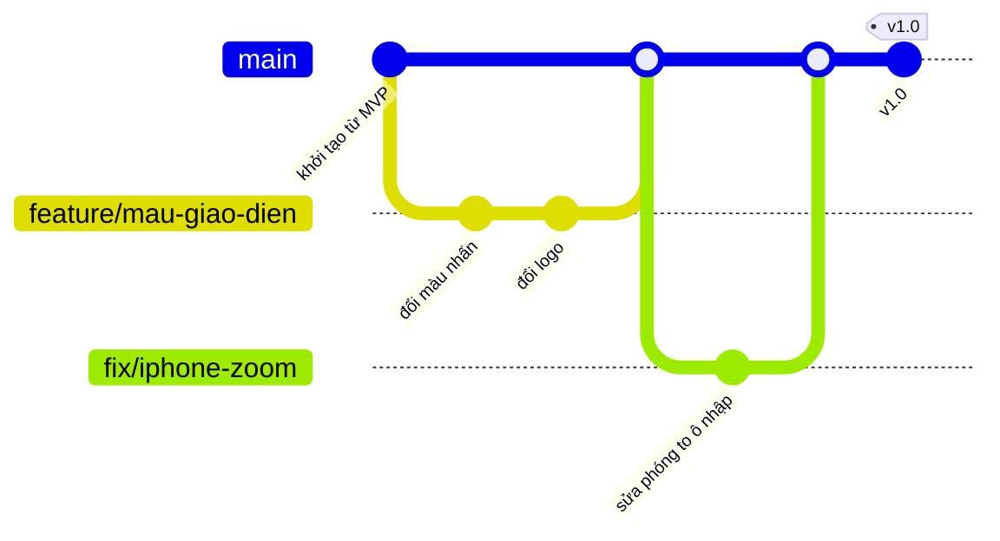

Một vòng làm việc mẫu:

```bash
git switch main && git pull
```

```bash
git switch -c feature/mau-giao-dien
```

Sửa code, chạy `npm test`, rồi xem lại **từng thay đổi** trước khi thêm vào commit:

```bash
git add -p
```

```bash
git commit -m "feat(giao-dien): đổi màu nhấn của Sổ tay sang xanh rêu"
```

```bash
git push -u origin feature/mau-giao-dien
```

Mở PR trên GitHub (hoặc `gh pr create --fill`), tự đọc phần "Files changed", đợi CI xanh, bấm *Merge*. Sau đó:

```bash
git switch main && git pull && git branch -d feature/mau-giao-dien
```

**Đặt tên commit theo Conventional Commits** (viết tiếng Việt cũng được). Lịch sử commit sẽ đọc như nhật ký dự án, và báo
cáo đồ án lấy được từ đó:

| Tiền tố | Dùng khi | Ví dụ |
| --- | --- | --- |
| `feat:` | Thêm tính năng | `feat(kỷ-vật): lọc theo năm` |
| `fix:` | Sửa lỗi | `fix(form): tắt hộp chọn tệp không đóng form` |
| `docs:` | Tài liệu | `docs: thêm ảnh chụp màn hình điện thoại` |
| `style:` | Định dạng code (không đổi logic) | `style: chạy prettier` |
| `refactor:` | Sắp xếp lại code | `refactor(upload): tách hàm uploadTo` |
| `test:` | Thêm/sửa kiểm thử | `test(chia-sẻ): người lạ nhận 404` |
| `chore:` | Việc lặt vặt (cấu hình, thư viện) | `chore: nâng Vite` |

**Lùi lại an toàn:**

- `git restore <tệp>`: bỏ thay đổi chưa commit.
- `git revert <mã-commit>`: tạo một commit "đảo ngược" commit cũ.
- **Không bao giờ** `git push --force` lên `main`.

**Bảo vệ `main`:** trên GitHub, vào *Settings → Branches → Add rule*, bật "Require a pull request" và "Require status checks"
(chọn CI).

**Bí mật:** khoá Google và các mật khẩu chỉ nằm trong `.env` trên máy bạn và trong mục *Environment variables* của nơi
hosting. Nếu lỡ commit một khoá bí mật: **thu hồi khoá đó ngay** (tạo khoá mới). Xoá khỏi lịch sử Git là chưa đủ.

**Đánh dấu phiên bản nộp bài:**

```bash
git tag -a v1.0 -m "Bản nộp đồ án" && git push --tags
```

### A6. Biến giao diện thành của bạn

Toàn bộ "diện mạo" nằm trong vài chỗ rõ ràng. Hiểu bản đồ này là sửa được mọi thứ:

| Muốn đổi | Sửa ở đâu |
| --- | --- |
| **Màu, font, bo góc, đổ bóng** của một giao diện | Khối biến CSS đầu tệp `client/src/styles/notebook.css` (hoặc `darkroom.css`): `--bg`, `--text`, `--accent`, `--font-body`, `--radius`… Đổi một biến là cả giao diện đổi theo |
| Khung chung (reset, nút, ô nhập) | `styles/base.css` |
| Thanh điều hướng, khung trang | `styles/layout.css` (+ logic tự thu gọn `useNavFit` trong `components/TopBar.jsx`) |
| Thẻ, bộ ảnh, form, kỷ vật… | `styles/components.css` · từng trang: `styles/pages.css` |
| Chi tiết riêng của từng giao diện (băng keo, lỗ phim, kính lúp) | Cuối `notebook.css` / `darkroom.css` |
| Font | `client/src/main.jsx` (dòng `import '@fontsource/...'`) + biến `--font-*` |
| Logo, favicon | `components/Brand.jsx` (SVG) · `client/public/favicon.svg` · `apple-touch-icon.png` (ảnh PNG 180 px cho iPhone) |
| Câu chữ | `client/src/i18n/vi.js` / `en.js` (xem [SUA-NOI-DUNG-TIENG-VIET.md](docs/SUA-NOI-DUNG-TIENG-VIET.md)) |
| Thẻ kỷ niệm (bưu thiếp, tem) | `client/src/lib/cards.js` (vẽ bằng canvas; bảng màu `PALETTES`) |

**Thử ngay (15 phút):**

1. Đổi `--accent` trong `notebook.css`.
2. Lưu tệp và xem trình duyệt tự cập nhật.
3. Chạy `npm test`.
4. Commit trên một nhánh `feature/...`.

**Đổi font:**

1. Cài font, ví dụ `npm i @fontsource/lora` (font phải có bộ ký tự `vietnamese`, kiểm tra trên fontsource.org).
2. Thêm `import '@fontsource/lora/500.css'` vào `main.jsx`.
3. Gán `--font-display: 'Lora', serif;` trong tệp giao diện.

**Thêm giao diện thứ ba** (ví dụ "Bưu thiếp", id `postcard`), 8 bước:

1. Chép `notebook.css` thành `styles/postcard.css`, đổi mọi `[data-theme='notebook']` thành `[data-theme='postcard']`,
   rồi chỉnh các biến.
2. `main.jsx`: thêm `import './styles/postcard.css';`.
3. `theme.jsx`: `THEMES = ['notebook', 'darkroom', 'postcard']`, thêm màu vào `THEME_COLOR`.
4. `client/public/theme-init.js`: cho phép giá trị `'postcard'`.
5. `components/ThemeSwitch.jsx`: thêm biểu tượng vào `ICONS`.
6. `i18n/en.js` và `vi.js`: thêm `theme.postcard` và `theme.postcardDesc`.
7. `test/i18n.test.js`: thêm `'postcard'` vào danh sách khoá ghép lúc chạy, rồi chạy `npm test`.
8. Kiểm tra cả hai ngôn ngữ, máy tính và điện thoại, và độ tương phản màu (WebAIM Contrast Checker).

**Dùng lại riêng phần front-end** cho một back-end khác (ví dụ trường bắt dùng Spring hoặc Laravel): chép `client/` và
`shared/`, giữ nguyên "hợp đồng" API trong bảng API của [README](README.md#api), hoặc sửa các đường dẫn trong `client/src/api.js`.
Cấu hình chuyển tiếp `/api` nằm trong `vite.config.js`.

### A7. Thêm tính năng mới mà không làm hỏng cái cũ

Ví dụ: "thả cảm xúc ❤️ cho lời nhắn". Làm theo thứ tự, mỗi bước một commit:

1. **Thiết kế:** vẽ bảng mới (`reactions`), API (`POST /api/memories/:id/comments/:cid/reactions`), quyền (chỉ ai xem được
   kỷ niệm mới thả được).
2. **Migration mới** `server/migrations/005_reactions.sql`. **Không bao giờ sửa migration cũ** đã chạy ở nơi khác.
3. **Model** (`server/models/social.js`) → **route** → **kiểm thử** (`test/api.test.js`): người lạ nhận 404, thả hai lần không
   nhân đôi.
4. **Giao diện** (`components/Comments.jsx`) + **câu chữ** (`en.js` + `vi.js`).
5. **Thời gian thực:** phát sự kiện qua `live.publish` như lời nhắn (xem `server/lib/live.js`).
6. Cập nhật README (bảng API) và PRESENTATION.

---

## Lịch 13 → 31/10

Mỗi ngày: **A** (3–4 giờ, sản phẩm nộp) + **B** (1–3 giờ, phòng tập). Cuối ngày viết 3 dòng vào `DEVLOG.md`: *đã làm gì · vướng gì
· việc đầu tiên ngày mai*. Đây là nguyên liệu cho chương "quá trình phát triển" trong báo cáo.

### Tuần 1 — Làm chủ dự án

| Ngày | A — Kế thừa | B — Xây lại | Xong khi |
| --- | --- | --- | --- |
| **T3 13/10** | *(Đã làm cùng trợ lý: Kỷ vật mới, Google trên máy, Phần C–D.)* Đọc [Đọc trước tiên](#đọc-trước-tiên--dự-án-đang-ở-đâu-13102026-và-bắt-đầu-từ-đâu) và [Bắt đầu nhanh](#bắt-đầu-nhanh--dùng-dự-án-mỗi-ngày) | — | Tự chạy và tắt được app, đăng nhập Google được |
| **T4 14/10** | A1–A4: cài công cụ, tạo repo, commit đầu, CI xanh, chạy demo, đọc [PRESENTATION](docs/PRESENTATION.md) §1–6. Còn giờ: đọc hiểu front-end `main.jsx` → `App.jsx` → `AppLayout` → `Today` | Chặng 0–2 | Repo private trên GitHub có dấu ✅; clone lại chạy được |
| **T5 15/10** | Đọc hiểu back-end: `app.js` → middleware → `routes/memories.js` → `models/memories.js`; đọc 5 bài kiểm thử; thử `npm run admin -- stats` | Chặng 3–5 | Kể lại được một yêu cầu đi từ nút bấm tới cơ sở dữ liệu |
| **T6 16/10** | A6: nhánh `feature/giao-dien`: màu, font, logo của bạn; PR → merge | Chặng 6 | Giao diện mang dấu ấn riêng; CI xanh |
| **T7 17/10** | Đưa lên mạng lần đầu ([DEPLOY](docs/DEPLOY.md)); trong OAuth client **đã có** (tạo ngày 13/10) thêm địa chỉ quay về của bản online, đặt `PUBLIC_URL` và hai mã Google ở nơi hosting; thử đăng nhập Google trên bản online | Chặng 7 | Mở được link `https://…` trên điện thoại, đăng nhập Google được |
| **CN 18/10** | Duyệt `vi.js`: sửa các câu "✎ MỚI — cần duyệt (vòng 3)" và "(vòng 4)" theo văn phong của bạn ([SUA-NOI-DUNG § 6](docs/SUA-NOI-DUNG-TIENG-VIET.md#6-câu-mới-cần-bạn-duyệt)) | Chặng 8 · bù việc | `npm test` xanh sau khi sửa câu chữ |

### Tuần 2 — Hiểu sâu phần khó, thêm dấu ấn riêng

| Ngày | A — Kế thừa | B — Xây lại | Xong khi |
| --- | --- | --- | --- |
| **T2 19/10** | Thử trên **iPhone và Samsung thật** (`npm run dev:phone`); mỗi lỗi ghi thành một *Issue* trên GitHub | Chặng 9 | Có danh sách Issue kèm ảnh chụp |
| **T3 20/10** | Sửa các Issue điện thoại, mỗi lỗi một nhánh `fix/…` | Chặng 10 | Đóng hết Issue nghiêm trọng |
| **T4 21/10** | **Tính năng của riêng bạn** (A7): thiết kế + migration + model + kiểm thử. Gợi ý: thả cảm xúc cho lời nhắn, lọc kỷ vật theo năm, giao diện thứ ba | Chặng 11 (máy chủ) | Kiểm thử của tính năng mới chạy xanh |
| **T5 22/10** | Hoàn thiện giao diện + câu chữ của tính năng mới | Chặng 11 (giao diện) | Demo được tính năng mới trên cả hai giao diện |
| **T6 23/10** | Soát bảo mật theo bảng [PRESENTATION §11](docs/PRESENTATION.md#11-bảo-mật--quyền-riêng-tư); thêm kiểm thử còn thiếu | Chặng 12 | Mỗi dòng của bảng bảo mật có ít nhất một kiểm thử |
| **T7 24/10** | Hiệu năng & dữ liệu: đọc [MO-RONG](docs/MO-RONG.md), đo dung lượng ảnh/video của chính bạn, chạy Lighthouse | Chặng 13 | Có bảng số liệu để đưa vào báo cáo |
| **CN 25/10** | Trợ năng: chạy **WAVE** (WebAIM) trên 5 trang chính ở cả hai giao diện, sửa lỗi tương phản và nhãn | Chặng 14 · bù việc | WAVE không còn lỗi đỏ |

### Tuần 3 — Hoàn thiện & nộp

| Ngày | Việc | Xong khi |
| --- | --- | --- |
| **T2 26/10** | Đưa bản cuối lên mạng; chạy hết danh sách "smoke test" trong [DEPLOY](docs/DEPLOY.md); `git tag v0.9` · **B:** Chặng 15 (đưa cả bản mini lên mạng) | Mọi mục smoke test đạt |
| **T3 27/10** | README của bạn: mô tả, ảnh chụp màn hình mới, cách chạy, link online · **B (tuỳ chọn):** Chặng 16 | Người khác đọc README là chạy được |
| **T4 28/10** | Báo cáo: vấn đề, mục tiêu, yêu cầu, thiết kế (ERD, kiến trúc), cài đặt, bảo mật, đa ngôn ngữ, kiểm thử, triển khai, giới hạn, hướng phát triển (dùng `DEVLOG.md`, PRESENTATION, MO-RONG) | Bản nháp báo cáo đầy đủ chương |
| **T5 29/10** | Slide 10–12 trang theo kịch bản [PRESENTATION §16](docs/PRESENTATION.md#16-kịch-bản-thuyết-trình--demo-10-phút); quay video demo dự phòng. **Từ giờ chỉ sửa lỗi, không thêm tính năng** | Có slide + video |
| **T6 30/10** | Tổng duyệt: clone sạch → làm theo README từ đầu; tập thuyết trình 2 lần có bấm giờ; ôn 12 câu hỏi thường gặp; làm 2 bài diễn tập ở [C10](#c10-diễn-tập-xử-lý-sự-cố); sao lưu bản online | Chạy trơn tru, nói đủ giờ |
| **T7 31/10** | Sáng: `npm run seed` lại trên bản online; `git tag v1.0`; nộp link repo, link app, báo cáo, slide, video | **Đã nộp** |

---

## Nếu bị chậm

Bỏ theo thứ tự (trên trước):

1. Phần B từ chặng 12 trở đi: đọc code (bản mini trong tài liệu này và bản thật) thay vì tự gõ lại. Chặng 16 vốn là tuỳ chọn.
2. Tính năng riêng của bạn (thay bằng cá nhân hoá giao diện).
3. Giao diện thứ ba.
4. Video demo dự phòng (thay bằng ảnh chụp màn hình).

**Không bao giờ bỏ:** repo Git có lịch sử commit rõ ràng · bản online chạy được · kiểm thử xanh · đọc hiểu được phần bảo mật
và luồng tải ảnh · tập thuyết trình.

## Rủi ro & cách tránh

| Rủi ro | Cách tránh |
| --- | --- |
| Lỡ commit `data/` hoặc `.env` | Luôn đọc `git status` trước khi commit; `.gitignore` có sẵn; nếu lộ khoá thì **thu hồi khoá** ngay |
| Hosting xoá dữ liệu sau khi khởi động lại | Dùng ổ đĩa bền vững (volume), thử khởi động lại ngay từ ngày 17/10 |
| Đăng nhập Google lỗi `redirect_uri_mismatch` | Địa chỉ callback trong Google Cloud phải khớp **từng ký tự** với `PUBLIC_URL` + `/api/auth/google/callback` |
| Video quá lớn khi tải từ điện thoại | Giới hạn `MAX_VIDEO_MB`; quay 1080p thay vì 4K; xem [MO-RONG §3](docs/MO-RONG.md#3-video-phần-nặng-nhất) |
| Sửa câu chữ làm lỗi cú pháp `vi.js` | Chạy `npm test`: bài kiểm thử i18n chỉ ra đúng khoá bị lỗi |
| Demo trực tiếp gặp sự cố | Seed lại buổi sáng; có video dự phòng; mở sẵn tab Thu Hà ở cửa sổ ẩn danh |
| Mất code | Commit và push mỗi ngày |

## Danh sách nộp bài

- [ ] Repo GitHub với lịch sử commit rõ ràng, tag `v1.0`, CI ✅
- [ ] README có ảnh chụp màn hình, cách chạy, link bản online
- [ ] Bản online với tài khoản demo (An và Thu Hà) và đăng nhập Google hoạt động
- [ ] `npm test` xanh
- [ ] WAVE không còn lỗi đỏ; đã thử trên iPhone và Android thật
- [ ] Báo cáo (PDF) · slide · video demo
- [ ] Chạy được bằng tiếng Việt và tiếng Anh, trên điện thoại và máy tính

---

## Phần B — Tự xây lại "Memory Lane mini" từ thư mục trống

Phần A giúp bạn **có** một sản phẩm. Phần B giúp bạn **hiểu** nó, bằng cách tự tay xây lại một phiên bản nhỏ hơn: **Memory Lane
mini**. Bản mini dùng đúng kiến trúc, đúng công nghệ và đúng các kỹ thuật của bản thật, chỉ ít tính năng hơn. Đi hết 16 chặng, bạn đã tự
viết mỗi lớp công nghệ ít nhất một lần. Khi đó mỗi tệp của bản thật sẽ trở nên "quen mặt", và bạn trả lời được câu hỏi khi bảo vệ.

### Cách dùng phần này

**Bạn sẽ xây gì.** Một ứng dụng web chạy được thật, gồm:

- Máy chủ **Express 5** với cơ sở dữ liệu **SQLite**: migration, model, kiểm tra dữ liệu, mã lỗi.
- Đăng ký, đăng nhập bằng **mật khẩu băm scrypt** và **phiên lưu ở máy chủ**. Có thêm lớp bảo vệ: CSP, chống CSRF, giới hạn số lần thử.
- Giao diện **React 19** với **React Router 8** và **Vite 8**.
- **Hai ngôn ngữ** (VI ⇄ EN) và **hai giao diện** (Sổ tay ⇄ Phòng tối).
- **Tải ảnh/video** riêng tư: nén WebP trong trình duyệt, nhận diện tệp bằng magic bytes, phát video có tua (HTTP Range).
- **Chia sẻ** bằng link mời, kèm **lời nhắn hiện ra trực tiếp** (Server-Sent Events).
- **Đăng nhập bằng Google** (OAuth 2.0 + PKCE).
- **Bưu thiếp vẽ bằng canvas**.
- **34 bài kiểm thử tự động**, chế độ production, Dockerfile và CI.

Kết thúc, bản mini có khoảng 4.500 dòng code trong 73 tệp, bằng khoảng một phần năm bản thật.

**Mỗi chặng có cùng một khung:**

| Mục | Nội dung |
| --- | --- |
| **Mục tiêu** | Cuối chặng bạn có gì chạy được |
| **Khái niệm** | Giải thích bằng lời thường *trước khi* gõ code |
| **Làm từng bước** | Lệnh và **code đầy đủ**. Tệp mới in trọn vẹn. Tệp sửa in dạng *diff* (xem cách đọc bên dưới) |
| **Kiểm tra** | Lệnh để tự kiểm tra và **kết quả bạn phải thấy** |
| **Lỗi hay gặp** | Triệu chứng → nguyên nhân → cách sửa |
| **Đối chiếu với bản thật** | Bản thật làm phần này ở tệp nào, thêm gì, và vì sao |
| **Tự kiểm tra** | Câu hỏi, cộng một bài tập nhỏ |

> **Mọi bước đã được làm thử thật.** Toàn bộ code trong phần này được chạy theo đúng thứ tự trên Node 24.15. Mọi đoạn "kết quả bạn
> phải thấy" là kết quả thật (chỉ khác ngày giờ và mã ngẫu nhiên). Code trong tài liệu được chèn tự động từ chính bản đã chạy, không
> chép tay. Nhờ làm thử, hướng dẫn đã sửa được vài lỗi mà người mới rất hay mắc; chúng được ghi lại trong mục "Lỗi hay gặp".

**Cách đọc diff.** Khi sửa một tệp đã có, hướng dẫn chỉ in phần thay đổi:

```diff
@@ -12,4 +12,6 @@
   app.use(express.json({ limit: '100kb' }));
-  api.use('/memories', memoryRoutes());
+  api.use('/memories', memoryRoutes(ctx));
+  api.use('/files', requireAuth, fileRoutes(ctx));
```

- Dòng bắt đầu bằng `-`: **xoá** khỏi tệp.
- Dòng bắt đầu bằng `+`: **thêm** vào tệp.
- Dòng không có dấu: giữ nguyên, chỉ để bạn biết chỗ cần sửa.
- `@@ -12,4 +12,6 @@` nghĩa là "quanh dòng 12".

Đây cũng chính là cách Git và GitHub hiển thị thay đổi (xem A5), nên đọc quen diff là kỹ năng đi làm.

**Ba điểm khác bản thật, để chạy cả hai cùng lúc không đụng nhau:**

| | Bản mini | Bản thật |
| --- | --- | --- |
| Cổng máy chủ API | `3101` | `3001` |
| Cổng Vite (giao diện khi dev) | `5174` | `5173` |
| Tên cookie phiên | `mini_session` | `ml_session` |

Cookie gắn với **tên máy** (`localhost`) chứ không gắn với cổng. Nếu hai app dùng cùng tên cookie, đăng nhập bên này sẽ làm bạn bị
đăng xuất bên kia.

**Nhịp làm việc gợi ý:**

1. Đọc mục "Khái niệm".
2. Gõ code. Nên **gõ lại**, đừng sao chép: gõ là lúc bạn đọc kỹ từng dòng.
3. Chạy phần "Kiểm tra".
4. Commit với lời nhắn ghi ở cuối chặng.
5. Mở các tệp trong mục "Đối chiếu với bản thật" và so sánh.

Mỗi chặng mất khoảng 1–3 giờ. Lịch gợi ý nằm ở mục [Lịch 13 → 31/10](#lịch-13--3110).

### Đọc theo chủ đề: back-end, cơ sở dữ liệu, đăng nhập, giao diện

Phần B dạy **back-end trước**: chặng 1–6 chỉ có máy chủ, cơ sở dữ liệu và đăng nhập, chưa có giao diện nào (bạn thử bằng `curl` và
kiểm thử tự động). Giao diện bắt đầu từ chặng 7. Các chặng 11–14 làm cả hai phía, mỗi chặng tách riêng mục "máy chủ" và "giao diện".
Bảng dưới gom theo chủ đề, để học hoặc ôn đúng phần mình cần:

| Chủ đề | Tự xây (bản mini) | Đọc ở bản thật | Khi vận hành ([Phần C](#phần-c--vận-hành-bảo-trì-và-xử-lý-sự-cố)) |
| --- | --- | --- | --- |
| **Máy chủ Express**: khởi động, middleware, route, lỗi gọn gàng, kiểm tra dữ liệu | [Chặng 1](#chặng-1--máy-chủ-express-đầu-tiên), [2](#chặng-2--cấu-hình-lỗi-gọn-gàng-kiểm-tra-dữ-liệu) | [B0.2](#b02-máy-chủ-các-tầng-và-từng-tệp): `server/index.js`, `app.js`, `config.js`, `lib/errors.js`, `lib/validate.js` | [C2](#c2-nhìn-vào-đâu-apihealth-log-mã-lỗi-devtools): `/api/health`, log, mã lỗi |
| **Cơ sở dữ liệu SQLite**: bảng, khoá ngoại, migration, model, transaction | [Chặng 3](#chặng-3--lưu-bằng-sqlite-migration-và-model); thêm bảng ở [5.2](#52-làm-từng-bước), [11.2](#112-làm-từng-bước--máy-chủ), [12.2](#122-làm-từng-bước--máy-chủ) | `server/db.js`, `migrations/`, `models/`; sơ đồ bảng ở [PRESENTATION § 8](docs/PRESENTATION.md#8-cơ-sở-dữ-liệu) | [C4](#c4-đọc-cơ-sở-dữ-liệu-bằng-tay) đọc CSDL · [C6](#c6-sao-lưu-và-khôi-phục) sao lưu · [C7](#c7-cập-nhật-phiên-bản-an-toàn) migration |
| **Kiểm thử máy chủ** | [Chặng 4](#chặng-4--kiểm-thử-tự-động) | `test/api.test.js`, `google.test.js`, `admin.test.js` | — |
| **Đăng nhập (auth)**: băm mật khẩu scrypt, phiên lưu ở máy chủ, cookie `HttpOnly`, không cho xem dữ liệu người khác | [Chặng 5](#chặng-5--tài-khoản-mật-khẩu-phiên-đăng-nhập) | `lib/password.js`, `lib/sessions.js`, `routes/auth.js`, `routes/me.js` | [C5.1–C5.3](#c51-tôi-quên-mật-khẩu), `admin sessions`, `admin reset-password` |
| **Bảo mật**: header, CSP, chống CSRF, giới hạn số lần thử | [Chặng 6](#chặng-6--lá-chắn-bảo-mật) | `lib/security.js`, `lib/rateLimit.js` | [C8](#c8-an-toàn-và-riêng-tư-khi-vận-hành) |
| **Ảnh/video phía máy chủ**: multer, magic bytes, xoá GPS, HTTP Range | [11.2](#112-làm-từng-bước--máy-chủ) | `lib/files.js`, `lib/metadata.js`, `routes/files.js` | `admin memory`, `admin check-files`, C5.5–C5.7 |
| **Chia sẻ và quyền**: link mời lưu mã băm, kết nối hai chiều, chia sẻ từng kỷ niệm | [12.2](#122-làm-từng-bước--máy-chủ) | `models/social.js`, `routes/invites.js`, `routes/sharing.js` | C5.8, C5.9 |
| **Thời gian thực (Server-Sent Events)** | [Chặng 13](#chặng-13--thời-gian-thực-với-server-sent-events) | `lib/live.js` | C5.10 |
| **Đăng nhập Google (OAuth 2.0 / OpenID Connect)** | [Chặng 14](#chặng-14--đăng-nhập-bằng-google) | `lib/google.js`, `routes/google.js`, [DEPLOY.md](docs/DEPLOY.md#bật-tiếp-tục-với-google) | C5.4, C5.15 |
| **Chạy thật**: build, chế độ production, Docker, CI | [Chặng 15](#chặng-15--đóng-gói-và-chạy-thật) | `Dockerfile`, `render.yaml`, `.github/workflows/ci.yml` | C6, C7, C9 |
| **Tính năng còn lại của bản thật** (người quen, phim nhạc, Hôm nay, tìm kiếm, cài đặt, kỷ vật, vận hành, kiểm thử toàn hệ thống) | [Phần E](#phần-e--xây-lại-từng-tính-năng-còn-lại-của-bản-thật-từng-bước), E1–E8 | Bảng "Tệp của tính năng" ở mỗi mục | C3, C5 |
| **Giao diện React** | Chặng [7](#chặng-7--giao-diện-react-đầu-tiên-với-vite), [8](#chặng-8--dữ-liệu-trên-giao-diện-usefetch-form-hộp-thoại), [9](#chặng-9--hai-ngôn-ngữ), [10](#chặng-10--css-design-token-và-hai-giao-diện), [11.3](#113-làm-từng-bước--giao-diện), [12.3](#123-làm-từng-bước--giao-diện), [16](#chặng-16-tuỳ-chọn--vẽ-bưu-thiếp-bằng-canvas) | [B0.3](#b03-giao-diện-các-tầng-và-từng-tệp) | — |

### B0. Bản đồ mã nguồn của bản thật

Đọc mục này trước khi bắt đầu, và mở lại mỗi khi lạc. Nó trả lời ba câu hỏi:

1. Mỗi tệp trong dự án làm gì?
2. Một yêu cầu đi qua những tầng nào?
3. Những "mẫu" (pattern) nào lặp đi lặp lại?

Bản mini bạn sắp xây có **cùng hình dạng** này, chỉ ít tệp hơn.

#### B0.1 Ba phần lớn

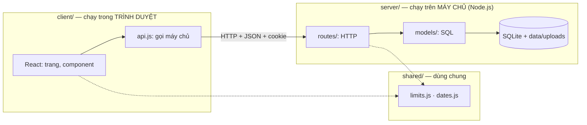

| Thư mục | Chạy ở đâu | Được phép làm | Không bao giờ làm |
| --- | --- | --- | --- |
| `client/` | Trình duyệt của người dùng | Vẽ giao diện, gọi `/api/...`, xử lý ảnh trước khi gửi | Đọc CSDL, giữ bí mật (mọi code ở đây ai cũng xem được) |
| `server/` | Máy chủ | Kiểm tra quyền và dữ liệu, đọc/ghi CSDL và tệp | Tin dữ liệu trình duyệt gửi lên mà không kiểm tra lại |
| `shared/` | Cả hai | Hằng số và hàm thuần tuý (không gọi mạng, không chạm CSDL) | Import thứ chỉ có ở một phía (`node:fs`, `window`…) |
| `test/` | Node khi chạy `npm test` | Bật app thật với CSDL tạm, gọi API như trình duyệt | Đụng vào `data/` thật |

#### B0.2 Máy chủ: các tầng và từng tệp

Một yêu cầu đi **từ trên xuống**. Mỗi tầng chỉ làm việc của mình:

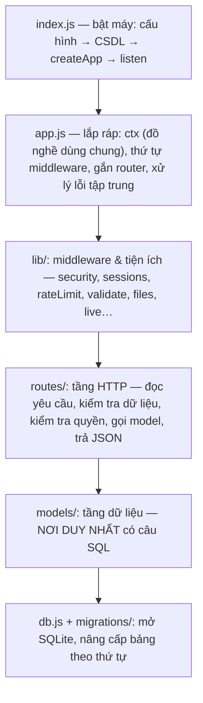

| Tệp | Trách nhiệm |
| --- | --- |
| `server/index.js` | Điểm khởi động: `loadConfig()` → `openDb()` → `createApp()` → `listen()`. Tắt gọn gàng khi nhận SIGINT/SIGTERM |
| `server/app.js` | Hàm `createApp({ db, config })`. Tạo `ctx` chứa mọi model và tiện ích, xếp **thứ tự middleware**, gắn từng nhóm route, phục vụ giao diện đã build, và **bắt mọi lỗi** thành JSON `{ error: 'CODE' }` |
| `server/config.js` | **Chỗ duy nhất** đọc biến môi trường (`PORT`, `DATA_DIR`, `GOOGLE_CLIENT_ID`…) và đặt giá trị mặc định. Tự đọc tệp `.env` |
| `server/db.js` | Mở SQLite (WAL, khoá ngoại, chờ khi bận), đăng ký hàm SQL `fold()` để tìm không dấu, chạy migration, hàm `transaction()` |
| `server/migrations/00N_*.sql` | Lịch sử cấu trúc CSDL. Chạy **một lần, theo thứ tự**, không bao giờ sửa tệp đã chạy |
| `server/seed.js` | Tạo thế giới demo (An và 5 người bạn). Chỉ xoá/tạo lại tài khoản demo |
| `lib/errors.js` | `HttpError(status, code, fields)`: lỗi "được phép kể cho trình duyệt" |
| `lib/validate.js` | `validator(body)`: đọc từng ô, làm sạch, ghi mã lỗi từng ô, `check()` ném tất cả một lần. `idParam`, `parseIdList` |
| `lib/password.js` | Băm và kiểm tra mật khẩu bằng scrypt, kèm `DUMMY_HASH` để thời gian trả lời không lộ email nào có thật |
| `lib/sessions.js` | Phiên đăng nhập: tạo token, lưu **mã băm**, đặt cookie; middleware `loadUser` (gắn `req.user`) và `requireAuth` (chặn 401) |
| `lib/security.js` | Header bảo mật (CSP…), `noStore` cho JSON riêng tư, `blockCrossSiteWrites` chống CSRF |
| `lib/rateLimit.js` | Giới hạn số lần thử theo IP |
| `lib/files.js` | Nhận diện tệp bằng **magic bytes**, kho tệp riêng tư (multer ghi xuống đĩa, đổi tên ngẫu nhiên, xoá) |
| `lib/metadata.js` | Xoá GPS/EXIF khỏi JPEG, PNG, WebP và **toạ độ trong video** MP4/MOV |
| `lib/google.js` | OAuth 2.0: tạo state, nonce, PKCE; đổi `code` lấy ID token; kiểm tra token |
| `lib/live.js` | Trạm phát Server-Sent Events: ai đang mở tab, gửi sự kiện cho ai |
| `lib/text.js` · `lib/today.js` | `fold('Đà Lạt') = 'da lat'` cho tìm kiếm không dấu · "hôm nay" theo giờ của người dùng |
| `models/users.js` | Bảng `users`. `toUser()` quyết định dữ liệu nào được gửi ra (không bao giờ có mã băm mật khẩu) |
| `models/memories.js` | Kỷ niệm và tệp của chúng. Một câu SQL lấy kỷ niệm **kèm** danh sách tệp, người có mặt, số lời nhắn (`json_group_array`) |
| `models/social.js` | Mọi thứ liên quan hai tài khoản: vòng thân quen, link mời, chia sẻ, lời nhắn, `canView()` |
| `models/people.js` · `media.js` · `artifacts.js` | Người quen cũ và ghi chú · Phim & nhạc · Kỷ vật |
| `routes/*.js` | Mỗi tệp một nhóm đường dẫn: `auth` (đăng ký, đăng nhập), `google`, `me` (tài khoản, xuất dữ liệu, xoá), `dashboard` (Hôm nay), `memories` (kỷ niệm, tệp, chia sẻ, lời nhắn), `files` (xem tệp có kiểm tra quyền), `invites`, `sharing`, `people`, `media`, `artifacts`, `search` |

**Thứ tự middleware trong `app.js`** quyết định yêu cầu gặp gì trước:

1. Header bảo mật.
2. Nén.
3. *(chỉ cho `/api`)* `no-store`.
4. Đọc JSON.
5. Chặn CSRF.
6. `loadUser`.
7. Router. Router nào cần đăng nhập thì có thêm `requireAuth` đứng trước.
8. 404 cho `/api` không khớp.
9. Giao diện đã build và SPA fallback.
10. Error handler.

Đặt sai thứ tự là lỗi thật. Ví dụ: `loadUser` đứng sau router thì router không bao giờ thấy `req.user`.

#### B0.3 Giao diện: các tầng và từng tệp

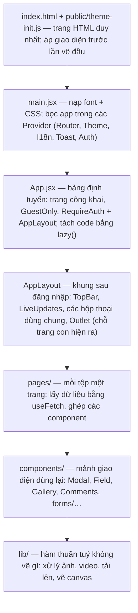

| Tệp / thư mục | Trách nhiệm |
| --- | --- |
| `client/index.html` | Khung HTML duy nhất của cả app (SPA): `<div id="root">`, meta cho điện thoại, nạp `theme-init.js` |
| `client/public/` | Tệp tĩnh giữ nguyên tên: `theme-init.js`, `favicon.svg`, `apple-touch-icon.png`, ảnh trang giới thiệu |
| `src/main.jsx` | Nạp font (`@fontsource`) và 6 tệp CSS theo thứ tự; dựng cây Provider |
| `src/App.jsx` | Định tuyến: `/`, `/join/:token`, nhóm `GuestOnly` (đăng nhập, đăng ký), nhóm `RequireAuth` + `AppLayout` (mọi trang riêng tư, tải theo nhu cầu bằng `lazy`) |
| `src/api.js` | **Nơi duy nhất** gọi máy chủ: `api.get/post/put/patch/del`; biến lỗi thành `ApiError { status, code, fields }` |
| `src/auth.jsx` | `AuthProvider` + `useAuth()`: ai đang đăng nhập (`undefined` / `null` / người dùng), `login`, `register`, `logout`, `demo` |
| `src/state.jsx` | `useFetch(path)` + `refresh()` (mọi danh sách tự tải lại sau khi lưu), tiêu đề tab, mở form từ bất cứ đâu, chế độ kín đáo |
| `src/theme.jsx` | Hai giao diện: đặt `<html data-theme>`, lưu lựa chọn |
| `src/i18n/` | `index.jsx` (hàm `t()`, số nhiều, định dạng ngày theo ngôn ngữ) · `vi.js` · `en.js` (cùng một bộ khoá) |
| `src/components/` | `AppLayout` (khung sau đăng nhập) · `TopBar` (thanh điều hướng tự thu gọn) · `Modal` (hộp thoại `<dialog>`) · `Field` (nhãn + ô + lỗi, nối sẵn cho trình đọc màn hình) · `Gallery` · `Comments` · `SharePanel` · `CardStudio` · `LiveUpdates` · `forms/` (MemoryForm, ShareFields, PersonForm…) |
| `src/pages/` | Landing, Login, Register, Join, Today, Album, MemoryDetail, People, PersonDetail, Sharing, Archive, Artifacts, Timeline, Search, Settings, NotFound |
| `src/lib/` | `image.js` (vẽ lại ảnh, WebP) · `video.js` (đo video, chụp khung hình) · `upload.js` (XHR có tiến trình) · `cards.js` (vẽ thẻ kỷ niệm) |
| `src/styles/` | `base.css` (reset, biến chung, mọi control) · `layout.css` (khung, thanh điều hướng) · `components.css` · `pages.css` · `notebook.css` và `darkroom.css` (mỗi giao diện một bộ biến + chi tiết trang trí) |

**Ai giữ dữ liệu gì (state):**

| Dữ liệu | Giữ ở đâu | Vì sao |
| --- | --- | --- |
| Người đang đăng nhập | `AuthProvider` (context) | Mọi trang cần biết |
| Ngôn ngữ, giao diện | `I18nProvider`, `ThemeProvider` + `localStorage` | Toàn app đổi theo, nhớ trên máy |
| Dữ liệu từ máy chủ (album, một kỷ niệm…) | `useFetch` trong **từng trang** | Mỗi trang tự lấy cái nó cần; `refresh()` bảo tất cả tải lại |
| Nội dung đang gõ trong form | `useState` **trong form đó** | Chỉ form đó quan tâm; đóng form là mất (đúng ý) |

#### B0.4 Hành trình của một yêu cầu: bấm "Lưu" một kỷ niệm mới

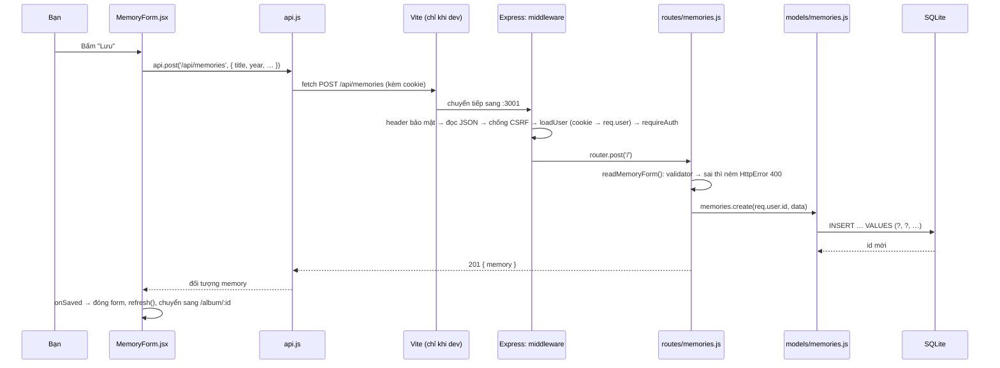

Nếu `validator` báo lỗi, `HttpError` được ném ra. Express 5 tự chuyển nó tới error handler cuối `app.js`, handler trả
`400 { error: 'VALIDATION', fields: { title: { code: 'REQUIRED' } } }`. `api.js` biến phản hồi đó thành `ApiError`, và form hiện
`t('errors.field.REQUIRED')` ngay dưới đúng ô bị lỗi.

#### B0.5 Những mẫu lặp lại khắp dự án

Nắm được 12 mẫu này là đọc được phần lớn code của dự án:

| # | Mẫu | Ví dụ trong code | Lợi ích |
| --- | --- | --- | --- |
| 1 | **Nhà máy (factory function) + tiêm phụ thuộc** | `memoriesModel(db)`, `memoryRoutes(ctx)`, `createApp({ db, config })` | Không có biến toàn cục; kiểm thử truyền vào CSDL tạm |
| 2 | **Tầng mỏng, việc rõ** | Route không viết SQL; model không biết HTTP | Sửa SQL không đụng route và ngược lại |
| 3 | **Mã lỗi thay vì câu chữ** | `throw new HttpError(404, 'NOT_FOUND')` → giao diện `t('errors.NOT_FOUND')` | Máy chủ không phụ thuộc ngôn ngữ |
| 4 | **Không tin trình duyệt** | `validator` ở mọi route ghi; `shared/limits.js` dùng ở cả hai phía | Ai gọi API trực tiếp cũng không lách được |
| 5 | **Quyền nằm trong câu SQL** | `WHERE id = ? AND user_id = ?`, `canView()` | Quên kiểm tra quyền là điều không thể xảy ra ở route |
| 6 | **404 thay vì 403** | Kỷ niệm của người khác trả giống hệt kỷ niệm không tồn tại | Không lộ "có tồn tại nhưng bị cấm" |
| 7 | **Chỉ lưu mã băm của bí mật** | Mật khẩu (scrypt), token phiên và link mời (SHA-256) | Lộ CSDL cũng không dùng được |
| 8 | **Transaction cho thao tác nhiều bước** | Nhận lời mời = kết nối + chia sẻ + đánh dấu đã dùng | Tất cả hoặc không gì cả |
| 9 | **Một nguồn sự thật** | Giới hạn trong `shared/limits.js`; cấu hình trong `config.js`; câu chữ trong `i18n/` | Sửa một chỗ, mọi nơi theo |
| 10 | **Provider + hook** | `useAuth()`, `useI18n()`, `useTheme()`, `useFetch()` | Component lấy thứ nó cần, không truyền props qua 5 tầng |
| 11 | **Design token** | Mọi màu, font, bo góc là biến CSS; `notebook.css`/`darkroom.css` chỉ đặt giá trị | Thêm giao diện mới mà không sửa component |
| 12 | **Kiểm thử ở mức HTTP** | `test/api.test.js` bật app thật, đi qua mọi middleware | Kiểm thử đúng thứ người dùng thật gặp |

#### B0.6 Thêm code mới thì đặt ở đâu?

| Bạn muốn… | Đặt ở | Nhớ thêm |
| --- | --- | --- |
| Bảng mới / cột mới | Migration **mới** `server/migrations/00N_ten.sql` | Không sửa migration cũ |
| Câu SQL mới | `server/models/` | Có `user_id = ?` hoặc `canView()` |
| Đường dẫn API mới | `server/routes/` (+ gắn trong `app.js` nếu là nhóm mới) | `validator`, kiểm tra quyền, **bài kiểm thử**, bảng API trong README |
| Giới hạn độ dài / danh sách giá trị | `shared/limits.js` | Dùng ở cả form (`maxLength`) và route |
| Trang mới | `client/src/pages/` + một `<Route>` trong `App.jsx` | `usePageTitle`, `lazy()` nếu là trang riêng tư |
| Mảnh giao diện dùng lại | `client/src/components/` | Câu chữ qua `t()` |
| Câu chữ | `i18n/vi.js` **và** `i18n/en.js` | Chạy `npm test` |
| Màu, font | Biến trong `notebook.css` / `darkroom.css` | Kiểm tra cả hai giao diện |
| Hàm xử lý không vẽ gì | `client/src/lib/` (hoặc `shared/` nếu máy chủ cũng cần) | — |

### B1. Lộ trình 16 chặng

| Chặng | Bạn xây được | Kỹ thuật chính | Giờ | Đối chiếu bản thật |
| --- | --- | --- | --- | --- |
| [0](#chặng-0--chuẩn-bị-máy-và-dự-án-trống) | Dự án trống có Git | npm, `package.json`, ES modules, `.gitignore` | 1 | `package.json`, `.gitignore` |
| [1](#chặng-1--máy-chủ-express-đầu-tiên) | API trả lời `/api/health` | HTTP, Express, middleware, `req`/`res`, curl | 1–2 | `server/index.js`, `app.js` |
| [2](#chặng-2--cấu-hình-lỗi-gọn-gàng-kiểm-tra-dữ-liệu) | API kỷ niệm (tạm trong bộ nhớ) báo lỗi từng ô | Biến môi trường, `HttpError`, error handler, validator | 2 | `config.js`, `lib/errors.js`, `lib/validate.js` |
| [3](#chặng-3--lưu-bằng-sqlite-migration-và-model) | Kỷ niệm lưu bền vững, đủ xem/tạo/sửa/xoá | SQL, `node:sqlite`, migration, model, transaction | 2–3 | `db.js`, `migrations/`, `models/memories.js` |
| [4](#chặng-4--kiểm-thử-tự-động) | 4 bài kiểm thử tự chạy | `node:test`, kiểm thử tích hợp qua HTTP, CSDL tạm | 1–2 | `test/api.test.js` |
| [5](#chặng-5--tài-khoản-mật-khẩu-phiên-đăng-nhập) | Đăng ký, đăng nhập, mỗi người một album | scrypt + salt, phiên phía máy chủ, cookie `HttpOnly`, IDOR | 3 | `lib/password.js`, `lib/sessions.js`, `routes/auth.js` |
| [6](#chặng-6--lá-chắn-bảo-mật) | Header bảo mật, chặn CSRF, giới hạn số lần thử | CSP, Fetch Metadata, rate limit | 1–2 | `lib/security.js`, `lib/rateLimit.js` |
| [7](#chặng-7--giao-diện-react-đầu-tiên-với-vite) | Trang đăng nhập, đăng ký, album | React, JSX, state, effect, context, Router, proxy | 3 | `main.jsx`, `App.jsx`, `api.js`, `auth.jsx` |
| [8](#chặng-8--dữ-liệu-trên-giao-diện-usefetch-form-hộp-thoại) | Thêm/sửa/xoá trong hộp thoại, trang chi tiết | Custom hook, `AbortController`, `<dialog>`, form có kiểm soát | 2–3 | `state.jsx`, `Modal.jsx`, `forms/MemoryForm.jsx` |
| [9](#chặng-9--hai-ngôn-ngữ) | Đổi VI ⇄ EN tức thì | Từ điển, `t()`, `Intl.PluralRules`, `Intl.DateTimeFormat` | 2 | `i18n/`, `test/i18n.test.js` |
| [10](#chặng-10--css-design-token-và-hai-giao-diện) | Giao diện đẹp, hai bộ màu, dùng tốt trên điện thoại | Biến CSS, Grid, `data-theme`, font tự đóng gói | 2–3 | `styles/`, `theme.jsx`, `theme-init.js` |
| [11](#chặng-11--ảnh-và-video) | Tải ảnh/video riêng tư, xem và tua video | multipart, multer, magic bytes, canvas, WebP, XHR, Range | 4–5 | `lib/files.js`, `routes/files.js`, `lib/image.js` |
| [12](#chặng-12--chia-sẻ-link-mời-vòng-thân-quen-lời-nhắn) | Link mời, chia sẻ từng kỷ niệm, lời nhắn | Token băm, nhiều–nhiều, mô hình quyền, transaction | 4 | `models/social.js`, `routes/invites.js` |
| [13](#chặng-13--thời-gian-thực-với-server-sent-events) | Lời nhắn hiện ra ngay | SSE, `EventSource`, sự kiện window, vòng đời trang | 2 | `lib/live.js`, `LiveUpdates.jsx` |
| [14](#chặng-14--đăng-nhập-bằng-google) | Nút "Tiếp tục với Google" | OAuth 2.0, OpenID Connect, PKCE, state, nonce, máy chủ giả | 3 | `lib/google.js`, `routes/google.js` |
| [15](#chặng-15--đóng-gói-và-chạy-thật) | Một máy chủ phục vụ cả API lẫn giao diện | Build, SPA fallback, production, Docker, CI | 1–2 | `app.js`, `Dockerfile`, `ci.yml` |
| [16](#chặng-16-tuỳ-chọn--vẽ-bưu-thiếp-bằng-canvas) | Bưu thiếp tải về được | Canvas 2D, `drawImage`, `destination-out`, `document.fonts` | 1–2 | `lib/cards.js`, `CardStudio.jsx` |

**Tài liệu gốc nên mở kèm** (đọc phần liên quan **sau khi** làm xong chặng, để hiểu sâu hơn):

| Công nghệ | Chặng | Dùng ở đâu trong bản thật | Tài liệu gốc |
| --- | --- | --- | --- |
| HTTP | 1–6, 11 | Toàn bộ API | [MDN HTTP](https://developer.mozilla.org/docs/Web/HTTP) |
| Node.js | 1–6 | `server/` | [nodejs.org/api](https://nodejs.org/api/) |
| Express 5 | 1–6 | `server/app.js`, `routes/` | [expressjs.com](https://expressjs.com) |
| SQLite + `node:sqlite` | 3, 5, 12 | `server/db.js`, `models/` | [sqlite.org/lang.html](https://www.sqlite.org/lang.html) · [node:sqlite](https://nodejs.org/api/sqlite.html) |
| Kiểm thử | 4 → 16 | `test/` | [node:test](https://nodejs.org/api/test.html) |
| Bảo mật web | 5, 6, 11, 12, 14 | `lib/security.js`, `sessions.js`, `password.js` | [OWASP Cheat Sheets](https://cheatsheetseries.owasp.org) |
| JavaScript hiện đại | mọi chặng | Mọi nơi | [MDN JavaScript](https://developer.mozilla.org/docs/Web/JavaScript) |
| React 19 | 7–16 | `client/src/` | [react.dev/learn](https://react.dev/learn) |
| React Router | 7, 12 | `App.jsx`, `RouteGuards.jsx` | [reactrouter.com](https://reactrouter.com) |
| Vite | 7, 15 | `vite.config.js` | [vite.dev/guide](https://vite.dev/guide/) |
| HTML ngữ nghĩa, `<dialog>`, ARIA | 7, 8 | `components/Modal.jsx`, mọi trang | [MDN HTML](https://developer.mozilla.org/docs/Web/HTML) |
| Đa ngôn ngữ, `Intl` | 9 | `client/src/i18n/` | [MDN Intl](https://developer.mozilla.org/docs/Web/JavaScript/Reference/Global_Objects/Intl) |
| CSS: biến, Grid, media query | 10 | `client/src/styles/` | [web.dev/learn/css](https://web.dev/learn/css) |
| Tải tệp | 11 | `lib/files.js`, `lib/metadata.js`, `routes/files.js` | [multer](https://github.com/expressjs/multer) |
| Canvas, ảnh, video | 11, 16 | `lib/image.js`, `video.js`, `cards.js` | [MDN Canvas API](https://developer.mozilla.org/docs/Web/API/Canvas_API) |
| Server-Sent Events | 13 | `lib/live.js`, `LiveUpdates.jsx` | [MDN SSE](https://developer.mozilla.org/docs/Web/API/Server-sent_events) |
| OAuth 2.0 / OpenID Connect | 14 | `lib/google.js`, `routes/google.js` | [Google OAuth (web server)](https://developers.google.com/identity/protocols/oauth2/web-server) |
| Git, GitHub Actions | 0, 15 | `.github/workflows/ci.yml` | [git-scm.com/book](https://git-scm.com/book/vi/v2) |
| Triển khai | 15 | `Dockerfile`, `render.yaml` | [docs/DEPLOY.md](docs/DEPLOY.md) |

### Chặng 0 — Chuẩn bị máy và dự án trống

**Mục tiêu:** một thư mục `mini-lane` có `package.json`, đủ các thư mục con và một commit Git đầu tiên.

#### 0.1 Khái niệm

- **Node.js** chạy JavaScript **bên ngoài trình duyệt**: trên máy bạn hoặc trên máy chủ. **npm** là trình quản lý thư viện đi kèm Node.
- **`package.json`** là "chứng minh thư" của dự án:
  - tên dự án;
  - các **script** (lệnh tắt như `npm test`);
  - danh sách thư viện cần dùng, chia làm hai loại:
    - `dependencies`: cần cả khi chạy thật (Express, React…);
    - `devDependencies`: chỉ cần lúc phát triển (Vite).
- **`package-lock.json`** ghi **chính xác** phiên bản của mọi thư viện, kể cả thư viện con.
  - `npm install` cài và có thể cập nhật tệp khoá.
  - `npm ci` cài **đúng y** theo tệp khoá. Máy nào cũng giống nhau, nên CI và máy chủ thật luôn dùng `npm ci`.
  - Vì vậy **luôn commit `package-lock.json`**.
- **ES modules**: dòng `"type": "module"` cho phép viết `import express from 'express'` (cú pháp chuẩn, giống trong trình duyệt), thay cho
  `require()` kiểu cũ.
- **`.gitignore`** liệt kê những thứ **không** đưa vào Git:
  - thư viện tải về (`node_modules/`);
  - kết quả build;
  - dữ liệu thật (`data/`);
  - bí mật (`.env`).

#### 0.2 Làm từng bước

**Bước 1 — Kiểm tra công cụ** (cài theo bảng ở [A1](#a1-cài-công-cụ) nếu thiếu):

```bash
node --version
```

Cần `v22.22` trở lên. Nên dùng `v24`, vì `node:sqlite` dùng ở chặng 3 chỉ có trong Node mới. Kiểm tra thêm:

```bash
npm --version
```

```bash
git --version
```

**Bước 2 — Tạo dự án.** Đặt `mini-lane` **bên cạnh** dự án thật, ví dụ `~/Projects/mini-lane`, đừng đặt bên trong nó:

```bash
mkdir -p ~/Projects/mini-lane && cd ~/Projects/mini-lane
```

```bash
npm init -y
```

`npm init -y` tạo `package.json` với giá trị mặc định. Chỉnh lại bằng `npm pkg`, thay vì sửa tay:

```bash
npm pkg set type=module
```

```bash
npm pkg set private=true --json
```

```bash
npm pkg delete main keywords author license
```

- `private: true`: không bao giờ lỡ tay đăng dự án lên kho npm công khai.
- `--json`: để `true` là giá trị đúng/sai, không phải chuỗi `"true"`.

Kết quả `package.json`:

```json
{
  "name": "mini-lane",
  "version": "1.0.0",
  "description": "",
  "scripts": {
    "test": "echo \"Error: no test specified\" && exit 1"
  },
  "type": "module",
  "private": true
}
```

**Bước 3 — Tạo các thư mục**, đúng hình dạng của bản thật (xem [B0.1](#b01-ba-phần-lớn)):

```bash
mkdir server client shared test
```

**Bước 4 — Tạo `.gitignore`** ở thư mục gốc:

```text
node_modules/
client/dist/
data/
.env
.DS_Store
*.log
```

**Bước 5 — Commit đầu tiên:**

```bash
git init
```

```bash
git add .
```

```bash
git commit -m "chore: khởi tạo mini-lane"
```

#### 0.3 Kiểm tra

```bash
git log --oneline
```

Bạn phải thấy đúng một dòng: `xxxxxxx chore: khởi tạo mini-lane`. Lệnh `git status` báo "nothing to commit, working tree clean".

> Git **không** lưu thư mục rỗng. Bốn thư mục `server/`, `client/`… sẽ vào Git khi có tệp đầu tiên. Điều này bình thường.

#### 0.4 Lỗi hay gặp

| Triệu chứng | Nguyên nhân | Cách sửa |
| --- | --- | --- |
| `node: command not found` | Chưa cài Node, hoặc terminal mở từ trước khi cài | Cài Node 24 (qua nvm/fnm), mở terminal mới |
| `git commit` báo `Please tell me who you are` | Chưa cấu hình tên và email cho Git | Chạy hai lệnh `git config --global user.name/user.email` ở [A1](#a1-cài-công-cụ) |
| Windows: `mkdir -p` lỗi | Lệnh của macOS/Linux | Dùng **Git Bash** (cài cùng Git). Mọi lệnh trong Phần B chạy y hệt ở đó |

#### 0.5 Đối chiếu với bản thật

- Mở `package.json` của bản thật:
  - `scripts`: `dev`, `dev:api`, `dev:web`, `dev:phone`, `build`, `start`, `seed`, `test`. Bạn sẽ tự tạo gần đủ chúng qua các chặng.
  - `engines.node`: báo phiên bản Node tối thiểu.
  - Thư viện máy chủ chỉ có **3**: `express`, `multer`, `compression`.
- Mở `.gitignore` của bản thật: giống của bạn.

#### 0.6 Tự kiểm tra

1. Vì sao phải commit `package-lock.json`, còn `node_modules/` thì không?
2. Trên máy chủ CI, nên dùng `npm install` hay `npm ci`? Vì sao?
3. Thiếu `"type": "module"` thì dòng `import express from 'express'` báo lỗi gì?

---

### Chặng 1 — Máy chủ Express đầu tiên

**Mục tiêu:** một máy chủ trả lời `GET /api/health` và `POST /api/echo`. Bạn sẽ thử nó bằng `curl` và hiểu một yêu cầu HTTP đi qua máy
chủ thế nào.

#### 1.1 Khái niệm

**Một yêu cầu HTTP** gồm:

- **phương thức**: `GET` xem, `POST` tạo, `PUT` sửa, `DELETE` xoá;
- **đường dẫn**: `/api/health`;
- **header**: thông tin kèm theo, ví dụ `Content-Type: application/json`;
- **thân (body)**: dữ liệu gửi lên, nếu có.

**Phản hồi** gồm **mã trạng thái**, header và thân:

- `200` OK;
- `201` đã tạo;
- `204` xong, không có nội dung;
- `400` dữ liệu sai;
- `401` chưa đăng nhập;
- `404` không thấy;
- `500` lỗi máy chủ.

**Express** là thư viện giúp viết máy chủ HTTP gọn gàng:

- **Route** = phương thức + đường dẫn + hàm xử lý `(req, res) => { … }`.
  - `req` (request) là yêu cầu gửi đến.
  - `res` (response) là phản hồi bạn sẽ gửi đi.
- **Middleware** là hàm `(req, res, next)` chạy **trước** route, theo đúng **thứ tự** bạn khai báo bằng `app.use()`.
  - Mỗi middleware làm một việc: ghi log, đọc JSON, kiểm tra đăng nhập…
  - Làm xong thì gọi `next()` để chuyển yêu cầu cho middleware tiếp theo, **hoặc** tự trả lời để chặn yêu cầu lại.

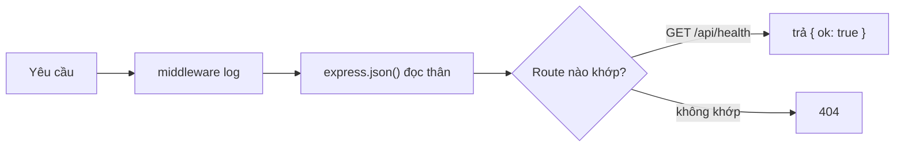

**Vì sao tách `app.js` và `index.js`?**

- `app.js` chỉ **lắp ráp** ứng dụng: hàm `createApp()` trả về `app`.
- `index.js` mới **mở cổng mạng** (`listen`).
- Đến chặng 4, bài kiểm thử gọi `createApp()` rồi tự mở một cổng ngẫu nhiên. Nhờ tách hai tệp, kiểm thử dùng **đúng** ứng dụng thật.

#### 1.2 Làm từng bước

**Bước 1 — Cài Express 5:**

```bash
npm i express@5
```

**Bước 2 — Tạo `server/app.js`:**

```js
import express from 'express';

/**
 * Lắp ráp ứng dụng Express. Tách khỏi index.js để bài kiểm thử (chặng 4)
 * tạo được app mà không cần mở cổng thật.
 */
export function createApp() {
  const app = express();
  app.disable('x-powered-by'); // không quảng cáo "Express" trong header

  // Middleware 1: ghi một dòng log cho mỗi yêu cầu, sau khi trả lời xong.
  app.use((req, res, next) => {
    const started = Date.now();
    res.on('finish', () => {
      console.log(`${req.method} ${req.originalUrl} → ${res.statusCode} (${Date.now() - started} ms)`);
    });
    next(); // chuyển yêu cầu cho middleware tiếp theo
  });

  // Middleware 2: đọc thân yêu cầu dạng JSON vào req.body (tối đa 100 KB).
  app.use(express.json({ limit: '100kb' }));

  // Route: phương thức + đường dẫn + hàm xử lý.
  app.get('/api/health', (req, res) => {
    res.json({ ok: true, time: new Date().toISOString() });
  });

  app.post('/api/echo', (req, res) => {
    res.status(201).json({ youSent: req.body });
  });

  return app;
}
```

Đọc kỹ:

- `res.on('finish', …)`: đăng ký một hàm chạy **khi phản hồi đã gửi xong**. Nhờ vậy dòng log có cả mã trạng thái và thời gian xử lý.
- `express.json({ limit: '100kb' })`: đọc thân yêu cầu có `Content-Type: application/json` vào `req.body`.
  - Giới hạn 100 KB để không ai gửi được một khối JSON khổng lồ làm treo máy chủ.
- `res.json(obj)` vừa đặt `Content-Type: application/json` vừa gửi. `res.status(201)` đổi mã trạng thái.

**Bước 3 — Tạo `server/index.js`:**

```js
import { createApp } from './app.js';

const port = Number(process.env.PORT) || 3101;
const app = createApp();

app.listen(port, () => {
  console.log(`Mini Lane API → http://localhost:${port}/api/health`);
});
```

`process.env.PORT` là **biến môi trường**. Các nền tảng hosting (Render, Railway…) dùng nó để báo app phải nghe ở cổng nào. Không
có thì dùng 3101.

**Bước 4 — Thêm script.** `node --watch` tự khởi động lại máy chủ mỗi khi bạn lưu tệp:

```bash
npm pkg set scripts.dev:api="node --watch server/index.js" scripts.start="node server/index.js"
```

**Bước 5 — Chạy:**

```bash
npm run dev:api
```

#### 1.3 Kiểm tra

Mở **một terminal thứ hai** (máy chủ vẫn chạy ở terminal đầu) và thử từng lệnh:

```bash
curl http://localhost:3101/api/health
```

```text
{"ok":true,"time":"2026-10-13T03:21:06.474Z"}
```

```bash
curl -X POST -H "Content-Type: application/json" -d '{"title":"Đà Lạt"}' http://localhost:3101/api/echo
```

```text
{"youSent":{"title":"Đà Lạt"}}
```

Terminal của máy chủ in log cho từng yêu cầu:

```text
Mini Lane API → http://localhost:3101/api/health
GET /api/health → 200 (4 ms)
POST /api/echo → 201 (5 ms)
```

Giờ thử hai trường hợp **xấu**. Đây là lý do của chặng 2:

```bash
curl http://localhost:3101/api/khong-co
```

```bash
curl -X POST -H "Content-Type: application/json" -d '{"title":' http://localhost:3101/api/echo
```

Cả hai trả về **trang HTML** (`Cannot GET /api/khong-co` và `SyntaxError: Unexpected end of JSON input`), và lệnh thứ hai còn in cả
**đường dẫn tệp trên máy chủ** (stack trace). Có hai vấn đề:

- Một API JSON mà lại trả HTML.
- Kẻ xấu đọc được cấu trúc thư mục máy chủ của bạn.

> Trên Windows, chạy các lệnh `curl` trong **Git Bash** cho giống hệt. PowerShell xử lý dấu nháy trong `-d '…'` khác.

#### 1.4 Lỗi hay gặp

| Triệu chứng | Nguyên nhân | Cách sửa |
| --- | --- | --- |
| `Error: listen EADDRINUSE :::3101` | Cổng 3101 đang bị chiếm, thường do máy chủ cũ vẫn chạy ở terminal khác | Tắt nó (Ctrl+C), hoặc chạy `PORT=3105 npm run dev:api` |
| `SyntaxError: Cannot use import statement outside a module` | Thiếu `"type": "module"` trong `package.json` | Làm lại bước 2 của chặng 0 |
| `req.body` là `undefined` | Quên `express.json()`, hoặc yêu cầu thiếu header `Content-Type: application/json` | Thêm middleware / thêm `-H "Content-Type: application/json"` |
| Yêu cầu "treo" mãi không trả lời | Một middleware quên gọi `next()` và cũng không trả lời | Mỗi middleware phải **hoặc** `next()` **hoặc** `res....` |

#### 1.5 Đối chiếu với bản thật

- `server/index.js`: thêm phần **tắt gọn gàng**. Khi nhận Ctrl+C hay lệnh dừng của nền tảng hosting, nó đóng máy chủ rồi mới đóng CSDL,
  để không ghi dở. Bạn sẽ làm phần này ở chặng 3.
- `server/app.js`: cùng cấu trúc `createApp`. Sau dòng `disable('x-powered-by')` có thêm chuỗi middleware (xem [B0.2](#b02-máy-chủ-các-tầng-và-từng-tệp)).
  Thay vì gắn route thẳng vào `app`, bản thật gom mọi route API vào **một `express.Router()` tên `api`** gắn ở `/api`. Bạn làm y vậy ở chặng 2.

#### 1.6 Tự kiểm tra

1. Đổi thứ tự hai middleware (log và `express.json`): có gì khác không? Còn nếu đặt `express.json()` **sau** route `/api/echo` thì sao?
2. Xoá dòng `next()` trong middleware log rồi gọi lại `/api/health`. Chuyện gì xảy ra, và vì sao?
3. **Bài tập:** viết route `GET /api/time` trả `{ now: <giờ máy chủ> }` và thử bằng curl.

**Commit:** `git add -A && git commit -m "feat(server): máy chủ Express đầu tiên"`

---

### Chặng 2 — Cấu hình, lỗi gọn gàng, kiểm tra dữ liệu

**Mục tiêu:**

- Mọi lỗi trả về dạng `{ "error": "MÃ" }`.
- Cấu hình nằm ở một chỗ.
- Có một API kỷ niệm đầu tiên: `GET /api/memories`, `GET /api/memories/:id`, `POST /api/memories`. Nó kiểm tra dữ liệu và **báo lỗi
  từng ô**.

Ở chặng này kỷ niệm tạm lưu trong một mảng; tắt máy chủ là mất. Chặng 3 sẽ thay bằng CSDL.

#### 2.1 Khái niệm

- **Biến môi trường** (`process.env.PORT`, `DATA_DIR`…) là cấu hình **nằm ngoài code**. Cùng một code chạy ở máy bạn, máy CI, máy chủ
  thật, mỗi nơi một cấu hình. Tệp `.env` giúp đặt chúng khi chạy ở máy. **Mọi** chỗ đọc biến môi trường gom vào `config.js`.
- **Lỗi là mã, không phải câu chữ.** Máy chủ trả `{ "error": "VALIDATION", "fields": { "title": { "code": "REQUIRED" } } }`, không trả
  "Tiêu đề không được để trống". Lý do:
  - Giao diện dịch mã sang **đúng ngôn ngữ** người dùng đang đọc (chặng 9).
  - Mã là một "hợp đồng" ổn định: sửa câu chữ không làm hỏng code.
- **Error handler tập trung.**
  - Trong route, gặp lỗi thì chỉ cần `throw new HttpError(404, 'NOT_FOUND')`.
  - **Express 5** tự bắt lỗi bị ném (kể cả trong hàm `async`) và chuyển tới **một** middleware đặc biệt có **4 tham số**
    `(err, req, res, next)`, đặt ở cuối. Nó quyết định trả gì cho trình duyệt.
  - Lỗi lạ (do lập trình) chỉ được **ghi log**; người dùng chỉ thấy `{ "error": "SERVER" }`.
- **Không bao giờ tin dữ liệu gửi lên.** Form trong trình duyệt có kiểm tra, nhưng ai cũng gọi thẳng API được (curl, Postman, script).
  Máy chủ phải kiểm tra lại **mọi** ô.
  - Ta viết một `validator` nhỏ: đọc từng ô, làm sạch, ghi lại **mã lỗi** của từng ô.
  - Cuối cùng `check()` ném **tất cả** lỗi một lần, để người dùng sửa hết trong một lượt.
- **`shared/`**: giới hạn độ dài và hàm ngày tháng được dùng **ở cả hai phía**. Máy chủ dùng để từ chối, giao diện dùng để báo trước.
- **Ngày không đầy đủ:** ảnh cũ nhiều khi chỉ nhớ năm. Vì vậy:
  - `year` bắt buộc; `month`, `day` tuỳ chọn;
  - có ngày thì phải có tháng;
  - và ngày phải **tồn tại thật** (không có 30/2).

#### 2.2 Làm từng bước

**Bước 1 — `shared/limits.js`**, một nguồn sự thật cho mọi giới hạn:

```js
// Một nguồn sự thật duy nhất cho các giới hạn: máy chủ dùng để từ chối,
// giao diện dùng để báo trước (maxLength, min, max). Hai bên không bao giờ "cãi nhau".
export const LIMITS = {
  userName: 60,
  email: 254,
  passwordMin: 8,
  passwordMax: 200,

  memoryTitle: 120,
  memoryPlace: 120,
  memoryStory: 5000,
  yearMin: 1850,

  comment: 2000,
  maxFilesPerMemory: 10,
};
```

**Bước 2 — `shared/dates.js`:**

```js
// Ngày tháng đi lại dưới dạng chuỗi 'YYYY-MM-DD' để múi giờ không bao giờ làm lệch một ngày.
const pad = (n) => String(n).padStart(2, '0');

/** Ngày hôm nay (theo giờ máy) dạng 'YYYY-MM-DD'. */
export function toISODate(date = new Date()) {
  return `${date.getFullYear()}-${pad(date.getMonth() + 1)}-${pad(date.getDate())}`;
}

/** 30/2 hay 31/4 không tồn tại: Date.UTC tự "tràn" sang tháng sau, nên so lại là biết. */
export function isValidDate(year, month, day) {
  const d = new Date(Date.UTC(year, month - 1, day));
  return d.getUTCFullYear() === year && d.getUTCMonth() === month - 1 && d.getUTCDate() === day;
}
```

Mẹo kiểm tra ngày: `Date.UTC(2021, 1, 30)` (tháng tính từ 0, nên 1 là tháng 2) **không báo lỗi**, mà "tràn" sang 2/3/2021. Đọc lại
năm/tháng/ngày của kết quả: nếu khác cái đã đưa vào thì ngày đó không tồn tại.

**Bước 3 — `server/config.js`:**

```js
import path from 'node:path';
import { fileURLToPath } from 'node:url';

// Thư mục gốc của dự án (mini-lane/), tính từ vị trí của chính tệp này.
export const ROOT = path.resolve(path.dirname(fileURLToPath(import.meta.url)), '..');

// Đọc tệp .env nếu có (Node 20.12+ có sẵn hàm này, không cần thư viện dotenv).
try {
  process.loadEnvFile(path.join(ROOT, '.env'));
} catch {
  // Không có .env cũng được: dùng giá trị mặc định bên dưới.
}

/** Mọi cấu hình đọc từ biến môi trường ở MỘT chỗ. Nhận `env` làm tham số để bài kiểm thử truyền giá trị riêng. */
export function loadConfig(env = process.env) {
  const dataDir = path.resolve(ROOT, env.DATA_DIR || 'data');
  const isProd = env.NODE_ENV === 'production';
  return {
    port: Number(env.PORT) || 3101,
    isProd,
    dataDir,
    dbFile: path.join(dataDir, 'mini.db'),
  };
}
```

- `import.meta.url` là đường dẫn của **chính tệp này**. Tính `ROOT` từ đó nên app chạy đúng dù bạn đứng ở thư mục nào khi gõ lệnh.
- `loadConfig(env = process.env)` nhận biến môi trường **làm tham số**. Bài kiểm thử (chặng 4) truyền vào `{ DATA_DIR: thư-mục-tạm }`
  mà không phải sửa `process.env`.

**Bước 4 — `server/lib/errors.js`:**

```js
/**
 * Lỗi mà API được phép cho trình duyệt biết.
 * `code` là chuỗi cố định cho máy đọc ('NOT_FOUND', 'VALIDATION'…); giao diện dịch nó ra câu chữ.
 */
export class HttpError extends Error {
  constructor(status, code, fields) {
    super(code);
    this.status = status;
    this.code = code;
    this.fields = fields;
  }
}

export const notFound = () => new HttpError(404, 'NOT_FOUND');
```

**Bước 5 — `server/lib/validate.js`:**

```js
import { HttpError } from './errors.js';

/**
 * Bộ kiểm tra dữ liệu nhỏ. Mỗi hàm đọc trả về giá trị đã làm sạch, hoặc ghi lại MÃ LỖI của ô đó;
 * check() ném tất cả lỗi một lần:
 *   const v = validator(req.body);
 *   const title = v.text('title', { required: true, max: 120 });
 *   v.check(); // → 400 { error: 'VALIDATION', fields: { title: { code: 'REQUIRED' } } }
 */
export function validator(body) {
  const input = body ?? {};
  const fields = {};

  const fail = (name, code, extra = {}) => {
    fields[name] ??= { code, ...extra }; // chỉ giữ lỗi ĐẦU TIÊN của mỗi ô
    return null;
  };

  return {
    fail,

    text(name, { required = false, max = 200 } = {}) {
      // Ô nhập nhiều dòng gửi \r\n: đổi hết về \n, bỏ khoảng trắng hai đầu.
      const value = input[name] == null ? '' : String(input[name]).replace(/\r\n?/g, '\n').trim();
      if (required && !value) return fail(name, 'REQUIRED');
      if (value.length > max) return fail(name, 'TOO_LONG', { max });
      return value;
    },

    int(name, { required = false, min = -Infinity, max = Infinity } = {}) {
      const value = input[name];
      if (value === undefined || value === null || value === '') {
        return required ? fail(name, 'REQUIRED') : null;
      }
      const n = Number(value);
      if (!Number.isInteger(n) || n < min || n > max) return fail(name, 'OUT_OF_RANGE', { min, max });
      return n;
    },

    hasErrors: () => Object.keys(fields).length > 0,

    check() {
      if (Object.keys(fields).length) throw new HttpError(400, 'VALIDATION', fields);
    },
  };
}

/** Tham số :id trên đường dẫn → số nguyên dương, nếu không thì 404 (không tồn tại). */
export function idParam(value) {
  const id = Number(value);
  if (!Number.isInteger(id) || id <= 0) throw new HttpError(404, 'NOT_FOUND');
  return id;
}
```

- `fields[name] ??= …` nghĩa là "chỉ gán khi chưa có". Mỗi ô giữ lỗi **đầu tiên**, không bị lỗi sau ghi đè.
- Mỗi hàm đọc trả về **giá trị sạch** (đã cắt khoảng trắng, đã đổi sang số) hoặc `null` khi lỗi. Route không phải tự xử lý chuỗi.
- `idParam`: `/api/memories/abc` hay `/api/memories/-1` trả 404 ngay, không bao giờ chạm tới CSDL.

**Bước 6 — `server/routes/memories.js`.** Mỗi nhóm đường dẫn một tệp, dùng `express.Router()`:

```js
import { Router } from 'express';
import { notFound } from '../lib/errors.js';
import { idParam, validator } from '../lib/validate.js';
import { isValidDate } from '../../shared/dates.js';
import { LIMITS } from '../../shared/limits.js';

export function memoryRoutes() {
  const router = Router();
  // TẠM THỜI: lưu trong bộ nhớ, tắt máy chủ là mất. Chặng 3 thay bằng SQLite.
  const memories = [];
  let nextId = 1;

  router.get('/', (req, res) => {
    res.json({ memories });
  });

  router.get('/:id', (req, res) => {
    const memory = memories.find((m) => m.id === idParam(req.params.id));
    if (!memory) throw notFound(); // Express 5 tự chuyển lỗi bị ném tới error handler
    res.json({ memory });
  });

  router.post('/', (req, res) => {
    const data = readMemoryForm(req.body); // sai → ném lỗi 400 ở đây, chưa tốn mã số nào
    const memory = { id: nextId++, ...data };
    memories.push(memory);
    res.status(201).json({ memory });
  });

  return router;
}

/** Đọc và kiểm tra form một kỷ niệm. Sai → ném HttpError 400 kèm lỗi từng ô. */
export function readMemoryForm(body) {
  const v = validator(body);
  const data = {
    title: v.text('title', { required: true, max: LIMITS.memoryTitle }),
    place: v.text('place', { max: LIMITS.memoryPlace }),
    story: v.text('story', { max: LIMITS.memoryStory }),
    year: v.int('year', { required: true, min: LIMITS.yearMin, max: new Date().getFullYear() }),
    month: v.int('month', { min: 1, max: 12 }),
    day: v.int('day', { min: 1, max: 31 }),
  };
  if (data.day && !data.month) v.fail('month', 'REQUIRED_FOR_DAY');
  if (data.year && data.month && data.day && !isValidDate(data.year, data.month, data.day)) {
    v.fail('day', 'INVALID_DATE');
  }
  v.check();
  return data;
}
```

> **Một lỗi đã gặp khi viết hướng dẫn này:** bản đầu viết `{ id: nextId++, ...readMemoryForm(req.body) }`. JavaScript tính `nextId++`
> **trước** khi gọi `readMemoryForm`, nên mỗi lần gửi dữ liệu sai vẫn "tiêu" mất một mã số, và kỷ niệm hợp lệ đầu tiên có id = 3. Bài học:
> **kiểm tra dữ liệu trước, rồi mới làm bất cứ việc gì có tác dụng phụ.**

**Bước 7 — viết lại `server/app.js`.** Mọi route API giờ gom vào một router `api` gắn ở `/api`. Phía sau là 404 dạng JSON và error handler:

```js
import express from 'express';
import { HttpError } from './lib/errors.js';
import { memoryRoutes } from './routes/memories.js';

export function createApp({ config }) {
  const app = express();
  app.disable('x-powered-by');

  app.use((req, res, next) => {
    const started = Date.now();
    res.on('finish', () => {
      if (!config.quiet) console.log(`${req.method} ${req.originalUrl} → ${res.statusCode} (${Date.now() - started} ms)`);
    });
    next();
  });

  // ---------- API JSON ----------
  const api = express.Router();
  api.use(express.json({ limit: '100kb' }));
  api.get('/health', (req, res) => res.json({ ok: true }));
  api.use('/memories', memoryRoutes());
  // Mọi đường dẫn /api/... không khớp route nào: 404 dạng JSON (thay cho trang HTML mặc định).
  api.use((req, res) => res.status(404).json({ error: 'NOT_FOUND' }));
  app.use('/api', api);

  // ---------- Bắt mọi lỗi → JSON có mã cố định ----------
  // Express nhận ra error handler nhờ hàm có ĐÚNG 4 tham số (err, req, res, next).
  // eslint-disable-next-line no-unused-vars
  app.use((err, req, res, next) => {
    if (err instanceof HttpError) {
      return res.status(err.status).json({ error: err.code, ...(err.fields && { fields: err.fields }) });
    }
    const status = err.status ?? err.statusCode;
    if (status >= 400 && status < 500) {
      // Ví dụ: JSON hỏng (400), thân yêu cầu quá lớn (413).
      return res.status(status).json({ error: status === 413 ? 'TOO_LARGE' : 'BAD_REQUEST' });
    }
    console.error(err); // lỗi thật của lập trình viên: ghi lại để sửa, nhưng KHÔNG gửi chi tiết cho người dùng
    res.status(500).json({ error: 'SERVER' });
  });

  return app;
}
```

Ba điểm then chốt:

- `config.quiet` để dành cho chặng 4: bài kiểm thử đặt nó thành `true` để không in log.
- **Thứ tự**: router `api` trước; dòng `api.use((req, res) => res.status(404)…)` sau mọi route của nó (không khớp route nào thì rơi
  xuống đây); error handler **cuối cùng**.
- Error handler phải có **đủ 4 tham số**, kể cả khi không dùng `next`. Express đếm số tham số để biết đây là error handler.

**Bước 8 — `server/index.js`** đọc cấu hình:

```diff
@@ -1,8 +1,9 @@
 import { createApp } from './app.js';
+import { loadConfig } from './config.js';
 
-const port = Number(process.env.PORT) || 3101;
-const app = createApp();
+const config = loadConfig();
+const app = createApp({ config });
 
-app.listen(port, () => {
-  console.log(`Mini Lane API → http://localhost:${port}/api/health`);
+app.listen(config.port, () => {
+  console.log(`Mini Lane API → http://localhost:${config.port}/api/health`);
 });
```

#### 2.3 Kiểm tra

Chạy `npm run dev:api` rồi thử lần lượt:

```bash
curl http://localhost:3101/api/khong-co
```

```text
{"error":"NOT_FOUND"}
```

```bash
curl -X POST -H "Content-Type: application/json" -d '{"title":' http://localhost:3101/api/memories
```

```text
{"error":"BAD_REQUEST"}
```

Gửi dữ liệu sai **nhiều ô cùng lúc**: tiêu đề toàn dấu cách, năm ở tương lai, có ngày mà không có tháng:

```bash
curl -X POST -H "Content-Type: application/json" -d '{"title":"  ","year":2030,"day":30}' http://localhost:3101/api/memories
```

```text
{"error":"VALIDATION","fields":{"title":{"code":"REQUIRED"},"year":{"code":"OUT_OF_RANGE","min":1850,"max":2026},"month":{"code":"REQUIRED_FOR_DAY"}}}
```

Ngày không tồn tại (30/2):

```bash
curl -X POST -H "Content-Type: application/json" -d '{"title":"Tết ở quê","year":2014,"month":2,"day":30}' http://localhost:3101/api/memories
```

```text
{"error":"VALIDATION","fields":{"day":{"code":"INVALID_DATE"}}}
```

Dữ liệu đúng:

```bash
curl -X POST -H "Content-Type: application/json" -d '{"title":"Tết ở quê","year":2014,"month":1,"day":31,"place":"Nam Định"}' http://localhost:3101/api/memories
```

```text
{"memory":{"id":1,"title":"Tết ở quê","place":"Nam Định","story":"","year":2014,"month":1,"day":31}}
```

Thử thêm: `curl http://localhost:3101/api/memories/1` trả về kỷ niệm đó. Còn `/api/memories/99` và `/api/memories/abc` đều trả
`{"error":"NOT_FOUND"}`.

Cuối cùng, **tắt máy chủ rồi bật lại**, gọi `curl http://localhost:3101/api/memories`. Kết quả là `{"memories":[]}`: mọi thứ đã mất.
Đó là việc của chặng 3.

#### 2.4 Lỗi hay gặp

| Triệu chứng | Nguyên nhân | Cách sửa |
| --- | --- | --- |
| Lỗi vẫn ra trang HTML, không phải JSON | Error handler có 3 tham số, hoặc đặt **trước** các route | Đủ 4 tham số `(err, req, res, next)`, đặt cuối cùng |
| `Cannot find module '…/shared/limits'` | Thiếu đuôi `.js` (ES modules **bắt buộc** ghi đuôi), hoặc sai số `../` | `../../shared/limits.js` khi đứng trong `server/routes/` |
| Lỗi `fields` chỉ có một ô dù sai nhiều ô | Gọi `check()` sau **mỗi** ô | Đọc hết các ô rồi mới gọi `check()` một lần |

#### 2.5 Đối chiếu với bản thật

- **`server/config.js`**: cùng hình dạng, nhiều tuỳ chọn hơn (giới hạn tải lên, hạn mức dung lượng, Google, `PUBLIC_URL`…). Mỗi dòng có
  chú thích giải thích.
- **`server/lib/errors.js`**: giống hệt.
- **`server/lib/validate.js`** có thêm:
  - `number`, `email`, `password`, `oneOf`, `pastDate`, `url` (link phim/nhạc chỉ nhận `http(s)://`, chặn `javascript:`);
  - `parseIdList`;
  - xử lý trường hợp form gửi một ô hai lần.
- **`server/app.js`**: error handler còn đổi lỗi của **multer** (tải tệp, chặng 11) và các mã 404/413/416 thành JSON.
- **`server/routes/memories.js`**: hàm `readMemoryForm` cùng ý tưởng. Hàm `isInFuture` chặn kỷ niệm ở tương lai **có chừa một ngày**,
  vì "hôm nay" của người dùng ở Việt Nam có thể đã là "ngày mai" theo giờ UTC của máy chủ.

#### 2.6 Tự kiểm tra

1. Vì sao máy chủ trả mã `REQUIRED` mà không trả câu "Không được để trống"?
2. Giao diện đã kiểm tra rồi, sao máy chủ vẫn phải kiểm tra lại?
3. Error handler có 3 tham số thì chuyện gì xảy ra?
4. **Bài tập:** từ chối kỷ niệm ở tương lai (ví dụ tháng 12 năm nay khi đang tháng 10) với mã `FUTURE_DATE`. So với `isInFuture` của bản thật.

**Commit:** `git add -A && git commit -m "feat(server): cấu hình, lỗi JSON, kiểm tra dữ liệu"`

---

### Chặng 3 — Lưu bằng SQLite: migration và model

**Mục tiêu:** kỷ niệm được lưu trong một **cơ sở dữ liệu thật**, còn nguyên sau khi tắt máy chủ. API có đủ 4 thao tác: xem, tạo, sửa,
xoá (CRUD).

#### 3.1 Khái niệm

**SQL và SQLite:**

- CSDL quan hệ lưu dữ liệu thành **bảng**: mỗi dòng là một bản ghi, mỗi cột có kiểu.
- **SQLite** là một CSDL quan hệ đầy đủ nhưng chỉ là **một tệp** (`data/mini.db`). Không phải cài máy chủ CSDL riêng.
- Từ Node 22.13, driver `node:sqlite` có sẵn, nên không phải cài thư viện nào. Node 22 có thể in thêm dòng `ExperimentalWarning`; không sao.

| Khái niệm | Trong bảng `memories` |
| --- | --- |
| Khoá chính `PRIMARY KEY` | `id INTEGER PRIMARY KEY`: SQLite tự đánh số 1, 2, 3… |
| Ràng buộc `NOT NULL`, `DEFAULT` | `title TEXT NOT NULL`, `story … DEFAULT ''` |
| Ràng buộc `CHECK` | `month BETWEEN 1 AND 12`. CSDL tự từ chối giá trị vô lý, kể cả khi code có lỗi |
| Chỉ mục `INDEX` | `memories_date`: như mục lục cuối sách, giúp sắp xếp/lọc theo thời gian nhanh |

**Truy vấn có tham số `?` chống SQL injection.** **Không bao giờ** ghép chuỗi người dùng nhập vào câu SQL. Thử tưởng tượng:

```js
// SAI — đừng bao giờ viết thế này
db.prepare("SELECT * FROM memories WHERE title = '" + q + "'").all();
```

Nếu `q` là `' OR '1'='1`, câu SQL thành `… WHERE title = '' OR '1'='1'`: điều kiện luôn đúng, trả về **mọi** dòng. Với
`db.prepare('… WHERE title = ?').all(q)`, giá trị `q` luôn chỉ là **dữ liệu**, không bao giờ thành **câu lệnh**.

**Migration:**

- Cấu trúc CSDL thay đổi theo thời gian: thêm bảng, thêm cột. Mỗi lần thay đổi là **một tệp SQL mới** có số thứ tự (`001_init.sql`,
  `002_….sql`).
- Khi khởi động, app đọc `PRAGMA user_version` (một con số SQLite cất sẵn trong tệp CSDL) để biết đã chạy bao nhiêu tệp, rồi chạy
  **các tệp còn thiếu**, theo thứ tự.
- Máy của bạn, máy chủ thật, máy của bạn cùng nhóm đều tự lên đúng phiên bản.
- **Quy tắc vàng:** tệp migration đã chạy ở đâu đó thì **không bao giờ sửa**. Muốn đổi gì, viết tệp mới.

**Transaction:** nhiều câu lệnh chạy như **một**. Hoặc tất cả thành công (`COMMIT`), hoặc có lỗi thì huỷ hết (`ROLLBACK`). Mỗi tệp
migration chạy trong một transaction, nên một migration hỏng giữa chừng không để lại CSDL "nửa nạc nửa mỡ".

**Model:** tệp **duy nhất** được viết SQL cho một loại dữ liệu.

- Route chỉ gọi `memories.create(data)` và không biết bên dưới là SQLite.
- Model trả về đối tượng JSON gọn gàng: `created_at` trong CSDL thành `createdAt` trong JavaScript.

**Tiêm phụ thuộc (dependency injection):**

- `createApp({ db, config })` **nhận** CSDL từ bên ngoài chứ không tự mở.
- `memoriesModel(db)` cũng vậy.
- Mọi thứ dùng chung gom vào một đối tượng `ctx` ("hộp đồ nghề") trao cho các nhóm route.

Nhờ vậy bài kiểm thử truyền vào CSDL tạm, máy chủ thật truyền CSDL thật, **code không đổi**.

#### 3.2 Làm từng bước

**Bước 1 — `server/db.js`:**

```js
import fs from 'node:fs';
import path from 'node:path';
import { fileURLToPath } from 'node:url';
import { DatabaseSync } from 'node:sqlite';

const MIGRATIONS_DIR = path.join(path.dirname(fileURLToPath(import.meta.url)), 'migrations');

/**
 * Mở (hoặc tạo) cơ sở dữ liệu SQLite bằng driver có sẵn trong Node — không phải cài gì thêm.
 * Các tệp server/migrations/*.sql chưa chạy sẽ được chạy theo thứ tự tên;
 * PRAGMA user_version nhớ đã chạy bao nhiêu tệp.
 */
export function openDb(file) {
  if (file !== ':memory:') fs.mkdirSync(path.dirname(file), { recursive: true });
  const db = new DatabaseSync(file);
  db.exec(`
    PRAGMA journal_mode = WAL;   -- đọc và ghi cùng lúc không chặn nhau
    PRAGMA foreign_keys = ON;    -- SQLite mặc định TẮT khoá ngoại: phải bật cho mỗi kết nối
    PRAGMA busy_timeout = 5000;  -- đang có người ghi thì chờ tối đa 5 giây thay vì báo lỗi ngay
  `);
  migrate(db);
  return db;
}

function migrate(db) {
  const files = fs.readdirSync(MIGRATIONS_DIR).filter((f) => f.endsWith('.sql')).sort();
  const applied = db.prepare('PRAGMA user_version').get().user_version;
  files.slice(applied).forEach((file, index) => {
    const sql = fs.readFileSync(path.join(MIGRATIONS_DIR, file), 'utf8');
    transaction(db, () => {
      db.exec(sql);
      db.exec(`PRAGMA user_version = ${applied + index + 1}`);
    });
    console.log(`  migration: ${file}`);
  });
}

/** Chạy fn giữa BEGIN và COMMIT; có lỗi ở bất kỳ đâu thì ROLLBACK — như chưa có gì xảy ra. */
export function transaction(db, fn) {
  db.exec('BEGIN');
  try {
    const result = fn();
    db.exec('COMMIT');
    return result;
  } catch (err) {
    db.exec('ROLLBACK');
    throw err;
  }
}
```

- `PRAGMA foreign_keys = ON`: SQLite **mặc định tắt** kiểm tra khoá ngoại, phải bật cho mỗi kết nối. Chặng 5 cần nó để xoá người dùng
  thì xoá luôn kỷ niệm của họ.
- `files.slice(applied)`: đã chạy 1 tệp thì bỏ qua tệp đầu, chạy từ tệp thứ hai.
- `transaction(db, fn)` được **export**: model sẽ dùng lại khi cần ghi nhiều bảng cùng lúc.

**Bước 2 — `server/migrations/001_init.sql`:**

```sql
-- Phiên bản 1 của cơ sở dữ liệu: chỉ có kỷ niệm.
-- Thời điểm lưu dạng chuỗi ISO-8601 giờ UTC; năm/tháng/ngày của kỷ niệm lưu riêng từng cột
-- vì ảnh cũ nhiều khi chỉ nhớ năm.

CREATE TABLE memories (
  id         INTEGER PRIMARY KEY,                       -- SQLite tự tăng: 1, 2, 3…
  title      TEXT    NOT NULL,
  story      TEXT    NOT NULL DEFAULT '',
  place      TEXT    NOT NULL DEFAULT '',
  year       INTEGER NOT NULL,
  month      INTEGER CHECK (month BETWEEN 1 AND 12),    -- được để trống (NULL)
  day        INTEGER CHECK (day BETWEEN 1 AND 31),
  created_at TEXT    NOT NULL DEFAULT (strftime('%Y-%m-%dT%H:%M:%fZ', 'now')),
  updated_at TEXT    NOT NULL DEFAULT (strftime('%Y-%m-%dT%H:%M:%fZ', 'now')),
  CHECK (day IS NULL OR month IS NOT NULL)              -- có ngày thì phải có tháng
);

-- "Mục lục" giúp sắp xếp/lọc theo thời gian nhanh khi có hàng nghìn kỷ niệm.
CREATE INDEX memories_date ON memories (year, month, day);
```

`created_at` lưu dạng chuỗi ISO giờ UTC (`2026-10-13T03:23:52.544Z`): sắp xếp theo chữ cũng chính là sắp xếp theo thời gian.

**Bước 3 — `server/models/memories.js`:**

```js
// Model = nơi DUY NHẤT viết câu SQL cho kỷ niệm. Route không bao giờ tự viết SQL.

const NOW = "strftime('%Y-%m-%dT%H:%M:%fZ', 'now')";
// Mới nhất trước; kỷ niệm chỉ có năm đứng sau những kỷ niệm có ngày cụ thể của cùng năm.
const ORDER = 'ORDER BY year DESC, month DESC NULLS LAST, day DESC NULLS LAST, id DESC';

/** Một dòng trong CSDL (snake_case) → đối tượng JSON gửi cho trình duyệt (camelCase). */
function toMemory(row) {
  return {
    id: row.id,
    title: row.title,
    story: row.story,
    place: row.place,
    year: row.year,
    month: row.month,
    day: row.day,
    createdAt: row.created_at,
    updatedAt: row.updated_at,
  };
}

export function memoriesModel(db) {
  return {
    list() {
      return db.prepare(`SELECT * FROM memories ${ORDER}`).all().map(toMemory);
    },

    get(id) {
      const row = db.prepare('SELECT * FROM memories WHERE id = ?').get(id);
      return row ? toMemory(row) : null;
    },

    create(data) {
      const { lastInsertRowid } = db
        .prepare('INSERT INTO memories (title, story, place, year, month, day) VALUES (?, ?, ?, ?, ?, ?)')
        .run(data.title, data.story, data.place, data.year, data.month, data.day);
      return Number(lastInsertRowid);
    },

    /** → true nếu có dòng được sửa, false nếu id không tồn tại. */
    update(id, data) {
      const { changes } = db
        .prepare(
          `UPDATE memories SET title = ?, story = ?, place = ?, year = ?, month = ?, day = ?, updated_at = ${NOW}
            WHERE id = ?`,
        )
        .run(data.title, data.story, data.place, data.year, data.month, data.day, id);
      return Number(changes) > 0;
    },

    remove(id) {
      const { changes } = db.prepare('DELETE FROM memories WHERE id = ?').run(id);
      return Number(changes) > 0;
    },
  };
}
```

- `.get()` trả **một** dòng (hoặc `undefined`), `.all()` trả **mảng**, `.run()` cho câu lệnh ghi và trả `{ changes, lastInsertRowid }`.
- `lastInsertRowid` là kiểu `BigInt` nên bọc `Number(…)`. `changes` là số dòng bị ảnh hưởng: 0 nghĩa là không có id đó → route trả 404.
- `NULLS LAST`: kỷ niệm chỉ có năm (tháng là `NULL`) đứng sau những kỷ niệm có ngày cụ thể của cùng năm.

**Bước 4 — `server/routes/memories.js`** bỏ mảng tạm, dùng model, thêm sửa và xoá:

```diff
@@ -5,25 +5,32 @@
 import { LIMITS } from '../../shared/limits.js';
 
-export function memoryRoutes() {
+/** Các đường dẫn /api/memories/... Nhận model từ ngoài vào (không tự mở CSDL). */
+export function memoryRoutes({ memories }) {
   const router = Router();
-  // TẠM THỜI: lưu trong bộ nhớ, tắt máy chủ là mất. Chặng 3 thay bằng SQLite.
-  const memories = [];
-  let nextId = 1;
 
   router.get('/', (req, res) => {
-    res.json({ memories });
+    res.json({ memories: memories.list() });
   });
 
   router.get('/:id', (req, res) => {
-    const memory = memories.find((m) => m.id === idParam(req.params.id));
-    if (!memory) throw notFound(); // Express 5 tự chuyển lỗi bị ném tới error handler
+    const memory = memories.get(idParam(req.params.id));
+    if (!memory) throw notFound();
     res.json({ memory });
   });
 
   router.post('/', (req, res) => {
-    const data = readMemoryForm(req.body); // sai → ném lỗi 400 ở đây, chưa tốn mã số nào
-    const memory = { id: nextId++, ...data };
-    memories.push(memory);
-    res.status(201).json({ memory });
+    const id = memories.create(readMemoryForm(req.body));
+    res.status(201).json({ memory: memories.get(id) });
+  });
+
+  router.put('/:id', (req, res) => {
+    const id = idParam(req.params.id);
+    if (!memories.update(id, readMemoryForm(req.body))) throw notFound();
+    res.json({ memory: memories.get(id) });
+  });
+
+  router.delete('/:id', (req, res) => {
+    if (!memories.remove(idParam(req.params.id))) throw notFound();
+    res.status(204).end(); // 204 = xong, không có nội dung trả về
   });
 
```

**Bước 5 — `server/app.js`** tạo model và `ctx`:

```diff
@@ -1,9 +1,20 @@
 import express from 'express';
 import { HttpError } from './lib/errors.js';
+import { memoriesModel } from './models/memories.js';
 import { memoryRoutes } from './routes/memories.js';
 
-export function createApp({ config }) {
+/**
+ * Lắp ráp ứng dụng. Nhận CSDL và cấu hình TỪ BÊN NGOÀI (dependency injection):
+ * bài kiểm thử truyền vào một CSDL tạm, máy chủ thật truyền CSDL thật.
+ */
+export function createApp({ db, config }) {
   const app = express();
   app.disable('x-powered-by');
+
+  // "Hộp đồ nghề" dùng chung, trao cho mọi nhóm route.
+  const ctx = {
+    config,
+    memories: memoriesModel(db),
+  };
 
   app.use((req, res, next) => {
@@ -19,5 +30,5 @@
   api.use(express.json({ limit: '100kb' }));
   api.get('/health', (req, res) => res.json({ ok: true }));
-  api.use('/memories', memoryRoutes());
+  api.use('/memories', memoryRoutes(ctx));
   // Mọi đường dẫn /api/... không khớp route nào: 404 dạng JSON (thay cho trang HTML mặc định).
   api.use((req, res) => res.status(404).json({ error: 'NOT_FOUND' }));
```

**Bước 6 — `server/index.js`** mở CSDL và tắt gọn gàng:

```diff
@@ -1,9 +1,21 @@
 import { createApp } from './app.js';
 import { loadConfig } from './config.js';
+import { openDb } from './db.js';
 
 const config = loadConfig();
-const app = createApp({ config });
+const db = openDb(config.dbFile);
+const app = createApp({ db, config });
 
-app.listen(config.port, () => {
+const server = app.listen(config.port, () => {
   console.log(`Mini Lane API → http://localhost:${config.port}/api/health`);
 });
+
+// Ctrl+C (SIGINT) hoặc nền tảng hosting yêu cầu dừng (SIGTERM): đóng gọn gàng, không làm hỏng CSDL.
+function shutdown() {
+  server.close(() => {
+    db.close();
+    process.exit(0);
+  });
+}
+process.on('SIGINT', shutdown);
+process.on('SIGTERM', shutdown);
```

#### 3.3 Kiểm tra

Chạy `npm run dev:api`. Dòng `migration: 001_init.sql` cho thấy bảng vừa được tạo, và thư mục `data/` xuất hiện. Thử:

```bash
curl -X POST -H "Content-Type: application/json" -d '{"title":"Đà Lạt","year":2019,"month":10,"day":12,"place":"Đà Lạt"}' http://localhost:3101/api/memories
```

```text
{"memory":{"id":1,"title":"Đà Lạt","story":"","place":"Đà Lạt","year":2019,"month":10,"day":12,"createdAt":"2026-10-13T03:23:52.544Z","updatedAt":"2026-10-13T03:23:52.544Z"}}
```

```bash
curl -X PUT -H "Content-Type: application/json" -d '{"title":"Đà Lạt mùa sương","year":2019,"month":10,"day":12}' http://localhost:3101/api/memories/1
```

```bash
curl -i -X DELETE http://localhost:3101/api/memories/1
```

Lệnh sửa trả về kỷ niệm với `updatedAt` mới. Lệnh xoá trả `HTTP/1.1 204 No Content`; xoá lần nữa thì `404`.

Giờ **tắt máy chủ, bật lại**: dữ liệu vẫn còn. Lần này không có dòng `migration:` vì `user_version` đã là 1.

Nhìn tận mắt CSDL. macOS có sẵn `sqlite3`; Windows thì cài tiện ích **SQLite Viewer** cho VS Code rồi mở `data/mini.db`:

```bash
sqlite3 data/mini.db "PRAGMA user_version; SELECT id, title, year, month, day FROM memories;"
```

```text
1
1|Đà Lạt mùa sương|2019|10|12
```

#### 3.4 Lỗi hay gặp

| Triệu chứng | Nguyên nhân | Cách sửa |
| --- | --- | --- |
| `no such table: memories` | Thư mục migration sai chỗ, hoặc tệp không có đuôi `.sql` | `server/migrations/001_init.sql` |
| Sửa `001_init.sql` mà CSDL không đổi | `user_version` đã là 1, tệp không chạy lại (đúng thiết kế) | Viết migration **mới**. Với dữ liệu thử ở máy mình thì có thể xoá `data/` để tạo lại từ đầu |
| `CHECK constraint failed` | Giá trị vô lý lọt qua (ví dụ `month = 13`) | Tốt: CSDL đang là lớp bảo vệ cuối. Sửa validator để báo lỗi sớm hơn |
| `database is locked` | Hai tiến trình cùng ghi | `busy_timeout` đã xử lý phần lớn trường hợp. Đừng mở tệp CSDL bằng công cụ khác trong lúc đang ghi |

#### 3.5 Đối chiếu với bản thật

- **`server/db.js`**: giống của bạn, thêm một dòng đăng ký **hàm SQL tự viết** `db.function('fold', …)`. Nhờ vậy câu SQL gọi được
  `fold(title)` để tìm kiếm **không dấu** ("da lat" ra "Đà Lạt", xem `lib/text.js`).
- **`server/migrations/`**: 4 tệp. Đọc `002_media_sharing.sql` để thấy cách **chuyển dữ liệu cũ sang bảng mới** khi đổi cấu trúc
  (từ "một ảnh mỗi kỷ niệm" sang "nhiều ảnh/video").
- **`server/models/memories.js`**:
  - Câu `SELECT` dài hơn: lấy kỷ niệm **kèm** danh sách tệp, người có mặt, số người được chia sẻ, số lời nhắn **trong cùng một câu
    truy vấn**, nhờ `json_group_array`. Bạn sẽ làm phần tệp ở chặng 11.
  - `create`/`update` dùng `transaction` vì ghi hai bảng (kỷ niệm + người có mặt).

#### 3.6 Tự kiểm tra

1. Viết lại câu SQL "sai" ở 3.1 với `?`, rồi thử truyền `' OR '1'='1`. Vì sao lần này an toàn?
2. Vì sao không được sửa một tệp migration đã chạy ở máy khác?
3. `.run()` trả `changes = 0` nghĩa là gì, và route nên trả mã nào?
4. **Bài tập:** thêm lọc theo năm `GET /api/memories?year=2019` (đọc `req.query.year`, thêm `WHERE year = ?`). So với `parseYearFilter`
   trong `routes/memories.js` của bản thật, nơi hỗ trợ cả `?year=before-2009`.

**Commit:** `git add -A && git commit -m "feat(server): lưu kỷ niệm bằng SQLite"`

---

### Chặng 4 — Kiểm thử tự động

**Mục tiêu:** `npm test` tự bật máy chủ với một CSDL tạm, gọi API như trình duyệt và kiểm tra kết quả, trong chưa đầy một giây.

#### 4.1 Khái niệm

**Vì sao cần kiểm thử tự động?** Bạn vừa thử API bằng tay với 9 lệnh `curl`. Mỗi lần sửa code mà phải làm lại 9 lệnh ấy (rồi 90, rồi
900) thì không ai làm nổi. Kiểm thử tự động:

- chạy lại **mọi** trường hợp sau mỗi thay đổi;
- báo ngay khi bạn làm hỏng thứ đang chạy tốt (gọi là "hồi quy", regression);
- là thứ CI chạy trên GitHub mỗi lần bạn đẩy code.

**Hai kiểu kiểm thử chính:**

| | Kiểm thử đơn vị (unit) | Kiểm thử tích hợp (integration) |
| --- | --- | --- |
| Kiểm tra | **Một hàm** riêng lẻ | **Cả đường đi**: HTTP → middleware → route → model → CSDL |
| Ví dụ | `isValidDate(2021, 2, 30) === false` | `POST /api/memories` với ngày 30/2 trả 400 |
| Bản thật dùng | `test/metadata.test.js` (cắt metadata từng byte) | `test/api.test.js` (phần lớn) |

Ở đây ta viết kiểm thử tích hợp, vì nó kiểm tra đúng thứ người dùng gặp.

**Công cụ có sẵn trong Node, không cần cài:**

- `node:test` cung cấp `test()`, `before()`, `after()`.
- `node:assert/strict` cung cấp:
  - `equal(a, b)`: bằng nhau;
  - `deepEqual`: so cả đối tượng, mảng;
  - `match(chuỗi, /regex/)`;
  - `ok(giá trị)`: phải "đúng".

**Mỗi bài kiểm thử có ba phần (AAA):**

1. **Arrange**: chuẩn bị dữ liệu.
2. **Act**: làm một việc.
3. **Assert**: khẳng định kết quả.

**Cô lập**, để các bài không ảnh hưởng nhau:

- Mỗi **tệp** kiểm thử bật một máy chủ riêng, trên **cổng 0** (hệ điều hành chọn một cổng trống).
- Mỗi máy chủ dùng CSDL nằm trong một **thư mục tạm mới** (`os.tmpdir()`), xoá khi xong.
- Không bao giờ đụng `data/` thật.

#### 4.2 Làm từng bước

**Bước 1 — Cho `openDb` một tuỳ chọn im lặng**, để kiểm thử không in `migration: …`:

```diff
@@ -11,5 +11,5 @@
  * PRAGMA user_version nhớ đã chạy bao nhiêu tệp.
  */
-export function openDb(file) {
+export function openDb(file, { quiet = false } = {}) {
   if (file !== ':memory:') fs.mkdirSync(path.dirname(file), { recursive: true });
   const db = new DatabaseSync(file);
@@ -19,9 +19,9 @@
     PRAGMA busy_timeout = 5000;  -- đang có người ghi thì chờ tối đa 5 giây thay vì báo lỗi ngay
   `);
-  migrate(db);
+  migrate(db, quiet);
   return db;
 }
 
-function migrate(db) {
+function migrate(db, quiet) {
   const files = fs.readdirSync(MIGRATIONS_DIR).filter((f) => f.endsWith('.sql')).sort();
   const applied = db.prepare('PRAGMA user_version').get().user_version;
@@ -32,5 +32,5 @@
       db.exec(`PRAGMA user_version = ${applied + index + 1}`);
     });
-    console.log(`  migration: ${file}`);
+    if (!quiet) console.log(`  migration: ${file}`);
   });
 }
```

**Bước 2 — `test/helpers.js`**, công cụ dùng chung cho mọi tệp kiểm thử:

```js
import fs from 'node:fs';
import os from 'node:os';
import path from 'node:path';
import { once } from 'node:events';
import { createApp } from '../server/app.js';
import { loadConfig } from '../server/config.js';
import { openDb } from '../server/db.js';

/**
 * Bật ứng dụng THẬT trên một cổng ngẫu nhiên, với CSDL mới tinh trong một thư mục tạm.
 * Mỗi tệp kiểm thử có máy chủ riêng, nên các bài không giẫm chân nhau và không đụng data/ thật.
 */
export async function startTestServer(env = {}) {
  const dir = fs.mkdtempSync(path.join(os.tmpdir(), 'mini-lane-test-'));
  const config = { ...loadConfig({ DATA_DIR: dir, ...env }), quiet: true };
  const db = openDb(config.dbFile, { quiet: true });
  const server = createApp({ db, config }).listen(0); // cổng 0: hệ điều hành chọn một cổng trống
  await once(server, 'listening');
  return {
    base: `http://127.0.0.1:${server.address().port}`,
    config,
    db,
    close() {
      server.close();
      db.close();
      fs.rmSync(dir, { recursive: true, force: true });
    },
  };
}

/** Một "trình duyệt giả" gọi API bằng fetch và đọc kết quả. */
export function client(base) {
  async function call(method, url, json) {
    const init = { method, headers: {} };
    if (json !== undefined) {
      init.headers['content-type'] = 'application/json';
      init.body = JSON.stringify(json);
    }
    const res = await fetch(base + url, init);
    const body = res.status === 204 ? null : await res.json();
    return { status: res.status, body, headers: res.headers };
  }
  return {
    get: (url) => call('GET', url),
    post: (url, json) => call('POST', url, json),
    put: (url, json) => call('PUT', url, json),
    del: (url) => call('DELETE', url),
  };
}
```

- `fs.mkdtempSync(…'mini-lane-test-')` tạo thư mục tạm **mới tinh** có tên ngẫu nhiên.
- `listen(0)` + `await once(server, 'listening')`: đợi máy chủ thật sự sẵn sàng rồi mới đọc cổng nó được cấp.
- `client(base)` là "trình duyệt giả": gửi JSON, đọc JSON. Chặng 5 sẽ dạy nó nhớ cookie.

**Bước 3 — `test/memories.test.js`:**

```js
import { after, before, test } from 'node:test';
import assert from 'node:assert/strict';
import { client, startTestServer } from './helpers.js';

let server;
let api;

before(async () => {
  server = await startTestServer();
  api = client(server.base);
});
after(() => server.close());

test('tạo, đọc, sửa, xoá một kỷ niệm', async () => {
  // Arrange + Act: tạo
  const created = await api.post('/api/memories', { title: 'Đà Lạt', year: 2019, month: 10, day: 12 });
  // Assert
  assert.equal(created.status, 201);
  const id = created.body.memory.id;
  assert.equal(created.body.memory.title, 'Đà Lạt');

  const read = await api.get(`/api/memories/${id}`);
  assert.equal(read.status, 200);
  assert.equal(read.body.memory.day, 12);

  const updated = await api.put(`/api/memories/${id}`, { title: 'Đà Lạt mùa sương', year: 2019 });
  assert.equal(updated.status, 200);
  assert.equal(updated.body.memory.title, 'Đà Lạt mùa sương');
  assert.equal(updated.body.memory.month, null); // không gửi tháng → xoá tháng

  assert.equal((await api.del(`/api/memories/${id}`)).status, 204);
  assert.equal((await api.get(`/api/memories/${id}`)).status, 404);
});

test('danh sách xếp mới nhất trước', async () => {
  await api.post('/api/memories', { title: 'Cũ', year: 2001 });
  await api.post('/api/memories', { title: 'Mới', year: 2022 });
  const titles = (await api.get('/api/memories')).body.memories.map((m) => m.title);
  assert.deepEqual(titles.slice(0, 2), ['Mới', 'Cũ']);
});

test('dữ liệu sai bị từ chối, kèm mã lỗi của từng ô', async () => {
  const res = await api.post('/api/memories', { title: '   ', year: 2019, month: 2, day: 30 });
  assert.equal(res.status, 400);
  assert.equal(res.body.error, 'VALIDATION');
  assert.equal(res.body.fields.title.code, 'REQUIRED');
  assert.equal(res.body.fields.day.code, 'INVALID_DATE');
});

test('đường dẫn lạ và JSON hỏng đều trả lỗi dạng JSON', async () => {
  const unknown = await api.get('/api/khong-co');
  assert.equal(unknown.status, 404);
  assert.deepEqual(unknown.body, { error: 'NOT_FOUND' });

  const broken = await fetch(`${server.base}/api/memories`, {
    method: 'POST',
    headers: { 'content-type': 'application/json' },
    body: '{"title":',
  });
  assert.equal(broken.status, 400);
  assert.deepEqual(await broken.json(), { error: 'BAD_REQUEST' });
});
```

**Bước 4 — Script `test`:**

```bash
npm pkg set scripts.test='node --test "test/*.test.js"'
```

Dấu nháy quanh `test/*.test.js` để chính Node (không phải shell) tìm các tệp. Cách này chạy giống nhau trên macOS, Linux và Windows.

#### 4.3 Kiểm tra

Máy chủ dev **không cần** chạy, vì kiểm thử tự bật máy chủ riêng:

```bash
npm test
```

```text
✔ tạo, đọc, sửa, xoá một kỷ niệm (42.754958ms)
✔ danh sách xếp mới nhất trước (4.94775ms)
✔ dữ liệu sai bị từ chối, kèm mã lỗi của từng ô (1.402416ms)
✔ đường dẫn lạ và JSON hỏng đều trả lỗi dạng JSON (2.28625ms)
ℹ tests 4
ℹ pass 4
ℹ fail 0
```

**Cố tình làm sai để xem kiểm thử "đỏ" trông thế nào.** Trong bài thứ hai, đổi `['Mới', 'Cũ']` thành `['Cũ', 'Mới']` rồi chạy lại:

```text
✖ danh sách xếp mới nhất trước (5.724875ms)
  AssertionError [ERR_ASSERTION]: Expected values to be strictly deep-equal:
  + actual - expected

    [
  +   'Mới',
      'Cũ',
  -   'Mới'
    ]
```

Đọc: `+ actual` là giá trị code **thật sự** trả về, `- expected` là giá trị bài kiểm thử **mong đợi**. Nhớ đổi lại cho đúng.

#### 4.4 Lỗi hay gặp

| Triệu chứng | Nguyên nhân | Cách sửa |
| --- | --- | --- |
| Bài kiểm thử "xanh" nhưng thật ra không kiểm tra gì | Quên `await` trước lời gọi API, nên `assert` chạy khi kết quả chưa về | Mọi lời gọi `api.*` đều phải `await` |
| Bài này chạy riêng thì xanh, chạy chung thì đỏ | Các bài phụ thuộc dữ liệu của nhau | Mỗi bài tự tạo dữ liệu của mình; so sánh đúng thứ mình vừa tạo |
| `npm test` không kết thúc | Còn kết nối hoặc bộ đếm giờ mở | `after(() => server.close())`; bộ đếm giờ dùng `.unref()` (xem chặng 6) |

#### 4.5 Đối chiếu với bản thật

- **`test/api.test.js`**:
  - Một tệp lớn, chia nhóm bằng `describe(…)`.
  - `agent()` có "hũ cookie" (chặng 5).
  - Các hàm giúp `registeredAgent()`, `createMemory()`, `fileForm()`.
  - Tổng cộng **72** bài kiểm thử, xếp theo nhóm ở [PRESENTATION §13](docs/PRESENTATION.md#13-kiểm-thử).
- **`test/google.test.js`**: bật một **máy chủ Google giả** (chặng 14).
- **`test/metadata.test.js`**: kiểm thử đơn vị cho các hàm cắt metadata từng byte.

#### 4.6 Tự kiểm tra

1. Vì sao mỗi tệp kiểm thử dùng một CSDL riêng trong thư mục tạm?
2. `listen(0)` nghĩa là gì, và vì sao không dùng luôn cổng 3101?
3. **Bài tập:** viết bài kiểm thử "sửa với dữ liệu sai trả 400 và **không** làm thay đổi kỷ niệm". Gợi ý: đọc lại kỷ niệm sau khi sửa
   thất bại.

**Commit:** `git add -A && git commit -m "test: kiểm thử tự động đầu tiên"`

---

### Chặng 5 — Tài khoản: mật khẩu, phiên đăng nhập

**Mục tiêu:**

- Đăng ký, đăng nhập, đăng xuất.
- Mỗi người chỉ thấy album **của mình**.
- Có một tài khoản mẫu tạo bằng `npm run seed`.
- 5 bài kiểm thử mới chứng minh những điều trên.

#### 5.1 Khái niệm

**Không bao giờ lưu mật khẩu.** Chỉ lưu **mã băm**: kết quả của một hàm một chiều. Từ mật khẩu tính ra mã băm thì dễ, từ mã băm đoán
ngược lại thì không. Khi đăng nhập, ta băm mật khẩu vừa nhập rồi so với mã băm đã lưu.

- **scrypt** (có sẵn trong Node) là hàm băm **cố tình chậm và tốn bộ nhớ**. Máy chủ của bạn chỉ băm một lần mỗi lần đăng nhập, nên
  không đáng kể. Kẻ trộm được CSDL muốn đoán thử hàng tỷ mật khẩu thì phải tốn rất nhiều tiền phần cứng.
- **Salt**: chuỗi ngẫu nhiên riêng của mỗi người, trộn vào trước khi băm. Hai người cùng mật khẩu `123456` vẫn có mã băm khác nhau, và
  bảng "mật khẩu → mã băm" tính sẵn trở nên vô dụng.
- **Mã băm lưu kèm tham số**: `scrypt$32768$8$1$<salt>$<hash>`. Sau này muốn tăng độ khó, tài khoản cũ vẫn kiểm tra được.
- `password.normalize('NFKC')`: chữ "ế" gõ trên iPhone và trên Windows có thể là **các dãy byte khác nhau**. Chuẩn hoá trước khi băm
  để cùng một mật khẩu luôn ra cùng một mã băm.
- `timingSafeEqual` so sánh **hết mọi byte**. Thời gian so sánh không tiết lộ đã sai từ byte thứ mấy.

**Không để lộ email nào đã đăng ký.**

- Sai email hay sai mật khẩu đều nhận **cùng một câu trả lời** (`INVALID_CREDENTIALS`).
- Thời gian trả lời cũng **như nhau**: email không tồn tại thì vẫn băm thử với `DUMMY_HASH`. Nếu không làm vậy, câu trả lời cho email
  không tồn tại về nhanh hơn hẳn, và kẻ xấu đo được.

**Phiên đăng nhập phía máy chủ:**

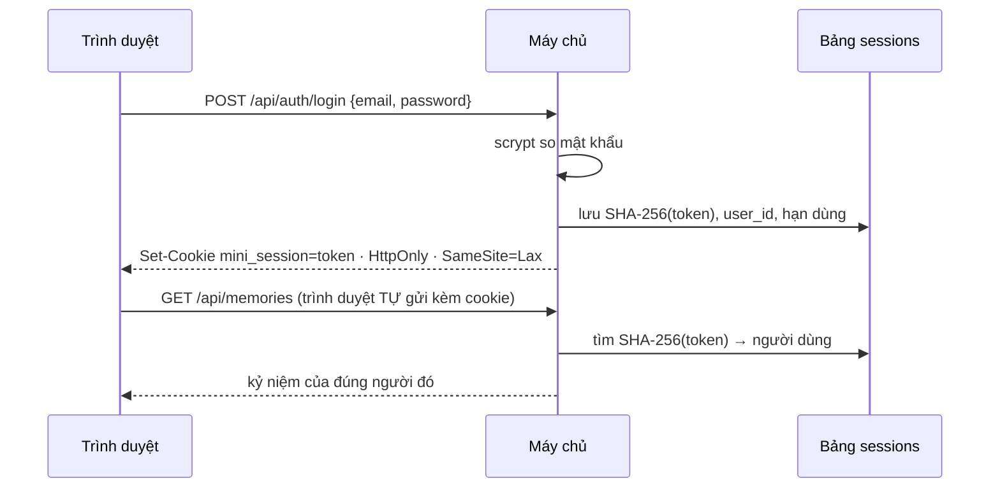

- **Token** là chuỗi ngẫu nhiên 256 bit, không ai đoán nổi. CSDL chỉ giữ **mã băm** của token: lộ CSDL cũng không đăng nhập được.
- **Đăng xuất = xoá dòng trong bảng `sessions`**. Token cũ, kể cả bị đánh cắp, hết tác dụng **ngay**.
  - JWT thì khác: chữ ký vẫn đúng cho tới khi hết hạn, nên "đăng xuất mọi nơi" rất khó.
- Cờ cookie:

| Cờ | Ý nghĩa |
| --- | --- |
| `HttpOnly` | JavaScript trên trang **không đọc được** cookie. Lỡ trang bị chèn script độc (XSS), token vẫn an toàn |
| `SameSite=Lax` | Trình duyệt không gửi cookie kèm yêu cầu **ghi** (POST/PUT/DELETE) xuất phát từ trang web khác (chống CSRF, xem thêm chặng 6) |
| `Secure` | Chỉ gửi qua HTTPS. Bật khi chạy thật (chặng 15) |
| `Max-Age` | Sống 30 ngày |

**Hai middleware:**

- `loadUser` chạy cho **mọi** yêu cầu: có cookie hợp lệ thì gắn `req.user`, không thì `req.user = null`.
- `requireAuth` đứng trước các router riêng tư: `req.user` trống thì trả 401.

**IDOR** (Insecure Direct Object Reference):

- Bình đổi `/api/memories/5` thành `/api/memories/6` và đọc được kỷ niệm của An. Đây là lỗi bảo mật phổ biến bậc nhất.
- Cách chặn: **mọi** câu SQL có thêm `AND user_id = ?`. Kỷ niệm của người khác trả **404, giống hệt kỷ niệm không tồn tại**.
- Trả 403 ("có nhưng bạn không được xem") là đã tiết lộ thông tin.

**Migration làm thay đổi bảng cũ.**

- Bảng `memories` cần thêm cột `user_id` **bắt buộc**. SQLite không thêm được cột `NOT NULL` không có giá trị mặc định vào bảng đã
  có dữ liệu, nên ta **tạo lại bảng**.
- Kỷ niệm thử của chặng 3 chưa có chủ nên bị bỏ. Được, vì đó chỉ là dữ liệu thử.
- Với dữ liệu thật phải **chuyển dữ liệu** sang. Xem cách bản thật làm trong `server/migrations/002_media_sharing.sql`.

#### 5.2 Làm từng bước

**Bước 1 — `server/migrations/002_accounts.sql`:**

```sql
-- Phiên bản 2: tài khoản, phiên đăng nhập, và mỗi kỷ niệm thuộc về đúng MỘT người.

CREATE TABLE users (
  id            INTEGER PRIMARY KEY,
  email         TEXT    NOT NULL UNIQUE COLLATE NOCASE,   -- không phân biệt hoa thường: An@x.com = an@x.com
  name          TEXT    NOT NULL,
  password_hash TEXT    NOT NULL,                          -- KHÔNG BAO GIỜ lưu mật khẩu gốc
  created_at    TEXT    NOT NULL DEFAULT (strftime('%Y-%m-%dT%H:%M:%fZ', 'now'))
);

CREATE TABLE sessions (
  token_hash TEXT    PRIMARY KEY,                          -- mã băm SHA-256 của token trong cookie
  user_id    INTEGER NOT NULL REFERENCES users (id) ON DELETE CASCADE,
  expires_at TEXT    NOT NULL,
  created_at TEXT    NOT NULL DEFAULT (strftime('%Y-%m-%dT%H:%M:%fZ', 'now'))
);
CREATE INDEX sessions_user ON sessions (user_id);

-- memories cần thêm cột user_id BẮT BUỘC. SQLite không thêm được cột NOT NULL (không có giá trị mặc định)
-- vào bảng đã có dữ liệu, nên ta tạo lại bảng. Các kỷ niệm thử của chặng 3 chưa có chủ nên bị bỏ đi:
-- làm vậy được vì đó chỉ là dữ liệu thử. Với dữ liệu thật phải CHUYỂN dữ liệu sang bảng mới
-- (xem ví dụ chuyển dữ liệu trong server/migrations/002_media_sharing.sql của bản thật).
DROP TABLE memories;

CREATE TABLE memories (
  id         INTEGER PRIMARY KEY,
  user_id    INTEGER NOT NULL REFERENCES users (id) ON DELETE CASCADE,  -- xoá người dùng → xoá luôn kỷ niệm
  title      TEXT    NOT NULL,
  story      TEXT    NOT NULL DEFAULT '',
  place      TEXT    NOT NULL DEFAULT '',
  year       INTEGER NOT NULL,
  month      INTEGER CHECK (month BETWEEN 1 AND 12),
  day        INTEGER CHECK (day BETWEEN 1 AND 31),
  created_at TEXT    NOT NULL DEFAULT (strftime('%Y-%m-%dT%H:%M:%fZ', 'now')),
  updated_at TEXT    NOT NULL DEFAULT (strftime('%Y-%m-%dT%H:%M:%fZ', 'now')),
  CHECK (day IS NULL OR month IS NOT NULL)
);
CREATE INDEX memories_user_date ON memories (user_id, year, month, day);
```

`COLLATE NOCASE` khiến `An@Example.com` và `an@example.com` bị coi là trùng. Ràng buộc `UNIQUE` chặn hai tài khoản cùng email
**ngay trong CSDL**.

**Bước 2 — `server/lib/password.js`:**

```js
import { randomBytes, scrypt, timingSafeEqual } from 'node:crypto';
import { promisify } from 'node:util';

// scrypt: thuật toán băm mật khẩu "tốn bộ nhớ" có sẵn trong Node — đoán thử hàng tỷ mật khẩu sẽ rất đắt.
const scryptAsync = promisify(scrypt);
const PARAMS = { N: 2 ** 15, r: 8, p: 1 }; // độ "khó"; lưu kèm mã băm để sau này tăng mà không hỏng tài khoản cũ
const KEY_LENGTH = 64;
const MAX_MEM = 64 * 1024 * 1024;

/** 'matkhau' → 'scrypt$32768$8$1$<salt>$<hash>' */
export async function hashPassword(password) {
  const salt = randomBytes(16); // mỗi người một salt: hai người cùng mật khẩu vẫn có mã băm khác nhau
  const hash = await scryptAsync(password.normalize('NFKC'), salt, KEY_LENGTH, { ...PARAMS, maxmem: MAX_MEM });
  return ['scrypt', PARAMS.N, PARAMS.r, PARAMS.p, salt.toString('base64'), hash.toString('base64')].join('$');
}

export async function verifyPassword(password, stored) {
  const [algorithm, N, r, p, salt, hash] = String(stored).split('$');
  if (algorithm !== 'scrypt' || !hash) return false;
  const expected = Buffer.from(hash, 'base64');
  const actual = await scryptAsync(password.normalize('NFKC'), Buffer.from(salt, 'base64'), expected.length, {
    N: Number(N),
    r: Number(r),
    p: Number(p),
    maxmem: MAX_MEM,
  });
  return timingSafeEqual(actual, expected); // so sánh hết mọi byte, thời gian không phụ thuộc chỗ sai đầu tiên
}

// Dùng khi email không tồn tại: vẫn băm như thật, để "sai email" và "sai mật khẩu" tốn thời gian như nhau.
export const DUMMY_HASH = await hashPassword(randomBytes(16).toString('hex'));
```

`await` ở dòng cuối nằm **ngoài hàm** ("top-level await"). ES modules cho phép điều này: tệp chỉ "nạp xong" khi `DUMMY_HASH` đã tính xong.

**Bước 3 — `server/lib/sessions.js`:**

```js
import { createHash, randomBytes } from 'node:crypto';
import { HttpError } from './errors.js';

const COOKIE = 'mini_session';

// Chỉ lưu SHA-256 của token: lộ CSDL cũng không dùng được để đăng nhập.
const hashToken = (token) => createHash('sha256').update(token).digest('hex');

/** Đọc một cookie từ header "Cookie: a=1; mini_session=xyz". */
export function readCookie(req, name) {
  for (const part of (req.headers.cookie ?? '').split(';')) {
    const index = part.indexOf('=');
    if (index > -1 && part.slice(0, index).trim() === name) {
      try {
        return decodeURIComponent(part.slice(index + 1).trim());
      } catch {
        return null;
      }
    }
  }
  return null;
}

/**
 * Phiên đăng nhập phía máy chủ: trình duyệt giữ một token ngẫu nhiên trong cookie HttpOnly,
 * CSDL giữ mã băm của token → người dùng + hạn dùng. Đăng xuất = xoá dòng đó: token hết tác dụng NGAY.
 */
export function createSessions(db, config) {
  const maxAgeMs = config.sessionDays * 86_400_000;
  const insert = db.prepare('INSERT INTO sessions (token_hash, user_id, expires_at) VALUES (?, ?, ?)');
  const remove = db.prepare('DELETE FROM sessions WHERE token_hash = ?');
  const lookup = db.prepare(`
    SELECT u.id, u.email, u.name, u.created_at
      FROM sessions s JOIN users u ON u.id = s.user_id
     WHERE s.token_hash = ? AND s.expires_at > ?`);

  return {
    /** Đăng nhập thành công → tạo phiên mới và gửi cookie. */
    start(res, userId) {
      const token = randomBytes(32).toString('base64url'); // 256 bit ngẫu nhiên: không thể đoán
      insert.run(hashToken(token), userId, new Date(Date.now() + maxAgeMs).toISOString());
      res.cookie(COOKIE, token, {
        httpOnly: true, // JavaScript trên trang KHÔNG đọc được cookie này (chống XSS lấy trộm)
        sameSite: 'lax', // trang web khác không "mượn" được cookie để ghi dữ liệu (chống CSRF)
        secure: config.cookieSecure, // chạy thật: chỉ gửi qua HTTPS
        maxAge: maxAgeMs,
        path: '/',
      });
    },

    end(req, res) {
      const token = readCookie(req, COOKIE);
      if (token) remove.run(hashToken(token));
      res.clearCookie(COOKIE, { path: '/', httpOnly: true, sameSite: 'lax', secure: config.cookieSecure });
    },

    /** Middleware: gắn req.user = người đang đăng nhập, hoặc null. */
    loadUser(req, res, next) {
      const token = readCookie(req, COOKIE);
      req.user = token ? (lookup.get(hashToken(token), new Date().toISOString()) ?? null) : null;
      next();
    },
  };
}

/** Middleware: chưa đăng nhập → 401, dừng tại đây. */
export function requireAuth(req, res, next) {
  if (!req.user) return next(new HttpError(401, 'UNAUTHORIZED'));
  next();
}
```

- `createSessions(db, config)` lại là một **nhà máy**. Nó chuẩn bị sẵn các câu SQL bằng `db.prepare` (nhanh hơn chuẩn bị lại mỗi lần),
  rồi trả về một đối tượng có ba hàm.
- `lookup` chỉ lấy `id, email, name, created_at`. `req.user` **không bao giờ** chứa mã băm mật khẩu.

**Bước 4 — `server/models/users.js`:**

```js
/** Hình dạng "công khai" của một người dùng: KHÔNG BAO GIỜ có password_hash. */
export function toUser(row) {
  if (!row) return null;
  return { id: row.id, email: row.email, name: row.name, createdAt: row.created_at };
}

export function usersModel(db) {
  return {
    byEmail: (email) => db.prepare('SELECT * FROM users WHERE email = ?').get(email),
    byId: (id) => db.prepare('SELECT * FROM users WHERE id = ?').get(id),

    create({ email, name, passwordHash }) {
      const { lastInsertRowid } = db
        .prepare('INSERT INTO users (email, name, password_hash) VALUES (?, ?, ?)')
        .run(email, name, passwordHash);
      return Number(lastInsertRowid);
    },
  };
}
```

`toUser()` là "cửa khẩu": **mọi** dữ liệu người dùng gửi ra ngoài đều đi qua nó. Có thêm cột bí mật nào, nó cũng không lọt ra.

**Bước 5 — thêm `email()` và `password()` vào validator:**

```diff
@@ -1,3 +1,4 @@
 import { HttpError } from './errors.js';
+import { LIMITS } from '../../shared/limits.js';
 
 /**
@@ -38,4 +39,19 @@
     },
 
+    email(name) {
+      const value = this.text(name, { required: true, max: LIMITS.email });
+      if (value && !/^[^\s@]+@[^\s@]+\.[^\s@]+$/.test(value)) return fail(name, 'INVALID_EMAIL');
+      return value ? value.toLowerCase() : value;
+    },
+
+    /** Mật khẩu KHÔNG bị cắt khoảng trắng: dấu cách ở đầu/cuối cũng là một phần của bí mật. */
+    password(name) {
+      const value = input[name] == null ? '' : String(input[name]);
+      if (!value) return fail(name, 'REQUIRED');
+      if (value.length < LIMITS.passwordMin) return fail(name, 'TOO_SHORT', { min: LIMITS.passwordMin });
+      if (value.length > LIMITS.passwordMax) return fail(name, 'TOO_LONG', { max: LIMITS.passwordMax });
+      return value;
+    },
+
     hasErrors: () => Object.keys(fields).length > 0,
 
```

**Bước 6 — `server/routes/auth.js`:**

```js
import { Router } from 'express';
import { HttpError } from '../lib/errors.js';
import { DUMMY_HASH, hashPassword, verifyPassword } from '../lib/password.js';
import { validator } from '../lib/validate.js';
import { toUser } from '../models/users.js';
import { LIMITS } from '../../shared/limits.js';

const SQLITE_CONSTRAINT_UNIQUE = 2067;

export function authRoutes({ sessions, users }) {
  const router = Router();

  // Luôn trả 200: giao diện hỏi "tôi là ai?" mà không gây lỗi đỏ trong console.
  router.get('/session', (req, res) => {
    res.json({ user: toUser(req.user) });
  });

  router.post('/register', async (req, res) => {
    const v = validator(req.body);
    const name = v.text('name', { required: true, max: LIMITS.userName });
    const email = v.email('email');
    const password = v.password('password');
    if (email && users.byEmail(email)) v.fail('email', 'EMAIL_TAKEN');
    v.check();

    let id;
    try {
      id = users.create({ email, name, passwordHash: await hashPassword(password) });
    } catch (err) {
      // Hai người đăng ký cùng email ĐÚNG cùng lúc: chỉ mục UNIQUE chặn người đến sau.
      if (err.errcode === SQLITE_CONSTRAINT_UNIQUE) {
        throw new HttpError(400, 'VALIDATION', { email: { code: 'EMAIL_TAKEN' } });
      }
      throw err;
    }
    sessions.start(res, id);
    res.status(201).json({ user: toUser(users.byId(id)) });
  });

  router.post('/login', async (req, res) => {
    const email = String(req.body?.email ?? '').trim().toLowerCase();
    const password = String(req.body?.password ?? '');
    const user = email ? users.byEmail(email) : undefined;
    // Email không tồn tại vẫn băm thử (DUMMY_HASH): kẻ xấu không đo được thời gian để biết email nào đã đăng ký.
    const valid = await verifyPassword(password, user?.password_hash ?? DUMMY_HASH);
    if (!user || !valid) throw new HttpError(401, 'INVALID_CREDENTIALS'); // cùng một câu trả lời cho cả hai trường hợp
    sessions.start(res, user.id);
    res.json({ user: toUser(user) });
  });

  router.post('/logout', (req, res) => {
    sessions.end(req, res);
    res.status(204).end();
  });

  return router;
}
```

- `register` kiểm tra email trùng **hai lần**:
  - `users.byEmail` báo lỗi đẹp cho trường hợp thường gặp;
  - `try/catch` quanh `users.create` bắt trường hợp hiếm: hai người bấm "Đăng ký" cùng email **đúng cùng lúc**. Cả hai đều qua bước
    kiểm tra, nhưng chỉ mục `UNIQUE` chặn người thứ hai (mã lỗi SQLite 2067).
- Đăng ký xong thì **đăng nhập luôn** (`sessions.start`).

**Bước 7 — `server/models/memories.js`.** Mọi hàm nhận thêm `userId`, mọi câu SQL có `user_id = ?`. Đây là bản đầy đủ:

```js
// Model = nơi DUY NHẤT viết câu SQL cho kỷ niệm. Route không bao giờ tự viết SQL.
// Quy tắc vàng: MỌI câu truy vấn đều có "user_id = ?" — album của người này không bao giờ lọt sang người khác.

const NOW = "strftime('%Y-%m-%dT%H:%M:%fZ', 'now')";
const ORDER = 'ORDER BY year DESC, month DESC NULLS LAST, day DESC NULLS LAST, id DESC';

function toMemory(row) {
  return {
    id: row.id,
    title: row.title,
    story: row.story,
    place: row.place,
    year: row.year,
    month: row.month,
    day: row.day,
    createdAt: row.created_at,
    updatedAt: row.updated_at,
  };
}

export function memoriesModel(db) {
  return {
    list(userId) {
      return db.prepare(`SELECT * FROM memories WHERE user_id = ? ${ORDER}`).all(userId).map(toMemory);
    },

    /** Kỷ niệm của người khác → null, giống hệt kỷ niệm không tồn tại (API trả 404). */
    get(userId, id) {
      const row = db.prepare('SELECT * FROM memories WHERE id = ? AND user_id = ?').get(id, userId);
      return row ? toMemory(row) : null;
    },

    create(userId, data) {
      const { lastInsertRowid } = db
        .prepare('INSERT INTO memories (user_id, title, story, place, year, month, day) VALUES (?, ?, ?, ?, ?, ?, ?)')
        .run(userId, data.title, data.story, data.place, data.year, data.month, data.day);
      return Number(lastInsertRowid);
    },

    update(userId, id, data) {
      const { changes } = db
        .prepare(
          `UPDATE memories SET title = ?, story = ?, place = ?, year = ?, month = ?, day = ?, updated_at = ${NOW}
            WHERE id = ? AND user_id = ?`,
        )
        .run(data.title, data.story, data.place, data.year, data.month, data.day, id, userId);
      return Number(changes) > 0;
    },

    remove(userId, id) {
      const { changes } = db.prepare('DELETE FROM memories WHERE id = ? AND user_id = ?').run(id, userId);
      return Number(changes) > 0;
    },
  };
}
```

**Bước 8 — `server/routes/memories.js`** truyền `req.user.id` xuống model:

```diff
@@ -5,14 +5,14 @@
 import { LIMITS } from '../../shared/limits.js';
 
-/** Các đường dẫn /api/memories/... Nhận model từ ngoài vào (không tự mở CSDL). */
+/** Các đường dẫn /api/memories/... (đã qua requireAuth, nên luôn có req.user). */
 export function memoryRoutes({ memories }) {
   const router = Router();
 
   router.get('/', (req, res) => {
-    res.json({ memories: memories.list() });
+    res.json({ memories: memories.list(req.user.id) });
   });
 
   router.get('/:id', (req, res) => {
-    const memory = memories.get(idParam(req.params.id));
+    const memory = memories.get(req.user.id, idParam(req.params.id));
     if (!memory) throw notFound();
     res.json({ memory });
@@ -20,17 +20,17 @@
 
   router.post('/', (req, res) => {
-    const id = memories.create(readMemoryForm(req.body));
-    res.status(201).json({ memory: memories.get(id) });
+    const id = memories.create(req.user.id, readMemoryForm(req.body));
+    res.status(201).json({ memory: memories.get(req.user.id, id) });
   });
 
   router.put('/:id', (req, res) => {
     const id = idParam(req.params.id);
-    if (!memories.update(id, readMemoryForm(req.body))) throw notFound();
-    res.json({ memory: memories.get(id) });
+    if (!memories.update(req.user.id, id, readMemoryForm(req.body))) throw notFound();
+    res.json({ memory: memories.get(req.user.id, id) });
   });
 
   router.delete('/:id', (req, res) => {
-    if (!memories.remove(idParam(req.params.id))) throw notFound();
-    res.status(204).end(); // 204 = xong, không có nội dung trả về
+    if (!memories.remove(req.user.id, idParam(req.params.id))) throw notFound();
+    res.status(204).end();
   });
 
```

**Bước 9 — cấu hình và lắp ráp:**

```diff
@@ -19,4 +19,6 @@
     port: Number(env.PORT) || 3101,
     isProd,
+    cookieSecure: isProd, // chạy thật (HTTPS) → cookie chỉ đi qua HTTPS
+    sessionDays: Number(env.SESSION_DAYS) || 30,
     dataDir,
     dbFile: path.join(dataDir, 'mini.db'),
```

```diff
@@ -1,5 +1,8 @@
 import express from 'express';
 import { HttpError } from './lib/errors.js';
+import { createSessions, requireAuth } from './lib/sessions.js';
 import { memoriesModel } from './models/memories.js';
+import { usersModel } from './models/users.js';
+import { authRoutes } from './routes/auth.js';
 import { memoryRoutes } from './routes/memories.js';
 
@@ -15,4 +18,6 @@
   const ctx = {
     config,
+    sessions: createSessions(db, config),
+    users: usersModel(db),
     memories: memoriesModel(db),
   };
@@ -29,6 +34,8 @@
   const api = express.Router();
   api.use(express.json({ limit: '100kb' }));
+  api.use(ctx.sessions.loadUser); // mọi yêu cầu: đọc cookie → req.user (hoặc null)
   api.get('/health', (req, res) => res.json({ ok: true }));
-  api.use('/memories', memoryRoutes(ctx));
+  api.use('/auth', authRoutes(ctx));
+  api.use('/memories', requireAuth, memoryRoutes(ctx)); // phải đăng nhập mới tới được các route bên trong
   // Mọi đường dẫn /api/... không khớp route nào: 404 dạng JSON (thay cho trang HTML mặc định).
   api.use((req, res) => res.status(404).json({ error: 'NOT_FOUND' }));
```

Thứ tự: `loadUser` đứng **trước** mọi router. `requireAuth` chỉ gắn cho `/memories`, vì `/auth/login` phải mở cho người chưa đăng nhập.

**Bước 10 — dữ liệu mẫu `server/seed.js`:**

```js
// Dữ liệu mẫu: một tài khoản "An" với vài kỷ niệm. Chạy: npm run seed
// Chỉ xoá và tạo lại đúng tài khoản mẫu, không đụng tài khoản khác.
import { loadConfig } from './config.js';
import { openDb } from './db.js';
import { hashPassword } from './lib/password.js';
import { memoriesModel } from './models/memories.js';
import { usersModel } from './models/users.js';

const DEMO = { email: 'an@example.com', name: 'An', password: 'matkhau-an' };

const config = loadConfig();
const db = openDb(config.dbFile);
const users = usersModel(db);
const memories = memoriesModel(db);

db.prepare('DELETE FROM users WHERE email = ?').run(DEMO.email); // ON DELETE CASCADE xoá luôn kỷ niệm của An
const userId = users.create({ email: DEMO.email, name: DEMO.name, passwordHash: await hashPassword(DEMO.password) });

const samples = [
  { title: 'Đà Lạt', place: 'Đà Lạt', story: 'Chuyến đi đầu tiên cùng nhóm bạn đại học.', year: 2019, month: 10, day: 12 },
  { title: 'Sinh nhật Hà', place: 'Quán cà phê quen', story: '', year: 2021, month: 10, day: 14 },
  { title: 'Tết ở quê', place: 'Nam Định', story: 'Cả nhà gói bánh chưng tới khuya.', year: 2014, month: 1, day: 31 },
  { title: 'Nhà cũ, trước sân', place: '', story: 'Chỉ còn nhớ là năm 1998.', year: 1998, month: null, day: null },
];
for (const memory of samples) memories.create(userId, memory);

console.log(`Đã tạo tài khoản mẫu ${DEMO.email} (mật khẩu: ${DEMO.password}) với ${samples.length} kỷ niệm.`);
db.close();
```

```bash
npm pkg set scripts.seed="node server/seed.js"
```

```bash
npm run seed
```

**Bước 11 — kiểm thử.** "Trình duyệt giả" giờ phải **nhớ cookie**:

```diff
@@ -29,8 +29,13 @@
 }
 
-/** Một "trình duyệt giả" gọi API bằng fetch và đọc kết quả. */
+/**
+ * Một "trình duyệt giả" gọi API bằng fetch. Nó có "hũ cookie" riêng: nhớ cookie phiên mà máy chủ gửi
+ * (Set-Cookie) và gửi lại ở các yêu cầu sau — giống trình duyệt thật. Hai client = hai người khác nhau.
+ */
 export function client(base) {
-  async function call(method, url, json) {
-    const init = { method, headers: {} };
+  let cookie = '';
+  async function call(method, url, json, headers = {}) {
+    const init = { method, headers: { ...headers } };
+    if (cookie) init.headers.cookie = cookie;
     if (json !== undefined) {
       init.headers['content-type'] = 'application/json';
@@ -38,12 +43,32 @@
     }
     const res = await fetch(base + url, init);
+    for (const line of res.headers.getSetCookie()) {
+      const pair = line.split(';')[0]; // "mini_session=abc" (bỏ phần "; HttpOnly; Path=/ …")
+      if (pair.startsWith('mini_session=')) cookie = pair === 'mini_session=' ? '' : pair;
+    }
     const body = res.status === 204 ? null : await res.json();
     return { status: res.status, body, headers: res.headers };
   }
   return {
-    get: (url) => call('GET', url),
-    post: (url, json) => call('POST', url, json),
-    put: (url, json) => call('PUT', url, json),
-    del: (url) => call('DELETE', url),
+    get: (url, headers) => call('GET', url, undefined, headers),
+    post: (url, json, headers) => call('POST', url, json, headers),
+    put: (url, json, headers) => call('PUT', url, json, headers),
+    del: (url, headers) => call('DELETE', url, undefined, headers),
+    get cookie() {
+      return cookie;
+    },
+    set cookie(value) {
+      cookie = value;
+    },
   };
 }
+
+let count = 0;
+/** Một client đã đăng ký tài khoản mới (email khác nhau mỗi lần). */
+export async function registered(base, name = 'Người thử') {
+  const api = client(base);
+  count += 1;
+  const res = await api.post('/api/auth/register', { name, email: `user${count}@example.com`, password: 'mat-khau-dai' });
+  if (res.status !== 201) throw new Error(`register failed: ${JSON.stringify(res.body)}`);
+  return { api, user: res.body.user, email: `user${count}@example.com`, password: 'mat-khau-dai' };
+}
```

Bài kiểm thử kỷ niệm cũ giờ phải đăng ký trước:

```diff
@@ -1,5 +1,5 @@
 import { after, before, test } from 'node:test';
 import assert from 'node:assert/strict';
-import { client, startTestServer } from './helpers.js';
+import { registered, startTestServer } from './helpers.js';
 
 let server;
@@ -8,5 +8,5 @@
 before(async () => {
   server = await startTestServer();
-  api = client(server.base);
+  ({ api } = await registered(server.base)); // từ chặng 5: phải đăng nhập mới dùng được kỷ niệm
 });
 after(() => server.close());
```

Và tệp mới `test/auth.test.js`:

```js
import { after, before, test } from 'node:test';
import assert from 'node:assert/strict';
import { client, registered, startTestServer } from './helpers.js';

let server;
before(async () => {
  server = await startTestServer();
});
after(() => server.close());

test('đăng ký: tạo phiên ngay, cookie an toàn, không lộ mã băm mật khẩu', async () => {
  const api = client(server.base);
  const res = await api.post('/api/auth/register', { name: 'An', email: 'An@Example.com', password: 'mat-khau-dai' });
  assert.equal(res.status, 201);
  assert.equal(res.body.user.email, 'an@example.com'); // email được chuẩn hoá về chữ thường
  assert.equal(res.body.user.password_hash, undefined);
  const setCookie = res.headers.get('set-cookie');
  assert.match(setCookie, /HttpOnly/);
  assert.match(setCookie, /SameSite=Lax/);
  assert.equal((await api.get('/api/auth/session')).body.user.name, 'An');
});

test('đăng ký: kiểm tra từng ô và email trùng', async () => {
  const api = client(server.base);
  const bad = await api.post('/api/auth/register', { name: '', email: 'khong-phai-email', password: 'ngan' });
  assert.equal(bad.status, 400);
  assert.equal(bad.body.fields.name.code, 'REQUIRED');
  assert.equal(bad.body.fields.email.code, 'INVALID_EMAIL');
  assert.equal(bad.body.fields.password.code, 'TOO_SHORT');

  const taken = await api.post('/api/auth/register', { name: 'An 2', email: 'AN@example.com', password: 'mat-khau-dai' });
  assert.equal(taken.body.fields.email.code, 'EMAIL_TAKEN');
});

test('đăng nhập sai email hay sai mật khẩu: cùng một câu trả lời', async () => {
  const { email } = await registered(server.base);
  const api = client(server.base);
  const wrongPassword = await api.post('/api/auth/login', { email, password: 'sai-mat-khau' });
  const unknownEmail = await api.post('/api/auth/login', { email: 'ai-do@example.com', password: 'sai-mat-khau' });
  assert.equal(wrongPassword.status, 401);
  assert.deepEqual(wrongPassword.body, unknownEmail.body); // { error: 'INVALID_CREDENTIALS' }
});

test('đăng xuất: cookie cũ (kể cả bị đánh cắp) hết tác dụng ngay', async () => {
  const { api } = await registered(server.base);
  const stolen = api.cookie;
  assert.equal((await api.post('/api/auth/logout')).status, 204);

  const thief = client(server.base);
  thief.cookie = stolen;
  assert.equal((await thief.get('/api/memories')).status, 401);
});

test('kỷ niệm: phải đăng nhập, và người này không thấy kỷ niệm của người kia', async () => {
  assert.equal((await client(server.base).get('/api/memories')).status, 401);

  const an = await registered(server.base, 'An');
  const binh = await registered(server.base, 'Bình');
  const { body } = await an.api.post('/api/memories', { title: 'Nhật ký riêng của An', year: 2020 });
  const id = body.memory.id;

  assert.equal((await binh.api.get(`/api/memories/${id}`)).status, 404); // 404 chứ không phải 403
  assert.equal((await binh.api.put(`/api/memories/${id}`, { title: 'Bị sửa', year: 2020 })).status, 404);
  assert.equal((await binh.api.del(`/api/memories/${id}`)).status, 404);
  assert.equal((await binh.api.get('/api/memories')).body.memories.length, 0);
  assert.equal((await an.api.get(`/api/memories/${id}`)).body.memory.title, 'Nhật ký riêng của An');
});
```

Bài cuối cùng là bài **quan trọng nhất** của cả dự án: nó chứng minh người này không đọc, sửa, xoá được kỷ niệm của người kia.

#### 5.3 Kiểm tra

```bash
npm test
```

```text
✔ đăng ký: tạo phiên ngay, cookie an toàn, không lộ mã băm mật khẩu
✔ đăng ký: kiểm tra từng ô và email trùng
✔ đăng nhập sai email hay sai mật khẩu: cùng một câu trả lời
✔ đăng xuất: cookie cũ (kể cả bị đánh cắp) hết tác dụng ngay
✔ kỷ niệm: phải đăng nhập, và người này không thấy kỷ niệm của người kia
✔ tạo, đọc, sửa, xoá một kỷ niệm
✔ danh sách xếp mới nhất trước
✔ dữ liệu sai bị từ chối, kèm mã lỗi của từng ô
✔ đường dẫn lạ và JSON hỏng đều trả lỗi dạng JSON
ℹ tests 9
ℹ pass 9
```

Thử bằng curl. Cờ `-c` **ghi** cookie vào tệp, `-b` **gửi** cookie từ tệp, giống trình duyệt. Chạy `npm run dev:api` rồi:

```bash
curl http://localhost:3101/api/memories
```

```text
{"error":"UNAUTHORIZED"}
```

```bash
curl -i -c cookies.txt -H "Content-Type: application/json" -d '{"email":"an@example.com","password":"matkhau-an"}' http://localhost:3101/api/auth/login
```

```text
HTTP/1.1 200 OK
Set-Cookie: mini_session=4elRJFXJQfce…; Max-Age=2592000; Path=/; Expires=Thu, 12 Nov 2026 03:26:47 GMT; HttpOnly; SameSite=Lax
{"user":{"id":1,"email":"an@example.com","name":"An","createdAt":"2026-10-13T03:26:12.724Z"}}
```

```bash
curl -b cookies.txt http://localhost:3101/api/memories
```

Lệnh này trả về 4 kỷ niệm của An. Đăng xuất, rồi dùng lại đúng cookie đó:

```bash
curl -b cookies.txt -X POST http://localhost:3101/api/auth/logout
```

```bash
curl -b cookies.txt http://localhost:3101/api/memories
```

```text
{"error":"UNAUTHORIZED"}
```

Xoá `cookies.txt` khi thử xong: trong đó là token đăng nhập.

#### 5.4 Lỗi hay gặp

| Triệu chứng | Nguyên nhân | Cách sửa |
| --- | --- | --- |
| Đăng ký trả `{"error":"SERVER"}`, log máy chủ ghi `NOT NULL constraint failed: users.password_hash` | Quên `await` trước `hashPassword`: một Promise được đưa vào câu SQL và bị coi là `NULL` | `await hashPassword(…)` |
| Phản hồi đăng ký có `password_hash` | Gửi thẳng dòng CSDL ra ngoài | Luôn đi qua `toUser()` |
| curl đăng nhập được nhưng gọi API vẫn 401 | Quên `-b cookies.txt` | Trình duyệt tự gửi cookie, curl thì không |
| `FOREIGN KEY constraint failed` khi xoá | Đúng thiết kế khi còn dữ liệu trỏ tới. Nếu **không** thấy lỗi này ở chỗ đáng lẽ phải có thì kiểm tra `PRAGMA foreign_keys = ON` | — |

#### 5.5 Đối chiếu với bản thật

- **`server/lib/password.js`**: giống hệt.
- **`server/lib/sessions.js`** thêm:
  - `revokeAll(userId)`: đăng xuất mọi nơi, dùng sau khi đổi mật khẩu;
  - dọn các phiên hết hạn khi khởi động;
  - `req.user` mang thêm `has_password` và `google_email` cho trang Cài đặt.
- **`server/routes/auth.js`** thêm:
  - giới hạn số lần thử (chặng 6);
  - đăng nhập **demo** một chạm (`/demo`, kể cả "vào vai Thu Hà");
  - `/session` trả thêm cấu hình cho giao diện (có bật demo, Google, giới hạn tải lên);
  - lưu ngôn ngữ của người dùng.
- **`server/routes/me.js`**: đổi tên, đổi mật khẩu (kèm `revokeAll`), xuất toàn bộ dữ liệu, xoá tài khoản (cả tệp trên đĩa).
- **`server/seed.js`**: dựng cả một "thế giới" gồm 6 tài khoản. Mật khẩu demo là chuỗi ngẫu nhiên không ai biết; vào bằng nút demo.

#### 5.6 Tự kiểm tra

1. Vì sao CSDL chỉ lưu mã băm của token phiên, mà không lưu chính token?
2. Muốn "đăng xuất khỏi mọi thiết bị", phiên phía máy chủ làm thế nào? JWT gặp khó gì?
3. Vì sao kỷ niệm của người khác trả 404 mà không phải 403?
4. `DUMMY_HASH` chống được kiểu tấn công nào?
5. **Bài tập:** viết `POST /api/auth/logout-all` xoá **mọi** phiên của người đang đăng nhập, kèm một bài kiểm thử. So với `revokeAll`
   trong `lib/sessions.js` của bản thật.

**Commit:** `git add -A && git commit -m "feat(auth): đăng ký, đăng nhập, phiên phía máy chủ"`

---

### Chặng 6 — Lá chắn bảo mật

**Mục tiêu:**

- Mọi phản hồi mang **header bảo mật**.
- Yêu cầu ghi đến từ trang web khác bị chặn (**CSRF**).
- Đoán mật khẩu bị **giới hạn số lần thử**.
- 3 bài kiểm thử mới.

#### 6.1 Khái niệm

**Ba kiểu tấn công cần chặn ở chặng này:**

| Tấn công | Kịch bản | Lá chắn |
| --- | --- | --- |
| **XSS** (chèn script) | Kẻ xấu lừa được trang hiển thị `<script src="https://trang-xau/lay-du-lieu.js">` | React đã tự "thoát" ký tự khi hiển thị chữ. Thêm **CSP**: trình duyệt chỉ chạy script từ chính máy chủ của bạn |
| **CSRF** (mượn phiên) | Bạn đang đăng nhập Mini Lane, rồi mở một trang lạ. Trang đó âm thầm gửi `POST /api/memories` tới máy chủ của bạn, và trình duyệt tự đính kèm cookie của bạn | Cookie `SameSite=Lax` (chặng 5) **và** kiểm tra header `Sec-Fetch-Site` |
| **Brute force** (đoán mò) | Một script thử 10.000 mật khẩu cho một email | **Giới hạn số lần thử** theo IP: quá 20 lần/15 phút thì trả `429` |

**Content Security Policy (CSP)** là một header liệt kê **nguồn được phép** cho từng loại tài nguyên. Ví dụ `script-src 'self'`: chỉ
script từ chính địa chỉ này, cấm cả `<script>…</script>` viết thẳng trong HTML. Một dòng CSP chặn được cả một lớp lỗ hổng.

**Fetch Metadata.** Trình duyệt hiện đại tự gắn header `Sec-Fetch-Site` vào mọi yêu cầu, với giá trị:

- `same-origin`: từ chính trang của bạn;
- `same-site`: từ một tên miền con;
- `cross-site`: từ trang web khác;
- `none`: người dùng tự gõ địa chỉ.

Trang độc hại **không giả được** header này. Máy chủ chỉ cần từ chối yêu cầu **ghi** có `cross-site`. Kết hợp với `SameSite=Lax` là
hai lớp bảo vệ độc lập: một lớp có kẽ hở, lớp kia vẫn chặn.

**Vài header khác:**

| Header | Tác dụng |
| --- | --- |
| `X-Content-Type-Options: nosniff` | Trình duyệt không "đoán" loại tệp. Một tệp ảnh có nội dung HTML sẽ không bị chạy như trang web |
| `frame-ancestors 'none'` (CSP) + `X-Frame-Options: DENY` | Không trang nào nhúng được app vào `<iframe>`. Chặn **clickjacking**: lừa bạn bấm nút thật đặt dưới một lớp trong suốt |
| `Cache-Control: no-store` (cho JSON) | Dữ liệu riêng tư không nằm lại trong bộ nhớ đệm của trình duyệt hay proxy, kể cả trên máy tính dùng chung |
| `Strict-Transport-Security` (chỉ khi chạy thật) | Trình duyệt nhớ "trang này **luôn** dùng HTTPS" |

**Giới hạn số lần thử kiểu "cửa sổ cố định":**

- Mỗi IP có một bộ đếm và một mốc "đặt lại".
- Trong 15 phút, quá `max` lần thì trả `429 Too Many Requests` kèm `Retry-After` (còn bao nhiêu giây).
- Hết 15 phút, bộ đếm về 0.

#### 6.2 Làm từng bước

**Bước 1 — `server/lib/security.js`:**

```js
import { HttpError } from './errors.js';

// Content Security Policy: trang chỉ được nạp code, CSS, font, ảnh từ CHÍNH máy chủ này.
// Lỡ có kẻ chèn được <script src="https://trang-xau/...">, trình duyệt sẽ từ chối chạy.
const CSP = [
  "default-src 'self'",
  "script-src 'self'", // không có 'unsafe-inline': cấm cả <script>…</script> viết thẳng trong HTML
  "style-src 'self' 'unsafe-inline'",
  "img-src 'self' data: blob:",
  "media-src 'self' blob:",
  "connect-src 'self'",
  "object-src 'none'",
  "base-uri 'self'",
  "form-action 'self'",
  "frame-ancestors 'none'", // không trang nào được nhúng app vào <iframe> (chống clickjacking)
].join('; ');

export function securityHeaders(config) {
  return (req, res, next) => {
    res.set({
      'Content-Security-Policy': CSP,
      'X-Content-Type-Options': 'nosniff', // trình duyệt không "đoán" loại tệp: ảnh là ảnh, không chạy như HTML
      'X-Frame-Options': 'DENY', // như frame-ancestors, cho trình duyệt cũ
      'Referrer-Policy': 'same-origin', // bấm link ra ngoài không để lộ đường dẫn trang trong app
    });
    if (config.isProd) res.set('Strict-Transport-Security', 'max-age=15552000; includeSubDomains'); // luôn HTTPS
    next();
  };
}

/** JSON riêng tư không bao giờ được lưu trong bộ nhớ đệm của trình duyệt hay proxy ở giữa. */
export function noStore(req, res, next) {
  res.set('Cache-Control', 'no-store');
  next();
}

const SAFE_METHODS = new Set(['GET', 'HEAD', 'OPTIONS']);

/**
 * Chống CSRF bằng Fetch Metadata: trình duyệt gắn header Sec-Fetch-Site vào MỌI yêu cầu.
 * Yêu cầu GHI dữ liệu (POST/PUT/DELETE) đến từ trang web khác → từ chối.
 * (curl, Postman không gửi header này nên vẫn dùng được để thử API.)
 */
export function blockCrossSiteWrites(req, res, next) {
  if (SAFE_METHODS.has(req.method)) return next();
  const site = req.get('sec-fetch-site');
  if (site && site !== 'same-origin' && site !== 'none') return next(new HttpError(403, 'CROSS_SITE'));
  next();
}
```

`securityHeaders(config)` là **nhà máy middleware**: hàm trả về một middleware. Nhờ vậy nó đọc được `config.isProd` để chỉ bật HSTS khi
chạy thật. Bật HSTS trên `localhost` sẽ làm trình duyệt "nhớ nhầm".

**Bước 2 — `server/lib/rateLimit.js`:**

```js
import { HttpError } from './errors.js';

/**
 * Giới hạn số lần thử theo địa chỉ IP, trong một "cửa sổ" thời gian cố định (fixed window).
 * Lưu trong bộ nhớ: đủ cho MỘT tiến trình máy chủ. Nhiều máy chủ thì cần Redis.
 */
export function rateLimit({ windowMs, max }) {
  const hits = new Map(); // ip → { count, resetAt }

  function limiter(req, res, next) {
    const now = Date.now();
    let entry = hits.get(req.ip);
    if (!entry || entry.resetAt <= now) {
      entry = { count: 0, resetAt: now + windowMs };
      hits.set(req.ip, entry);
    }
    entry.count += 1;
    if (entry.count > max) {
      res.set('Retry-After', String(Math.ceil((entry.resetAt - now) / 1000))); // còn bao nhiêu giây thì thử lại được
      return next(new HttpError(429, 'RATE_LIMITED'));
    }
    next();
  }

  // Dọn các IP đã hết cửa sổ, để Map không phình mãi.
  const sweep = setInterval(() => {
    const now = Date.now();
    for (const [ip, entry] of hits) if (entry.resetAt <= now) hits.delete(ip);
  }, windowMs);
  sweep.unref(); // không giữ tiến trình Node sống chỉ vì bộ đếm giờ này

  return limiter;
}
```

`setInterval(...).unref()`: bộ đếm giờ dọn dẹp **không giữ** tiến trình Node sống. Thiếu `.unref()`, `npm test` sẽ treo không kết thúc.

**Bước 3 — gắn giới hạn vào đăng ký và đăng nhập:**

```diff
@@ -2,4 +2,5 @@
 import { HttpError } from '../lib/errors.js';
 import { DUMMY_HASH, hashPassword, verifyPassword } from '../lib/password.js';
+import { rateLimit } from '../lib/rateLimit.js';
 import { validator } from '../lib/validate.js';
 import { toUser } from '../models/users.js';
@@ -8,6 +9,8 @@
 const SQLITE_CONSTRAINT_UNIQUE = 2067;
 
-export function authRoutes({ sessions, users }) {
+export function authRoutes({ config, sessions, users }) {
   const router = Router();
+  // Đoán mật khẩu: mỗi IP chỉ được thử AUTH_RATE_LIMIT lần (mặc định 20) mỗi 15 phút.
+  const limiter = rateLimit({ windowMs: 15 * 60_000, max: config.authRateLimit });
 
   // Luôn trả 200: giao diện hỏi "tôi là ai?" mà không gây lỗi đỏ trong console.
@@ -16,5 +19,5 @@
   });
 
-  router.post('/register', async (req, res) => {
+  router.post('/register', limiter, async (req, res) => {
     const v = validator(req.body);
     const name = v.text('name', { required: true, max: LIMITS.userName });
@@ -38,5 +41,5 @@
   });
 
-  router.post('/login', async (req, res) => {
+  router.post('/login', limiter, async (req, res) => {
     const email = String(req.body?.email ?? '').trim().toLowerCase();
     const password = String(req.body?.password ?? '');
```

**Bước 4 — cấu hình và thứ tự middleware:**

```diff
@@ -21,4 +21,5 @@
     cookieSecure: isProd, // chạy thật (HTTPS) → cookie chỉ đi qua HTTPS
     sessionDays: Number(env.SESSION_DAYS) || 30,
+    authRateLimit: Number(env.AUTH_RATE_LIMIT) || 20, // số lần đăng nhập/đăng ký mỗi IP mỗi 15 phút
     dataDir,
     dbFile: path.join(dataDir, 'mini.db'),
```

```diff
@@ -1,4 +1,5 @@
 import express from 'express';
 import { HttpError } from './lib/errors.js';
+import { blockCrossSiteWrites, noStore, securityHeaders } from './lib/security.js';
 import { createSessions, requireAuth } from './lib/sessions.js';
 import { memoriesModel } from './models/memories.js';
@@ -23,4 +24,6 @@
   };
 
+  app.use(securityHeaders(config)); // header bảo mật cho MỌI phản hồi
+
   app.use((req, res, next) => {
     const started = Date.now();
@@ -33,5 +36,7 @@
   // ---------- API JSON ----------
   const api = express.Router();
+  api.use(noStore);
   api.use(express.json({ limit: '100kb' }));
+  api.use(blockCrossSiteWrites);
   api.use(ctx.sessions.loadUser); // mọi yêu cầu: đọc cookie → req.user (hoặc null)
   api.get('/health', (req, res) => res.json({ ok: true }));
```

`blockCrossSiteWrites` đứng **trước** `loadUser` và mọi router: yêu cầu giả mạo bị chặn trước khi chạm tới bất cứ thứ gì.

**Bước 5 — kiểm thử.** Bài kiểm thử đăng ký rất nhiều tài khoản từ cùng một IP, nên máy chủ kiểm thử nới giới hạn (trừ khi bài kiểm
thử tự đặt):

```diff
@@ -13,5 +13,6 @@
 export async function startTestServer(env = {}) {
   const dir = fs.mkdtempSync(path.join(os.tmpdir(), 'mini-lane-test-'));
-  const config = { ...loadConfig({ DATA_DIR: dir, ...env }), quiet: true };
+  // Kiểm thử đăng ký rất nhiều tài khoản: nới giới hạn số lần thử, trừ khi bài kiểm thử tự đặt.
+  const config = { ...loadConfig({ DATA_DIR: dir, AUTH_RATE_LIMIT: '1000', ...env }), quiet: true };
   const db = openDb(config.dbFile, { quiet: true });
   const server = createApp({ db, config }).listen(0); // cổng 0: hệ điều hành chọn một cổng trống
```

Tệp mới `test/security.test.js`:

```js
import { after, before, test } from 'node:test';
import assert from 'node:assert/strict';
import { client, registered, startTestServer } from './helpers.js';

let server;
before(async () => {
  server = await startTestServer();
});
after(() => server.close());

test('mọi phản hồi có header bảo mật; JSON riêng tư không được lưu cache', async () => {
  const res = await client(server.base).get('/api/auth/session');
  assert.match(res.headers.get('content-security-policy'), /frame-ancestors 'none'/);
  assert.equal(res.headers.get('x-content-type-options'), 'nosniff');
  assert.equal(res.headers.get('cache-control'), 'no-store');
  assert.equal(res.headers.get('x-powered-by'), null);
});

test('CSRF: yêu cầu ghi đến từ trang web khác bị chặn', async () => {
  const { api } = await registered(server.base);
  const evil = await api.post('/api/memories', { title: 'Giả mạo', year: 2020 }, { 'sec-fetch-site': 'cross-site' });
  assert.equal(evil.status, 403);
  assert.equal(evil.body.error, 'CROSS_SITE');
  const ok = await api.post('/api/memories', { title: 'Thật', year: 2020 }, { 'sec-fetch-site': 'same-origin' });
  assert.equal(ok.status, 201);
});

test('giới hạn số lần đăng nhập: quá giới hạn → 429 kèm Retry-After', async () => {
  const strict = await startTestServer({ AUTH_RATE_LIMIT: '3' });
  try {
    const api = client(strict.base);
    for (let i = 0; i < 3; i += 1) {
      assert.equal((await api.post('/api/auth/login', { email: 'x@example.com', password: 'sai' })).status, 401);
    }
    const blocked = await api.post('/api/auth/login', { email: 'x@example.com', password: 'sai' });
    assert.equal(blocked.status, 429);
    assert.ok(Number(blocked.headers.get('retry-after')) > 0);
  } finally {
    strict.close();
  }
});
```

#### 6.3 Kiểm tra

```bash
npm test
```

```text
✔ mọi phản hồi có header bảo mật; JSON riêng tư không được lưu cache
✔ CSRF: yêu cầu ghi đến từ trang web khác bị chặn
✔ giới hạn số lần đăng nhập: quá giới hạn → 429 kèm Retry-After
ℹ tests 12
ℹ pass 12
```

Xem tận mắt các header. `-I` chỉ in phần header:

```bash
curl -I http://localhost:3101/api/auth/session
```

Giả làm một trang web lạ gửi yêu cầu ghi:

```bash
curl -X POST -H "Content-Type: application/json" -H "Sec-Fetch-Site: cross-site" -d '{"email":"a@b.c","password":"x"}' http://localhost:3101/api/auth/login
```

```text
{"error":"CROSS_SITE"}
```

#### 6.4 Lỗi hay gặp

| Triệu chứng | Nguyên nhân | Cách sửa |
| --- | --- | --- |
| Kiểm thử thỉnh thoảng nhận `429` | Nhiều bài đăng ký từ cùng IP vượt giới hạn | Máy chủ kiểm thử đặt `AUTH_RATE_LIMIT: '1000'` như bước 5 |
| `npm test` chạy xong nhưng không thoát | Quên `.unref()` cho `setInterval` | Thêm `.unref()` |
| Khi chạy thật sau proxy, mọi người dùng chung một bộ đếm | `req.ip` là IP của proxy, không phải của người dùng | `app.set('trust proxy', 1)` khi chạy thật (chặng 15) |
| Chặng 10 trở đi: trang trắng khi chạy bản build | CSP chặn `<script>` viết thẳng trong HTML | Đưa script ra tệp riêng (`theme-init.js`, chặng 10) |

#### 6.5 Đối chiếu với bản thật

- **`server/lib/security.js`**: cùng ý tưởng. CSP có thêm `font-src 'self'` (font tự đóng gói, không gọi Google Fonts). Có thêm header
  `Cross-Origin-Opener-Policy` và `Permissions-Policy` (tắt camera, micro, định vị: app không cần).
- **`server/lib/rateLimit.js`**: giống hệt, thêm `limiter.reset`.
- Bản thật còn giới hạn:
  - **xem trước/nhận link mời**: 60 lần/15 phút (`routes/invites.js`);
  - **số link mời tạo ra**: 30 link/ngày;
  - **đăng nhập Google**: gấp đôi giới hạn đăng nhập, vì mỗi lần đăng nhập Google gồm hai yêu cầu.
- Bảng đầy đủ "mối nguy → cách chặn → ở đâu" nằm ở [PRESENTATION §11](docs/PRESENTATION.md#11-bảo-mật--quyền-riêng-tư).

#### 6.6 Tự kiểm tra

1. Đã có `SameSite=Lax` rồi, sao còn kiểm tra `Sec-Fetch-Site`?
2. Vì sao chỉ chặn yêu cầu **ghi** (POST/PUT/DELETE) mà không chặn GET?
3. Giới hạn theo IP có điểm yếu gì? (Gợi ý: nhiều người dùng chung một mạng; kẻ tấn công có nhiều IP.)
4. **Bài tập:** giới hạn tạo kỷ niệm ở 100 lần/15 phút mỗi IP, kèm bài kiểm thử dùng `startTestServer` riêng như bài rate limit ở trên.

**Commit:** `git add -A && git commit -m "feat(security): header bảo mật, chống CSRF, giới hạn số lần thử"`

---

### Chặng 7 — Giao diện React đầu tiên với Vite

**Mục tiêu:** mở trình duyệt vào `http://localhost:5174` và dùng được ba trang **Đăng nhập**, **Đăng ký**, **Album**. Giao diện nói
chuyện với API của bạn. Chưa có CSS: trang trông "thô", chặng 10 sẽ làm đẹp.

#### 7.1 Khái niệm

**SPA (Single Page Application).**

- Máy chủ gửi **một** trang HTML gần như trống, kèm một tệp JavaScript lớn.
- JavaScript **vẽ** các trang ngay trong trình duyệt. Khi bạn bấm link, React Router đổi địa chỉ trên thanh URL và vẽ trang mới mà
  **không tải lại** cả trang.
- Từ đó về sau, trình duyệt chỉ xin **dữ liệu** (JSON) từ API.

**React trong 6 ý:**

1. **Component** là một hàm trả về giao diện, viết bằng **JSX** (cú pháp giống HTML nằm trong JavaScript).
   `<Album />` là gọi component `Album`.
2. **Props** là tham số truyền vào component: `<MemoryForm memory={m} onSaved={…} />`.
3. **State** (`useState`) là dữ liệu thay đổi theo thời gian. Gọi hàm đặt state thì React **vẽ lại** component.
   **Không bao giờ** sửa state trực tiếp (`fields.name = 'x'`): luôn tạo đối tượng mới (`{ ...fields, name: 'x' }`).
4. **Effect** (`useEffect(fn, [phụ thuộc])`) chạy **sau khi vẽ**: gọi API, đăng ký sự kiện…
   - Hàm `return` bên trong là phần **dọn dẹp**: huỷ yêu cầu, gỡ sự kiện.
   - Mảng phụ thuộc quyết định khi nào chạy lại. `[]` nghĩa là chạy một lần.
5. **Context** là "kênh phát sóng": `AuthProvider` phát thông tin người đang đăng nhập, mọi component bên trong "bắt sóng" bằng
   `useAuth()`. Không phải truyền props qua nhiều tầng.
6. **Custom hook** là hàm tên `use…` gom logic dùng lại: `useAuth()`, rồi `useFetch()` ở chặng 8.

**`<StrictMode>`** khi dev cố tình chạy mỗi effect **hai lần** (chạy → dọn dẹp → chạy lại) để lộ ra effect quên dọn dẹp. Vì vậy mọi
lời gọi API trong effect đều có `AbortController` để huỷ được.

**Vite** là công cụ chạy giao diện khi phát triển:

- Sửa code là trang cập nhật ngay, không mất state (Fast Refresh).
- Lệnh `vite build` đóng gói ra tệp tối ưu.
- **Proxy**: trình duyệt chỉ nói chuyện với Vite (`:5174`); mọi yêu cầu `/api/...` được Vite chuyển tiếp sang Express (`:3101`).
  Với trình duyệt, API và giao diện **cùng một địa chỉ**, nên cookie hoạt động bình thường và không cần cấu hình CORS.

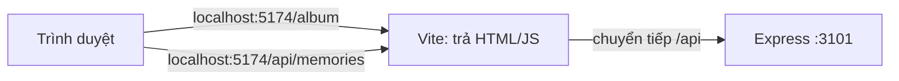

**React Router.**

- `<Routes>` chứa các `<Route path element>`.
- **Route lồng nhau**: route cha (không có `path`) vẽ một khung (`Layout`), route con hiện ra ở chỗ `<Outlet />` trong khung.
- **"Lính gác" (route guard)** là component quyết định cho vào hay chuyển hướng (`<Navigate>`):
  - `RequireAuth`: phải đăng nhập;
  - `GuestOnly`: chỉ người chưa đăng nhập.

**Trạng thái đăng nhập có 3 giá trị:**

| Giá trị | Nghĩa |
| --- | --- |
| `undefined` | Đang hỏi máy chủ, chưa biết |
| `null` | Chưa đăng nhập |
| `{ … }` | Đã đăng nhập |

Phân biệt `undefined` với `null` để khi tải lại trang, app **không** đá bạn sang `/login` trong tích tắc chưa kịp hỏi máy chủ.

#### 7.2 Làm từng bước

**Bước 1 — Cài thư viện:**

```bash
npm i react@19 react-dom@19 react-router@8
```

```bash
npm i -D vite@8 @vitejs/plugin-react@6 concurrently@10
```

`-D` là `devDependencies`: Vite và concurrently chỉ dùng khi phát triển.

**Bước 2 — `vite.config.js`** ở thư mục gốc:

```js
import { fileURLToPath } from 'node:url';
import { defineConfig } from 'vite';
import react from '@vitejs/plugin-react';

export default defineConfig({
  root: 'client', // mã giao diện nằm trong client/
  plugins: [react()], // hiểu cú pháp JSX, tự cập nhật trang khi sửa code (Fast Refresh)
  resolve: {
    // import ... from '@shared/limits.js' → thư mục shared/ dùng chung với máy chủ
    alias: { '@shared': fileURLToPath(new URL('./shared', import.meta.url)) },
  },
  server: {
    port: 5174,
    strictPort: true, // cổng bận (một "npm run dev" khác còn chạy) → báo lỗi ngay, không lặng lẽ sang 5175
    // Trình duyệt chỉ nói chuyện với Vite; mọi yêu cầu /api được Vite chuyển tiếp sang Express.
    // changeOrigin: false giữ nguyên địa chỉ trình duyệt đang dùng (localhost:5174) trong header Host.
    proxy: { '/api': { target: 'http://localhost:3101', changeOrigin: false } },
  },
  build: { outDir: 'dist', emptyOutDir: true }, // kết quả build: client/dist/
});
```

Hai dòng đáng chú ý trong `server`:

- **`strictPort: true`** — mặc định, nếu cổng 5174 đã có chương trình khác dùng (thường là một `npm run dev` bạn quên tắt ở cửa sổ
  khác), Vite **lặng lẽ** chạy sang 5175. Bạn sẽ có hai máy chủ cùng lúc mà không biết, và những thứ gắn với đúng một địa chỉ (đăng
  nhập Google ở chặng 14) sẽ hỏng. Với `strictPort`, Vite dừng và báo "Port 5174 is already in use": bạn biết ngay phải tắt cái cũ.
- **`changeOrigin: false`** — cách viết ngắn `proxy: { '/api': 'http://localhost:3101' }` khiến Vite đổi header `Host` thành
  `localhost:3101` trước khi chuyển tiếp. Máy chủ sẽ tưởng trình duyệt đang ở cổng 3101. Đa số API không để ý, nhưng ở chặng 14
  máy chủ dựng "địa chỉ quay về" cho Google từ `Host`, và Google sẽ báo `redirect_uri_mismatch`. Giữ nguyên `Host` thì máy chủ
  thấy đúng `localhost:5174`.

**Bước 3 — `client/index.html`:**

```html
<!doctype html>
<html lang="vi">
  <head>
    <meta charset="UTF-8" />
    <meta name="viewport" content="width=device-width, initial-scale=1.0" />
    <title>Mini Lane</title>
  </head>
  <body>
    <div id="root"></div>
    <script type="module" src="/src/main.jsx"></script>
  </body>
</html>
```

**Bước 4 — `client/src/main.jsx`**, điểm khởi đầu:

```jsx
import { StrictMode } from 'react';
import { createRoot } from 'react-dom/client';
import { BrowserRouter } from 'react-router';
import App from './App.jsx';
import { AuthProvider } from './auth.jsx';

// Điểm khởi đầu: gắn cây component React vào <div id="root"> trong index.html.
// Các "Provider" bọc ngoài cung cấp dữ liệu dùng chung cho MỌI component bên trong.
createRoot(document.getElementById('root')).render(
  <StrictMode>
    <BrowserRouter>
      <AuthProvider>
        <App />
      </AuthProvider>
    </BrowserRouter>
  </StrictMode>,
);
```

**Bước 5 — `client/src/api.js`**, nơi **duy nhất** gọi máy chủ:

```js
/**
 * NƠI DUY NHẤT gọi máy chủ. Mọi lời gọi:
 *  - tự gửi cookie phiên (cùng địa chỉ, HttpOnly — JavaScript không bao giờ thấy nó),
 *  - biến phản hồi lỗi thành ApiError { status, code, fields } để trang hiển thị câu dễ hiểu.
 */
export class ApiError extends Error {
  constructor(status, code, fields) {
    super(code);
    this.status = status;
    this.code = code;
    this.fields = fields ?? {};
  }
}

let onUnauthorized = () => {};
/** AuthProvider đăng ký hàm này: gặp 401 (phiên hết hạn…) thì coi như đã đăng xuất. */
export function setUnauthorizedHandler(handler) {
  onUnauthorized = handler;
}

async function request(method, path, body, { signal } = {}) {
  const init = { method, credentials: 'same-origin', signal, headers: { Accept: 'application/json' } };
  if (body !== undefined) {
    init.headers['Content-Type'] = 'application/json';
    init.body = JSON.stringify(body);
  }

  let response;
  try {
    response = await fetch(path, init);
  } catch (err) {
    if (err.name === 'AbortError') throw err; // yêu cầu bị huỷ có chủ ý (rời trang): không phải lỗi
    throw new ApiError(0, 'NETWORK'); // mất mạng, máy chủ tắt…
  }

  if (response.status === 204) return null;
  const data = await response.json().catch(() => ({}));
  if (!response.ok) {
    if (response.status === 401 && !path.startsWith('/api/auth/')) onUnauthorized();
    throw new ApiError(response.status, data.error ?? 'SERVER', data.fields);
  }
  return data;
}

export const api = {
  get: (path, options) => request('GET', path, undefined, options),
  post: (path, body, options) => request('POST', path, body, options),
  put: (path, body, options) => request('PUT', path, body, options),
  del: (path, options) => request('DELETE', path, undefined, options),
};
```

- Đường dẫn luôn **tương đối** (`/api/...`), không bao giờ `http://localhost:3101/...`. Nhờ vậy cookie được gửi kèm, và khi chạy thật
  không phải sửa gì.
- Lỗi luôn thành `ApiError { status, code, fields }`, đúng hình dạng máy chủ trả ở chặng 2.

**Bước 6 — `client/src/auth.jsx`:**

```jsx
import { createContext, useContext, useEffect, useMemo, useState } from 'react';
import { api, setUnauthorizedHandler } from './api.js';

/**
 * Ai đang đăng nhập? `user` có 3 trạng thái:
 *   undefined → đang hỏi máy chủ (chưa biết)
 *   null      → chưa đăng nhập
 *   { … }     → đã đăng nhập
 */
const AuthContext = createContext(null);

export function AuthProvider({ children }) {
  const [user, setUser] = useState(undefined);

  // Chạy MỘT lần khi app mở: hỏi máy chủ "cookie này là của ai?".
  useEffect(() => {
    setUnauthorizedHandler(() => setUser(null));
    api
      .get('/api/auth/session')
      .then((r) => setUser(r.user))
      .catch(() => setUser(null));
  }, []);

  const value = useMemo(
    () => ({
      user,
      async login(email, password) {
        const r = await api.post('/api/auth/login', { email, password });
        setUser(r.user);
      },
      async register(fields) {
        const r = await api.post('/api/auth/register', fields);
        setUser(r.user);
      },
      async logout() {
        await api.post('/api/auth/logout').catch(() => {});
        setUser(null);
      },
    }),
    [user],
  );

  return <AuthContext.Provider value={value}>{children}</AuthContext.Provider>;
}

/** Hook: mọi component gọi useAuth() để biết người dùng và gọi login/logout. */
export function useAuth() {
  const context = useContext(AuthContext);
  if (!context) throw new Error('useAuth phải nằm bên trong <AuthProvider>');
  return context;
}
```

`useMemo(() => ({…}), [user])` giữ **cùng một đối tượng** chừng nào `user` chưa đổi. Nếu tạo đối tượng mới mỗi lần vẽ, mọi component
dùng `useAuth()` sẽ vẽ lại vô ích.

**Bước 7 — "lính gác" `client/src/components/RouteGuards.jsx`:**

```jsx
import { Navigate, Outlet, useLocation } from 'react-router';
import { useAuth } from '../auth.jsx';

/** Trang cần đăng nhập. Chưa đăng nhập → sang /login, nhớ trang đang định vào để quay lại sau. */
export function RequireAuth({ children }) {
  const { user } = useAuth();
  const location = useLocation();
  if (user === undefined) return <p>Đang tải…</p>;
  if (!user) return <Navigate to="/login" replace state={{ from: location.pathname }} />;
  return children;
}

/** Trang đăng nhập / đăng ký: đã đăng nhập rồi thì đi thẳng tới nơi định đến (mặc định /album). */
export function GuestOnly() {
  const { user } = useAuth();
  const location = useLocation();
  if (user === undefined) return <p>Đang tải…</p>;
  if (user) return <Navigate to={location.state?.from ?? '/album'} replace />;
  return <Outlet />;
}
```

`state={{ from: location.pathname }}` gửi kèm "nơi định đến" khi chuyển sang `/login`. Đăng nhập xong, `GuestOnly` đưa người dùng
**quay lại đúng chỗ đó**. Chặng 12 dựa vào điều này để mở lại link mời.

**Bước 8 — khung trang `client/src/components/Layout.jsx`:**

```jsx
import { NavLink, Outlet } from 'react-router';
import { useAuth } from '../auth.jsx';

/** Khung chung của các trang sau đăng nhập: thanh trên cùng + nội dung trang (Outlet). */
export default function Layout() {
  const { user, logout } = useAuth();
  return (
    <>
      <header className="topbar">
        <strong className="brand">Mini Lane</strong>
        <nav>
          <NavLink to="/album">Album</NavLink>
        </nav>
        <span className="who">{user.name}</span>
        <button type="button" onClick={logout}>
          Đăng xuất
        </button>
      </header>
      <main className="page">
        <Outlet />
      </main>
    </>
  );
}
```

**Bước 9 — ba trang.** `client/src/pages/Login.jsx`:

```jsx
import { useState } from 'react';
import { Link } from 'react-router';
import { useAuth } from '../auth.jsx';

export default function Login() {
  const { login } = useAuth();
  const [email, setEmail] = useState('');
  const [password, setPassword] = useState('');
  const [error, setError] = useState(null);
  const [busy, setBusy] = useState(false);

  async function onSubmit(event) {
    event.preventDefault(); // chặn trình duyệt tự tải lại trang khi gửi form
    setBusy(true);
    setError(null);
    try {
      await login(email, password); // thành công → user đổi → GuestOnly tự chuyển sang /album
    } catch (err) {
      setError(err.code === 'INVALID_CREDENTIALS' ? 'Sai email hoặc mật khẩu.' : 'Có lỗi, hãy thử lại.');
      setBusy(false);
    }
  }

  return (
    <form className="card auth" onSubmit={onSubmit} noValidate>
      <h1>Đăng nhập</h1>
      {error && <p role="alert" className="error">{error}</p>}
      <label>
        Email
        <input type="email" autoComplete="email" value={email} onChange={(e) => setEmail(e.target.value)} />
      </label>
      <label>
        Mật khẩu
        <input type="password" autoComplete="current-password" value={password} onChange={(e) => setPassword(e.target.value)} />
      </label>
      <button type="submit" disabled={busy}>
        {busy ? 'Đang đăng nhập…' : 'Đăng nhập'}
      </button>
      <p>
        Chưa có tài khoản? <Link to="/register">Tạo mới</Link>
      </p>
    </form>
  );
}
```

- `event.preventDefault()`: mặc định trình duyệt **tải lại trang** khi gửi form. SPA không muốn thế.
- Ô nhập **có kiểm soát** (controlled input): `value={email}` cùng `onChange={(e) => setEmail(e.target.value)}`. React luôn biết ô đang
  chứa gì.
- Đăng nhập thành công **không cần** tự chuyển trang: `login()` đặt `user`, `GuestOnly` vẽ lại và tự `<Navigate>` sang `/album`.

`client/src/pages/Register.jsx`. Lỗi từng ô lấy từ `err.fields` mà máy chủ trả về:

```jsx
import { useState } from 'react';
import { Link } from 'react-router';
import { useAuth } from '../auth.jsx';

// Mã lỗi từ máy chủ → câu tiếng Việt. (Chặng 9 chuyển chúng vào từ điển đa ngôn ngữ.)
const MESSAGES = {
  REQUIRED: 'Không được để trống.',
  INVALID_EMAIL: 'Email chưa đúng.',
  EMAIL_TAKEN: 'Email này đã được dùng.',
  TOO_SHORT: 'Mật khẩu cần ít nhất 8 ký tự.',
  TOO_LONG: 'Quá dài.',
};

export default function Register() {
  const { register } = useAuth();
  const [fields, setFields] = useState({ name: '', email: '', password: '' });
  const [errors, setErrors] = useState({});
  const [busy, setBusy] = useState(false);

  // Một hàm cho mọi ô: cập nhật đúng thuộc tính theo tên ô.
  const update = (name) => (event) => setFields({ ...fields, [name]: event.target.value });

  async function onSubmit(event) {
    event.preventDefault();
    setBusy(true);
    try {
      await register(fields);
    } catch (err) {
      setErrors(err.fields ?? {}); // { email: { code: 'EMAIL_TAKEN' }, … }
      setBusy(false);
    }
  }

  const errorOf = (name) => errors[name] && <span className="error">{MESSAGES[errors[name].code] ?? errors[name].code}</span>;

  return (
    <form className="card auth" onSubmit={onSubmit} noValidate>
      <h1>Tạo tài khoản</h1>
      <label>
        Tên của bạn
        <input value={fields.name} onChange={update('name')} autoComplete="name" />
        {errorOf('name')}
      </label>
      <label>
        Email
        <input type="email" value={fields.email} onChange={update('email')} autoComplete="email" />
        {errorOf('email')}
      </label>
      <label>
        Mật khẩu
        <input type="password" value={fields.password} onChange={update('password')} autoComplete="new-password" />
        {errorOf('password')}
      </label>
      <button type="submit" disabled={busy}>
        Tạo tài khoản
      </button>
      <p>
        Đã có tài khoản? <Link to="/login">Đăng nhập</Link>
      </p>
    </form>
  );
}
```

`client/src/pages/Album.jsx`, lấy dữ liệu trong `useEffect`:

```jsx
import { useEffect, useState } from 'react';
import { api } from '../api.js';

export default function Album() {
  const [memories, setMemories] = useState(null); // null = đang tải
  const [error, setError] = useState(null);

  useEffect(() => {
    const controller = new AbortController();
    api
      .get('/api/memories', { signal: controller.signal })
      .then((data) => setMemories(data.memories))
      .catch((err) => {
        if (err.name !== 'AbortError') setError(err);
      });
    return () => controller.abort(); // rời trang trước khi tải xong → huỷ yêu cầu
  }, []);

  if (error) return <p className="error">Không tải được album.</p>;
  if (!memories) return <p>Đang tải…</p>;

  return (
    <>
      <h1>Album ({memories.length})</h1>
      {memories.length === 0 && <p>Chưa có kỷ niệm nào.</p>}
      <ul className="memories">
        {memories.map((memory) => (
          <li key={memory.id}>
            <strong>{memory.title}</strong> — {memory.day ? `${memory.day}/${memory.month}/` : ''}
            {memory.year}
            {memory.place && ` · ${memory.place}`}
          </li>
        ))}
      </ul>
    </>
  );
}
```

`key={memory.id}` bắt buộc khi vẽ danh sách: React dùng nó để biết phần tử nào thêm, bớt, đổi chỗ.

**Bước 10 — bảng định tuyến `client/src/App.jsx`:**

```jsx
import { Navigate, Route, Routes } from 'react-router';
import Layout from './components/Layout.jsx';
import { GuestOnly, RequireAuth } from './components/RouteGuards.jsx';
import Album from './pages/Album.jsx';
import Login from './pages/Login.jsx';
import Register from './pages/Register.jsx';

export default function App() {
  return (
    <Routes>
      <Route path="/" element={<Navigate to="/album" replace />} />

      {/* Chỉ dành cho người CHƯA đăng nhập */}
      <Route element={<GuestOnly />}>
        <Route path="/login" element={<Login />} />
        <Route path="/register" element={<Register />} />
      </Route>

      {/* Phải đăng nhập; Layout bọc ngoài, trang con hiện ở <Outlet /> */}
      <Route
        element={
          <RequireAuth>
            <Layout />
          </RequireAuth>
        }
      >
        <Route path="/album" element={<Album />} />
      </Route>

      <Route path="*" element={<p>Không tìm thấy trang.</p>} />
    </Routes>
  );
}
```

**Bước 11 — script chạy cả hai cùng lúc:**

```bash
npm pkg set scripts.dev='concurrently -k -n api,web -c yellow,cyan "npm:dev:api" "npm:dev:web"' scripts.dev:web="vite" scripts.build="vite build"
```

`concurrently` chạy `dev:api` (Express) và `dev:web` (Vite) trong **một** terminal, log mỗi bên một màu. `-k`: tắt một bên thì tắt cả hai.

#### 7.3 Kiểm tra

```bash
npm run dev
```

Mở **http://localhost:5174/album**. Đây là những gì đã thấy khi chạy thử, bạn làm lại từng bước:

1. Chưa đăng nhập: tự chuyển sang `/login`.
2. Bấm "Tạo mới", bấm "Tạo tài khoản" khi chưa điền gì: ba dòng "Không được để trống." hiện dưới ba ô. Đó là lỗi **từ máy chủ**.
3. Điền tên, email, mật khẩu dài hơn 8 ký tự rồi gửi: vào `/album`, thấy "Album (0)" và "Chưa có kỷ niệm nào.".
4. **Tải lại trang** (F5): vẫn đăng nhập, vì cookie vẫn còn.
5. Bấm "Đăng xuất": về `/login`.
6. Đăng nhập bằng `an@example.com` / `matkhau-an` (tài khoản `npm run seed` tạo ở chặng 5): thấy "Album (4)" với 4 kỷ niệm.

Mở **DevTools** (F12), tab **Network**, rồi tải lại trang:

- Yêu cầu `session` và `memories` đi tới `localhost:5174/api/...`, có cookie kèm theo.
- Tab **Application → Cookies** thấy `mini_session` có dấu tick **HttpOnly**. Gõ `document.cookie` trong tab Console: nó **không** hiện
  ra, đúng như thiết kế.

Thử build:

```bash
npm run build
```

```text
client/dist/index.html                  0.32 kB │ gzip:  0.22 kB
client/dist/assets/index-DmwlpavZ.js  263.87 kB │ gzip: 83.99 kB
✓ built in 118ms
```

#### 7.4 Lỗi hay gặp

| Triệu chứng | Nguyên nhân | Cách sửa |
| --- | --- | --- |
| Trang trắng, Console báo `Failed to resolve import` | Sai đường dẫn hoặc thiếu đuôi `.jsx` | So lại tên tệp và đường dẫn import |
| Console báo lỗi **CORS**, hoặc đăng nhập xong mà cookie không được dùng | Gọi thẳng `http://localhost:3101/api/...` (khác địa chỉ với trang) thay vì `/api/...` | Luôn dùng đường dẫn tương đối để đi qua proxy |
| Console: `Each child in a list should have a unique "key" prop` | Quên `key` khi `map` danh sách | `key={memory.id}` |
| Trình duyệt gửi yêu cầu liên tục không dứt | `useEffect` thiếu mảng phụ thuộc, hoặc đặt state làm effect chạy lại | Thêm `[]` (hoặc đúng các phụ thuộc) |
| `useAuth phải nằm bên trong <AuthProvider>` | Component dùng `useAuth` nằm ngoài `AuthProvider` | Xem lại thứ tự Provider trong `main.jsx` |
| `http proxy error ... ECONNREFUSED` trong log Vite | Máy chủ API chưa chạy | Dùng `npm run dev` (chạy cả hai), đừng chỉ `vite` |

#### 7.5 Đối chiếu với bản thật

- **`client/src/main.jsx`**: thêm font, 6 tệp CSS và các Provider `ThemeProvider`, `I18nProvider`, `ToastProvider` (bạn làm hai cái đầu
  ở chặng 9–10).
- **`client/src/App.jsx`**:
  - Trang riêng tư được **tải theo nhu cầu**: `lazy(() => import('./pages/Today.jsx'))` + `<Suspense>`. Người chỉ ghé trang giới thiệu
    không phải tải code của mọi trang.
  - Có thêm trang `/` (giới thiệu hoặc chuyển sang `/today`) và `ScrollToTop`.
- **`client/src/api.js`**: giống hệt, thêm nhánh gửi `FormData` (tải tệp).
- **`client/src/auth.jsx`**:
  - đăng nhập demo;
  - quy tắc ngôn ngữ (lựa chọn trên máy được ưu tiên, nếu không thì theo tài khoản);
  - `signedOut` dùng `startTransition`, để lúc đăng xuất "rời trang" và "quên người dùng" xảy ra cùng một lần vẽ.
- **`components/RouteGuards.jsx`**: `returnPath()` chỉ nhận đường dẫn **nội bộ** (`/…` nhưng không phải `//…`), để không ai lợi dụng
  `from` đưa người dùng sang trang khác.
- **`pages/Login.jsx`**: dùng `Field` (nhãn + ô + lỗi nối sẵn cho trình đọc màn hình), `PasswordInput` (nút hiện/ẩn mật khẩu),
  `SubmitButton`, nút Google và nút demo.

#### 7.6 Tự kiểm tra

1. State khác props ở đâu? Ai được phép thay đổi mỗi loại?
2. Vì sao `user` có ba trạng thái mà không chỉ hai?
3. Proxy của Vite giải quyết vấn đề gì? Chạy thật thì ai làm việc đó? (Gợi ý: chặng 15.)
4. Vì sao `GuestOnly` tự chuyển trang được mà `Login` không cần gọi `navigate`?
5. **Bài tập:** thêm trang `/about` công khai, có link từ trang đăng nhập. Dùng `<Link>` chứ không dùng `<a href>`. Vì sao?

**Commit:** `git add -A && git commit -m "feat(web): giao diện React đầu tiên"`

---

### Chặng 8 — Dữ liệu trên giao diện: useFetch, form, hộp thoại

**Mục tiêu:**

- Thêm và sửa kỷ niệm trong một **hộp thoại**.
- Trang chi tiết `/album/:id` có nút **Xoá**.
- Mọi danh sách **tự cập nhật** sau khi lưu.
- Lỗi của từng ô hiện ngay dưới ô đó.

#### 8.1 Khái niệm

**Custom hook `useFetch(path)`.** Ở chặng 7, trang Album tự viết `useEffect` + `AbortController` + state. Trang nào cũng phải viết lại
đúng đoạn ấy. Gom nó thành **một hook** để mỗi trang chỉ cần:

```jsx
const { data, error, retry } = useFetch('/api/memories');
```

**"Phiên bản dữ liệu" (`refresh()`).** Sau khi lưu một kỷ niệm, album, trang chi tiết và bộ đếm phải cập nhật. Cách đơn giản và
chắc chắn:

1. `DataProvider` giữ một con số `version`.
2. `useFetch` liệt kê `version` trong mảng phụ thuộc của effect.
3. Gọi `refresh()` là tăng `version`, và **mọi** `useFetch` đang hiện trên màn hình tự tải lại.

Không cần thư viện quản lý state nào.

**Thẻ `<dialog>` có sẵn của trình duyệt.** `dialog.showModal()` cho ta miễn phí:

- nền mờ (`::backdrop`);
- giữ con trỏ bàn phím **bên trong** hộp thoại;
- phím **Esc** để đóng;
- phần trang phía sau bị "khoá" với trình đọc màn hình.

Tự làm hộp thoại bằng `<div>` thì phải viết lại tất cả những thứ đó, và thường làm thiếu.

**Lỗi "nổi bọt" (event bubbling).** Sự kiện xảy ra ở phần tử con được báo ngược lên mọi phần tử cha. Hộp thoại nghe sự kiện `cancel`
(phím Esc) để đóng. Nhưng ô chọn tệp `<input type="file">` **cũng** phát sự kiện `cancel` khi bạn đóng cửa sổ chọn tệp, và nó nổi bọt
lên hộp thoại. Không kiểm tra `event.target`, **đóng cửa sổ chọn ảnh là đóng luôn cả form**. Đây đúng là lỗi bạn đã gặp ở bản thật
(vòng 3), và cách sửa nằm trong `Modal.jsx` dưới đây.

**Form có kiểm soát với một đối tượng `values`.**

- Mỗi ô ứng với một thuộc tính.
- Một hàm `update(name)` dùng chung cho mọi ô.
- Ô trống giữ `''` chứ không phải `null`: React không nhận `null` làm `value` của ô nhập.

#### 8.2 Làm từng bước

**Bước 1 — `client/src/state.jsx`:**

```jsx
import { createContext, useCallback, useContext, useEffect, useMemo, useState } from 'react';
import { api } from './api.js';

/*
 * "Phiên bản dữ liệu": mọi danh sách đang hiện trên màn hình tự tải lại khi version tăng.
 * Sau mỗi lần lưu/xoá ta gọi refresh() — album, trang chi tiết… cập nhật cùng lúc, không cần F5.
 */
const DataContext = createContext({ version: 0, refresh: () => {} });

export function DataProvider({ children }) {
  const [version, setVersion] = useState(0);
  const refresh = useCallback(() => setVersion((v) => v + 1), []);
  const value = useMemo(() => ({ version, refresh }), [version, refresh]);
  return <DataContext.Provider value={value}>{children}</DataContext.Provider>;
}

export const useData = () => useContext(DataContext);

/**
 * GET `path` và giữ { data, error, loading } luôn khớp với nó.
 * Đổi path → huỷ yêu cầu cũ (AbortController), tải cái mới. Truyền null để không tải gì.
 */
export function useFetch(path) {
  const { version } = useData();
  const [state, setState] = useState({ data: null, error: null, loading: Boolean(path) });
  const [attempt, setAttempt] = useState(0);

  useEffect(() => {
    if (!path) return undefined;
    const controller = new AbortController();
    setState((s) => ({ ...s, error: null, loading: true })); // giữ dữ liệu cũ trong lúc tải lại: không nháy trang
    api
      .get(path, { signal: controller.signal })
      .then((data) => setState({ data, error: null, loading: false }))
      .catch((error) => {
        if (error.name !== 'AbortError') setState((s) => ({ ...s, error, loading: false }));
      });
    return () => controller.abort();
  }, [path, version, attempt]); // chạy lại khi đổi đường dẫn, khi refresh(), khi bấm "Thử lại"

  const retry = useCallback(() => setAttempt((n) => n + 1), []);
  return { ...state, retry };
}
```

`setState((s) => ({ ...s, … }))` dùng **dạng hàm** khi giá trị mới phụ thuộc giá trị cũ. React có thể gộp nhiều lần đặt state, và dạng
hàm luôn nhận giá trị mới nhất.

**Bước 2 — hàm hiển thị ngày `client/src/lib/dates.js`** (tạm thời, chặng 9 sẽ thay bằng định dạng theo ngôn ngữ):

```js
/** Kỷ niệm có thể chỉ nhớ năm, hoặc năm + tháng, hoặc đủ ngày. (Chặng 9 thay bằng Intl theo ngôn ngữ.) */
export function memoryDate({ year, month, day }) {
  if (month && day) return `${day}/${month}/${year}`;
  if (month) return `tháng ${month}/${year}`;
  return String(year);
}
```

**Bước 3 — hộp thoại `client/src/components/Modal.jsx`:**

```jsx
import { useEffect, useId, useRef } from 'react';

/**
 * Hộp thoại dựa trên thẻ <dialog> có sẵn của trình duyệt: showModal() tự giữ tiêu điểm bên trong,
 * phím Esc đóng được, phần còn lại của trang bị "khoá" với trình đọc màn hình.
 * Nội dung chỉ được vẽ khi mở, nên mỗi lần mở là một form mới tinh.
 */
export default function Modal({ open, onClose, title, children }) {
  const ref = useRef(null);
  const titleId = useId();

  useEffect(() => {
    const dialog = ref.current;
    if (open && !dialog.open) dialog.showModal();
    if (!open && dialog.open) dialog.close();
  }, [open]);

  return (
    <dialog
      ref={ref}
      className="modal"
      aria-labelledby={titleId}
      onCancel={(event) => {
        // Chỉ nhận "cancel" của CHÍNH hộp thoại (phím Esc). Ô chọn tệp bên trong cũng phát sự kiện cancel
        // khi bạn đóng cửa sổ chọn tệp, và sự kiện đó "nổi bọt" lên đây — thiếu dòng này là form bị đóng nhầm.
        if (event.target !== event.currentTarget) return;
        event.preventDefault();
        onClose();
      }}
      // Bấm ra vùng tối bên ngoài: cú bấm rơi đúng vào thẻ <dialog>.
      onMouseDown={(event) => event.target === ref.current && onClose()}
    >
      {open && (
        <div className="modal-card">
          <header className="modal-head">
            <h2 id={titleId}>{title}</h2>
            <button type="button" onClick={onClose} aria-label="Đóng">
              ×
            </button>
          </header>
          {children}
        </div>
      )}
    </dialog>
  );
}
```

**Bước 4 — form `client/src/components/MemoryForm.jsx`**, dùng cho cả thêm và sửa:

```jsx
import { useState } from 'react';
import { LIMITS } from '@shared/limits.js';
import { api } from '../api.js';

const MESSAGES = {
  REQUIRED: 'Không được để trống.',
  TOO_LONG: 'Quá dài.',
  OUT_OF_RANGE: 'Ngoài khoảng cho phép.',
  INVALID_DATE: 'Ngày này không tồn tại.',
  REQUIRED_FOR_DAY: 'Có ngày thì cần chọn tháng.',
};

/** Một ô nhập ↔ một thuộc tính của `values`. Rỗng → '' (ô nhập của React không nhận null). */
const fromMemory = (m) => ({
  title: m?.title ?? '',
  year: m?.year ?? '',
  month: m?.month ?? '',
  day: m?.day ?? '',
  place: m?.place ?? '',
  story: m?.story ?? '',
});

/** Form thêm (memory = undefined) hoặc sửa (memory = {...}) một kỷ niệm. */
export default function MemoryForm({ memory, onSaved, onCancel }) {
  const [values, setValues] = useState(() => fromMemory(memory));
  const [errors, setErrors] = useState({});
  const [busy, setBusy] = useState(false);

  const update = (name) => (event) => setValues((v) => ({ ...v, [name]: event.target.value }));
  const errorOf = (name) =>
    errors[name] && (
      <span className="error" role="alert">
        {MESSAGES[errors[name].code] ?? errors[name].code}
      </span>
    );

  async function onSubmit(event) {
    event.preventDefault();
    setBusy(true);
    setErrors({});
    try {
      const body = { ...values }; // máy chủ tự hiểu '' là "để trống" và tự đổi '2019' thành số
      const r = memory ? await api.put(`/api/memories/${memory.id}`, body) : await api.post('/api/memories', body);
      onSaved(r.memory);
    } catch (err) {
      setErrors(err.fields ?? { title: { code: err.code } });
      setBusy(false);
    }
  }

  return (
    <form className="form" onSubmit={onSubmit} noValidate>
      <label>
        Tiêu đề
        <input value={values.title} onChange={update('title')} maxLength={LIMITS.memoryTitle} autoFocus />
        {errorOf('title')}
      </label>
      <div className="row">
        <label>
          Năm
          <input type="number" value={values.year} onChange={update('year')} min={LIMITS.yearMin} max={new Date().getFullYear()} />
          {errorOf('year')}
        </label>
        <label>
          Tháng
          <input type="number" value={values.month} onChange={update('month')} min={1} max={12} />
          {errorOf('month')}
        </label>
        <label>
          Ngày
          <input type="number" value={values.day} onChange={update('day')} min={1} max={31} />
          {errorOf('day')}
        </label>
      </div>
      <label>
        Nơi chốn
        <input value={values.place} onChange={update('place')} maxLength={LIMITS.memoryPlace} />
      </label>
      <label>
        Câu chuyện
        <textarea rows={4} value={values.story} onChange={update('story')} maxLength={LIMITS.memoryStory} />
      </label>
      <div className="actions">
        <button type="button" onClick={onCancel} disabled={busy}>
          Huỷ
        </button>
        <button type="submit" disabled={busy}>
          {busy ? 'Đang lưu…' : 'Lưu'}
        </button>
      </div>
    </form>
  );
}
```

- `useState(() => fromMemory(memory))`: truyền **hàm** để giá trị ban đầu chỉ tính một lần.
- `maxLength`/`min`/`max` lấy từ **`@shared/limits.js`**, cùng con số máy chủ dùng để kiểm tra (chặng 2).
- Gửi `body` nguyên chuỗi: `''` nghĩa là "để trống", `'2019'` được validator của máy chủ đổi thành số.

**Bước 5 — trang Album dùng `useFetch` và mở form trong hộp thoại:**

```jsx
import { useState } from 'react';
import { Link, useNavigate } from 'react-router';
import MemoryForm from '../components/MemoryForm.jsx';
import Modal from '../components/Modal.jsx';
import { memoryDate } from '../lib/dates.js';
import { useData, useFetch } from '../state.jsx';

export default function Album() {
  const { data, error, retry } = useFetch('/api/memories');
  const { refresh } = useData();
  const navigate = useNavigate();
  const [adding, setAdding] = useState(false);

  return (
    <>
      <div className="page-head">
        <h1>Album {data && `(${data.memories.length})`}</h1>
        <button type="button" onClick={() => setAdding(true)}>
          + Thêm kỷ niệm
        </button>
      </div>

      {error && (
        <p className="error">
          Không tải được album. <button onClick={retry}>Thử lại</button>
        </p>
      )}
      {!data && !error && <p aria-busy="true">Đang tải…</p>}
      {data?.memories.length === 0 && <p>Chưa có kỷ niệm nào. Bấm “Thêm kỷ niệm” để bắt đầu.</p>}

      <ul className="memories">
        {data?.memories.map((memory) => (
          <li key={memory.id}>
            <Link to={`/album/${memory.id}`}>{memory.title}</Link>
            <span className="meta">
              {memoryDate(memory)}
              {memory.place && ` · ${memory.place}`}
            </span>
          </li>
        ))}
      </ul>

      <Modal open={adding} onClose={() => setAdding(false)} title="Kỷ niệm mới">
        <MemoryForm
          onCancel={() => setAdding(false)}
          onSaved={(memory) => {
            setAdding(false);
            refresh(); // mọi useFetch đang hiện sẽ tải lại
            navigate(`/album/${memory.id}`);
          }}
        />
      </Modal>
    </>
  );
}
```

**Bước 6 — trang chi tiết `client/src/pages/MemoryPage.jsx`:**

```jsx
import { useState } from 'react';
import { Link, useNavigate, useParams } from 'react-router';
import { api } from '../api.js';
import MemoryForm from '../components/MemoryForm.jsx';
import Modal from '../components/Modal.jsx';
import { memoryDate } from '../lib/dates.js';
import { useData, useFetch } from '../state.jsx';

export default function MemoryPage() {
  const { id } = useParams(); // /album/:id → id
  const { data, error } = useFetch(`/api/memories/${id}`);
  const { refresh } = useData();
  const navigate = useNavigate();
  const [editing, setEditing] = useState(false);

  if (error?.status === 404) return <p>Không tìm thấy kỷ niệm này.</p>;
  if (error) return <p className="error">Không tải được kỷ niệm.</p>;
  if (!data) return <p aria-busy="true">Đang tải…</p>;
  const { memory } = data;

  async function remove() {
    if (!window.confirm(`Xoá “${memory.title}”? Không thể hoàn tác.`)) return;
    await api.del(`/api/memories/${memory.id}`);
    refresh();
    navigate('/album');
  }

  return (
    <article className="memory">
      <Link to="/album">← Album</Link>
      <h1>{memory.title}</h1>
      <p className="meta">
        {memoryDate(memory)}
        {memory.place && ` · ${memory.place}`}
      </p>
      {memory.story && <p className="story">{memory.story}</p>}
      <div className="actions">
        <button type="button" onClick={() => setEditing(true)}>
          Sửa
        </button>
        <button type="button" className="danger" onClick={remove}>
          Xoá
        </button>
      </div>

      <Modal open={editing} onClose={() => setEditing(false)} title="Sửa kỷ niệm">
        <MemoryForm
          memory={memory}
          onCancel={() => setEditing(false)}
          onSaved={() => {
            setEditing(false);
            refresh();
          }}
        />
      </Modal>
    </article>
  );
}
```

- `useParams()` đọc `:id` trên đường dẫn.
- `error?.status === 404` trả lời "không tìm thấy", gồm cả kỷ niệm của người khác (chặng 5).

**Bước 7 — thêm route và `DataProvider`:**

```diff
@@ -4,4 +4,5 @@
 import Album from './pages/Album.jsx';
 import Login from './pages/Login.jsx';
+import MemoryPage from './pages/MemoryPage.jsx';
 import Register from './pages/Register.jsx';
 
@@ -26,4 +27,5 @@
       >
         <Route path="/album" element={<Album />} />
+        <Route path="/album/:id" element={<MemoryPage />} />
       </Route>
 
```

```diff
@@ -1,4 +1,5 @@
 import { NavLink, Outlet } from 'react-router';
 import { useAuth } from '../auth.jsx';
+import { DataProvider } from '../state.jsx';
 
 /** Khung chung của các trang sau đăng nhập: thanh trên cùng + nội dung trang (Outlet). */
@@ -6,5 +7,5 @@
   const { user, logout } = useAuth();
   return (
-    <>
+    <DataProvider>
       <header className="topbar">
         <strong className="brand">Mini Lane</strong>
@@ -20,5 +21,5 @@
         <Outlet />
       </main>
-    </>
+    </DataProvider>
   );
 }
```

`DataProvider` đặt trong `Layout` vì chỉ phần sau đăng nhập mới cần nó.

#### 8.3 Kiểm tra

Chạy `npm run dev`, đăng nhập An, rồi:

1. Bấm "+ Thêm kỷ niệm". Hộp thoại mở ra. (Con trỏ đang nằm ở nút "×" chứ không ở ô Tiêu đề; chặng 10 sẽ sửa.)
2. Để trống tiêu đề, nhập năm 2019, tháng 2, ngày 30, bấm Lưu. Hai lỗi hiện **dưới đúng ô**: "Không được để trống." (Tiêu đề) và "Ngày
   này không tồn tại." (Ngày).
3. Sửa tiêu đề thành "Hồ Tây", ngày 28, bấm Lưu. Hộp thoại đóng, trang chuyển sang `/album/5` và hiện "Hồ Tây · 28/2/2019".
4. Bấm "Sửa", đổi tiêu đề thành "Hồ Tây lộng gió", Lưu. Tiêu đề trên trang đổi **ngay**, không cần F5.
5. Bấm "Xoá" và đồng ý. Trang về `/album`, danh sách còn 4.
6. Gõ thẳng `http://localhost:5174/album/9999`: "Không tìm thấy kỷ niệm này.".
7. Mở form, nhấn **Esc**: form đóng. Mở lại: các ô trống trơn (form "mới tinh" mỗi lần mở).

Trong tab Network, mỗi lần lưu bạn sẽ thấy đúng **một** `POST`/`PUT`, sau đó là các `GET` do `refresh()` gây ra.

#### 8.4 Lỗi hay gặp

| Triệu chứng | Nguyên nhân | Cách sửa |
| --- | --- | --- |
| Console: `A component is changing an uncontrolled input to be controlled` | `value` của ô nhập là `null`/`undefined` | Dùng `''` cho ô trống, như `fromMemory()` |
| Lưu xong mà danh sách không đổi | Quên gọi `refresh()` | Gọi trong `onSaved` |
| Mở form lần hai vẫn thấy dữ liệu cũ | Vẽ form cả khi hộp thoại đóng, nên state cũ còn nguyên | Chỉ vẽ nội dung khi `open` (`{open && …}`) |
| Đóng cửa sổ chọn tệp làm đóng luôn form (chặng 11) | Sự kiện `cancel` nổi bọt từ ô chọn tệp | `if (event.target !== event.currentTarget) return;` |
| Khi dev, mỗi trang gọi API **hai lần** | `<StrictMode>` cố ý chạy effect hai lần | Bình thường; bản build không như vậy. `AbortController` huỷ lần thừa |

#### 8.5 Đối chiếu với bản thật

- **`client/src/state.jsx`**:
  - `useFetch` có thêm `lastPath`: đổi sang trang khác thì xoá dữ liệu cũ, còn tải lại cùng trang thì giữ dữ liệu cũ, không nháy.
  - Có thêm `usePageTitle`, `ComposerProvider` (mở form kỷ niệm từ **bất kỳ đâu**: thanh trên cùng, album, trang Hôm nay), chế độ kín
    đáo.
- **`components/Modal.jsx`**: thêm `locked` (không cho đóng khi đang tải tệp lên), `kicker` (dòng chữ nhỏ trên tiêu đề) và
  `data-autofocus` (chặng 10).
- **`components/forms/MemoryForm.jsx`** (644 dòng). Ngoài các ô của bạn còn có:
  - kéo thả nhiều ảnh/video, chọn ảnh bìa, đổi thứ tự;
  - người có mặt;
  - **mục chia sẻ ngay trong form**;
  - tải từng tệp, có thể dừng giữa chừng.
  Đọc nó **sau** chặng 11–12.
- **`components/ConfirmDialog.jsx`** thay cho `window.confirm`: hộp thoại cùng phong cách với app, dịch được câu chữ.
- **`pages/MemoryDetail.jsx`**: bộ ảnh, lời nhắn, khung chia sẻ, ảnh nhỏ các thẻ đã lưu vào Kỷ vật, nút tạo thẻ kỷ niệm.

#### 8.6 Tự kiểm tra

1. `useFetch` tải lại khi nào? Liệt kê ba lý do (gợi ý: mảng phụ thuộc).
2. Vì sao dùng `<dialog>` có sẵn thay vì tự làm bằng `<div>`?
3. Sự kiện "nổi bọt" là gì? Vì sao nó làm đóng nhầm form?
4. **Bài tập:** thay `window.confirm` bằng component `ConfirmDialog` dựng trên `Modal` (có nút "Huỷ" và "Xoá"). So với
   `components/ConfirmDialog.jsx` của bản thật.

**Commit:** `git add -A && git commit -m "feat(web): thêm, sửa, xoá kỷ niệm"`

---

### Chặng 9 — Hai ngôn ngữ

**Mục tiêu:**

- Nút **VI | EN** đổi toàn bộ giao diện tức thì: câu chữ, ngày tháng ("14 tháng 10, 2021" ⇄ "October 14, 2021"), số nhiều ("4 kỷ
  niệm" ⇄ "4 memories"), và cả câu báo lỗi.
- Lựa chọn được nhớ sau khi tải lại trang.
- Một bài kiểm thử bảo đảm hai từ điển không bao giờ lệch nhau.

#### 9.1 Khái niệm

**Từ điển.** Mọi câu chữ nằm trong hai tệp **cùng cấu trúc khoá**: `vi.js` và `en.js`. Khoá đặt theo màn hình (`auth.loginTitle`,
`album.count`…). Code chỉ biết khoá: `t('album.count', { count: 4 })`.

**Hàm `t(key, vars)`:**

1. Tìm khoá trong từ điển của ngôn ngữ hiện tại. Không có thì dùng tạm tiếng Anh; vẫn không có thì trả về **chính khoá**, để lỗi lộ
   rõ trên màn hình.
2. **Số nhiều.** Tiếng Anh: "1 memory", "2 memories". Tiếng Việt: "1 kỷ niệm", "2 kỷ niệm".
   - `Intl.PluralRules` (có sẵn trong trình duyệt) biết luật của mọi ngôn ngữ: với `en`, `select(1)` trả `'one'`, `select(4)` trả
     `'other'`; với `vi` luôn là `'other'`.
   - Vì vậy trong `en.js`, `count` là `{ one, other }`, còn trong `vi.js` chỉ cần một chuỗi.
3. Thay `{tên}` trong câu bằng `vars.tên`.

**Ngày tháng theo ngôn ngữ.**

- `Intl.DateTimeFormat('vi-VN', …)` cho "14 tháng 10, 2021", `en-US` cho "October 14, 2021". Không phải tự viết mảng tên tháng.
- Kỷ niệm là **ngày lịch**, không phải thời điểm. Định dạng với `timeZone: 'UTC'` để không bị lùi một ngày ở múi giờ âm.

**Lỗi máy chủ.** Chặng 2 đã để máy chủ trả **mã**. Giờ giao diện dịch mã:

- `errors.INVALID_CREDENTIALS` → "Sai email hoặc mật khẩu.";
- `errors.field.TOO_LONG` với `{ max: 120 }` → "Tối đa 120 ký tự.".

Đổi ngôn ngữ thì câu báo lỗi **đang hiện** cũng đổi theo, vì ta lưu **đối tượng lỗi**, chỉ dịch lúc vẽ.

**Kiểm thử từ điển.** Con người hay quên. Bài kiểm thử tự kiểm tra:

- hai từ điển có cùng khoá;
- cùng `{biến}` trong mỗi câu;
- không câu nào trống;
- mọi `t('…')` trong code đều có khoá;
- mọi mã lỗi máy chủ có thể gửi đều có câu dịch.

#### 9.2 Làm từng bước

**Bước 1 — hai từ điển.** `client/src/i18n/vi.js`:

```js
// Toàn bộ chữ tiếng Việt của giao diện. Các khoá phải khớp HOÀN TOÀN với en.js (npm test kiểm tra).
export default {
  app: { name: 'Mini Lane', loading: 'Đang tải…', notFound: 'Không tìm thấy trang.' },
  nav: { album: 'Album', logout: 'Đăng xuất', language: 'Ngôn ngữ' },
  auth: {
    loginTitle: 'Đăng nhập',
    registerTitle: 'Tạo tài khoản',
    name: 'Tên của bạn',
    email: 'Email',
    password: 'Mật khẩu',
    submitLogin: 'Đăng nhập',
    submitRegister: 'Tạo tài khoản',
    busy: 'Đang xử lý…',
    noAccount: 'Chưa có tài khoản?',
    toRegister: 'Tạo mới',
    haveAccount: 'Đã có tài khoản?',
    toLogin: 'Đăng nhập',
  },
  album: {
    title: 'Album',
    count: '{count} kỷ niệm', // tiếng Việt không đổi dạng theo số nhiều
    add: '+ Thêm kỷ niệm',
    empty: 'Chưa có kỷ niệm nào. Bấm “Thêm kỷ niệm” để bắt đầu.',
    loadError: 'Không tải được album.',
    retry: 'Thử lại',
  },
  memory: {
    newTitle: 'Kỷ niệm mới',
    editTitle: 'Sửa kỷ niệm',
    back: '← Album',
    notFound: 'Không tìm thấy kỷ niệm này.',
    loadError: 'Không tải được kỷ niệm.',
    edit: 'Sửa',
    delete: 'Xoá',
    confirmDelete: 'Xoá “{title}”? Không thể hoàn tác.',
    title: 'Tiêu đề',
    year: 'Năm',
    month: 'Tháng',
    day: 'Ngày',
    place: 'Nơi chốn',
    story: 'Câu chuyện',
    cancel: 'Huỷ',
    save: 'Lưu',
    saving: 'Đang lưu…',
  },
  common: { close: 'Đóng' },
  errors: {
    INVALID_CREDENTIALS: 'Sai email hoặc mật khẩu.',
    UNAUTHORIZED: 'Phiên đăng nhập đã hết. Hãy đăng nhập lại.',
    RATE_LIMITED: 'Bạn thử quá nhiều lần. Hãy đợi một lát.',
    NETWORK: 'Không kết nối được máy chủ.',
    SERVER: 'Có lỗi, hãy thử lại.',
    field: {
      REQUIRED: 'Không được để trống.',
      TOO_LONG: 'Tối đa {max} ký tự.',
      TOO_SHORT: 'Cần ít nhất {min} ký tự.',
      OUT_OF_RANGE: 'Chỉ nhận từ {min} đến {max}.',
      INVALID_EMAIL: 'Email chưa đúng.',
      EMAIL_TAKEN: 'Email này đã được dùng.',
      INVALID_DATE: 'Ngày này không tồn tại.',
      REQUIRED_FOR_DAY: 'Có ngày thì cần chọn tháng.',
    },
  },
};
```

`client/src/i18n/en.js` có **đúng các khoá đó**. Để ý `album.count` ở dạng số nhiều:

```js
export default {
  app: { name: 'Mini Lane', loading: 'Loading…', notFound: 'Page not found.' },
  nav: { album: 'Album', logout: 'Log out', language: 'Language' },
  auth: {
    loginTitle: 'Log in',
    registerTitle: 'Create an account',
    name: 'Your name',
    email: 'Email',
    password: 'Password',
    submitLogin: 'Log in',
    submitRegister: 'Create account',
    busy: 'Working…',
    noAccount: 'No account yet?',
    toRegister: 'Sign up',
    haveAccount: 'Already have an account?',
    toLogin: 'Log in',
  },
  album: {
    title: 'Album',
    count: { one: '{count} memory', other: '{count} memories' }, // tiếng Anh có số ít / số nhiều
    add: '+ Add a memory',
    empty: 'No memories yet. Press “Add a memory” to start.',
    loadError: 'Could not load the album.',
    retry: 'Try again',
  },
  memory: {
    newTitle: 'New memory',
    editTitle: 'Edit memory',
    back: '← Album',
    notFound: 'This memory does not exist.',
    loadError: 'Could not load this memory.',
    edit: 'Edit',
    delete: 'Delete',
    confirmDelete: 'Delete “{title}”? This cannot be undone.',
    title: 'Title',
    year: 'Year',
    month: 'Month',
    day: 'Day',
    place: 'Place',
    story: 'Story',
    cancel: 'Cancel',
    save: 'Save',
    saving: 'Saving…',
  },
  common: { close: 'Close' },
  errors: {
    INVALID_CREDENTIALS: 'Wrong email or password.',
    UNAUTHORIZED: 'Your session has ended. Please log in again.',
    RATE_LIMITED: 'Too many attempts. Please wait a moment.',
    NETWORK: 'Cannot reach the server.',
    SERVER: 'Something went wrong. Please try again.',
    field: {
      REQUIRED: 'Required.',
      TOO_LONG: 'At most {max} characters.',
      TOO_SHORT: 'At least {min} characters.',
      OUT_OF_RANGE: 'Between {min} and {max}.',
      INVALID_EMAIL: 'This is not a valid email.',
      EMAIL_TAKEN: 'This email is already used.',
      INVALID_DATE: 'This date does not exist.',
      REQUIRED_FOR_DAY: 'Pick a month to set a day.',
    },
  },
};
```

**Bước 2 — bộ máy dịch `client/src/i18n/index.jsx`:**

```jsx
import { createContext, useCallback, useContext, useEffect, useMemo, useState } from 'react';
import en from './en.js';
import vi from './vi.js';

const DICTIONARIES = { vi, en };
export const LOCALES = ['vi', 'en'];
const INTL_LOCALE = { vi: 'vi-VN', en: 'en-US' };
const STORAGE_KEY = 'mini.locale';

/** 'memory.confirmDelete' → dictionary.memory.confirmDelete */
function lookup(dictionary, key) {
  return key.split('.').reduce((node, part) => (node == null ? undefined : node[part]), dictionary);
}

/**
 * t('album.count', { count: 3 }) → "3 kỷ niệm" / "3 memories"
 *  - thiếu khoá ở tiếng Việt → dùng tạm tiếng Anh; thiếu cả hai → trả về chính khoá (dễ thấy để sửa)
 *  - giá trị dạng { one, other } → chọn theo luật số nhiều của ngôn ngữ (Intl.PluralRules)
 *  - {tên} trong câu → thay bằng vars.tên
 */
export function translate(locale, key, vars) {
  let entry = lookup(DICTIONARIES[locale], key) ?? lookup(DICTIONARIES.en, key);
  if (entry === undefined) return key;
  if (typeof entry === 'object' && typeof vars?.count === 'number') {
    const category = new Intl.PluralRules(INTL_LOCALE[locale]).select(vars.count); // 'one' | 'other' | …
    entry = entry[category] ?? entry.other;
  }
  if (typeof entry !== 'string') return key;
  return entry.replace(/\{(\w+)\}/g, (match, name) => (vars?.[name] ?? match).toString());
}

/** Lần đầu vào: lựa chọn đã lưu trên máy, nếu không thì theo ngôn ngữ của trình duyệt. */
function detectLocale() {
  try {
    const saved = localStorage.getItem(STORAGE_KEY);
    if (LOCALES.includes(saved)) return saved;
  } catch {
    // trình duyệt chặn localStorage (chế độ riêng tư): bỏ qua
  }
  return navigator.language?.toLowerCase().startsWith('vi') ? 'vi' : 'en';
}

const I18nContext = createContext(null);

export function I18nProvider({ children }) {
  const [locale, setLocaleState] = useState(detectLocale);

  useEffect(() => {
    document.documentElement.lang = locale; // trình đọc màn hình đọc đúng giọng, trình duyệt gạch chính tả đúng
  }, [locale]);

  const setLocale = useCallback((next) => {
    if (!LOCALES.includes(next)) return;
    setLocaleState(next);
    try {
      localStorage.setItem(STORAGE_KEY, next);
    } catch {
      // không lưu được: lựa chọn chỉ có tác dụng trong lần truy cập này
    }
  }, []);

  const value = useMemo(() => {
    const intl = INTL_LOCALE[locale];
    return {
      locale,
      setLocale,
      t: (key, vars) => translate(locale, key, vars),
      /** Ngày của kỷ niệm theo đúng thói quen mỗi ngôn ngữ: "12 tháng 10, 2019" / "October 12, 2019". */
      memoryDate({ year, month, day }) {
        const format = (options) => new Intl.DateTimeFormat(intl, { timeZone: 'UTC', ...options });
        if (month && day) return format({ day: 'numeric', month: 'long', year: 'numeric' }).format(Date.UTC(year, month - 1, day));
        if (month) return format({ month: 'long', year: 'numeric' }).format(Date.UTC(year, month - 1, 1));
        return String(year);
      },
    };
  }, [locale, setLocale]);

  return <I18nContext.Provider value={value}>{children}</I18nContext.Provider>;
}

export function useI18n() {
  const context = useContext(I18nContext);
  if (!context) throw new Error('useI18n phải nằm bên trong <I18nProvider>');
  return context;
}

/** Lỗi của một ô từ máy chủ ({ code: 'TOO_LONG', max: 120 }) → câu đã dịch, có điền {max}. */
export function fieldMessage(t, error) {
  return error ? t(`errors.field.${error.code}`, error) : null;
}

/** Lỗi chung (ApiError) → câu đã dịch. */
export function errorMessage(t, error) {
  const key = `errors.${error?.code}`;
  const text = t(key);
  return text === key ? t('errors.SERVER') : text;
}
```

- `useState(detectLocale)`: truyền **hàm** (không gọi), nên `detectLocale` chỉ chạy một lần lúc khởi tạo.
- `localStorage` có thể bị chặn (chế độ riêng tư, một số trình duyệt): luôn bọc trong `try/catch`.

**Bước 3 — nút chọn ngôn ngữ `client/src/components/LanguageToggle.jsx`:**

```jsx
import { LOCALES, useI18n } from '../i18n/index.jsx';

/** Hai nút VI | EN. aria-pressed cho trình đọc màn hình biết nút nào đang chọn. */
export default function LanguageToggle() {
  const { locale, setLocale, t } = useI18n();
  return (
    <div className="segmented" role="group" aria-label={t('nav.language')}>
      {LOCALES.map((code) => (
        <button key={code} type="button" aria-pressed={locale === code} onClick={() => setLocale(code)}>
          {code.toUpperCase()}
        </button>
      ))}
    </div>
  );
}
```

**Bước 4 — bọc app trong `I18nProvider`:**

```diff
@@ -4,13 +4,14 @@
 import App from './App.jsx';
 import { AuthProvider } from './auth.jsx';
+import { I18nProvider } from './i18n/index.jsx';
 
-// Điểm khởi đầu: gắn cây component React vào <div id="root"> trong index.html.
-// Các "Provider" bọc ngoài cung cấp dữ liệu dùng chung cho MỌI component bên trong.
 createRoot(document.getElementById('root')).render(
   <StrictMode>
     <BrowserRouter>
-      <AuthProvider>
-        <App />
-      </AuthProvider>
+      <I18nProvider>
+        <AuthProvider>
+          <App />
+        </AuthProvider>
+      </I18nProvider>
     </BrowserRouter>
   </StrictMode>,
```

**Bước 5 — thay mọi câu chữ bằng `t()`.** Hai trang đăng nhập, đăng ký viết lại hẳn:

```jsx
import { useState } from 'react';
import { Link } from 'react-router';
import { useAuth } from '../auth.jsx';
import { errorMessage, useI18n } from '../i18n/index.jsx';

export default function Login() {
  const { login } = useAuth();
  const { t } = useI18n();
  const [email, setEmail] = useState('');
  const [password, setPassword] = useState('');
  const [error, setError] = useState(null);
  const [busy, setBusy] = useState(false);

  async function onSubmit(event) {
    event.preventDefault();
    setBusy(true);
    setError(null);
    try {
      await login(email, password);
    } catch (err) {
      setError(err); // lưu cả lỗi, dịch lúc hiển thị: đổi ngôn ngữ thì câu báo lỗi đổi theo
      setBusy(false);
    }
  }

  return (
    <form className="card auth" onSubmit={onSubmit} noValidate>
      <h1>{t('auth.loginTitle')}</h1>
      {error && (
        <p role="alert" className="error">
          {errorMessage(t, error)}
        </p>
      )}
      <label>
        {t('auth.email')}
        <input type="email" autoComplete="email" value={email} onChange={(e) => setEmail(e.target.value)} />
      </label>
      <label>
        {t('auth.password')}
        <input type="password" autoComplete="current-password" value={password} onChange={(e) => setPassword(e.target.value)} />
      </label>
      <button type="submit" className="primary" disabled={busy}>
        {busy ? t('auth.busy') : t('auth.submitLogin')}
      </button>
      <p>
        {t('auth.noAccount')} <Link to="/register">{t('auth.toRegister')}</Link>
      </p>
    </form>
  );
}
```

```jsx
import { useState } from 'react';
import { Link } from 'react-router';
import { LIMITS } from '@shared/limits.js';
import { useAuth } from '../auth.jsx';
import { errorMessage, fieldMessage, useI18n } from '../i18n/index.jsx';

export default function Register() {
  const { register } = useAuth();
  const { t } = useI18n();
  const [fields, setFields] = useState({ name: '', email: '', password: '' });
  const [errors, setErrors] = useState({});
  const [formError, setFormError] = useState(null);
  const [busy, setBusy] = useState(false);

  const update = (name) => (event) => setFields({ ...fields, [name]: event.target.value });
  const errorOf = (name) => errors[name] && <span className="error">{fieldMessage(t, errors[name])}</span>;

  async function onSubmit(event) {
    event.preventDefault();
    setBusy(true);
    setFormError(null);
    try {
      await register(fields);
    } catch (err) {
      setErrors(err.fields ?? {});
      if (!err.fields || !Object.keys(err.fields).length) setFormError(err); // lỗi chung: mạng, quá số lần thử…
      setBusy(false);
    }
  }

  return (
    <form className="card auth" onSubmit={onSubmit} noValidate>
      <h1>{t('auth.registerTitle')}</h1>
      {formError && (
        <p role="alert" className="error">
          {errorMessage(t, formError)}
        </p>
      )}
      <label>
        {t('auth.name')}
        <input value={fields.name} onChange={update('name')} autoComplete="name" maxLength={LIMITS.userName} />
        {errorOf('name')}
      </label>
      <label>
        {t('auth.email')}
        <input type="email" value={fields.email} onChange={update('email')} autoComplete="email" />
        {errorOf('email')}
      </label>
      <label>
        {t('auth.password')}
        <input type="password" value={fields.password} onChange={update('password')} autoComplete="new-password" />
        {errorOf('password')}
      </label>
      <button type="submit" className="primary" disabled={busy}>
        {busy ? t('auth.busy') : t('auth.submitRegister')}
      </button>
      <p>
        {t('auth.haveAccount')} <Link to="/login">{t('auth.toLogin')}</Link>
      </p>
    </form>
  );
}
```

Các tệp còn lại chỉ đổi chữ thành `t('…')`:

```diff
@@ -2,12 +2,5 @@
 import { LIMITS } from '@shared/limits.js';
 import { api } from '../api.js';
-
-const MESSAGES = {
-  REQUIRED: 'Không được để trống.',
-  TOO_LONG: 'Quá dài.',
-  OUT_OF_RANGE: 'Ngoài khoảng cho phép.',
-  INVALID_DATE: 'Ngày này không tồn tại.',
-  REQUIRED_FOR_DAY: 'Có ngày thì cần chọn tháng.',
-};
+import { fieldMessage, useI18n } from '../i18n/index.jsx';
 
 /** Một ô nhập ↔ một thuộc tính của `values`. Rỗng → '' (ô nhập của React không nhận null). */
@@ -23,4 +16,5 @@
 /** Form thêm (memory = undefined) hoặc sửa (memory = {...}) một kỷ niệm. */
 export default function MemoryForm({ memory, onSaved, onCancel }) {
+  const { t } = useI18n();
   const [values, setValues] = useState(() => fromMemory(memory));
   const [errors, setErrors] = useState({});
@@ -31,5 +25,5 @@
     errors[name] && (
       <span className="error" role="alert">
-        {MESSAGES[errors[name].code] ?? errors[name].code}
+        {fieldMessage(t, errors[name])}
       </span>
     );
@@ -52,5 +46,5 @@
     <form className="form" onSubmit={onSubmit} noValidate>
       <label>
-        Tiêu đề
+        {t('memory.title')}
         <input value={values.title} onChange={update('title')} maxLength={LIMITS.memoryTitle} autoFocus />
         {errorOf('title')}
@@ -58,15 +52,15 @@
       <div className="row">
         <label>
-          Năm
+          {t('memory.year')}
           <input type="number" value={values.year} onChange={update('year')} min={LIMITS.yearMin} max={new Date().getFullYear()} />
           {errorOf('year')}
         </label>
         <label>
-          Tháng
+          {t('memory.month')}
           <input type="number" value={values.month} onChange={update('month')} min={1} max={12} />
           {errorOf('month')}
         </label>
         <label>
-          Ngày
+          {t('memory.day')}
           <input type="number" value={values.day} onChange={update('day')} min={1} max={31} />
           {errorOf('day')}
@@ -74,17 +68,17 @@
       </div>
       <label>
-        Nơi chốn
+        {t('memory.place')}
         <input value={values.place} onChange={update('place')} maxLength={LIMITS.memoryPlace} />
       </label>
       <label>
-        Câu chuyện
+        {t('memory.story')}
         <textarea rows={4} value={values.story} onChange={update('story')} maxLength={LIMITS.memoryStory} />
       </label>
       <div className="actions">
         <button type="button" onClick={onCancel} disabled={busy}>
-          Huỷ
+          {t('memory.cancel')}
         </button>
-        <button type="submit" disabled={busy}>
-          {busy ? 'Đang lưu…' : 'Lưu'}
+        <button type="submit" className="primary" disabled={busy}>
+          {busy ? t('memory.saving') : t('memory.save')}
         </button>
       </div>
```

```diff
@@ -3,8 +3,9 @@
 import MemoryForm from '../components/MemoryForm.jsx';
 import Modal from '../components/Modal.jsx';
-import { memoryDate } from '../lib/dates.js';
+import { useI18n } from '../i18n/index.jsx';
 import { useData, useFetch } from '../state.jsx';
 
 export default function Album() {
+  const { t, memoryDate } = useI18n();
   const { data, error, retry } = useFetch('/api/memories');
   const { refresh } = useData();
@@ -15,7 +16,10 @@
     <>
       <div className="page-head">
-        <h1>Album {data && `(${data.memories.length})`}</h1>
-        <button type="button" onClick={() => setAdding(true)}>
-          + Thêm kỷ niệm
+        <div>
+          <h1>{t('album.title')}</h1>
+          {data && <p className="meta">{t('album.count', { count: data.memories.length })}</p>}
+        </div>
+        <button type="button" className="primary" onClick={() => setAdding(true)}>
+          {t('album.add')}
         </button>
       </div>
@@ -23,9 +27,9 @@
       {error && (
         <p className="error">
-          Không tải được album. <button onClick={retry}>Thử lại</button>
+          {t('album.loadError')} <button onClick={retry}>{t('album.retry')}</button>
         </p>
       )}
-      {!data && !error && <p aria-busy="true">Đang tải…</p>}
-      {data?.memories.length === 0 && <p>Chưa có kỷ niệm nào. Bấm “Thêm kỷ niệm” để bắt đầu.</p>}
+      {!data && !error && <p aria-busy="true">{t('app.loading')}</p>}
+      {data?.memories.length === 0 && <p>{t('album.empty')}</p>}
 
       <ul className="memories">
@@ -41,5 +45,5 @@
       </ul>
 
-      <Modal open={adding} onClose={() => setAdding(false)} title="Kỷ niệm mới">
+      <Modal open={adding} onClose={() => setAdding(false)} title={t('memory.newTitle')}>
         <MemoryForm
           onCancel={() => setAdding(false)}
```

```diff
@@ -4,8 +4,9 @@
 import MemoryForm from '../components/MemoryForm.jsx';
 import Modal from '../components/Modal.jsx';
-import { memoryDate } from '../lib/dates.js';
+import { useI18n } from '../i18n/index.jsx';
 import { useData, useFetch } from '../state.jsx';
 
 export default function MemoryPage() {
+  const { t, memoryDate } = useI18n();
   const { id } = useParams(); // /album/:id → id
   const { data, error } = useFetch(`/api/memories/${id}`);
@@ -14,11 +15,11 @@
   const [editing, setEditing] = useState(false);
 
-  if (error?.status === 404) return <p>Không tìm thấy kỷ niệm này.</p>;
-  if (error) return <p className="error">Không tải được kỷ niệm.</p>;
-  if (!data) return <p aria-busy="true">Đang tải…</p>;
+  if (error?.status === 404) return <p>{t('memory.notFound')}</p>;
+  if (error) return <p className="error">{t('memory.loadError')}</p>;
+  if (!data) return <p aria-busy="true">{t('app.loading')}</p>;
   const { memory } = data;
 
   async function remove() {
-    if (!window.confirm(`Xoá “${memory.title}”? Không thể hoàn tác.`)) return;
+    if (!window.confirm(t('memory.confirmDelete', { title: memory.title }))) return;
     await api.del(`/api/memories/${memory.id}`);
     refresh();
@@ -28,5 +29,5 @@
   return (
     <article className="memory">
-      <Link to="/album">← Album</Link>
+      <Link to="/album">{t('memory.back')}</Link>
       <h1>{memory.title}</h1>
       <p className="meta">
@@ -37,12 +38,12 @@
       <div className="actions">
         <button type="button" onClick={() => setEditing(true)}>
-          Sửa
+          {t('memory.edit')}
         </button>
         <button type="button" className="danger" onClick={remove}>
-          Xoá
+          {t('memory.delete')}
         </button>
       </div>
 
-      <Modal open={editing} onClose={() => setEditing(false)} title="Sửa kỷ niệm">
+      <Modal open={editing} onClose={() => setEditing(false)} title={t('memory.editTitle')}>
         <MemoryForm
           memory={memory}
```

```diff
@@ -1,19 +1,22 @@
 import { NavLink, Outlet } from 'react-router';
 import { useAuth } from '../auth.jsx';
+import { useI18n } from '../i18n/index.jsx';
 import { DataProvider } from '../state.jsx';
+import LanguageToggle from './LanguageToggle.jsx';
 
-/** Khung chung của các trang sau đăng nhập: thanh trên cùng + nội dung trang (Outlet). */
 export default function Layout() {
   const { user, logout } = useAuth();
+  const { t } = useI18n();
   return (
     <DataProvider>
       <header className="topbar">
-        <strong className="brand">Mini Lane</strong>
+        <strong className="brand">{t('app.name')}</strong>
         <nav>
-          <NavLink to="/album">Album</NavLink>
+          <NavLink to="/album">{t('nav.album')}</NavLink>
         </nav>
+        <LanguageToggle />
         <span className="who">{user.name}</span>
         <button type="button" onClick={logout}>
-          Đăng xuất
+          {t('nav.logout')}
         </button>
       </header>
```

```diff
@@ -1,4 +1,10 @@
 import { Navigate, Outlet, useLocation } from 'react-router';
 import { useAuth } from '../auth.jsx';
+import { useI18n } from '../i18n/index.jsx';
+
+function Loading() {
+  const { t } = useI18n();
+  return <p aria-busy="true">{t('app.loading')}</p>;
+}
 
 /** Trang cần đăng nhập. Chưa đăng nhập → sang /login, nhớ trang đang định vào để quay lại sau. */
@@ -6,5 +12,5 @@
   const { user } = useAuth();
   const location = useLocation();
-  if (user === undefined) return <p>Đang tải…</p>;
+  if (user === undefined) return <Loading />;
   if (!user) return <Navigate to="/login" replace state={{ from: location.pathname }} />;
   return children;
@@ -15,5 +21,5 @@
   const { user } = useAuth();
   const location = useLocation();
-  if (user === undefined) return <p>Đang tải…</p>;
+  if (user === undefined) return <Loading />;
   if (user) return <Navigate to={location.state?.from ?? '/album'} replace />;
   return <Outlet />;
```

```diff
@@ -1,3 +1,4 @@
 import { useEffect, useId, useRef } from 'react';
+import { useI18n } from '../i18n/index.jsx';
 
 /**
@@ -9,4 +10,5 @@
   const ref = useRef(null);
   const titleId = useId();
+  const { t } = useI18n();
 
   useEffect(() => {
@@ -28,5 +30,4 @@
         onClose();
       }}
-      // Bấm ra vùng tối bên ngoài: cú bấm rơi đúng vào thẻ <dialog>.
       onMouseDown={(event) => event.target === ref.current && onClose()}
     >
@@ -35,5 +36,5 @@
           <header className="modal-head">
             <h2 id={titleId}>{title}</h2>
-            <button type="button" onClick={onClose} aria-label="Đóng">
+            <button type="button" className="icon" onClick={onClose} aria-label={t('common.close')}>
               ×
             </button>
```

```diff
@@ -2,4 +2,5 @@
 import Layout from './components/Layout.jsx';
 import { GuestOnly, RequireAuth } from './components/RouteGuards.jsx';
+import { useI18n } from './i18n/index.jsx';
 import Album from './pages/Album.jsx';
 import Login from './pages/Login.jsx';
@@ -8,9 +9,9 @@
 
 export default function App() {
+  const { t } = useI18n();
   return (
     <Routes>
       <Route path="/" element={<Navigate to="/album" replace />} />
 
-      {/* Chỉ dành cho người CHƯA đăng nhập */}
       <Route element={<GuestOnly />}>
         <Route path="/login" element={<Login />} />
@@ -18,5 +19,4 @@
       </Route>
 
-      {/* Phải đăng nhập; Layout bọc ngoài, trang con hiện ở <Outlet /> */}
       <Route
         element={
@@ -30,5 +30,5 @@
       </Route>
 
-      <Route path="*" element={<p>Không tìm thấy trang.</p>} />
+      <Route path="*" element={<p>{t('app.notFound')}</p>} />
     </Routes>
   );
```

`memoryDate` giờ do `useI18n()` cung cấp, nên xoá tệp tạm của chặng 8:

```bash
git rm client/src/lib/dates.js
```

**Bước 6 — kiểm thử từ điển `test/i18n.test.js`:**

```js
import { test } from 'node:test';
import assert from 'node:assert/strict';
import fs from 'node:fs';
import path from 'node:path';
import en from '../client/src/i18n/en.js';
import vi from '../client/src/i18n/vi.js';

/** { a: { b: 'x' } } → { 'a.b': 'x' }. Giá trị số nhiều { one, other } được tính là MỘT khoá. */
function flatten(node, prefix = '', out = {}) {
  for (const [key, value] of Object.entries(node)) {
    const full = prefix ? `${prefix}.${key}` : key;
    const isPlural = value && typeof value === 'object' && 'other' in value;
    if (value && typeof value === 'object' && !isPlural) flatten(value, full, out);
    else out[full] = value;
  }
  return out;
}
const placeholders = (value) =>
  [...new Set(JSON.stringify(value).match(/\{\w+\}/g) ?? [])].sort().join(' ');

const EN = flatten(en);
const VI = flatten(vi);

/** Mọi tệp .js/.jsx trong một thư mục (đệ quy). */
function sourceFiles(dir) {
  return fs.readdirSync(dir, { withFileTypes: true }).flatMap((entry) => {
    const full = path.join(dir, entry.name);
    if (entry.isDirectory()) return sourceFiles(full);
    return /\.jsx?$/.test(entry.name) ? [full] : [];
  });
}
const read = (file) => fs.readFileSync(file, 'utf8');

test('hai từ điển có đúng cùng một bộ khoá', () => {
  assert.deepEqual(Object.keys(VI).sort(), Object.keys(EN).sort());
});

test('cùng {biến} trong mỗi câu, và không câu nào bị bỏ trống', () => {
  for (const key of Object.keys(EN)) {
    assert.equal(placeholders(VI[key]), placeholders(EN[key]), `khoá ${key}`);
    assert.ok(JSON.stringify(VI[key]).replace(/"/g, '').trim(), `khoá ${key} đang trống`);
  }
});

test('mọi khoá t("...") dùng trong giao diện đều có trong từ điển', () => {
  for (const file of sourceFiles('client/src')) {
    for (const [, key] of read(file).matchAll(/\bt\(\s*'([\w.]+)'/g)) {
      assert.ok(key in EN, `${path.basename(file)} dùng khoá không tồn tại: ${key}`);
    }
  }
});

test('mọi mã lỗi máy chủ có thể gửi đều có câu dịch', () => {
  for (const file of sourceFiles('server')) {
    const code = read(file);
    for (const [, name] of code.matchAll(/fail\([^,]+,\s*'([A-Z_]+)'/g)) {
      assert.ok(`errors.field.${name}` in EN, `thiếu errors.field.${name}`);
    }
    for (const [, name] of code.matchAll(/HttpError\(\s*(?:401|429)\s*,\s*'([A-Z_]+)'/g)) {
      assert.ok(`errors.${name}` in EN, `thiếu errors.${name}`);
    }
  }
});
```

Bài kiểm thử đọc **mã nguồn** như văn bản và dùng biểu thức chính quy để tìm `t('…')`, `fail(…, 'MÃ')`, `HttpError(…, 'MÃ')`. Không
cần chạy giao diện.

#### 9.3 Kiểm tra

```bash
npm test
```

**Chuyện có thật khi viết hướng dẫn:** lần chạy đầu tiên, bài kiểm thử mới **đỏ**:

```text
✖ mọi mã lỗi máy chủ có thể gửi đều có câu dịch
  AssertionError [ERR_ASSERTION]: thiếu errors.UNAUTHORIZED
```

Mã `UNAUTHORIZED` (phiên hết hạn) đã bị quên khi viết từ điển. Bài kiểm thử tìm ra trước khi người dùng thấy chữ
`errors.UNAUTHORIZED` trên màn hình. Hai từ điển ở trên **đã** có dòng này. Kết quả bây giờ:

```text
ℹ tests 16
ℹ pass 16
```

Trong trình duyệt (`npm run dev`):

| Thao tác | Kết quả |
| --- | --- |
| Đăng nhập sai mật khẩu | "Sai email hoặc mật khẩu." |
| Đăng nhập An | "4 kỷ niệm", ngày "14 tháng 10, 2021" |
| Bấm **EN** | "4 memories", "October 14, 2021", nút "Log out" |
| Tải lại trang | Vẫn tiếng Anh; DevTools → Elements: `<html lang="en">` |

#### 9.4 Lỗi hay gặp

| Triệu chứng | Nguyên nhân | Cách sửa |
| --- | --- | --- |
| Màn hình hiện nguyên chữ `album.cout` | Gõ sai khoá | `npm test` chỉ ra đúng tệp và khoá |
| Câu hiện nguyên `{name}` | Gõ sai tên biến trong từ điển (`{ten}`) hoặc quên truyền `vars` | So với bản tiếng Anh; bài kiểm thử "cùng {biến}" bắt được |
| Ngày hiện **lùi một ngày** | Định dạng ngày lịch bằng giờ địa phương | `timeZone: 'UTC'` + `Date.UTC(…)` |
| Lỗi cú pháp ở `vi.js` | Dấu nháy đơn trong câu (`'Ba nói 'cố lên''`) | Viết `\'`, hoặc dùng ngoặc kép cong “…” |

#### 9.5 Đối chiếu với bản thật

- **`client/src/i18n/index.jsx`**: cùng `translate()`, nhưng có thêm:
  - định dạng **số** theo ngôn ngữ cho `{count}`;
  - nhiều hàm ngày: `fullDate`, `monthYear`, `timestamp`, dòng ngày trên trang Hôm nay, và `ago()` ("5 năm trước" / "5 years ago",
    dùng `Intl.RelativeTimeFormat`);
  - khi dev, cảnh báo khoá thiếu trong Console.
- **`client/src/auth.jsx`**: ngôn ngữ còn được lưu **trong tài khoản**, nên đăng nhập máy khác vẫn đúng ngôn ngữ, trừ khi máy đó đã
  được chọn ngôn ngữ riêng.
- **`client/src/i18n/vi.js`**: mỗi nhóm có chú thích "ở màn hình nào". Câu nháp mới có đánh dấu "✎ MỚI". Hướng dẫn sửa:
  [SUA-NOI-DUNG-TIENG-VIET.md](docs/SUA-NOI-DUNG-TIENG-VIET.md).
- **`test/i18n.test.js`**: có thêm danh sách khoá "ghép lúc chạy" (`nav.tabs.${…}`). Bạn sẽ gặp đúng vấn đề này ở chặng 10.

#### 9.6 Tự kiểm tra

1. Vì sao `en.js` cần `{ one, other }` mà `vi.js` chỉ cần một chuỗi?
2. Vì sao lưu **đối tượng lỗi** vào state, chứ không lưu câu đã dịch?
3. Thêm tiếng Nhật thì phải sửa những đâu?
4. **Bài tập:** dưới mỗi kỷ niệm, hiện "lưu cách đây 3 ngày" / "saved 3 days ago" từ `createdAt`, dùng `Intl.RelativeTimeFormat`. So với
   hàm `ago()` của bản thật.

**Commit:** `git add -A && git commit -m "feat(i18n): tiếng Việt và tiếng Anh"`

---

### Chặng 10 — CSS, design token và hai giao diện

**Mục tiêu:**

- App có diện mạo hoàn chỉnh, với hai giao diện **Sổ tay** và **Phòng tối** đổi tức thì.
- Font có dấu tiếng Việt tự đóng gói, không gọi Google Fonts.
- Dùng tốt trên điện thoại.
- Mở form thì con trỏ nằm ngay ô đầu tiên.

<p>
  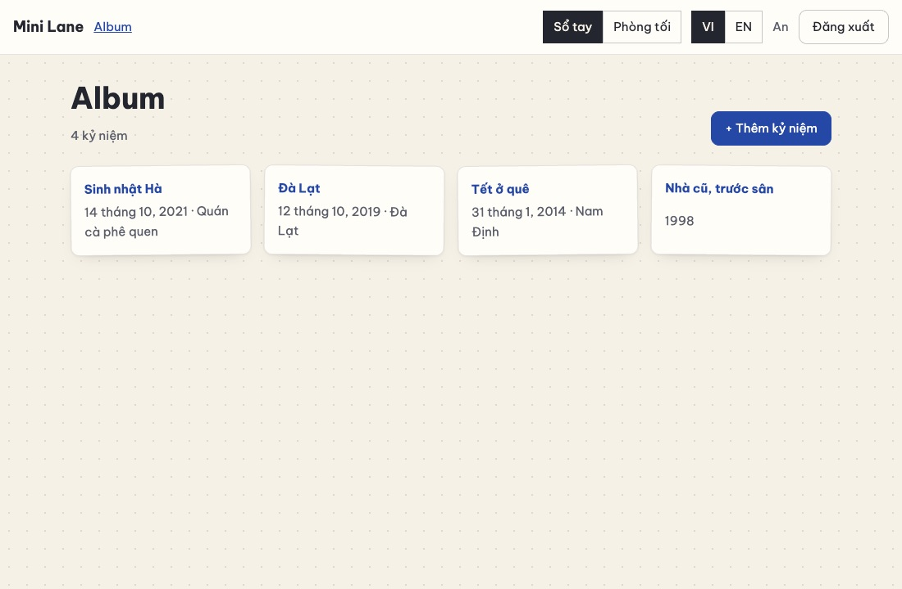
  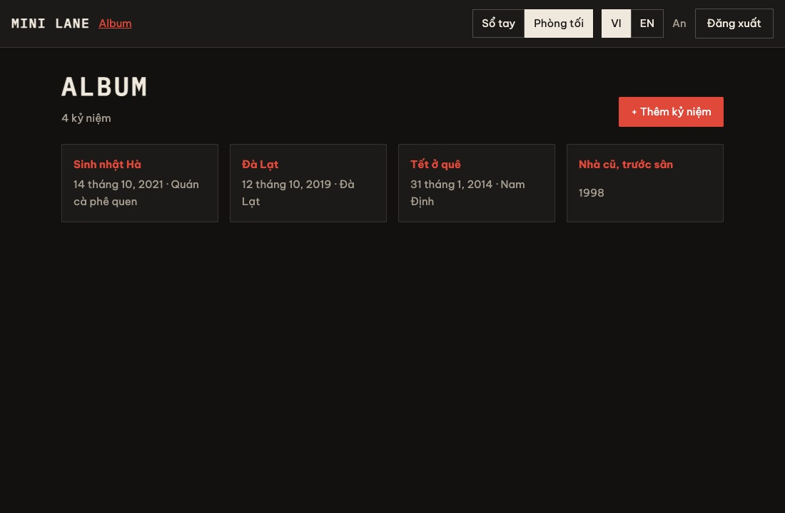
</p>

#### 10.1 Khái niệm

**Design token = biến CSS.** Thay vì rải mã màu `#2547a6` khắp nơi, ta đặt tên cho nó: `--accent`. Mọi quy tắc CSS chỉ dùng
`var(--accent)`. Kiến trúc có hai tầng:

| Tầng | Tệp | Chứa gì |
| --- | --- | --- |
| **Nền móng** | `base.css` | Bố cục, kích thước, mọi thành phần (nút, ô nhập, thẻ…). **Chỉ dùng biến**, không có màu cụ thể |
| **Giao diện** | `notebook.css`, `darkroom.css` | **Giá trị** cho các biến, đặt trong `[data-theme='notebook'] { … }`, cộng vài chi tiết trang trí riêng |

Đổi giao diện = đổi **một thuộc tính** trên thẻ `<html>`: `data-theme="darkroom"`. Mọi biến đổi giá trị cùng lúc, không component
React nào phải vẽ lại. Muốn thêm giao diện thứ ba, chỉ cần thêm một tệp.

**Không "nháy" sai màu.**

- React chỉ chạy **sau khi** trang đã vẽ lần đầu. Nếu đợi React mới đặt `data-theme`, người chọn Phòng tối sẽ thấy trang trắng loé lên
  một khoảnh khắc.
- Vì vậy một script **rất nhỏ** (`theme-init.js`) chạy ngay trong `<head>`, trước lần vẽ đầu tiên.
- Nó phải là **tệp riêng**: CSP ở chặng 6 cấm `<script>` viết thẳng trong HTML.
- Lần đầu vào, chưa chọn gì, thì theo chế độ sáng/tối của hệ điều hành (`prefers-color-scheme`).

**Bố cục co giãn không cần media query:**

- `grid-template-columns: repeat(auto-fill, minmax(220px, 1fr))` nghĩa là "xếp bao nhiêu cột cũng được, mỗi cột tối thiểu 220px".
  Máy tính có 4 cột, điện thoại 1 cột, tự động.
- `clamp(26px, 4vw, 36px)`: chữ to dần theo bề rộng màn hình, có mức tối thiểu và tối đa.

**Riêng cho điện thoại:**

| Quy tắc | Vì sao |
| --- | --- |
| Ô nhập `font-size: 16px` | Dưới 16px, Safari trên iPhone **tự phóng to cả trang** khi chạm vào ô nhập |
| `min-height: 100dvh` | `dvh` là chiều cao **thật** của màn hình, đã trừ thanh địa chỉ đang hiện. `vh` trên điện thoại thì không |
| `env(safe-area-inset-left)` + `viewport-fit=cover` | Chừa chỗ cho "tai thỏ" và góc bo khi xoay ngang iPhone |
| Nút cao tối thiểu 40px | Vùng chạm vừa ngón tay |
| `html:has(dialog[open]) { overflow: hidden }` | Hộp thoại đang mở thì trang phía sau không trôi theo ngón tay |

**Font tự đóng gói.**

- Gói `@fontsource/be-vietnam-pro` chứa tệp font. Vite chép chúng vào bản build, kèm khai báo `unicode-range`.
- Trình duyệt chỉ tải phần font **chứa các chữ trên trang**: phần tiếng Việt (`vietnamese`) và Latin, bỏ qua Cyrillic…
- Không một yêu cầu nào đi tới Google. Riêng tư hơn và hợp với CSP `'self'`.

**Trợ năng:**

- `:focus-visible` vẽ viền rõ khi dùng **bàn phím**, không vẽ khi bấm chuột.
- `prefers-reduced-motion` tắt hiệu ứng cho người bị say chuyển động.
- `aria-pressed` cho biết nút nào trong nhóm đang được chọn.

#### 10.2 Làm từng bước

**Bước 1 — Cài font:**

```bash
npm i @fontsource/be-vietnam-pro@5 @fontsource/ibm-plex-mono@5
```

**Bước 2 — nền móng `client/src/styles/base.css`:**

```css
/* ==========================================================================
   Nền móng chung: reset, bố cục, mọi thành phần — viết bằng BIẾN (design token).
   Mỗi giao diện (notebook.css, darkroom.css) chỉ đặt giá trị cho các biến và thêm vài chi tiết riêng.
   ========================================================================== */

:root {
  /* Thang khoảng cách 4px: dùng lại khắp nơi để mọi thứ "thẳng hàng" */
  --s1: 4px;
  --s2: 8px;
  --s3: 12px;
  --s4: 16px;
  --s5: 24px;
  --s6: 32px;
  --page-max: 960px;
  /* Lề hai bên; trên iPhone xoay ngang, chừa cả "tai thỏ" (safe-area) */
  --gutter: max(16px, env(safe-area-inset-left, 0px), env(safe-area-inset-right, 0px));
}

/* ---------- Reset ---------- */
*,
*::before,
*::after {
  box-sizing: border-box; /* width tính cả padding và viền: dễ đoán kích thước hơn */
}
body {
  margin: 0;
  min-height: 100dvh; /* dvh: chiều cao THẬT của màn hình điện thoại (trừ thanh địa chỉ) */
  background: var(--bg);
  color: var(--text);
  font-family: var(--font-body);
  font-size: 15px;
  line-height: 1.6;
}
h1,
h2 {
  font-family: var(--font-display);
  line-height: 1.2;
  margin: 0 0 var(--s3);
}
h1 {
  font-size: clamp(26px, 4vw, 36px); /* chữ to dần theo bề rộng màn hình, có mức tối thiểu/tối đa */
}
a {
  color: var(--accent);
}
:focus-visible {
  outline: 3px solid var(--focus); /* viền tiêu điểm rõ ràng cho người dùng bàn phím */
  outline-offset: 2px;
}

/* ---------- Khung trang ---------- */
.topbar {
  position: sticky;
  top: 0;
  z-index: 10;
  display: flex;
  flex-wrap: wrap;
  align-items: center;
  gap: var(--s3);
  padding: var(--s3) var(--gutter);
  background: var(--surface);
  border-bottom: 1px solid var(--line);
}
.topbar nav {
  flex: 1; /* chiếm hết chỗ trống, đẩy các nút sang phải */
}
.brand {
  font-family: var(--font-display);
  font-size: 18px;
}
.who {
  color: var(--text-2);
}
.page {
  max-width: var(--page-max);
  margin: 0 auto;
  padding: var(--s6) var(--gutter);
}
.page-head {
  display: flex;
  align-items: flex-end;
  justify-content: space-between;
  gap: var(--s4);
  margin-bottom: var(--s5);
}
.meta {
  color: var(--text-2);
  margin: 0;
}

/* ---------- Nút ---------- */
button {
  font: inherit;
  cursor: pointer;
  border-radius: var(--radius);
  border: 1px solid var(--line-2);
  background: var(--surface);
  color: var(--text);
  padding: var(--s2) var(--s4);
  min-height: 40px; /* vùng chạm đủ lớn cho ngón tay */
}
button.primary {
  background: var(--accent);
  border-color: var(--accent);
  color: var(--accent-ink);
}
button.danger {
  color: var(--danger);
}
button:disabled {
  opacity: 0.6;
  cursor: progress;
}
.segmented {
  display: inline-flex;
}
.segmented button {
  border-radius: 0;
  padding: var(--s1) var(--s3);
}
.segmented button[aria-pressed='true'] {
  background: var(--text);
  color: var(--bg);
}

/* ---------- Form ---------- */
.form,
.auth {
  display: grid;
  gap: var(--s4);
}
label {
  display: grid;
  gap: var(--s1);
  font-weight: 600;
}
input,
textarea {
  font: inherit;
  font-size: 16px; /* < 16px thì Safari trên iPhone tự PHÓNG TO cả trang khi chạm vào ô nhập */
  font-weight: 400;
  padding: var(--s2) var(--s3);
  border: 1px solid var(--line-2);
  border-radius: var(--radius);
  background: var(--input-bg);
  color: var(--text);
  width: 100%;
}
.row {
  display: grid;
  grid-template-columns: repeat(3, 1fr);
  gap: var(--s3);
}
.actions {
  display: flex;
  justify-content: flex-end;
  gap: var(--s2);
}
.error {
  color: var(--danger);
  font-weight: 400;
}
.card {
  background: var(--surface);
  border: 1px solid var(--line);
  border-radius: var(--radius);
  padding: var(--s5);
  box-shadow: var(--shadow);
}
.auth {
  max-width: 420px;
  margin: 10vh auto;
}

/* ---------- Danh sách kỷ niệm: lưới tự co giãn ---------- */
.memories {
  list-style: none;
  padding: 0;
  margin: 0;
  display: grid;
  /* "Bao nhiêu cột cũng được, mỗi cột tối thiểu 220px": không cần media query */
  grid-template-columns: repeat(auto-fill, minmax(220px, 1fr));
  gap: var(--s4);
}
.memories li {
  background: var(--surface);
  border: 1px solid var(--line);
  border-radius: var(--radius);
  padding: var(--s4);
  display: grid;
  gap: var(--s1);
  box-shadow: var(--shadow);
}
.memories a {
  font-weight: 700;
  text-decoration: none;
}
.story {
  white-space: pre-line; /* giữ các xuống dòng người dùng đã gõ */
  font-size: 17px;
}

/* ---------- Hộp thoại ---------- */
.modal {
  border: none;
  padding: 0;
  background: transparent;
  width: min(560px, 100% - 2 * var(--gutter));
}
.modal::backdrop {
  background: var(--backdrop);
}
.modal-card {
  background: var(--surface);
  color: var(--text);
  border-radius: var(--radius);
  padding: var(--s5);
}
.modal-head {
  display: flex;
  justify-content: space-between;
  align-items: center;
}
html:has(dialog[open]) {
  overflow: hidden; /* hộp thoại mở: trang phía sau không cuộn theo ngón tay */
}

/* ---------- Điện thoại ---------- */
@media (max-width: 560px) {
  .row {
    grid-template-columns: 1fr; /* năm / tháng / ngày xếp dọc */
  }
  .page-head {
    flex-direction: column;
    align-items: stretch;
  }
}

/* Người dùng bật "giảm chuyển động" trong hệ điều hành: tắt mọi hiệu ứng */
@media (prefers-reduced-motion: reduce) {
  * {
    animation: none !important;
    transition: none !important;
  }
}
```

**Bước 3 — hai giao diện.** `client/src/styles/notebook.css`:

```css
/* Giao diện A — "Sổ tay": giấy chấm bi, mực bút bi xanh. CHỈ đặt biến + vài chi tiết trang trí. */
[data-theme='notebook'] {
  color-scheme: light; /* ô nhập, thanh cuộn của trình duyệt cũng theo tông sáng */
  --bg: #f6f1e6;
  --surface: #fffdf8;
  --input-bg: #ffffff;
  --text: #23262f;
  --text-2: #5b5f6b;
  --line: rgba(35, 38, 47, 0.12);
  --line-2: rgba(35, 38, 47, 0.25);
  --accent: #2547a6;
  --accent-ink: #ffffff;
  --focus: #2547a6;
  --danger: #c0392b;
  --backdrop: rgba(44, 38, 28, 0.4);
  --radius: 10px;
  --shadow: 0 1px 2px rgba(35, 38, 47, 0.06), 0 8px 20px -12px rgba(35, 38, 47, 0.25);
  --font-body: 'Be Vietnam Pro', system-ui, sans-serif;
  --font-display: 'Be Vietnam Pro', system-ui, sans-serif;
}

/* Chi tiết riêng: nền giấy chấm bi, thẻ nghiêng nhẹ như ảnh dán vào sổ */
[data-theme='notebook'] body {
  background-image: radial-gradient(rgba(35, 38, 47, 0.12) 1px, transparent 1px);
  background-size: 22px 22px;
}
[data-theme='notebook'] .memories li:nth-child(odd) {
  transform: rotate(-0.6deg);
}
[data-theme='notebook'] .memories li:nth-child(even) {
  transform: rotate(0.5deg);
}
```

`client/src/styles/darkroom.css`:

```css
/* Giao diện B — "Phòng tối": nền than chì, đèn an toàn màu đỏ, chữ máy. */
[data-theme='darkroom'] {
  color-scheme: dark;
  --bg: #121110;
  --surface: #1c1a18;
  --input-bg: #121110;
  --text: #efe9dd;
  --text-2: #a49c8e;
  --line: rgba(239, 233, 221, 0.12);
  --line-2: rgba(239, 233, 221, 0.25);
  --accent: #e0483a;
  --accent-ink: #ffffff;
  --focus: #ff8a7d;
  --danger: #ff6b5e;
  --backdrop: rgba(0, 0, 0, 0.6);
  --radius: 2px;
  --shadow: none;
  --font-body: 'Be Vietnam Pro', system-ui, sans-serif;
  --font-display: 'IBM Plex Mono', ui-monospace, monospace;
}

/* Chi tiết riêng: tiêu đề in hoa giãn chữ, thẻ có viền đỏ khi rê chuột */
[data-theme='darkroom'] h1,
[data-theme='darkroom'] .brand {
  text-transform: uppercase;
  letter-spacing: 0.08em;
}
[data-theme='darkroom'] .memories li:hover {
  border-color: var(--accent);
}
```

Hai tệp đặt **cùng một bộ biến**. Thiếu biến nào thì chỗ dùng biến đó "mất màu": đây là lỗi đầu tiên cần nghĩ tới khi thêm giao diện.

**Bước 4 — script chạy trước lần vẽ đầu tiên `client/public/theme-init.js`.** Thư mục `public/` được Vite giữ nguyên tên tệp:

```js
// Chạy trong <head>, TRƯỚC khi trình duyệt vẽ trang lần đầu: áp giao diện đã lưu, nên trang không bao giờ
// "nháy" sai màu. Đây là tệp riêng (không viết thẳng <script> trong HTML) vì CSP của máy chủ cấm script nội tuyến.
(function () {
  var theme = null;
  try {
    theme = localStorage.getItem('mini.theme');
  } catch (e) {
    // localStorage bị chặn: dùng mặc định
  }
  if (theme !== 'notebook' && theme !== 'darkroom') {
    var dark = window.matchMedia && window.matchMedia('(prefers-color-scheme: dark)').matches;
    theme = dark ? 'darkroom' : 'notebook'; // lần đầu: theo chế độ sáng/tối của hệ điều hành
  }
  document.documentElement.setAttribute('data-theme', theme);
})();
```

Nạp nó trong `<head>`, và đặt sẵn `data-theme` mặc định:

```diff
@@ -1,8 +1,11 @@
 <!doctype html>
-<html lang="vi">
+<html lang="vi" data-theme="notebook">
   <head>
     <meta charset="UTF-8" />
-    <meta name="viewport" content="width=device-width, initial-scale=1.0" />
+    <!-- viewport-fit=cover: cho phép dùng env(safe-area-inset-*) để né "tai thỏ" của iPhone -->
+    <meta name="viewport" content="width=device-width, initial-scale=1.0, viewport-fit=cover" />
     <title>Mini Lane</title>
+    <!-- Áp giao diện đã lưu TRƯỚC lần vẽ đầu tiên (xem public/theme-init.js) -->
+    <script src="/theme-init.js"></script>
   </head>
   <body>
```

**Bước 5 — `client/src/theme.jsx`** giữ React và thuộc tính `data-theme` đồng bộ sau đó:

```jsx
import { createContext, useCallback, useContext, useMemo, useState } from 'react';

export const THEMES = ['notebook', 'darkroom'];
const STORAGE_KEY = 'mini.theme';
const ThemeContext = createContext(null);

/** theme-init.js đã đặt <html data-theme="…"> trước khi React chạy: đọc lại giá trị đó. */
function currentTheme() {
  const value = document.documentElement.dataset.theme;
  return THEMES.includes(value) ? value : 'notebook';
}

export function ThemeProvider({ children }) {
  const [theme, setThemeState] = useState(currentTheme);

  const setTheme = useCallback((next) => {
    if (!THEMES.includes(next)) return;
    document.documentElement.dataset.theme = next; // CSS [data-theme='…'] đổi theo NGAY, không cần vẽ lại React
    try {
      localStorage.setItem(STORAGE_KEY, next);
    } catch {
      // không lưu được: chỉ có tác dụng trong lần truy cập này
    }
    setThemeState(next);
  }, []);

  const value = useMemo(() => ({ theme, setTheme }), [theme, setTheme]);
  return <ThemeContext.Provider value={value}>{children}</ThemeContext.Provider>;
}

export function useTheme() {
  const context = useContext(ThemeContext);
  if (!context) throw new Error('useTheme phải nằm bên trong <ThemeProvider>');
  return context;
}
```

**Bước 6 — nút đổi giao diện `client/src/components/ThemeSwitch.jsx`:**

```jsx
import { useI18n } from '../i18n/index.jsx';
import { THEMES, useTheme } from '../theme.jsx';

export default function ThemeSwitch() {
  const { theme, setTheme } = useTheme();
  const { t } = useI18n();
  return (
    <div className="segmented" role="group" aria-label={t('theme.label')}>
      {THEMES.map((name) => (
        <button key={name} type="button" aria-pressed={theme === name} onClick={() => setTheme(name)}>
          {t(`theme.${name}`)}
        </button>
      ))}
    </div>
  );
}
```

**Bước 7 — nạp font, CSS và `ThemeProvider` trong `main.jsx`:**

```jsx
import { StrictMode } from 'react';
import { createRoot } from 'react-dom/client';
import { BrowserRouter } from 'react-router';

// Font tự đóng gói (Vite chép tệp font vào bản build): không gọi Google Fonts, có đủ dấu tiếng Việt.
import '@fontsource/be-vietnam-pro/400.css';
import '@fontsource/be-vietnam-pro/600.css';
import '@fontsource/be-vietnam-pro/700.css';
import '@fontsource/ibm-plex-mono/500.css';

// Thứ tự quan trọng: nền móng trước, hai giao diện sau (cùng độ ưu tiên thì CSS nạp sau thắng).
import './styles/base.css';
import './styles/notebook.css';
import './styles/darkroom.css';

import App from './App.jsx';
import { AuthProvider } from './auth.jsx';
import { I18nProvider } from './i18n/index.jsx';
import { ThemeProvider } from './theme.jsx';

createRoot(document.getElementById('root')).render(
  <StrictMode>
    <BrowserRouter>
      <ThemeProvider>
        <I18nProvider>
          <AuthProvider>
            <App />
          </AuthProvider>
        </I18nProvider>
      </ThemeProvider>
    </BrowserRouter>
  </StrictMode>,
);
```

**Bước 8 — đặt nút vào thanh trên cùng và thêm câu chữ:**

```diff
@@ -4,4 +4,5 @@
 import { DataProvider } from '../state.jsx';
 import LanguageToggle from './LanguageToggle.jsx';
+import ThemeSwitch from './ThemeSwitch.jsx';
 
 export default function Layout() {
@@ -15,4 +16,5 @@
           <NavLink to="/album">{t('nav.album')}</NavLink>
         </nav>
+        <ThemeSwitch />
         <LanguageToggle />
         <span className="who">{user.name}</span>
```

```diff
@@ -3,4 +3,5 @@
   app: { name: 'Mini Lane', loading: 'Đang tải…', notFound: 'Không tìm thấy trang.' },
   nav: { album: 'Album', logout: 'Đăng xuất', language: 'Ngôn ngữ' },
+  theme: { label: 'Giao diện', notebook: 'Sổ tay', darkroom: 'Phòng tối' },
   auth: {
     loginTitle: 'Đăng nhập',
```

```diff
@@ -2,4 +2,5 @@
   app: { name: 'Mini Lane', loading: 'Loading…', notFound: 'Page not found.' },
   nav: { album: 'Album', logout: 'Log out', language: 'Language' },
+  theme: { label: 'Look', notebook: 'Notebook', darkroom: 'Darkroom' },
   auth: {
     loginTitle: 'Log in',
```

**Bước 9 — khoá "ghép lúc chạy".** `ThemeSwitch` gọi `` t(`theme.${name}`) ``: khoá được **ghép** bằng template string. Biểu thức chính
quy ở chặng 9 chỉ tìm `t('…')` nên **không thấy** những khoá này. Liệt kê tay chúng trong bài kiểm thử:

```diff
@@ -51,4 +51,10 @@
 });
 
+test('khoá ghép lúc chạy (t(`theme.${name}`)) cũng có trong từ điển', () => {
+  // Biểu thức chính quy ở bài trên không "nhìn thấy" khoá ghép bằng template string, nên liệt kê tay.
+  const RUNTIME_KEYS = ['theme.notebook', 'theme.darkroom'];
+  for (const key of RUNTIME_KEYS) assert.ok(key in EN, `thiếu ${key}`);
+});
+
 test('mọi mã lỗi máy chủ có thể gửi đều có câu dịch', () => {
   for (const file of sourceFiles('server')) {
```

**Bước 10 — con trỏ vào đúng ô đầu tiên khi mở form.** `showModal()` tự đặt con trỏ vào phần tử bấm được **đầu tiên** trong hộp thoại,
tức nút "×". `autoFocus` của React không thắng được việc đó. Cách sửa (giống bản thật): đánh dấu ô muốn chọn bằng `data-autofocus`, rồi
tự `focus()` ngay sau `showModal()`:

```diff
@@ -14,5 +14,9 @@
   useEffect(() => {
     const dialog = ref.current;
-    if (open && !dialog.open) dialog.showModal();
+    if (open && !dialog.open) {
+      dialog.showModal();
+      // showModal() tự đặt con trỏ vào phần tử bấm được ĐẦU TIÊN (nút ×). Ta muốn ô nhập đầu tiên:
+      dialog.querySelector('[data-autofocus]')?.focus();
+    }
     if (!open && dialog.open) dialog.close();
   }, [open]);
```

```diff
@@ -47,5 +47,5 @@
       <label>
         {t('memory.title')}
-        <input value={values.title} onChange={update('title')} maxLength={LIMITS.memoryTitle} autoFocus />
+        <input value={values.title} onChange={update('title')} maxLength={LIMITS.memoryTitle} data-autofocus />
         {errorOf('title')}
       </label>
```

#### 10.3 Kiểm tra

- `npm test`: **17** bài đạt.
- `npm run dev`, đăng nhập An:
  - Giao diện **Sổ tay**: nền giấy chấm bi, thẻ nghiêng nhẹ.
  - Bấm **Phòng tối**: nền than chì, nút đỏ, tiêu đề in hoa kiểu chữ máy.
  - Tải lại trang: vẫn Phòng tối, **không** loé trắng.
- Mở form: con trỏ nằm sẵn trong ô **Tiêu đề**.
- DevTools → bật chế độ điện thoại (Ctrl/Cmd+Shift+M), chọn iPhone:
  - không có thanh cuộn ngang;
  - ba ô Năm/Tháng/Ngày xếp dọc;
  - lưới kỷ niệm còn một cột.

<p>
  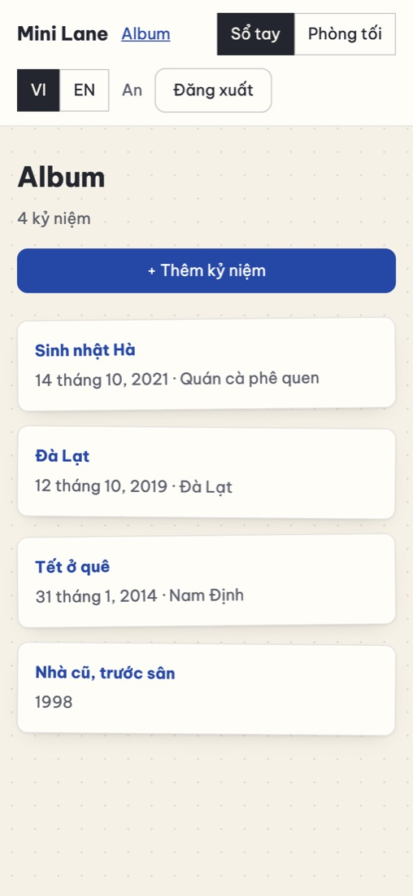
</p>

`npm run build` in ra các tệp font, chỉ những gì trình duyệt cần mới thật sự được tải:

```text
client/dist/assets/be-vietnam-pro-vietnamese-400-normal-CRcqvyg1.woff2    11.53 kB
client/dist/assets/be-vietnam-pro-vietnamese-600-normal-nyU-ZL2p.woff2    12.17 kB
client/dist/assets/be-vietnam-pro-vietnamese-700-normal-Csr0PCuG.woff2    12.46 kB
client/dist/assets/ibm-plex-mono-vietnamese-500-normal-DZ4AoWbu.woff2      6.04 kB
…
```

#### 10.4 Lỗi hay gặp

| Triệu chứng | Nguyên nhân | Cách sửa |
| --- | --- | --- |
| Tải lại trang thấy loé trắng rồi mới tối | `theme-init.js` không được nạp trong `<head>` | Kiểm tra dòng `<script src="/theme-init.js">` và tệp nằm trong `client/public/` |
| Một số chỗ mất màu ở giao diện mới | Tệp giao diện thiếu biến | So hai tệp giao diện, đủ cùng một bộ biến |
| Đổi giá trị trong `base.css` mà không thấy tác dụng | CSS nạp **sau** thắng khi cùng độ ưu tiên | Giữ thứ tự import: `base.css` trước, các giao diện sau |
| iPhone phóng to cả trang khi chạm ô nhập | Chữ trong ô nhập < 16px | `font-size: 16px` cho `input`, `textarea` |
| Trên điện thoại có thanh cuộn ngang | Phần tử có bề rộng cố định (`width: 500px`) | Dùng `max-width: 100%`, `minmax()`, `min(…)` |

#### 10.5 Đối chiếu với bản thật

- **`client/src/styles/`**: khoảng 5.600 dòng chia 6 tệp: `base.css`, `layout.css`, `components.css`, `pages.css`, `notebook.css`,
  `darkroom.css`. Nguyên tắc **giống hệt** của bạn: nền móng chỉ dùng biến, giao diện đặt giá trị và thêm chi tiết riêng (băng keo, lỗ
  phim, kính lúp…). Lý do thiết kế: [DESIGN.md](docs/design/DESIGN.md).
- **`client/public/theme-init.js`**: còn đặt `<meta name="theme-color">` (màu thanh trình duyệt trên điện thoại) và
  `<meta name="color-scheme">`.
- **`components/TopBar.jsx`**: thanh điều hướng **tự đo** xem chữ có tràn không, rồi thu gọn từng bước (`useNavFit` + `ResizeObserver`).
  Có menu riêng cho điện thoại. Đây là cách sửa lỗi "chữ đè nhau khi đổi giao diện" bạn từng báo.
- **[A6](#a6-biến-giao-diện-thành-của-bạn)**: 8 bước thêm giao diện thứ ba vào bản thật.

#### 10.6 Tự kiểm tra

1. Vì sao `base.css` không được chứa mã màu cụ thể?
2. Vì sao `theme-init.js` là tệp riêng, không viết thẳng `<script>` trong `index.html`?
3. `repeat(auto-fill, minmax(220px, 1fr))` làm được gì mà không cần media query?
4. **Bài tập:** thêm giao diện thứ ba **"Bưu điện"** (giấy vàng, mực nâu, dấu đỏ) cho bản mini: một tệp CSS mới, thêm giá trị vào `THEMES`,
   `theme-init.js`, câu chữ và danh sách khoá ghép lúc chạy. Xong thì làm lại trên bản thật theo A6.

**Commit:** `git add -A && git commit -m "feat(ui): design token, hai giao diện, font tự đóng gói"`

---

### Chặng 11 — Ảnh và video

**Mục tiêu:**

- Thêm được nhiều ảnh và video vào một kỷ niệm, mỗi tệp một thanh tiến trình.
- Ảnh được nén sang **WebP** ngay trong trình duyệt và mất hết toạ độ GPS.
- Video có ảnh đại diện, **phát và tua được**.
- Tệp là **riêng tư**: chỉ chủ kỷ niệm xem được.
- 6 bài kiểm thử mới.

Đây là chặng khó nhất. Chia làm hai buổi: **máy chủ** (bước 1–8) và **giao diện** (bước 9–14).

#### 11.1 Khái niệm

**Tệp đi từ trình duyệt lên máy chủ thế nào?**

- Form gửi tệp dùng định dạng **`multipart/form-data`**: thân yêu cầu chia thành nhiều "phần", mỗi phần là một ô (`width`, `height`)
  hoặc một tệp.
- Trong JavaScript, ta dựng nó bằng `new FormData()` rồi `form.set('file', blob, 'ten.webp')`.

**Phía máy chủ:**

| Kỹ thuật | Làm gì | Vì sao |
| --- | --- | --- |
| **multer ghi thẳng xuống đĩa** | Thư viện đọc `multipart`, ghi tệp vào `uploads/tmp/` **trong lúc** dữ liệu còn đang đến | Một video 100 MB không bao giờ nằm trọn trong RAM |
| **Kiểm tra trước khi nhận** (`beforeUpload`) | Kỷ niệm của bạn? Còn chỗ? Chạy **trước** multer | Từ chối ngay, không phải đợi nhận xong 100 MB |
| **Magic bytes** | Đọc 16 byte đầu: JPEG bắt đầu bằng `FF D8 FF`, PNG bằng `89 50 4E 47…`, MP4 có chữ `ftyp` ở byte 4 | Tên tệp và kiểu MIME do **người gửi** tự đặt. Một tệp `anh.png` chứa HTML bị từ chối |
| **Tên ngẫu nhiên** | `randomBytes(16)` → `3f9a…e1.webp` (128 bit), đổi tên **sau khi** kiểm tra | Không đoán được tên; tên do người dùng đặt (`../../`) không bao giờ thành đường dẫn |
| **Không có thư mục công khai** | Mọi tệp qua `GET /api/files/:tên`, kiểm tra quyền **mỗi lần** | Thu hồi quyền là có hiệu lực ngay |
| **HTTP Range** | Trình duyệt xin "byte 1.000.000 đến 2.000.000", máy chủ trả `206 Partial Content` | Video phát sau vài trăm KB đầu và **tua** được |
| **Dọn dẹp trong `finally`** | Tệp tạm của lần tải bị từ chối luôn bị xoá | Ổ đĩa không đầy rác |

**Phía trình duyệt:**

| Kỹ thuật | Làm gì |
| --- | --- |
| **Vẽ lại ảnh lên `<canvas>`** | Ảnh mới chỉ còn điểm ảnh: EXIF và **toạ độ GPS** (thường là nhà bạn) biến mất. Ảnh chụp dọc được xoay đúng chiều. Ảnh 48 MP thu về tối đa 2000 px |
| **WebP 0.85** | Nhỏ hơn JPEG khoảng 30% với cùng độ nét: đo trên ảnh demo của bản thật, trung bình 249 KB so với 358 KB, SSIM 0.994. Trình duyệt không ghi được WebP thì dùng JPEG |
| **Ảnh xem trước 480 px** | Lưới album tải ảnh nhỏ này thay cho ảnh gốc |
| **Đo video bằng `<video>`** | Đọc `videoWidth`, `videoHeight`, `duration`; tua tới giây thứ 1 rồi vẽ khung hình lên canvas làm **ảnh đại diện** |
| **`XMLHttpRequest`** | `fetch()` chưa báo được tiến trình **gửi lên**; XHR có `upload.onprogress` |
| **Lần lượt từng tệp** | Ảnh 48 MP giải nén chiếm hàng trăm MB RAM. Xử lý nhiều ảnh cùng lúc dễ làm treo điện thoại |

**Lỗi N+1 và `json_group_array`.** Album có 100 kỷ niệm. Lấy danh sách (1 truy vấn) rồi lấy tệp của từng kỷ niệm (100 truy vấn) là
**101 truy vấn**: lỗi hiệu năng kinh điển tên "N+1". Ta để SQLite **gói** danh sách tệp thành chuỗi JSON ngay trong câu truy vấn chính:
100 kỷ niệm vẫn là **1** truy vấn.

**Khung xem theo hình dạng tệp.** Video quay dọc (1080×1920) nhét vào khung 4:3 cố định sẽ bị thu bé tí. Đây là lỗi bạn từng báo.
Giao diện đặt biến CSS `--ratio` = rộng/cao **của từng tệp**, và CSS dùng `aspect-ratio: var(--ratio)`.

#### 11.2 Làm từng bước — máy chủ

**Bước 1 — Cài multer:**

```bash
npm i multer@2
```

**Bước 2 — `server/migrations/003_files.sql`:**

```sql
-- Phiên bản 3: mỗi kỷ niệm có nhiều ảnh/video. position 0 = ảnh bìa.
CREATE TABLE memory_files (
  id         INTEGER PRIMARY KEY,
  memory_id  INTEGER NOT NULL REFERENCES memories (id) ON DELETE CASCADE,
  user_id    INTEGER NOT NULL REFERENCES users (id) ON DELETE CASCADE,
  kind       TEXT    NOT NULL CHECK (kind IN ('image', 'video')),
  file       TEXT    NOT NULL UNIQUE,   -- tên ngẫu nhiên trong data/uploads, ví dụ 3f9a…e1.webp
  poster     TEXT    UNIQUE,            -- ảnh xem trước (ảnh nhỏ, hoặc một khung hình của video)
  width      INTEGER,
  height     INTEGER,
  duration   REAL,                      -- video: độ dài (giây)
  size       INTEGER NOT NULL DEFAULT 0,
  position   INTEGER NOT NULL DEFAULT 0,
  created_at TEXT    NOT NULL DEFAULT (strftime('%Y-%m-%dT%H:%M:%fZ', 'now'))
);
CREATE INDEX memory_files_memory ON memory_files (memory_id, position);
```

`user_id` lặp lại ở đây (dù đã có ở `memories`) để câu "tổng dung lượng của người này" và kiểm tra quyền chạy nhanh, không cần nối bảng.

**Bước 3 — kho tệp `server/lib/files.js`:**

```js
import fs from 'node:fs';
import path from 'node:path';
import { randomBytes } from 'node:crypto';
import multer from 'multer';

// Nhận diện tệp bằng vài byte ĐẦU TIÊN ("magic bytes"), không tin tên tệp hay MIME type trình duyệt gửi:
// cả hai đều do người tải lên tự đặt. Một tệp "anh.png" chứa HTML sẽ bị từ chối.
const IMAGES = [
  { ext: 'jpg', match: (b) => b[0] === 0xff && b[1] === 0xd8 && b[2] === 0xff },
  { ext: 'png', match: (b) => b.subarray(0, 8).equals(Buffer.from([0x89, 0x50, 0x4e, 0x47, 0x0d, 0x0a, 0x1a, 0x0a])) },
  { ext: 'gif', match: (b) => ['GIF87a', 'GIF89a'].includes(b.subarray(0, 6).toString('latin1')) },
  { ext: 'webp', match: (b) => b.subarray(0, 4).toString('latin1') === 'RIFF' && b.subarray(8, 12).toString('latin1') === 'WEBP' },
];

/** → { kind: 'image' | 'video', ext } hoặc null nếu không phải định dạng được nhận. */
export function sniff(head) {
  if (!head || head.length < 12) return null;
  const image = IMAGES.find((signature) => signature.match(head));
  if (image) return { kind: 'image', ext: image.ext };
  // MP4 và MOV: byte 4–7 là chữ "ftyp", byte 8–11 là "nhãn" (brand); "qt  " là MOV của Apple.
  if (head.subarray(4, 8).toString('latin1') === 'ftyp') {
    const brand = head.subarray(8, 12).toString('latin1');
    if (['heic', 'heix', 'mif1', 'avif'].includes(brand)) return null; // ảnh HEIC/AVIF "đội lốt" cùng khung
    return { kind: 'video', ext: brand === 'qt  ' ? 'mov' : 'mp4' };
  }
  if (head[0] === 0x1a && head[1] === 0x45 && head[2] === 0xdf && head[3] === 0xa3) return { kind: 'video', ext: 'webm' };
  return null;
}

// Tên tệp hợp lệ: đúng 32 ký tự hex + đuôi. Mọi tên khác (kể cả "../../etc/passwd") bị từ chối.
const NAME_PATTERN = /^[a-f0-9]{32}\.(jpg|png|gif|webp|mp4|mov|webm)$/;

/**
 * Kho tệp riêng tư. Tệp tải lên được GHI THẲNG xuống uploads/tmp (video 100 MB không nằm trong RAM),
 * kiểm tra, rồi mới đổi sang tên ngẫu nhiên không thể đoán. Không tệp nào ở đây được phục vụ công khai.
 */
export function createFileStore(dir) {
  const tmpDir = path.join(dir, 'tmp');
  fs.mkdirSync(tmpDir, { recursive: true });

  return {
    dir,

    /** Middleware multer: nhận một trường `file` và (tuỳ chọn) một trường `poster`. */
    uploader(maxBytes) {
      return multer({
        storage: multer.diskStorage({
          destination: tmpDir,
          filename: (req, file, cb) => cb(null, randomBytes(16).toString('hex')),
        }),
        limits: { fileSize: maxBytes, files: 2, fields: 10 },
      }).fields([
        { name: 'file', maxCount: 1 },
        { name: 'poster', maxCount: 1 },
      ]);
    },

    /** Đọc 16 byte đầu của tệp tạm và cho biết nó là gì. */
    inspect(tmpPath) {
      const fd = fs.openSync(tmpPath, 'r');
      try {
        const head = Buffer.alloc(16);
        const read = fs.readSync(fd, head, 0, 16, 0);
        return sniff(head.subarray(0, read));
      } finally {
        fs.closeSync(fd);
      }
    },

    /** Tệp tạm đã kiểm tra → tên chính thức ngẫu nhiên (128 bit). */
    adopt(tmpPath, ext) {
      const name = `${randomBytes(16).toString('hex')}.${ext}`;
      fs.renameSync(tmpPath, path.join(dir, name));
      return name;
    },

    discard(tmpPath) {
      if (tmpPath) fs.rm(tmpPath, { force: true }, () => {});
    },

    remove(name) {
      if (name && NAME_PATTERN.test(name)) fs.rm(path.join(dir, name), { force: true }, () => {});
    },

    isValidName: (name) => NAME_PATTERN.test(name),
  };
}
```

**Bước 4 — cấu hình giới hạn và thư mục:**

```diff
@@ -22,6 +22,9 @@
     sessionDays: Number(env.SESSION_DAYS) || 30,
     authRateLimit: Number(env.AUTH_RATE_LIMIT) || 20, // số lần đăng nhập/đăng ký mỗi IP mỗi 15 phút
+    maxUploadMb: Number(env.MAX_UPLOAD_MB) || 15, // ảnh lớn nhất (MB)
+    maxVideoMb: Number(env.MAX_VIDEO_MB) || 100, // video lớn nhất (MB)
     dataDir,
     dbFile: path.join(dataDir, 'mini.db'),
+    uploadDir: path.join(dataDir, 'uploads'),
   };
 }
```

**Bước 5 — model trả kỷ niệm kèm danh sách tệp.** Bản đầy đủ `server/models/memories.js`:

```js
import { transaction } from '../db.js';

// Model = nơi DUY NHẤT viết câu SQL cho kỷ niệm. Quy tắc vàng: mọi truy vấn đều có "user_id = ?".

const NOW = "strftime('%Y-%m-%dT%H:%M:%fZ', 'now')";
const ORDER = 'ORDER BY m.year DESC, m.month DESC NULLS LAST, m.day DESC NULLS LAST, m.id DESC';

// Mỗi kỷ niệm đi kèm danh sách ảnh/video của nó TRONG CÙNG MỘT câu truy vấn: SQLite tự gói danh sách
// thành chuỗi JSON (json_group_array). Nhờ vậy 100 kỷ niệm = 1 truy vấn, không phải 101 ("lỗi N+1").
const SELECT = `
  SELECT m.*,
         (SELECT json_group_array(json_object('id', f.id, 'kind', f.kind, 'file', f.file, 'poster', f.poster,
                                              'width', f.width, 'height', f.height, 'duration', f.duration))
            FROM (SELECT * FROM memory_files WHERE memory_id = m.id ORDER BY position, id) AS f) AS files_json
    FROM memories m`;

// Tệp chỉ được xem qua đường dẫn có kiểm tra quyền /api/files/…, không bao giờ là thư mục công khai.
const fileUrl = (name) => (name ? `/api/files/${name}` : null);

function toMemory(row) {
  const files = JSON.parse(row.files_json || '[]').map((f) => ({
    id: f.id,
    kind: f.kind,
    url: fileUrl(f.file),
    posterUrl: fileUrl(f.poster),
    width: f.width,
    height: f.height,
    duration: f.duration,
  }));
  return {
    id: row.id,
    title: row.title,
    story: row.story,
    place: row.place,
    year: row.year,
    month: row.month,
    day: row.day,
    files,
    cover: files[0] ?? null,
    createdAt: row.created_at,
    updatedAt: row.updated_at,
  };
}

export function memoriesModel(db) {
  const owns = (userId, memoryId) =>
    Boolean(db.prepare('SELECT 1 FROM memories WHERE id = ? AND user_id = ?').get(memoryId, userId));

  return {
    owns,

    list(userId) {
      return db.prepare(`${SELECT} WHERE m.user_id = ? ${ORDER}`).all(userId).map(toMemory);
    },

    get(userId, id) {
      const row = db.prepare(`${SELECT} WHERE m.id = ? AND m.user_id = ?`).get(id, userId);
      return row ? toMemory(row) : null;
    },

    create(userId, data) {
      const { lastInsertRowid } = db
        .prepare('INSERT INTO memories (user_id, title, story, place, year, month, day) VALUES (?, ?, ?, ?, ?, ?, ?)')
        .run(userId, data.title, data.story, data.place, data.year, data.month, data.day);
      return Number(lastInsertRowid);
    },

    update(userId, id, data) {
      const { changes } = db
        .prepare(
          `UPDATE memories SET title = ?, story = ?, place = ?, year = ?, month = ?, day = ?, updated_at = ${NOW}
            WHERE id = ? AND user_id = ?`,
        )
        .run(data.title, data.story, data.place, data.year, data.month, data.day, id, userId);
      return Number(changes) > 0;
    },

    /** Xoá kỷ niệm → trả về tên các tệp của nó (để xoá khỏi đĩa), hoặc null nếu không phải của bạn. */
    remove(userId, id) {
      if (!owns(userId, id)) return null;
      const names = db
        .prepare('SELECT file, poster FROM memory_files WHERE memory_id = ?')
        .all(id)
        .flatMap((row) => [row.file, row.poster].filter(Boolean));
      db.prepare('DELETE FROM memories WHERE id = ? AND user_id = ?').run(id, userId); // CASCADE xoá các dòng memory_files
      return names;
    },

    // ---- ảnh & video ----

    fileCount(memoryId) {
      return db.prepare('SELECT COUNT(*) AS n FROM memory_files WHERE memory_id = ?').get(memoryId).n;
    },

    addFile(userId, memoryId, file) {
      return transaction(db, () => {
        const { next } = db
          .prepare('SELECT COALESCE(MAX(position), -1) + 1 AS next FROM memory_files WHERE memory_id = ?')
          .get(memoryId);
        db.prepare(
          `INSERT INTO memory_files (memory_id, user_id, kind, file, poster, width, height, duration, size, position)
           VALUES (?, ?, ?, ?, ?, ?, ?, ?, ?, ?)`,
        ).run(memoryId, userId, file.kind, file.file, file.poster, file.width, file.height, file.duration, file.size, next);
        db.prepare(`UPDATE memories SET updated_at = ${NOW} WHERE id = ?`).run(memoryId);
      });
    },

    /** Xoá một tệp của kỷ niệm bạn sở hữu → [file, poster] cần xoá khỏi đĩa, hoặc null. */
    removeFile(userId, memoryId, fileId) {
      const row = db
        .prepare('SELECT file, poster FROM memory_files WHERE id = ? AND memory_id = ? AND user_id = ?')
        .get(fileId, memoryId, userId);
      if (!row) return null;
      db.prepare('DELETE FROM memory_files WHERE id = ?').run(fileId);
      return [row.file, row.poster].filter(Boolean);
    },

    /** Người này có được xem tệp này không? (Chặng 12 mở rộng: cả người được chia sẻ.) */
    canViewFile(viewerId, name) {
      return Boolean(
        db
          .prepare(
            `SELECT 1 FROM memory_files f JOIN memories m ON m.id = f.memory_id
              WHERE (f.file = ? OR f.poster = ?) AND m.user_id = ?`,
          )
          .get(name, name, viewerId),
      );
    },
  };
}
```

- `json_group_array(json_object(...))` gom các dòng `memory_files` thành **một** chuỗi JSON. `toMemory` `JSON.parse` lại và đổi tên tệp
  thành đường dẫn **được bảo vệ** `/api/files/…`.
- `remove` trả về tên các tệp để route xoá khỏi ổ đĩa. Bản thân CSDL **không biết** gì về ổ đĩa.

**Bước 6 — route tải lên và xoá tệp trong `server/routes/memories.js`:**

```diff
@@ -1,4 +1,4 @@
 import { Router } from 'express';
-import { notFound } from '../lib/errors.js';
+import { HttpError, notFound } from '../lib/errors.js';
 import { idParam, validator } from '../lib/validate.js';
 import { isValidDate } from '../../shared/dates.js';
@@ -6,6 +6,10 @@
 
 /** Các đường dẫn /api/memories/... (đã qua requireAuth, nên luôn có req.user). */
-export function memoryRoutes({ memories }) {
+const MB = 1024 * 1024;
+
+export function memoryRoutes({ config, memories, files }) {
   const router = Router();
+  // Mỗi yêu cầu tải lên MỘT ảnh/video (+ một ảnh xem trước), ghi thẳng xuống đĩa.
+  const upload = files.uploader(Math.max(config.maxVideoMb, config.maxUploadMb) * MB);
 
   router.get('/', (req, res) => {
@@ -31,6 +35,65 @@
 
   router.delete('/:id', (req, res) => {
-    if (!memories.remove(req.user.id, idParam(req.params.id))) throw notFound();
+    const names = memories.remove(req.user.id, idParam(req.params.id));
+    if (!names) throw notFound();
+    names.forEach((name) => files.remove(name)); // xoá luôn ảnh/video khỏi ổ đĩa
     res.status(204).end();
+  });
+
+  // ---------- ảnh & video ----------
+  // POST /:id/files — multipart/form-data: file (ảnh hoặc video), poster (ảnh xem trước, tuỳ chọn),
+  // width, height, duration (trình duyệt đo sẵn).
+
+  // Chạy TRƯỚC multer: kỷ niệm của người khác hay đã đủ tệp thì từ chối ngay, trước khi nhận 100 MB.
+  function beforeUpload(req, res, next) {
+    const id = idParam(req.params.id);
+    if (!memories.owns(req.user.id, id)) throw notFound();
+    if (memories.fileCount(id) >= LIMITS.maxFilesPerMemory) {
+      throw new HttpError(400, 'VALIDATION', { file: { code: 'TOO_MANY_FILES', max: LIMITS.maxFilesPerMemory } });
+    }
+    next();
+  }
+
+  router.post('/:id/files', beforeUpload, upload, async (req, res) => {
+    const main = req.files?.file?.[0]; // multer đã ghi tệp vào uploads/tmp và cho ta đường dẫn
+    const poster = req.files?.poster?.[0];
+    try {
+      const id = idParam(req.params.id);
+      const v = validator(req.body);
+      const type = main ? files.inspect(main.path) : null;
+      if (!main) v.fail('file', 'REQUIRED');
+      else if (!type) v.fail('file', 'FILE_TYPE');
+      else if (type.kind === 'image' && main.size > config.maxUploadMb * MB) v.fail('file', 'FILE_TOO_LARGE', { max: config.maxUploadMb });
+      else if (type.kind === 'video' && main.size > config.maxVideoMb * MB) v.fail('file', 'FILE_TOO_LARGE', { max: config.maxVideoMb });
+      const posterType = poster ? files.inspect(poster.path) : null;
+      if (poster && posterType?.kind !== 'image') v.fail('poster', 'FILE_TYPE');
+      const width = v.int('width', { min: 1, max: 20000 });
+      const height = v.int('height', { min: 1, max: 20000 });
+      const duration = v.int('duration', { min: 0, max: 36000 });
+      v.check();
+
+      memories.addFile(req.user.id, id, {
+        kind: type.kind,
+        file: files.adopt(main.path, type.ext),
+        poster: poster ? files.adopt(poster.path, posterType.ext) : null,
+        width,
+        height,
+        duration: type.kind === 'video' ? duration : null,
+        size: main.size,
+      });
+      res.status(201).json({ memory: memories.get(req.user.id, id) });
+    } finally {
+      // Tệp tạm nào chưa được "nhận nuôi" (bị từ chối, hoặc lỗi giữa chừng) thì xoá đi. Đã adopt thì không còn ở tmp.
+      files.discard(main?.path);
+      files.discard(poster?.path);
+    }
+  });
+
+  router.delete('/:id/files/:fileId', (req, res) => {
+    const id = idParam(req.params.id);
+    const names = memories.removeFile(req.user.id, id, idParam(req.params.fileId));
+    if (!names) throw notFound();
+    names.forEach((name) => files.remove(name));
+    res.json({ memory: memories.get(req.user.id, id) });
   });
 
```

Đọc kỹ thứ tự trong `router.post('/:id/files', beforeUpload, upload, async …)`:

1. `beforeUpload`: kiểm tra quyền và số tệp, **chưa nhận byte nào**.
2. `upload` (multer): nhận và ghi tệp tạm.
3. Hàm chính: kiểm tra **loại thật** và kích thước theo loại, rồi `adopt` (đổi tên chính thức), rồi ghi CSDL.
4. `finally`: xoá mọi tệp tạm chưa được nhận nuôi.

Video có thêm `duration`. Trình duyệt làm tròn tới giây, nên validator dùng `int`.

**Bước 7 — xem tệp có kiểm tra quyền `server/routes/files.js`:**

```js
import { Router } from 'express';
import { notFound } from '../lib/errors.js';

/**
 * Ảnh và video là RIÊNG TƯ: không có thư mục công khai. Mỗi lần xin một tệp, máy chủ kiểm tra:
 * đã đăng nhập, tên tệp đúng mẫu, và tệp thuộc kỷ niệm người này được xem. Sai bất kỳ điều gì → 404,
 * giống hệt tệp không tồn tại (không để lộ "tệp này có thật").
 *
 * res.sendFile tự trả lời yêu cầu HTTP Range: video phát ngay sau vài trăm KB đầu và tua được (mã 206).
 */
export function fileRoutes({ memories, files }) {
  const router = Router();

  router.get('/:name', (req, res) => {
    const { name } = req.params;
    if (!files.isValidName(name) || !memories.canViewFile(req.user.id, name)) throw notFound();
    res.sendFile(name, {
      root: files.dir,
      cacheControl: false,
      // private: proxy dùng chung không được giữ bản sao. no-cache: trình duyệt phải hỏi lại máy chủ mỗi lần
      // (rẻ, nhờ ETag → 304), nên khi bị thu hồi quyền hay đã đăng xuất, tệp không mở lại được từ bộ nhớ đệm.
      headers: { 'Cache-Control': 'private, no-cache' },
    });
  });

  return router;
}
```

**Bước 8 — lắp vào app, và đổi lỗi của multer thành JSON:**

```diff
@@ -1,4 +1,6 @@
 import express from 'express';
+import multer from 'multer';
 import { HttpError } from './lib/errors.js';
+import { createFileStore } from './lib/files.js';
 import { blockCrossSiteWrites, noStore, securityHeaders } from './lib/security.js';
 import { createSessions, requireAuth } from './lib/sessions.js';
@@ -6,4 +8,5 @@
 import { usersModel } from './models/users.js';
 import { authRoutes } from './routes/auth.js';
+import { fileRoutes } from './routes/files.js';
 import { memoryRoutes } from './routes/memories.js';
 
@@ -22,4 +25,5 @@
     users: usersModel(db),
     memories: memoriesModel(db),
+    files: createFileStore(config.uploadDir),
   };
 
@@ -43,4 +47,5 @@
   api.use('/auth', authRoutes(ctx));
   api.use('/memories', requireAuth, memoryRoutes(ctx)); // phải đăng nhập mới tới được các route bên trong
+  api.use('/files', requireAuth, fileRoutes(ctx));
   // Mọi đường dẫn /api/... không khớp route nào: 404 dạng JSON (thay cho trang HTML mặc định).
   api.use((req, res) => res.status(404).json({ error: 'NOT_FOUND' }));
@@ -53,4 +58,9 @@
     if (err instanceof HttpError) {
       return res.status(err.status).json({ error: err.code, ...(err.fields && { fields: err.fields }) });
+    }
+    if (err instanceof multer.MulterError) {
+      // Ví dụ: tệp lớn hơn giới hạn của multer → dừng nhận ngay, không ghi tiếp xuống đĩa.
+      const code = err.code === 'LIMIT_FILE_SIZE' ? 'FILE_TOO_LARGE' : 'UPLOAD_FAILED';
+      return res.status(400).json({ error: 'VALIDATION', fields: { file: { code, max: config.maxVideoMb } } });
     }
     const status = err.status ?? err.statusCode;
```

Kiểm thử cần gửi `FormData` và nhận tệp nhị phân:

```diff
@@ -39,5 +39,7 @@
     const init = { method, headers: { ...headers } };
     if (cookie) init.headers.cookie = cookie;
-    if (json !== undefined) {
+    if (json instanceof FormData) {
+      init.body = json; // multipart/form-data: fetch tự đặt Content-Type kèm "boundary"
+    } else if (json !== undefined) {
       init.headers['content-type'] = 'application/json';
       init.body = JSON.stringify(json);
@@ -48,5 +50,7 @@
       if (pair.startsWith('mini_session=')) cookie = pair === 'mini_session=' ? '' : pair;
     }
-    const body = res.status === 204 ? null : await res.json();
+    const type = res.headers.get('content-type') ?? '';
+    // JSON → đối tượng; tệp (ảnh, video) → Buffer
+    const body = res.status === 204 ? null : type.includes('json') ? await res.json() : Buffer.from(await res.arrayBuffer());
     return { status: res.status, body, headers: res.headers };
   }
```

`test/files.test.js`:

```js
import { after, before, test } from 'node:test';
import assert from 'node:assert/strict';
import fs from 'node:fs';
import path from 'node:path';
import { registered, startTestServer } from './helpers.js';

// Một tấm PNG thật, 1×1 điểm ảnh.
const PNG = Buffer.from(
  'iVBORw0KGgoAAAANSUhEUgAAAAEAAAABCAQAAAC1HAwCAAAAC0lEQVR42mNkYAAAAAYAAjCB0C8AAAAASUVORK5CYII=',
  'base64',
);

function fileForm(bytes, { type = 'image/png', name = 'anh.png', fields = {} } = {}) {
  const form = new FormData();
  for (const [key, value] of Object.entries(fields)) form.set(key, String(value));
  form.set('file', new Blob([bytes], { type }), name);
  return form;
}

let server;
let an;
let binh;
let memoryId;

before(async () => {
  server = await startTestServer({ MAX_UPLOAD_MB: '1', MAX_VIDEO_MB: '2' });
  an = await registered(server.base, 'An');
  binh = await registered(server.base, 'Bình');
  memoryId = (await an.api.post('/api/memories', { title: 'Đà Lạt', year: 2019 })).body.memory.id;
});
after(() => server.close());

test('tải ảnh lên, rồi xem được qua đường dẫn riêng tư', async () => {
  const res = await an.api.post(`/api/memories/${memoryId}/files`, fileForm(PNG, { fields: { width: 1, height: 1 } }));
  assert.equal(res.status, 201);
  const file = res.body.memory.files[0];
  assert.equal(file.kind, 'image');
  assert.match(file.url, /^\/api\/files\/[a-f0-9]{32}\.png$/); // tên ngẫu nhiên, không phải "anh.png"

  const got = await an.api.get(file.url);
  assert.equal(got.status, 200);
  assert.equal(got.headers.get('content-type'), 'image/png');
  assert.equal(got.headers.get('cache-control'), 'private, no-cache');
  assert.ok(got.body.equals(PNG));
});

test('HTTP Range: xin một đoạn của tệp → 206', async () => {
  const { files } = (await an.api.get(`/api/memories/${memoryId}`)).body.memory;
  const part = await an.api.get(files[0].url, { range: 'bytes=0-7' });
  assert.equal(part.status, 206);
  assert.equal(part.headers.get('content-range'), `bytes 0-7/${PNG.length}`);
  assert.equal(part.body.length, 8);
});

test('tệp HTML đội lốt .png bị từ chối (magic bytes)', async () => {
  const fake = Buffer.from('<html><script>alert(1)</script></html>');
  const res = await an.api.post(`/api/memories/${memoryId}/files`, fileForm(fake));
  assert.equal(res.status, 400);
  assert.equal(res.body.fields.file.code, 'FILE_TYPE');
});

test('ảnh quá lớn bị từ chối, và không để lại tệp tạm', async () => {
  const big = Buffer.concat([PNG, Buffer.alloc(1.5 * 1024 * 1024)]); // > MAX_UPLOAD_MB = 1
  const res = await an.api.post(`/api/memories/${memoryId}/files`, fileForm(big));
  assert.equal(res.status, 400);
  assert.equal(res.body.fields.file.code, 'FILE_TOO_LARGE');
  await new Promise((r) => setTimeout(r, 100)); // xoá tệp tạm chạy bất đồng bộ
  assert.deepEqual(fs.readdirSync(path.join(server.config.uploadDir, 'tmp')), []);
});

test('người khác: không tải lên được, không xem được tệp (404)', async () => {
  const { files } = (await an.api.get(`/api/memories/${memoryId}`)).body.memory;
  assert.equal((await binh.api.get(files[0].url)).status, 404);
  assert.equal((await binh.api.post(`/api/memories/${memoryId}/files`, fileForm(PNG))).status, 404);
  assert.equal((await binh.api.get('/api/files/..%2F..%2Fmini.db')).status, 404); // tên tệp lạ
});

test('xoá kỷ niệm thì tệp cũng biến mất khỏi ổ đĩa', async () => {
  const id = (await an.api.post('/api/memories', { title: 'Tạm', year: 2020 })).body.memory.id;
  const { memory } = (await an.api.post(`/api/memories/${id}/files`, fileForm(PNG))).body;
  const onDisk = path.join(server.config.uploadDir, memory.files[0].url.split('/').pop());
  assert.ok(fs.existsSync(onDisk));
  assert.equal((await an.api.del(`/api/memories/${id}`)).status, 204);
  await new Promise((r) => setTimeout(r, 100));
  assert.ok(!fs.existsSync(onDisk));
});
```

Tấm PNG 1×1 thật được nhúng sẵn dạng base64 trong bài kiểm thử: không cần tệp ảnh nào trên đĩa.

#### 11.3 Làm từng bước — giao diện

**Bước 9 — chuẩn bị ảnh `client/src/lib/image.js`:**

```js
// Ảnh được VẼ LẠI lên <canvas> trước khi tải lên. Việc này:
//  1. bỏ toàn bộ metadata (EXIF, nhất là toạ độ GPS nơi chụp — thường là nhà bạn),
//  2. xoay đúng chiều ảnh chụp dọc,
//  3. thu ảnh 12–48 MP của điện thoại về tối đa 2000 px: tải nhanh, tốn ít chỗ,
//  4. lưu dạng WebP (nhỏ hơn JPEG khoảng 30% với cùng độ nét); trình duyệt không ghi được WebP thì dùng JPEG,
//  5. làm thêm một ảnh xem trước nhỏ (480 px) cho lưới album.

const MAX_EDGE = 2000;
const PREVIEW_WIDTH = 480;

function canvasBlob(canvas, type, quality) {
  return new Promise((resolve) => canvas.toBlob(resolve, type, quality));
}

/** Trình duyệt không ghi được WebP sẽ lặng lẽ trả về PNG — nên phải kiểm tra blob.type. */
async function encode(canvas, quality) {
  const webp = await canvasBlob(canvas, 'image/webp', quality);
  if (webp?.type === 'image/webp') return { blob: webp, ext: 'webp' };
  return { blob: await canvasBlob(canvas, 'image/jpeg', quality), ext: 'jpg' };
}

function draw(source, width, height) {
  const canvas = document.createElement('canvas');
  canvas.width = Math.max(1, Math.round(width));
  canvas.height = Math.max(1, Math.round(height));
  canvas.getContext('2d').drawImage(source, 0, 0, canvas.width, canvas.height);
  return canvas;
}

/** Ảnh nhỏ cho lưới album (dùng cho cả khung hình video). */
export async function makePreview(source, width, height) {
  const scale = Math.min(1, PREVIEW_WIDTH / width);
  return (await encode(draw(source, width * scale, height * scale), 0.75)).blob;
}

/** Giải mã ảnh, ĐÚNG CHIỀU. Safari cũ báo lỗi với tuỳ chọn imageOrientation → thử lại không có tuỳ chọn. */
async function decode(file) {
  try {
    return await createImageBitmap(file, { imageOrientation: 'from-image' });
  } catch {
    return createImageBitmap(file);
  }
}

/** File gốc → { file, preview, width, height } sẵn sàng để tải lên. */
export async function preparePhoto(file) {
  const bitmap = await decode(file);
  try {
    const { width, height } = bitmap;
    const scale = Math.min(1, MAX_EDGE / Math.max(width, height));
    const canvas = draw(bitmap, width * scale, height * scale);
    const { blob, ext } = await encode(canvas, 0.85);
    const base = file.name.replace(/\.[^.]+$/, '') || 'anh';
    return {
      file: new File([blob], `${base}.${ext}`, { type: blob.type }),
      preview: await makePreview(bitmap, width, height),
      width: canvas.width,
      height: canvas.height,
    };
  } finally {
    bitmap.close(); // trả lại bộ nhớ ngay (ảnh 48 MP chiếm cả trăm MB khi giải nén)
  }
}
```

`canvas.toBlob` dùng **callback**. Hàm `canvasBlob` bọc nó thành `Promise` để viết được `await`. Đây là kỹ thuật "promisify" rất hay
dùng.

**Bước 10 — đo video, chụp khung hình `client/src/lib/video.js`:**

```js
import { makePreview } from './image.js';

// Video được tải lên NGUYÊN BẢN (nén lại video trong trình duyệt rất chậm). Nhưng trước đó trình duyệt
// đo kích thước, độ dài và chụp một khung hình làm ảnh đại diện. Không đọc được (định dạng lạ)? Vẫn tải lên được.

function waitFor(video, event) {
  return new Promise((resolve, reject) => {
    const timer = setTimeout(() => reject(new Error('timeout')), 10_000);
    video.addEventListener(event, () => (clearTimeout(timer), resolve()), { once: true });
    video.addEventListener('error', () => (clearTimeout(timer), reject(new Error('decode'))), { once: true });
  });
}

/** → { width, height, duration, preview } (mỗi giá trị có thể là null). */
export async function readVideo(file) {
  const url = URL.createObjectURL(file);
  const video = document.createElement('video');
  video.muted = true;
  video.preload = 'metadata';
  const info = { width: null, height: null, duration: null, preview: null };
  try {
    video.src = url;
    await waitFor(video, 'loadedmetadata');
    info.width = video.videoWidth || null;
    info.height = video.videoHeight || null;
    info.duration = Number.isFinite(video.duration) ? Math.round(video.duration) : null;
    video.currentTime = Math.min(1, video.duration / 2 || 0); // khung hình ở giây thứ 1 thường đẹp hơn khung đen đầu tiên
    await waitFor(video, 'seeked');
    info.preview = await makePreview(video, video.videoWidth, video.videoHeight);
  } catch {
    // không đọc được: tải lên mà không có ảnh đại diện
  } finally {
    URL.revokeObjectURL(url);
  }
  return info;
}
```

`URL.createObjectURL(file)` cho thẻ `<video>` đọc **tệp trên máy bạn** mà không tải lên đâu cả. Nhớ `revokeObjectURL` để giải phóng.

**Bước 11 — tải lên có tiến trình `client/src/lib/upload.js`:**

```js
import { ApiError } from '../api.js';

/**
 * Tải MỘT ảnh/video lên một kỷ niệm, có báo tiến trình. fetch() chưa báo được tiến trình GỬI ĐI,
 * nên riêng việc này dùng XMLHttpRequest. Cùng cookie, cùng định dạng lỗi JSON như api.js.
 */
export function uploadFile(memoryId, { file, preview, width, height, duration }, { onProgress } = {}) {
  return new Promise((resolve, reject) => {
    const form = new FormData();
    if (width) form.set('width', String(width));
    if (height) form.set('height', String(height));
    if (duration) form.set('duration', String(duration));
    form.set('file', file, file.name);
    if (preview) form.set('poster', preview, preview.type === 'image/webp' ? 'preview.webp' : 'preview.jpg');

    const xhr = new XMLHttpRequest();
    xhr.open('POST', `/api/memories/${memoryId}/files`);
    xhr.responseType = 'json';
    xhr.upload.onprogress = (event) => {
      if (event.lengthComputable) onProgress?.(event.loaded / event.total); // 0 → 1
    };
    xhr.onload = () => {
      const data = xhr.response ?? {};
      if (xhr.status >= 200 && xhr.status < 300) resolve(data);
      else reject(new ApiError(xhr.status, data.error ?? 'SERVER', data.fields));
    };
    xhr.onerror = () => reject(new ApiError(0, 'NETWORK'));
    xhr.send(form);
  });
}
```

**Bước 12 — ô chọn tệp và thanh tiến trình `client/src/components/Uploader.jsx`:**

```jsx
import { useRef, useState } from 'react';
import { fieldMessage, useI18n } from '../i18n/index.jsx';
import { preparePhoto } from '../lib/image.js';
import { uploadFile } from '../lib/upload.js';
import { readVideo } from '../lib/video.js';

/** Chọn nhiều ảnh/video → chuẩn bị từng tệp → tải lên LẦN LƯỢT, mỗi tệp một thanh tiến trình. */
export default function Uploader({ memoryId, onUploaded }) {
  const { t } = useI18n();
  const input = useRef(null);
  const [items, setItems] = useState([]); // [{ name, progress (0–1), error }]

  const patch = (index, change) => setItems((list) => list.map((item, i) => (i === index ? { ...item, ...change } : item)));

  async function onPick(event) {
    const picked = [...event.target.files];
    event.target.value = ''; // chọn lại đúng tệp đó lần nữa vẫn được
    setItems(picked.map((file) => ({ name: file.name, progress: 0, error: null })));
    // LẦN LƯỢT, không song song: ảnh 48 MP giải nén chiếm hàng trăm MB, làm cùng lúc dễ làm treo điện thoại.
    for (const [index, file] of picked.entries()) {
      try {
        const prepared = file.type.startsWith('video/')
          ? { file, ...(await readVideo(file)) }
          : await preparePhoto(file);
        await uploadFile(memoryId, prepared, { onProgress: (p) => patch(index, { progress: p }) });
        patch(index, { progress: 1 });
        onUploaded();
      } catch (err) {
        patch(index, { error: err.fields?.file ? fieldMessage(t, err.fields.file) : t('upload.failed') });
      }
    }
  }

  return (
    <div className="uploader">
      <input ref={input} type="file" accept="image/*,video/*" multiple hidden onChange={onPick} />
      <button type="button" onClick={() => input.current.click()}>
        {t('upload.choose')}
      </button>
      {items.map((item) => (
        <div key={item.name} className="upload-row">
          <span>{item.name}</span>
          {item.error ? <span className="error">{item.error}</span> : <progress max={1} value={item.progress} />}
        </div>
      ))}
    </div>
  );
}
```

**Bước 13 — bộ ảnh `client/src/components/Gallery.jsx`:**

```jsx
import { useState } from 'react';
import { useI18n } from '../i18n/index.jsx';

/** Tỉ lệ khung theo đúng hình dạng tệp (ảnh/video dọc không bị thu bé), giới hạn để khỏi quá dẹt hay quá cao. */
function shapeOf(file) {
  if (!file.width || !file.height) return 4 / 3;
  return Math.min(2.2, Math.max(0.5, file.width / file.height));
}

export default function Gallery({ files, onDelete }) {
  const { t } = useI18n();
  const [index, setIndex] = useState(0);
  if (!files.length) return null;
  const current = files[Math.min(index, files.length - 1)];

  return (
    <section className="gallery" aria-label={t('gallery.label')}>
      {/* --ratio: biến CSS đặt TỪ JavaScript, CSS dùng nó trong aspect-ratio */}
      <div className="stage" style={{ '--ratio': shapeOf(current) }}>
        {current.kind === 'video' ? (
          // preload="metadata": chỉ tải phần đầu; phát tới đâu tải tới đó nhờ HTTP Range
          <video key={current.id} src={current.url} poster={current.posterUrl ?? undefined} controls preload="metadata" playsInline />
        ) : (
          
        )}
      </div>
      <div className="thumbs">
        {files.map((file, i) => (
          <button key={file.id} type="button" className="thumb" aria-pressed={i === index} onClick={() => setIndex(i)}>
            
          </button>
        ))}
      </div>
      {onDelete && (
        <button type="button" className="danger" onClick={() => onDelete(current)}>
          {t('gallery.delete')}
        </button>
      )}
    </section>
  );
}
```

`style={{ '--ratio': shapeOf(current) }}`: React đặt được **biến CSS** qua `style`. Khung tự đổi hình dạng theo từng ảnh/video.

**Bước 14 — ghép vào trang, CSS và câu chữ:**

```diff
@@ -2,6 +2,8 @@
 import { Link, useNavigate, useParams } from 'react-router';
 import { api } from '../api.js';
+import Gallery from '../components/Gallery.jsx';
 import MemoryForm from '../components/MemoryForm.jsx';
 import Modal from '../components/Modal.jsx';
+import Uploader from '../components/Uploader.jsx';
 import { useI18n } from '../i18n/index.jsx';
 import { useData, useFetch } from '../state.jsx';
@@ -35,5 +37,13 @@
         {memory.place && ` · ${memory.place}`}
       </p>
+      <Gallery
+        files={memory.files}
+        onDelete={async (file) => {
+          await api.del(`/api/memories/${memory.id}/files/${file.id}`);
+          refresh();
+        }}
+      />
       {memory.story && <p className="story">{memory.story}</p>}
+      <Uploader memoryId={memory.id} onUploaded={refresh} />
       <div className="actions">
         <button type="button" onClick={() => setEditing(true)}>
```

```diff
@@ -36,4 +36,7 @@
         {data?.memories.map((memory) => (
           <li key={memory.id}>
+            {memory.cover && (
+              
+            )}
             <Link to={`/album/${memory.id}`}>{memory.title}</Link>
             <span className="meta">
```

```diff
@@ -201,4 +201,65 @@
 }
 
+/* ---------- Ảnh bìa trong lưới album ---------- */
+.cover {
+  width: 100%;
+  aspect-ratio: 4 / 3;
+  object-fit: cover; /* cắt cho vừa khung, không méo ảnh */
+  border-radius: calc(var(--radius) - 4px);
+}
+
+/* ---------- Bộ ảnh của một kỷ niệm ---------- */
+.gallery {
+  display: grid;
+  gap: var(--s3);
+  margin: var(--s4) 0;
+}
+.stage {
+  /* Khung theo hình dạng tệp (--ratio do Gallery.jsx đặt), nhưng không cao quá 70% màn hình */
+  aspect-ratio: var(--ratio, 4 / 3);
+  max-height: 70dvh;
+  max-width: 100%;
+  margin: 0 auto;
+  background: var(--surface);
+  border: 1px solid var(--line);
+}
+.stage img,
+.stage video {
+  width: 100%;
+  height: 100%;
+  object-fit: contain; /* thấy TRỌN ảnh, không cắt */
+  display: block;
+}
+.thumbs {
+  display: flex;
+  gap: var(--s2);
+  overflow-x: auto;
+}
+.thumb {
+  padding: 0;
+  width: 64px;
+  height: 64px;
+  flex: none;
+  overflow: hidden;
+}
+.thumb img {
+  width: 100%;
+  height: 100%;
+  object-fit: cover;
+}
+.thumb[aria-pressed='true'] {
+  outline: 3px solid var(--accent);
+}
+.uploader {
+  display: grid;
+  gap: var(--s2);
+  justify-items: start;
+}
+.upload-row {
+  display: flex;
+  gap: var(--s3);
+  align-items: center;
+}
+
 /* ---------- Hộp thoại ---------- */
 .modal {
```

```diff
@@ -45,4 +45,6 @@
     saving: 'Đang lưu…',
   },
+  upload: { choose: '+ Thêm ảnh hoặc video', failed: 'Tải lên không được.' },
+  gallery: { label: 'Ảnh và video', show: 'Xem tệp số {number}', delete: 'Xoá tệp này' },
   common: { close: 'Đóng' },
   errors: {
@@ -61,4 +63,8 @@
       INVALID_DATE: 'Ngày này không tồn tại.',
       REQUIRED_FOR_DAY: 'Có ngày thì cần chọn tháng.',
+      FILE_TYPE: 'Chỉ nhận ảnh (JPG, PNG, WebP, GIF) hoặc video (MP4, MOV, WebM).',
+      FILE_TOO_LARGE: 'Tệp quá lớn — tối đa {max} MB.',
+      TOO_MANY_FILES: 'Mỗi kỷ niệm tối đa {max} tệp.',
+      UPLOAD_FAILED: 'Tải lên không được.',
     },
   },
```

```diff
@@ -44,4 +44,6 @@
     saving: 'Saving…',
   },
+  upload: { choose: '+ Add photos or videos', failed: 'Upload failed.' },
+  gallery: { label: 'Photos and videos', show: 'Show file {number}', delete: 'Delete this file' },
   common: { close: 'Close' },
   errors: {
@@ -60,4 +62,8 @@
       INVALID_DATE: 'This date does not exist.',
       REQUIRED_FOR_DAY: 'Pick a month to set a day.',
+      FILE_TYPE: 'Only photos (JPG, PNG, WebP, GIF) or videos (MP4, MOV, WebM).',
+      FILE_TOO_LARGE: 'File too large — at most {max} MB.',
+      TOO_MANY_FILES: 'At most {max} files per memory.',
+      UPLOAD_FAILED: 'Upload failed.',
     },
   },
```

#### 11.4 Kiểm tra

Chạy `npm test` **trước khi** thêm câu chữ ở bước 14: bài kiểm thử dịch thuật báo `thiếu errors.field.FILE_TYPE`. Các mã lỗi mới của máy
chủ được phát hiện **tự động**. Thêm câu chữ xong:

```text
✔ tải ảnh lên, rồi xem được qua đường dẫn riêng tư
✔ HTTP Range: xin một đoạn của tệp → 206
✔ tệp HTML đội lốt .png bị từ chối (magic bytes)
✔ ảnh quá lớn bị từ chối, và không để lại tệp tạm
✔ người khác: không tải lên được, không xem được tệp (404)
✔ xoá kỷ niệm thì tệp cũng biến mất khỏi ổ đĩa
ℹ tests 23
ℹ pass 23
```

Trong trình duyệt, mở một kỷ niệm, bấm "+ Thêm ảnh hoặc video" và chọn **cùng lúc** một ảnh chụp dọc và một video ngắn. Không có sẵn thì
lấy trong `server/seed-media/` của dự án thật, ví dụ `duongtau.jpg` và `ruong-lua.mp4`. Khi chạy thử với hai tệp đó:

| Tệp gốc | Sau khi tải lên |
| --- | --- |
| `duongtau.jpg`, 1066×1600, 402 KB | `….webp`, 1066×1600, **339 KB**, có ảnh xem trước. Khung xem dọc (`--ratio` = 0,666) |
| `ruong-lua.mp4`, 960×540 | `….mp4`, 960×540, 12 giây, có ảnh đại diện. Khung ngang (`--ratio` = 1,78), phát và tua được |

<p>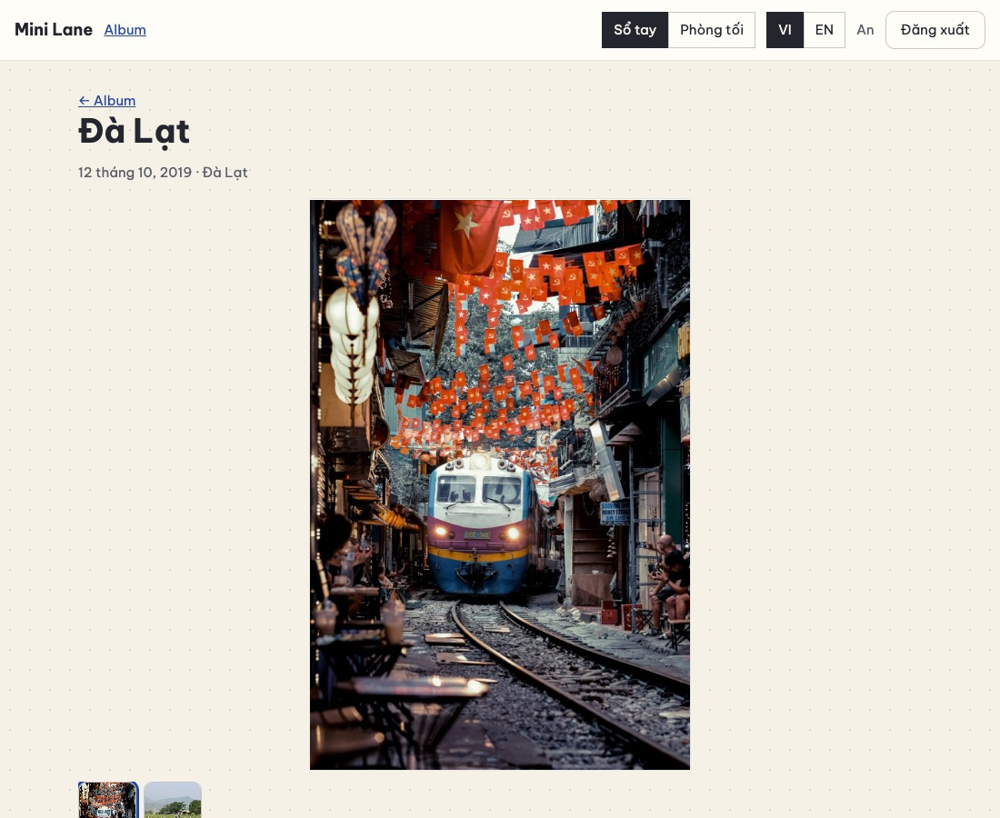</p>

Mở DevTools → Network, phát video rồi kéo thanh thời gian: yêu cầu tới `/api/files/….mp4` có trạng thái **206** và header `Range`. Mở
một tab **ẩn danh** (chưa đăng nhập), dán đường dẫn ảnh: **401**. Đăng nhập bằng tài khoản khác rồi thử lại: **404**.

#### 11.5 Lỗi hay gặp

| Triệu chứng | Nguyên nhân | Cách sửa |
| --- | --- | --- |
| `MulterError: Unexpected field` | Tên trường trong `FormData` khác với `fields([{ name: 'file' }, { name: 'poster' }])` | Dùng đúng `file` và `poster` |
| `req.files` là `undefined` | Quên middleware `upload` trong route | `router.post('/:id/files', beforeUpload, upload, …)` |
| Ảnh HEIC của iPhone báo "Tải lên không được" trên Chrome/Windows | Trình duyệt đó không giải mã được HEIC nên không vẽ lên canvas được (Safari thì được) | Bản thật thử thêm cách giải mã qua thẻ ``. Hoặc để iPhone chụp định dạng "Tương thích nhất" (JPEG) |
| Video phát được nhưng không tua được | Máy chủ không hỗ trợ Range | `res.sendFile` hỗ trợ sẵn. Đừng tự `fs.readFile` rồi `res.send` |
| Thư mục `uploads/tmp` đầy tệp lạ | Quên dọn trong `finally` | `files.discard(...)` trong `finally` |
| Ảnh hiện nhưng chỉ khi đang đăng nhập (bình thường!) | Tệp riêng tư, `` gửi kèm cookie | Đúng thiết kế |

#### 11.6 Đối chiếu với bản thật

- **`server/lib/files.js`**: giống của bạn, thêm `saveBuffer` (cho seed) và **dọn tệp tạm cũ** khi khởi động.
- **`server/lib/metadata.js`**: lớp bảo vệ **thứ hai** ở máy chủ, xoá EXIF/XMP khỏi JPEG, PNG, WebP và **toạ độ GPS bên trong video**
  MP4/MOV, thay chuỗi toạ độ bằng số 0 và giữ nguyên độ dài để video không hỏng.
  - Vì sao phải hai lớp? Video không được vẽ lại trong trình duyệt, và ai gọi thẳng API thì bỏ qua được canvas.
  - Bài kiểm thử: `test/metadata.test.js`.
- **`server/routes/memories.js`**:
  - ảnh xem trước tối đa 3 MB;
  - **hạn mức dung lượng** mỗi tài khoản (`STORAGE_MB`), kiểm tra trước khi nhận (theo `Content-Length`) và sau khi nhận (kích thước thật);
  - đổi thứ tự tệp, chọn ảnh bìa.
- **`client/src/lib/image.js`**: 3 cách giải mã dự phòng (Safari cũ, ảnh HEIC); giữ nguyên ảnh GIF (canvas làm mất chuyển động); ảnh
  PNG có nền trong suốt vẫn giữ trong suốt.
- **`components/forms/MemoryForm.jsx`**: hàng đợi tải lên ngay trong form; tệp lỗi thì có nút "Thử lại" hoặc "Bỏ qua".
- **`components/Gallery.jsx`**: phím ← →, **vuốt** trên điện thoại, đếm "01 / 05".
- **[docs/MO-RONG.md](docs/MO-RONG.md)**: khi có nhiều người dùng thì nén video bằng ffmpeg, lưu trên S3/R2, link có chữ ký, CDN.

#### 11.7 Tự kiểm tra

1. Vì sao không tin đuôi tệp hay kiểu MIME trình duyệt gửi?
2. Vì sao tệp phải đi qua `/api/files/:tên` có kiểm tra quyền, thay vì để trong một thư mục công khai?
3. Range request giúp gì cho video? Mã trạng thái nào báo "đây là một phần của tệp"?
4. Ảnh đã được vẽ lại trong trình duyệt (mất GPS), sao bản thật **vẫn** xoá metadata ở máy chủ?
5. **Bài tập:** thêm **hạn mức dung lượng** `STORAGE_MB` cho mỗi tài khoản: cộng `size` mọi tệp của người đó, vượt thì trả lỗi
   `STORAGE_FULL` (nhớ thêm câu dịch, bài kiểm thử dịch thuật sẽ nhắc). So với `storageUsed()` của bản thật.

**Commit:** `git add -A && git commit -m "feat(media): tải ảnh và video riêng tư"`

---

### Chặng 12 — Chia sẻ: link mời, vòng thân quen, lời nhắn

**Mục tiêu:**

- An tạo **link mời** gắn với kỷ niệm "Sinh nhật Hà" và gửi cho Hà.
- Hà mở link khi **chưa có tài khoản** → đăng ký → được đưa **về lại link** → bấm "Nhận lời mời" → thấy kỷ niệm (chỉ xem) và viết
  **lời nhắn**.
- An chọn được ai xem kỷ niệm nào.
- 4 bài kiểm thử mới.

#### 12.1 Khái niệm

**Mô hình ba lớp**, lớp sau cần lớp trước:

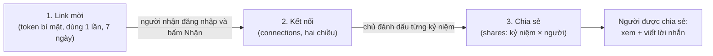

**Quan hệ nhiều–nhiều.** Một kỷ niệm chia sẻ cho nhiều người; một người được chia sẻ nhiều kỷ niệm. Cần một **bảng nối** `shares`
với khoá chính kép `(memory_id, user_id)`. Bảng `connections` lưu **cả hai chiều** (An→Hà và Hà→An), để câu hỏi "vòng thân quen của
tôi" chỉ cần `WHERE user_id = ?`.

**Token link mời được bảo vệ như mật khẩu:**

- **192 bit ngẫu nhiên**: đoán mò là vô vọng.
- CSDL chỉ giữ **SHA-256** của token. Link chỉ hiện **một lần**, lúc tạo.
- **Dùng một lần** (`accepted_at`), **hết hạn** sau 7 ngày (`expires_at`).
- **Xem trước công khai** (tên người mời, tên kỷ niệm), để Hà biết ai mời mình trước khi đăng ký. Nhưng **nhận lời phải đăng nhập và tự
  bấm nút**: mở link không tự động nhận.

**Mô hình quyền.** "Được xem kỷ niệm" = **là chủ** HOẶC **có dòng trong `shares`**. Viết thẳng vào câu SQL:

```sql
WHERE m.id = ? AND (m.user_id = ? OR EXISTS (SELECT 1 FROM shares s WHERE s.memory_id = m.id AND s.user_id = ?))
```

- **Sửa, xoá, tải tệp, chia sẻ tiếp: chỉ chủ.** Các câu SQL đó vẫn giữ `AND user_id = ?` từ chặng 5, nên người được chia sẻ tự động
  nhận 404.
- **Chỉ chia sẻ trong vòng thân quen:** câu `INSERT … SELECT … FROM connections` chỉ thêm những người **đã kết nối**. Id người lạ gửi lên
  bị lặng lẽ bỏ qua.

**`json_each(?)`** biến một mảng JSON (`'[3,7]'`) thành một "bảng tạm" dùng được trong `IN (…)`. Nhờ vậy một tham số `?` duy nhất chứa
được cả danh sách id, vẫn an toàn trước SQL injection.

**Transaction cho việc nhận lời mời.** Kết nối hai chiều + chia sẻ kỷ niệm + đánh dấu link đã dùng phải xảy ra **cùng nhau**. Lỗi giữa
chừng thì huỷ tất cả, không để "kết nối rồi mà link vẫn dùng được".

**Thứ tự route trong Express.** Express thử các route **theo thứ tự khai báo**. `router.get('/shared')` phải đứng **trước**
`router.get('/:id')`. Nếu không, `/shared` khớp với `/:id` (id = "shared") và trả 404.

#### 12.2 Làm từng bước — máy chủ

**Bước 1 — `server/migrations/004_sharing.sql`:**

```sql
-- Phiên bản 4: chia sẻ. Ba lớp, lớp sau cần lớp trước:
--   link mời (invites) → kết nối hai chiều (connections) → chia sẻ từng kỷ niệm (shares) → lời nhắn (comments)

-- Hai người đã nhận lời mời của nhau. Lưu CẢ HAI CHIỀU (A→B và B→A) để truy vấn đơn giản.
CREATE TABLE connections (
  user_id    INTEGER NOT NULL REFERENCES users (id) ON DELETE CASCADE,
  other_id   INTEGER NOT NULL REFERENCES users (id) ON DELETE CASCADE,
  created_at TEXT    NOT NULL DEFAULT (strftime('%Y-%m-%dT%H:%M:%fZ', 'now')),
  PRIMARY KEY (user_id, other_id),
  CHECK (user_id <> other_id)                                  -- không tự kết nối với chính mình
);

-- Link mời. CHỈ lưu mã băm của token: link chỉ hiện MỘT lần lúc tạo.
CREATE TABLE invites (
  id          INTEGER PRIMARY KEY,
  inviter_id  INTEGER NOT NULL REFERENCES users (id) ON DELETE CASCADE,
  token_hash  TEXT    NOT NULL UNIQUE,
  memory_id   INTEGER REFERENCES memories (id) ON DELETE SET NULL, -- kỷ niệm được chia sẻ khi nhận lời (tuỳ chọn)
  expires_at  TEXT    NOT NULL,
  accepted_by INTEGER REFERENCES users (id) ON DELETE SET NULL,
  accepted_at TEXT,
  created_at  TEXT    NOT NULL DEFAULT (strftime('%Y-%m-%dT%H:%M:%fZ', 'now'))
);

-- "Kỷ niệm 13 được chia sẻ với người dùng 7." Quan hệ nhiều–nhiều.
CREATE TABLE shares (
  memory_id  INTEGER NOT NULL REFERENCES memories (id) ON DELETE CASCADE,
  user_id    INTEGER NOT NULL REFERENCES users (id) ON DELETE CASCADE,
  created_at TEXT    NOT NULL DEFAULT (strftime('%Y-%m-%dT%H:%M:%fZ', 'now')),
  PRIMARY KEY (memory_id, user_id)
);
CREATE INDEX shares_user ON shares (user_id);

-- Lời nhắn dưới một kỷ niệm, của chủ hoặc người được chia sẻ.
CREATE TABLE comments (
  id         INTEGER PRIMARY KEY,
  memory_id  INTEGER NOT NULL REFERENCES memories (id) ON DELETE CASCADE,
  user_id    INTEGER NOT NULL REFERENCES users (id) ON DELETE CASCADE,
  body       TEXT    NOT NULL,
  created_at TEXT    NOT NULL DEFAULT (strftime('%Y-%m-%dT%H:%M:%fZ', 'now'))
);
CREATE INDEX comments_memory ON comments (memory_id, created_at);
```

`ON DELETE SET NULL` ở `invites.memory_id`: xoá kỷ niệm thì link mời vẫn còn (và vẫn tạo kết nối được), chỉ không còn gắn kỷ niệm.

**Bước 2 — `server/models/social.js`:**

```js
import { createHash, randomBytes } from 'node:crypto';
import { transaction } from '../db.js';

const NOW = "strftime('%Y-%m-%dT%H:%M:%fZ', 'now')";
const hashToken = (token) => createHash('sha256').update(token).digest('hex');

/** Mọi thứ liên quan HAI tài khoản: vòng thân quen, link mời, chia sẻ, lời nhắn. */
export function socialModel(db) {
  const isOwner = (userId, memoryId) =>
    Boolean(db.prepare('SELECT 1 FROM memories WHERE id = ? AND user_id = ?').get(memoryId, userId));

  /** QUY TẮC QUYỀN XEM: là chủ, HOẶC được chia sẻ đích danh. */
  const canView = (userId, memoryId) =>
    Boolean(
      db
        .prepare(
          `SELECT 1 FROM memories m WHERE m.id = ?
             AND (m.user_id = ? OR EXISTS (SELECT 1 FROM shares s WHERE s.memory_id = m.id AND s.user_id = ?))`,
        )
        .get(memoryId, userId, userId),
    );

  return {
    canView,

    // ---- vòng thân quen ----
    connections(userId) {
      return db
        .prepare(
          `SELECT u.id, u.name FROM connections c JOIN users u ON u.id = c.other_id
            WHERE c.user_id = ? ORDER BY u.name COLLATE NOCASE`,
        )
        .all(userId);
    },

    // ---- link mời ----
    /** → { id, token }. Token GỐC chỉ trả về lần này; CSDL chỉ giữ mã băm của nó. */
    createInvite(inviterId, { memoryId = null, days = 7 } = {}) {
      const token = randomBytes(24).toString('base64url'); // 192 bit ngẫu nhiên
      const safeMemory = memoryId && isOwner(inviterId, memoryId) ? memoryId : null; // chỉ gắn kỷ niệm CỦA MÌNH
      const expiresAt = new Date(Date.now() + days * 86_400_000).toISOString();
      const { lastInsertRowid } = db
        .prepare('INSERT INTO invites (inviter_id, token_hash, memory_id, expires_at) VALUES (?, ?, ?, ?)')
        .run(inviterId, hashToken(token), safeMemory, expiresAt);
      return { id: Number(lastInsertRowid), token, expiresAt };
    },

    /** Lời mời còn dùng được (chưa ai nhận, chưa hết hạn) → dòng CSDL, ngược lại null. */
    findInvite(token) {
      if (typeof token !== 'string' || token.length < 20 || token.length > 100) return null;
      const row = db
        .prepare(
          `SELECT i.*, u.name AS inviter_name, m.title AS memory_title
             FROM invites i JOIN users u ON u.id = i.inviter_id
             LEFT JOIN memories m ON m.id = i.memory_id
            WHERE i.token_hash = ?`,
        )
        .get(hashToken(token));
      if (!row || row.accepted_at || row.expires_at <= new Date().toISOString()) return null;
      return row;
    },

    /** Nhận lời: kết nối hai chiều + chia sẻ kỷ niệm gắn kèm + đánh dấu đã dùng — TẤT CẢ hoặc KHÔNG GÌ. */
    acceptInvite(token, userId) {
      const row = this.findInvite(token);
      if (!row) return { error: 'INVITE_INVALID' };
      if (row.inviter_id === userId) return { error: 'INVITE_OWN' };
      return transaction(db, () => {
        const connect = db.prepare('INSERT OR IGNORE INTO connections (user_id, other_id) VALUES (?, ?)');
        connect.run(row.inviter_id, userId);
        connect.run(userId, row.inviter_id);
        if (row.memory_id) {
          db.prepare('INSERT OR IGNORE INTO shares (memory_id, user_id) VALUES (?, ?)').run(row.memory_id, userId);
        }
        db.prepare(`UPDATE invites SET accepted_by = ?, accepted_at = ${NOW} WHERE id = ?`).run(userId, row.id);
        return { inviter: { id: row.inviter_id, name: row.inviter_name }, memoryId: row.memory_id ?? null };
      });
    },

    // ---- chia sẻ ----
    /** Ai đang xem được kỷ niệm của bạn (null nếu kỷ niệm không phải của bạn). */
    recipients(ownerId, memoryId) {
      if (!isOwner(ownerId, memoryId)) return null;
      return db
        .prepare('SELECT u.id, u.name FROM shares s JOIN users u ON u.id = s.user_id WHERE s.memory_id = ? ORDER BY u.name')
        .all(memoryId);
    },

    /** Thay toàn bộ danh sách người xem. CHỈ người trong vòng thân quen được thêm; id lạ bị bỏ qua. */
    setRecipients(ownerId, memoryId, userIds) {
      if (!isOwner(ownerId, memoryId)) return null;
      const wanted = JSON.stringify(userIds);
      transaction(db, () => {
        db.prepare('DELETE FROM shares WHERE memory_id = ? AND user_id NOT IN (SELECT value FROM json_each(?))').run(memoryId, wanted);
        db.prepare(
          `INSERT OR IGNORE INTO shares (memory_id, user_id)
           SELECT ?, c.other_id FROM connections c
            WHERE c.user_id = ? AND c.other_id IN (SELECT value FROM json_each(?))`,
        ).run(memoryId, ownerId, wanted);
      });
      return this.recipients(ownerId, memoryId);
    },

    // ---- lời nhắn ----
    comments(memoryId) {
      return db
        .prepare(
          `SELECT c.id, c.body, c.created_at, u.id AS author_id, u.name AS author_name
             FROM comments c JOIN users u ON u.id = c.user_id
            WHERE c.memory_id = ? ORDER BY c.created_at, c.id`,
        )
        .all(memoryId)
        .map((row) => ({ id: row.id, body: row.body, createdAt: row.created_at, author: { id: row.author_id, name: row.author_name } }));
    },

    addComment(memoryId, userId, body) {
      const { lastInsertRowid } = db.prepare('INSERT INTO comments (memory_id, user_id, body) VALUES (?, ?, ?)').run(memoryId, userId, body);
      return this.comments(memoryId).find((comment) => comment.id === Number(lastInsertRowid));
    },
  };
}
```

`acceptInvite` gọi `this.findInvite`. `this` là đối tượng model, vì hàm được gọi dạng `social.acceptInvite(…)`.

**Bước 3 — người được chia sẻ đọc được kỷ niệm và tệp:**

```diff
@@ -9,14 +9,15 @@
 // thành chuỗi JSON (json_group_array). Nhờ vậy 100 kỷ niệm = 1 truy vấn, không phải 101 ("lỗi N+1").
 const SELECT = `
-  SELECT m.*,
+  SELECT m.*, u.name AS owner_name,
          (SELECT json_group_array(json_object('id', f.id, 'kind', f.kind, 'file', f.file, 'poster', f.poster,
                                               'width', f.width, 'height', f.height, 'duration', f.duration))
             FROM (SELECT * FROM memory_files WHERE memory_id = m.id ORDER BY position, id) AS f) AS files_json
-    FROM memories m`;
+    FROM memories m JOIN users u ON u.id = m.user_id`;
 
 // Tệp chỉ được xem qua đường dẫn có kiểm tra quyền /api/files/…, không bao giờ là thư mục công khai.
 const fileUrl = (name) => (name ? `/api/files/${name}` : null);
 
-function toMemory(row) {
+/** viewerId: người đang xem — để biết họ là chủ hay người được chia sẻ. */
+function toMemory(row, viewerId = row.user_id) {
   const files = JSON.parse(row.files_json || '[]').map((f) => ({
     id: f.id,
@@ -38,4 +39,6 @@
     files,
     cover: files[0] ?? null,
+    owner: { id: row.user_id, name: row.owner_name },
+    access: viewerId === row.user_id ? 'owner' : 'shared', // giao diện ẩn nút Sửa/Xoá khi là 'shared'
     createdAt: row.created_at,
     updatedAt: row.updated_at,
@@ -51,10 +54,26 @@
 
     list(userId) {
-      return db.prepare(`${SELECT} WHERE m.user_id = ? ${ORDER}`).all(userId).map(toMemory);
+      // Viết (row) => toMemory(row), KHÔNG viết .map(toMemory): map truyền thêm số thứ tự (0, 1, 2…)
+      // vào tham số thứ hai, và toMemory sẽ tưởng đó là viewerId.
+      return db.prepare(`${SELECT} WHERE m.user_id = ? ${ORDER}`).all(userId).map((row) => toMemory(row));
     },
 
-    get(userId, id) {
-      const row = db.prepare(`${SELECT} WHERE m.id = ? AND m.user_id = ?`).get(id, userId);
-      return row ? toMemory(row) : null;
+    /** Kỷ niệm bạn sở hữu HOẶC được chia sẻ với bạn. Mọi trường hợp khác → null (API trả 404). */
+    get(viewerId, id) {
+      const row = db
+        .prepare(
+          `${SELECT} WHERE m.id = ?
+             AND (m.user_id = ? OR EXISTS (SELECT 1 FROM shares s WHERE s.memory_id = m.id AND s.user_id = ?))`,
+        )
+        .get(id, viewerId, viewerId);
+      return row ? toMemory(row, viewerId) : null;
+    },
+
+    /** Kỷ niệm người khác chia sẻ với bạn, mới chia sẻ trước. */
+    sharedWith(viewerId) {
+      return db
+        .prepare(`${SELECT} JOIN shares s ON s.memory_id = m.id WHERE s.user_id = ? ORDER BY s.created_at DESC`)
+        .all(viewerId)
+        .map((row) => toMemory(row, viewerId));
     },
 
@@ -116,5 +135,5 @@
     },
 
-    /** Người này có được xem tệp này không? (Chặng 12 mở rộng: cả người được chia sẻ.) */
+    /** Người này có được xem tệp này không? Chủ kỷ niệm, hoặc người được chia sẻ kỷ niệm chứa tệp. */
     canViewFile(viewerId, name) {
       return Boolean(
@@ -122,7 +141,8 @@
           .prepare(
             `SELECT 1 FROM memory_files f JOIN memories m ON m.id = f.memory_id
-              WHERE (f.file = ? OR f.poster = ?) AND m.user_id = ?`,
+              WHERE (f.file = ? OR f.poster = ?)
+                AND (m.user_id = ? OR EXISTS (SELECT 1 FROM shares s WHERE s.memory_id = m.id AND s.user_id = ?))`,
           )
-          .get(name, name, viewerId),
+          .get(name, name, viewerId, viewerId),
       );
     },
```

> **Một lỗi tinh vi đã gặp khi viết hướng dẫn này:** dòng cũ `.all(userId).map(toMemory)` không sai cho tới khi `toMemory` có tham số thứ
> hai. `Array.map` gọi hàm với **(phần tử, số thứ tự, mảng)**, nên `toMemory` nhận số thứ tự 0, 1, 2… làm `viewerId`, và kỷ niệm của
> chính An bị đánh dấu `access: 'shared'`. Viết rõ `(row) => toMemory(row)` để chỉ truyền đúng một tham số.

**Bước 4 — đọc danh sách id an toàn (`parseIdList`):**

```diff
@@ -62,4 +62,11 @@
 }
 
+/** [1, 2] hoặc "1,2" → danh sách số nguyên dương, không trùng, tối đa `max` phần tử. */
+export function parseIdList(value, max = 500) {
+  const list = Array.isArray(value) ? value : String(value ?? '').split(',');
+  const ids = list.map(Number).filter((n) => Number.isInteger(n) && n > 0);
+  return [...new Set(ids)].slice(0, max);
+}
+
 /** Tham số :id trên đường dẫn → số nguyên dương, nếu không thì 404 (không tồn tại). */
 export function idParam(value) {
```

**Bước 5 — `server/routes/invites.js`:**

```js
import { Router } from 'express';
import { HttpError } from '../lib/errors.js';
import { rateLimit } from '../lib/rateLimit.js';
import { requireAuth } from '../lib/sessions.js';
import { validator } from '../lib/validate.js';

/**
 * Link mời — cách DUY NHẤT để vào vòng thân quen của ai đó. Token 192 bit ngẫu nhiên; CSDL chỉ giữ mã băm.
 * Dùng một lần, hết hạn sau 7 ngày.
 */
export function inviteRoutes({ social }) {
  const router = Router();
  const limiter = rateLimit({ windowMs: 15 * 60_000, max: 60 }); // đoán token là vô vọng, nhưng cũng không cho thử nhanh

  // CÔNG KHAI: trang /join/… cho biết ai mời bạn, trước khi bạn đăng nhập hay tạo tài khoản.
  router.get('/preview/:token', limiter, (req, res) => {
    const invite = social.findInvite(req.params.token);
    if (!invite) throw new HttpError(404, 'INVITE_INVALID');
    res.json({
      invite: {
        inviter: { name: invite.inviter_name },
        memory: invite.memory_id ? { title: invite.memory_title } : null,
        expiresAt: invite.expires_at,
      },
    });
  });

  // Nhận lời: PHẢI đăng nhập và tự bấm nút (không tự động nhận chỉ vì mở link).
  router.post('/accept/:token', requireAuth, limiter, (req, res) => {
    const result = social.acceptInvite(req.params.token, req.user.id);
    if (result.error) throw new HttpError(result.error === 'INVITE_OWN' ? 400 : 404, result.error);
    res.json(result);
  });

  // Tạo link: { memoryId? } → { token }. Token chỉ có trong phản hồi NÀY.
  router.post('/', requireAuth, (req, res) => {
    const v = validator(req.body);
    const memoryId = v.int('memoryId', { min: 1 });
    v.check();
    const { token, expiresAt } = social.createInvite(req.user.id, { memoryId });
    res.status(201).json({ token, expiresAt });
  });

  return router;
}
```

**Bước 6 — chia sẻ và lời nhắn trong `server/routes/memories.js`:**

```diff
@@ -1,5 +1,5 @@
 import { Router } from 'express';
 import { HttpError, notFound } from '../lib/errors.js';
-import { idParam, validator } from '../lib/validate.js';
+import { idParam, parseIdList, validator } from '../lib/validate.js';
 import { isValidDate } from '../../shared/dates.js';
 import { LIMITS } from '../../shared/limits.js';
@@ -8,5 +8,5 @@
 const MB = 1024 * 1024;
 
-export function memoryRoutes({ config, memories, files }) {
+export function memoryRoutes({ config, memories, files, social }) {
   const router = Router();
   // Mỗi yêu cầu tải lên MỘT ảnh/video (+ một ảnh xem trước), ghi thẳng xuống đĩa.
@@ -15,4 +15,9 @@
   router.get('/', (req, res) => {
     res.json({ memories: memories.list(req.user.id) });
+  });
+
+  // Phải đứng TRƯỚC '/:id': Express thử route theo thứ tự khai báo, '/shared' sẽ bị '/:id' "nuốt" mất.
+  router.get('/shared', (req, res) => {
+    res.json({ memories: memories.sharedWith(req.user.id) });
   });
 
@@ -98,4 +103,36 @@
   });
 
+  // ---------- chia sẻ (chỉ chủ kỷ niệm) ----------
+
+  router.get('/:id/shares', (req, res) => {
+    const recipients = social.recipients(req.user.id, idParam(req.params.id));
+    if (!recipients) throw notFound();
+    res.json({ recipients, circle: social.connections(req.user.id) });
+  });
+
+  // Thân yêu cầu: { userIds: [...] } — DANH SÁCH ĐẦY ĐỦ người được xem (thay thế danh sách cũ).
+  router.put('/:id/shares', (req, res) => {
+    const recipients = social.setRecipients(req.user.id, idParam(req.params.id), parseIdList(req.body?.userIds));
+    if (!recipients) throw notFound();
+    res.json({ recipients });
+  });
+
+  // ---------- lời nhắn: chủ + người được chia sẻ ----------
+
+  router.get('/:id/comments', (req, res) => {
+    const id = idParam(req.params.id);
+    if (!social.canView(req.user.id, id)) throw notFound();
+    res.json({ comments: social.comments(id) });
+  });
+
+  router.post('/:id/comments', (req, res) => {
+    const id = idParam(req.params.id);
+    if (!social.canView(req.user.id, id)) throw notFound();
+    const v = validator(req.body);
+    const body = v.text('body', { required: true, max: LIMITS.comment });
+    v.check();
+    res.status(201).json({ comment: social.addComment(id, req.user.id, body) });
+  });
+
   return router;
 }
```

**Bước 7 — lắp vào app:**

```diff
@@ -6,7 +6,9 @@
 import { createSessions, requireAuth } from './lib/sessions.js';
 import { memoriesModel } from './models/memories.js';
+import { socialModel } from './models/social.js';
 import { usersModel } from './models/users.js';
 import { authRoutes } from './routes/auth.js';
 import { fileRoutes } from './routes/files.js';
+import { inviteRoutes } from './routes/invites.js';
 import { memoryRoutes } from './routes/memories.js';
 
@@ -26,4 +28,5 @@
     memories: memoriesModel(db),
     files: createFileStore(config.uploadDir),
+    social: socialModel(db),
   };
 
@@ -48,4 +51,5 @@
   api.use('/memories', requireAuth, memoryRoutes(ctx)); // phải đăng nhập mới tới được các route bên trong
   api.use('/files', requireAuth, fileRoutes(ctx));
+  api.use('/invites', inviteRoutes(ctx)); // xem trước lời mời là công khai; phần còn lại tự đòi đăng nhập
   // Mọi đường dẫn /api/... không khớp route nào: 404 dạng JSON (thay cho trang HTML mặc định).
   api.use((req, res) => res.status(404).json({ error: 'NOT_FOUND' }));
```

**Bước 8 — kiểm thử `test/sharing.test.js`:**

```js
import { after, before, test } from 'node:test';
import assert from 'node:assert/strict';
import { client, registered, startTestServer } from './helpers.js';

let server;
before(async () => {
  server = await startTestServer();
});
after(() => server.close());

/** An tạo một kỷ niệm và một link mời gắn với nó. */
async function anInvites() {
  const an = await registered(server.base, 'An');
  const memory = (await an.api.post('/api/memories', { title: 'Sinh nhật Hà', year: 2021 })).body.memory;
  const { token } = (await an.api.post('/api/invites', { memoryId: memory.id })).body;
  return { an, memory, token };
}

test('link mời: xem trước công khai, CSDL chỉ có mã băm, nhận lời phải đăng nhập', async () => {
  const { token } = await anInvites();
  const preview = await client(server.base).get(`/api/invites/preview/${token}`);
  assert.equal(preview.status, 200);
  assert.equal(preview.body.invite.inviter.name, 'An');
  assert.equal(preview.body.invite.memory.title, 'Sinh nhật Hà');

  const stored = server.db.prepare('SELECT token_hash FROM invites').all().map((row) => row.token_hash);
  assert.ok(!stored.includes(token)); // token gốc không nằm trong CSDL

  assert.equal((await client(server.base).post(`/api/invites/accept/${token}`)).status, 401);
});

test('nhận lời: hai người kết nối, kỷ niệm được chia sẻ — chỉ để XEM', async () => {
  const { an, memory, token } = await anInvites();
  const ha = await registered(server.base, 'Hà');
  const accepted = await ha.api.post(`/api/invites/accept/${token}`);
  assert.equal(accepted.status, 200);
  assert.equal(accepted.body.memoryId, memory.id);

  const seen = await ha.api.get(`/api/memories/${memory.id}`);
  assert.equal(seen.status, 200);
  assert.equal(seen.body.memory.access, 'shared');
  assert.equal(seen.body.memory.owner.name, 'An');
  assert.equal((await ha.api.get('/api/memories/shared')).body.memories.length, 1);
  assert.equal((await an.api.get(`/api/memories/${memory.id}`)).body.memory.access, 'owner');

  // Người được chia sẻ không sửa, không xoá, không tải tệp lên được
  assert.equal((await ha.api.put(`/api/memories/${memory.id}`, { title: 'Sửa trộm', year: 2021 })).status, 404);
  assert.equal((await ha.api.del(`/api/memories/${memory.id}`)).status, 404);

  // Link chỉ dùng một lần
  const again = await (await registered(server.base, 'Người thứ ba')).api.post(`/api/invites/accept/${token}`);
  assert.equal(again.status, 404);
  assert.equal(again.body.error, 'INVITE_INVALID');
});

test('chia sẻ chỉ trong vòng thân quen; bỏ chia sẻ là mất quyền ngay', async () => {
  const { an, memory, token } = await anInvites();
  const ha = await registered(server.base, 'Hà');
  const stranger = await registered(server.base, 'Người lạ');
  await ha.api.post(`/api/invites/accept/${token}`);

  // Thêm người lạ vào danh sách: bị lặng lẽ bỏ qua vì không có trong vòng thân quen
  const put = await an.api.put(`/api/memories/${memory.id}/shares`, { userIds: [ha.user.id, stranger.user.id] });
  assert.deepEqual(put.body.recipients.map((r) => r.name), ['Hà']);
  assert.equal((await stranger.api.get(`/api/memories/${memory.id}`)).status, 404);

  // Bỏ chia sẻ với Hà
  await an.api.put(`/api/memories/${memory.id}/shares`, { userIds: [] });
  assert.equal((await ha.api.get(`/api/memories/${memory.id}`)).status, 404);
});

test('lời nhắn: chủ và người được chia sẻ viết được, người lạ thì không', async () => {
  const { an, memory, token } = await anInvites();
  const ha = await registered(server.base, 'Hà');
  const stranger = await registered(server.base, 'Người lạ');
  await ha.api.post(`/api/invites/accept/${token}`);

  assert.equal((await ha.api.post(`/api/memories/${memory.id}/comments`, { body: 'Nhớ hôm đó ghê!' })).status, 201);
  assert.equal((await an.api.post(`/api/memories/${memory.id}/comments`, { body: 'Hè sau đi lại nha.' })).status, 201);
  assert.equal((await stranger.api.post(`/api/memories/${memory.id}/comments`, { body: 'Xin chào' })).status, 404);

  const list = (await ha.api.get(`/api/memories/${memory.id}/comments`)).body.comments;
  assert.deepEqual(list.map((c) => c.author.name), ['Hà', 'An']);
});
```

`server.db` (CSDL mà `startTestServer` trả về) cho phép bài kiểm thử nhìn **thẳng vào CSDL**, để chứng minh token gốc không được lưu.

Mở rộng bài kiểm thử dịch thuật cho **mọi** mã lỗi `HttpError` (link mời dùng 404 và 400):

```diff
@@ -63,5 +63,5 @@
       assert.ok(`errors.field.${name}` in EN, `thiếu errors.field.${name}`);
     }
-    for (const [, name] of code.matchAll(/HttpError\(\s*(?:401|429)\s*,\s*'([A-Z_]+)'/g)) {
+    for (const [, name] of code.matchAll(/HttpError\(\s*\d+\s*,\s*'([A-Z_]+)'/g)) {
       assert.ok(`errors.${name}` in EN, `thiếu errors.${name}`);
     }
```

#### 12.3 Làm từng bước — giao diện

**Bước 9 — khung chia sẻ cho chủ kỷ niệm `client/src/components/SharePanel.jsx`:**

```jsx
import { useState } from 'react';
import { api } from '../api.js';
import { useI18n } from '../i18n/index.jsx';
import { useFetch } from '../state.jsx';

/** Chủ kỷ niệm chọn ai được xem (trong vòng thân quen), và tạo link mời người mới. */
export default function SharePanel({ memoryId }) {
  const { t } = useI18n();
  const { data } = useFetch(`/api/memories/${memoryId}/shares`); // { recipients, circle }
  const [selected, setSelected] = useState(null); // null = chưa đổi gì, dùng dữ liệu từ máy chủ
  const [link, setLink] = useState(null);
  const [copied, setCopied] = useState(false);

  if (!data) return null;
  const ids = selected ?? data.recipients.map((person) => person.id);

  async function toggle(userId) {
    const next = ids.includes(userId) ? ids.filter((id) => id !== userId) : [...ids, userId];
    setSelected(next); // cập nhật giao diện ngay ("optimistic"), rồi mới gửi
    const r = await api.put(`/api/memories/${memoryId}/shares`, { userIds: next });
    setSelected(r.recipients.map((person) => person.id)); // máy chủ là nguồn sự thật cuối cùng
  }

  async function createInvite() {
    const { token } = await api.post('/api/invites', { memoryId });
    setLink(`${window.location.origin}/join/${token}`);
    setCopied(false);
  }

  return (
    <section className="card share">
      <h2>{t('share.title')}</h2>
      <p className="meta">{t('share.hint')}</p>
      {data.circle.length === 0 && <p>{t('share.empty')}</p>}
      {data.circle.map((person) => (
        <label key={person.id} className="check">
          <input type="checkbox" checked={ids.includes(person.id)} onChange={() => toggle(person.id)} />
          {person.name}
        </label>
      ))}
      <button type="button" onClick={createInvite}>
        {t('share.invite')}
      </button>
      {link && (
        <div className="invite-link">
          <p>{t('share.linkReady')}</p>
          <input readOnly value={link} onFocus={(event) => event.target.select()} />
          <button
            type="button"
            onClick={async () => {
              await navigator.clipboard.writeText(link);
              setCopied(true);
            }}
          >
            {copied ? t('share.copied') : t('share.copy')}
          </button>
        </div>
      )}
    </section>
  );
}
```

`toggle` là kiểu cập nhật **lạc quan** (optimistic): giao diện đổi ngay khi bấm, rồi mới gửi lên máy chủ. Máy chủ trả về danh sách thật
và giao diện dùng danh sách đó, phòng khi máy chủ bỏ bớt người.

**Bước 10 — lời nhắn `client/src/components/Comments.jsx`:**

```jsx
import { useEffect, useState } from 'react';
import { LIMITS } from '@shared/limits.js';
import { api } from '../api.js';
import { fieldMessage, useI18n } from '../i18n/index.jsx';
import { useFetch } from '../state.jsx';

/** Lời nhắn dưới một kỷ niệm: chỉ chủ và người được chia sẻ thấy. */
export default function Comments({ memoryId }) {
  const { t } = useI18n();
  const { data } = useFetch(`/api/memories/${memoryId}/comments`);
  const [comments, setComments] = useState([]);
  const [body, setBody] = useState('');
  const [error, setError] = useState(null);

  useEffect(() => {
    if (data) setComments(data.comments); // dữ liệu từ máy chủ → bản sao trong state để thêm lời nhắn mới vào ngay
  }, [data]);

  async function send(event) {
    event.preventDefault();
    setError(null);
    try {
      const { comment } = await api.post(`/api/memories/${memoryId}/comments`, { body });
      setComments((list) => [...list, comment]);
      setBody('');
    } catch (err) {
      setError(err.fields?.body ? fieldMessage(t, err.fields.body) : t('errors.SERVER'));
    }
  }

  return (
    <section className="comments">
      <h2>{t('comments.title')}</h2>
      {comments.length === 0 && <p className="meta">{t('comments.empty')}</p>}
      <ul>
        {comments.map((comment) => (
          <li key={comment.id} className="card">
            <strong>{comment.author.name}</strong>
            <p>{comment.body}</p>
          </li>
        ))}
      </ul>
      <form onSubmit={send} className="form">
        <textarea
          rows={2}
          value={body}
          maxLength={LIMITS.comment}
          placeholder={t('comments.placeholder')}
          onChange={(event) => setBody(event.target.value)}
        />
        {error && <span className="error">{error}</span>}
        <div className="actions">
          <button type="submit" className="primary" disabled={!body.trim()}>
            {t('comments.send')}
          </button>
        </div>
      </form>
    </section>
  );
}
```

**Bước 11 — trang mở link mời `client/src/pages/Join.jsx`:**

```jsx
import { useEffect, useState } from 'react';
import { Link, useNavigate, useParams } from 'react-router';
import { api } from '../api.js';
import { useAuth } from '../auth.jsx';
import { errorMessage, useI18n } from '../i18n/index.jsx';

/** /join/:token — mở được khi CHƯA đăng nhập. Đăng nhập/đăng ký xong thì quay lại đúng trang này. */
export default function Join() {
  const { token } = useParams();
  const { user } = useAuth();
  const { t } = useI18n();
  const navigate = useNavigate();
  const [invite, setInvite] = useState(null);
  const [error, setError] = useState(null);

  useEffect(() => {
    api
      .get(`/api/invites/preview/${token}`)
      .then((r) => setInvite(r.invite))
      .catch(setError);
  }, [token]);

  async function accept() {
    try {
      const r = await api.post(`/api/invites/accept/${token}`);
      navigate(r.memoryId ? `/album/${r.memoryId}` : '/album', { replace: true });
    } catch (err) {
      setError(err);
    }
  }

  const back = { from: `/join/${token}` }; // để GuestOnly đưa người dùng quay lại đây sau khi đăng nhập
  return (
    <div className="card auth">
      {error && <p className="error">{errorMessage(t, error)}</p>}
      {!invite && !error && <p aria-busy="true">{t('app.loading')}</p>}
      {invite && (
        <>
          <h1>{t('join.title', { name: invite.inviter.name })}</h1>
          {invite.memory && <p>{t('join.withMemory', { title: invite.memory.title })}</p>}
          {user ? (
            <button type="button" className="primary" onClick={accept}>
              {t('join.accept')}
            </button>
          ) : (
            <>
              <Link to="/register" state={back}>
                {t('join.registerFirst')}
              </Link>
              <Link to="/login" state={back}>
                {t('join.loginFirst')}
              </Link>
            </>
          )}
        </>
      )}
    </div>
  );
}
```

Mấu chốt là `state={{ from: '/join/…' }}` trên hai link Đăng ký/Đăng nhập. Đăng ký xong, `GuestOnly` (chặng 7) đưa Hà **về lại đúng link
mời**. Trang Đăng nhập và Đăng ký phải **chuyển tiếp** state đó khi người dùng bấm qua lại giữa hai trang:

```diff
@@ -1,4 +1,4 @@
 import { useState } from 'react';
-import { Link } from 'react-router';
+import { Link, useLocation } from 'react-router';
 import { useAuth } from '../auth.jsx';
 import { errorMessage, useI18n } from '../i18n/index.jsx';
@@ -7,4 +7,5 @@
   const { login } = useAuth();
   const { t } = useI18n();
+  const location = useLocation(); // giữ state.from khi chuyển qua lại giữa Đăng nhập và Đăng ký
   const [email, setEmail] = useState('');
   const [password, setPassword] = useState('');
@@ -44,5 +45,5 @@
       </button>
       <p>
-        {t('auth.noAccount')} <Link to="/register">{t('auth.toRegister')}</Link>
+        {t('auth.noAccount')} <Link to="/register" state={location.state}>{t('auth.toRegister')}</Link>
       </p>
     </form>
```

```diff
@@ -1,4 +1,4 @@
 import { useState } from 'react';
-import { Link } from 'react-router';
+import { Link, useLocation } from 'react-router';
 import { LIMITS } from '@shared/limits.js';
 import { useAuth } from '../auth.jsx';
@@ -8,4 +8,5 @@
   const { register } = useAuth();
   const { t } = useI18n();
+  const location = useLocation(); // giữ state.from khi chuyển qua lại giữa Đăng nhập và Đăng ký
   const [fields, setFields] = useState({ name: '', email: '', password: '' });
   const [errors, setErrors] = useState({});
@@ -56,5 +57,5 @@
       </button>
       <p>
-        {t('auth.haveAccount')} <Link to="/login">{t('auth.toLogin')}</Link>
+        {t('auth.haveAccount')} <Link to="/login" state={location.state}>{t('auth.toLogin')}</Link>
       </p>
     </form>
```

**Bước 12 — ghép vào app:**

```diff
@@ -4,4 +4,5 @@
 import { useI18n } from './i18n/index.jsx';
 import Album from './pages/Album.jsx';
+import Join from './pages/Join.jsx';
 import Login from './pages/Login.jsx';
 import MemoryPage from './pages/MemoryPage.jsx';
@@ -13,4 +14,6 @@
     <Routes>
       <Route path="/" element={<Navigate to="/album" replace />} />
+      {/* Link mời mở được dù đã đăng nhập hay chưa */}
+      <Route path="/join/:token" element={<Join />} />
 
       <Route element={<GuestOnly />}>
```

```diff
@@ -2,7 +2,9 @@
 import { Link, useNavigate, useParams } from 'react-router';
 import { api } from '../api.js';
+import Comments from '../components/Comments.jsx';
 import Gallery from '../components/Gallery.jsx';
 import MemoryForm from '../components/MemoryForm.jsx';
 import Modal from '../components/Modal.jsx';
+import SharePanel from '../components/SharePanel.jsx';
 import Uploader from '../components/Uploader.jsx';
 import { useI18n } from '../i18n/index.jsx';
@@ -21,4 +23,5 @@
   if (!data) return <p aria-busy="true">{t('app.loading')}</p>;
   const { memory } = data;
+  const isOwner = memory.access === 'owner'; // người được chia sẻ: chỉ xem và viết lời nhắn
 
   async function remove() {
@@ -36,22 +39,32 @@
         {memoryDate(memory)}
         {memory.place && ` · ${memory.place}`}
+        {!isOwner && ` · ${t('share.owner', { name: memory.owner.name })}`}
       </p>
       <Gallery
         files={memory.files}
-        onDelete={async (file) => {
-          await api.del(`/api/memories/${memory.id}/files/${file.id}`);
-          refresh();
-        }}
+        onDelete={
+          isOwner &&
+          (async (file) => {
+            await api.del(`/api/memories/${memory.id}/files/${file.id}`);
+            refresh();
+          })
+        }
       />
       {memory.story && <p className="story">{memory.story}</p>}
-      <Uploader memoryId={memory.id} onUploaded={refresh} />
-      <div className="actions">
-        <button type="button" onClick={() => setEditing(true)}>
-          {t('memory.edit')}
-        </button>
-        <button type="button" className="danger" onClick={remove}>
-          {t('memory.delete')}
-        </button>
-      </div>
+      {isOwner && (
+        <>
+          <Uploader memoryId={memory.id} onUploaded={refresh} />
+          <div className="actions">
+            <button type="button" onClick={() => setEditing(true)}>
+              {t('memory.edit')}
+            </button>
+            <button type="button" className="danger" onClick={remove}>
+              {t('memory.delete')}
+            </button>
+          </div>
+          <SharePanel memoryId={memory.id} />
+        </>
+      )}
+      <Comments memoryId={memory.id} />
 
       <Modal open={editing} onClose={() => setEditing(false)} title={t('memory.editTitle')}>
```

```diff
@@ -9,4 +9,5 @@
   const { t, memoryDate } = useI18n();
   const { data, error, retry } = useFetch('/api/memories');
+  const shared = useFetch('/api/memories/shared');
   const { refresh } = useData();
   const navigate = useNavigate();
@@ -48,4 +49,19 @@
       </ul>
 
+      {shared.data?.memories.length > 0 && (
+        <>
+          <h2 className="section-title">{t('share.sharedWithYou')}</h2>
+          <ul className="memories">
+            {shared.data.memories.map((memory) => (
+              <li key={memory.id}>
+                {memory.cover && }
+                <Link to={`/album/${memory.id}`}>{memory.title}</Link>
+                <span className="meta">{t('share.owner', { name: memory.owner.name })}</span>
+              </li>
+            ))}
+          </ul>
+        </>
+      )}
+
       <Modal open={adding} onClose={() => setAdding(false)} title={t('memory.newTitle')}>
         <MemoryForm
```

```diff
@@ -262,4 +262,39 @@
 }
 
+/* ---------- Chia sẻ & lời nhắn ---------- */
+.section-title {
+  margin-top: var(--s6);
+}
+.share {
+  display: grid;
+  gap: var(--s2);
+  justify-items: start;
+  margin: var(--s5) 0;
+}
+.check {
+  display: flex;
+  align-items: center;
+  gap: var(--s2);
+  font-weight: 400;
+}
+.check input {
+  width: auto;
+}
+.invite-link {
+  display: grid;
+  gap: var(--s2);
+  width: 100%;
+}
+.comments ul {
+  list-style: none;
+  padding: 0;
+  display: grid;
+  gap: var(--s3);
+}
+.comments li p {
+  margin: var(--s1) 0 0;
+  white-space: pre-line;
+}
+
 /* ---------- Hộp thoại ---------- */
 .modal {
```

**Bước 13 — câu chữ:**

```diff
@@ -47,8 +47,32 @@
   upload: { choose: '+ Thêm ảnh hoặc video', failed: 'Tải lên không được.' },
   gallery: { label: 'Ảnh và video', show: 'Xem tệp số {number}', delete: 'Xoá tệp này' },
+  share: {
+    title: 'Chia sẻ với',
+    hint: 'Chỉ người trong vòng thân quen (đã nhận lời mời của bạn) mới hiện ở đây.',
+    empty: 'Chưa có ai trong vòng thân quen.',
+    invite: 'Tạo link mời',
+    linkReady: 'Gửi link này cho người thân (dùng được một lần, trong 7 ngày):',
+    copy: 'Sao chép',
+    copied: 'Đã chép',
+    owner: 'Của {name}',
+    sharedWithYou: 'Được chia sẻ với bạn',
+  },
+  comments: { title: 'Lời nhắn', placeholder: 'Viết lời nhắn…', send: 'Gửi', empty: 'Chưa có lời nhắn nào.' },
+  join: {
+    title: '{name} mời bạn vào Mini Lane',
+    withMemory: 'và muốn chia sẻ kỷ niệm “{title}”.',
+    accept: 'Nhận lời mời',
+    loginFirst: 'Đăng nhập để nhận lời',
+    registerFirst: 'Tạo tài khoản mới',
+  },
   common: { close: 'Đóng' },
   errors: {
     INVALID_CREDENTIALS: 'Sai email hoặc mật khẩu.',
     UNAUTHORIZED: 'Phiên đăng nhập đã hết. Hãy đăng nhập lại.',
+    NOT_FOUND: 'Không tìm thấy.',
+    VALIDATION: 'Vui lòng kiểm tra lại các ô.',
+    CROSS_SITE: 'Yêu cầu bị chặn vì đến từ trang web khác.',
+    INVITE_INVALID: 'Link mời không còn dùng được (đã dùng, hết hạn hoặc sai).',
+    INVITE_OWN: 'Đây là link mời của chính bạn.',
     RATE_LIMITED: 'Bạn thử quá nhiều lần. Hãy đợi một lát.',
     NETWORK: 'Không kết nối được máy chủ.',
```

```diff
@@ -46,8 +46,32 @@
   upload: { choose: '+ Add photos or videos', failed: 'Upload failed.' },
   gallery: { label: 'Photos and videos', show: 'Show file {number}', delete: 'Delete this file' },
+  share: {
+    title: 'Shared with',
+    hint: 'Only people in your circle (who accepted your invite) appear here.',
+    empty: 'Nobody in your circle yet.',
+    invite: 'Create an invite link',
+    linkReady: 'Send this link to someone (works once, for 7 days):',
+    copy: 'Copy',
+    copied: 'Copied',
+    owner: 'By {name}',
+    sharedWithYou: 'Shared with you',
+  },
+  comments: { title: 'Notes', placeholder: 'Write a note…', send: 'Send', empty: 'No notes yet.' },
+  join: {
+    title: '{name} invites you to Mini Lane',
+    withMemory: 'and wants to share the memory “{title}”.',
+    accept: 'Accept the invite',
+    loginFirst: 'Log in to accept',
+    registerFirst: 'Create an account',
+  },
   common: { close: 'Close' },
   errors: {
     INVALID_CREDENTIALS: 'Wrong email or password.',
     UNAUTHORIZED: 'Your session has ended. Please log in again.',
+    NOT_FOUND: 'Not found.',
+    VALIDATION: 'Please check the fields.',
+    CROSS_SITE: 'Blocked: the request came from another website.',
+    INVITE_INVALID: 'This invite link no longer works (used, expired or wrong).',
+    INVITE_OWN: 'This is your own invite link.',
     RATE_LIMITED: 'Too many attempts. Please wait a moment.',
     NETWORK: 'Cannot reach the server.',
```

#### 12.4 Kiểm tra

`npm test`: **27** bài đạt. Rồi thử bằng **hai trình duyệt**: cửa sổ thường cho An, cửa sổ **ẩn danh** cho Hà. Hai cửa sổ có cookie riêng,
như hai máy khác nhau. Kết quả khi chạy thử:

| # | Ai | Làm gì | Thấy gì |
| --- | --- | --- | --- |
| 1 | An | Mở "Sinh nhật Hà" | Khung "Chia sẻ với": "Chưa có ai trong vòng thân quen.", nút "Tạo link mời" |
| 2 | An | Bấm "Tạo link mời" | Ô chứa `http://localhost:5174/join/…`, nút "Sao chép" |
| 3 | Hà | Dán link (chưa đăng nhập) | "An mời bạn vào Mini Lane / và muốn chia sẻ kỷ niệm “Sinh nhật Hà”." cùng hai nút Tạo tài khoản / Đăng nhập |
| 4 | Hà | Tạo tài khoản | Được đưa **về lại** `/join/…`, giờ có nút "Nhận lời mời" |
| 5 | Hà | Bấm "Nhận lời mời" | Vào `/album/2`: "14 tháng 10, 2021 · Quán cà phê quen · Của An". **Không** có nút Sửa/Xoá |
| 6 | Hà | Viết "Nhớ hôm đó ghê!" | Lời nhắn hiện dưới kỷ niệm |
| 7 | An | Tải lại trang | Thấy lời nhắn của Thu Hà; khung chia sẻ: "Thu Hà ✓" |
| 8 | Hà | Mở `/album` | "0 kỷ niệm", phía dưới mục "Được chia sẻ với bạn" có "Sinh nhật Hà" |

<p>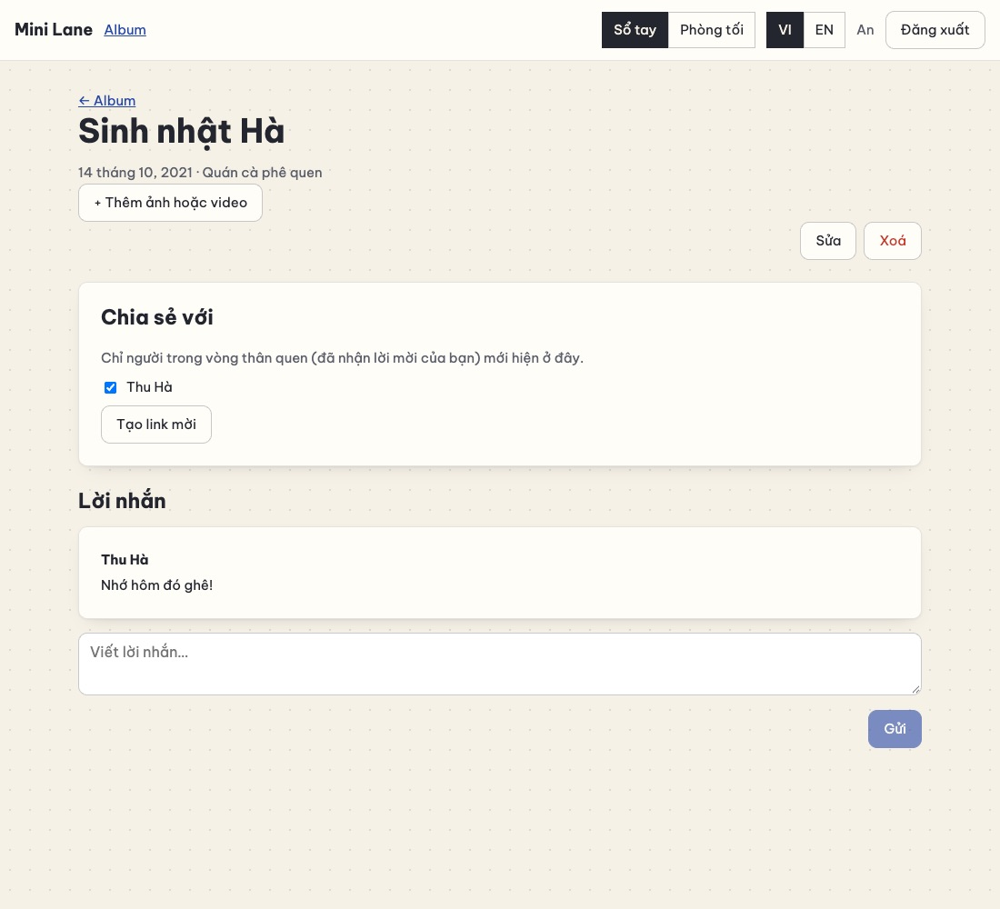</p>

Ở bước 7, An phải **tải lại trang** mới thấy lời nhắn. Chặng 13 sẽ làm nó hiện ra ngay.

#### 12.5 Lỗi hay gặp

| Triệu chứng | Nguyên nhân | Cách sửa |
| --- | --- | --- |
| `GET /api/memories/shared` trả 404 | Route `'/shared'` khai báo **sau** `'/:id'` | Đặt route cụ thể trước route có tham số |
| Kỷ niệm của chính mình hiện "Của …", mất nút Sửa | `.map(toMemory)` truyền số thứ tự làm `viewerId` | `(row) => toMemory(row)` |
| Link mời dùng được nhiều lần | `findInvite` không kiểm tra `accepted_at` | Lời mời đã nhận hoặc hết hạn → `null` |
| Đăng ký xong không quay lại link mời | Link Đăng ký/Đăng nhập không mang `state={{ from }}`, hoặc trang kia không chuyển tiếp `location.state` | Như bước 11 |
| Nút "Sao chép" không làm gì khi mở bằng `http://192.168…` | `navigator.clipboard` chỉ chạy ở "ngữ cảnh an toàn" (HTTPS hoặc localhost) | Bản thật có cách dự phòng (`components/InviteLink.jsx`) |

#### 12.6 Đối chiếu với bản thật

- **`server/models/social.js`** (284 dòng) có thêm:
  - lời mời có **ghi chú riêng** ("cho cô Lan") và gắn với một người trong "Người quen cũ";
  - **thu hồi** lời mời; danh sách lời mời kèm trạng thái (đang chờ / đã nhận / hết hạn / đã thu hồi);
  - `attachMemory`: **tạo link trước khi kỷ niệm tồn tại**, lúc đang điền form, rồi gắn kỷ niệm vào link khi bấm Lưu. Đây là tính năng bạn
    yêu cầu ở vòng 3;
  - `disconnect` ngừng kết nối và thu hồi chia sẻ **cả hai chiều**;
  - xoá lời nhắn (tác giả hoặc chủ kỷ niệm).
- **`server/routes/invites.js`**: tối đa 30 link/ngày; danh sách, thu hồi, gắn kỷ niệm.
- **`pages/Sharing.jsx`**: trang tổng hợp: được chia sẻ với bạn, vòng thân quen, các link đã gửi.
- **`components/forms/ShareFields.jsx`**: mục "Chia sẻ kỷ niệm này" ngay trong form tạo kỷ niệm.
- **`components/InviteLink.jsx`**:
  - nút **Chia sẻ** mở bảng chia sẻ của điện thoại (`navigator.share`), gửi thẳng qua Zalo/Messenger;
  - sao chép dự phòng bằng `execCommand` cho trang `http://`.
- **`pages/Join.jsx`**: xử lý thêm "đây là link của chính bạn" và "bạn đang đăng nhập là …".

#### 12.7 Tự kiểm tra

1. Vì sao `connections` lưu hai chiều?
2. Vì sao nhận lời mời phải đăng nhập **và** tự bấm nút, mà không tự nhận khi mở link?
3. `INSERT … SELECT … FROM connections WHERE … IN (SELECT value FROM json_each(?))` chặn được điều gì?
4. Người được chia sẻ gọi thẳng `PUT /api/memories/:id`. Chuyện gì xảy ra, và **dòng code nào** chặn?
5. **Bài tập:** thêm **thu hồi link mời** `DELETE /api/invites/:id`: chỉ người tạo, chỉ khi chưa ai nhận. Kèm bài kiểm thử "link đã thu hồi
   thì `INVITE_INVALID`". So với `revokeInvite` của bản thật.

**Commit:** `git add -A && git commit -m "feat(sharing): link mời, chia sẻ, lời nhắn"`

---

### Chặng 13 — Thời gian thực với Server-Sent Events

**Mục tiêu:** Hà viết lời nhắn, và lời nhắn **hiện ngay** trên màn hình của An (khi chạy thử: sau khoảng 0,1 giây), có hiệu ứng trượt
vào, không cần tải lại trang. Thêm 2 bài kiểm thử.

#### 13.1 Khái niệm

**Ba cách để trình duyệt biết "có gì mới":**

| Cách | Hoạt động | Khi nào hợp |
| --- | --- | --- |
| Hỏi định kỳ (polling) | Cứ 15 giây hỏi một lần | Đơn giản nhất, nhưng chậm và tốn yêu cầu vô ích |
| **Server-Sent Events (SSE)** | Trình duyệt mở **một** yêu cầu HTTP không bao giờ kết thúc; máy chủ **ghi thêm** sự kiện vào đó bất cứ lúc nào | Chỉ cần chiều máy chủ → trình duyệt. **Đây là trường hợp của ta** |
| WebSocket | Kênh hai chiều liên tục | Chat tốc độ cao, "đang gõ…", trò chơi |

SSE là **HTTP thường**, nên:

- cookie phiên tự đi kèm, kiểm tra đăng nhập y như mọi API;
- không cần thư viện, vì trình duyệt có sẵn `EventSource`;
- rớt mạng thì `EventSource` **tự kết nối lại**.

**Định dạng luồng sự kiện** rất đơn giản: mỗi sự kiện là vài dòng chữ, kết thúc bằng một dòng trống:

```text
event: comment
data: {"type":"comment","memoryId":2,"comment":{"id":5,"body":"Nhớ hôm đó ghê!",…}}

: ping

```

Dòng bắt đầu bằng `:` là **chú thích**. Máy chủ gửi `: ping` mỗi 25 giây, để proxy và router không đóng kết nối vì "im lặng quá lâu".

**"Trạm phát" (`lib/live.js`)** nhớ ai đang mở tab: `userId → tập các phản hồi đang mở`. Có lời nhắn mới thì:

1. tìm **những người xem được** kỷ niệm (chủ + người được chia sẻ), **trừ** người vừa viết;
2. ghi sự kiện vào mọi tab của họ.

**Phía trình duyệt:**

- **Một** `EventSource` cho cả app, đặt trong `Layout`.
- Mỗi sự kiện được phát lại thành sự kiện `window` tên `mini-live`. Component nào quan tâm thì tự nghe, ví dụ `Comments`.
- Không component nào phải biết về SSE.

**Giới hạn 6 kết nối và vòng đời trang.**

- Qua HTTP/1.1 (khi chạy ở máy), trình duyệt chỉ mở tối đa **6 kết nối** tới một địa chỉ.
- Mỗi tab giữ một kết nối SSE. Trang cũ nằm trong **bộ nhớ "quay lại"** (bfcache) cũng có thể giữ kết nối của nó.
- Hết 6 kết nối thì **ảnh ngừng tải**. Lỗi này đã thật sự xảy ra với bản thật, phát hiện khi chụp ảnh màn hình tự động.
- Cách chữa: **chỉ giữ kết nối khi trang đang hiện**.
  - Tab bị ẩn (`visibilitychange`) hoặc rời trang (`pagehide`): đóng kết nối.
  - Quay lại: mở lại, và `refresh()` để lấy những gì đã lỡ.

**Không nén luồng sự kiện.** Middleware nén (`compression`) gom dữ liệu lại cho đủ một khối rồi mới gửi. Với SSE, sự kiện sẽ bị giữ lại
không tới ngay. Bản mini chưa dùng nén. Bản thật dùng, và loại `/api/events` ra.

#### 13.2 Làm từng bước

**Bước 1 — trạm phát `server/lib/live.js`:**

```js
/**
 * Cập nhật trực tiếp bằng Server-Sent Events (SSE). Mỗi tab đang mở giữ MỘT phản hồi HTTP không bao giờ kết thúc
 * (GET /api/events). Khi có chuyện liên quan tới người đó — lời nhắn mới dưới kỷ niệm họ xem được — máy chủ
 * ghi một "sự kiện" vào phản hồi ấy, và trang cập nhật ngay.
 *
 * Danh sách người đang kết nối nằm trong bộ nhớ của MỘT tiến trình. Nhiều máy chủ → cần Redis pub/sub.
 */
export function createLive({ heartbeatMs = 25_000 } = {}) {
  const clients = new Map(); // userId → Set các phản hồi đang mở (mỗi tab một cái)

  return {
    /** Giữ phản hồi mở thành một luồng sự kiện cho req.user. */
    connect(req, res) {
      res.writeHead(200, {
        'Content-Type': 'text/event-stream; charset=utf-8',
        'Cache-Control': 'no-cache, no-transform',
        Connection: 'keep-alive',
        'X-Accel-Buffering': 'no', // nginx: đừng gom sự kiện lại rồi mới gửi
      });
      res.write('retry: 5000\n\n'); // rớt mạng thì trình duyệt tự kết nối lại sau 5 giây
      const userId = req.user.id;
      if (!clients.has(userId)) clients.set(userId, new Set());
      clients.get(userId).add(res);
      // Dòng chú thích mỗi 25 giây: proxy không đóng kết nối "im lặng quá lâu".
      const heartbeat = setInterval(() => res.write(': ping\n\n'), heartbeatMs);
      req.on('close', () => {
        clearInterval(heartbeat);
        const tabs = clients.get(userId);
        tabs?.delete(res);
        if (!tabs?.size) clients.delete(userId);
      });
    },

    /** Gửi `event` ({ type, … }) tới mọi tab đang mở của những người này. */
    publish(userIds, event) {
      const message = `event: ${event.type}\ndata: ${JSON.stringify(event)}\n\n`;
      for (const userId of new Set(userIds)) {
        for (const res of clients.get(userId) ?? []) res.write(message);
      }
    },
  };
}
```

- `res.writeHead(200, { 'Content-Type': 'text/event-stream' })` rồi **không bao giờ** gọi `res.end()`. Phản hồi cứ mở như vậy.
- `req.on('close', …)`: trình duyệt đóng tab hoặc rớt mạng thì dọn dẹp, kể cả bộ đếm giờ của dòng `ping`.
- `new Set(userIds)` loại trùng, phòng khi một người vừa là chủ vừa có trong danh sách.

**Bước 2 — "những người xem được kỷ niệm":**

```diff
@@ -102,4 +102,12 @@
     },
 
+    /** Mọi người xem được một kỷ niệm: chủ + những người được chia sẻ (để gửi cập nhật trực tiếp). */
+    audience(memoryId) {
+      return db
+        .prepare('SELECT user_id FROM memories WHERE id = ? UNION SELECT user_id FROM shares WHERE memory_id = ?')
+        .all(memoryId, memoryId)
+        .map((row) => row.user_id);
+    },
+
     // ---- lời nhắn ----
     comments(memoryId) {
```

`UNION` gộp hai tập và tự loại trùng.

**Bước 3 — phát sự kiện khi có lời nhắn mới:**

```diff
@@ -8,5 +8,5 @@
 const MB = 1024 * 1024;
 
-export function memoryRoutes({ config, memories, files, social }) {
+export function memoryRoutes({ config, memories, files, social, live }) {
   const router = Router();
   // Mỗi yêu cầu tải lên MỘT ảnh/video (+ một ảnh xem trước), ghi thẳng xuống đĩa.
@@ -132,5 +132,9 @@
     const body = v.text('body', { required: true, max: LIMITS.comment });
     v.check();
-    res.status(201).json({ comment: social.addComment(id, req.user.id, body) });
+    const comment = social.addComment(id, req.user.id, body);
+    // Những người KHÁC xem được kỷ niệm này nhận lời nhắn ngay, không cần tải lại trang.
+    const others = social.audience(id).filter((userId) => userId !== req.user.id);
+    live.publish(others, { type: 'comment', memoryId: id, comment });
+    res.status(201).json({ comment });
   });
 
```

**Bước 4 — đường dẫn `/api/events`:**

```diff
@@ -3,4 +3,5 @@
 import { HttpError } from './lib/errors.js';
 import { createFileStore } from './lib/files.js';
+import { createLive } from './lib/live.js';
 import { blockCrossSiteWrites, noStore, securityHeaders } from './lib/security.js';
 import { createSessions, requireAuth } from './lib/sessions.js';
@@ -29,4 +30,5 @@
     files: createFileStore(config.uploadDir),
     social: socialModel(db),
+    live: createLive(),
   };
 
@@ -52,4 +54,7 @@
   api.use('/files', requireAuth, fileRoutes(ctx));
   api.use('/invites', inviteRoutes(ctx)); // xem trước lời mời là công khai; phần còn lại tự đòi đăng nhập
+  // Luồng sự kiện trực tiếp. (Nếu sau này dùng middleware nén `compression`, nhớ LOẠI đường dẫn này ra:
+  // nén sẽ giữ các sự kiện nhỏ trong bộ đệm và trình duyệt không nhận được ngay.)
+  api.get('/events', requireAuth, (req, res) => ctx.live.connect(req, res));
   // Mọi đường dẫn /api/... không khớp route nào: 404 dạng JSON (thay cho trang HTML mặc định).
   api.use((req, res) => res.status(404).json({ error: 'NOT_FOUND' }));
```

**Bước 5 — kiểm thử đọc luồng `test/live.test.js`:**

```js
import { after, before, test } from 'node:test';
import assert from 'node:assert/strict';
import { registered, startTestServer } from './helpers.js';

let server;
before(async () => {
  server = await startTestServer();
});
after(() => server.close());

/** Mở luồng /api/events như EventSource, trả về hàm next() đọc từng sự kiện. */
async function listen(api, signal) {
  const res = await fetch(`${server.base}/api/events`, { headers: { cookie: api.cookie }, signal });
  assert.equal(res.headers.get('content-type'), 'text/event-stream; charset=utf-8');
  const reader = res.body.getReader();
  const decoder = new TextDecoder();
  let buffer = '';
  return async function next(type) {
    for (;;) {
      // Mỗi sự kiện kết thúc bằng một dòng trống ("\n\n")
      let end;
      while ((end = buffer.indexOf('\n\n')) !== -1) {
        const block = buffer.slice(0, end);
        buffer = buffer.slice(end + 2);
        const event = /^event: (.+)$/m.exec(block)?.[1];
        const data = /^data: (.+)$/m.exec(block)?.[1];
        if (event === type) return JSON.parse(data);
      }
      const { value, done } = await reader.read();
      if (done) throw new Error('luồng đã đóng');
      buffer += decoder.decode(value, { stream: true });
    }
  };
}

test('lời nhắn mới đến ngay với chủ kỷ niệm, không cần tải lại', async () => {
  const an = await registered(server.base, 'An');
  const ha = await registered(server.base, 'Hà');
  const memory = (await an.api.post('/api/memories', { title: 'Sinh nhật Hà', year: 2021 })).body.memory;
  const { token } = (await an.api.post('/api/invites', { memoryId: memory.id })).body;
  await ha.api.post(`/api/invites/accept/${token}`);

  const controller = new AbortController();
  const next = await listen(an.api, controller.signal);
  await ha.api.post(`/api/memories/${memory.id}/comments`, { body: 'Nhớ hôm đó ghê!' });
  const event = await next('comment');
  controller.abort();

  assert.equal(event.memoryId, memory.id);
  assert.equal(event.comment.body, 'Nhớ hôm đó ghê!');
  assert.equal(event.comment.author.name, 'Hà');
});

test('không đăng nhập thì không nghe được luồng sự kiện', async () => {
  assert.equal((await fetch(`${server.base}/api/events`)).status, 401);
});
```

`fetch` trả `res.body` là một **luồng** (stream). `getReader().read()` đọc từng mảnh dữ liệu ngay khi nó tới, đúng như `EventSource`.
`AbortController` đóng kết nối khi bài kiểm thử xong.

**Bước 6 — một `EventSource` cho cả app `client/src/components/LiveUpdates.jsx`:**

```jsx
import { useEffect } from 'react';
import { useData } from '../state.jsx';

/**
 * MỘT EventSource cho cả app (đặt trong Layout). Mỗi sự kiện được "phát lại" thành sự kiện window
 * tên 'mini-live' — component nào quan tâm (Comments) thì tự lắng nghe.
 *
 * Chỉ giữ kết nối khi trang ĐANG HIỆN: qua HTTP/1.1 trình duyệt chỉ mở tối đa 6 kết nối tới một trang web;
 * tab ẩn hay trang nằm trong bộ nhớ "quay lại" (bfcache) mà vẫn giữ kết nối thì ảnh sẽ ngừng tải.
 * Quay lại trang → mở lại + refresh() để lấy những gì đã lỡ.
 */
export default function LiveUpdates() {
  const { refresh } = useData();

  useEffect(() => {
    let source = null;
    const onEvent = (event) => {
      window.dispatchEvent(new CustomEvent('mini-live', { detail: JSON.parse(event.data) }));
    };
    const open = () => {
      if (source) return;
      source = new EventSource('/api/events'); // tự gửi cookie (cùng địa chỉ), tự kết nối lại khi rớt mạng
      source.addEventListener('comment', onEvent);
    };
    const close = () => {
      source?.close();
      source = null;
    };
    const onVisibility = () => {
      if (document.visibilityState === 'hidden') close();
      else if (!source) {
        open();
        refresh();
      }
    };
    const onPageShow = (event) => {
      if (event.persisted) onVisibility(); // trang vừa được lấy ra từ bfcache
    };

    if (document.visibilityState !== 'hidden') open();
    document.addEventListener('visibilitychange', onVisibility);
    window.addEventListener('pagehide', close);
    window.addEventListener('pageshow', onPageShow);
    return () => {
      close();
      document.removeEventListener('visibilitychange', onVisibility);
      window.removeEventListener('pagehide', close);
      window.removeEventListener('pageshow', onPageShow);
    };
  }, [refresh]);

  return null; // component "vô hình": chỉ có tác dụng phụ
}
```

**Bước 7 — đặt nó vào khung, và cho `Comments` nghe sự kiện:**

```diff
@@ -4,4 +4,5 @@
 import { DataProvider } from '../state.jsx';
 import LanguageToggle from './LanguageToggle.jsx';
+import LiveUpdates from './LiveUpdates.jsx';
 import ThemeSwitch from './ThemeSwitch.jsx';
 
@@ -11,4 +12,5 @@
   return (
     <DataProvider>
+      <LiveUpdates />
       <header className="topbar">
         <strong className="brand">{t('app.name')}</strong>
```

```diff
@@ -16,4 +16,16 @@
     if (data) setComments(data.comments); // dữ liệu từ máy chủ → bản sao trong state để thêm lời nhắn mới vào ngay
   }, [data]);
+
+  // Lời nhắn của người khác đến trực tiếp (LiveUpdates.jsx phát lại sự kiện SSE thành 'mini-live').
+  useEffect(() => {
+    const onLive = ({ detail }) => {
+      if (detail.type !== 'comment' || detail.memoryId !== memoryId) return;
+      setComments((list) =>
+        list.some((c) => c.id === detail.comment.id) ? list : [...list, { ...detail.comment, fresh: true }],
+      );
+    };
+    window.addEventListener('mini-live', onLive);
+    return () => window.removeEventListener('mini-live', onLive); // dọn dẹp khi rời trang
+  }, [memoryId]);
 
   async function send(event) {
@@ -35,5 +47,5 @@
       <ul>
         {comments.map((comment) => (
-          <li key={comment.id} className="card">
+          <li key={comment.id} className={`card${comment.fresh ? ' fresh' : ''}`}>
             <strong>{comment.author.name}</strong>
             <p>{comment.body}</p>
```

`list.some((c) => c.id === …)`: không thêm trùng nếu lời nhắn đã có (ví dụ vừa tải lại danh sách).

**Bước 8 — hiệu ứng "trượt vào":**

```diff
@@ -297,4 +297,15 @@
 }
 
+/* Lời nhắn vừa đến: trượt vào từ dưới lên */
+.comments li.fresh {
+  animation: arrive 0.5s ease-out;
+}
+@keyframes arrive {
+  from {
+    opacity: 0;
+    transform: translateY(12px);
+  }
+}
+
 /* ---------- Hộp thoại ---------- */
 .modal {
```

`@keyframes arrive { from { … } }` chỉ khai báo **điểm bắt đầu**. Trình duyệt tự chạy tới trạng thái bình thường của phần tử.

#### 13.3 Kiểm tra

```bash
npm test
```

```text
✔ lời nhắn mới đến ngay với chủ kỷ niệm, không cần tải lại
✔ không đăng nhập thì không nghe được luồng sự kiện
ℹ tests 29
ℹ pass 29
```

Trong trình duyệt:

1. An mở "Sinh nhật Hà".
2. Ở cửa sổ ẩn danh, Hà viết lời nhắn.
3. Bên An, lời nhắn **trượt vào** sau khoảng 0,1 giây, không tải lại trang.

DevTools → Network → yêu cầu `events`: trạng thái 200, cột Time **không bao giờ kết thúc**, tab **EventStream** liệt kê từng sự kiện.

Thử vòng đời trang: chuyển sang tab khác rồi quay lại. Yêu cầu `events` cũ kết thúc, một yêu cầu mới mở ra, kèm các `GET` do `refresh()`
gây ra.

#### 13.4 Lỗi hay gặp

| Triệu chứng | Nguyên nhân | Cách sửa |
| --- | --- | --- |
| Sự kiện tới trễ hàng chục giây, hoặc tới thành từng cục | Có middleware nén hoặc proxy gom dữ liệu | Loại `/api/events` khỏi nén; header `X-Accel-Buffering: no` cho nginx |
| Sau khi chuyển qua lại vài trang, **ảnh ngừng tải** | Trang cũ trong bfcache, tab ẩn vẫn giữ kết nối SSE; HTTP/1.1 chỉ có 6 kết nối | Đóng khi `pagehide`/ẩn tab, mở lại khi hiện (bước 6) |
| Người viết lời nhắn thấy lời nhắn của mình **hai lần** | Không loại tác giả khỏi danh sách nhận, hoặc không kiểm tra trùng id | `.filter((userId) => userId !== req.user.id)` và `list.some(…)` |
| `npm test` không thoát sau bài SSE | Kết nối SSE vẫn mở | `controller.abort()` sau khi đọc xong |

#### 13.5 Đối chiếu với bản thật

- **`server/lib/live.js`**: giống hệt, thêm `connectedUsers()` cho kiểm thử và theo dõi.
- **Sự kiện của bản thật**:
  - `comment` và `comment-removed` (xoá lời nhắn);
  - `shared` (vừa được chia sẻ một kỷ niệm);
  - `circle` (có người vừa nhận lời mời của bạn).
- **`components/LiveUpdates.jsx`**: hiện **thông báo nhỏ** (toast) khi sự kiện liên quan tới trang khác với trang đang xem, và `refresh()`
  khi được chia sẻ, để mục "Được chia sẻ với bạn" cập nhật.
- **Nhiều máy chủ:** danh sách kết nối nằm trong bộ nhớ của **một** tiến trình. Chạy 3 máy chủ thì cần **Redis pub/sub** làm "bảng tin
  chung". Xem [MO-RONG §6](docs/MO-RONG.md#6-tương-tác-thời-gian-thực-trong-kỷ-niệm-chung).

#### 13.6 Tự kiểm tra

1. Vì sao chọn SSE mà không chọn WebSocket cho lời nhắn?
2. Dòng `: ping` để làm gì?
3. Vì sao phải đóng `EventSource` khi tab bị ẩn?
4. **Bài tập:** phát thêm sự kiện `shared` khi An chia sẻ một kỷ niệm cho Hà. Bên Hà, `LiveUpdates` gọi `refresh()` để mục "Được chia sẻ
   với bạn" cập nhật ngay. So với `router.put('/:id/shares')` của bản thật.

**Commit:** `git add -A && git commit -m "feat(live): lời nhắn hiện ra trực tiếp (SSE)"`

---

### Chặng 14 — Đăng nhập bằng Google

**Mục tiêu:**

- Nút **"Tiếp tục với Google"** trên trang đăng nhập và đăng ký.
- Luồng OAuth 2.0 đầy đủ, an toàn: state, nonce, PKCE, kiểm tra ID token.
- 5 bài kiểm thử chạy với một **"Google giả"**, không cần Internet.
- Muốn thử với Google thật thì làm thêm phần 14.4.

#### 14.1 Khái niệm

**OAuth 2.0 và OpenID Connect.**

- OAuth 2.0 là chuẩn để một app được **phép** làm gì đó thay người dùng.
- **OpenID Connect** (OIDC) là lớp "đăng nhập" xây trên OAuth. Ngoài quyền, Google trả thêm một **ID token**: phiếu có chữ ký, ghi "người
  này là ai".

Luồng **authorization code**:

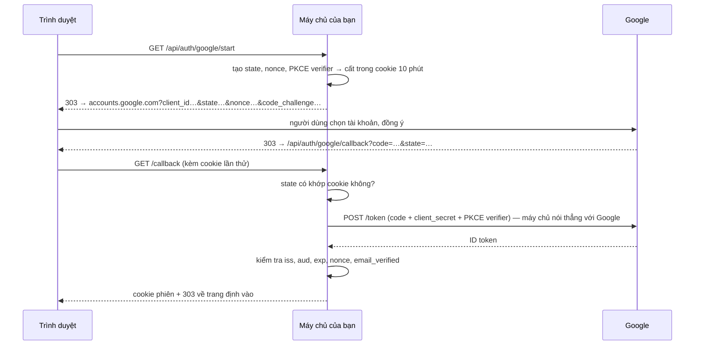

**Mỗi mảnh chặn một kiểu tấn công:**

| Mảnh | Chặn | Nếu thiếu thì sao |
| --- | --- | --- |
| **state** | Callback giả mạo (login CSRF) | Kẻ xấu gửi bạn một link callback chứa `code` **của họ**. Bạn bị đăng nhập vào tài khoản kẻ xấu, rồi tải ảnh riêng tư của mình **vào đó** |
| **nonce** | Phát lại một ID token cũ | Ai nhặt được một token cũ có thể dùng lại nó |
| **PKCE** | Bị đánh cắp `code` giữa đường | Máy chủ gửi Google **mã băm** của `verifier` lúc bắt đầu, rồi gửi chính `verifier` lúc đổi `code`. Kẻ trộm `code` không có `verifier` nên không đổi được |
| Kiểm tra **aud** | Token cấp cho **app khác** | Một app khác (có thể độc hại) dùng token người dùng đưa cho nó để vào app của bạn |
| **email_verified** | Email chưa xác minh | Ai cũng tạo được tài khoản Google ghi email của người khác mà chưa xác minh |

**ID token là JWT**, gồm ba phần nối bằng dấu chấm: `phần-đầu.phần-thân.chữ-ký`. Phần thân là JSON mã hoá **base64url**, chứa:

- `sub`: mã cố định của tài khoản Google;
- `email`, `name`;
- `aud`: token cấp cho app nào;
- `exp`: hạn dùng;
- `nonce`.

Ta **không** tự kiểm tra chữ ký: token đến **thẳng từ Google qua HTTPS**, trong câu trả lời cho một yêu cầu có client secret của ta.
Chuẩn OpenID Connect (Core §3.1.3.7) cho phép làm vậy. Mọi thông tin bên trong thì vẫn kiểm tra.

**Nhận diện bằng `sub`, không bằng email.** Email có thể đổi, `sub` thì không.

**Không tự gộp tài khoản theo email** (chống *account pre-hijacking*):

- Kẻ xấu đăng ký trước `an@example.com` bằng mật khẩu **của họ**, rồi đợi An "Tiếp tục với Google" bằng đúng email ấy.
- Nếu app tự gộp, kẻ xấu vẫn đăng nhập được vào tài khoản An bằng mật khẩu đã đặt sẵn.
- Vì vậy email trùng thì **từ chối** (`EMAIL_TAKEN`). Bản thật cho chủ tài khoản đăng nhập bằng mật khẩu rồi **tự liên kết** Google trong
  Cài đặt.

**Chuyển trang, không phải `fetch`.** Đăng nhập Google là trình duyệt **rời** trang của bạn sang Google rồi quay về. Vì vậy:

- Nút là một thẻ `<a href>`, không phải `fetch`.
- Kết quả xấu được báo bằng `?google=MÃ` trên địa chỉ trang `/login`, không bằng JSON.
- Mã `303 See Other` nghĩa là "hãy GET địa chỉ này".

**Open redirect.** Tham số `?next=` (về đâu sau khi đăng nhập) chỉ được nhận **đường dẫn nội bộ** (`/album/7`), không nhận
`https://trang-xau`. Nếu không, link của bạn bị lợi dụng để đưa người dùng sang trang lừa đảo.

#### 14.2 Làm từng bước

**Bước 1 — `server/migrations/005_google.sql`:**

```sql
-- Phiên bản 5: đăng nhập bằng Google. Nhận diện bằng `sub` — mã CỐ ĐỊNH Google cấp cho mỗi tài khoản
-- (email có thể đổi, sub thì không). Tài khoản tạo bằng Google có password_hash = '' (không có mật khẩu).
ALTER TABLE users ADD COLUMN google_sub TEXT;
ALTER TABLE users ADD COLUMN google_email TEXT;
-- Mỗi tài khoản Google gắn với tối đa một người dùng; người chưa dùng Google (NULL) thì bao nhiêu cũng được.
CREATE UNIQUE INDEX users_google_sub ON users (google_sub) WHERE google_sub IS NOT NULL;
```

**Chỉ mục một phần** (`WHERE google_sub IS NOT NULL`): `UNIQUE` chỉ áp dụng cho dòng **có** `google_sub`. Nhiều người dùng chưa liên
kết Google (cùng `NULL`) vẫn hợp lệ.

**Bước 2 — `server/lib/google.js`:**

```js
import { createHash, randomBytes } from 'node:crypto';

// "Tiếp tục với Google" theo luồng OAuth 2.0 authorization code (OpenID Connect):
//   1. /api/auth/google/start đưa trình duyệt sang Google kèm state, nonce và PKCE challenge ngẫu nhiên;
//   2. Google đưa trình duyệt quay về /api/auth/google/callback với một `code` dùng một lần;
//   3. MÁY CHỦ đổi code lấy ID token (nói chuyện thẳng với Google, kèm client secret) và đọc xem ai vừa đăng nhập.
// Không script nào của Google chạy trên trang của ta: trình duyệt chỉ ghé accounts.google.com.

const AUTH_URL = 'https://accounts.google.com/o/oauth2/v2/auth';
const TOKEN_URL = 'https://oauth2.googleapis.com/token';
const ISSUERS = new Set(['https://accounts.google.com', 'accounts.google.com']);

const random = (bytes) => randomBytes(bytes).toString('base64url');

/**
 * Bí mật của MỘT lần đăng nhập, cất trong cookie HttpOnly sống 10 phút:
 *   state    — callback phải mang về đúng giá trị này: chặn callback giả mạo (login CSRF)
 *   nonce    — Google chép nó vào ID token: chặn phát lại một token cũ
 *   verifier — PKCE: Google chỉ trả token cho ai biết verifier, nên `code` bị lộ cũng vô dụng
 */
export function newAttempt() {
  const verifier = random(32);
  return {
    state: random(24),
    nonce: random(24),
    verifier,
    challenge: createHash('sha256').update(verifier).digest('base64url'), // chỉ gửi BĂM của verifier sang Google
  };
}

/** Địa chỉ trang chọn tài khoản của Google cho app của ta. */
export function authorizationUrl(google, { redirectUri, state, nonce, challenge }) {
  const url = new URL(google.authUrl ?? AUTH_URL);
  url.search = new URLSearchParams({
    client_id: google.clientId,
    redirect_uri: redirectUri,
    response_type: 'code',
    scope: 'openid email profile',
    state,
    nonce,
    code_challenge: challenge,
    code_challenge_method: 'S256',
    prompt: 'select_account',
  }).toString();
  return url.toString();
}

/** ID token là JWT: "phần đầu.phần thân.chữ ký" — phần thân là JSON mã hoá base64url. */
function readIdToken(idToken) {
  const parts = String(idToken ?? '').split('.');
  if (parts.length !== 3) throw new Error('no ID token');
  return JSON.parse(Buffer.from(parts[1], 'base64url').toString('utf8'));
}

/**
 * Đổi `code` lấy ID token và KIỂM TRA nó → { sub, email, name }.
 * Token đến thẳng từ Google qua HTTPS, trả lời một yêu cầu có client secret của ta, nên (theo OpenID Connect
 * Core §3.1.3.7) không cần kiểm tra lại chữ ký. Nhưng MỌI thông tin quan trọng bên trong đều được kiểm tra.
 */
export async function exchangeCode(google, { code, redirectUri, verifier, nonce }) {
  const response = await fetch(google.tokenUrl ?? TOKEN_URL, {
    method: 'POST',
    headers: { 'content-type': 'application/x-www-form-urlencoded' },
    body: new URLSearchParams({
      code,
      client_id: google.clientId,
      client_secret: google.clientSecret,
      redirect_uri: redirectUri,
      grant_type: 'authorization_code',
      code_verifier: verifier,
    }),
    signal: AbortSignal.timeout(10_000),
  });
  if (!response.ok) throw new Error(`token endpoint answered ${response.status}`);
  const claims = readIdToken((await response.json()).id_token);

  if (!ISSUERS.has(claims.iss)) throw new Error('wrong issuer'); // do Google phát hành?
  if (claims.aud !== google.clientId) throw new Error('token is for another app'); // cấp cho ĐÚNG app này?
  if (!(Number(claims.exp) * 1000 > Date.now())) throw new Error('token expired'); // còn hạn?
  if (claims.nonce !== nonce) throw new Error('nonce mismatch'); // của ĐÚNG lần đăng nhập này?
  if (!claims.sub || !claims.email) throw new Error('no account id or email');
  if (claims.email_verified !== true && claims.email_verified !== 'true') throw new Error('email not verified'); // email chưa xác minh có thể là của người khác

  return { sub: String(claims.sub), email: String(claims.email).toLowerCase(), name: claims.name ? String(claims.name) : '' };
}
```

`google.authUrl ?? AUTH_URL`: bài kiểm thử truyền địa chỉ **Google giả**. Khi chạy thật thì dùng địa chỉ của Google.

**Bước 3 — `server/routes/google.js`:**

```js
import { Router } from 'express';
import { authorizationUrl, exchangeCode, newAttempt } from '../lib/google.js';
import { rateLimit } from '../lib/rateLimit.js';
import { readCookie } from '../lib/sessions.js';
import { LIMITS } from '../../shared/limits.js';

const COOKIE = 'mini_google';
const COOKIE_PATH = '/api/auth/google'; // cookie chỉ được gửi kèm các đường dẫn đăng nhập Google

/** Chỉ nhận đường dẫn BÊN TRONG app: ?next=https://trang-xau sẽ bị bỏ (chống "open redirect"). */
function safeNext(value) {
  const next = String(value ?? '');
  return /^\/(?![/\\])/.test(next) && !next.startsWith('/api/') && next.length <= 200 ? next : null;
}

/**
 *   GET /start?next=/join/…  → 303 sang Google
 *   GET /callback?code&state → 303 về app, đã đăng nhập
 * Đây là những lần CHUYỂN TRANG (không phải fetch), nên lỗi được báo bằng /login?google=MÃ_LỖI chứ không phải JSON.
 *
 * Không bao giờ tự GỘP tài khoản Google vào tài khoản mật khẩu có cùng email: có thể ai đó đã đăng ký trước bằng
 * email của bạn để chờ bạn "gộp" vào (account pre-hijacking). Bản thật cho chủ tài khoản tự liên kết trong Cài đặt.
 */
export function googleRoutes({ config, sessions, users }) {
  const router = Router();
  const limiter = rateLimit({ windowMs: 15 * 60_000, max: config.authRateLimit * 2 }); // mỗi lần đăng nhập = 2 yêu cầu
  const cookieOptions = { httpOnly: true, sameSite: 'lax', secure: config.cookieSecure, path: COOKIE_PATH };

  // Phải khớp TỪNG KÝ TỰ với một "Authorized redirect URI" của OAuth client trong Google Cloud.
  const redirectUri = (req) => `${config.publicUrl ?? `${req.protocol}://${req.get('host')}`}${COOKIE_PATH}/callback`;
  // Kết quả xấu → quay về trang đăng nhập kèm mã: /login?google=FAILED (giao diện dịch mã này ra câu).
  const back = (res, code) => res.redirect(303, `/login?google=${code}`);

  router.get('/start', limiter, (req, res) => {
    if (!config.google) return back(res, 'NOT_CONFIGURED');
    const attempt = newAttempt();
    const saved = { state: attempt.state, nonce: attempt.nonce, verifier: attempt.verifier, next: safeNext(req.query.next) };
    res.cookie(COOKIE, JSON.stringify(saved), { ...cookieOptions, maxAge: 10 * 60_000 });
    res.redirect(303, authorizationUrl(config.google, { redirectUri: redirectUri(req), ...attempt }));
  });

  router.get('/callback', limiter, async (req, res) => {
    let saved = null;
    try {
      saved = JSON.parse(readCookie(req, COOKIE) ?? 'null');
    } catch {
      // cookie hỏng = không có cookie
    }
    res.clearCookie(COOKIE, cookieOptions); // mỗi lần thử chỉ dùng được MỘT lần

    if (!config.google) return back(res, 'NOT_CONFIGURED');
    // Trình duyệt này không hề bắt đầu đăng nhập, hoặc state không khớp → callback giả mạo.
    if (!saved || typeof req.query.state !== 'string' || req.query.state !== saved.state) return back(res, 'FAILED');
    if (req.query.error) return back(res, 'CANCELLED'); // người dùng bấm "Huỷ" trên trang Google

    let profile;
    try {
      profile = await exchangeCode(config.google, {
        code: String(req.query.code ?? ''),
        redirectUri: redirectUri(req),
        verifier: saved.verifier,
        nonce: saved.nonce,
      });
    } catch (err) {
      console.warn(`Google sign-in failed: ${err.message}`);
      return back(res, 'FAILED');
    }

    let user = users.byGoogleSub(profile.sub);
    if (!user) {
      if (users.byEmail(profile.email)) return back(res, 'EMAIL_TAKEN'); // KHÔNG tự gộp (xem chú thích ở trên)
      const name = (profile.name || profile.email.split('@')[0]).slice(0, LIMITS.userName);
      user = users.byId(users.create({ email: profile.email, name, passwordHash: '', google: profile }));
    }
    sessions.start(res, user.id);
    res.redirect(303, saved.next ?? '/album');
  });

  return router;
}
```

- Cookie lần thử có `path: '/api/auth/google'`: trình duyệt chỉ gửi nó tới đúng hai đường dẫn này.
- Cookie bị `clearCookie` **ngay** ở callback: mỗi lần thử chỉ dùng một lần.
- Hàm báo lỗi tên `back` (không tên `fail`) để bài kiểm thử dịch thuật không nhầm nó với `fail()` của validator. Phần kiểm tra ở cuối
  chặng sẽ nói rõ.

**Bước 4 — người dùng có thể không có mật khẩu:**

```diff
@@ -9,9 +9,11 @@
     byEmail: (email) => db.prepare('SELECT * FROM users WHERE email = ?').get(email),
     byId: (id) => db.prepare('SELECT * FROM users WHERE id = ?').get(id),
+    byGoogleSub: (sub) => db.prepare('SELECT * FROM users WHERE google_sub = ?').get(sub),
 
-    create({ email, name, passwordHash }) {
+    /** passwordHash '' = không có mật khẩu (tài khoản tạo bằng Google). google: { sub, email } hoặc null. */
+    create({ email, name, passwordHash, google = null }) {
       const { lastInsertRowid } = db
-        .prepare('INSERT INTO users (email, name, password_hash) VALUES (?, ?, ?)')
-        .run(email, name, passwordHash);
+        .prepare('INSERT INTO users (email, name, password_hash, google_sub, google_email) VALUES (?, ?, ?, ?, ?)')
+        .run(email, name, passwordHash, google?.sub ?? null, google?.email ?? null);
       return Number(lastInsertRowid);
     },
```

```diff
@@ -16,5 +16,5 @@
   // Luôn trả 200: giao diện hỏi "tôi là ai?" mà không gây lỗi đỏ trong console.
   router.get('/session', (req, res) => {
-    res.json({ user: toUser(req.user) });
+    res.json({ user: toUser(req.user), google: Boolean(config.google) }); // máy chủ này đã cài đăng nhập Google chưa?
   });
 
@@ -46,6 +46,7 @@
     const user = email ? users.byEmail(email) : undefined;
     // Email không tồn tại vẫn băm thử (DUMMY_HASH): kẻ xấu không đo được thời gian để biết email nào đã đăng ký.
-    const valid = await verifyPassword(password, user?.password_hash ?? DUMMY_HASH);
-    if (!user || !valid) throw new HttpError(401, 'INVALID_CREDENTIALS'); // cùng một câu trả lời cho cả hai trường hợp
+    // `|| DUMMY_HASH`: tài khoản tạo bằng Google có password_hash = '' (không có mật khẩu để so).
+    const valid = await verifyPassword(password, user?.password_hash || DUMMY_HASH);
+    if (!user || !user.password_hash || !valid) throw new HttpError(401, 'INVALID_CREDENTIALS'); // cùng một câu trả lời
     sessions.start(res, user.id);
     res.json({ user: toUser(user) });
```

`|| DUMMY_HASH` thay cho `?? DUMMY_HASH`: tài khoản tạo bằng Google có `password_hash = ''` (chuỗi rỗng). `??` chỉ thay `null`/`undefined`,
còn `||` thay cả chuỗi rỗng. Thêm điều kiện `!user.password_hash` để không ai đăng nhập bằng mật khẩu rỗng vào tài khoản Google.

**Bước 5 — cấu hình và lắp ráp:**

```diff
@@ -22,4 +22,11 @@
     sessionDays: Number(env.SESSION_DAYS) || 30,
     authRateLimit: Number(env.AUTH_RATE_LIMIT) || 20, // số lần đăng nhập/đăng ký mỗi IP mỗi 15 phút
+    // Đăng nhập Google: cả hai giá trị lấy từ một OAuth client trong Google Cloud Console. Thiếu → nút Google bị tắt.
+    google:
+      env.GOOGLE_CLIENT_ID && env.GOOGLE_CLIENT_SECRET
+        ? { clientId: env.GOOGLE_CLIENT_ID, clientSecret: env.GOOGLE_CLIENT_SECRET }
+        : null,
+    // Địa chỉ người dùng gõ để vào app, ví dụ https://mini-lane.onrender.com (dùng để tạo redirect URI cho Google).
+    publicUrl: env.PUBLIC_URL ? env.PUBLIC_URL.replace(/\/+$/, '') : null,
     maxUploadMb: Number(env.MAX_UPLOAD_MB) || 15, // ảnh lớn nhất (MB)
     maxVideoMb: Number(env.MAX_VIDEO_MB) || 100, // video lớn nhất (MB)
```

```diff
@@ -11,4 +11,5 @@
 import { authRoutes } from './routes/auth.js';
 import { fileRoutes } from './routes/files.js';
+import { googleRoutes } from './routes/google.js';
 import { inviteRoutes } from './routes/invites.js';
 import { memoryRoutes } from './routes/memories.js';
@@ -50,4 +51,5 @@
   api.use(ctx.sessions.loadUser); // mọi yêu cầu: đọc cookie → req.user (hoặc null)
   api.get('/health', (req, res) => res.json({ ok: true }));
+  api.use('/auth/google', googleRoutes(ctx)); // đường dẫn cụ thể đặt trước đường dẫn chung ('/auth') cho dễ đọc
   api.use('/auth', authRoutes(ctx));
   api.use('/memories', requireAuth, memoryRoutes(ctx)); // phải đăng nhập mới tới được các route bên trong
```

**Bước 6 — kiểm thử với "Google giả".** `startTestServer` nhận thêm `overrides` để ghi đè cấu hình (ở đây: địa chỉ Google):

```diff
@@ -11,8 +11,8 @@
  * Mỗi tệp kiểm thử có máy chủ riêng, nên các bài không giẫm chân nhau và không đụng data/ thật.
  */
-export async function startTestServer(env = {}) {
+export async function startTestServer(env = {}, overrides = {}) {
   const dir = fs.mkdtempSync(path.join(os.tmpdir(), 'mini-lane-test-'));
   // Kiểm thử đăng ký rất nhiều tài khoản: nới giới hạn số lần thử, trừ khi bài kiểm thử tự đặt.
-  const config = { ...loadConfig({ DATA_DIR: dir, AUTH_RATE_LIMIT: '1000', ...env }), quiet: true };
+  const config = { ...loadConfig({ DATA_DIR: dir, AUTH_RATE_LIMIT: '1000', ...env }), ...overrides, quiet: true };
   const db = openDb(config.dbFile, { quiet: true });
   const server = createApp({ db, config }).listen(0); // cổng 0: hệ điều hành chọn một cổng trống
```

`test/google.test.js`:

```js
import { after, before, test } from 'node:test';
import assert from 'node:assert/strict';
import http from 'node:http';
import { once } from 'node:events';
import { createHash } from 'node:crypto';
import { client, startTestServer } from './helpers.js';

// ---------- "Google giả": một máy chủ HTTP nhỏ đóng vai trang lấy token của Google ----------
// Mỗi bài kiểm thử nói trước Google giả sẽ trả về thông tin gì (claims) cho lần đổi code kế tiếp.
const CLIENT_ID = 'mini-test.apps.googleusercontent.com';
let fakeGoogle;
let nextClaims = null;
let lastChallenge = null; // code_challenge mà app gửi sang ở bước /start

before(async () => {
  fakeGoogle = http.createServer(async (req, res) => {
    let body = '';
    for await (const chunk of req) body += chunk;
    const form = new URLSearchParams(body);
    // Kiểm tra PKCE như Google thật: SHA-256(code_verifier) phải bằng code_challenge đã gửi lúc đầu.
    const challenge = createHash('sha256').update(form.get('code_verifier') ?? '').digest('base64url');
    if (form.get('client_secret') !== 'bi-mat' || challenge !== lastChallenge) {
      res.writeHead(400).end('{"error":"invalid_grant"}');
      return;
    }
    const payload = Buffer.from(JSON.stringify(nextClaims)).toString('base64url');
    res.writeHead(200, { 'content-type': 'application/json' }).end(JSON.stringify({ id_token: `x.${payload}.y` }));
  });
  fakeGoogle.listen(0);
  await once(fakeGoogle, 'listening');
});
after(() => fakeGoogle.close());

let server;
before(async () => {
  const google = {
    clientId: CLIENT_ID,
    clientSecret: 'bi-mat',
    authUrl: 'https://accounts.google.test/auth', // không bao giờ thật sự mở
    tokenUrl: `http://127.0.0.1:${fakeGoogle.address().port}/token`,
  };
  server = await startTestServer({}, { google });
});
after(() => server.close());

/**
 * Đi trọn một lượt đăng nhập như trình duyệt: /start → (giả vờ ở trang Google) → /callback.
 * claims(nonce) trả về nội dung ID token mà "Google" sẽ phát.
 */
async function signIn(claims, { tamper } = {}) {
  const start = await fetch(`${server.base}/api/auth/google/start?next=/album/7`, { redirect: 'manual' });
  assert.equal(start.status, 303);
  const google = new URL(start.headers.get('location'));
  assert.equal(google.searchParams.get('code_challenge_method'), 'S256');
  lastChallenge = google.searchParams.get('code_challenge');
  const attemptCookie = start.headers.getSetCookie()[0].split(';')[0]; // mini_google=…
  nextClaims = claims(google.searchParams.get('nonce'));

  const state = tamper === 'state' ? 'gia-mao' : google.searchParams.get('state');
  const callback = await fetch(`${server.base}/api/auth/google/callback?code=ma-mot-lan&state=${state}`, {
    redirect: 'manual',
    headers: { cookie: attemptCookie },
  });
  const session = callback.headers.getSetCookie().find((c) => c.startsWith('mini_session='));
  return { location: callback.headers.get('location'), cookie: session?.split(';')[0] };
}

const goodClaims = (nonce) => ({
  iss: 'https://accounts.google.com',
  aud: CLIENT_ID,
  exp: Math.floor(Date.now() / 1000) + 600,
  nonce,
  sub: '1001',
  email: 'ha.google@example.com',
  email_verified: true,
  name: 'Thu Hà',
});

test('đăng nhập lần đầu: tạo tài khoản, vào thẳng trang định đến', async () => {
  const { location, cookie } = await signIn(goodClaims);
  assert.equal(location, '/album/7');
  const api = client(server.base);
  api.cookie = cookie;
  const { user } = (await api.get('/api/auth/session')).body;
  assert.equal(user.email, 'ha.google@example.com');
  assert.equal(user.name, 'Thu Hà');
});

test('lần sau: nhận ra đúng người theo `sub`, kể cả khi email đã đổi', async () => {
  const { cookie } = await signIn((nonce) => ({ ...goodClaims(nonce), email: 'email-moi@example.com' }));
  const api = client(server.base);
  api.cookie = cookie;
  assert.equal((await api.get('/api/auth/session')).body.user.email, 'ha.google@example.com');
});

test('callback giả mạo (sai state) và token của app khác đều bị từ chối', async () => {
  assert.equal((await signIn(goodClaims, { tamper: 'state' })).location, '/login?google=FAILED');
  assert.equal((await signIn((nonce) => ({ ...goodClaims(nonce), aud: 'app-khac' }))).location, '/login?google=FAILED');
  assert.equal((await signIn((nonce) => ({ ...goodClaims(nonce), nonce: 'nonce-cu' }))).location, '/login?google=FAILED');
  assert.equal((await signIn((nonce) => ({ ...goodClaims(nonce), email_verified: false }))).location, '/login?google=FAILED');
});

test('không tự gộp vào tài khoản mật khẩu có cùng email (chống pre-hijacking)', async () => {
  await client(server.base).post('/api/auth/register', { name: 'Ai đó', email: 'an@example.com', password: 'mat-khau-dai' });
  const result = await signIn((nonce) => ({ ...goodClaims(nonce), sub: '2002', email: 'an@example.com' }));
  assert.equal(result.location, '/login?google=EMAIL_TAKEN');
  assert.equal(result.cookie, undefined);
});

test('tài khoản tạo bằng Google không đăng nhập được bằng mật khẩu rỗng', async () => {
  const res = await client(server.base).post('/api/auth/login', { email: 'ha.google@example.com', password: '' });
  assert.equal(res.status, 401);
});
```

**Google giả** là một máy chủ HTTP nhỏ đóng vai **trang lấy token** của Google. Nó kiểm tra client secret và **PKCE** đúng như Google
thật. Mỗi bài kiểm thử đặt trước nội dung ID token (`nextClaims`): token đúng, token của app khác, `nonce` cũ, email chưa xác minh…

**Bước 7 — giao diện.** Nút `client/src/components/GoogleButton.jsx`:

```jsx
import { useAuth } from '../auth.jsx';
import { useI18n } from '../i18n/index.jsx';

/**
 * Một LIÊN KẾT bình thường (không phải fetch): đăng nhập Google là chuyển hẳn trang sang Google rồi quay về.
 * `next`: trang muốn quay lại sau khi đăng nhập (ví dụ /join/… của một link mời).
 */
export default function GoogleButton({ next = '/album' }) {
  const { googleEnabled } = useAuth();
  const { t } = useI18n();
  if (!googleEnabled) {
    return (
      <button type="button" className="google" disabled title={t('google.notConfigured')}>
        {t('google.button')}
      </button>
    );
  }
  return (
    <a className="google button" href={`/api/auth/google/start?next=${encodeURIComponent(next)}`}>
      {t('google.button')}
    </a>
  );
}
```

```diff
@@ -12,4 +12,5 @@
 export function AuthProvider({ children }) {
   const [user, setUser] = useState(undefined);
+  const [googleEnabled, setGoogleEnabled] = useState(false);
 
   // Chạy MỘT lần khi app mở: hỏi máy chủ "cookie này là của ai?".
@@ -18,5 +19,8 @@
     api
       .get('/api/auth/session')
-      .then((r) => setUser(r.user))
+      .then((r) => {
+        setGoogleEnabled(r.google);
+        setUser(r.user);
+      })
       .catch(() => setUser(null));
   }, []);
@@ -25,4 +29,5 @@
     () => ({
       user,
+      googleEnabled,
       async login(email, password) {
         const r = await api.post('/api/auth/login', { email, password });
@@ -38,5 +43,5 @@
       },
     }),
-    [user],
+    [user, googleEnabled],
   );
 
```

```diff
@@ -2,4 +2,5 @@
 import { Link, useLocation } from 'react-router';
 import { useAuth } from '../auth.jsx';
+import GoogleButton from '../components/GoogleButton.jsx';
 import { errorMessage, useI18n } from '../i18n/index.jsx';
 
@@ -12,4 +13,6 @@
   const [error, setError] = useState(null);
   const [busy, setBusy] = useState(false);
+  // Quay về từ Google với kết quả xấu: /login?google=EMAIL_TAKEN …
+  const googleResult = new URLSearchParams(location.search).get('google');
 
   async function onSubmit(event) {
@@ -28,9 +31,11 @@
     <form className="card auth" onSubmit={onSubmit} noValidate>
       <h1>{t('auth.loginTitle')}</h1>
-      {error && (
+      {(error || googleResult) && (
         <p role="alert" className="error">
-          {errorMessage(t, error)}
+          {error ? errorMessage(t, error) : t(`google.result.${googleResult}`)}
         </p>
       )}
+      <GoogleButton next={location.state?.from} />
+      <p className="divider">{t('google.or')}</p>
       <label>
         {t('auth.email')}
```

```diff
@@ -3,4 +3,5 @@
 import { LIMITS } from '@shared/limits.js';
 import { useAuth } from '../auth.jsx';
+import GoogleButton from '../components/GoogleButton.jsx';
 import { errorMessage, fieldMessage, useI18n } from '../i18n/index.jsx';
 
@@ -33,4 +34,6 @@
     <form className="card auth" onSubmit={onSubmit} noValidate>
       <h1>{t('auth.registerTitle')}</h1>
+      <GoogleButton next={location.state?.from} />
+      <p className="divider">{t('google.or')}</p>
       {formError && (
         <p role="alert" className="error">
```

```diff
@@ -105,4 +105,22 @@
   color: var(--accent-ink);
 }
+a.button {
+  display: inline-flex;
+  align-items: center;
+  justify-content: center;
+  min-height: 40px;
+  padding: var(--s2) var(--s4);
+  border: 1px solid var(--line-2);
+  border-radius: var(--radius);
+  background: var(--surface);
+  color: var(--text);
+  text-decoration: none;
+  font-weight: 600;
+}
+.divider {
+  text-align: center;
+  color: var(--text-2);
+  margin: 0;
+}
 button.danger {
   color: var(--danger);
```

**Bước 8 — câu chữ, và dạy bài kiểm thử dịch thuật biết về kết quả Google:**

```diff
@@ -66,4 +66,15 @@
     registerFirst: 'Tạo tài khoản mới',
   },
+  google: {
+    button: 'Tiếp tục với Google',
+    notConfigured: 'Máy chủ này chưa cài đăng nhập Google (xem GOOGLE_CLIENT_ID).',
+    or: 'hoặc dùng email',
+    result: {
+      NOT_CONFIGURED: 'Máy chủ này chưa cài đăng nhập Google.',
+      FAILED: 'Đăng nhập Google không thành công. Hãy thử lại.',
+      CANCELLED: 'Bạn đã huỷ đăng nhập Google.',
+      EMAIL_TAKEN: 'Email này đã có tài khoản. Hãy đăng nhập bằng mật khẩu.',
+    },
+  },
   common: { close: 'Đóng' },
   errors: {
```

```diff
@@ -65,4 +65,15 @@
     registerFirst: 'Create an account',
   },
+  google: {
+    button: 'Continue with Google',
+    notConfigured: 'Google sign-in is not set up on this server (see GOOGLE_CLIENT_ID).',
+    or: 'or use email',
+    result: {
+      NOT_CONFIGURED: 'Google sign-in is not set up on this server.',
+      FAILED: 'Google sign-in did not work. Please try again.',
+      CANCELLED: 'You cancelled the Google sign-in.',
+      EMAIL_TAKEN: 'This email already has an account. Log in with your password.',
+    },
+  },
   common: { close: 'Close' },
   errors: {
```

```diff
@@ -53,5 +53,5 @@
 test('khoá ghép lúc chạy (t(`theme.${name}`)) cũng có trong từ điển', () => {
   // Biểu thức chính quy ở bài trên không "nhìn thấy" khoá ghép bằng template string, nên liệt kê tay.
-  const RUNTIME_KEYS = ['theme.notebook', 'theme.darkroom'];
+  const RUNTIME_KEYS = ['theme.notebook', 'theme.darkroom', 'google.result.FAILED', 'google.result.CANCELLED'];
   for (const key of RUNTIME_KEYS) assert.ok(key in EN, `thiếu ${key}`);
 });
@@ -66,4 +66,7 @@
       assert.ok(`errors.${name}` in EN, `thiếu errors.${name}`);
     }
+    for (const [, name] of code.matchAll(/back\(res,\s*'([A-Z_]+)'/g)) {
+      assert.ok(`google.result.${name}` in EN, `thiếu google.result.${name}`);
+    }
   }
 });
```

#### 14.3 Kiểm tra

```bash
npm test
```

```text
✔ đăng nhập lần đầu: tạo tài khoản, vào thẳng trang định đến
✔ lần sau: nhận ra đúng người theo `sub`, kể cả khi email đã đổi
Google sign-in failed: token is for another app
Google sign-in failed: nonce mismatch
Google sign-in failed: email not verified
✔ callback giả mạo (sai state) và token của app khác đều bị từ chối
✔ không tự gộp vào tài khoản mật khẩu có cùng email (chống pre-hijacking)
✔ tài khoản tạo bằng Google không đăng nhập được bằng mật khẩu rỗng
ℹ tests 34
ℹ pass 34
```

Ba dòng `Google sign-in failed: …` là log **mong đợi**: máy chủ ghi lại lý do từ chối từng token xấu.

**Chuyện có thật khi viết hướng dẫn:**

- Bản đầu đặt tên hàm báo lỗi trong `routes/google.js` là `fail(res, 'NOT_CONFIGURED')`.
- Biểu thức chính quy của bài kiểm thử dịch thuật tưởng đó là `fail()` của validator, nên đòi câu dịch `errors.field.NOT_CONFIGURED`.
- Đổi tên thành `back()` và thêm một luật riêng cho `google.result.*`.

Tên hàm cũng là một phần của "hợp đồng" giữa code và công cụ kiểm tra.

Trong trình duyệt, khi **chưa** cấu hình Google:

- nút "Tiếp tục với Google" bị **tắt**; rê chuột vào thấy lý do;
- mở `http://localhost:5174/login?google=EMAIL_TAKEN`: thấy "Email này đã có tài khoản. Hãy đăng nhập bằng mật khẩu.".

#### 14.4 (Tuỳ chọn) Thử với Google thật

1. Tạo OAuth client theo [DEPLOY.md, mục Bật "Tiếp tục với Google"](docs/DEPLOY.md#bật-tiếp-tục-với-google).
   - Ở mục **Authorized redirect URIs**, khai báo `http://localhost:5174/api/auth/google/callback`. Đó là cổng Vite của bản mini
     (máy chủ thấy đúng cổng này nhờ `changeOrigin: false` ở chặng 7). Kiểm tra địa chỉ app sẽ gửi cho Google:
     `curl -sI http://localhost:5174/api/auth/google/start | grep -i location` → trong dòng `location` có
     `redirect_uri=http%3A%2F%2Flocalhost%3A5174%2F…` (`%3A` là `:`, `%2F` là `/`).
2. Tạo tệp `.env` ở thư mục gốc của `mini-lane` (đã có trong `.gitignore`):

   ```text
   GOOGLE_CLIENT_ID=…apps.googleusercontent.com
   GOOGLE_CLIENT_SECRET=…
   ```

3. Khởi động lại `npm run dev`. Nút bật lên; bấm vào sẽ sang trang chọn tài khoản của Google.

#### 14.5 Lỗi hay gặp

| Triệu chứng | Nguyên nhân | Cách sửa |
| --- | --- | --- |
| Google báo `redirect_uri_mismatch` | Địa chỉ callback không khớp **từng ký tự** với Google Cloud | So `http`/`https`, tên máy, cổng, dấu `/` cuối |
| Luôn về `/login?google=FAILED` dù đã chọn tài khoản | Bắt đầu ở `127.0.0.1` nhưng Google trả về `localhost` (hoặc ngược lại): hai tên máy khác nhau thì cookie lần thử không được gửi kèm | Luôn mở app bằng **cùng một** tên máy với địa chỉ callback đã khai báo |
| `?google=NOT_CONFIGURED` | Thiếu một trong hai biến `GOOGLE_CLIENT_ID`/`GOOGLE_CLIENT_SECRET`, hoặc chưa khởi động lại | Kiểm tra `.env`, khởi động lại |
| Email của chính bạn báo `EMAIL_TAKEN` | Bạn đã đăng ký email đó bằng mật khẩu | Đúng thiết kế. Bản thật: đăng nhập bằng mật khẩu → Cài đặt → Liên kết Google |

#### 14.6 Đối chiếu với bản thật

- **`server/lib/google.js`**: giống hệt.
- **`server/routes/google.js`** có thêm chế độ **liên kết** (`mode=link`):
  - người đã đăng nhập gắn thêm Google vào tài khoản;
  - tài khoản Google đó đã thuộc người khác thì báo `TAKEN`;
  - lưu ngôn ngữ cho tài khoản mới.
- **`server/routes/me.js`**:
  - huỷ liên kết Google, nhưng chỉ khi đã có mật khẩu (`NEEDS_PASSWORD`), để không tự khoá mình ngoài;
  - tài khoản tạo bằng Google đặt mật khẩu lần đầu mà không cần "mật khẩu hiện tại".
- **`components/GoogleButton.jsx`**: logo Google, chế độ `link`. Trang Cài đặt có mục Google.
- **`test/google.test.js`**: 7 bài, thêm phần liên kết và trường hợp chưa cấu hình.
- Giải thích cho buổi bảo vệ: [PRESENTATION §7.12](docs/PRESENTATION.md#712-đăng-nhập-bằng-google--oauth-20--openid-connect).

#### 14.7 Tự kiểm tra

1. Bỏ `state` thì kẻ xấu làm được gì? Bỏ PKCE thì sao?
2. Vì sao nhận diện người dùng bằng `sub` mà không bằng email?
3. Vì sao **không** tự gộp tài khoản khi email trùng?
4. Vì sao không nạp script đăng nhập của Google vào trang (kiểu nút "Sign in with Google" nhúng sẵn)? Gợi ý: CSP và quyền riêng tư.
5. **Bài tập:** làm chế độ **liên kết**: `GET /start?mode=link` khi đã đăng nhập; callback gắn `google_sub` vào **người đang đăng nhập**;
   báo `TAKEN` nếu tài khoản Google đó đã thuộc người khác. Thêm bài kiểm thử vào `google.test.js`.

**Commit:** `git add -A && git commit -m "feat(auth): đăng nhập bằng Google (OAuth 2.0 + PKCE)"`

---

### Chặng 15 — Đóng gói và chạy thật

**Mục tiêu:**

- **Một** máy chủ Node phục vụ cả API lẫn giao diện đã build.
- Bật chế độ production: cookie `Secure`, HSTS, tin proxy của nơi hosting.
- Có `Dockerfile` và CI chạy kiểm thử mỗi lần đẩy code.

#### 15.1 Khái niệm

**Khi phát triển và khi chạy thật:**

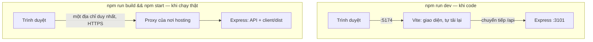

**Build.**

- `vite build` gom và thu nhỏ toàn bộ giao diện vào `client/dist/`.
- Tên tệp có **mã băm nội dung** (`index-B8ITuBVT.js`): nội dung đổi thì tên đổi.
- Vì vậy tệp trong `assets/` được phép lưu cache **một năm** (`immutable`). Riêng `index.html` phải `no-cache`, để luôn trỏ tới tên tệp
  mới nhất.

**SPA fallback.**

- Người dùng gõ thẳng `https://…/album/5`. Máy chủ không có tệp nào tên `album/5`.
- Vì vậy mọi yêu cầu GET **không phải** API và **không phải** tệp tĩnh đều nhận `index.html`. React Router đọc địa chỉ và vẽ đúng trang.

**`NODE_ENV=production` bật ba thứ:**

| Thứ | Vì sao |
| --- | --- |
| Cookie `Secure` | Chỉ đi qua HTTPS: không ai trên cùng mạng Wi-Fi đọc trộm được |
| `Strict-Transport-Security` | Trình duyệt nhớ "trang này luôn HTTPS" |
| `trust proxy` | Nơi hosting đặt một proxy HTTPS **đứng trước** app. Không bật thì `req.ip` là IP của proxy (giới hạn số lần thử thành vô dụng: mọi người chung một bộ đếm) và `req.protocol` là `http` (redirect URI của Google sai) |

**Dữ liệu phải nằm trên ổ đĩa bền vững.**

- Các nền tảng như Render, Railway, Fly.io **xoá sạch** ổ đĩa của app mỗi lần triển khai lại.
- `data/` (CSDL SQLite + ảnh/video) phải nằm trên một **volume**: ổ đĩa riêng gắn vào, ví dụ ở `/data`.
- Đặt `DATA_DIR=/data` để app dùng nó.

**Docker nhiều giai đoạn (multi-stage):**

- Giai đoạn 1 cài **đủ** thư viện (cả Vite) để build giao diện.
- Giai đoạn 2 chỉ chép **kết quả build** cộng thư viện production. Ảnh Docker cuối nhỏ và ít thứ để tấn công.
- Chạy bằng người dùng `node` thay cho `root`.

**CI** (Continuous Integration): GitHub tự chạy `npm ci`, `npm test`, `npm run build` cho mỗi lần đẩy code. Dấu ❌ đỏ nghĩa là đừng gộp
nhánh đó.

#### 15.2 Làm từng bước

**Bước 1 — phục vụ giao diện đã build, bật `trust proxy`:**

```diff
@@ -1,2 +1,4 @@
+import fs from 'node:fs';
+import path from 'node:path';
 import express from 'express';
 import multer from 'multer';
@@ -22,4 +24,7 @@
   const app = express();
   app.disable('x-powered-by');
+  // Chạy thật: HTTPS do proxy của nơi hosting đảm nhận. Tin header X-Forwarded-* của ĐÚNG MỘT proxy đứng trước,
+  // để req.ip (giới hạn số lần thử) và req.protocol (redirect URI của Google) là của người dùng thật.
+  if (config.isProd) app.set('trust proxy', 1);
 
   // "Hộp đồ nghề" dùng chung, trao cho mọi nhóm route.
@@ -63,4 +68,18 @@
   app.use('/api', api);
 
+  // ---------- Giao diện React đã build (sau `npm run build`) ----------
+  // Chạy thật chỉ cần MỘT máy chủ: Express trả cả API lẫn các tệp HTML/JS/CSS của giao diện.
+  const indexHtml = path.join(config.clientDist, 'index.html');
+  if (fs.existsSync(indexHtml)) {
+    // Vite gắn mã băm vào tên tệp (index-DmwlpavZ.js): nội dung đổi thì tên đổi, nên được lưu cache MÃI MÃI.
+    app.use('/assets', express.static(path.join(config.clientDist, 'assets'), { immutable: true, maxAge: '1y' }));
+    app.use(express.static(config.clientDist, { index: false }));
+    // SPA: mọi đường dẫn GET khác (/album/5, /join/…) đều trả index.html, rồi React Router chọn trang.
+    app.use((req, res, next) => {
+      if (req.method !== 'GET' && req.method !== 'HEAD') return next();
+      res.sendFile(indexHtml, { headers: { 'Cache-Control': 'no-cache' } }); // index.html luôn hỏi lại: lấy bản mới nhất
+    });
+  }
+
   // ---------- Bắt mọi lỗi → JSON có mã cố định ----------
   // Express nhận ra error handler nhờ hàm có ĐÚNG 4 tham số (err, req, res, next).
```

Khối giao diện đặt **sau** router `/api` và **trước** error handler. Nó chỉ bật khi đã có `client/dist/index.html`, nên lúc dev không ảnh
hưởng gì.

```diff
@@ -34,4 +34,5 @@
     dbFile: path.join(dataDir, 'mini.db'),
     uploadDir: path.join(dataDir, 'uploads'),
+    clientDist: path.join(ROOT, 'client', 'dist'),
   };
 }
```

```diff
@@ -1,2 +1,3 @@
+import fs from 'node:fs';
 import { createApp } from './app.js';
 import { loadConfig } from './config.js';
@@ -9,4 +10,5 @@
 const server = app.listen(config.port, () => {
   console.log(`Mini Lane API → http://localhost:${config.port}/api/health`);
+  if (fs.existsSync(config.clientDist)) console.log(`Giao diện đã build → http://localhost:${config.port}`);
 });
 
```

**Bước 2 — khai báo phiên bản Node tối thiểu:**

```bash
npm pkg set engines.node=">=22.22"
```

**Bước 3 — `Dockerfile`:**

```dockerfile
# Ảnh Docker để chạy thật (Fly.io, Railway, Render, máy chủ riêng…).
# Gắn một ổ đĩa bền vững (volume) vào /data: nơi chứa CSDL SQLite, ảnh và video.

# ---- Giai đoạn 1: build giao diện React (cần cả devDependencies như Vite) ----
FROM node:24-slim AS build
WORKDIR /app
COPY package.json package-lock.json ./
RUN npm ci
COPY . .
RUN npm run build

# ---- Giai đoạn 2: ảnh chạy thật — chỉ có thư viện production + mã máy chủ + giao diện đã build ----
FROM node:24-slim
ENV NODE_ENV=production \
    PORT=3101 \
    DATA_DIR=/data
WORKDIR /app
COPY package.json package-lock.json ./
RUN npm ci --omit=dev && npm cache clean --force
COPY server ./server
COPY shared ./shared
COPY --from=build /app/client/dist ./client/dist
RUN mkdir -p /data && chown -R node:node /data
USER node
VOLUME /data
EXPOSE 3101
CMD ["node", "server/index.js"]
```

`.dockerignore`: những thứ **không** chép vào ảnh Docker. Thiếu tệp này, `node_modules` và cả `data/` của máy bạn sẽ bị chép vào:

```text
node_modules
client/dist
data
.env
.git
*.log
```

**Bước 4 — CI `.github/workflows/ci.yml`:**

```yaml
# Chạy mỗi lần đẩy code / mở Pull Request: cài đúng các gói đã khoá, chạy kiểm thử, kiểm tra build.
name: CI

on:
  push:
  pull_request:

jobs:
  test:
    runs-on: ubuntu-latest
    steps:
      - uses: actions/checkout@v4
      - uses: actions/setup-node@v4
        with:
          node-version: 24
          cache: npm
      - run: npm ci
      - run: npm test
      - run: npm run build
```

#### 15.3 Kiểm tra

Chạy chế độ production ngay trên máy (cổng 3102, để không đụng bản dev):

```bash
npm run build
```

```bash
NODE_ENV=production PORT=3102 npm start
```

Ở terminal khác, kết quả khi chạy thử:

| Kiểm tra | Lệnh | Kết quả |
| --- | --- | --- |
| Trang chủ là HTML, có CSP | `curl -I http://localhost:3102/` | `200`, `Content-Type: text/html`, `Content-Security-Policy: default-src 'self'; …` |
| Đường dẫn của React | `curl http://localhost:3102/album/5` | Trả `index.html` (có `<div id="root"></div>`) |
| Tệp JS cache một năm | `curl -I http://localhost:3102/assets/index-….js` | `Cache-Control: public, max-age=31536000, immutable` |
| HSTS | `curl -I http://localhost:3102/api/health` | `Strict-Transport-Security: max-age=15552000; includeSubDomains` |
| Cookie an toàn | đăng nhập bằng `curl -i …/api/auth/login` | `Set-Cookie: mini_session=…; HttpOnly; Secure; SameSite=Lax` |
| API lạ vẫn là JSON | `curl http://localhost:3102/api/khong-co` | `{"error":"NOT_FOUND"}` |

Mở `http://localhost:3102` trong trình duyệt và đăng nhập. Ở đây cookie `Secure` vẫn chạy, vì trình duyệt coi `localhost` là an toàn.
Console **không có lỗi CSP**, font Be Vietnam Pro tải đúng.

Có Docker trên máy thì thử:

```bash
docker build -t mini-lane .
```

```bash
docker run -p 3101:3101 -v mini-data:/data mini-lane
```

> Máy dùng để viết hướng dẫn này không có Docker, nên `Dockerfile` của bản mini **chưa được build thử**. Nó theo đúng mẫu `Dockerfile` của
> bản thật. Phần chế độ production ở bảng trên thì đã chạy thật.

**Đưa lên mạng:** làm theo [DEPLOY.md](docs/DEPLOY.md). Thay cổng 3001 bằng 3101 và nhớ gắn ổ đĩa vào `/data`.

#### 15.4 Lỗi hay gặp

| Triệu chứng | Nguyên nhân | Cách sửa |
| --- | --- | --- |
| Triển khai lại là mất hết tài khoản và ảnh | `data/` nằm trên ổ đĩa tạm của nền tảng | Gắn volume, đặt `DATA_DIR` trỏ vào đó. Thử khởi động lại **ngay ngày đầu** |
| F5 ở `/album/5` báo `Cannot GET /album/5` | Thiếu SPA fallback | Bước 1 |
| Chạy thật qua `http://` thì không đăng nhập được | Cookie `Secure` chỉ đi qua HTTPS | Dùng địa chỉ `https://` nền tảng cấp |
| Mọi người dùng bị `429` cùng lúc | Thiếu `trust proxy`: mọi yêu cầu mang IP của proxy | `app.set('trust proxy', 1)` khi `isProd` |
| Đăng nhập Google báo `redirect_uri_mismatch` sau khi đưa lên mạng | Redirect URI dùng `http` hoặc sai tên miền | `trust proxy` + đặt `PUBLIC_URL=https://ten-mien-cua-ban`, khai báo đúng địa chỉ đó trong Google Cloud |
| Người dùng vẫn thấy giao diện cũ sau khi triển khai | `index.html` bị cache | `Cache-Control: no-cache` cho `index.html` (đã có ở bước 1) |

#### 15.5 Đối chiếu với bản thật

- **`server/app.js`**: cùng khối "giao diện đã build" và `trust proxy`. Có thêm **nén** (`compression`), loại trừ `/api/events`.
- **`Dockerfile`**: giống, cộng chạy `seed.js` trước khi khởi động (trừ khi `ALLOW_DEMO=false`), để bản online luôn có tài khoản demo.
- **`render.yaml`**: "bản thiết kế" cho Render: dịch vụ web, ổ đĩa, biến môi trường. Bấm vài nút là có app chạy.
- **[docs/DEPLOY.md](docs/DEPLOY.md)**: Render, Railway, Fly.io/Docker, cài Google, danh sách kiểm tra 15 phút sau khi triển khai.

#### 15.6 Tự kiểm tra

1. Vì sao tệp trong `assets/` được cache một năm, còn `index.html` thì không?
2. Khởi động lại máy chủ mà mất hết dữ liệu: lỗi ở đâu?
3. `trust proxy` sửa được hai vấn đề nào?
4. **Bài tập:** đưa bản mini lên Render theo DEPLOY.md, gắn ổ đĩa, rồi mở trên điện thoại qua `https://…`. Khởi động lại dịch vụ và kiểm
   tra tài khoản vẫn còn.

**Commit:** `git add -A && git commit -m "chore(deploy): chạy thật, Docker, CI"`

---

### Chặng 16 (tuỳ chọn) — Vẽ bưu thiếp bằng canvas

**Mục tiêu:** từ một kỷ niệm, vẽ một tấm **bưu thiếp 1500×1000**:

- ảnh cắt vừa khung;
- con tem có răng cưa và dấu bưu điện;
- lời nhắn tự xuống dòng, đúng dấu tiếng Việt;
- tải về được dạng JPEG.

Mọi thứ diễn ra trong trình duyệt, không gửi gì lên máy chủ.

<p></p>

#### 16.1 Khái niệm

**Canvas 2D** là một "tấm vải" điểm ảnh, vẽ bằng lệnh JavaScript:

| Lệnh | Vẽ gì |
| --- | --- |
| `fillRect` | Hình chữ nhật |
| `arc` | Hình tròn |
| `fillText`, `measureText` | Viết chữ, và đo bề rộng chữ |
| `drawImage(ảnh, sx, sy, sw, sh, dx, dy, dw, dh)` | Lấy **một vùng** của ảnh gốc, vẽ vào **một vùng** trên canvas |

Bạn đã dùng canvas ở chặng 11 để nén ảnh. Ở đây ta dùng nó để **sáng tác**.

**Ba kỹ thuật chính:**

1. **Cắt kiểu `object-fit: cover`.** Chọn tỉ lệ thu phóng **lớn hơn** trong hai tỉ lệ (theo bề rộng, theo bề cao), để ảnh phủ kín khung;
   rồi lấy vùng giữa của ảnh gốc.
2. **Tự xuống dòng.** Canvas không tự xuống dòng. Ghép từng từ, đo bằng `measureText`; quá bề rộng thì xuống dòng.
3. **Đục lỗ bằng `globalCompositeOperation = 'destination-out'`.** Ở chế độ này, chỗ nào vẽ lên thì chỗ đó trở nên **trong suốt**. Vẽ
   các hình tròn dọc mép con tem là ra răng cưa thật. Ta vẽ con tem trên một **canvas phụ**, để chỉ đục lỗ con tem chứ không đục cả bưu
   thiếp.

**Hai cái bẫy:**

- **Font chưa tải xong.** Canvas vẽ chữ bằng font **đang có**. Font Be Vietnam Pro chưa tải xong thì chữ sẽ ra font dự phòng, có khi
  thiếu dấu. `document.fonts.load('700 56px "Be Vietnam Pro"', 'Đà Lạt')` đợi đúng phần font chứa các ký tự cần vẽ.
- **Canvas "bẩn".** Vẽ ảnh lấy từ **trang web khác** lên canvas thì không xuất ra tệp được nữa (`toBlob` báo lỗi bảo mật). Ảnh của ta lấy
  từ `/api/files/…`, **cùng địa chỉ**, nên canvas vẫn sạch.

#### 16.2 Làm từng bước

**Bước 1 — thư viện vẽ `client/src/lib/postcard.js`:**

```js
// Vẽ một tấm bưu thiếp 1500×1000 bằng Canvas 2D — hoàn toàn trong trình duyệt, không gửi gì lên máy chủ.

const W = 1500;
const H = 1000;

/** Vẽ ảnh vào khung (x, y, w, h) kiểu "object-fit: cover": lấp đầy khung, cắt bớt phần thừa, không méo. */
function cover(ctx, image, x, y, w, h) {
  const scale = Math.max(w / image.width, h / image.height);
  const sw = w / scale;
  const sh = h / scale;
  ctx.drawImage(image, (image.width - sw) / 2, (image.height - sh) / 2, sw, sh, x, y, w, h);
}

/** Viết chữ tự xuống dòng trong bề rộng maxWidth; trả về toạ độ y của dòng tiếp theo. */
function wrap(ctx, text, x, y, maxWidth, lineHeight) {
  let line = '';
  for (const word of text.split(/\s+/)) {
    const test = line ? `${line} ${word}` : word;
    if (ctx.measureText(test).width > maxWidth && line) {
      ctx.fillText(line, x, y);
      line = word;
      y += lineHeight;
    } else {
      line = test;
    }
  }
  if (line) ctx.fillText(line, x, y);
  return y + lineHeight;
}

/** Con tem có răng cưa: vẽ hình chữ nhật rồi "đục" các lỗ tròn dọc mép bằng destination-out. */
function stamp(ctx, image, x, y, w, h) {
  const tile = document.createElement('canvas'); // vẽ riêng trên canvas phụ để chỉ đục lỗ con tem
  tile.width = w;
  tile.height = h;
  const t = tile.getContext('2d');
  t.fillStyle = '#fffdf8';
  t.fillRect(0, 0, w, h);
  t.globalCompositeOperation = 'destination-out'; // vẽ vào đâu thì chỗ đó trở nên TRONG SUỐT
  for (let i = 10; i < w; i += 22) {
    for (const yy of [0, h]) t.beginPath(), t.arc(i, yy, 7, 0, Math.PI * 2), t.fill();
  }
  for (let j = 10; j < h; j += 22) {
    for (const xx of [0, w]) t.beginPath(), t.arc(xx, j, 7, 0, Math.PI * 2), t.fill();
  }
  t.globalCompositeOperation = 'source-over';
  if (image) cover(t, image, 16, 16, w - 32, h - 32);
  ctx.save();
  ctx.shadowColor = 'rgba(0,0,0,0.25)';
  ctx.shadowBlur = 10;
  ctx.drawImage(tile, x, y);
  ctx.restore();
}

/**
 * canvas: thẻ <canvas>. data: { image (đã tải xong, hoặc null), title, year, stampDate ('12.10.2019'),
 * message, to, fontFamily }.
 */
export function drawPostcard(canvas, { image, title, year, stampDate, message, to, fontFamily = 'sans-serif' }) {
  canvas.width = W;
  canvas.height = H;
  const ctx = canvas.getContext('2d');
  ctx.fillStyle = '#fffdf8';
  ctx.fillRect(0, 0, W, H);

  if (image) {
    cover(ctx, image, 50, 50, 820, 900);
  } else {
    // Kỷ niệm chưa có ảnh: một nền màu giấy với con số năm thật to.
    ctx.fillStyle = '#e9e1d0';
    ctx.fillRect(50, 50, 820, 900);
    ctx.fillStyle = '#b7aa8f';
    ctx.font = `700 160px ${fontFamily}`;
    ctx.textAlign = 'center';
    ctx.fillText(String(year), 460, 560);
    ctx.textAlign = 'left';
  }
  ctx.fillStyle = '#d9d2c3';
  ctx.fillRect(920, 80, 2, 840); // đường kẻ dọc giữa hai nửa

  stamp(ctx, image, 1260, 70, 170, 200);
  ctx.strokeStyle = '#c2453a'; // dấu bưu điện: một vòng tròn đỏ đè lên góc tem
  ctx.lineWidth = 4;
  ctx.beginPath();
  ctx.arc(1240, 250, 70, 0, Math.PI * 2);
  ctx.stroke();
  ctx.fillStyle = '#c2453a';
  ctx.font = `600 22px ${fontFamily}`;
  ctx.textAlign = 'center';
  ctx.fillText(stampDate, 1240, 258); // ngày dạng số ngắn gọn: vừa vòng dấu bưu điện

  ctx.textAlign = 'left';
  ctx.fillStyle = '#23262f';
  ctx.font = `700 56px ${fontFamily}`;
  wrap(ctx, title, 960, 380, 480, 64);
  ctx.fillStyle = '#2547a6';
  ctx.font = `400 34px ${fontFamily}`;
  const end = wrap(ctx, message, 960, 500, 480, 48);
  ctx.fillStyle = '#23262f';
  ctx.font = `600 30px ${fontFamily}`;
  ctx.fillText(to, 960, Math.max(end + 40, 860));
}

/** canvas → tệp JPEG để tải về hoặc chia sẻ. */
export function canvasToFile(canvas, name) {
  return new Promise((resolve) => canvas.toBlob((blob) => resolve(new File([blob], name, { type: 'image/jpeg' })), 'image/jpeg', 0.92));
}
```

`ctx.save()` … `ctx.restore()` cất và khôi phục trạng thái vẽ (bóng đổ, màu…), để bóng đổ của con tem không lan sang những thứ vẽ sau.

**Bước 2 — cửa sổ tạo bưu thiếp `client/src/components/PostcardStudio.jsx`:**

```jsx
import { useEffect, useRef, useState } from 'react';
import { useI18n } from '../i18n/index.jsx';
import { canvasToFile, drawPostcard } from '../lib/postcard.js';

/** Tải ảnh (cùng địa chỉ với trang, nên canvas vẫn "sạch" và xuất ra tệp được). */
function loadImage(url) {
  return new Promise((resolve, reject) => {
    const image = new Image();
    image.onload = () => resolve(image);
    image.onerror = reject;
    image.src = url;
  });
}

export default function PostcardStudio({ memory }) {
  const { t } = useI18n();
  const canvas = useRef(null);
  const [image, setImage] = useState(null);
  const [message, setMessage] = useState('');
  const photo = memory.files.find((file) => file.kind === 'image');

  useEffect(() => {
    if (photo) loadImage(photo.url).then(setImage);
  }, [photo]);

  // Vẽ lại mỗi khi ảnh tải xong hoặc lời nhắn thay đổi. Đợi font có dấu tiếng Việt tải xong rồi mới vẽ chữ.
  useEffect(() => {
    let cancelled = false;
    document.fonts.load('700 56px "Be Vietnam Pro"', memory.title).then(() => {
      if (cancelled) return;
      const pad = (n) => String(n).padStart(2, '0');
      drawPostcard(canvas.current, {
        image,
        title: memory.title,
        year: memory.year,
        stampDate: memory.month && memory.day ? `${pad(memory.day)}.${pad(memory.month)}.${memory.year}` : String(memory.year),
        message: message || t('postcard.defaultMessage'),
        to: t('postcard.to'),
        fontFamily: '"Be Vietnam Pro", sans-serif',
      });
    });
    return () => {
      cancelled = true;
    };
  }, [image, message, memory, t]);

  async function download() {
    const file = await canvasToFile(canvas.current, 'buu-thiep.jpg');
    const url = URL.createObjectURL(file);
    const link = Object.assign(document.createElement('a'), { href: url, download: file.name });
    link.click();
    URL.revokeObjectURL(url);
  }

  return (
    <div className="studio">
      <canvas ref={canvas} className="postcard" role="img" aria-label={t('postcard.preview')} />
      <textarea rows={2} value={message} placeholder={t('postcard.defaultMessage')} onChange={(e) => setMessage(e.target.value)} />
      <button type="button" className="primary" onClick={download}>
        {t('postcard.download')}
      </button>
    </div>
  );
}
```

- Tải về: `toBlob` → `URL.createObjectURL` → một thẻ `<a download>` tạm, rồi `click()`.
- Biến `cancelled` trong effect: người dùng gõ nhanh thì lần vẽ cũ (đang đợi font) bị bỏ, chỉ lần mới nhất được vẽ.

**Bước 3 — nút trên trang kỷ niệm, CSS và câu chữ:**

```diff
@@ -6,4 +6,5 @@
 import MemoryForm from '../components/MemoryForm.jsx';
 import Modal from '../components/Modal.jsx';
+import PostcardStudio from '../components/PostcardStudio.jsx';
 import SharePanel from '../components/SharePanel.jsx';
 import Uploader from '../components/Uploader.jsx';
@@ -18,4 +19,5 @@
   const navigate = useNavigate();
   const [editing, setEditing] = useState(false);
+  const [postcard, setPostcard] = useState(false);
 
   if (error?.status === 404) return <p>{t('memory.notFound')}</p>;
@@ -66,4 +68,10 @@
         </>
       )}
+      <button type="button" onClick={() => setPostcard(true)}>
+        {t('postcard.open')}
+      </button>
+      <Modal open={postcard} onClose={() => setPostcard(false)} title={t('postcard.open')}>
+        <PostcardStudio memory={memory} />
+      </Modal>
       <Comments memoryId={memory.id} />
 
```

```diff
@@ -326,4 +326,15 @@
 }
 
+/* ---------- Bưu thiếp ---------- */
+.studio {
+  display: grid;
+  gap: var(--s3);
+}
+.postcard {
+  width: 100%;
+  height: auto; /* canvas 1500×1000 thu nhỏ theo bề rộng hộp thoại */
+  border: 1px solid var(--line);
+}
+
 /* ---------- Hộp thoại ---------- */
 .modal {
```

```diff
@@ -77,4 +77,11 @@
     },
   },
+  postcard: {
+    open: 'Tạo bưu thiếp',
+    preview: 'Xem trước bưu thiếp',
+    defaultMessage: 'Gửi bạn một kỷ niệm của mình.',
+    to: 'Gửi: người thân yêu',
+    download: 'Tải về',
+  },
   common: { close: 'Đóng' },
   errors: {
```

```diff
@@ -76,4 +76,11 @@
     },
   },
+  postcard: {
+    open: 'Make a postcard',
+    preview: 'Postcard preview',
+    defaultMessage: 'Sending you one of my memories.',
+    to: 'To: someone dear',
+    download: 'Download',
+  },
   common: { close: 'Close' },
   errors: {
```

#### 16.3 Kiểm tra

Mở một kỷ niệm **có ảnh**, bấm "Tạo bưu thiếp", gõ lời nhắn. Tấm thiếp vẽ lại theo từng chữ bạn gõ. Bấm "Tải về": được tệp
`buu-thiep.jpg` 1500×1000.

**Hai lỗi đã gặp khi viết hướng dẫn**, cách sửa đã có trong code ở trên:

- Kỷ niệm **chưa có ảnh** làm nửa trái bưu thiếp trống trơn. Sửa: vẽ nền màu giấy với con số năm thật to.
- Ngày dạng chữ ("12 tháng 10, 2019") quá dài, **tràn ra ngoài** vòng dấu bưu điện. Sửa: dấu bưu điện dùng ngày dạng số "12.10.2019".

Bài học: luôn thử **trường hợp rỗng** (không có ảnh) và **dữ liệu dài nhất** (chữ dài, ngôn ngữ dài).

#### 16.4 Lỗi hay gặp

| Triệu chứng | Nguyên nhân | Cách sửa |
| --- | --- | --- |
| Chữ trên thiếp thiếu dấu, hoặc sai font ở lần vẽ đầu | Vẽ trước khi font tải xong | `await document.fonts.load(font, chuỗi)` rồi mới vẽ |
| `toBlob` báo `Tainted canvases may not be exported` | Ảnh lấy từ địa chỉ khác | Dùng ảnh cùng địa chỉ (`/api/files/…`) |
| Răng cưa đục thủng cả bưu thiếp | Đục lỗ thẳng trên canvas chính | Vẽ con tem trên canvas phụ rồi mới `drawImage` lên thiếp |
| Ảnh trên thiếp bị méo | Dùng `drawImage(ảnh, x, y, w, h)` khác tỉ lệ ảnh | Hàm `cover()` |

#### 16.5 Đối chiếu với bản thật

- **`client/src/lib/cards.js`** (387 dòng) vẽ **ba loại thẻ** (bưu thiếp, con tem, thẻ ảnh) theo **hai kiểu** (Giấy, Phòng tối). Kỹ thuật
  như của bạn, cộng thêm:
  - hạt giấy (`grain`);
  - dòng kẻ cho lời nhắn;
  - thu nhỏ chữ cho vừa (`fit`);
  - khung phim có lỗ cho kiểu Phòng tối.
- **`components/CardStudio.jsx`**: chọn loại, kiểu, ảnh, dòng chữ; nút **Chia sẻ** gửi thẳng tệp qua `navigator.share({ files })` trên
  điện thoại.
- Thiết kế: [DESIGN.md §5](docs/design/DESIGN.md#5-kỷ-vật-và-thẻ-kỷ-niệm).

#### 16.6 Tự kiểm tra

1. Vì sao `cover()` chọn tỉ lệ **lớn hơn** trong hai tỉ lệ?
2. `destination-out` khác `source-over` (mặc định) thế nào?
3. **Bài tập:** thêm kiểu **"Phòng tối"** cho bưu thiếp (nền than chì, chữ kem, dấu đỏ). Gợi ý: gom các màu vào một bảng màu như
   `PALETTES` trong `lib/cards.js` của bản thật.

**Commit:** `git add -A && git commit -m "feat(cards): bưu thiếp vẽ bằng canvas"`

---

### B2. Sau 16 chặng: bản mini so với bản thật

Bạn đã tự viết mọi **lớp** của bản thật. Phần còn lại của bản thật là thêm **tính năng** trên đúng các lớp đó. Hướng dẫn **từng bước**
cho từng tính năng (cơ sở dữ liệu → model → route → kiểm thử → giao diện) nằm ở [Phần E](#phần-e--xây-lại-từng-tính-năng-còn-lại-của-bản-thật-từng-bước):

| Bản thật có thêm | Ở đâu | Dựa trên kỹ thuật của chặng |
| --- | --- | --- |
| Người quen cũ (ghi chú, độ thân, "lâu chưa liên lạc") | `models/people.js`, `routes/people.js`, `pages/People.jsx`, `PersonDetail.jsx` | 3, 5, 8 |
| Phim & nhạc, Kỷ vật | `models/media.js`, `artifacts.js`, `pages/Archive.jsx`, `Artifacts.jsx` | 3, 5, 8, 11 |
| Trang **Hôm nay** ("Hôm nay, nhiều năm trước") | `routes/dashboard.js`, `shared/dates.js` (`dayOfYearDistance`), `pages/Today.jsx` | 3, 8 |
| **Tìm kiếm không dấu** | `lib/text.js` (`fold`), `db.js` (đăng ký hàm SQL), `routes/search.js` | 3 |
| Dòng thời gian | `pages/Timeline.jsx` | 8 |
| Xoá GPS ở máy chủ (cả trong video), hạn mức dung lượng | `lib/metadata.js`, `routes/memories.js` | 11 |
| Người có mặt trong kỷ niệm, ảnh bìa, đổi thứ tự tệp | `models/memories.js`, `forms/MemoryForm.jsx` | 3, 8, 11 |
| Chia sẻ ngay trong form, thu hồi link, ngừng kết nối, trang Chia sẻ | `models/social.js`, `forms/ShareFields.jsx`, `pages/Sharing.jsx` | 12 |
| Sự kiện trực tiếp `shared`, `circle`, thông báo nhỏ | `routes/memories.js`, `routes/invites.js`, `LiveUpdates.jsx`, `Toast.jsx` | 13 |
| Liên kết/huỷ liên kết Google, đặt mật khẩu lần đầu | `routes/google.js`, `routes/me.js`, `pages/Settings.jsx` | 14 |
| Cài đặt: đổi tên, đổi mật khẩu, đăng xuất mọi nơi, **xuất dữ liệu**, **xoá tài khoản** | `routes/me.js`, `pages/Settings.jsx` | 5 |
| Đăng nhập demo, thế giới demo 6 tài khoản | `routes/auth.js`, `seed.js` | 5 |
| Thanh điều hướng tự thu gọn, menu điện thoại, chế độ kín đáo, trang giới thiệu | `TopBar.jsx`, `state.jsx`, `pages/Landing.jsx` | 10 |
| Tải trang theo nhu cầu (`lazy`), nén phản hồi | `App.jsx`, `app.js` | 7, 15 |
| Thẻ kỷ niệm 3 loại × 2 kiểu, chia sẻ tệp từ điện thoại | `lib/cards.js`, `CardStudio.jsx` | 16 |

**Đọc bản thật theo thứ tự này** (mỗi tệp đều có chú thích đầu tệp):

1. `server/app.js` → `lib/sessions.js` → `routes/memories.js` → `models/memories.js`: xương sống, bạn đã quen.
2. `models/social.js` → `routes/invites.js`: so với chặng 12, xem phần `attachMemory` và `disconnect`.
3. `lib/metadata.js` + `test/metadata.test.js`: xử lý tệp nhị phân từng byte.
4. `client/src/components/forms/MemoryForm.jsx`: tệp giao diện phức tạp nhất, ghép mọi thứ của chặng 8, 11, 12.
5. `client/src/components/TopBar.jsx` → `styles/layout.css`: thanh điều hướng tự đo.
6. `client/src/lib/cards.js`: vẽ thẻ.

### B3. Khi bị kẹt: cách gỡ lỗi

Làm theo thứ tự, đừng đoán:

1. **Đọc thông báo lỗi đến hết.** Dòng đầu cho biết **cái gì** sai. Dòng có tên tệp **của bạn** (không phải trong `node_modules`) cho
   biết **chỗ nào**.
2. **Lỗi ở phía nào?** Mở DevTools → **Network**, tìm yêu cầu tới `/api/…`:
   - **Không có yêu cầu nào**: lỗi ở giao diện. Xem tab Console.
   - **Có yêu cầu, mã 4xx**: máy chủ từ chối. Đọc thân phản hồi, ví dụ `{"error":"VALIDATION","fields":…}`.
   - **Mã 500**: lỗi ở máy chủ. Xem terminal đang chạy `npm run dev`; error handler đã in chi tiết ở đó.
3. **Thu nhỏ vấn đề.** Thử đúng API đó bằng `curl` (chặng 1–6). Nếu curl chạy đúng thì lỗi nằm ở giao diện.
4. **Nhìn vào dữ liệu thật:** `sqlite3 data/mini.db "SELECT * FROM memories;"`.
5. **In ra để xem:**
   - `console.log({ biến })` (in cả tên lẫn giá trị);
   - hoặc đặt **breakpoint** trong DevTools → Sources (giao diện);
   - hoặc chạy `node --inspect server/index.js` rồi mở `chrome://inspect` (máy chủ).
6. **Viết một bài kiểm thử tái hiện lỗi** trước khi sửa. Sửa xong, bài đó xanh và sẽ canh lỗi ấy mãi về sau.
7. **So với bản thật**: tệp cùng tên ở bản thật là "đáp án tham khảo", và đã chạy với 72 bài kiểm thử.

### B4. Tự đánh giá cuối Phần B

Trả lời được hết mà không cần mở tài liệu là bạn đã sẵn sàng bảo vệ:

- [ ] Vẽ lại sơ đồ "một yêu cầu đi từ nút bấm tới CSDL" ([B0.4](#b04-hành-trình-của-một-yêu-cầu-bấm-lưu-một-kỷ-niệm-mới)) và nói tên tệp ở
      từng bước.
- [ ] Giải thích 4 lớp bảo vệ của đăng nhập: băm mật khẩu có salt, phiên lưu mã băm, cookie `HttpOnly`/`SameSite`, giới hạn số lần thử.
- [ ] Giải thích vì sao trả 404 thay vì 403, và dòng SQL nào bảo đảm điều đó.
- [ ] Kể đường đi của một tấm ảnh từ điện thoại tới ổ đĩa máy chủ, và mọi lớp kiểm tra trên đường.
- [ ] Giải thích state, nonce, PKCE bằng lời của bạn.
- [ ] Giải thích vì sao SSE, và vì sao phải đóng kết nối khi tab bị ẩn.
- [ ] Thêm một giao diện thứ ba chỉ bằng CSS.
- [ ] Thêm một tính năng nhỏ kèm migration, model, route, bài kiểm thử, câu chữ hai ngôn ngữ. Đó chính là [A7](#a7-thêm-tính-năng-mới-mà-không-làm-hỏng-cái-cũ).

---

## Phần C — Vận hành, bảo trì và xử lý sự cố

Phần A giúp bạn **có** sản phẩm, Phần B giúp bạn **hiểu** nó. Phần C dành cho lúc app **đã có người dùng thật**: theo dõi máy chủ, sao
lưu dữ liệu, cập nhật phiên bản, và xử lý khi ai đó nhắn "mình không đăng nhập được" hay "ảnh của mình biến mất rồi".

Mọi lệnh trong phần này đã được chạy thử trên một bản dữ liệu demo riêng; kết quả in ra là kết quả thật (chỉ khác ngày giờ, mã ngẫu
nhiên và đường dẫn).

**Năm nguyên tắc khi động vào dữ liệu thật:**

1. **Sao lưu trước khi sửa.** Một lệnh `npm run admin -- backup` mất vài giây; mất dữ liệu của người khác thì không lấy lại được.
2. **Xem trước, sửa sau.** Chẩn đoán bằng các lệnh chỉ đọc (`stats`, `user`, `memory`, `check-files`). Chỉ sửa khi đã biết nguyên nhân.
3. **Không sửa cơ sở dữ liệu bằng tay** khi đã có lệnh làm việc đó. Nếu buộc phải chạy SQL, thử trên bản sao trước (xem [C4](#c4-đọc-cơ-sở-dữ-liệu-bằng-tay)).
4. **Tôn trọng riêng tư.** Chẩn đoán bằng con số, ngày giờ và mã định danh, **không mở ảnh hay đọc câu chuyện** của người dùng.
   Công cụ quản trị cố ý không bao giờ in tiêu đề, câu chuyện, ghi chú hay lời nhắn. Không bao giờ hỏi mật khẩu của người dùng.
5. **Ghi lại mỗi sự cố** vào sổ sự cố (mẫu ở cuối [C10](#c10-diễn-tập-xử-lý-sự-cố)): lần sau gặp lại sẽ xử lý nhanh hơn.

### C0. Bản đồ vận hành: cái gì nằm ở đâu

| Thành phần | Trên máy bạn (`npm run dev`) | Khi chạy thật (Render, Docker…) | Xem bằng gì |
| --- | --- | --- | --- |
| Mã nguồn | thư mục dự án | build từ GitHub mỗi lần deploy | Git, GitHub |
| Cấu hình | tệp `.env` (không commit) | mục **Environment** của nơi hosting | `npm run admin -- stats` (dòng "Cấu hình") |
| Cơ sở dữ liệu | `data/memorylane.db` (+ `-wal`, `-shm`) | `DATA_DIR/memorylane.db` trên **ổ đĩa bền vững** (Render: `/var/data`, Docker: `/data`) | `npm run admin`, [C4](#c4-đọc-cơ-sở-dữ-liệu-bằng-tay) |
| Ảnh, video, thẻ kỷ vật | `data/uploads/` | `DATA_DIR/uploads/` | `npm run admin -- check-files` |
| Log | cửa sổ Terminal đang chạy `npm run dev` (các dòng `[api]`) | Render: tab **Logs** · Docker: `docker logs` | [C2.2](#c22-log-của-máy-chủ) |
| Sức khoẻ máy chủ | <http://localhost:3001/api/health> | `https://ten-mien/api/health` | trình duyệt, `curl` |
| Bản sao lưu | `data/backups/` | `DATA_DIR/backups/`, **rồi chép ra ngoài** | [C6](#c6-sao-lưu-và-khôi-phục) |

Hai thứ quyết định tất cả: **`DATA_DIR`** (dữ liệu ở đâu) và **các biến môi trường** (máy chủ chạy thế nào). Phần lớn sự cố "kỳ lạ"
sau khi deploy đến từ một trong hai thứ này.

Khi có người báo lỗi, đi theo thứ tự:

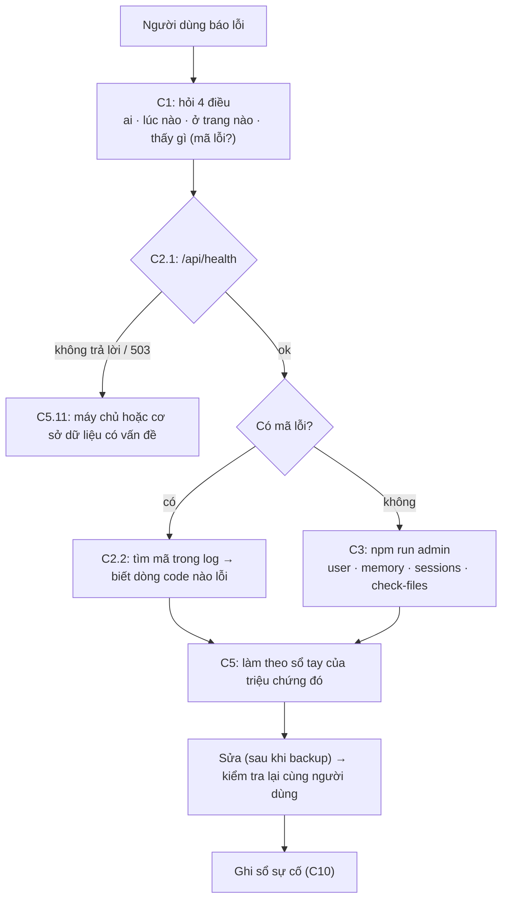

### C1. Khi có người báo lỗi: hỏi đúng bốn điều

"App bị lỗi" chưa đủ để sửa. Hãy hỏi lại, nhẹ nhàng:

| Hỏi | Vì sao |
| --- | --- |
| **Email tài khoản** của bạn là gì? | Để tra đúng người: `npm run admin -- user <email>` |
| **Lúc nào** (khoảng mấy giờ, hôm nào)? | Để tìm đúng đoạn log |
| **Ở trang nào?** Gửi giúp địa chỉ trên thanh trình duyệt, ví dụ `/album/29` | Con số đó là mã kỷ niệm: `npm run admin -- memory 29` |
| **Thấy gì?** Chụp màn hình giúp; nếu có dòng "**Mã lỗi: …**" thì chép lại | Mã lỗi dẫn thẳng tới dòng log ([C2.3](#c23-mã-lỗi-người-dùng-nhìn-thấy)) |

Thêm nếu cần: dùng **điện thoại hay máy tính, trình duyệt gì**; lần cuối dùng được là khi nào; người khác có bị không.

Mẫu tin nhắn hỏi lại:

> Chào bạn, mình xin lỗi vì sự bất tiện. Để kiểm tra nhanh, bạn gửi giúp mình: (1) email bạn dùng để đăng nhập, (2) khoảng thời gian
> gặp lỗi, (3) địa chỉ trang đang mở (dòng chữ trên thanh địa chỉ), (4) ảnh chụp màn hình, nếu có dòng "Mã lỗi" thì chép lại giúp
> mình. Bạn **không cần** gửi mật khẩu — mình sẽ không bao giờ hỏi mật khẩu.

### C2. Nhìn vào đâu: /api/health, log, mã lỗi, DevTools

#### C2.1 `/api/health` — máy chủ còn sống không?

```bash
curl -i http://localhost:3001/api/health
```

| Kết quả | Nghĩa là | Làm gì |
| --- | --- | --- |
| `200 {"ok":true}` | Máy chủ chạy và đọc được cơ sở dữ liệu | Lỗi nằm ở chỗ khác: xem log, dùng `npm run admin` |
| `503 {"ok":false}` | Máy chủ chạy nhưng **không đọc được cơ sở dữ liệu** | [C5.11](#c511-app-không-mở-được--máy-chủ-không-chạy), log có dòng `HEALTH database unavailable: …` |
| Không trả lời, `502`, `504` | Máy chủ **không chạy** hoặc nơi hosting không tới được nó | [C5.11](#c511-app-không-mở-được--máy-chủ-không-chạy) |

Địa chỉ này công khai, không cần đăng nhập, và không tiết lộ gì ngoài "ok". Render dùng nó để biết lúc nào máy chủ sẵn sàng
(`healthCheckPath` trong `render.yaml`), Docker dùng nó cho `HEALTHCHECK`. Bạn có thể dùng thêm một dịch vụ "uptime monitor" miễn phí
gọi địa chỉ này vài phút một lần và báo cho bạn khi nó ngừng trả lời. Code: `server/app.js`, tìm `/health`.

#### C2.2 Log của máy chủ

**Máy chủ ghi gì vào log** (cố ý ít, để không lộ dữ liệu người dùng):

| Dòng log | Khi nào |
| --- | --- |
| `Memory Lane API → http://localhost:3001/api` | Máy chủ vừa khởi động |
| `[2026-10-13T14:00:53.068Z] SERVER 1f9e2221 POST /api/memories/27/files user=1` + chi tiết lỗi | **Lỗi không lường trước** (mã 500). `1f9e2221` là mã lỗi, `user=1` là id tài khoản (`-` nếu chưa đăng nhập) |
| `[…] HEALTH database unavailable: …` | `/api/health` không đọc được cơ sở dữ liệu |
| `Google sign-in failed: …` | Đổi mã với Google thất bại (sai Client secret, mạng, token không hợp lệ) |

**Không ghi:** từng yêu cầu bình thường, mật khẩu, cookie, token. Đường dẫn chứa token dài (link mời) bị che thành `…`.

**Xem log ở đâu:**

- **Trên máy:** cửa sổ Terminal đang chạy `npm run dev`, các dòng bắt đầu bằng `[api]`.
- **Render:** mở dịch vụ → tab **Logs** → ô tìm kiếm.
- **Docker / VPS:** `docker logs <tên-container> 2>&1 | grep SERVER` (thêm `--since 2h` để chỉ xem 2 giờ gần nhất).

Một lỗi thật, tạo trong lúc diễn tập ([C10](#c10-diễn-tập-xử-lý-sự-cố), bài 3: thư mục tải lên không ghi được):

```text
[2026-10-13T14:00:53.068Z] SERVER 1f9e2221 POST /api/memories/27/files user=1
[Error: EACCES: permission denied, open '/var/data/uploads/tmp/c16fe88a42abf0b3bc11e7125baab698'] {
  errno: -13,
  code: 'EACCES',
  syscall: 'open',
```

Đọc từ trên xuống: **lúc nào** (giờ UTC, Việt Nam = UTC+7), **mã lỗi**, **yêu cầu nào** (tải tệp lên kỷ niệm 27), **ai** (tài khoản 1),
rồi **vì sao**: `EACCES` = không có quyền ghi vào thư mục. Các mã hệ điều hành hay gặp: `EACCES` (không có quyền), `ENOSPC` (hết chỗ
trên đĩa), `ENOENT` (không thấy tệp/thư mục), `EADDRINUSE` (cổng đã có chương trình khác dùng), `SQLITE_BUSY`/`database is locked`
(cơ sở dữ liệu đang bị khoá quá lâu).

#### C2.3 "Mã lỗi" người dùng nhìn thấy

Khi có lỗi 500, máy chủ trả `{"error":"SERVER","ref":"1f9e2221"}` và giao diện hiện:

> Có lỗi phía máy chủ. Bạn thử lại nhé. **Mã lỗi: 1f9e2221.**

Người dùng chép mã đó cho bạn → bạn tìm `1f9e2221` trong log → ra đúng dòng ở C2.2, kể cả khi log có hàng nghìn dòng. Mã chỉ là 8 ký
tự ngẫu nhiên, không chứa thông tin gì về người dùng. Code: `server/app.js` (phần "Errors → JSON"), `client/src/api.js`
(`errorMessage`), câu chữ ở khoá `errors.ref` trong `vi.js`.

#### C2.4 Tab Network trong DevTools

Khi bạn tự tái hiện được lỗi: mở DevTools (`F12`, hoặc `Cmd+Option+I` trên Mac) → tab **Network** → làm lại thao tác lỗi → bấm
vào dòng màu đỏ → xem **Status** và **Response**.

| Status | Thân trả về (ví dụ) | Nghĩa là |
| --- | --- | --- |
| 400 | `{"error":"VALIDATION","fields":{"title":{"code":"REQUIRED"}}}` | Dữ liệu gửi lên sai; giao diện đã báo ở đúng ô |
| 401 | `{"error":"UNAUTHORIZED"}` / `INVALID_CREDENTIALS` | Phiên hết hạn, đã bị đăng xuất / sai email hoặc mật khẩu |
| 403 | `{"error":"CROSS_SITE"}` | Yêu cầu đến từ trang khác → bị chặn để chống CSRF |
| 404 | `{"error":"NOT_FOUND"}` | Không tồn tại **hoặc không có quyền xem** (cố ý giống nhau, để không lộ gì) |
| 413 | `{"error":"TOO_LARGE"}` | Thân yêu cầu quá lớn |
| 429 | `{"error":"RATE_LIMITED"}` | Thử quá nhiều lần; header `Retry-After` cho biết phải đợi bao nhiêu giây |
| 500 | `{"error":"SERVER","ref":"…"}` | Lỗi không lường trước → tìm `ref` trong log |
| 503 | `{"ok":false}` (ở `/api/health`) | Không đọc được cơ sở dữ liệu |

Danh sách đầy đủ mã lỗi và câu tiếng Việt tương ứng nằm ở nhóm `errors` trong `client/src/i18n/vi.js`.

### C3. Công cụ quản trị: `npm run admin`

`server/admin.js` là "bảng điều khiển" dòng lệnh của bạn. Nó mở **đúng cơ sở dữ liệu máy chủ đang dùng** (theo `DATA_DIR`), nên phải
chạy ở nơi máy chủ chạy:

| Ở đâu | Cách chạy |
| --- | --- |
| Máy bạn | `npm run admin -- stats` (trong thư mục dự án) |
| Render | mở dịch vụ → tab **Shell** → `npm run admin -- stats` (Shell đã có sẵn `DATA_DIR=/var/data`) |
| Docker | `docker exec -it <tên-container> npm run admin -- stats` |
| Fly.io | `fly ssh console`, rồi `cd /app && npm run admin -- stats` |

> **Dấu `--`** báo cho npm: phần sau là tham số của công cụ, không phải của npm. Chạy thẳng `node server/admin.js stats` cũng được.

| Lệnh | Làm gì | Ghi vào dữ liệu? |
| --- | --- | --- |
| `help` | In danh sách lệnh | không |
| `stats` | Tổng quan: tài khoản, kỷ niệm, tệp, dung lượng, phiên, lời mời, phiên bản cơ sở dữ liệu, cấu hình | không |
| `users [từ khoá]` | Danh sách tài khoản, lọc theo email hoặc tên | không |
| `user <email\|id>` | Một tài khoản: cách đăng nhập, phiên, dung lượng, số kỷ niệm, chia sẻ, lời mời | không |
| `memory <id>` | Một kỷ niệm: chủ, từng tệp còn trên đĩa không, chia sẻ với ai | không |
| `sessions <email\|id>` | Các phiên đăng nhập (mỗi trình duyệt một phiên) | không |
| `sessions <email\|id> --revoke` | Đăng xuất tài khoản khỏi **mọi** thiết bị | **có** |
| `reset-password <email\|id>` | Đặt mật khẩu tạm (in một lần) và đăng xuất mọi nơi | **có** |
| `check-files` | Đối chiếu cơ sở dữ liệu với `uploads/`: tệp mồ côi, tệp bị mất, tệp tạm cũ | không |
| `check-files --fix` | Xoá tệp mồ côi (cũ hơn 10 phút) và tệp tạm cũ; không bao giờ đụng tệp đang dùng | **có** (chỉ xoá tệp thừa) |
| `backup [thư mục]` | Chụp cơ sở dữ liệu + chép `uploads/` (mặc định vào `DATA_DIR/backups/`) | không (chỉ tạo bản sao) |

Thêm `--json` vào bất kỳ lệnh nào để in dạng JSON (dùng trong script và trong `test/admin.test.js`).

**Ví dụ thật** (dữ liệu demo):

```text
$ npm run admin -- stats
Memory Lane — tổng quan (DATA_DIR: /var/data)

  Cơ sở dữ liệu           0,2 MB · phiên bản 5/5
  Thư mục uploads         68 tệp · 33,5 MB
  Tài khoản               6 (6 demo) · 0 liên kết Google · 0 chỉ dùng Google
  Phiên còn hạn           2
  Kỷ niệm                 26 · 23 ảnh, 5 video · 29,3 MB
  Kỷ vật                  6 thẻ · 2 MB
  Người quen · phim nhạc  10 · 5
  Vòng thân quen          5 cặp kết nối · 20 lời nhắn
  Lời mời                 1 đang chờ · 5 đã nhận · 1 hết hạn · 1 đã thu hồi
  Cấu hình                STORAGE_MB=2048 · ALLOW_DEMO=true · Google: chưa bật · development
```

"phiên bản 5/5" nghĩa là cơ sở dữ liệu đã chạy đủ 5 migration mà mã nguồn có. Nếu thấy `4/5`, máy chủ chưa khởi động lại sau khi cập
nhật ([C7](#c7-cập-nhật-phiên-bản-an-toàn)).

```text
$ npm run admin -- user demo@memorylane.local
Tài khoản #1 — demo@memorylane.local

  Tên · ngôn ngữ                   An · vi
  Tạo lúc                          03/09/2026 20:59
  Đăng nhập bằng                   mật khẩu · chưa liên kết Google
  Phiên còn hạn                    2 · gần nhất: 13/10/2026 20:59
  Kỷ niệm                          14 · 12 ảnh, 1 video
  Kỷ vật · người quen · phim nhạc  6 · 5 · 5
  Dung lượng                       11,5 MB / 2.048 MB (1%)
  Vòng thân quen                   5 người
  Lời mời đã gửi                   1 đang chờ · 5 đã nhận · 1 hết hạn · 1 đã thu hồi
  Chia sẻ                          12 kỷ niệm của họ đang chia sẻ · 11 kỷ niệm người khác chia sẻ cho họ
  Lời nhắn đã viết                 9
```

```text
$ npm run admin -- memory 12
Kỷ niệm #12 — chủ: demo@memorylane.local (#1) · ngày 2022-07-09 · lưu lúc 13/10/2026 20:59

#  loại  tệp                                   kích thước  trên đĩa  ảnh nhỏ
─  ────  ────────────────────────────────────  ──────────  ────────  ───────
0  ảnh   d58b2deda83f50d7d57b6dd0130f7d0e.jpg  0,4 MB      có        có

Chia sẻ với: thuha@memorylane.local, khoa@memorylane.local, linh@memorylane.local
Lời nhắn: 3 · thẻ trong Kỷ vật: 1
```

Để ý: không có tiêu đề hay câu chuyện của kỷ niệm. Bạn biết đủ để sửa lỗi mà không cần đọc nội dung riêng tư.

```text
$ npm run admin -- check-files
Đối chiếu 68 tệp trong uploads với cơ sở dữ liệu (68 tệp đang được dùng)

! 1 tệp mồ côi (1 KB): không bản ghi nào dùng
    0123456789abcdef0123456789abcdef.jpg  1 KB  181 phút trước
! 1 tệp bị MẤT: cơ sở dữ liệu cần nhưng đĩa không có
    00c14756615e2df0eab9ade382d6d7ad.jpg  kỷ niệm #16 của thuha@memorylane.local
✓ Không có tệp tạm cũ

Xoá tệp mồ côi và tệp tạm cũ: npm run admin -- check-files --fix
Tệp bị mất không tự sửa được: khôi phục từ bản sao lưu (PLAN.md, C6).
```

- **Tệp mồ côi:** có trên đĩa nhưng không bản ghi nào dùng (ví dụ một lần tải lên bị ngắt đúng lúc, hoặc ai đó chép tay vào). Vô hại,
  chỉ tốn chỗ. `--fix` chỉ xoá tệp mồ côi **cũ hơn 10 phút**, vì tệp mới hơn có thể là ảnh đang được lưu đúng lúc đó.
- **Tệp bị mất:** cơ sở dữ liệu cần nhưng đĩa không có: người dùng sẽ thấy ảnh trống. Chỉ bản sao lưu cứu được ([C6](#c6-sao-lưu-và-khôi-phục)).

```text
$ npm run admin -- reset-password thuha@memorylane.local
✓ Đã đặt mật khẩu tạm cho thuha@memorylane.local và đăng xuất 0 phiên.

    Mật khẩu tạm:  p27c-e9gk-5pgm

  • Chỉ báo mật khẩu này cho đúng chủ tài khoản, qua kênh riêng (gọi điện, nhắn trực tiếp).
  • Họ đăng nhập bằng email + mật khẩu tạm, rồi vào Cài đặt → Đổi mật khẩu ngay.
  • Liên kết Google (nếu có) vẫn giữ nguyên.
```

Mật khẩu tạm dùng bảng chữ không có ký tự dễ nhầm (`l`/`1`, `o`/`0`) để đọc qua điện thoại không sai.

**Đọc code của công cụ** (`server/admin.js`, khoảng 550 dòng, phần lớn là chú thích và định dạng) là một bài tập hay sau Phần B: mỗi lệnh là một hàm; mở cơ sở dữ liệu ở
chế độ **chỉ đọc** (`new DatabaseSync(file, { readOnly: true })`) trừ khi lệnh cần sửa; `reset-password` dùng lại `hashPassword` và
`transaction` của máy chủ; `backup` dùng `VACUUM INTO`. Kiểm thử: `test/admin.test.js`.

### C4. Đọc cơ sở dữ liệu bằng tay

Khi `npm run admin` chưa trả lời được câu hỏi của bạn, đọc thẳng cơ sở dữ liệu, **ở chế độ chỉ đọc**:

```bash
sqlite3 -readonly data/memorylane.db
```

`sqlite3` có sẵn trên macOS. Trên máy chủ Linux hoặc trong Docker có thể không có; khi đó dùng Node (đã có sẵn):

```bash
node --input-type=module -e "
import { DatabaseSync } from 'node:sqlite';
const db = new DatabaseSync(process.env.DATA_DIR + '/memorylane.db', { readOnly: true });
console.table(db.prepare('SELECT id, email, created_at FROM users ORDER BY id').all());"
```

Trong `sqlite3`: `.tables` liệt kê bảng, `.schema users` xem cấu trúc một bảng, `.mode box` cho bảng dễ đọc, `.quit` để thoát. Sơ đồ
các bảng: [PRESENTATION.md § 8](docs/PRESENTATION.md#8-cơ-sở-dữ-liệu).

**Các câu truy vấn hay dùng** (chỉ đọc, không chạm nội dung riêng tư):

```sql
-- Một tài khoản: có mật khẩu không, đã liên kết Google chưa
SELECT id, email, name, created_at, google_email, password_hash <> '' AS has_password
  FROM users WHERE email = 'ten@example.com';

-- Phiên còn hạn của tài khoản 12
SELECT created_at, expires_at FROM sessions
 WHERE user_id = 12 AND expires_at > strftime('%Y-%m-%dT%H:%M:%fZ', 'now');

-- Các tệp của kỷ niệm 29 (position 0 = ảnh bìa)
SELECT position, kind, file, poster, size FROM memory_files WHERE memory_id = 29 ORDER BY position;

-- Kỷ niệm 29 đang chia sẻ với ai
SELECT u.id, u.email, s.created_at FROM shares s JOIN users u ON u.id = s.user_id WHERE s.memory_id = 29;

-- Tài khoản 12 và 15 đã kết nối chưa (mỗi kết nối lưu hai dòng, hai chiều)
SELECT * FROM connections WHERE (user_id = 12 AND other_id = 15) OR (user_id = 15 AND other_id = 12);

-- Lời mời tài khoản 12 đã gửi và trạng thái
SELECT id, created_at, expires_at, accepted_at, revoked_at FROM invites WHERE inviter_id = 12 ORDER BY created_at DESC;

-- 10 tài khoản dùng nhiều dung lượng nhất (MB)
SELECT u.email, ROUND(SUM(f.size) / 1048576.0, 1) AS mb
  FROM memory_files f JOIN users u ON u.id = f.user_id GROUP BY u.id ORDER BY mb DESC LIMIT 10;

-- Cơ sở dữ liệu đã chạy tới migration số mấy
PRAGMA user_version;
```

**Bảng nào trả lời câu hỏi nào:**

| Câu hỏi | Bảng |
| --- | --- |
| Có tài khoản không, đăng nhập bằng gì? | `users` (`password_hash = ''` nghĩa là chỉ dùng Google) |
| Đang đăng nhập ở đâu? | `sessions` (chỉ lưu **mã băm** của token) |
| Ảnh/video của kỷ niệm? | `memory_files` (`file`, `poster` là tên tệp trong `uploads/`) |
| Ai xem được kỷ niệm? | `shares` (người được chia sẻ) + `memories.user_id` (chủ) |
| Hai người đã kết nối? | `connections` |
| Link mời ra sao? | `invites` (chỉ lưu mã băm của link) |
| Thẻ trong Kỷ vật? | `artifacts` (`memory_id` = kỷ niệm gốc) |

**Nếu buộc phải sửa bằng SQL** (hiếm khi cần): (1) `npm run admin -- backup`; (2) chép bản sao lưu ra một thư mục thử, chạy câu SQL
trên đó, kiểm tra kết quả bằng `DATA_DIR=<thư-mục-thử> npm run admin -- …`; (3) mới chạy trên dữ liệu thật, **trong một transaction**
(`BEGIN; …; COMMIT;`, sai thì `ROLLBACK;`); (4) ghi lại câu SQL đã chạy vào sổ sự cố. Tuyệt đối không xoá hoặc sửa tệp `-wal`, `-shm`
khi máy chủ đang chạy.

### C5. Sổ tay xử lý sự cố

Mỗi mục có: **Triệu chứng** → **Kiểm tra** → **Nguyên nhân hay gặp và cách xử lý**. Lệnh `npm run admin -- …` viết tắt là `admin …`.

#### C5.1 "Tôi quên mật khẩu"

- **Kiểm tra:** `admin user <email>`. Nếu dòng "Đăng nhập bằng" có **Google**, người dùng có thể đăng nhập bằng Google rồi đặt mật khẩu
  mới trong Cài đặt, không cần bạn làm gì.
- **Xử lý:** bản MVP chưa gửi được email đặt lại mật khẩu, nên bạn làm thay:
  1. **Xác minh đúng chủ tài khoản** trước (người quen, gọi điện, hỏi vài điều chỉ chủ tài khoản biết như ngày tạo tài khoản, số kỷ
     niệm). Kẻ xấu hay giả làm người quên mật khẩu.
  2. `admin backup`, rồi `admin reset-password <email>`. Lệnh đăng xuất mọi phiên cũ.
  3. Báo mật khẩu tạm qua **kênh riêng**. Người dùng đăng nhập, vào **Cài đặt → Đổi mật khẩu** ngay.
- **Lâu dài:** tính năng "Quên mật khẩu" gửi link qua email (cần dịch vụ gửi email) nằm trong danh sách "Chưa có trong bản MVP" của README.

#### C5.2 "Đăng nhập không được" (chắc chắn đúng mật khẩu)

| Kiểm tra | Nếu thấy | Xử lý |
| --- | --- | --- |
| `admin user <email>` | "Không có tài khoản nào…" | Gõ sai email, hoặc đã đăng ký bằng email khác: `admin users <một phần tên>` |
| Dòng "Đăng nhập bằng" | "chưa có mật khẩu · Google (…)" | Tài khoản tạo bằng Google: bấm **Tiếp tục với Google**. Muốn có mật khẩu → C5.1 |
| Câu báo lỗi | "Thử quá nhiều lần…" (`RATE_LIMITED`) | Đợi 15 phút. Bộ đếm nằm trong bộ nhớ, nên khởi động lại máy chủ cũng xoá nó (`AUTH_RATE_LIMIT` để đổi giới hạn) |
| Câu báo lỗi | "Email hoặc mật khẩu không đúng." | Bật/tắt Caps Lock, bộ gõ tiếng Việt (Unikey/Telex) có thể đổi ký tự khi gõ mật khẩu. Vẫn không được → C5.1 |
| DevTools → Network → `login` | 200 nhưng ngay sau đó vẫn như chưa đăng nhập | Trình duyệt không giữ cookie → C5.3 |

#### C5.3 Bị đăng xuất liên tục, hoặc đăng nhập xong vẫn như chưa

- **Kiểm tra:** `admin sessions <email>`: có phiên mới được tạo mỗi lần đăng nhập không?
- **Nguyên nhân hay gặp:**
  - Chạy thật bằng `http://` (không có HTTPS) với `NODE_ENV=production`: cookie có cờ `Secure` nên trình duyệt **không gửi lại**. Dùng
    HTTPS (Render, Fly.io có sẵn).
  - Người dùng mở lúc bằng `www.ten-mien`, lúc bằng `ten-mien`: hai địa chỉ là hai "nơi", cookie không dùng chung. Chọn một địa chỉ
    chính, chuyển hướng địa chỉ còn lại về đó.
  - Trình duyệt chặn cookie hoặc đang ở chế độ ẩn danh xoá cookie khi đóng tab.
  - Phiên hết hạn sau `SESSION_DAYS` ngày (mặc định 30); ai đó đã bấm **Đăng xuất mọi nơi**; hoặc bạn vừa chạy `reset-password` / `sessions --revoke`.

#### C5.4 Đăng nhập bằng Google lỗi

Sau khi Google trả về, địa chỉ trang có dạng `/login?google=MÃ`:

| `google=` | Nghĩa là | Xử lý |
| --- | --- | --- |
| `NOT_CONFIGURED` | Máy chủ chưa có `GOOGLE_CLIENT_ID` / `GOOGLE_CLIENT_SECRET` | `npm run setup:google` (trên máy) hoặc đặt biến môi trường; [DEPLOY.md](docs/DEPLOY.md#bật-tiếp-tục-với-google) |
| `CANCELLED` | Người dùng bấm Huỷ ở trang Google | Không phải lỗi |
| `FAILED` | Đổi mã với Google thất bại | Log có dòng `Google sign-in failed: …`: sai Client secret, đồng hồ máy chủ lệch, mạng chặn Google |
| `EMAIL_TAKEN` | Email đó đã có tài khoản đăng ký bằng mật khẩu | Tính năng bảo mật: đăng nhập bằng mật khẩu, rồi **Cài đặt → Liên kết tài khoản Google** |
| `TAKEN` | Tài khoản Google đã gắn với một tài khoản Memory Lane khác | `admin users <email Google>` để biết tài khoản nào; người dùng huỷ liên kết ở tài khoản kia trước |
| `LOGIN_FIRST` | Bấm "Liên kết Google" khi chưa đăng nhập | Đăng nhập trước |

Lỗi hiện **ngay trên trang của Google** (chưa quay về app):

- `Lỗi 400: redirect_uri_mismatch` → địa chỉ quay về mà app gửi không có trong mục **Authorized redirect URIs** của OAuth client
  (phải khớp từng ký tự). Bấm **"thông tin chi tiết về lỗi"** trên trang đó: Google in ra đúng `redirect_uri` app đã gửi. So với
  danh sách đã khai: `http` hay `https`, `localhost` hay `127.0.0.1`, cổng (`5173` khi `npm run dev`, `3001` khi `npm start` trên máy),
  dấu `/` thừa ở cuối, `PUBLIC_URL` khi chạy thật. Thêm đúng địa chỉ đó, bấm Save, đợi vài phút rồi thử lại.
- `access_denied` hoặc "app chưa được xác minh" → email chưa có trong **Test users** (Google Auth Platform → Audience).

#### C5.5 Ảnh hoặc video không hiện

1. Hỏi địa chỉ trang (`/album/29`) → `admin memory 29`.
2. Cột "trên đĩa" là **MẤT** → tệp bị mất: khôi phục đúng tệp đó từ bản sao lưu gần nhất (chép `uploads/<tên-tệp>` từ bản sao lưu về
   `DATA_DIR/uploads/`), rồi `admin check-files` để chắc chắn. Không có bản sao lưu → nhờ chủ kỷ niệm tải lại.
3. Tệp vẫn **có**, nhưng người **được chia sẻ** không thấy → dòng "Chia sẻ với" có họ không? Không có → C5.8.
4. Ảnh bị mờ, rê chuột mới rõ → **chế độ kín đáo** đang bật **cho tài khoản đó** trên trình duyệt đó (Cài đặt → Chế độ kín đáo). Mặc
   định tắt; tài khoản mới không bao giờ bị. Trên điện thoại chạm để xem. Không phải lỗi.
5. Video không phát trên iPhone → định dạng hoặc codec điện thoại không hỗ trợ (ví dụ WebM trên Safari cũ). Nhờ người dùng tải bản MP4.
6. Nhiều ảnh cùng mất một lúc → nghi ổ đĩa hoặc `DATA_DIR` sai sau khi deploy: `admin check-files`, `admin stats` (dòng "Thư mục uploads").

#### C5.6 Tải ảnh/video lên bị lỗi

| Câu báo lỗi / dấu hiệu | Nguyên nhân | Xử lý |
| --- | --- | --- |
| "Định dạng chưa hỗ trợ…" | HEIC chưa chuyển, tệp hỏng, định dạng lạ | iPhone: Cài đặt → Camera → Định dạng → "Tương thích nhất"; hoặc chụp màn hình rồi tải ảnh đó |
| "Ảnh quá lớn / Video quá lớn — tối đa … MB" | Vượt `MAX_UPLOAD_MB` / `MAX_VIDEO_MB` | Cắt ngắn video; hoặc tăng giới hạn (biến môi trường) nếu ổ đĩa đủ |
| "Mỗi ký ức có tối đa 20 ảnh và video." | Giới hạn của app | Tách thành hai kỷ niệm |
| "Dung lượng lưu trữ đã đầy…" | Vượt hạn mức tài khoản | C5.7 |
| "… Mã lỗi: …" | Lỗi 500 | Tìm mã trong log (C2.2). Hay gặp: `EACCES` (thư mục không ghi được), `ENOSPC` (hết ổ đĩa) |
| Thanh tiến trình chạy tới 100% rồi báo lỗi, chỉ khi chạy thật | Nơi hosting / proxy giới hạn kích thước | Nginx tự dựng: `client_max_body_size 110m;` |

#### C5.7 "Hết dung lượng"

- **Kiểm tra:** `admin user <email>`, dòng "Dung lượng: 1,9 GB / 2.048 MB (95%)".
- **Xử lý:** người dùng xoá bớt video lớn (video chiếm phần lớn dung lượng). Hoặc tăng `STORAGE_MB` (mỗi tài khoản) rồi khởi động lại,
  **sau khi** kiểm tra ổ đĩa còn đủ chỗ cho tất cả mọi người (`admin stats`, `df -h`). Hạn mức tính cả ảnh các thẻ trong Kỷ vật.

#### C5.8 Người được chia sẻ không thấy kỷ niệm

1. `admin memory <id>` → dòng "Chia sẻ với" có email người đó không?
2. Không có → chủ kỷ niệm chưa chia sẻ (hoặc đã bỏ chia sẻ). Chủ mở kỷ niệm → khung **Chia sẻ với** → tick người đó.
3. Người đó **không có trong danh sách để tick** → hai người chưa kết nối: `admin user <email chủ>` (dòng "Vòng thân quen"); chủ tạo
   link mời mới, người kia bấm nhận.
4. Có trong "Chia sẻ với" mà vẫn không thấy → người đó đang đăng nhập **tài khoản khác** (`admin users <tên>`: có hai tài khoản không?).

#### C5.9 Link mời không dùng được ("Link không còn hiệu lực")

Máy chủ cố ý trả **cùng một câu** cho mọi trường hợp (`INVITE_INVALID`), để kẻ dò link không biết gì thêm. Bạn tra được lý do:
`admin user <email người mời>` → dòng "Lời mời đã gửi", hoặc truy vấn `invites` ở C4:

| Lý do | Dấu hiệu | Xử lý |
| --- | --- | --- |
| Hết hạn (mặc định 7 ngày, `INVITE_DAYS`) | `expires_at` đã qua | Người mời tạo link mới |
| Đã bị thu hồi | `revoked_at` có giá trị | Người mời tạo link mới |
| Đã có người nhận | `accepted_at` có giá trị (mỗi link dùng một lần) | Mỗi người cần một link riêng |
| Chép thiếu ký tự | Link bị Zalo/Messenger cắt dòng | Gửi lại bằng nút **Sao chép** |
| Tự mở link của chính mình | Trang báo đây là link của bạn, kèm hình xem trước người nhận sẽ thấy | Muốn thử như người nhận: mở link trong cửa sổ ẩn danh |
| Người nhận đang đăng nhập **tài khoản khác** | Trang hiện nút "Nhận lời mời" cho tài khoản đó | Bấm "Không phải bạn? Đăng xuất…" ngay trên trang, rồi tạo tài khoản hoặc đăng nhập đúng tài khoản |

#### C5.10 Lời nhắn không hiện ra ngay (phải tải lại trang)

- **Kiểm tra:** DevTools → Network → lọc `events` → phải có một yêu cầu `/api/events` **đang mở** (Type: `eventsource`), tab
  **EventStream** có dữ liệu khi có lời nhắn mới.
- **Nguyên nhân hay gặp:**
  - Proxy giữ dữ liệu lại trong bộ đệm. App đã gửi `X-Accel-Buffering: no` (cho nginx) và không nén luồng sự kiện; proxy khác cần tắt
    buffering cho `/api/events`.
  - Mở **quá nhiều tab** cùng app: mỗi tab giữ một kết nối, trình duyệt chỉ cho khoảng 6 kết nối mỗi tên miền qua HTTP/1.1. Đóng bớt tab.
  - Mạng công ty/trường chặn kết nối giữ lâu. Lời nhắn vẫn được lưu, chỉ không hiện tức thì; tải lại trang là thấy.

#### C5.11 App không mở được / máy chủ không chạy

| Dấu hiệu | Kiểm tra | Nguyên nhân → xử lý |
| --- | --- | --- |
| `/api/health` không trả lời | Log lúc khởi động | "Cổng 3001 đang được một chương trình khác dùng" (`EADDRINUSE`) hoặc Vite "Port 5173 is already in use": một `npm run dev` khác còn chạy → [Q3](#q3-tìm-và-tắt-một-máy-chủ-đang-chạy-ngầm) |
| | | Node quá cũ (cần ≥ 22.22, `node -v`) → `node:sqlite` không có |
| | | Thiếu thư viện: chạy `npm ci` |
| `/api/health` → 503 | Log: `HEALTH database unavailable` | Tệp cơ sở dữ liệu hỏng, bị khoá, hoặc không đọc được → [C6](#c6-sao-lưu-và-khôi-phục) |
| Chạy được nhưng **mọi người như mất hết dữ liệu**, tài khoản "không tồn tại" | `admin stats` → 0 tài khoản | **`DATA_DIR` sai hoặc ổ đĩa chưa gắn**: máy chủ không thấy cơ sở dữ liệu nên **tự tạo một cái trống**. Đừng để người dùng đăng ký lại! Dừng máy chủ, sửa `DATA_DIR`/gắn ổ đĩa, khởi động lại, `admin stats` phải thấy số cũ |
| Trang trắng, API vẫn chạy | Console của trình duyệt | Chưa build giao diện (`npm run build`), hoặc build lỗi trong lần deploy |
| Chạy một lúc thì tắt | Log | Hết RAM (gói hosting quá nhỏ), lỗi lặp lại → tìm dòng `SERVER` |

#### C5.12 Cập nhật xong máy chủ không khởi động (migration lỗi)

- **Dấu hiệu:** log khởi động báo lỗi SQL, ví dụ `table … already exists`, `no such column`.
- **Điều tốt:** mỗi migration chạy trong **một transaction**, nên khi lỗi, cơ sở dữ liệu **giữ nguyên như trước** (`admin stats` vẫn
  báo phiên bản cũ).
- **Xử lý:** deploy lại phiên bản trước để người dùng dùng tiếp; sửa migration **trên máy** với một bản sao dữ liệu thật
  (`DATA_DIR=./ban-sao npm start`) cho tới khi chạy được; rồi deploy lại. Migration đã chạy ở nơi khác thì **không sửa tệp cũ**, mà
  viết tệp mới (`006_…sql`). Chi tiết: [C7](#c7-cập-nhật-phiên-bản-an-toàn).

#### C5.13 Ổ đĩa sắp đầy

- **Kiểm tra:** `df -h` (còn bao nhiêu), `du -sh $DATA_DIR/*` (cái gì chiếm), `admin stats`, `admin users` (ai dùng nhiều).
- **Xử lý theo thứ tự an toàn:** `admin check-files --fix` (tệp thừa) → chuyển bản sao lưu cũ trong `DATA_DIR/backups/` ra nơi khác →
  hạ `STORAGE_MB` cho tài khoản mới → nâng gói ổ đĩa. **Không** xoá tệp trong `uploads/` bằng tay.
- Tệp `memorylane.db-wal` lớn bất thường là bình thường khi đang ghi nhiều; SQLite tự gộp lại, khởi động lại máy chủ cũng gộp.

#### C5.14 Nghi tài khoản bị người khác dùng

1. `admin sessions <email>`: có phiên lạ (thời điểm người dùng không đăng nhập)?
2. `admin backup`, rồi `admin sessions <email> --revoke` để đăng xuất **mọi nơi** ngay.
3. Người dùng đổi mật khẩu (nếu không vào được: C5.1). Nếu tài khoản Google của họ bị lộ: họ đổi mật khẩu Google, rồi huỷ và liên
   kết lại trong Cài đặt.
4. Cùng người dùng xem lại: kỷ niệm có bị chia sẻ cho ai lạ không (`admin memory <id>`), vòng thân quen có người lạ không.

#### C5.15 Lộ `GOOGLE_CLIENT_SECRET` hoặc tệp `.env` (ví dụ lỡ đẩy lên GitHub)

1. **Coi như đã lộ**, kể cả khi xoá commit ngay: GitHub và các bot quét bí mật rất nhanh.
2. Google Cloud → Google Auth Platform → **Clients** → client của bạn → tạo secret mới, xoá secret cũ.
3. Cập nhật biến môi trường ở nơi hosting (và `.env` trên máy: `npm run setup:google`), khởi động lại, thử đăng nhập Google.
4. Thêm/kiểm tra `.env` trong `.gitignore`. Mật khẩu người dùng **không** bị ảnh hưởng (chỉ lưu mã băm scrypt).

#### C5.16 Người dùng muốn lấy hoặc xoá dữ liệu của mình

- **Tự làm được** trong **Cài đặt**: **Xuất dữ liệu** (một tệp JSON) và **Xoá tài khoản** (xoá mọi kỷ niệm, tệp, kết nối, lời nhắn).
- Không vào được tài khoản → giúp họ vào lại (C5.1), rồi họ tự làm. Bạn không nên tự xoá tài khoản thay người khác.
- Sau khi xoá: dữ liệu vẫn còn trong các **bản sao lưu cũ** cho tới khi chúng được xoá theo lịch (C6). Nói rõ điều này nếu được hỏi.

### C6. Sao lưu và khôi phục

**Sao lưu cái gì:** **cả hai** — cơ sở dữ liệu **và** thư mục `uploads/`. Một thiếu một là vô dụng: cơ sở dữ liệu không có ảnh thì ảnh
trống; ảnh không có cơ sở dữ liệu thì không biết của ai. Không cần sao lưu `node_modules/`, `client/dist/` (tạo lại được).

**Vì sao không chép thẳng tệp `.db`?** Khi máy chủ đang chạy, một phần dữ liệu mới nằm trong `memorylane.db-wal`. Chép riêng tệp
`.db` có thể ra một bản thiếu hoặc hỏng. `npm run admin -- backup` dùng `VACUUM INTO`: SQLite tự tạo một **bản chụp nhất quán** thành
một tệp duy nhất, kể cả khi máy chủ đang ghi.

```text
$ npm run admin -- backup
✓ Đã sao lưu vào /var/data/backups/memory-lane-2026-10-13_2100
    memorylane.db  0,2 MB
    uploads/       68 tệp · 33,4 MB

Bản sao lưu nằm cùng máy với dữ liệu thật: hãy chép nó ra nơi khác (máy bạn, ổ ngoài, dịch vụ lưu trữ).
```

Mỗi bản sao lưu là một thư mục gồm `memorylane.db`, `uploads/` và `README.txt` (hướng dẫn khôi phục ngắn).

**Chép ra khỏi máy chủ** (quy tắc 3-2-1: 3 bản, trên 2 loại thiết bị, 1 bản ở nơi khác):

- **VPS / máy chủ riêng:** `scp -r user@may-chu:/var/data/backups/memory-lane-2026-10-13_2100 ~/MemoryLane-backups/`
- **Docker:** `docker cp <tên-container>:/data/backups/memory-lane-2026-10-13_2100 ./`
- **Render, Fly.io:** dùng SSH/SCP của nơi hosting (xem tài liệu của họ). Nhiều nơi còn tự chụp ổ đĩa định kỳ; tiện, nhưng vẫn nên có
  bản riêng nằm ngoài nơi hosting.

**Khi nào sao lưu:**

| Lúc | Vì sao |
| --- | --- |
| **Trước mỗi lần deploy**, nhất là khi có migration mới | Migration có thể xoá hoặc đổi bảng (ví dụ `005_card_artifacts` bỏ hai bảng cũ) |
| Trước mọi lệnh sửa (`reset-password`, `--revoke`, `--fix`, SQL tay) | Nguyên tắc 1 |
| Định kỳ: hằng tuần (vài người dùng) hoặc hằng ngày (nhiều người) | Ổ đĩa có thể hỏng bất cứ lúc nào |

Giữ khoảng 4 bản hằng tuần gần nhất; xoá bản cũ hơn (dữ liệu người đã xoá tài khoản cũng hết theo).

**Khôi phục toàn bộ:**

1. **Dừng máy chủ** (Render: Suspend; Docker: `docker stop`; trên máy: `Ctrl+C`).
2. **Đổi tên** thư mục dữ liệu hiện tại (`data` → `data-hong-2026-10-13`). Đừng xoá: biết đâu còn cần.
3. Tạo lại `DATA_DIR`, chép `memorylane.db` và thư mục `uploads/` của bản sao lưu vào. **Không** chép `-wal`, `-shm` cũ.
4. Khởi động máy chủ. Nếu bản sao lưu cũ hơn mã nguồn, migration tự chạy nốt.
5. Kiểm tra: `/api/health` → ok; `admin stats` (số tài khoản, kỷ niệm hợp lý); `admin check-files` (không thiếu tệp); đăng nhập thử.
6. Báo cho người dùng: dữ liệu từ sau thời điểm sao lưu (nếu có) đã mất.

**Khôi phục một tệp:** chép đúng `uploads/<tên-tệp>` từ bản sao lưu về `DATA_DIR/uploads/` (C5.5). Không cần dừng máy chủ.

**Một bản sao lưu chưa từng được thử khôi phục thì chưa phải là bản sao lưu.** Mỗi tháng thử một lần trên máy bạn:

```bash
DATA_DIR=./restore-test npm run admin -- stats      # trước tiên chép bản sao lưu vào ./restore-test
DATA_DIR=./restore-test PORT=3002 npm start         # rồi mở http://localhost:3002 và đăng nhập thử
```

### C7. Cập nhật phiên bản an toàn

**Mỗi lần đưa phiên bản mới lên:**

1. Trên máy: `npm test` xanh, `npm run build` thành công, `npm run test:e2e` đạt hết (kiểm tra mọi luồng chính trên Chrome thật).
2. Đọc lại các migration mới (`server/migrations/`): có xoá hay đổi bảng không? Nếu có, thử trên **bản sao dữ liệu thật**
   (`DATA_DIR=./ban-sao npm start`, rồi `DATA_DIR=./ban-sao npm run admin -- stats`).
3. **Sao lưu** dữ liệu thật (C6).
4. Deploy (đẩy lên nhánh `main`; Render tự build và khởi động lại).
5. Theo dõi 10 phút: `/api/health`, log (dòng `SERVER`?), `admin stats` (phiên bản cơ sở dữ liệu tăng đúng chưa).
6. Chạy nhanh danh sách kiểm tra cuối [DEPLOY.md](docs/DEPLOY.md).

**Nếu hỏng:** quay về bản trước (Render: trang **Events** của dịch vụ → lần deploy trước → **Rollback**; hoặc `git revert` rồi đẩy). Chỉ khôi phục
bản sao lưu nếu migration mới **đã làm hỏng dữ liệu**; nếu migration chưa chạy xong thì dữ liệu vẫn nguyên (C5.12).

**Quy tắc migration:**

- Mỗi thay đổi cấu trúc là **một tệp mới**, số thứ tự tăng dần (`006_…sql`). Không bao giờ sửa tệp đã chạy ở nơi khác.
- Thêm cột: `ALTER TABLE … ADD COLUMN …` kèm giá trị mặc định, để dữ liệu cũ vẫn hợp lệ.
- Đổi hay bỏ bảng: tạo bảng mới, chép dữ liệu, rồi mới bỏ bảng cũ, tất cả trong cùng tệp (xem `002_media_sharing.sql`, `005_card_artifacts.sql`).
- Có kiểm thử cho hành vi mới (`test/`).

**Cập nhật thư viện và Node** (mỗi tháng): `npm outdated` (cái gì cũ), `npm audit` (lỗ hổng đã biết), cập nhật từng ít một, chạy
`npm test` sau mỗi lần. Node: dùng bản **LTS** (`engines` trong `package.json`, `NODE_VERSION` trên Render, `FROM node:24-slim` trong
Dockerfile phải khớp nhau).

### C8. An toàn và riêng tư khi vận hành

- **Bí mật chỉ nằm trong biến môi trường** (`.env` trên máy, mục Environment ở nơi hosting), không bao giờ trong mã nguồn hay ảnh chụp
  màn hình gửi người khác. `npm run setup:google` tự đặt quyền `.env` chỉ mình bạn đọc được.
- **Khi mở cho người dùng thật:**
  - `NODE_ENV=production` (cookie `Secure`, tin proxy HTTPS của nơi hosting).
  - `ALLOW_DEMO=false`: tắt nút demo. Đồng thời đổi lệnh chạy từ `npm run start:demo` sang **`npm start`** (`render.yaml`:
    `startCommand`), vì `start:demo` tạo lại các tài khoản demo mỗi lần khởi động. Dockerfile đã tự bỏ bước này khi `ALLOW_DEMO=false`.
  - Bật xác thực hai lớp cho tài khoản GitHub, Render, Google Cloud: ai vào được đó là vào được dữ liệu của mọi người.
- **Riêng tư của người dùng:** người vận hành **có thể** đọc mọi thứ trong cơ sở dữ liệu, nên phải tự đặt giới hạn: chỉ xem những gì
  cần cho sự cố, ưu tiên `npm run admin` (không in nội dung), không mở ảnh của người khác. Nếu buộc phải xem một tệp (ví dụ nghi tệp
  hỏng), hỏi ý người dùng trước.
- **Log** không chứa mật khẩu, cookie hay token; vẫn nên giữ log trong thời gian ngắn và không chia sẻ log ra ngoài.
- **Chuyển giao:** khi người khác vận hành thay bạn, đưa họ đọc Phần C này và cho họ quyền **riêng** (không dùng chung tài khoản).

### C9. Lịch bảo trì

| Khi nào | Việc | Lệnh |
| --- | --- | --- |
| Mỗi lần deploy | Sao lưu → deploy → theo dõi 10 phút | C6, C7 |
| Hằng ngày (khi có người dùng thật) | Nhìn qua log tìm dòng `SERVER`; uptime monitor báo nếu `/api/health` ngừng | C2 |
| Hằng tuần | Sao lưu và chép ra ngoài; kiểm tra tệp; xem ổ đĩa | `admin backup` · `admin check-files` · `df -h` |
| Hằng tháng | Thử khôi phục một bản sao lưu; `npm outdated`, `npm audit`; xoá bản sao lưu quá cũ | C6, C7 |
| Mỗi học kỳ / khi chuyển giao | Đổi `GOOGLE_CLIENT_SECRET`; rà soát ai có quyền vào GitHub/hosting | C5.15, C8 |

### C10. Diễn tập xử lý sự cố

Như diễn tập phòng cháy: luyện **trên bản sao**, để khi sự cố thật xảy ra bạn đã biết làm gì. Mỗi bài 10–15 phút.

**Chuẩn bị một "thế giới" riêng** (không đụng dữ liệu thật):

```bash
npm run build                                   # giao diện đã build, để chạy được bằng npm start
DATA_DIR=./data-drill npm run seed              # dữ liệu demo trong thư mục riêng
DATA_DIR=./data-drill PORT=3002 npm start       # mở http://localhost:3002, bấm "Dùng thử bản demo"
```

Mở thêm một cửa sổ Terminal cho các lệnh `DATA_DIR=./data-drill npm run admin -- …`.

| Bài | Gây sự cố | Bạn phải | Đạt khi |
| --- | --- | --- | --- |
| 1. Quên mật khẩu | Thu Hà "quên mật khẩu" | `admin reset-password thuha@memorylane.local`, đăng nhập bằng mật khẩu tạm, đổi mật khẩu trong Cài đặt | Đăng nhập được bằng mật khẩu mới; phiên cũ bị đăng xuất |
| 2. Mất một tấm ảnh | `admin backup`, rồi chuyển một tệp `.jpg` trong `data-drill/uploads/` ra ngoài | Tìm ra bằng `admin check-files`, `admin memory <id>`; chép đúng tệp đó từ bản sao lưu về | `check-files` báo "Không thiếu tệp nào"; ảnh hiện lại |
| 3. Thư mục không ghi được | `chmod 555 data-drill/uploads/tmp`, rồi tải một ảnh lên | Thấy "Mã lỗi: …" trên màn hình; tìm mã trong log (`EACCES`); sửa bằng `chmod 755 data-drill/uploads/tmp` | Tải lại được; giải thích được dòng log |
| 4. "Mất hết dữ liệu" | Dừng máy chủ, đổi tên `data-drill` thành `data-drill-x` (giống ổ đĩa chưa được gắn), chạy lại với `DATA_DIR=./data-drill` | Nhận ra máy chủ đã tự tạo cơ sở dữ liệu **trống** (`admin stats` → 0 tài khoản); dừng máy chủ, xoá thư mục `data-drill` trống vừa sinh ra, đổi tên `data-drill-x` về như cũ, chạy lại | `admin stats` thấy lại 6 tài khoản demo |
| 5. Khôi phục toàn bộ | Xoá vài kỷ niệm trong app | Khôi phục bản sao lưu ở bài 2 theo đúng các bước C6 | Kỷ niệm quay lại; `check-files` sạch |

Xong thì dừng máy chủ và xoá `data-drill*`. Diễn tập trước buổi bảo vệ là cách tốt nhất để trả lời câu hỏi "nếu máy chủ hỏng thì sao?".

**Mẫu sổ sự cố** (một tệp `SU-CO.md`, hoặc mục Issues trên GitHub):

```markdown
## 2026-10-20 — Thu Hà không xem được ảnh "Huế mùa mưa"
- Báo lúc: 20/10 21:15, qua Zalo. Mã lỗi: không có.
- Kiểm tra: admin memory 16 → tệp 00c1…d7ad.jpg MẤT; check-files: 1 tệp bị mất.
- Nguyên nhân: tệp bị xoá nhầm khi dọn ổ đĩa bằng tay.
- Xử lý: chép tệp từ bản sao lưu 2026-10-18 về uploads/; check-files sạch; Thu Hà xác nhận đã thấy ảnh.
- Phòng ngừa: chỉ dọn ổ đĩa bằng `admin check-files --fix`, không xoá tay trong uploads/.
```

---

## Phần D — Khi không còn ai để hỏi: tự gỡ rối và học tiếp

Lập trình viên giỏi không phải người không gặp lỗi, mà là người **có cách** tìm ra lỗi. Phần này là cách đó, kèm hai sự cố có thật
của chính dự án này để làm ví dụ.

### D1. Sáu bước gỡ một lỗi bất kỳ

1. **Đọc thông báo lỗi đến hết**, nhất là dòng đầu (lỗi gì) và dòng có tên tệp **của bạn** (ở đâu). Đừng đoán khi chưa đọc.
2. **Làm lỗi xảy ra lại**, mỗi lần đều giống nhau. Ghi rõ: bấm gì, ở trang nào, với tài khoản nào.
3. **Khoanh vùng**: lỗi ở trình duyệt hay máy chủ? Mở DevTools → **Network**: yêu cầu có đỏ không, mã gì ([C2.4](#c24-tab-network-trong-devtools))?
   Đỏ 4xx/5xx → xem máy chủ; không có yêu cầu nào hoặc Console báo đỏ → xem giao diện.
4. **Đặt một giả thuyết** ("có lẽ biến này rỗng"), rồi **thử nhỏ** để kiểm chứng: thêm `console.log(…)`, chạy lại. Đúng thì sửa;
   sai thì bỏ giả thuyết, quay lại bước 3.
5. **Sửa ít nhất có thể**, chạy `npm test`, tự bấm lại đúng thao tác ở bước 2.
6. **Ghi lại** vào `DEVLOG.md` (hoặc sổ sự cố, [C10](#c10-diễn-tập-xử-lý-sự-cố)): triệu chứng, nguyên nhân, cách sửa. Lần sau gặp lại chỉ mất một phút.

**Hai sự cố thật ngày 13/10/2026, giải theo đúng sáu bước:**

| | "Đăng nhập Google: `redirect_uri_mismatch`" | "`npm run dev` mở ra cổng 5174, Google không đăng nhập được" |
| --- | --- | --- |
| 1. Đọc lỗi | Trang Google: "Lỗi 400: redirect_uri_mismatch" → địa chỉ quay về không khớp | Không có lỗi, chỉ là cổng lạ: 5174 thay vì 5173 |
| 2. Tái hiện | Bấm nút Google lần nào cũng lỗi | Chạy `npm run dev` ở cửa sổ mới lần nào cũng ra 5174 |
| 3. Khoanh vùng | Xem app gửi gì cho Google: `curl -sI http://localhost:5173/api/auth/google/start \| grep -i location` → `redirect_uri=…localhost%3A3001…` (cổng 3001!) | `lsof -nP -iTCP:5173 -sTCP:LISTEN` → cổng 5173 **đã có** một chương trình khác giữ |
| 4. Giả thuyết | Vite đổi header `Host` khi chuyển tiếp → máy chủ tưởng mình ở 3001 | Một `npm run dev` cũ còn chạy ngầm; Vite thấy 5173 bận nên tự nhảy sang 5174 |
| 5. Sửa | `changeOrigin: false` trong `vite.config.js` + bài kiểm thử khoá lại | Tắt bản chạy ngầm (Q3); thêm `strictPort: true` để lần sau báo lỗi thay vì nhảy cổng |
| 6. Ghi lại | [C5.4](#c54-đăng-nhập-bằng-google-lỗi), chặng 7 | [Q2](#q2-chạy-app), [Q3](#q3-tìm-và-tắt-một-máy-chủ-đang-chạy-ngầm) |

### D2. Đọc thông báo lỗi

**Lỗi ở máy chủ** (cửa sổ `npm run dev`, dòng `[api]`):

```text
[api] TypeError: Cannot read properties of undefined (reading 'id')
[api]     at file:///Users/bone/Projects/hoai-niem/server/routes/memories.js:57:31
[api]     at Layer.handle (…/node_modules/router/lib/layer.js:152:17)
```

- Dòng 1: **loại lỗi** và **lý do** (đọc thuộc tính `id` của một thứ đang là `undefined`).
- Dòng 2: tệp **của bạn** đầu tiên (`server/routes/memories.js`, dòng 57, cột 31). Mở đúng chỗ đó.
- Các dòng `node_modules/…` là code thư viện: thường bỏ qua.

**Lỗi ở trình duyệt:** DevTools (`⌘ + Option + I`) → tab **Console**: dòng đỏ đầu tiên là quan trọng nhất; bấm vào tên tệp bên phải
để nhảy tới dòng code. Khi chạy `npm run dev`, Vite còn hiện lỗi biên dịch đè lên trang (khung đỏ), ghi rõ tệp và dòng.

**Lỗi khi chạy `npm test`:**

```text
✖ invites can be withdrawn and they expire
  AssertionError [ERR_ASSERTION]: Expected values to be strictly equal:
  + actual - expected
  + 'revoked'
  - 'expired'
      at TestContext.<anonymous> (file:///…/test/api.test.js:544:12)
```

`+ actual` là giá trị thật, `- expected` là giá trị bài kiểm thử mong đợi, dòng `at …api.test.js:544` là câu kiểm tra bị sai. Chạy
riêng một tệp hoặc một bài cho nhanh:

```bash
node --test test/api.test.js
```

```bash
node --test --test-name-pattern="expire" test/api.test.js
```

### D3. Những công cụ gỡ lỗi nên biết

| Công cụ | Dùng khi | Cách dùng |
| --- | --- | --- |
| `console.log` | Muốn xem một giá trị lúc chạy | `console.log('memory =', memory)`; ở máy chủ thì in ra cửa sổ `npm run dev`, ở giao diện thì in ra Console. **Xoá trước khi commit** |
| Breakpoint trong DevTools | Muốn dừng giao diện ở một dòng | DevTools → **Sources** → `⌘ + P` gõ tên tệp → bấm số dòng; hoặc viết `debugger;` vào code |
| Debugger của VS Code cho máy chủ | Muốn dừng máy chủ ở một dòng | **Terminal → New Terminal** → mũi tên cạnh dấu `+` → **JavaScript Debug Terminal** → chạy `npm run dev` → bấm vào lề trái dòng code để đặt điểm dừng |
| `npm run admin` | Muốn biết dữ liệu đang ra sao | [C3](#c3-công-cụ-quản-trị-npm-run-admin) |
| `git diff` | "Hôm qua còn chạy, nay hỏng" | Xem mình đã sửa gì từ commit gần nhất; `git stash` cất tạm thay đổi để thử bản cũ, `git stash pop` lấy lại |
| `git bisect` | Không biết commit nào làm hỏng | `git bisect start`, `git bisect bad`, `git bisect good <commit-cũ-còn-chạy>`, rồi trả lời good/bad cho từng bản Git đưa ra |

### D4. Đi từ giao diện vào code (khi không biết sửa ở tệp nào)

Muốn sửa một thứ thấy trên màn hình mà không biết code nằm đâu, **lần theo chữ**:

1. Chép một câu trên màn hình, ví dụ "Tạo từ một kỷ niệm".
2. Tìm nó trong `client/src/i18n/vi.js` (VS Code: `⌘ + Shift + F` tìm cả dự án) → ra khoá `artifacts.add`.
3. Tìm khoá `artifacts.add` trong `client/src` → ra component `pages/Artifacts.jsx` và nút đó.
4. Nút gọi hàm nào (`onClick`)? Hàm đó gọi `api.get/post('/api/…')` nào?
5. Tìm đường dẫn đó trong `server/routes/` → route → hàm model trong `server/models/` → câu SQL.

Bảng "tệp nào làm gì" ở [B0](#b0-bản-đồ-mã-nguồn-của-bản-thật) và mục "Thêm code mới thì đặt ở đâu?" giúp đi nhanh hơn.

### D5. Tìm kiếm cho đúng

- **Tìm đúng câu lỗi**, đặt trong ngoặc kép, kèm tên thư viện: `"Port 5173 is already in use" vite`.
- **Tài liệu chính thức trước** (bảng tài liệu gốc ở [B1](#b1-lộ-trình-16-chặng)), rồi tới GitHub Issues của thư viện, rồi Stack Overflow.
- **Coi chừng phiên bản**: dự án dùng **Express 5**, **React 19**, **React Router 8**, **Vite 8**, **Node 24**. Nhiều câu trả lời trên mạng viết cho
  Express 4 hay React Router 6: cú pháp khác. Xem phiên bản đang dùng trong `package.json`.
- Câu trả lời đúng là câu **bạn hiểu và kiểm chứng được** bằng `npm test` và bằng cách tự bấm thử.

### D6. Nếu dùng một trợ lý AI khác

- **Không bao giờ dán** `.env`, Client secret, mật khẩu, cookie, hay dữ liệu thật của người dùng.
- Dán **đoạn code nhỏ nhất** có lỗi, kèm **thông báo lỗi đầy đủ** và **phiên bản** (Node 24, Express 5…).
- Bảo nó **giải thích** trước khi sửa; chỉ áp dụng khi bạn hiểu; luôn chạy `npm test` sau đó.
- Dán đường dẫn tới tài liệu này (`PLAN.md`, mục liên quan) để nó hiểu cấu trúc dự án.

### D7. Hỏi người khác (thầy, bạn, cộng đồng)

Câu hỏi tốt được trả lời nhanh. Mẫu:

```text
Mình đang làm: đăng nhập Google cho app Express 5 + React (Memory Lane).
Mong đợi: bấm "Tiếp tục với Google" → chọn tài khoản → quay về /today.
Thực tế: Google báo "Lỗi 400: redirect_uri_mismatch".
Đã thử: khai http://localhost:5173/api/auth/google/callback trong Authorized redirect URIs; đợi 10 phút.
App đang gửi: redirect_uri=http://localhost:3001/api/auth/google/callback (thấy bằng curl -sI …/start).
Môi trường: macOS, Node 24.15, Vite 8.3, Chrome 141.
```

Kèm ảnh chụp màn hình hoặc đoạn code **ngắn** liên quan. Không kèm bí mật.

### D8. Học tiếp sau đồ án

Theo thứ tự hữu ích cho người mới đi làm: **TypeScript** (bắt lỗi trước khi chạy) → **PostgreSQL** (cơ sở dữ liệu cho nhiều máy
chủ, [MO-RONG](docs/MO-RONG.md)) → **kiểm thử giao diện tự động** (Playwright) → **Docker** sâu hơn → một framework đầy đủ (Next.js,
NestJS). Mỗi thứ đều có thể thử ngay trên chính dự án này, trong một nhánh Git riêng.

---

## Phần E — Xây lại từng tính năng còn lại của bản thật, từng bước

Phần B dạy mọi **lớp** của ứng dụng (máy chủ, cơ sở dữ liệu, đăng nhập, bảo mật, giao diện, tệp, chia sẻ, thời gian thực, Google,
triển khai) qua bản mini. Bản thật có thêm 8 nhóm **tính năng** dựng trên đúng các lớp đó (bảng
[B2](#b2-sau-16-chặng-bản-mini-so-với-bản-thật)). Phần này đi qua từng nhóm theo đúng thứ tự một lập trình viên xây một tính năng:

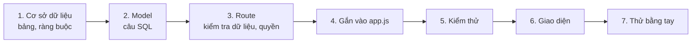

- Mọi đoạn code dưới đây được **chép tự động từ bản thật** đang chạy (72 bài kiểm thử, 35 kiểm tra trên trình duyệt), nên luôn
  khớp từng dòng với tệp thật. Dòng `// …` nghĩa là bỏ qua phần không liên quan trong cùng tệp.
- Mỗi tính năng có bảng **Tệp của tính năng** để biết mở tệp nào, và mục **Thêm vào bản mini** nếu bạn muốn xây tiếp trên bản mini.

### Cách luyện: xoá đi rồi tự viết lại, bài kiểm thử chấm điểm

Trên repo Git của bạn (Phần A), mỗi tính năng làm trên một nhánh riêng, ví dụ:

```bash
git switch -c luyen/nguoi-quen
```

1. Mở các tệp trong bảng "Tệp của tính năng", **xoá phần thân** những hàm được nêu (giữ dòng khai báo để tệp vẫn chạy).
2. Chạy `npm test`: các bài kiểm thử của tính năng đó chuyển **đỏ**. Đó là "đề bài".
3. Làm theo từng bước dưới đây: đọc giải thích, **gõ lại** code (đừng chép), chạy lại bài kiểm thử được chỉ ra sau mỗi bước.
4. Xanh hết thì so với bản gốc, ví dụ `git diff main -- server/models/people.js`.
5. Quay về bản gốc bằng `git switch main`; xoá nhánh luyện bằng `git branch -D luyen/nguoi-quen`.

Chạy riêng bài kiểm thử của một tính năng (nhanh hơn chạy cả bộ):

```bash
node --test --test-name-pattern="people" test/api.test.js
```

| Mục | Tính năng | Kỹ thuật chính được luyện |
| --- | --- | --- |
| [E1](#e1-người-quen-cũ--bảng-mới-quan-hệ-nhiềunhiều-ghi-chú) | Người quen cũ | Bảng mới, quan hệ nhiều–nhiều, ghi chú, chặn sửa dữ liệu người khác |
| [E2](#e2-phim--nhạc--một-bảng-crud-trọn-vẹn-đường-link-an-toàn) | Phim & nhạc | Một bảng thêm/sửa/xoá trọn vẹn, chặn link `javascript:` |
| [E3](#e3-trang-hôm-nay--ngày-tháng-múi-giờ-một-yêu-cầu-cho-cả-trang) | Trang Hôm nay | Ngày tháng, múi giờ, gộp nhiều truy vấn vào một yêu cầu |
| [E4](#e4-tìm-kiếm-không-dấu-và-dòng-thời-gian--hàm-sql-tự-viết) | Tìm kiếm không dấu, Dòng thời gian | Hàm SQL tự viết, `LIKE` an toàn |
| [E5](#e5-tài-khoản-và-cài-đặt--đổi-mật-khẩu-đăng-xuất-mọi-nơi-xuất-và-xoá-dữ-liệu) | Tài khoản & cài đặt | Đổi mật khẩu, đăng xuất mọi nơi, xuất dữ liệu, xoá tài khoản, chế độ kín đáo |
| [E6](#e6-kỷ-vật--thẻ-lưu-từ-kỷ-niệm-tải-tệp-khoá-ngoại-quyền-xem-tệp) | Kỷ vật | Tải tệp có kiểm tra trước, khoá ngoại xoá theo, quyền xem tệp |
| [E7](#e7-vận-hành--apihealth-mã-lỗi-tham-chiếu-công-cụ-quản-trị) | Vận hành | `/api/health`, mã lỗi tham chiếu, công cụ quản trị, sao lưu |
| [E8](#e8-kiểm-thử-toàn-hệ-thống--điều-khiển-chrome-như-người-dùng-thật) | Kiểm thử toàn hệ thống | Điều khiển Chrome thật, viết thêm một kiểm tra |

### E1. Người quen cũ — bảng mới, quan hệ nhiều–nhiều, ghi chú

**Bạn sẽ xây:** danh sách những người muốn giữ liên lạc (quan hệ, độ thân 1–5, lần cuối liên lạc, màu), nhật ký ghi chú riêng cho
từng người, gắn người vào kỷ niệm ("Những ai có mặt"), nút "Hôm nay mình đã nhắn", và gợi ý "lâu rồi chưa liên lạc" trên trang
Hôm nay.

**Tệp của tính năng:**

| Tầng | Tệp | Phần chính |
| --- | --- | --- |
| Cơ sở dữ liệu | `server/migrations/001_init.sql`, `002_media_sharing.sql` | bảng `people`, `person_notes`, `memory_people`; cột `linked_user_id` |
| Model | `server/models/people.js` | `list`, `get`, `create`, `update`, `remove`, `setLastContact`, `notes`, `addNote`, `removeNote`, `suggestion` |
| Route | `server/routes/people.js` | `GET/POST /api/people`, `GET/PUT/DELETE /api/people/:id`, `/contacted`, `/notes` |
| Gắn vào app | `server/app.js` | `ctx.people`, `api.use('/people', …)` |
| Kiểm thử | `test/api.test.js` | "people: contact log, notes and the long-time-no-see suggestion" |
| Giao diện | `client/src/pages/People.jsx`, `PersonDetail.jsx`, `components/forms/PersonForm.jsx` | danh sách, trang một người, form |
| Câu chữ | `client/src/i18n/vi.js`, `en.js` | nhóm `people`, `person` |

#### Bước 1 — Cơ sở dữ liệu

`server/migrations/001_init.sql`

```sql
-- People you want to keep in mind, followed on purpose instead of through a feed.
CREATE TABLE people (
  id           INTEGER PRIMARY KEY,
  user_id      INTEGER NOT NULL REFERENCES users (id) ON DELETE CASCADE,
  name         TEXT    NOT NULL,
  relation     TEXT    NOT NULL DEFAULT '',                       -- "bạn cấp 2", "former colleague"
  last_contact TEXT,                                              -- 'YYYY-MM-DD'
  closeness    INTEGER NOT NULL DEFAULT 3 CHECK (closeness BETWEEN 1 AND 5),
  color        TEXT    NOT NULL DEFAULT 'teal' CHECK (color IN ('teal', 'amber', 'rose', 'ink')),
  created_at   TEXT    NOT NULL DEFAULT (strftime('%Y-%m-%dT%H:%M:%fZ', 'now')),
  updated_at   TEXT    NOT NULL DEFAULT (strftime('%Y-%m-%dT%H:%M:%fZ', 'now'))
);
CREATE INDEX people_user ON people (user_id, last_contact);
```

`server/migrations/001_init.sql`

```sql
CREATE TABLE person_notes (
  id         INTEGER PRIMARY KEY,
  person_id  INTEGER NOT NULL REFERENCES people (id) ON DELETE CASCADE,
  body       TEXT    NOT NULL,
  created_at TEXT    NOT NULL DEFAULT (strftime('%Y-%m-%dT%H:%M:%fZ', 'now'))
);
CREATE INDEX person_notes_person ON person_notes (person_id, created_at);
```

`server/migrations/001_init.sql`

```sql
-- Many-to-many: who appears in which memory.
CREATE TABLE memory_people (
  memory_id INTEGER NOT NULL REFERENCES memories (id) ON DELETE CASCADE,
  person_id INTEGER NOT NULL REFERENCES people (id) ON DELETE CASCADE,
  PRIMARY KEY (memory_id, person_id)
);
CREATE INDEX memory_people_person ON memory_people (person_id);
```

Đọc từng dòng:

- `user_id … REFERENCES users (id) ON DELETE CASCADE`: mỗi người quen thuộc **một** tài khoản; xoá tài khoản thì SQLite tự xoá
  người quen của tài khoản đó.
- `last_contact TEXT` dạng `'YYYY-MM-DD'`: "lần cuối liên lạc" là một **ngày theo lịch** (không có giờ), và chuỗi dạng này sắp xếp
  đúng thứ tự thời gian.
- `CHECK (closeness BETWEEN 1 AND 5)`, `CHECK (color IN (…))`: cơ sở dữ liệu tự từ chối giá trị vô lý, kể cả khi code máy chủ có lỗi.
- `person_notes … ON DELETE CASCADE`: xoá một người là xoá luôn ghi chú của họ.
- `memory_people` là bảng **nối** cho quan hệ nhiều–nhiều: một kỷ niệm có nhiều người, một người có mặt trong nhiều kỷ niệm.
  `PRIMARY KEY (memory_id, person_id)` chặn gắn trùng.
- Index `people_user (user_id, last_contact)` khớp đúng cách danh sách được lọc và sắp xếp.

Migration `002_media_sharing.sql` thêm sau đó cột nối người quen với **tài khoản** của họ, khi họ nhận lời mời:

`server/migrations/002_media_sharing.sql`

```sql
ALTER TABLE people ADD COLUMN linked_user_id INTEGER REFERENCES users (id) ON DELETE SET NULL;
```

Tự kiểm tra: `sqlite3 -readonly data/memorylane.db ".schema people"` in đúng cấu trúc trên.

#### Bước 2 — Model: mọi câu SQL của người quen

Đầu tệp là một câu `SELECT` dùng chung, kèm **truy vấn con** đếm ghi chú và kỷ niệm của từng người, rồi hàm `toPerson` đổi tên cột
(`snake_case`) sang tên JSON (`camelCase`) và chỉ trả những gì giao diện cần:

`server/models/people.js`

```js
// linked_name: the person's own account, once they accepted your invite (see models/social.js).
const SELECT = `
  SELECT p.*, lu.name AS linked_name,
         (SELECT COUNT(*) FROM person_notes n WHERE n.person_id = p.id) AS note_count,
         (SELECT MAX(n.created_at) FROM person_notes n WHERE n.person_id = p.id) AS last_note_at,
         (SELECT COUNT(*) FROM memory_people mp WHERE mp.person_id = p.id) AS memory_count
    FROM people p LEFT JOIN users lu ON lu.id = p.linked_user_id`;

// Longest time without contact first; people with no recorded contact go last.
const ORDER = 'ORDER BY p.last_contact IS NULL, p.last_contact ASC, p.name COLLATE NOCASE';

const NOW = "strftime('%Y-%m-%dT%H:%M:%fZ', 'now')";

export function toPerson(row) {
  return {
    id: row.id,
    name: row.name,
    relation: row.relation,
    lastContact: row.last_contact,
    closeness: row.closeness,
    color: row.color,
    noteCount: row.note_count,
    lastNoteAt: row.last_note_at,
    memoryCount: row.memory_count,
    linked: row.linked_user_id ? { id: row.linked_user_id, name: row.linked_name } : null,
    createdAt: row.created_at,
  };
}
```

- `LEFT JOIN users lu`: người quen **có thể** đã có tài khoản (sau khi nhận lời mời). `LEFT` để người chưa có tài khoản vẫn hiện.
- `ORDER BY p.last_contact IS NULL, p.last_contact ASC`: ai lâu chưa liên lạc nhất lên đầu; người chưa ghi ngày nào xuống cuối.

Thêm, sửa, xoá. Để ý **mọi** câu đều có `AND user_id = ?`: đó là chỗ chặn người này sửa người quen của người khác (lỗi IDOR, chặng 5):

`server/models/people.js`

```js
create(userId, data) {
  const { lastInsertRowid } = db
    .prepare('INSERT INTO people (user_id, name, relation, last_contact, closeness, color) VALUES (?, ?, ?, ?, ?, ?)')
    .run(userId, data.name, data.relation, data.lastContact, data.closeness, data.color);
  return Number(lastInsertRowid);
},

// …

update(userId, id, data) {
  const { changes } = db
    .prepare(
      `UPDATE people SET name = ?, relation = ?, last_contact = ?, closeness = ?, color = ?, updated_at = ${NOW}
        WHERE id = ? AND user_id = ?`,
    )
    .run(data.name, data.relation, data.lastContact, data.closeness, data.color, id, userId);
  return Number(changes) > 0;
},

// …

remove(userId, id) {
  const { changes } = db.prepare('DELETE FROM people WHERE id = ? AND user_id = ?').run(id, userId);
  return Number(changes) > 0;
},

// …

setLastContact(userId, id, date) {
  const { changes } = db
    .prepare(`UPDATE people SET last_contact = ?, updated_at = ${NOW} WHERE id = ? AND user_id = ?`)
    .run(date, id, userId);
  return Number(changes) > 0;
},
```

`changes` là số dòng câu lệnh đã sửa: `0` nghĩa là không có người quen đó **của bạn**, và route sẽ trả 404.

Ghi chú: bảng `person_notes` không có cột `user_id`, nên trước khi thêm, `owns()` kiểm tra người quen đó thuộc về bạn:

`server/models/people.js`

```js
const owns = (userId, id) => Boolean(db.prepare('SELECT 1 FROM people WHERE id = ? AND user_id = ?').get(id, userId));

// …

addNote(userId, personId, body) {
  if (!owns(userId, personId)) return null;
  const { lastInsertRowid } = db
    .prepare('INSERT INTO person_notes (person_id, body) VALUES (?, ?)')
    .run(personId, body);
  return toNote(db.prepare('SELECT * FROM person_notes WHERE id = ?').get(Number(lastInsertRowid)));
},
```

Gợi ý "lâu rồi chưa liên lạc": lấy ngày **muộn hơn** giữa lần liên lạc và ghi chú mới nhất, giữ những ai từ 1 năm trở lên:

`server/models/people.js`

```js
/**
 * The sidebar nudge: the person you have neither contacted nor written about for the longest
 * time (at least a year). "Last touch" = the later of last contact and the newest note.
 */
suggestion(userId, today) {
  const rows = db
    .prepare(
      `SELECT p.id, p.name, p.color,
              MAX(COALESCE(p.last_contact, ''), COALESCE(substr(MAX(n.created_at), 1, 10), '')) AS last_touch
         FROM people p LEFT JOIN person_notes n ON n.person_id = p.id
        WHERE p.user_id = ?
        GROUP BY p.id`,
    )
    .all(userId)
    .filter((row) => row.last_touch)
    .map((row) => ({ person: { id: row.id, name: row.name, color: row.color }, lastTouch: row.last_touch }))
    .map((entry) => ({ ...entry, years: fullYearsBetween(entry.lastTouch, today) }))
    .filter((entry) => entry.years >= 1)
    .sort((a, b) => a.lastTouch.localeCompare(b.lastTouch));
  return rows[0] ?? null;
},
```

#### Bước 3 — Route: kiểm tra dữ liệu, quyền, mã trả về

`server/routes/people.js`

```js
import { Router } from 'express';
import { notFound } from '../lib/errors.js';
import { clientToday } from '../lib/today.js';
import { idParam, validator } from '../lib/validate.js';
import { LIMITS, PERSON_COLORS } from '../../shared/limits.js';

export function peopleRoutes({ people, memories, social }) {
  const router = Router();

  router.get('/', (req, res) => {
    res.json({ people: people.list(req.user.id) });
  });

  // Person page: profile + notes + every memory they appear in + invites sent to them.
  router.get('/:id', (req, res) => {
    const id = idParam(req.params.id);
    const person = people.get(req.user.id, id);
    if (!person) throw notFound();
    res.json({
      person,
      notes: people.notes(id),
      memories: memories.list(req.user.id, { personId: id }),
      invites: social.invites(req.user.id).filter((invite) => invite.person?.id === id),
    });
  });

  router.post('/', (req, res) => {
    const id = people.create(req.user.id, readPersonForm(req.body));
    res.status(201).json({ person: people.get(req.user.id, id) });
  });

  router.put('/:id', (req, res) => {
    const id = idParam(req.params.id);
    if (!people.update(req.user.id, id, readPersonForm(req.body))) throw notFound();
    res.json({ person: people.get(req.user.id, id) });
  });

  router.delete('/:id', (req, res) => {
    if (!people.remove(req.user.id, idParam(req.params.id))) throw notFound();
    res.status(204).end();
  });

  // "I reached out today" — body.date is the browser's local date.
  router.post('/:id/contacted', (req, res) => {
    const id = idParam(req.params.id);
    if (!people.setLastContact(req.user.id, id, clientToday(req.body?.date))) throw notFound();
    res.json({ person: people.get(req.user.id, id) });
  });

  router.post('/:id/notes', (req, res) => {
    const id = idParam(req.params.id);
    const v = validator(req.body);
    const body = v.text('body', { required: true, max: LIMITS.note });
    v.check();
    const note = people.addNote(req.user.id, id, body);
    if (!note) throw notFound();
    res.status(201).json({ note });
  });

  router.delete('/:id/notes/:noteId', (req, res) => {
    if (!people.removeNote(req.user.id, idParam(req.params.id), idParam(req.params.noteId))) throw notFound();
    res.status(204).end();
  });

  return router;
}

function readPersonForm(body) {
  const v = validator(body);
  const data = {
    name: v.text('name', { required: true, max: LIMITS.personName }),
    relation: v.text('relation', { max: LIMITS.personRelation }),
    lastContact: v.pastDate('lastContact'),
    closeness: v.int('closeness', { min: 1, max: 5 }) ?? 3,
    color: v.oneOf('color', PERSON_COLORS, 'teal'),
  };
  v.check();
  return data;
}
```

- `readPersonForm`: mọi ô đều qua `validator` (chặng 2). `pastDate` từ chối ngày ở tương lai (`FUTURE_DATE`), `oneOf` chỉ nhận màu
  trong danh sách.
- `clientToday(req.body?.date)`: "hôm nay" theo **ngày của trình duyệt**, vì máy chủ chạy giờ UTC còn bạn ở UTC+7 (xem E3).
- Mã trả về: `201` khi tạo, `204` khi xoá (không có nội dung), `404` khi model báo "không có, hoặc không phải của bạn".

#### Bước 4 — Gắn vào `server/app.js`

`server/app.js`

```js
import { peopleModel } from './models/people.js';
import { peopleRoutes } from './routes/people.js';
    people: peopleModel(db),
  api.use('/people', requireAuth, peopleRoutes(ctx));
```

`requireAuth` đứng trước nên chưa đăng nhập thì mọi đường dẫn `/api/people…` trả 401.

#### Bước 5 — Kiểm thử

`test/api.test.js`

```js
test('people: contact log, notes and the long-time-no-see suggestion', async () => {
  const { agent: a } = await registeredAgent();
  const ha = (await a.post('/api/people', { json: { name: 'Thu Hà', lastContact: '2021-03-14', closeness: 1 } })).body.person;
  await a.post('/api/people', { json: { name: 'Minh Khoa', lastContact: toISODate() } });

  const summary = await a.get(`/api/dashboard/summary?today=${toISODate()}`);
  assert.equal(summary.body.suggestion.person.name, 'Thu Hà');
  assert.ok(summary.body.suggestion.years >= 5);

  const note = await a.post(`/api/people/${ha.id}/notes`, { json: { body: 'Gọi lại cho Hà' } });
  assert.equal(note.status, 201);
  const contacted = await a.post(`/api/people/${ha.id}/contacted`, { json: { date: toISODate() } });
  assert.equal(contacted.body.person.lastContact, toISODate());
  assert.equal((await a.get(`/api/dashboard/summary?today=${toISODate()}`)).body.suggestion, null);

  const detail = await a.get(`/api/people/${ha.id}`);
  assert.equal(detail.body.notes.length, 1);
  assert.deepEqual(detail.body.invites, []);
  assert.equal(detail.body.person.linked, null);
  assert.equal((await a.del(`/api/people/${ha.id}/notes/${note.body.note.id}`)).status, 204);

  const future = await a.post('/api/people', { json: { name: 'X', lastContact: '2999-01-01' } });
  assert.equal(future.body.fields.lastContact.code, 'FUTURE_DATE');
});
```

```bash
node --test --test-name-pattern="people" test/api.test.js
```

Phải thấy `✔ people: contact log, notes and the long-time-no-see suggestion`. Bài "users can never see or change each other's
memories, files or people" kiểm tra luôn việc chặn sửa người quen của người khác.

#### Bước 6 — Giao diện

Trang danh sách gọi `useFetch('/api/people')` (chặng 8) và mở form trong hộp thoại; sau khi lưu, `refresh()` làm mọi danh sách tự tải lại:

`client/src/pages/People.jsx`

```jsx
/** "Người quen cũ" — people followed on purpose, longest silence first. */
export default function People() {
  const { t } = useI18n();
  const { refresh } = useData();
  const toast = useToast();
  const navigate = useNavigate();
  const [params, setParams] = useSearchParams();
  const [sort, setSort] = useState('longest');
  const [formOpen, setFormOpen] = useState(false);
  const { data, error, retry } = useFetch('/api/people');
  usePageTitle(t('people.title'));

  // "add someone →" on Today links to /people?new=1.
  useEffect(() => {
    if (params.get('new') === '1') {
      setFormOpen(true);
      setParams({}, { replace: true });
    }
  }, [params, setParams]);

  const people = data ? sortPeople(data.people, sort) : null;

  function onSaved(person) {
    setFormOpen(false);
    toast(t('person.saved'));
    refresh();
    navigate(`/people/${person.id}`);
  }

  return (
    <>
      <PageHeader
        kicker={t('people.eyebrow')}
        title={t('people.title')}
        subtitle={data ? t('people.count', { count: data.people.length }) : ' '}
        actions={
          <>
            <label className="visually-hidden" htmlFor="people-sort">
              {t('people.sortLabel')}
            </label>
            <select
              id="people-sort"
              className="select"
              style={{ minHeight: 42, width: 'auto' }}
              value={sort}
              onChange={(event) => setSort(event.target.value)}
            >
              <option value="longest">{t('people.sort.longest')}</option>
              <option value="name">{t('people.sort.name')}</option>
              <option value="recent">{t('people.sort.recent')}</option>
            </select>
            <button type="button" className="btn btn-primary" onClick={() => setFormOpen(true)}>
              <Icon name="plus" size={15} />
              {t('people.add')}
            </button>
          </>
        }
      />
      <p className="lede" style={{ marginTop: -16, marginBottom: 30 }}>
        {t('people.lede')}
      </p>

      {error && <ErrorState error={error} onRetry={retry} />}
      {!people && !error && <Skeleton height={76} count={4} />}
      {people?.length === 0 && (
        <EmptyState
          art="people"
          title={t('people.emptyTitle')}
          body={t('people.emptyBody')}
          action={
            <button type="button" className="btn btn-primary" onClick={() => setFormOpen(true)}>
              {t('people.emptyCta')}
            </button>
          }
        />
      )}
      {people?.length > 0 && (
        <div className="people-list">
          {people.map((person) => (
            <PersonRow key={person.id} person={person} />
          ))}
        </div>
      )}

      <Modal open={formOpen} onClose={() => setFormOpen(false)} title={t('person.newTitle')} kicker={t('person.eyebrow')}>
        <PersonForm onSaved={onSaved} onCancel={() => setFormOpen(false)} />
      </Modal>
    </>
  );
}
```

Form thêm/sửa gửi JSON; lỗi trả về theo từng ô (`err.fields`) hiện đúng dưới ô đó:

`client/src/components/forms/PersonForm.jsx`

```jsx
async function submit(event) {
  event.preventDefault();
  setSaving(true);
  setErrors({});
  setFormError(null);
  try {
    const body = { ...values, lastContact: values.lastContact || null };
    const result = editing ? await api.put(`/api/people/${person.id}`, body) : await api.post('/api/people', body);
    onSaved(result.person);
  } catch (err) {
    if (err instanceof ApiError && err.code === 'VALIDATION') setErrors(err.fields);
    else setFormError(errorMessage(t, err));
    setSaving(false);
  }
}
```

Trang một người: nút "Hôm nay mình đã nhắn" gửi **ngày của trình duyệt**, và form ghi chú:

`client/src/pages/PersonDetail.jsx`

```jsx
async function markContacted() {
  setContacting(true);
  try {
    await api.post(`/api/people/${person.id}/contacted`, { date: toISODate() });
    toast(t('person.contactedDone'));
    refresh();
  } catch (err) {
    toast(errorMessage(t, err), 'error');
  } finally {
    setContacting(false);
  }
}

// …

async function addNote(event) {
  event.preventDefault();
  if (!note.trim()) return;
  setSavingNote(true);
  setNoteError(null);
  try {
    await api.post(`/api/people/${person.id}/notes`, { body: note });
    setNote('');
    toast(t('person.noteSaved'));
    refresh();
  } catch (err) {
    setNoteError(err instanceof ApiError && err.fields?.body ? fieldMessage(t, err.fields.body) : errorMessage(t, err));
  } finally {
    setSavingNote(false);
  }
}
```

Câu chữ nằm ở nhóm `people` và `person` của `vi.js`/`en.js`. Thêm khoá mới thì thêm ở **cả hai** tệp (bài kiểm thử `i18n` kiểm tra).

#### Bước 7 — Thử bằng tay

1. **Người quen → Thêm người**: tên "Bạn Thử", lần cuối liên lạc 2 năm trước → người này lên đầu danh sách.
2. Mở trang của họ, viết một ghi chú → hiện ngay, số ghi chú trên thẻ tăng.
3. Bấm **Hôm nay mình đã nhắn** → ngày cập nhật, người này xuống cuối danh sách.
4. Trang **Hôm nay**: gợi ý "lâu rồi chưa liên lạc" đổi theo.
5. Xoá người đó → ghi chú biến mất theo (`ON DELETE CASCADE`).

**Lỗi hay gặp:** quên `AND user_id = ?` trong `UPDATE`/`DELETE` (người khác sửa được dữ liệu của bạn) · dùng `new Date()` của máy chủ
làm "hôm nay" (lệch ngày vào buổi tối ở Việt Nam) · quên `ON DELETE CASCADE` (xoá người mà còn sót ghi chú).

**Thêm vào bản mini:** tạo `server/migrations/006_people.sql` với ba bảng ở Bước 1 (cột `linked_user_id` có thể bỏ); thêm vào
`server/lib/validate.js` hai hàm dưới đây; thêm `personName: 60`, `personRelation: 80`, `note: 2000` vào `LIMITS` trong
`shared/limits.js`; hàm `list` có tham số `q` thì cần làm E4 trước.

`server/lib/validate.js`

```js
oneOf(name, options, fallback) {
  const value = raw(name);
  if (value === undefined || value === null || value === '') {
    return fallback !== undefined ? fallback : fail(name, 'REQUIRED');
  }
  return options.includes(value) ? value : fail(name, 'INVALID_CHOICE');
},

// …

/** Optional 'YYYY-MM-DD' that is a real date and not in the future. */
pastDate(name) {
  const value = raw(name);
  if (value === undefined || value === null || value === '') return null;
  if (!parseISODate(String(value))) return fail(name, 'INVALID_DATE');
  // One day of slack: the user's "today" may already be tomorrow in UTC.
  if (String(value) > addDays(toISODate(), 1)) return fail(name, 'FUTURE_DATE');
  return String(value);
},
```

### E2. Phim & nhạc — một bảng CRUD trọn vẹn, đường link an toàn

**Bạn sẽ xây:** kho phim và bài hát gắn với gia đình (của ai, thời nào, câu chuyện, link xem lại), lọc Phim/Nhạc. Đây là mẫu "một
bảng, đủ thêm/sửa/xoá" gọn nhất của bản thật: luyện xong là tự làm được mọi tính năng kiểu danh sách.

**Tệp của tính năng:**

| Tầng | Tệp | Phần chính |
| --- | --- | --- |
| Cơ sở dữ liệu | `server/migrations/001_init.sql` | bảng `media` |
| Model | `server/models/media.js` | `list`, `get`, `count`, `create`, `update`, `remove` |
| Route | `server/routes/media.js` | `GET/POST /api/media`, `PUT/DELETE /api/media/:id` |
| Kiểm thử | `test/api.test.js` | "media links must be http(s) — javascript: URLs are refused" |
| Giao diện | `client/src/pages/Archive.jsx`, `components/forms/MediaForm.jsx` | danh sách + lọc, form |

#### Bước 1 — Cơ sở dữ liệu

`server/migrations/001_init.sql`

```sql
-- Films and songs the family loved.
CREATE TABLE media (
  id         INTEGER PRIMARY KEY,
  user_id    INTEGER NOT NULL REFERENCES users (id) ON DELETE CASCADE,
  kind       TEXT    NOT NULL CHECK (kind IN ('film', 'music')),
  title      TEXT    NOT NULL,
  story      TEXT    NOT NULL DEFAULT '',
  owner      TEXT    NOT NULL DEFAULT '',                         -- whose favourite: "Mẹ", "Dad"
  era        TEXT    NOT NULL DEFAULT '',                         -- "early 2000s", "trước 1975"
  url        TEXT    NOT NULL DEFAULT '',
  created_at TEXT    NOT NULL DEFAULT (strftime('%Y-%m-%dT%H:%M:%fZ', 'now')),
  updated_at TEXT    NOT NULL DEFAULT (strftime('%Y-%m-%dT%H:%M:%fZ', 'now'))
);
CREATE INDEX media_user ON media (user_id, kind);
```

`kind` chỉ nhận `film` hoặc `music`; `owner` và `era` là chữ tự do ("Mẹ", "trước 1975") vì ký ức gia đình hiếm khi có ngày chính xác.

#### Bước 2 — Model

`server/models/media.js`

```js
import { likePattern } from '../lib/text.js';

const NOW = "strftime('%Y-%m-%dT%H:%M:%fZ', 'now')";

export function toMedia(row) {
  return {
    id: row.id,
    kind: row.kind,
    title: row.title,
    story: row.story,
    owner: row.owner,
    era: row.era,
    url: row.url,
    createdAt: row.created_at,
  };
}

export function mediaModel(db) {
  return {
    list(userId, { kind, q, limit = 1000 } = {}) {
      const where = ['user_id = ?'];
      const params = [userId];
      if (kind) {
        where.push('kind = ?');
        params.push(kind);
      }
      if (q) {
        where.push(`fold(title || ' ' || owner || ' ' || era || ' ' || story) LIKE ? ESCAPE '\\'`);
        params.push(likePattern(q));
      }
      return db
        .prepare(`SELECT * FROM media WHERE ${where.join(' AND ')} ORDER BY created_at DESC, id DESC LIMIT ?`)
        .all(...params, limit)
        .map(toMedia);
    },

    get(userId, id) {
      const row = db.prepare('SELECT * FROM media WHERE id = ? AND user_id = ?').get(id, userId);
      return row ? toMedia(row) : null;
    },

    count(userId) {
      return db.prepare('SELECT COUNT(*) AS n FROM media WHERE user_id = ?').get(userId).n;
    },

    create(userId, data) {
      const { lastInsertRowid } = db
        .prepare('INSERT INTO media (user_id, kind, title, story, owner, era, url) VALUES (?, ?, ?, ?, ?, ?, ?)')
        .run(userId, data.kind, data.title, data.story, data.owner, data.era, data.url);
      return Number(lastInsertRowid);
    },

    update(userId, id, data) {
      const { changes } = db
        .prepare(
          `UPDATE media SET kind = ?, title = ?, story = ?, owner = ?, era = ?, url = ?, updated_at = ${NOW}
            WHERE id = ? AND user_id = ?`,
        )
        .run(data.kind, data.title, data.story, data.owner, data.era, data.url, id, userId);
      return Number(changes) > 0;
    },

    remove(userId, id) {
      const { changes } = db.prepare('DELETE FROM media WHERE id = ? AND user_id = ?').run(id, userId);
      return Number(changes) > 0;
    },
  };
}
```

- `list` dựng mệnh đề `WHERE` từng phần: lọc theo loại, tìm theo chữ (E4). Mọi giá trị đi qua `?` (câu lệnh có tham số), **không bao
  giờ** cộng chuỗi vào SQL: đó là cách chặn SQL injection.
- `updated_at = ${NOW}`: `NOW` là một biểu thức SQL cố định do code viết, không phải dữ liệu người dùng, nên ghép vào câu được.

#### Bước 3 — Route và kiểm tra link

`server/routes/media.js`

```js
import { Router } from 'express';
import { notFound } from '../lib/errors.js';
import { idParam, validator } from '../lib/validate.js';
import { LIMITS, MEDIA_KINDS } from '../../shared/limits.js';

/** "Kho phim & nhạc" — films and songs the family loved. */
export function mediaRoutes({ media }) {
  const router = Router();

  router.get('/', (req, res) => {
    const kind = MEDIA_KINDS.includes(req.query.kind) ? req.query.kind : undefined;
    res.json({ media: media.list(req.user.id, { kind }) });
  });

  router.post('/', (req, res) => {
    const id = media.create(req.user.id, readMediaForm(req.body));
    res.status(201).json({ item: media.get(req.user.id, id) });
  });

  router.put('/:id', (req, res) => {
    const id = idParam(req.params.id);
    if (!media.update(req.user.id, id, readMediaForm(req.body))) throw notFound();
    res.json({ item: media.get(req.user.id, id) });
  });

  router.delete('/:id', (req, res) => {
    if (!media.remove(req.user.id, idParam(req.params.id))) throw notFound();
    res.status(204).end();
  });

  return router;
}

function readMediaForm(body) {
  const v = validator(body);
  const data = {
    kind: v.oneOf('kind', MEDIA_KINDS),
    title: v.text('title', { required: true, max: LIMITS.mediaTitle }),
    owner: v.text('owner', { max: LIMITS.mediaOwner }),
    era: v.text('era', { max: LIMITS.mediaEra }),
    url: v.url('url', { max: LIMITS.mediaUrl }),
    story: v.text('story', { max: LIMITS.mediaStory }),
  };
  v.check();
  return data;
}
```

`v.url` chỉ nhận link `http://` hoặc `https://`. Một link `javascript:alert(1)` mà lọt vào thẻ `<a href>` sẽ chạy mã của kẻ xấu khi
người dùng bấm (một dạng XSS):

`server/lib/validate.js`

```js
url(name, { max = 500 } = {}) {
  const value = this.text(name, { max });
  if (!value) return value;
  try {
    const url = new URL(value);
    if (url.protocol !== 'http:' && url.protocol !== 'https:') throw new Error('protocol');
  } catch {
    return fail(name, 'INVALID_URL');
  }
  return value;
},
```

#### Bước 4 — Gắn vào app.js

`server/app.js`

```js
import { mediaModel } from './models/media.js';
import { mediaRoutes } from './routes/media.js';
    media: mediaModel(db),
  api.use('/media', requireAuth, mediaRoutes(ctx));
```

#### Bước 5 — Kiểm thử

`test/api.test.js`

```js
test('media links must be http(s) — javascript: URLs are refused', async () => {
  const { agent: a } = await registeredAgent();
  const bad = await a.post('/api/media', { json: { kind: 'film', title: 'XSS', url: 'javascript:alert(1)' } });
  assert.equal(bad.body.fields.url.code, 'INVALID_URL');
  const good = await a.post('/api/media', { json: { kind: 'film', title: 'Mắt biếc', url: 'https://youtube.com/x' } });
  assert.equal(good.status, 201);
  assert.equal((await a.get('/api/media?kind=music')).body.media.length, 0);
  assert.equal((await a.get('/api/media?kind=film')).body.media.length, 1);
});
```

```bash
node --test --test-name-pattern="media" test/api.test.js
```

#### Bước 6 — Giao diện

Bộ lọc nằm ngay trong đường dẫn gọi API (`?kind=film`), nên đổi lọc là `useFetch` tự tải lại:

`client/src/pages/Archive.jsx`

```jsx
/** "Kho phim & nhạc" — the family's films and songs: cassettes in the notebook, records in the darkroom. */
export default function Archive() {
  const { t } = useI18n();
  const { refresh } = useData();
  const toast = useToast();
  const [params, setParams] = useSearchParams();
  const kind = ['film', 'music'].includes(params.get('kind')) ? params.get('kind') : '';
  const { data, error, retry } = useFetch(`/api/media${kind ? `?kind=${kind}` : ''}`);
  const [form, setForm] = useState(null); // null | { item } (item null → new)
  const [deleting, setDeleting] = useState(null);
  usePageTitle(t('archive.title'));

  useEffect(() => {
    if (params.get('new') === '1') {
      setForm({ item: null });
      setParams({}, { replace: true });
    }
  }, [params, setParams]);

  const items = data?.media;

  function onSaved() {
    setForm(null);
    toast(t('archive.form.saved'));
    refresh();
  }

  async function remove() {
    await api.del(`/api/media/${deleting.id}`);
    setDeleting(null);
    toast(t('archive.form.deleted'));
    refresh();
  }
```

`client/src/components/forms/MediaForm.jsx`

```jsx
async function submit(event) {
  event.preventDefault();
  setSaving(true);
  setErrors({});
  setFormError(null);
  try {
    const result = editing ? await api.put(`/api/media/${item.id}`, values) : await api.post('/api/media', values);
    onSaved(result.item);
  } catch (err) {
    if (err instanceof ApiError && err.code === 'VALIDATION') setErrors(err.fields);
    else setFormError(errorMessage(t, err));
    setSaving(false);
  }
}
```

#### Bước 7 — Thử bằng tay

**Phim & nhạc → Thêm mục mới** → "Phim thử", loại Phim → hiện trong danh sách · bấm **Nhạc** → biến mất · **Tất cả** → hiện lại ·
thử dán link `javascript:alert(1)` → báo lỗi dưới ô link · **Sửa → Xóa** → mất khỏi danh sách.

**Thêm vào bản mini:** migration `007_media.sql` với bảng ở Bước 1, hàm `url` ở Bước 3 vào `validate.js`, `MEDIA_KINDS = ['film',
'music']` và các giới hạn `mediaTitle`, `mediaOwner`, `mediaEra`, `mediaUrl`, `mediaStory` vào `shared/limits.js`.

### E3. Trang Hôm nay — ngày tháng, múi giờ, một yêu cầu cho cả trang

**Bạn sẽ xây:** lời chào theo giờ, một kỷ niệm nổi bật, cuộn phim **"Hôm nay, nhiều năm trước"** (kỷ niệm các năm trước quanh ngày
hôm nay), người lâu chưa liên lạc, phim nhạc gần đây, kỷ niệm được chia sẻ với bạn. Không có bảng mới: chỉ là **truy vấn** trên các
bảng đã có.

**Tệp của tính năng:**

| Tầng | Tệp | Phần chính |
| --- | --- | --- |
| Ngày tháng dùng chung | `shared/dates.js`, `server/lib/today.js` | `dayOfYearDistance`, `fullYearsBetween`, `clientToday` |
| Model | `server/models/memories.js` | `onThisDay`, `sameMonth`, `random`, `featured` |
| Route | `server/routes/dashboard.js` | `GET /api/dashboard/today`, `GET /api/dashboard/summary` |
| Kiểm thử | `test/api.test.js` | “"On this day" finds memories…”, “film strip falls back…”, “"Today" and the navigation counters…” |
| Giao diện | `client/src/pages/Today.jsx` | một `useFetch` cho cả trang |

#### Bước 1 — "Hôm nay" là ngày nào? Múi giờ

Máy chủ (Render, Docker…) thường chạy giờ **UTC**; Việt Nam là UTC+7. Từ 0 giờ đến 7 giờ sáng ở Việt Nam, máy chủ vẫn đang ở **hôm
qua**. Vì vậy trình duyệt gửi ngày của chính nó (`?today=2026-10-14`), máy chủ chỉ tin nếu ngày đó hợp lệ và lệch không quá một ngày:

`server/lib/today.js`

```js
import { parseISODate, toISODate } from '../../shared/dates.js';

/**
 * "Today" as the user sees it. The browser sends its local date (?today=2026-10-11)
 * because a server in UTC and a user in Vietnam (UTC+7) disagree for 7 hours a day.
 * Anything malformed or more than a day away from the server clock is ignored.
 */
export function clientToday(value) {
  const serverToday = toISODate();
  if (typeof value !== 'string' || !parseISODate(value)) return serverToday;
  const diffDays = Math.abs(Date.parse(`${value}T00:00:00Z`) - Date.parse(`${serverToday}T00:00:00Z`)) / 86_400_000;
  return diffDays <= 1 ? value : serverToday;
}
```

#### Bước 2 — Khoảng cách giữa hai ngày trên một vòng lịch

"Quanh hôm nay ±3 ngày" phải tính **vòng qua năm mới**: 30/12 và 2/1 chỉ cách nhau 3 ngày. Dùng năm nhuận 2000 để 29/2 luôn hợp lệ:

`shared/dates.js`

```js
/**
 * Distance in days between two month/day pairs on a circular calendar,
 * so Dec 30 and Jan 2 are 3 days apart. Uses leap year 2000 so Feb 29 is valid.
 */
export function dayOfYearDistance(month1, day1, month2, day2) {
  const dayOfYear = (m, d) => (Date.UTC(2000, m - 1, d) - Date.UTC(2000, 0, 1)) / DAY_MS;
  const diff = Math.abs(dayOfYear(month1, day1) - dayOfYear(month2, day2));
  return Math.min(diff, 366 - diff);
}
```

#### Bước 3 — Model: chọn kỷ niệm cho trang

`server/models/memories.js`

```js
/** Memories from earlier years whose month/day is within `windowDays` of today. */
onThisDay(userId, today, windowDays = 3) {
  const [year, month, day] = today.split('-').map(Number);
  return many(`${SELECT} WHERE m.user_id = ? AND m.year < ? AND m.day IS NOT NULL`, userId, year)
    .map((memory) => ({ memory, distance: dayOfYearDistance(memory.month, memory.day, month, day) }))
    .filter((entry) => entry.distance <= windowDays)
    .sort((a, b) => a.distance - b.distance || b.memory.year - a.memory.year)
    .map((entry) => entry.memory);
},

// …

sameMonth(userId, today, limit) {
  const [year, month] = today.split('-').map(Number);
  return many(`${SELECT} WHERE m.user_id = ? AND m.month = ? AND m.year < ? ${ORDER} LIMIT ?`, userId, month, year, limit);
},

// …

random(userId, limit) {
  return many(`${SELECT} WHERE m.user_id = ? ORDER BY random() LIMIT ?`, userId, limit);
},

// …

/** One memory to feature — prefers ones with a photo. */
featured(userId) {
  const row = db
    .prepare(
      `${SELECT} WHERE m.user_id = ?
       ORDER BY NOT EXISTS (SELECT 1 FROM memory_files f WHERE f.memory_id = m.id AND f.kind = 'image'), random()
       LIMIT 1`,
    )
    .get(userId);
  return row ? toMemory(row) : null;
},
```

- `onThisDay` lấy các kỷ niệm **năm trước** có ngày cụ thể, tính khoảng cách bằng JavaScript (SQLite không có sẵn phép tính vòng lịch),
  sắp gần nhất lên trước.
- `featured`: `ORDER BY NOT EXISTS (… ảnh …), random()`: kỷ niệm có ảnh được ưu tiên, trong số đó chọn ngẫu nhiên.

#### Bước 4 — Route: cả trang trong một yêu cầu

`server/routes/dashboard.js`

```js
import { Router } from 'express';
import { clientToday } from '../lib/today.js';

export function dashboardRoutes({ memories, people, media, social }) {
  const router = Router();

  // Small payload for the navigation: counters + the "you haven't written about X" nudge.
  router.get('/summary', (req, res) => {
    const userId = req.user.id;
    const today = clientToday(req.query.today);
    res.json({
      counts: {
        onThisDay: memories.onThisDay(userId, today).length,
        memories: memories.count(userId),
        people: people.count(userId),
        media: media.count(userId),
        sharedWithMe: memories.countSharedWith(userId),
        circle: social.connections(userId).length,
      },
      latestSharedAt: memories.latestSharedAt(userId),
      suggestion: people.suggestion(userId, today),
    });
  });

  // Everything the "Today" page needs, in one request.
  router.get('/today', (req, res) => {
    const userId = req.user.id;
    const today = clientToday(req.query.today);
    res.json({
      today,
      stats: { memories: memories.count(userId), people: people.count(userId), media: media.count(userId) },
      featured: memories.featured(userId),
      filmstrip: filmstrip(memories, userId, today),
      people: people.list(userId, { limit: 3 }),
      media: media.list(userId, { limit: 3 }),
      sharedWithMe: memories.sharedWith(userId, { limit: 4 }),
      suggestion: people.suggestion(userId, today),
      years: memories.years(userId),
    });
  });

  return router;
}

/**
 * "Hôm nay, nhiều năm trước": memories within ±3 days of today in earlier years.
 * If there are none, fall back to the same month, then to a random handful,
 * so the film strip is never empty while the album has photos.
 */
function filmstrip(memories, userId, today, size = 5) {
  const day = memories.onThisDay(userId, today);
  if (day.length) return { mode: 'day', items: day.slice(0, size) };
  const month = memories.sameMonth(userId, today, size);
  if (month.length) return { mode: 'month', items: month };
  const random = memories.random(userId, size);
  return { mode: random.length ? 'random' : 'empty', items: random };
}
```

Một yêu cầu trả **mọi thứ** trang cần, thay vì 7 yêu cầu riêng: trang hiện nhanh hơn, nhất là trên điện thoại. `filmstrip` lùi dần
(cùng ngày → cùng tháng → ngẫu nhiên) để cuộn phim không bao giờ trống khi album có ảnh.

#### Bước 5 — Kiểm thử

`test/api.test.js`

```js
test('"On this day" finds memories from earlier years around today', async () => {
  const { agent: a } = await registeredAgent();
  const today = toISODate();
  const [year, month, day] = today.split('-').map(Number);
  // year - 4 keeps Feb 29 valid when the tests run on a leap day.
  await createMemory(a, { title: 'Năm xưa', year: year - 4, month, day });
  await createMemory(a, { title: 'Chỉ có năm', year: year - 2 });

  const res = await a.get(`/api/dashboard/today?today=${today}`);
  assert.equal(res.body.filmstrip.mode, 'day');
  assert.deepEqual(res.body.filmstrip.items.map((m) => m.title), ['Năm xưa']);
  assert.deepEqual(res.body.stats, { memories: 2, people: 0, media: 0 });

  const summary = await a.get(`/api/dashboard/summary?today=${today}`);
  assert.equal(summary.body.counts.onThisDay, 1);
});
```

```bash
node --test --test-name-pattern="On this day|film strip|Today" test/api.test.js
```

#### Bước 6 — Giao diện

Trang gửi ngày của trình duyệt (`toISODate()` trong `shared/dates.js`) và chọn lời chào theo giờ máy người dùng:

`client/src/pages/Today.jsx`

```jsx
function greetingKey(hour) {
  if (hour < 12) return 'greeting.morning';
  if (hour < 18) return 'greeting.afternoon';
  return 'greeting.evening';
}

// …

const { data, error, retry } = useFetch(`/api/dashboard/today?today=${toISODate()}`);
```

#### Bước 7 — Thử bằng tay

Đăng nhập demo An → trang Hôm nay có cuộn phim "Hôm nay, nhiều năm trước" (dữ liệu demo được tạo **theo ngày hôm nay**, nên luôn có).
Tạo một kỷ niệm năm 2015 đúng ngày hôm nay → nó xuất hiện trong cuộn phim. Xem `GET /api/dashboard/today?today=…` trong DevTools →
Network: một yêu cầu, đủ dữ liệu cho cả trang.

**Thêm vào bản mini:** chép `dayOfYearDistance`, `fullYearsBetween` (cần `fullMonthsBetween`) vào `shared/dates.js`; tạo
`server/lib/today.js`; thêm `onThisDay` vào model kỷ niệm; tạo `routes/dashboard.js` chỉ với `/today`; gắn
`api.use('/dashboard', requireAuth, dashboardRoutes(ctx))`.

### E4. Tìm kiếm không dấu và Dòng thời gian — hàm SQL tự viết

**Bạn sẽ xây:** một ô tìm kiếm tìm trong kỷ niệm, người quen (kể cả ghi chú), phim nhạc và kỷ vật, **không cần gõ dấu**: "da lat" ra
"Đà Lạt", "tet o que" ra "Tết ở quê". Và trang Dòng thời gian xếp kỷ niệm theo năm.

**Tệp của tính năng:**

| Tầng | Tệp | Phần chính |
| --- | --- | --- |
| Hàm "gấp" chữ | `server/lib/text.js` | `fold`, `likePattern` |
| Đăng ký hàm SQL | `server/db.js` | `db.function('fold', …)` |
| Dùng trong model | `server/models/memories.js`, `people.js`, `media.js`, `artifacts.js` | `fold(...) LIKE ? ESCAPE '\'` |
| Route | `server/routes/search.js` | `GET /api/search?q=` |
| Kiểm thử | `test/api.test.js` | "search ignores Vietnamese accents and case" |
| Giao diện | `client/src/pages/Search.jsx`, `Timeline.jsx`, ô tìm trên `TopBar.jsx` | |

#### Bước 1 — "Gấp" chữ tiếng Việt

`server/lib/text.js`

```js
// "Fold" text for Vietnamese-friendly search: lower-case and strip every diacritic,
// so typing "da lat" finds "Đà Lạt" and "tet o que" finds "Tết ở quê".
export function fold(value) {
  return String(value ?? '')
    .normalize('NFD')
    .replace(/[̀-ͯ]/g, '') // combining accents (à, ạ, ế …)
    .replace(/đ/g, 'd')
    .replace(/Đ/g, 'D')
    .toLowerCase();
}

/** Turn a user query into a safe LIKE pattern (used with ESCAPE '\'). */
export function likePattern(query) {
  return `%${fold(query).trim().replace(/[\\%_]/g, (c) => `\\${c}`)}%`;
}
```

- `normalize('NFD')` tách "ạ" thành "a" + dấu nặng (một ký tự dấu riêng); dòng tiếp theo xoá mọi ký tự dấu.
- "đ" không phải "d" có dấu nên phải đổi riêng.
- `likePattern`: người dùng gõ `%` hay `_` (ký tự đặc biệt của `LIKE`) thì được **thoát** bằng `\`, nên gõ "50%" tìm đúng chữ "50%".

#### Bước 2 — Dạy SQLite một hàm mới

SQLite cho phép đăng ký hàm viết bằng JavaScript; sau đó câu SQL gọi được `fold(...)` như hàm có sẵn:

`server/db.js`

```js
db.function('fold', { deterministic: true }, (value) => fold(value));
```

`deterministic: true` báo SQLite cùng đầu vào luôn ra cùng kết quả, để nó tối ưu được.

#### Bước 3 — Dùng trong model

`server/models/memories.js`

```js
/**
 * Your own memories. filters.year: { exact: 2019 } | { before: 2009 } · filters.q: accent-insensitive text ·
 * filters.personId: only memories this person appears in · filters.sharedOnly: only ones shared with someone.
 */
list(userId, { year, q, personId, sharedOnly = false, limit = 1000 } = {}) {
  const where = ['m.user_id = ?'];
  const params = [userId];
  if (year?.exact) {
    where.push('m.year = ?');
    params.push(year.exact);
  } else if (year?.before) {
    where.push('m.year < ?');
    params.push(year.before);
  }
  if (q) {
    where.push(`fold(m.title || ' ' || m.place || ' ' || m.story) LIKE ? ESCAPE '\\'`);
    params.push(likePattern(q));
  }
  if (personId) {
    where.push('EXISTS (SELECT 1 FROM memory_people mp WHERE mp.memory_id = m.id AND mp.person_id = ?)');
    params.push(personId);
  }
  if (sharedOnly) where.push('EXISTS (SELECT 1 FROM shares s WHERE s.memory_id = m.id)');
  return many(`${SELECT} WHERE ${where.join(' AND ')} ${ORDER} LIMIT ?`, ...params, limit);
},
```

`fold(m.title || ' ' || m.place || ' ' || m.story) LIKE ?`: gấp cả tiêu đề, nơi chốn, câu chuyện rồi so với từ khoá đã gấp.
`ESCAPE '\'` báo `LIKE` rằng `\` là ký tự thoát (khớp với `likePattern`).

> Với vài nghìn kỷ niệm, cách này đủ nhanh. Khi dữ liệu lớn hơn nhiều, dùng bảng tìm kiếm toàn văn **FTS5** của SQLite
> ([MO-RONG.md](docs/MO-RONG.md)).

#### Bước 4 — Một route cho cả bốn loại

`server/routes/search.js`

```js
import { Router } from 'express';
import { LIMITS } from '../../shared/limits.js';

/** One search box across memories, people (incl. their notes), the film & music archive and artifacts. */
export function searchRoutes({ memories, people, media, artifacts }) {
  const router = Router();

  router.get('/', (req, res) => {
    const q = String(req.query.q ?? '').trim().slice(0, LIMITS.searchQuery);
    if (!q) return res.json({ q, memories: [], people: [], media: [], artifacts: [] });
    const userId = req.user.id;
    res.json({
      q,
      memories: memories.list(userId, { q, limit: 30 }),
      people: people.list(userId, { q, limit: 30 }),
      media: media.list(userId, { q, limit: 30 }),
      artifacts: artifacts.list(userId, { q, limit: 30 }),
    });
  });

  return router;
}
```

#### Bước 5 — Kiểm thử

`test/api.test.js`

```js
test('search ignores Vietnamese accents and case', async () => {
  const { agent: a } = await registeredAgent();
  await createMemory(a, { title: 'Đà Lạt', story: 'Tết ở quê' });
  await a.post('/api/media', { json: { kind: 'music', title: 'Diễm xưa', owner: 'Ba' } });
  const person = (await a.post('/api/people', { json: { name: 'Thu Hà', relation: 'bạn cấp 2' } })).body.person;
  await a.post(`/api/people/${person.id}/notes`, { json: { body: 'Hẹn cà phê ở Huế' } });

  assert.equal((await a.get('/api/search?q=da lat')).body.memories.length, 1);
  assert.equal((await a.get('/api/search?q=TET O QUE')).body.memories.length, 1);
  assert.equal((await a.get('/api/search?q=diem xua')).body.media.length, 1);
  assert.equal((await a.get('/api/search?q=hue')).body.people.length, 1, 'notes are searchable too');
  assert.equal((await a.get('/api/search?q=100%')).body.memories.length, 0, 'LIKE wildcards are escaped');
});
```

```bash
node --test --test-name-pattern="search" test/api.test.js
```

#### Bước 6 — Giao diện

Trang kết quả đọc `?q=` trên địa chỉ, nên chia sẻ hay tải lại trang vẫn giữ kết quả:

`client/src/pages/Search.jsx`

```jsx
/** One search box for everything; accents optional ("da lat" → "Đà Lạt"). */
export default function Search() {
  const { t } = useI18n();
  const [params] = useSearchParams();
  const q = (params.get('q') ?? '').trim();
  const { data, error, retry } = useFetch(q ? `/api/search?q=${encodeURIComponent(q)}` : null);
  usePageTitle(t('search.title'));

  const total = data ? data.memories.length + data.people.length + data.media.length + data.artifacts.length : 0;

  return (
    <>
      <PageHeader
        kicker={t('search.label')}
        title={q ? t('search.resultsFor', { q }) : t('search.title')}
        subtitle={data ? t('search.count', { count: total }) : ' '}
      />

      {!q && (
        <EmptyState
          art="search"
          title={t('search.title')}
          body={t('search.prompt')}
          action={<SearchBox key="page-search" />}
        />
      )}
      {error && <ErrorState error={error} onRetry={retry} />}
      {q && !data && !error && <Skeleton height={120} count={2} />}
      {data && total === 0 && (
        <EmptyState art="search" compact title={t('search.emptyTitle', { q })} body={t('search.emptyBody')} />
      )}

      {data?.memories.length > 0 && (
        <section className="result-group">
          <h2 className="result-head">
            {t('search.memories')} <span>{data.memories.length}</span>
          </h2>
          <MemoryGrid memories={data.memories} compact />
        </section>
      )}
      {data?.people.length > 0 && (
        <section className="result-group">
          <h2 className="result-head">
            {t('search.people')} <span>{data.people.length}</span>
          </h2>
          <div className="people-list">
            {data.people.map((person) => (
              <PersonRow key={person.id} person={person} />
            ))}
          </div>
        </section>
      )}
      {data?.media.length > 0 && (
        <section className="result-group">
          <h2 className="result-head">
            {t('search.media')} <span>{data.media.length}</span>
          </h2>
          <div className="reels">
            {data.media.map((item, index) => (
              <Reel key={item.id} item={item} index={index} />
            ))}
          </div>
        </section>
      )}
      {data?.artifacts.length > 0 && (
        <section className="result-group">
          <h2 className="result-head">
            {t('search.artifacts')} <span>{data.artifacts.length}</span>
          </h2>
          <div className="chips">
            {data.artifacts.map((artifact) => (
              <Link key={artifact.id} to={`/artifacts?open=${artifact.id}`} className="chip">
                <Icon name={ARTIFACT_ICONS[artifact.kind]} size={15} />
                {artifact.title}
              </Link>
            ))}
          </div>
        </section>
      )}
    </>
  );
}
```

Dòng thời gian không cần API mới: lấy danh sách kỷ niệm rồi **nhóm theo năm** ngay trong trình duyệt:

`client/src/pages/Timeline.jsx`

```jsx
import { useMemo } from 'react';
import Icon from '../components/Icon.jsx';
import { MemoryGrid } from '../components/Memories.jsx';
import PageHeader from '../components/PageHeader.jsx';
import { EmptyState, ErrorState, Skeleton } from '../components/States.jsx';
import { useI18n } from '../i18n/index.jsx';
import { useComposer, useFetch, usePageTitle } from '../state.jsx';

/** Every memory on one line, grouped by year (newest first). */
export default function Timeline() {
  const { t } = useI18n();
  const { openMemory } = useComposer();
  const { data, error, retry } = useFetch('/api/memories');
  usePageTitle(t('timeline.title'));

  // The API already sorts newest → oldest, so grouping keeps that order.
  const groups = useMemo(() => {
    const byYear = new Map();
    for (const memory of data?.memories ?? []) {
      if (!byYear.has(memory.year)) byYear.set(memory.year, []);
      byYear.get(memory.year).push(memory);
    }
    return [...byYear.entries()].map(([year, memories]) => ({ year, memories }));
  }, [data]);

  return (
    <>
      <PageHeader
        kicker={t('timeline.kicker')}
        title={t('timeline.title')}
        subtitle={data ? t('timeline.sub', { count: groups.length }) : ' '}
      />
      {error && <ErrorState error={error} onRetry={retry} />}
      {!data && !error && <Skeleton height={180} count={3} />}
      {data && groups.length === 0 && (
        <EmptyState
          title={t('timeline.emptyTitle')}
          body={t('timeline.emptyBody')}
          action={
            <button type="button" className="btn btn-primary" onClick={() => openMemory()}>
              <Icon name="plus" size={15} />
              {t('timeline.emptyCta')}
            </button>
          }
        />
      )}
      {groups.length > 0 && (
        <ol className="timeline">
          {groups.map((group) => (
            <li key={group.year} className="tl-year">
              <div className="tl-label">
                <span className="tl-num">{group.year}</span>
                <span className="tl-count">{t('timeline.count', { count: group.memories.length })}</span>
              </div>
              <MemoryGrid memories={group.memories} compact />
            </li>
          ))}
        </ol>
      )}
    </>
  );
}
```

#### Bước 7 — Thử bằng tay

Ô tìm trên thanh điều hướng: gõ "da lat" → ra "Đà Lạt"; "bao" → ra người quen "Quốc Bảo"; "vung tau" → ra cả kỷ niệm lẫn kỷ vật
"Biển Vũng Tàu"; "50%" → không lỗi. Mở **Dòng thời gian** → các năm xếp từ mới đến cũ.

**Thêm vào bản mini:** tạo `server/lib/text.js` như Bước 1; thêm dòng `db.function('fold', …)` vào `openDb` trong `server/db.js`;
thêm tham số `q` vào hàm `list` của model kỷ niệm như Bước 3; tạo `routes/search.js` chỉ với `memories`.

### E5. Tài khoản và cài đặt — đổi mật khẩu, đăng xuất mọi nơi, xuất và xoá dữ liệu

**Bạn sẽ xây:** trang Cài đặt riêng tư: đổi tên và ngôn ngữ, đổi mật khẩu (các thiết bị khác bị đăng xuất), đăng xuất khỏi mọi thiết
bị, xem dung lượng đã dùng, **tải toàn bộ dữ liệu** thành một tệp JSON, **xoá tài khoản** (gõ email để xác nhận), và chế độ kín đáo.
Đây là phần "quyền của người dùng với dữ liệu của mình": hay được hỏi khi bảo vệ.

**Tệp của tính năng:**

| Tầng | Tệp | Phần chính |
| --- | --- | --- |
| Phiên đăng nhập | `server/lib/sessions.js` | `revokeAll`, `start`, `end` |
| Route | `server/routes/me.js` | `/storage`, `PATCH /`, `/password`, `/logout-all`, `/export`, `DELETE /` |
| Kiểm thử | `test/api.test.js` | "changing the password signs out other devices", "logout everywhere…", "export contains only your own data…", "deleting the account needs the email typed back…" |
| Giao diện | `client/src/pages/Settings.jsx`, `client/src/state.jsx` | các "panel", chế độ kín đáo |

#### Bước 1 — Đăng xuất mọi nơi = xoá mọi phiên

Phiên lưu ở máy chủ (chặng 5), nên "đăng xuất mọi nơi" chỉ là một câu `DELETE`; mọi trình duyệt khác bị đăng xuất **ngay** ở yêu
cầu tiếp theo (điều mà JWT thuần không làm được):

`server/lib/sessions.js`

```js
/** Log a user out everywhere (used after a password change). */
revokeAll(userId) {
  db.prepare('DELETE FROM sessions WHERE user_id = ?').run(userId);
},
```

#### Bước 2 — Route tài khoản

`server/routes/me.js`

```js
import { Router } from 'express';
import { HttpError } from '../lib/errors.js';
import { hashPassword, verifyPassword } from '../lib/password.js';
import { validator } from '../lib/validate.js';
import { toUser } from '../models/users.js';
import { LIMITS, LOCALES } from '../../shared/limits.js';
import { toISODate } from '../../shared/dates.js';

/** The logged-in user's own account: profile, language, password, export, deletion. */
export function meRoutes({ config, users, memories, people, media, artifacts, social, files, sessions }) {
  const router = Router();

  // Settings → storage: how much of the account's space photos and videos use.
  router.get('/storage', (req, res) => {
    res.json({ used: memories.storageUsed(req.user.id), quota: config.storageMb * 1024 * 1024 });
  });

  router.patch('/', (req, res) => {
    const body = req.body ?? {};
    const v = validator(body);
    const name = 'name' in body ? v.text('name', { required: true, max: LIMITS.userName }) : req.user.name;
    const locale = 'locale' in body ? v.oneOf('locale', LOCALES) : req.user.locale;
    v.check();
    users.update(req.user.id, { name, locale });
    res.json({ user: toUser(users.byId(req.user.id)) });
  });

  // Change the password — or set a first one, for an account created with Google.
  router.post('/password', async (req, res) => {
    const v = validator(req.body);
    const newPassword = v.password('newPassword');
    const current = users.byId(req.user.id);
    if (current.password_hash && !(await verifyPassword(String(req.body?.currentPassword ?? ''), current.password_hash))) {
      v.fail('currentPassword', 'WRONG_PASSWORD');
    }
    v.check();
    users.setPassword(req.user.id, await hashPassword(newPassword));
    // Sign out every other device, then keep this one signed in.
    sessions.revokeAll(req.user.id);
    sessions.start(res, req.user.id);
    res.status(204).end();
  });

  // Stop signing in with Google. Only allowed with a password, or the account could not be opened again.
  router.delete('/google', (req, res) => {
    const current = users.byId(req.user.id);
    if (!current.password_hash) throw new HttpError(400, 'NEEDS_PASSWORD');
    users.unlinkGoogle(req.user.id);
    res.json({ user: toUser(users.byId(req.user.id)) });
  });

  // Lost a phone, used a shared computer? Revoke every session, including this one.
  router.post('/logout-all', (req, res) => {
    sessions.revokeAll(req.user.id);
    sessions.end(req, res);
    res.status(204).end();
  });

  // "Xuất dữ liệu" — everything the user owns, as one JSON file. Other people's memories are
  // not theirs to export: only the comments the user wrote under them are included.
  router.get('/export', (req, res) => {
    const userId = req.user.id;
    const fileName = (url) => (url ? url.split('/').pop() : null);
    const payload = {
      app: 'memory-lane',
      format: 4,
      exportedAt: new Date().toISOString(),
      user: toUser(req.user),
      memories: memories.list(userId).map(({ files: list, cover, owner, access, ...memory }) => ({
        ...memory,
        files: list.map(({ url, posterUrl, ...file }) => ({ ...file, file: fileName(url), poster: fileName(posterUrl) })),
        sharedWith: social.recipients(userId, memory.id),
        comments: social.comments(memory.id),
      })),
      people: people.list(userId).map((person) => ({ ...person, notes: people.notes(person.id) })),
      media: media.list(userId),
      artifacts: artifacts.list(userId).map(({ imageUrl, previewUrl, memory, ...artifact }) => ({
        ...artifact,
        memoryId: memory.id,
        file: fileName(imageUrl),
        preview: fileName(previewUrl),
      })),
      circle: social.connections(userId),
      invites: social.invites(userId),
      commentsOnSharedMemories: social.commentsBy(userId),
    };
    res.attachment(`memory-lane-${toISODate()}.json`);
    res.send(JSON.stringify(payload, null, 2));
  });

  // Deleting an account is permanent; the user must type their email to confirm.
  router.delete('/', (req, res) => {
    const confirmation = String(req.body?.email ?? '').trim().toLowerCase();
    if (confirmation !== req.user.email.toLowerCase()) {
      throw new HttpError(400, 'VALIDATION', { email: { code: 'CONFIRM_MISMATCH' } });
    }
    const names = [...memories.allFileNames(req.user.id), ...artifacts.allFileNames(req.user.id)];
    users.remove(req.user.id); // ON DELETE CASCADE: memories, shares, comments, circle, invites…
    names.forEach((name) => files.remove(name));
    sessions.end(req, res);
    res.status(204).end();
  });

  return router;
}
```

Những điểm hay được hỏi:

- **Đổi mật khẩu** phải gõ mật khẩu hiện tại (kẻ nhặt được máy đang đăng nhập không đổi được), rồi `revokeAll` + `start`: các thiết bị
  khác bị đăng xuất, thiết bị này vẫn đăng nhập. Tài khoản tạo bằng Google chưa có mật khẩu thì đặt lần đầu không cần mật khẩu cũ.
- **Xuất dữ liệu** chỉ gồm dữ liệu **của bạn** cộng lời nhắn **bạn viết** dưới kỷ niệm của người khác, không gồm kỷ niệm của người khác.
  `res.attachment(…)` làm trình duyệt tải về thành tệp.
- **Xoá tài khoản**: gõ lại email để tránh bấm nhầm; một câu `DELETE FROM users` và `ON DELETE CASCADE` xoá theo mọi thứ (kỷ niệm,
  chia sẻ, lời nhắn, kết nối, lời mời…); tên tệp được gom **trước** khi xoá để xoá ảnh/video khỏi đĩa.

#### Bước 3 — Gắn vào app.js

`server/app.js`

```js
import { meRoutes } from './routes/me.js';
  api.use('/me', requireAuth, meRoutes(ctx));
```

#### Bước 4 — Kiểm thử

`test/api.test.js`

```js
test('changing the password signs out other devices', async () => {
  const { agent: phone, user, password } = await registeredAgent();
  const laptop = agent();
  await laptop.post('/api/auth/login', { json: { email: user.email, password } });
  const bad = await phone.post('/api/me/password', { json: { currentPassword: 'nope', newPassword: 'a brand new password' } });
  assert.equal(bad.body.fields.currentPassword.code, 'WRONG_PASSWORD');
  const res = await phone.post('/api/me/password', { json: { currentPassword: password, newPassword: 'a brand new password' } });
  assert.equal(res.status, 204);
  assert.equal((await phone.get('/api/memories')).status, 200);
  assert.equal((await laptop.get('/api/memories')).status, 401);
});

// …

test('deleting the account needs the email typed back, then removes everything', async () => {
  const { agent: a, user } = await registeredAgent();
  const { agent: friend } = await registeredAgent('Friend');
  const memory = await createMemory(a, { title: 'Bye', year: 2015 });
  const file = onDisk((await upload(a, memory.id, PNG)).body.memory.files[0].url);
  const friendMemory = await createMemory(friend);
  await connect(friend, a, { memoryId: friendMemory.id });
  await a.post(`/api/memories/${friendMemory.id}/comments`, { json: { body: 'xin chào' } });

  const wrong = await a.del('/api/me', { json: { email: 'not-me@example.com' } });
  assert.equal(wrong.body.fields.email.code, 'CONFIRM_MISMATCH');

  assert.equal((await a.del('/api/me', { json: { email: user.email.toUpperCase() } })).status, 204);
  await settle();
  assert.ok(!fs.existsSync(file), 'photos are deleted from disk');
  assert.equal((await a.get('/api/auth/session')).body.user, null);
  const login = await agent().post('/api/auth/login', { json: { email: user.email, password: 'correct horse battery' } });
  assert.equal(login.status, 401);
  assert.deepEqual((await friend.get('/api/sharing')).body.circle, [], 'they leave every circle');
  assert.deepEqual((await friend.get(`/api/memories/${friendMemory.id}/comments`)).body.comments, []);
});
```

```bash
node --test --test-name-pattern="password|logout|export|deleting the account" test/api.test.js
```

#### Bước 5 — Giao diện: mỗi việc một "panel"

Đổi mật khẩu: lỗi từng ô (`WRONG_PASSWORD`, mật khẩu mới quá ngắn) hiện đúng chỗ; thành công thì xoá trắng form:

`client/src/pages/Settings.jsx`

```jsx
/** Change the password — or, for an account created with Google, set a first one. */
function PasswordPanel() {
  const { t } = useI18n();
  const toast = useToast();
  const { user, setUser } = useAuth();
  const [values, setValues] = useState({ currentPassword: '', newPassword: '' });
  const [errors, setErrors] = useState({});
  const [busy, setBusy] = useState(false);
  const firstPassword = !user.hasPassword;

  async function submit(event) {
    event.preventDefault();
    setBusy(true);
    setErrors({});
    try {
      await api.post('/api/me/password', values);
      setValues({ currentPassword: '', newPassword: '' });
      toast(firstPassword ? t('settings.passwordSet') : t('settings.passwordChanged'));
      if (firstPassword) setUser({ ...user, hasPassword: true });
    } catch (err) {
      if (err instanceof ApiError && err.code === 'VALIDATION') setErrors(err.fields);
      else toast(errorMessage(t, err), 'error');
    } finally {
      setBusy(false);
    }
  }

  return (
    <section className="panel">
      <h2 className="panel-title">{firstPassword ? t('settings.setPasswordTitle') : t('settings.passwordTitle')}</h2>
      <form className="form" onSubmit={submit} noValidate>
        {firstPassword ? (
          <p className="field-hint">{t('settings.setPasswordHint')}</p>
        ) : (
          <Field label={t('settings.currentPassword')} error={errors.currentPassword}>
            {(props) => (
              <PasswordInput
                {...props}
                autoComplete="current-password"
                value={values.currentPassword}
                onChange={(event) => setValues((v) => ({ ...v, currentPassword: event.target.value }))}
              />
            )}
          </Field>
        )}
        <Field
          label={t('settings.newPassword')}
          error={errors.newPassword}
          hint={t('auth.passwordHint', { min: LIMITS.passwordMin })}
        >
          {(props) => (
            <PasswordInput
              {...props}
              autoComplete="new-password"
              value={values.newPassword}
              onChange={(event) => setValues((v) => ({ ...v, newPassword: event.target.value }))}
              maxLength={LIMITS.passwordMax}
            />
          )}
        </Field>
        <div className="form-actions">
          <SubmitButton busy={busy}>{firstPassword ? t('settings.setPassword') : t('settings.changePassword')}</SubmitButton>
        </div>
      </form>
    </section>
  );
}
```

Xoá tài khoản: hộp xác nhận bắt gõ lại email:

`client/src/pages/Settings.jsx`

```jsx
function DangerPanel() {
  const { t } = useI18n();
  const { user, signedOut } = useAuth();
  const toast = useToast();
  const [open, setOpen] = useState(false);
  const [email, setEmail] = useState('');
  const [error, setError] = useState(null);
  const [busy, setBusy] = useState(false);

  async function submit(event) {
    event.preventDefault();
    setBusy(true);
    setError(null);
    try {
      await api.del('/api/me', { email });
      toast(t('settings.deleted'));
      signedOut();
    } catch (err) {
      setError(err instanceof ApiError && err.fields?.email ? err.fields.email : null);
      if (!(err instanceof ApiError && err.fields?.email)) toast(errorMessage(t, err), 'error');
      setBusy(false);
    }
  }

  return (
    <section className="panel panel--wide panel--danger">
      <div className="panel-head">
        <div>
          <h2 className="panel-title">{t('settings.dangerTitle')}</h2>
          <p style={{ marginTop: 6 }}>{t('settings.dangerBody')}</p>
        </div>
        <button type="button" className="btn btn-danger-quiet" onClick={() => setOpen(true)}>
          <Icon name="trash" size={15} />
          {t('settings.deleteAccount')}
        </button>
      </div>

      <Modal
        open={open}
        onClose={() => {
          if (!busy) {
            setOpen(false);
            setEmail('');
            setError(null);
          }
        }}
        title={t('settings.confirmTitle')}
      >
        <form className="form" onSubmit={submit} noValidate>
          <p className="confirm-text">{t('settings.confirmBody', { email: user.email })}</p>
          <Field label={t('settings.confirmLabel')} error={error}>
            {(props) => (
              <input
                {...props}
                className="input"
                type="email"
                autoComplete="off"
                value={email}
                onChange={(event) => setEmail(event.target.value)}
                placeholder={user.email}
                data-autofocus
              />
            )}
          </Field>
          <div className="form-actions">
            <button type="button" className="btn btn-quiet" onClick={() => setOpen(false)} disabled={busy}>
              {t('common.cancel')}
            </button>
            <button
              type="submit"
              className="btn btn-danger"
              disabled={busy || email.trim().toLowerCase() !== user.email.toLowerCase()}
            >
              {busy && <span className="spinner" />}
              {t('settings.confirmAction')}
            </button>
          </div>
        </form>
      </Modal>
    </section>
  );
}
```

Chế độ kín đáo (làm mờ ảnh nơi đông người) là lựa chọn **của từng tài khoản trên từng thiết bị**, mặc định tắt. Mọi component đọc
cùng một giá trị qua `useSyncExternalStore`; thành phần `DiscreetModeEffect` (chỉ một cái, trong khung app) gắn lớp `discreet` lên
`<html>` và gỡ ra khi đăng xuất:

`client/src/state.jsx`

```jsx
/** [on, setOn] for the signed-in account. Every component using it sees the same value. */
export function useDiscreetMode() {
  const { user } = useAuth();
  const userId = user?.id ?? null;
  const on = useSyncExternalStore(subscribeDiscreet, () => readDiscreet(userId));
  const setOn = useCallback(
    (next) => {
      if (!userId) return;
      try {
        localStorage.setItem(`ml.discreet.${userId}`, next ? '1' : '0');
      } catch {
        discreetMemory.set(userId, next);
      }
      window.dispatchEvent(new Event(DISCREET_EVENT));
    },
    [userId],
  );
  return [on, setOn];
}

// …

/** Mounted once inside the logged-in app: applies the blur, and removes it on logout (landing, login pages). */
export function DiscreetModeEffect() {
  const [on] = useDiscreetMode();
  useEffect(() => {
    try {
      localStorage.removeItem(LEGACY_DISCREET_KEY);
    } catch {
      // nothing to clean
    }
  }, []);
  useEffect(() => {
    if (!on) return undefined;
    document.documentElement.classList.add('discreet');
    // Phones have no hover: a tap on a blurred photo or text reveals it, a second tap hides it again.
    // (A swipe or a scroll is not a tap.)
    let start = null;
    const onDown = (event) => {
      start = { x: event.clientX, y: event.clientY };
    };
    const onTap = (event) => {
      if (event.pointerType === 'mouse' || !start) return;
      if (Math.hypot(event.clientX - start.x, event.clientY - start.y) > 10) return;
      const target = event.target.closest?.('.private');
      if (target && !target.closest('a, button')) target.classList.toggle('revealed');
    };
    document.addEventListener('pointerdown', onDown);
    document.addEventListener('pointerup', onTap);
    return () => {
      document.documentElement.classList.remove('discreet');
      document.removeEventListener('pointerdown', onDown);
      document.removeEventListener('pointerup', onTap);
      document.querySelectorAll('.private.revealed').forEach((el) => el.classList.remove('revealed'));
    };
  }, [on]);
  return null;
}
```

#### Bước 6 — Thử bằng tay

Dùng một tài khoản thử (đừng dùng tài khoản thật): đổi tên → thanh trên đổi theo · đổi mật khẩu → mở cửa sổ ẩn danh đã đăng nhập từ
trước: tải lại là bị đăng xuất · **Tải dữ liệu của tôi** → mở tệp JSON, thấy kỷ niệm, người quen · bật chế độ kín đáo → ảnh mờ; đăng
nhập tài khoản khác trên cùng trình duyệt → không mờ · **Xóa tài khoản** → gõ email → về trang chủ; đăng nhập lại báo sai.

**Thêm vào bản mini:** thêm `revokeAll` vào `lib/sessions.js`; tạo `routes/me.js` với `/password`, `/logout-all`, `/export` (chỉ
`user` + `memories`) và `DELETE /`; trang Cài đặt với hai form.

### E6. Kỷ vật — thẻ lưu từ kỷ niệm: tải tệp, khoá ngoại, quyền xem tệp

**Bạn sẽ xây:** trong cửa sổ tạo thẻ (bưu thiếp, con tem, thẻ ảnh — chặng 16), chủ kỷ niệm bấm **Lưu vào Kỷ vật**: trình duyệt gửi ảnh
thẻ vừa vẽ lên máy chủ; tab Kỷ vật là danh mục các thẻ đã lưu, đánh số "Hiện vật số 00N". Xoá kỷ niệm thì các thẻ của nó cũng đi theo.

**Tệp của tính năng:**

| Tầng | Tệp | Phần chính |
| --- | --- | --- |
| Cơ sở dữ liệu | `server/migrations/005_card_artifacts.sql` | bảng `artifacts`, `memory_id … ON DELETE CASCADE` |
| Model | `server/models/artifacts.js` | `list`, `get`, `forMemory`, `create`, `remove`, `canViewFile` |
| Route lưu thẻ | `server/routes/memories.js` | `beforeCard`, `POST /api/memories/:id/artifacts` |
| Route kỷ vật | `server/routes/artifacts.js` | `GET /api/artifacts`, `GET/DELETE /api/artifacts/:id` |
| Quyền xem tệp | `server/routes/files.js`, `server/models/memories.js` | `canViewFile`, `fileNamesOf` |
| Kiểm thử | `test/api.test.js` | ba bài trong nhóm "artifacts (kỷ vật)…" |
| Giao diện | `client/src/components/CardStudio.jsx`, `client/src/pages/Artifacts.jsx` | `keep()`, danh mục, xem, xoá |

#### Bước 1 — Cơ sở dữ liệu

`server/migrations/005_card_artifacts.sql`

```sql
-- Schema v5: an artifact ("kỷ vật") is now a keepsake card — a postcard, a stamp or a photo card —
-- made from one of your own memories in the card studio and saved to the Artifacts tab.
-- The hand-entered artifacts of v4 (objects, letters, old papers with their own photos) are retired:
-- the album keeps only what was made from its memories.
DROP TABLE memory_artifacts;
DROP TABLE artifacts;

CREATE TABLE artifacts (
  id         INTEGER PRIMARY KEY,
  user_id    INTEGER NOT NULL REFERENCES users (id) ON DELETE CASCADE,
  -- The memory it was made from. Deleting the memory deletes its cards too (they show its photos).
  memory_id  INTEGER NOT NULL REFERENCES memories (id) ON DELETE CASCADE,
  kind       TEXT    NOT NULL CHECK (kind IN ('postcard', 'stamp', 'photo')),
  style      TEXT    NOT NULL DEFAULT 'paper' CHECK (style IN ('paper', 'darkroom')),
  title      TEXT    NOT NULL,                 -- the big line on the card
  line       TEXT    NOT NULL DEFAULT '',      -- place · date
  message    TEXT    NOT NULL DEFAULT '',      -- a postcard's message
  recipient  TEXT    NOT NULL DEFAULT '',      -- "To: …" on a postcard
  file       TEXT    NOT NULL UNIQUE,          -- the card image (random file name in uploads/)
  preview    TEXT    UNIQUE,                   -- a small version for the catalogue
  width      INTEGER,
  height     INTEGER,
  size       INTEGER NOT NULL DEFAULT 0,       -- bytes of image + preview, for the storage quota
  created_at TEXT    NOT NULL DEFAULT (strftime('%Y-%m-%dT%H:%M:%fZ', 'now'))
);
CREATE INDEX artifacts_user ON artifacts (user_id, created_at);
CREATE INDEX artifacts_memory ON artifacts (memory_id);
```

- `memory_id INTEGER NOT NULL REFERENCES memories (id) ON DELETE CASCADE`: một kỷ vật **luôn** gắn với kỷ niệm gốc; xoá kỷ niệm là
  xoá dòng kỷ vật.
- `CHECK (kind IN ('postcard', 'stamp', 'photo'))`, `CHECK (style IN ('paper', 'darkroom'))`: chỉ những loại thẻ app vẽ được.
- `file … UNIQUE`: tên tệp ngẫu nhiên, mỗi tệp thuộc đúng một dòng.
- Đây là migration **thay đổi lớn** (bỏ hai bảng kỷ vật cũ): ví dụ điển hình vì sao phải sao lưu trước khi cập nhật ([C7](#c7-cập-nhật-phiên-bản-an-toàn)).

#### Bước 2 — Route lưu thẻ: kiểm tra trước khi nhận một byte nào

`server/routes/memories.js`

```js
function beforeCard(req, res, next) {
  if (!memories.owns(req.user.id, idParam(req.params.id))) throw notFound();
  const incoming = Number(req.get('content-length')) || 0;
  if (memories.storageUsed(req.user.id) + incoming > config.storageMb * MB) throw storageFull();
  next();
}

// …

router.post('/:id/artifacts', beforeCard, upload, async (req, res) => {
  const main = req.files?.file?.[0];
  const poster = req.files?.poster?.[0];
  let adopted = [];
  try {
    const memoryId = idParam(req.params.id);
    const v = validator(req.body);
    const kind = v.oneOf('kind', CARD_KINDS);
    const style = v.oneOf('style', CARD_STYLES, 'paper');
    const title = v.text('title', { required: true, max: LIMITS.cardTitle });
    const line = v.text('line', { max: LIMITS.cardLine });
    const message = v.text('message', { max: LIMITS.cardMessage });
    const recipient = v.text('recipient', { max: LIMITS.cardRecipient });
    const width = v.int('width', { min: 1, max: 20000 });
    const height = v.int('height', { min: 1, max: 20000 });
    const type = main ? files.inspect(main.path) : null;
    if (!main) v.fail('file', 'REQUIRED');
    else if (type?.kind !== 'image') v.fail('file', 'FILE_TYPE');
    else if (main.size > config.maxUploadMb * MB) v.fail('file', 'FILE_TOO_LARGE', { max: config.maxUploadMb });
    const posterType = poster ? files.inspect(poster.path) : null;
    if (poster && (posterType?.kind !== 'image' || poster.size > 3 * MB)) v.fail('poster', 'FILE_TYPE');
    v.check();
    const size = main.size + (poster?.size ?? 0);
    if (memories.storageUsed(req.user.id) + size > config.storageMb * MB) throw storageFull();

    await scrubMetadata(main.path, type.ext);
    if (poster) await scrubMetadata(poster.path, posterType.ext);
    const file = files.adopt(main.path, type.ext);
    adopted.push(file);
    const preview = poster ? files.adopt(poster.path, posterType.ext) : null;
    if (preview) adopted.push(preview);

    const id = artifacts.create(req.user.id, { memoryId, kind, style, title, line, message, recipient, file, preview, width, height, size });
    adopted = [];
    res.status(201).json({ artifact: artifacts.get(req.user.id, id) });
  } finally {
    // Whatever was not kept is removed: temp files of a refused upload, or files whose DB insert failed.
    files.discard(main?.path);
    files.discard(poster?.path);
    adopted.forEach((name) => files.remove(name));
  }
});
```

Đọc theo thứ tự chạy:

1. `beforeCard` chạy **trước** multer: không phải chủ kỷ niệm → 404; dung lượng (theo `Content-Length`) vượt hạn mức → từ chối, chưa
   ghi gì xuống đĩa.
2. multer ghi tệp tạm (`upload`, chặng 11). `files.inspect` đọc **magic bytes**: tệp phải thật sự là ảnh.
3. Kiểm tra lại dung lượng theo kích thước thật, xoá metadata, đổi sang tên ngẫu nhiên (`adopt`), rồi mới ghi dòng vào cơ sở dữ liệu.
4. `finally`: mọi thứ không được giữ (tệp tạm, tệp đã đổi tên mà ghi CSDL lỗi) đều bị xoá. Không bao giờ còn tệp mồ côi.

#### Bước 3 — Model, và quyền xem ảnh thẻ

`server/models/artifacts.js`

```js
create(userId, { memoryId, kind, style, title, line, message, recipient, file, preview, width, height, size }) {
  const { lastInsertRowid } = db
    .prepare(
      `INSERT INTO artifacts (user_id, memory_id, kind, style, title, line, message, recipient, file, preview, width, height, size)
       VALUES (?, ?, ?, ?, ?, ?, ?, ?, ?, ?, ?, ?, ?)`,
    )
    .run(userId, memoryId, kind, style, title, line, message, recipient, file, preview, width ?? null, height ?? null, size);
  return Number(lastInsertRowid);
},

// …

/** May this viewer see this file? Only the owner of the card. */
canViewFile(viewerId, name) {
  return Boolean(db.prepare('SELECT 1 FROM artifacts WHERE user_id = ? AND (file = ? OR preview = ?)').get(viewerId, name, name));
},
```

Ảnh thẻ đi qua cùng cửa `/api/files/:name` với ảnh kỷ niệm; cửa này hỏi cả hai model, và kỷ vật thì **chỉ chủ** xem được (người được
chia sẻ kỷ niệm vẫn không xem được thẻ):

`server/routes/files.js`

```js
const allowed = memories.canViewFile(req.user.id, name) || artifacts.canViewFile(req.user.id, name);
```

Xoá một kỷ niệm thì gom tên tệp của **cả** ảnh lẫn thẻ để xoá khỏi đĩa (dòng CSDL đã tự xoá nhờ `ON DELETE CASCADE`):

`server/models/memories.js`

```js
/** Every file on disk that belongs to a memory: its photos/videos and the keepsake cards made from it. */
function fileNamesOf(memoryId) {
  return [
    ...db.prepare('SELECT file AS a, poster AS b FROM memory_files WHERE memory_id = ?').all(memoryId),
    ...db.prepare('SELECT file AS a, preview AS b FROM artifacts WHERE memory_id = ?').all(memoryId),
  ].flatMap((row) => [row.a, row.b].filter(Boolean));
}
```

#### Bước 4 — Kiểm thử

`test/api.test.js`

```js
test('keep a card made from your memory, list it by kind, open it, delete it', async () => {
  const { agent: an } = await registeredAgent('An');
  const memory = await createMemory(an, { title: 'Vịnh Hạ Long', year: 2022 });

  const saved = await an.post(`/api/memories/${memory.id}/artifacts`, { form: cardForm() });
  assert.equal(saved.status, 201, JSON.stringify(saved.body));
  const card = saved.body.artifact;
  assert.equal(card.kind, 'postcard');
  assert.equal(card.recipient, 'Bố mẹ');
  assert.deepEqual(card.memory, { id: memory.id, title: 'Vịnh Hạ Long', year: 2022, month: null, day: null });
  assert.match(card.imageUrl, /^\/api\/files\/[a-f0-9]{32}\.png$/);
  assert.equal((await an.get(card.imageUrl)).status, 200);

  await an.post(`/api/memories/${memory.id}/artifacts`, { form: cardForm({ kind: 'stamp', style: 'darkroom', title: 'Hạ Long 2022' }) });
  assert.deepEqual((await an.get('/api/artifacts')).body.artifacts.map((x) => x.kind), ['postcard', 'stamp'], 'oldest first');
  assert.deepEqual((await an.get('/api/artifacts?kind=stamp')).body.artifacts.map((x) => x.title), ['Hạ Long 2022']);
  assert.equal((await an.get(`/api/artifacts/${card.id}`)).body.artifact.message, 'Hè này đi lại nhé!');
  // The memory page lists the cards made from it — for its owner.
  assert.deepEqual((await an.get(`/api/memories/${memory.id}`)).body.memory.artifacts.map((x) => x.kind), ['postcard', 'stamp']);

  assert.equal((await an.del(`/api/artifacts/${card.id}`)).status, 204);
  await settle();
  assert.equal((await an.get(`/api/artifacts/${card.id}`)).status, 404);
  assert.ok(!fs.existsSync(onDisk(card.imageUrl)) && !fs.existsSync(onDisk(card.previewUrl)), 'image and preview deleted');
});
```

```bash
node --test --test-name-pattern="artifacts|card" test/api.test.js
```

#### Bước 5 — Giao diện: vẽ ở trình duyệt, gửi lên khi bấm "Lưu"

`client/src/components/CardStudio.jsx`

```jsx
/** Keep the card in the Artifacts tab: the image, a small preview, and what is written on it. */
async function keep() {
  const keeping = design;
  setBusy('keep');
  try {
    const card = canvas.current;
    const file = await cardFile(card, cardFileName(title, kind));
    const preview = await makePreview(card, card.width, card.height);
    const { artifact } = await uploadTo(`/api/memories/${memory.id}/artifacts`, {
      file,
      preview,
      width: card.width,
      height: card.height,
      fields: { kind, style, title, line, message: onPostcard ? message : '', recipient: onPostcard ? to : '' },
    });
    setKeptAs(keeping);
    toast(t('cards.kept'));
    onKept?.(artifact);
  } catch (err) {
    const field = err.fields?.title ?? err.fields?.file;
    toast(field ? fieldMessage(t, field) : `${t('cards.keepFailed')} ${errorMessage(t, err)}`, 'error');
  } finally {
    setBusy(false);
  }
}
```

`cardFile` xuất canvas thành JPEG, `makePreview` thu nhỏ còn khoảng 560 px (dùng cho lưới), `uploadTo` gửi bằng XHR để có thanh tiến
trình (chặng 11). Trang Kỷ vật luôn tải **toàn bộ** danh sách rồi mới lọc theo loại, nên số "Hiện vật số 00N" không đổi khi lọc:

`client/src/pages/Artifacts.jsx`

```jsx
function onKept(artifact) {
  setStudioFor(null);
  setJustKept(artifact.id);
  refresh();
}

// …

async function remove() {
  await api.del(`/api/artifacts/${deleting.id}`);
  setDeleting(null);
  setViewing(null);
  toast(t('artifacts.deleted'));
  refresh();
}
```

#### Bước 6 — Thử bằng tay

Mở một kỷ niệm của bạn → **Tạo thẻ kỷ niệm** → chọn Con tem → **Lưu vào Kỷ vật** → nút thành "Đã lưu vào Kỷ vật", trang kỷ niệm có
ảnh nhỏ của thẻ · tab **Kỷ vật** → thẻ mới mang số kế tiếp · lọc Con tem · mở thẻ → **Xóa** · thử xoá cả kỷ niệm → hộp xác nhận báo
số thẻ sẽ mất · đăng nhập Thu Hà, mở một kỷ niệm được chia sẻ → không có nút "Lưu vào Kỷ vật".

**Thêm vào bản mini:** migration `008_artifacts.sql` (bảng ở Bước 1); model `artifacts.js` (`create`, `list`, `remove`,
`canViewFile`); route lưu thẻ như Bước 2 dùng lại `upload` và `files` của chặng 11; trong `routes/files.js` cho phép thêm
`artifacts.canViewFile`; nút "Lưu" trong `PostcardStudio.jsx` gọi `uploadTo`.

### E7. Vận hành — `/api/health`, mã lỗi tham chiếu, công cụ quản trị

**Bạn sẽ xây:** những thứ giúp **người vận hành** (là bạn, sau khi app có người dùng): một địa chỉ để kiểm tra sức khoẻ máy chủ, mã
lỗi ngắn người dùng chép lại được, và công cụ dòng lệnh `npm run admin` (cách dùng ở [Phần C](#phần-c--vận-hành-bảo-trì-và-xử-lý-sự-cố)).

**Tệp của tính năng:**

| Tầng | Tệp | Phần chính |
| --- | --- | --- |
| Máy chủ | `server/app.js` | `GET /api/health`, bộ xử lý lỗi gắn `ref` |
| Giao diện | `client/src/api.js` | `ApiError.ref`, `errorMessage` |
| Công cụ | `server/admin.js`, `package.json` | lệnh `npm run admin` |
| Kiểm thử | `test/admin.test.js` | 5 bài |

#### Bước 1 — Sức khoẻ máy chủ

`server/app.js`

```js
// "Is the app up, and can it read its database?" — for the hosting platform's health check and for whoever
// looks after the server (curl …/api/health). Public, and it says nothing else.
api.get('/health', (req, res) => {
  try {
    db.prepare('SELECT 1').get();
    res.json({ ok: true });
  } catch (err) {
    console.error(`[${new Date().toISOString()}] HEALTH database unavailable: ${err.message}`);
    res.status(503).json({ ok: false });
  }
});
```

Đặt **trước** middleware đọc phiên: kiểm tra sức khoẻ không cần đăng nhập, và chỉ trả `ok`, không tiết lộ gì thêm.

#### Bước 2 — Mã lỗi tham chiếu

Bộ xử lý lỗi cuối cùng của Express: lỗi "được phép kể" (`HttpError`, lỗi tải tệp, 4xx) trả mã của nó; lỗi **không lường trước** được
ghi log kèm một mã 8 ký tự, và chính mã đó trả về cho trình duyệt:

`server/app.js`

```js
// ---------- Errors → JSON with a stable code ----------
// eslint-disable-next-line no-unused-vars
app.use((err, req, res, next) => {
  if (err instanceof HttpError) {
    return res.status(err.status).json({ error: err.code, ...(err.fields && { fields: err.fields }) });
  }
  if (err instanceof multer.MulterError) {
    const code = err.code === 'LIMIT_FILE_SIZE' ? 'FILE_TOO_LARGE' : 'UPLOAD_FAILED';
    return res.status(400).json({ error: 'VALIDATION', fields: { file: { code, max: config.maxVideoMb } } });
  }
  const status = err.status ?? err.statusCode;
  if (status >= 400 && status < 500) {
    // e.g. malformed JSON body (400), body too large (413), file missing on disk (404), bad Range (416)
    const code = { 400: 'BAD_REQUEST', 404: 'NOT_FOUND', 413: 'TOO_LARGE', 416: 'BAD_RANGE' }[status] ?? 'BAD_REQUEST';
    return res.status(status).json({ error: code });
  }
  // Unexpected: log it under a short reference that the person sees ("Mã lỗi: 3f9a1c2e") and can quote, so
  // whoever looks after the server finds this exact line. Long tokens in the path (invite links) are masked.
  const ref = randomBytes(4).toString('hex');
  const where = req.originalUrl.split('?')[0].replace(/[\w-]{20,}/g, '…');
  console.error(`[${new Date().toISOString()}] SERVER ${ref} ${req.method} ${where} user=${req.user?.id ?? '-'}`);
  console.error(err);
  res.status(500).json({ error: 'SERVER', ref });
});
```

Giao diện nối "Mã lỗi: …" vào sau câu báo lỗi:

`client/src/api.js`

```js
/** Translated, human message for any error thrown by api.*. */
export function errorMessage(t, error) {
  if (!(error instanceof ApiError)) return t('errors.SERVER');
  const message = t(`errors.${error.code}`);
  // "… Mã lỗi: 3f9a1c2e." — something to quote when reporting the problem (docs: PLAN.md, Phần C).
  return error.ref ? `${message} ${t('errors.ref', { ref: error.ref })}` : message;
}
```

#### Bước 3 — Công cụ quản trị

`server/admin.js` là một chương trình Node riêng (không phải route), mở **cùng** tệp cơ sở dữ liệu với máy chủ. Mở ở chế độ **chỉ
đọc** trừ khi lệnh cần sửa, và không bao giờ tự tạo cơ sở dữ liệu trống khi trỏ nhầm thư mục:

`server/admin.js`

```js
/** The server's database — read-only unless the command changes something. Never creates an empty one. */
function openDatabase({ write = false } = {}) {
  if (!fs.existsSync(config.dbFile)) {
    fail(`Không tìm thấy cơ sở dữ liệu: ${config.dbFile}\n  DATA_DIR phải trùng với thư mục máy chủ đang dùng (xem .env hoặc biến môi trường).`);
  }
  const db = new DatabaseSync(config.dbFile, { readOnly: !write });
  db.exec('PRAGMA busy_timeout = 5000');
  if (write) db.exec('PRAGMA foreign_keys = ON');
  const version = schemaVersion(db);
  if (version !== MIGRATIONS) {
    console.error(`! Cơ sở dữ liệu ở phiên bản ${version}, mã nguồn cần ${MIGRATIONS}: khởi động máy chủ một lần để chạy migration.`);
  }
  return db;
}
```

Đặt mật khẩu tạm: dùng lại `hashPassword` của máy chủ, cập nhật mật khẩu và xoá mọi phiên trong **một transaction**:

`server/admin.js`

```js
/**
 * "I forgot my password": there is no reset email in this MVP, so whoever looks after the server sets a temporary
 * password, tells it to the owner privately, and the owner changes it in Settings. Only after checking who is asking.
 */
async function resetPassword() {
  const db = openDatabase({ write: true });
  const row = findUser(db, args[0]);
  const { hashPassword } = await import('./lib/password.js');
  const password = temporaryPassword();
  const hash = await hashPassword(password);
  const revoked = transaction(db, () => {
    db.prepare('UPDATE users SET password_hash = ? WHERE id = ?').run(hash, row.id);
    return Number(db.prepare('DELETE FROM sessions WHERE user_id = ?').run(row.id).changes);
  });
  out({ email: row.email, temporaryPassword: password, sessionsRevoked: revoked }, (d) => {
    console.log(`✓ Đã đặt mật khẩu tạm cho ${d.email} và đăng xuất ${d.sessionsRevoked} phiên.\n`);
    console.log(`    Mật khẩu tạm:  ${d.temporaryPassword}\n`);
    console.log('  • Chỉ báo mật khẩu này cho đúng chủ tài khoản, qua kênh riêng (gọi điện, nhắn trực tiếp).');
    console.log('  • Họ đăng nhập bằng email + mật khẩu tạm, rồi vào Cài đặt → Đổi mật khẩu ngay.');
    console.log('  • Liên kết Google (nếu có) vẫn giữ nguyên.');
  });
}
```

Sao lưu: `VACUUM INTO` tạo một bản chụp nhất quán của cơ sở dữ liệu (kể cả khi máy chủ đang ghi), rồi chép thư mục `uploads/`:

`server/admin.js`

```js
/**
 * A backup you can restore: a consistent snapshot of the database (VACUUM INTO — safe while the server is writing)
 * and a copy of the uploads folder, side by side, with a short restore guide. Then copy it OFF this machine.
 */
function backup() {
  const db = openDatabase();
  const base = args[0] ? path.resolve(args[0]) : path.join(config.dataDir, 'backups');
  const target = path.join(base, `memory-lane-${stamp(new Date())}`);
  if (target.startsWith(config.uploadDir + path.sep)) fail('Không đặt bản sao lưu bên trong thư mục uploads.', 2);
  if (fs.existsSync(target)) fail(`Đã có ${target} — đợi một phút rồi chạy lại.`);
  fs.mkdirSync(target, { recursive: true });

  const dbCopy = path.join(target, 'memorylane.db');
  db.exec(`VACUUM INTO '${dbCopy.replaceAll("'", "''")}'`);
  const tmpDir = path.join(config.uploadDir, 'tmp');
  fs.cpSync(config.uploadDir, path.join(target, 'uploads'), { recursive: true, filter: (source) => source !== tmpDir });
  fs.writeFileSync(
    path.join(target, 'README.txt'),
    `Bản sao lưu Memory Lane — ${new Date().toISOString()}
Từ DATA_DIR: ${config.dataDir} · phiên bản cơ sở dữ liệu ${schemaVersion(db)}

memorylane.db  cơ sở dữ liệu (bản chụp nhất quán bằng VACUUM INTO)
uploads/       ảnh, video, ảnh nhỏ và thẻ kỷ vật — tên tệp khớp với cơ sở dữ liệu

Khôi phục (chi tiết: PLAN.md, mục C6):
1. Dừng máy chủ.
2. Đổi tên thư mục DATA_DIR đang dùng (ví dụ data → data-cu). Đừng xoá.
3. Tạo lại DATA_DIR, chép memorylane.db và thư mục uploads/ của bản này vào.
4. Khởi động máy chủ, mở /api/health, rồi chạy: npm run admin -- stats  và  npm run admin -- check-files
`,
  );

  const data = { path: target, database: { bytes: sizeOf(dbCopy) }, uploads: folderStats(path.join(target, 'uploads')) };
  out(data, (d) => {
    console.log(`✓ Đã sao lưu vào ${d.path}`);
    console.log(`    memorylane.db  ${mb(d.database.bytes)}`);
    console.log(`    uploads/       ${d.uploads.files} tệp · ${mb(d.uploads.bytes)}`);
    console.log('\nBản sao lưu nằm cùng máy với dữ liệu thật: hãy chép nó ra nơi khác (máy bạn, ổ ngoài, dịch vụ lưu trữ).');
  });
}
```

Đăng ký lệnh trong `package.json`:

`package.json`

```json
"admin": "node server/admin.js",
```

#### Bước 4 — Kiểm thử

Bài kiểm thử cố tình **đóng cơ sở dữ liệu** giữa chừng để tạo một lỗi 500 thật, rồi kiểm tra mã trả về khớp với dòng log:

`test/admin.test.js`

```js
test('/api/health answers without a login, says 503 when the database is gone; a crash gives a reference to quote', async (t) => {
  // Its own app and database, so breaking the database does not disturb the other tests.
  const dir = fs.mkdtempSync(path.join(os.tmpdir(), 'memorylane-health-'));
  const own = { ...loadConfig({ DATA_DIR: dir }), clientDist: path.join(dir, 'none') };
  const ownDb = openDb(own.dbFile);
  const app = createApp({ db: ownDb, config: own }).listen(0);
  await once(app, 'listening');
  const url = `http://127.0.0.1:${app.address().port}`;
  try {
    const healthy = await fetch(`${url}/api/health`);
    assert.equal(healthy.status, 200);
    assert.deepEqual(await healthy.json(), { ok: true });

    const browser = agent(() => url);
    assert.equal((await browser.post('/api/auth/register', { json: { name: 'A', email: 'a@example.com', password: PASSWORD } })).status, 201);
    const logged = t.mock.method(console, 'error', () => {});
    ownDb.close(); // the disk failed, the file was deleted…

    const down = await fetch(`${url}/api/health`);
    assert.equal(down.status, 503);
    assert.deepEqual(await down.json(), { ok: false });

    const crash = await browser.get('/api/memories');
    assert.equal(crash.status, 500);
    assert.equal(crash.body.error, 'SERVER');
    assert.match(crash.body.ref, /^[0-9a-f]{8}$/, 'a short reference the person can quote');
    const token = 'k'.repeat(43);
    const masked = await fetch(`${url}/api/invites/preview/${token}`);
    assert.equal(masked.status, 500);

    const lines = logged.mock.calls.map((call) => String(call.arguments[0])).join('\n');
    assert.match(lines, new RegExp(`SERVER ${crash.body.ref} GET /api/memories user=-`), 'the log line carries the same reference');
    assert.match(lines, /GET \/api\/invites\/preview\/… /, 'long tokens in the address are masked');
    assert.ok(!lines.includes(token), 'an invite token never reaches the log');
  } finally {
    app.close();
    fs.rmSync(dir, { recursive: true, force: true });
  }
});
```

```bash
node --test test/admin.test.js
```

#### Bước 5 — Thử bằng tay

`curl -i http://localhost:3001/api/health` → `200 {"ok":true}` · `npm run admin -- stats` · `npm run admin -- check-files` ·
`npm run admin -- backup` rồi mở thư mục sao lưu. Tạo một lỗi 500 theo [C10](#c10-diễn-tập-xử-lý-sự-cố), bài 3, và tìm mã lỗi trong log.

### E8. Kiểm thử toàn hệ thống — điều khiển Chrome như người dùng thật

**Bạn sẽ xây:** một chương trình mở **Google Chrome thật** (chế độ không hiện cửa sổ), bấm, gõ, tải tệp lên như người dùng, qua
**ba trình duyệt cùng lúc** (An, Thu Hà, một tài khoản mới), và báo từng tính năng đạt hay không. Bài kiểm thử ở `test/*.test.js` kiểm
tra **máy chủ**; bài này kiểm tra **cả hệ thống**: giao diện + máy chủ + cơ sở dữ liệu + tệp.

```bash
npm run test:e2e
```

Lệnh tự build giao diện, tạo một thư mục dữ liệu tạm với thế giới demo, chạy một máy chủ riêng ở cổng 3299, chạy 35 kiểm tra rồi tắt
và dọn sạch (không đụng `data/` của bạn, không đụng `npm run dev`). Mất 1–2 phút. Kết quả:

```text
✓ Tạo kỷ niệm bằng form: ảnh + video, gắn người, chia sẻ cho Thu Hà — #27: ảnh WEBP, video 17 giây có khung hình; chia sẻ: 1 người
✓ Lời nhắn hiện ngay ở người kia (Server-Sent Events, hai chiều)
✓ Link mời từ đầu đến cuối: người mới đăng ký → nhận lời mời → xem kỷ niệm được chia sẻ — mở "Vịnh Hạ Long" — Bạn đã kết nối với An
…
35/35 tính năng đạt.
```

Có mục ✗ thì lệnh in đường dẫn thư mục chứa **ảnh chụp màn hình lúc lỗi** và **log máy chủ**. Cần Google Chrome; nếu Chrome không nằm ở
chỗ mặc định của macOS, đặt `CHROME_PATH`. Cổng 3299 bận thì đặt `E2E_PORT`.

**Tệp của tính năng:**

| Tệp | Vai trò |
| --- | --- |
| `test/e2e/browser.mjs` | Điều khiển Chrome qua **DevTools Protocol** (cùng giao thức DevTools dùng): mở trang, chạy JavaScript trong trang, gõ chữ, chụp màn hình |
| `test/e2e/system.mjs` | Dựng môi trường thử, rồi 35 kiểm tra; mỗi kiểm tra là một hàm `check(tên, trình-duyệt, async () => …)` |

#### Bước 1 — Gõ chữ vào ô nhập của React

Đặt `input.value = …` thẳng thì React **không biết** (nó nghe sự kiện `input`). Phải gọi setter gốc của trình duyệt rồi phát sự kiện:

`test/e2e/browser.mjs`

```js
/** Types into a React-controlled input, textarea or select. */
async fill(selector, value) {
  await page.evaluate(`(() => {
    const el = document.querySelector(${JSON.stringify(selector)});
    if (!el) throw new Error('missing ${selector}');
    const proto = el instanceof HTMLTextAreaElement ? HTMLTextAreaElement.prototype : el instanceof HTMLSelectElement ? HTMLSelectElement.prototype : HTMLInputElement.prototype;
    Object.getOwnPropertyDescriptor(proto, 'value').set.call(el, ${JSON.stringify(value)});
    el.dispatchEvent(new Event(el instanceof HTMLSelectElement ? 'change' : 'input', { bubbles: true }));
  })()`);
},
```

#### Bước 2 — Một kiểm tra = một hàm

`test/e2e/system.mjs`

```js
async function check(name, page, fn) {
  try {
    const note = await fn();
    results.push({ name, ok: true, note: note ?? '' });
    console.log(`✓ ${name}${note ? ` — ${note}` : ''}`);
  } catch (err) {
    results.push({ name, ok: false, note: err.message.split('\n')[0] });
    console.log(`✗ ${name} — ${err.message.split('\n')[0]}`);
    try {
      await page.shot(path.join(FAILURES, `${results.length}.png`));
    } catch {
      // the browser may be gone
    }
  }
}
```

Ví dụ một kiểm tra hoàn chỉnh: đếm kỷ niệm, bấm năm 2022, đợi danh sách ngắn lại, bấm "Tất cả", đợi đủ lại:

`test/e2e/system.mjs`

```js
await check('Album: lọc theo năm', a, async () => {
  await go(a, '/album');
  const all = await a.js(`document.querySelectorAll('.print').length`);
  await a.clickIn('.year', '2022');
  await a.until(`document.querySelectorAll('.print').length > 0 && document.querySelectorAll('.print').length < ${all}`, 8000, 'filtered list');
  const y2022 = await a.js(`document.querySelectorAll('.print').length`);
  await a.clickIn('.year', 'Tất cả');
  await a.until(`document.querySelectorAll('.print').length === ${all}`, 8000, 'all again');
  return `${all} kỷ niệm, năm 2022: ${y2022}`;
});
```

`until(điều-kiện)` đợi tới khi điều kiện đúng (tối đa vài giây) thay vì đợi một số giây cố định: kiểm thử vừa nhanh vừa không "lúc
được lúc không".

#### Bước 3 — Tự thêm một kiểm tra

Ví dụ kiểm tra trang 404: thêm vào `system.mjs`, trước dòng `// ---- cross-cutting`:

```js
  await check('Trang không tồn tại hiện thông báo 404', a, async () => {
    await go(a, '/khong-co-trang-nay');
    await a.until(`document.body.innerText.includes('404')`, 5000, '404 page');
  });
```

Chạy lại `npm run test:e2e` → thấy thêm một dòng ✓. Viết kiểm tra **trước** khi sửa một lỗi (nó phải ✗), sửa xong nó ✓: đó là cách
chắc chắn lỗi không quay lại.

> Khi dự án lớn hơn, công cụ chuyên dụng như **Playwright** làm việc này đầy đủ hơn (nhiều trình duyệt, ghi hình, chạy song song).
> `browser.mjs` cố ý tự viết để bạn hiểu cơ chế bên dưới và dự án không cần thêm thư viện.
