# Memory Lane — cuốn album không thuật toán

Ứng dụng web riêng tư để lưu **ảnh cũ và video gia đình, người quen cũ, phim & nhạc cả nhà từng yêu**, cùng những **kỷ vật** làm
từ chính các kỷ niệm đó (bưu thiếp, con tem, thẻ ảnh). Mọi thứ được lưu một cách chủ động và riêng tư, thay vì lướt qua lúc nửa đêm.

- **Chia sẻ:** chỉ với **đúng những người bạn chọn**, qua link mời riêng. Lời nhắn hiện ra **trực tiếp**.
- **Thẻ kỷ niệm & Kỷ vật:** biến một kỷ niệm thành bưu thiếp, con tem hay thẻ ảnh để gửi cho người thân, rồi cất những tấm muốn
  giữ vào tab **Kỷ vật**.
- **Song ngữ:** **Tiếng Việt ⇄ English** chỉ với một chạm.
- **Hai giao diện:** *Sổ tay ký ức* và *Phòng tối*.
- **Thiết bị:** dùng tốt trên máy tính, iPhone và Android.

Đây là bản MVP (bản mẫu hoàn chỉnh) của một đồ án tốt nghiệp. Ứng dụng gồm React ở phía giao diện, API REST bằng Express và cơ sở
dữ liệu SQLite, với đăng nhập thật (cả bằng Google), lưu ảnh/video riêng tư, chia sẻ, kiểm thử tự động và tệp triển khai.

<p>
  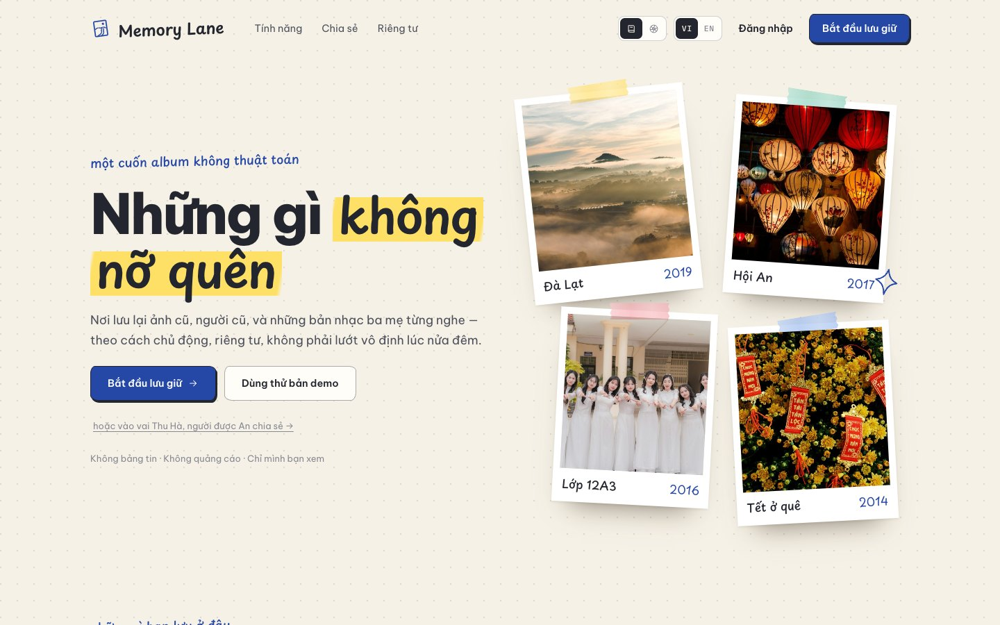
  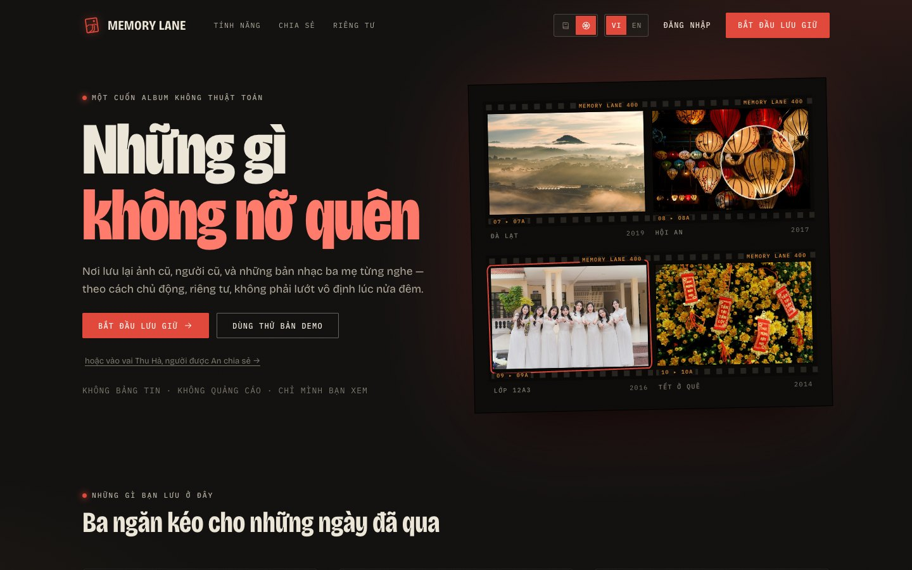
</p>

| Tài liệu | Nội dung |
| --- | --- |
| [docs/PRESENTATION.md](docs/PRESENTATION.md) | **Thuyết trình toàn bộ dự án**: từng phần front-end, back-end, cơ sở dữ liệu, bảo mật, chia sẻ, luồng xử lý, kịch bản demo. Viết cho người vừa học xong lập trình web. |
| [PLAN.md](PLAN.md) | **Kế hoạch & hướng dẫn**: chuyển dự án này sang một repo Git thật để tự phát triển tiếp; bản đồ mã nguồn; hướng dẫn **tự xây lại từ thư mục trống** qua 16 chặng (máy chủ, cơ sở dữ liệu, đăng nhập rồi mới tới giao diện; code đầy đủ, đã chạy thử); **Phần C: vận hành, bảo trì, xử lý sự cố** (sao lưu, công cụ quản trị, sổ tay theo triệu chứng); **Phần D: khi không còn ai để hỏi**; và **Phần E: xây lại từng tính năng còn lại của bản thật**, từng bước, code trích nguyên văn. Bắt đầu từ mục **"Đọc trước tiên"** và **"Bắt đầu nhanh"** (mở, chạy, tắt app, các cổng, đăng nhập, tình huống hay gặp). |
| [docs/MO-RONG.md](docs/MO-RONG.md) | Khi có nhiều người dùng: nén ảnh/video giữ chất lượng (có số liệu đo), lưu trữ đám mây, bảo mật, thời gian thực. |
| [docs/design/DESIGN.md](docs/design/DESIGN.md) | Thiết kế hai giao diện, Kỷ vật và thẻ kỷ niệm, điện thoại, gợi ý giao diện mới. |
| [docs/SUA-NOI-DUNG-TIENG-VIET.md](docs/SUA-NOI-DUNG-TIENG-VIET.md) | Cách tự sửa mọi câu chữ tiếng Việt của giao diện (`client/src/i18n/vi.js`). |
| [docs/DEPLOY.md](docs/DEPLOY.md) | Đưa app lên mạng (Render, Railway, Fly.io / Docker) và cài **đăng nhập Google**. |
| [docs/CREDITS.md](docs/CREDITS.md) | Nguồn ảnh (Unsplash) và video (Pexels) miễn phí dùng cho dữ liệu demo. |

---

## Chạy thử nhanh

Cần **Node.js 22.22 trở lên** (đã thử trên Node 24). Không cần cài gì thêm: cơ sở dữ liệu chỉ là một tệp, tự tạo ra.

```bash
npm install
```

```bash
npm run seed
```

```bash
npm run dev
```

Mở **http://localhost:5173**, bấm **"Dùng thử bản demo"**. Muốn xem phía người được chia sẻ, bấm dòng nhỏ bên dưới:
**"…vào vai Thu Hà"**.

`npm run dev` chạy hai chương trình cùng lúc: API Express ở cổng 3001 và Vite ở cổng 5173 (tự tải lại khi sửa code). Tắt bằng
`Ctrl + C`. **Chỉ chạy một `npm run dev` một lúc**: lần thứ hai sẽ báo "Port 5173 is already in use". Tìm và tắt bản đang chạy ngầm:
[PLAN.md, Q3](PLAN.md#q3-tìm-và-tắt-một-máy-chủ-đang-chạy-ngầm).

Để chạy giống khi đưa lên mạng, tức một máy chủ phục vụ cả API lẫn giao diện đã build:

```bash
npm run build && npm start
```

rồi mở http://localhost:3001.

**Thử trên điện thoại thật** (cùng mạng Wi-Fi với máy tính):

```bash
npm run dev:phone
```

Vite in ra một địa chỉ dạng `http://192.168.x.x:5173`; mở địa chỉ đó trên iPhone hoặc Android.

**Dữ liệu demo** (`npm run seed`): chỉ tạo lại các tài khoản demo, không bao giờ đụng vào tài khoản thật.

- **An**: 14 kỷ niệm có ảnh và video, 5 người quen, 5 phim/nhạc, và 6 kỷ vật (2 bưu thiếp, 2 con tem, 2 thẻ ảnh) làm từ chính các
  kỷ niệm đó.
- **Năm người bạn** đã kết nối với An: Thu Hà, Minh Khoa, Phương Linh, Anh Tuấn, Quốc Bảo. Họ chia sẻ kỷ niệm qua lại với An
  và có sẵn 20 lời nhắn. Có đủ các trạng thái link mời: đã nhận, đang chờ, hết hạn, đã thu hồi.
- **Ngày tháng tính theo hôm nay**, nên cuộn phim "Hôm nay, nhiều năm trước" luôn có ảnh.

---

## Tính năng

| Phần | Làm được gì |
| --- | --- |
| **Hai giao diện** | **Sổ tay ký ức:** giấy chấm, ảnh dán băng keo, chữ viết tay, mực bi xanh. **Phòng tối:** than chì, đèn đỏ, tờ in thử có lỗ phim, kính lúp khi rê chuột, ảnh "hiện hình". Đổi trên thanh điều hướng hoặc trong Cài đặt. |
| **Hôm nay gợi lại** | Lời chào, kỷ niệm nổi bật, thống kê, thanh năm, cuộn phim **"Hôm nay, nhiều năm trước"**, kỷ niệm **được chia sẻ với bạn**, người lâu ngày chưa liên lạc, phim & nhạc. |
| **Album** | Mỗi kỷ niệm có **tối đa 20 ảnh và video**, tiêu đề, nơi chốn, câu chuyện, ngày có thể **không đầy đủ** (chỉ năm, hoặc năm + tháng). Ảnh và video dọc hiển thị đúng hình dạng. |
| **Ảnh & video** | Kéo thả nhiều tệp, mỗi tệp một thanh tiến trình, chọn ảnh bìa. Ảnh được xử lý **ngay trong trình duyệt**: bỏ GPS, xoay đúng chiều, tối đa 2000 px, lưu **WebP** (nhỏ hơn JPEG khoảng 30%, chất lượng gần như không đổi) và có bản xem trước 560 px. Video (MP4/MOV/WebM ≤ 100 MB) có khung hình đại diện. **Máy chủ xoá GPS thêm lần nữa**, kể cả toạ độ nơi quay trong video. Video phát ngay và tua được. |
| **Chia sẻ** | **Link mời** dùng một lần, hết hạn sau 7 ngày, thu hồi được, gửi qua Zalo/Messenger. Người nhận lời vào **vòng thân quen** của bạn. Chọn người được xem **ngay trong form tạo kỷ niệm**, và tạo được link mời trước khi lưu. Người được chia sẻ xem và để lại **lời nhắn**. |
| **Thời gian thực** | Lời nhắn mới **tự hiện ra** cho người đang xem kỷ niệm. Có thông báo nhỏ khi ai đó chia sẻ hoặc nhận lời mời (Server-Sent Events). |
| **Thẻ kỷ niệm** | Từ một kỷ niệm tạo **bưu thiếp, con tem hoặc thẻ ảnh** (hai kiểu Giấy / Phòng tối), tải về hoặc chia sẻ thẳng sang Zalo/Messenger trên điện thoại. Thẻ được vẽ ngay trên máy; chỉ khi chủ kỷ niệm bấm **Lưu vào Kỷ vật** thì ảnh thẻ mới được tải lên, riêng tư. |
| **Kỷ vật (Artifacts)** | Bộ sưu tập các **thẻ đã lưu từ chính kỷ niệm của bạn**, trình bày như danh mục một bảo tàng gia đình nhỏ: số hiện vật theo thứ tự lưu, lọc bưu thiếp / con tem / thẻ ảnh, xem lớn, tải về, chia sẻ, mở lại kỷ niệm gốc. Lưu từ trang kỷ niệm, hoặc ngay trong tab ("Tạo từ một kỷ niệm"). Chỉ chủ thấy; xoá kỷ niệm thì các thẻ của nó cũng đi theo. |
| **Người quen cũ** | Quan hệ, lần cuối liên lạc, độ thân, nhãn "5 năm chưa liên lạc", nhật ký riêng, kỷ niệm chung, nút **"Mời dùng Memory Lane"**. |
| **Phim & nhạc** | Bộ phim, bài hát của gia đình, của ai, thời nào, câu chuyện, link xem lại. |
| **Dòng thời gian · Tìm kiếm** | Kỷ niệm theo năm. Một ô tìm cho kỷ niệm, người, ghi chú, phim nhạc, kỷ vật, **không cần gõ dấu** ("da lat" ra "Đà Lạt"). |
| **Tài khoản** | Đăng ký/đăng nhập bằng email **hoặc Google**. Liên kết/huỷ liên kết Google, đặt mật khẩu, chế độ kín đáo (làm mờ ảnh nơi đông người; mặc định tắt, mỗi tài khoản tự bật), dung lượng đã dùng, đăng xuất mọi nơi, **xuất toàn bộ dữ liệu**, **xoá tài khoản**. |
| **Ngôn ngữ** | Tiếng Việt ⇄ English ở mọi nơi, đổi tức thì, nhớ trên thiết bị và trong tài khoản. |
| **Điện thoại** | Đã soát cho iPhone (Safari) và Android/Samsung: chữ trong ô nhập ≥ 16 px (iPhone không tự phóng to), vùng chạm đủ lớn, vùng an toàn tai thỏ, vuốt ảnh, chạm để xem ở chế độ kín đáo, biểu tượng màn hình chính. |

<p>
  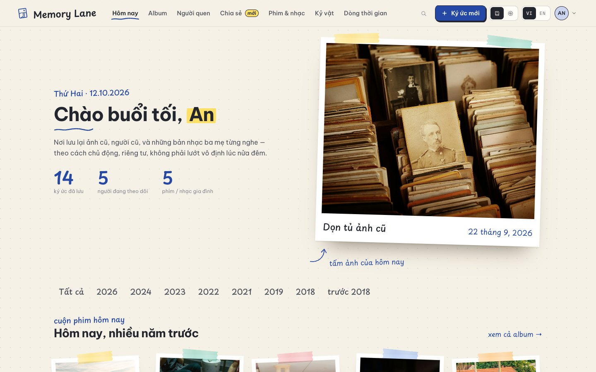
  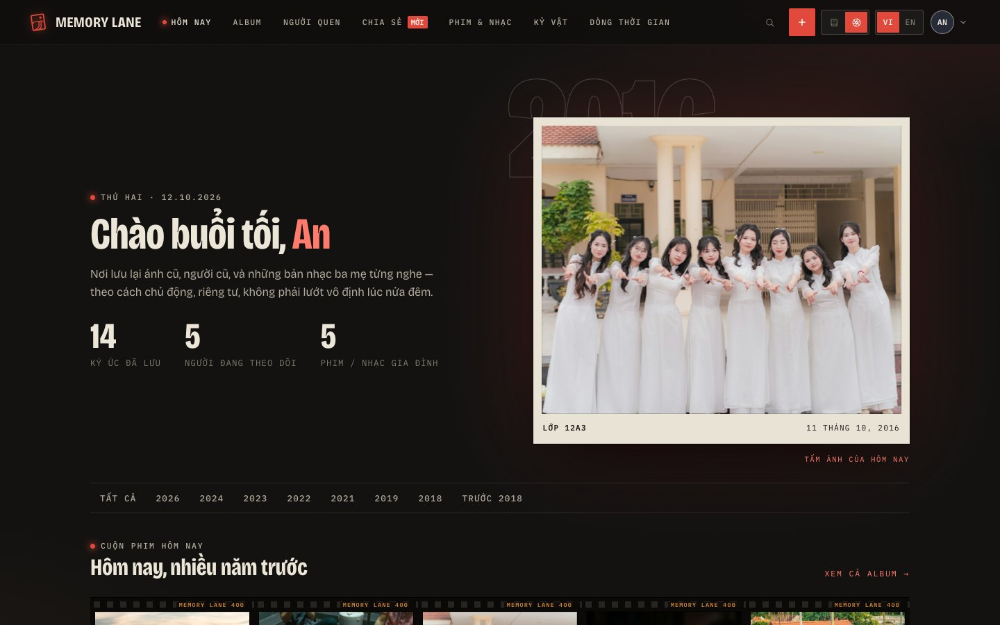
  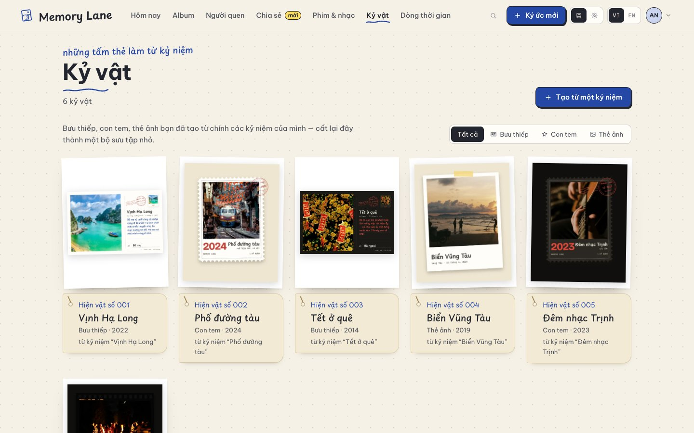
  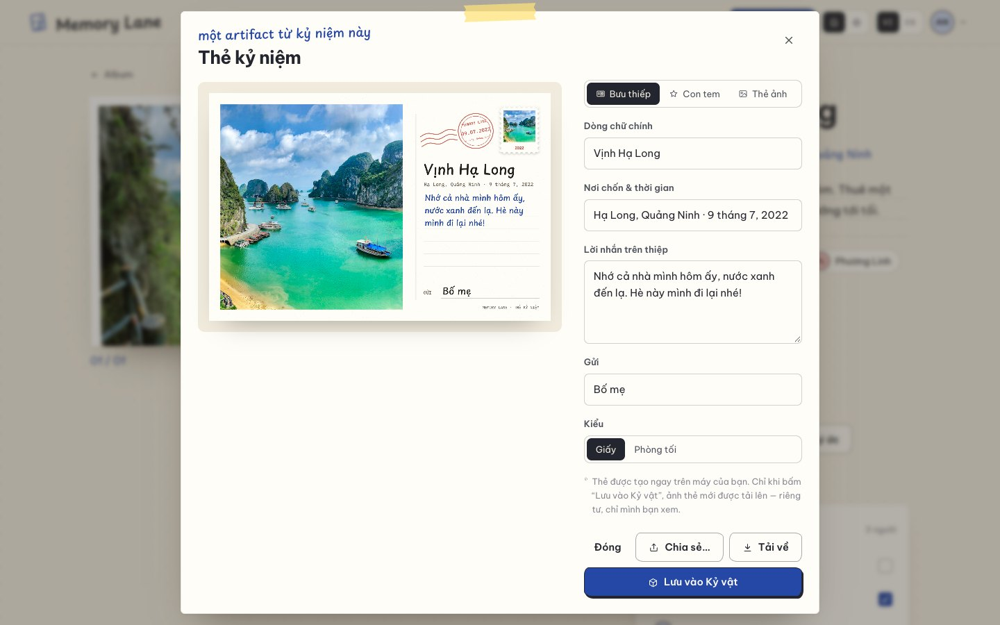
  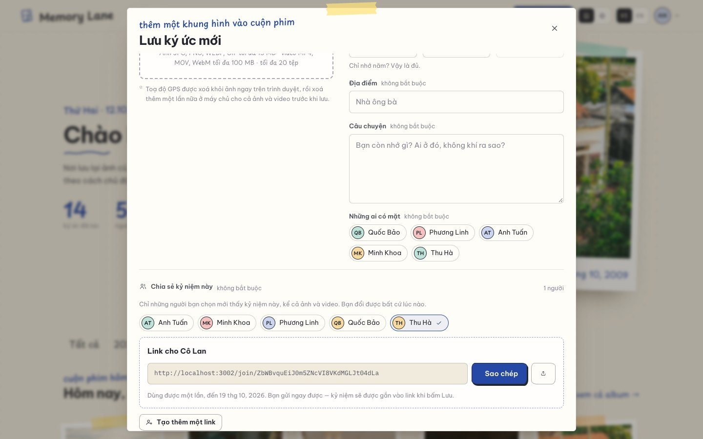
  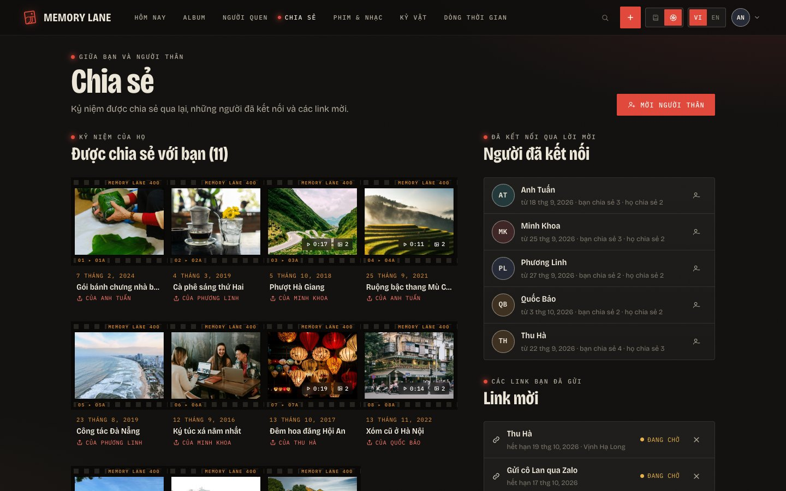
</p>

<p>
  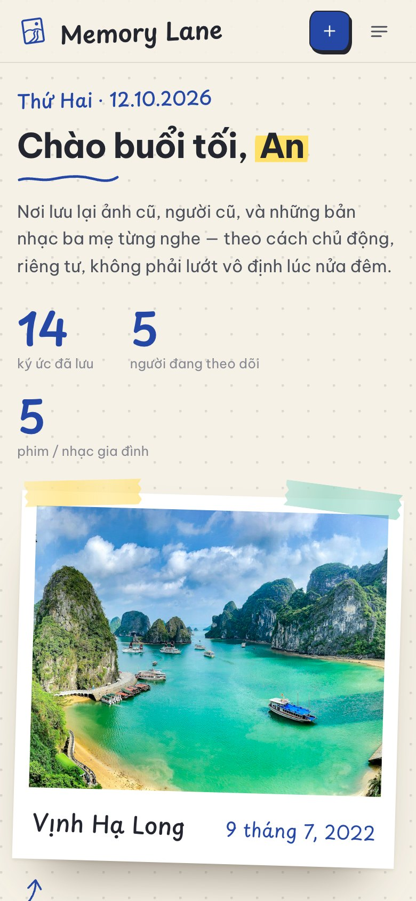
  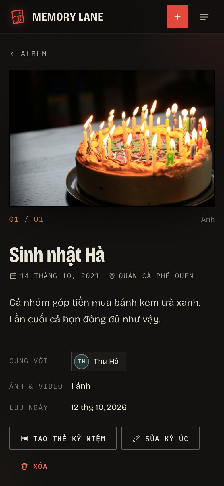
  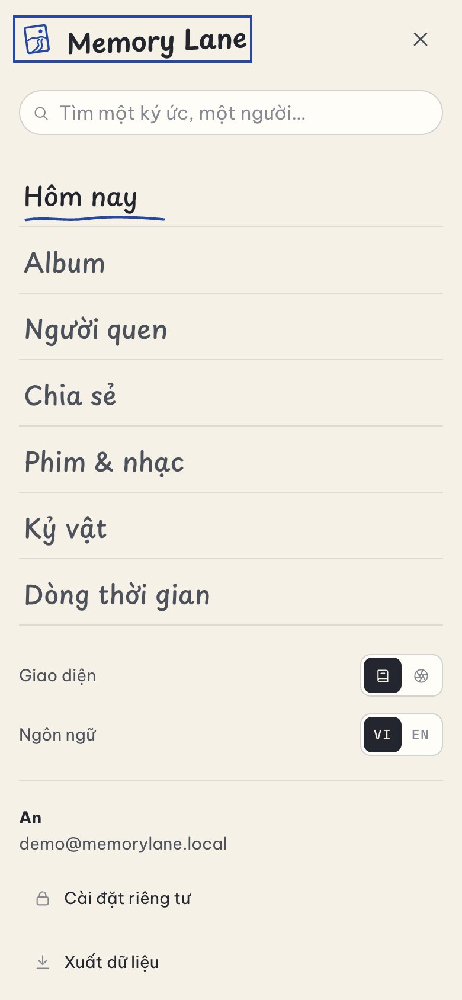
</p>

---

## Công nghệ

| Lớp | Công nghệ | Vì sao |
| --- | --- | --- |
| Giao diện | **React 19** + **React Router 8** | Chia giao diện thành component; điều hướng không tải lại trang. |
| Build | **Vite 8** | Máy chủ phát triển tức thì, build tối ưu, tách code theo trang. |
| CSS | **CSS thuần** + biến CSS (design token), mỗi giao diện một bộ token | Hai giao diện trên cùng một HTML (`<html data-theme="notebook\|darkroom">`), không framework. Font **tự đóng gói** bằng `@fontsource` (Be Vietnam Pro, Playpen Sans, Bricolage Grotesque, IBM Plex Mono), đủ dấu tiếng Việt, không gọi Google Fonts. |
| Đa ngôn ngữ | Lớp nhỏ tự viết (`client/src/i18n`) + **Intl** của trình duyệt | Từ điển `vi.js` / `en.js`, số nhiều, ngày tháng theo ngôn ngữ. |
| Ảnh, video, thẻ | **Canvas**, `<video>`, **XMLHttpRequest** có sẵn trong trình duyệt | Nén WebP, chụp khung hình video, thanh tiến trình tải lên, vẽ bưu thiếp/con tem, không cần thư viện. |
| API | **Node.js** + **Express 5** | REST API rõ ràng; Express 5 tự bắt lỗi trong hàm `async`. |
| Cơ sở dữ liệu | **SQLite** qua **`node:sqlite`** có sẵn trong Node | SQL thật (khóa ngoại, index, migration), không cần cài máy chủ CSDL. |
| Tải tệp | **multer** (ghi thẳng xuống đĩa) + kiểm tra magic bytes + xoá metadata | Video 100 MB không nằm trong RAM; nhận diện tệp bằng nội dung. |
| Đăng nhập | Phiên phía máy chủ + **scrypt**; **Google OAuth 2.0 / OpenID Connect** (PKCE, state, nonce) | Thu hồi phiên tức thì; đăng nhập Google mà không nạp script nào của Google vào trang. |
| Thời gian thực | **Server-Sent Events** (`EventSource`) | Máy chủ đẩy lời nhắn/chia sẻ mới xuống trình duyệt; không cần thư viện WebSocket. |
| Kiểm thử | **node:test** có sẵn + Chrome thật qua DevTools Protocol | 72 bài máy chủ: API, quyền riêng tư, chia sẻ, tải tệp, kỷ vật, Google (với "Google giả" và lệnh `setup:google`), SSE, xoá metadata, bản dịch, công cụ quản trị, `/api/health`. Và `npm run test:e2e`: **35 tính năng** kiểm tra trên Chrome thật như người dùng bấm. |

Máy chủ chỉ phụ thuộc 3 gói: `express`, `multer`, `compression`.

---

## Cấu trúc thư mục

```text
memory-lane/
├── client/                    Giao diện React (thư mục gốc của Vite)
│   ├── index.html             trang HTML duy nhất (meta cho điện thoại: theme-color, color-scheme, safe area)
│   ├── public/                theme-init.js · favicon.svg · apple-touch-icon.png · ảnh trang giới thiệu
│   └── src/
│       ├── main.jsx           điểm khởi đầu: font, CSS, các provider
│       ├── App.jsx            danh sách trang (trang riêng tư tải khi cần)
│       ├── api.js             nơi duy nhất gọi máy chủ (+ lib/upload.js cho tải tệp có tiến trình)
│       ├── auth.jsx · theme.jsx · state.jsx   đăng nhập · giao diện · dữ liệu dùng chung
│       ├── i18n/              vi.js · en.js · index.jsx
│       ├── components/        TopBar, Memories, Gallery, Comments, SharePanel, InviteLink, GoogleButton,
│       │                      CardStudio, LiveUpdates, forms/ (MemoryForm, ShareFields, PersonForm…)
│       ├── pages/             mỗi màn hình một tệp (Today, Album, MemoryDetail, Artifacts, Sharing, Join…)
│       ├── lib/               image.js (WebP) · video.js · upload.js · cards.js (vẽ thẻ) · artifacts.js
│       └── styles/            base · layout · components · pages · notebook · darkroom
├── server/                    API Express
│   ├── index.js · app.js      bật máy chủ · lắp middleware + route + xử lý lỗi
│   ├── config.js · db.js      cấu hình từ biến môi trường · SQLite + migration
│   ├── migrations/            001_init · 002_media_sharing · 003_google_login · 004_artifacts · 005_card_artifacts
│   ├── models/                TẤT CẢ câu SQL (users, memories, people, media, social, artifacts)
│   ├── routes/                auth, google, me, dashboard, memories, files, invites, sharing, people, media, artifacts, search
│   ├── lib/                   files, metadata (xoá GPS), google (OAuth), live (SSE), validate, sessions, security…
│   ├── seed.js                thế giới demo: An và 5 người bạn
│   ├── setup-google.js        npm run setup:google — ghi mã OAuth của bạn vào .env
│   ├── admin.js               npm run admin — công cụ quản trị: tra tài khoản, mật khẩu tạm, kiểm tra tệp, sao lưu
│   └── seed-media/            ảnh & video demo miễn phí (xem docs/CREDITS.md) · cards/ (thẻ demo do app vẽ)
├── shared/                    code DÙNG CHUNG cho trình duyệt và máy chủ (giới hạn, tính ngày)
├── test/                      api.test.js · google.test.js · metadata.test.js · i18n.test.js
├── docs/                      PRESENTATION · MO-RONG · DESIGN · DEPLOY · CREDITS · SUA-NOI-DUNG-TIENG-VIET · screenshots/
├── Dockerfile · render.yaml
└── PLAN.md
```

---

## Một yêu cầu đi như thế nào

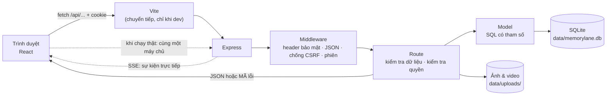

Máy chủ không bao giờ gửi câu chữ, chỉ gửi dữ liệu và **mã lỗi** (`EMAIL_TAKEN`, `INVITE_INVALID`…). Giao diện tự dịch mã
đó sang tiếng Việt hoặc tiếng Anh.

---

## API

Mọi đường dẫn bắt đầu bằng `/api` và dùng JSON. Tất cả cần đăng nhập, trừ `health`, `auth/*` và `invites/preview`.

| Phương thức & đường dẫn | Làm gì |
| --- | --- |
| `GET /health` (công khai) | Máy chủ chạy và đọc được cơ sở dữ liệu? `{ ok: true }`, hoặc `503 { ok: false }` |
| `GET /auth/session` | Tôi là ai? `{ user \| null, demo, google, limits }` |
| `POST /auth/register` · `/login` · `/logout` · `/demo` (`{ as: 'friend' }` → Thu Hà) | Tài khoản |
| `GET /auth/google/start?mode=login\|link&next=` · `GET /auth/google/callback` | Đăng nhập / liên kết Google (chuyển trang, không phải JSON) |
| `PATCH /me` · `POST /me/password` · `DELETE /me/google` · `POST /me/logout-all` · `GET /me/storage` · `GET /me/export` · `DELETE /me` | Tài khoản của bạn |
| `GET /events` | Luồng sự kiện trực tiếp (Server-Sent Events) |
| `GET /dashboard/today?today=YYYY-MM-DD` · `GET /dashboard/summary` | Dữ liệu trang Hôm nay / thanh điều hướng, mỗi thứ một yêu cầu |
| `GET /memories?year=&q=&person=` · `GET /memories/years` | Kỷ niệm của bạn + số lượng theo năm |
| `GET /memories/:id` | Một kỷ niệm của bạn **hoặc được chia sẻ với bạn** (chủ thấy thêm các thẻ đã lưu từ kỷ niệm này) |
| `POST /memories` · `PUT /memories/:id` · `DELETE /memories/:id` | Tạo / sửa / xóa |
| `POST /memories/:id/files` · `DELETE /memories/:id/files/:fileId` · `PUT /memories/:id/files/order` | Tải một ảnh/video · bỏ · sắp xếp (tệp đầu = ảnh bìa) |
| `GET /files/:name` | Ảnh/video/bản xem trước, chỉ cho chủ hoặc người được chia sẻ (hỗ trợ Range) |
| `GET /memories/:id/shares` · `PUT /memories/:id/shares` | Ai được xem (chỉ chủ; chỉ người trong vòng thân quen) |
| `GET/POST /memories/:id/comments` · `DELETE /memories/:id/comments/:commentId` | Lời nhắn |
| `GET /invites` · `POST /invites` · `PUT /invites/:id/memory` · `DELETE /invites/:id` | Link mời (mã chỉ hiện một lần) · gắn kỷ niệm vào link · thu hồi |
| `GET /invites/preview/:token` (công khai) · `POST /invites/accept/:token` | Mở / nhận lời mời |
| `GET /sharing` · `GET /sharing/circle` · `DELETE /sharing/circle/:userId` | Trang Chia sẻ · vòng thân quen · ngừng kết nối |
| `POST /memories/:id/artifacts` (ảnh thẻ + bản nhỏ + chữ trên thẻ) | Lưu một thẻ kỷ niệm vào Kỷ vật (chỉ chủ kỷ niệm) |
| `GET /artifacts?kind=postcard\|stamp\|photo` · `GET /artifacts/:id` · `DELETE /artifacts/:id` | Kỷ vật: danh sách, một thẻ, xoá |
| `GET /people` · `GET /people/:id` · `POST` · `PUT` · `DELETE` · `POST /people/:id/contacted` · `/notes` | Người quen cũ & nhật ký |
| `GET /media?kind=film\|music` · `POST` · `PUT /media/:id` · `DELETE /media/:id` | Phim & nhạc |
| `GET /search?q=` | Tìm trong kỷ niệm, người, phim nhạc, kỷ vật, không cần dấu |

Lỗi có dạng `{ "error": "VALIDATION", "fields": { "file": { "code": "FILE_TOO_LARGE", "max": 100 } } }`. Lỗi không lường trước
(500) kèm mã tham chiếu `{ "error": "SERVER", "ref": "1f9e2221" }`: giao diện hiện "Mã lỗi: 1f9e2221", log máy chủ có cùng mã
([PLAN.md, C2](PLAN.md#c2-nhìn-vào-đâu-apihealth-log-mã-lỗi-devtools)).

---

## Mô hình dữ liệu

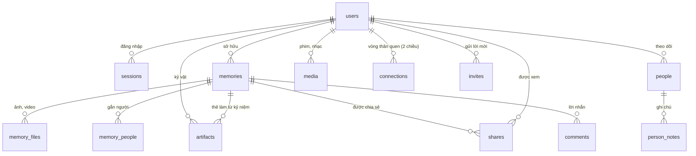

Năm migration chạy lần lượt khi khởi động (`PRAGMA user_version` nhớ đã chạy tới đâu):
`001_init` (album, người quen, phim nhạc) → `002_media_sharing` (nhiều ảnh/video, chia sẻ, lời nhắn) →
`003_google_login` (`google_sub`, `google_email`) → `004_artifacts` (kỷ vật đời đầu: đồ vật, thư từ) →
`005_card_artifacts` (kỷ vật = thẻ lưu từ một kỷ niệm, xoá theo kỷ niệm).

---

## Bảo mật & quyền riêng tư (tóm tắt)

- **Mật khẩu:** băm bằng **scrypt** + salt. Đăng nhập tốn cùng thời gian dù email có tồn tại hay không.
- **Phiên đăng nhập phía máy chủ:** token ngẫu nhiên nằm trong cookie `HttpOnly; SameSite=Lax` (`Secure` khi chạy thật); cơ sở
  dữ liệu chỉ lưu mã băm SHA-256 của token. Đăng xuất là thu hồi ngay.
- **Đăng nhập Google:** luồng authorization code + **PKCE + state + nonce**, kiểm tra người phát hành, đối tượng nhận, hạn dùng
  và email đã xác minh.
  - **Không tự gộp** với tài khoản cùng email đã đăng ký bằng mật khẩu (chống chiếm đoạt trước). Chủ tài khoản phải đăng nhập rồi
    tự liên kết.
- **Kiểm tra quyền:** mọi truy vấn kiểm tra **chủ sở hữu hoặc được chia sẻ đích danh**. Còn lại trả **404**, không phải 403.
  Người được chia sẻ chỉ xem và viết lời nhắn. Kỷ vật luôn chỉ chủ mới thấy.
- **Link mời:** 192 bit ngẫu nhiên, chỉ lưu mã băm, dùng một lần, hết hạn 7 ngày, thu hồi được.
- **Tệp:** không bao giờ công khai. Mỗi lần xem đều kiểm tra quyền, tên tệp ngẫu nhiên, loại tệp nhận diện bằng nội dung.
  **GPS/EXIF bị xoá ở trình duyệt và máy chủ**, kể cả trong video. Có giới hạn cho mỗi tệp và hạn mức cho mỗi tài khoản.
- **CSRF, XSS:** chặn CSRF bằng Fetch Metadata + cookie SameSite; **CSP** chặt chẽ, không script/font/ảnh của bên thứ ba.
- **Dữ liệu là của bạn:** xuất toàn bộ thành JSON, xoá tài khoản là xoá hết.

Giải thích chi tiết: [docs/PRESENTATION.md § 11](docs/PRESENTATION.md#11-bảo-mật--quyền-riêng-tư). Khi có nhiều người dùng:
[docs/MO-RONG.md](docs/MO-RONG.md).

---

## Các lệnh

| Lệnh | Làm gì |
| --- | --- |
| `npm run dev` | API (tự khởi động lại) + Vite (tự tải lại) |
| `npm run dev:phone` | Như trên, mở cho điện thoại cùng Wi-Fi truy cập |
| `npm run build` | Build giao diện → `client/dist/` |
| `npm start` | Một máy chủ: API + giao diện đã build, cổng `PORT` (mặc định 3001) |
| `npm run seed` | Tạo lại thế giới demo (An + 5 người bạn) với ảnh, video, kỷ vật |
| `npm run setup:google` | Bật "Tiếp tục với Google" trên máy: dán Client ID và Client secret của bạn, lệnh ghi vào `.env` |
| `npm run start:demo` | Seed rồi chạy (dùng trên nền tảng hosting) |
| `npm run admin -- <lệnh>` | Công cụ quản trị: `stats`, `users`, `user <email>`, `memory <id>`, `sessions`, `reset-password`, `check-files`, `backup` ([PLAN.md, C3](PLAN.md#c3-công-cụ-quản-trị-npm-run-admin)) |
| `npm test` | 72 bài kiểm thử máy chủ |
| `npm run test:e2e` | Kiểm tra toàn hệ thống trên Chrome thật (35 tính năng, 1–2 phút; tự dựng máy chủ và dữ liệu riêng). Cần Google Chrome |

Cấu hình là tuỳ chọn: chép `.env.example` thành `.env` để đổi cổng, thư mục dữ liệu, giới hạn tệp, hạn mức, thời hạn lời mời,
hoặc bật đăng nhập Google (`npm run setup:google`, hoặc tự điền `GOOGLE_CLIENT_ID`, `GOOGLE_CLIENT_SECRET`; xem
[docs/DEPLOY.md](docs/DEPLOY.md#bật-tiếp-tục-với-google)).

---

## Chưa có trong bản MVP (bước tiếp theo hay)

- Xác minh email và quên mật khẩu qua email. (Trong lúc chờ: người vận hành đặt mật khẩu tạm bằng
  `npm run admin -- reset-password <email>`, xem [PLAN.md, C5.1](PLAN.md#c51-tôi-quên-mật-khẩu).)
- Chuyển mã video ở máy chủ (ffmpeg) và kho lưu trữ đám mây (xem [docs/MO-RONG.md](docs/MO-RONG.md)).
- Thông báo đẩy khi app đang đóng.
- Album chung nhiều người cùng thêm ảnh.
- PWA dùng khi mất mạng.
- Kiểm thử end-to-end trên trình duyệt (Playwright).
