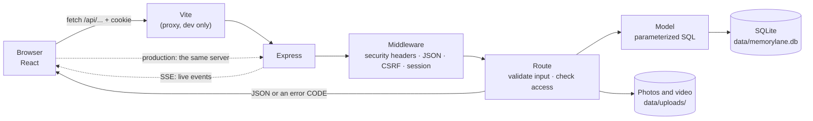
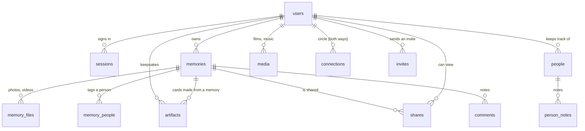

# Memory Lane — an album with no algorithm

A private web app for keeping **old family photos and videos, people you have lost touch with, and the films and songs the household loved**, plus **keepsakes** made from those memories (postcards, stamps, photo cards). You save them on purpose, and privately, instead of scrolling past them at midnight.

- **Sharing:** only with **the people you choose**, through a private invite link. Notes show up **live**.
- **Keepsake cards and Keepsakes:** turn a memory into a postcard, a stamp, or a photo card to send to someone, then file the ones you want to keep under **Keepsakes**.
- **Two languages:** **Tiếng Việt ⇄ English** in one tap.
- **Two themes:** *Notebook* and *Darkroom*.
- **Devices:** works on a computer, iPhone, and Android.

This is the MVP of a graduation project. The app is a React interface, an Express REST API, and a SQLite database, with real sign-in (including Google), private photo and video storage, sharing, automated tests, and deploy files.

<p>
  
  
</p>

| Document | What it is |
| --- | --- |
| [docs/DEPLOY.md](docs/DEPLOY.md) | Putting the app online (Render, Railway, Fly.io / Docker) and setting up **Google sign-in** (Vietnamese). |
| [docs/CREDITS.md](docs/CREDITS.md) | Unsplash photos and Pexels videos used as demo media. |

---

## Try it

You need **Node.js 22.22 or newer** (tested on Node 24). Nothing else to install: the database is a single file, created automatically.

```bash
npm install
```

```bash
npm run seed
```

```bash
npm run dev
```

Open **http://localhost:5173** and click **"Try the demo"**. To see the app as someone the album was shared with, click the small line under that button: **"…as Thu Hà"**.

`npm run dev` runs two programs at once: the Express API on port 3001 and Vite on port 5173 (the page reloads when you edit code). Stop them with `Ctrl + C`. **Run only one `npm run dev` at a time.** A second one reports "Port 5173 is already in use". Stop the other one with `Ctrl + C` in its terminal. If you cannot find that window, run `lsof -nP -iTCP:5173 -sTCP:LISTEN` and stop the listed process.

To run it the way it runs online — one server for both the API and the built interface:

```bash
npm run build && npm start
```

then open http://localhost:3001.

**On a real phone** (same Wi-Fi as the computer):

```bash
npm run dev:phone
```

Vite prints an address like `http://192.168.x.x:5173`. Open that on an iPhone or Android.

**Demo data** (`npm run seed`) recreates only the demo accounts. It never touches a real account.

- **An:** 14 memories with photos and videos, 5 old friends, 5 films and songs, and 6 keepsakes (2 postcards, 2 stamps, 2 photo cards) made from those memories.
- **Five friends** already connected to An: Thu Hà, Minh Khoa, Phương Linh, Anh Tuấn, Quốc Bảo. They share memories with An and 20 notes are already there. Invite links cover every state: accepted, pending, expired, revoked.
- **Dates are computed from today**, so the "On this day, years ago" film strip always has something in it.

---

## Features

| Part | What you can do |
| --- | --- |
| **Two themes** | **Notebook:** dotted paper, photos taped down, handwriting, blue ballpoint. **Darkroom:** charcoal, a red safelight, a contact sheet, a loupe on hover, photos that "develop". Switch from the nav bar or from Settings. |
| **Today** | A greeting, a featured memory, counts, a year bar, the **"On this day, years ago"** film strip, memories **shared with you**, people you have not contacted in a long time, films and music. |
| **Album** | Each memory holds **up to 20 photos and videos**, a title, a place, a story, and a date that can be **incomplete** (year only, or year and month). Portrait photos and videos keep their shape. |
| **Photos and video** | Drag and drop many files, one progress bar each, pick a cover. Photos are processed **in the browser**: GPS removed, orientation fixed, max 2000 px, saved as **WebP** (about 30% smaller than JPEG, almost the same quality) plus a 560 px preview. Video (MP4/MOV/WebM, up to 100 MB) gets a poster frame. **The server strips GPS again**, including the location stored in a video. Video starts playing immediately and can be seeked. |
| **Sharing** | A **one-time invite link**, expiring after 7 days, revocable, sent via Zalo or Messenger. Accepting puts that person in your **circle**. You choose who can see a memory **in the memory form itself**, and you can create the invite before saving. People you share with can view the memory and leave a **note**. |
| **Live updates** | A new note **appears on its own** for anyone who has the memory open. A small notice when someone shares or accepts an invite (Server-Sent Events). |
| **Keepsake cards** | From a memory, make a **postcard, stamp, or photo card** (Paper or Darkroom style), download it, or share it to Zalo/Messenger on a phone. The card is drawn on the device. The image is uploaded, privately, only when the owner clicks **Save to Keepsakes**. |
| **Keepsakes (Artifacts)** | The **cards you saved from your own memories**, laid out like a small family museum: a catalogue number in the order you saved them, filters for postcard / stamp / photo card, a large view, download, share, and a link back to the memory. Save from the memory page, or from the tab ("Make one from a memory"). Only the owner sees them. Delete the memory and its cards go with it. |
| **Old friends** | Relationship, last contact, closeness, a "5 years out of touch" label, a private log, shared memories, and an **"Invite to Memory Lane"** button. |
| **Films and music** | A film or a song the family loved, whose it was, when, the story, and a link to watch or hear it again. |
| **Timeline and search** | Memories by year. One search box for memories, people, notes, films, music, and keepsakes, **accents optional** ("da lat" finds "Đà Lạt"). |
| **Account** | Register and sign in with email **or Google**. Link or unlink Google, set a password, discreet mode (blur photos in a crowded place; off by default, each account turns it on), storage used, sign out everywhere, **export everything**, **delete the account**. |
| **Language** | Tiếng Việt ⇄ English everywhere, instant, remembered on the device and on the account. |
| **Phones** | Checked on iPhone (Safari) and Android/Samsung: input text at least 16 px (so iPhone does not zoom in), large tap targets, the notch safe area, swiping photos, tap-to-reveal in discreet mode, and a home-screen icon. |

<p>
  
  
  
  
  
  
</p>

<p>
  
  
  
</p>

---

## Technology

| Layer | Technology | Why it is here |
| --- | --- | --- |
| Interface | **React 19** + **React Router 8** | Split the UI into components. Move between pages without a full reload. |
| Build | **Vite 8** | A fast dev server, an optimized production build, and one file per page. |
| CSS | **Plain CSS** and CSS variables (design tokens), one token set per theme | Two themes on the same HTML (`<html data-theme="notebook\|darkroom">`), no CSS framework. Fonts are **bundled** with `@fontsource` (Be Vietnam Pro, Playpen Sans, Bricolage Grotesque, IBM Plex Mono), including Vietnamese diacritics. No request goes to Google Fonts. |
| Languages | A small layer in `client/src/i18n` plus the browser's **Intl** | Dictionaries `vi.js` / `en.js`, plurals, and dates in the active language. |
| Photos, video, cards | **Canvas**, `<video>`, and **XMLHttpRequest**, all built into the browser | WebP compression, a video poster frame, upload progress, and drawing postcards and stamps. No extra library. |
| API | **Node.js** + **Express 5** | A plain REST API. Express 5 forwards errors thrown inside `async` functions. |
| Database | **SQLite** through **`node:sqlite`**, built into Node | Real SQL (foreign keys, indexes, migrations) with no database server to install. |
| Uploads | **multer** (straight to disk) plus magic-byte checks and metadata stripping | A 100 MB video is never held in RAM. The file type comes from the bytes, not the name. |
| Sign-in | Server-side sessions and **scrypt**; **Google OAuth 2.0 / OpenID Connect** (PKCE, state, nonce) | A session can be revoked immediately. Google sign-in loads no Google script on the page. |
| Live updates | **Server-Sent Events** (`EventSource`) | The server pushes new notes and shares to the browser. No WebSocket library. |
| Tests | Built-in **node:test**, plus real Chrome over the DevTools Protocol | 72 server tests: API, privacy, sharing, uploads, keepsakes, Google (a fake Google plus `setup:google`), SSE, metadata stripping, translations, the admin tool, `/api/health`. And `npm run test:e2e`: **35 features** exercised in real Chrome the way a person would click. |

The server depends on three packages: `express`, `multer`, `compression`.

---

## Folder map

```text
memory-lane/
├── client/                    React UI (Vite's project root)
│   ├── index.html             the only HTML page (phone meta: theme-color, color-scheme, safe area)
│   ├── public/                theme-init.js · favicon.svg · apple-touch-icon.png · landing photos
│   └── src/
│       ├── main.jsx           entry: fonts, CSS, providers
│       ├── App.jsx            the route list (private pages load on demand)
│       ├── api.js             the only place that calls the server (+ lib/upload.js for progress)
│       ├── auth.jsx · theme.jsx · state.jsx   sign-in · theme · shared data
│       ├── i18n/              vi.js · en.js · index.jsx
│       ├── components/        TopBar, Memories, Gallery, Comments, SharePanel, InviteLink, GoogleButton,
│       │                      CardStudio, LiveUpdates, forms/ (MemoryForm, ShareFields, PersonForm…)
│       ├── pages/             one file per screen (Today, Album, MemoryDetail, Artifacts, Sharing, Join…)
│       ├── lib/               image.js (WebP) · video.js · upload.js · cards.js (draws cards) · artifacts.js
│       └── styles/            base · layout · components · pages · notebook · darkroom
├── server/                    Express API
│   ├── index.js · app.js      start the server · wire middleware, routes, and errors
│   ├── config.js · db.js      env config · SQLite and migrations
│   ├── migrations/            001_init · 002_media_sharing · 003_google_login · 004_artifacts · 005_card_artifacts
│   ├── models/                EVERY SQL statement (users, memories, people, media, social, artifacts)
│   ├── routes/                auth, google, me, dashboard, memories, files, invites, sharing, people, media, artifacts, search
│   ├── lib/                   files, metadata (strip GPS), google (OAuth), live (SSE), validate, sessions, security…
│   ├── seed.js                the demo world: An and 5 friends
│   ├── setup-google.js        npm run setup:google — writes your OAuth client into .env
│   ├── admin.js               npm run admin — look up accounts, a temporary password, check files, backup
│   └── seed-media/            free demo photos and videos (see docs/CREDITS.md) · cards/ (cards the app drew)
├── shared/                    code SHARED by the browser and the server (limits, dates)
├── test/                      api.test.js · google.test.js · metadata.test.js · i18n.test.js
├── docs/                      DEPLOY.md · CREDITS.md · screenshots/
└── Dockerfile · render.yaml
```

---

## How one request moves



The server never sends sentences. It sends data and an **error code** (`EMAIL_TAKEN`, `INVITE_INVALID`, …). The interface translates that code into Vietnamese or English.

---

## API

Every path starts with `/api` and speaks JSON. All of them require a signed-in user except `health`, `auth/*`, and `invites/preview`.

| Method and path | What it does |
| --- | --- |
| `GET /health` (public) | Is the server up, and can it read the database? `{ ok: true }`, or `503 { ok: false }` |
| `GET /auth/session` | Who am I? `{ user \| null, demo, google, limits }` |
| `POST /auth/register` · `/login` · `/logout` · `/demo` (`{ as: 'friend' }` → Thu Hà) | Accounts |
| `GET /auth/google/start?mode=login\|link&next=` · `GET /auth/google/callback` | Sign in or link Google (a redirect, not JSON) |
| `PATCH /me` · `POST /me/password` · `DELETE /me/google` · `POST /me/logout-all` · `GET /me/storage` · `GET /me/export` · `DELETE /me` | Your account |
| `GET /events` | The live event stream (Server-Sent Events) |
| `GET /dashboard/today?today=YYYY-MM-DD` · `GET /dashboard/summary` | Data for Today and for the nav bar, one request each |
| `GET /memories?year=&q=&person=` · `GET /memories/years` | Your memories, and counts by year |
| `GET /memories/:id` | One memory you own **or that was shared with you** (the owner also sees cards saved from it) |
| `POST /memories` · `PUT /memories/:id` · `DELETE /memories/:id` | Create, update, delete |
| `POST /memories/:id/files` · `DELETE /memories/:id/files/:fileId` · `PUT /memories/:id/files/order` | Upload one photo or video, remove one, reorder (first file is the cover) |
| `GET /files/:name` | A photo, video, or preview, only for the owner or someone it was shared with (Range requests supported) |
| `GET /memories/:id/shares` · `PUT /memories/:id/shares` | Who can see it (owner only; only people in the circle) |
| `GET/POST /memories/:id/comments` · `DELETE /memories/:id/comments/:commentId` | Notes |
| `GET /invites` · `POST /invites` · `PUT /invites/:id/memory` · `DELETE /invites/:id` | Invite links (the code is shown once), attach a memory, revoke |
| `GET /invites/preview/:token` (public) · `POST /invites/accept/:token` | Open or accept an invite |
| `GET /sharing` · `GET /sharing/circle` · `DELETE /sharing/circle/:userId` | The Sharing page, the circle, disconnect |
| `POST /memories/:id/artifacts` (card image, thumbnail, and the text on the card) | Save a keepsake card (memory owner only) |
| `GET /artifacts?kind=postcard\|stamp\|photo` · `GET /artifacts/:id` · `DELETE /artifacts/:id` | Keepsakes: list, one card, delete |
| `GET /people` · `GET /people/:id` · `POST` · `PUT` · `DELETE` · `POST /people/:id/contacted` · `/notes` | Old friends and the log |
| `GET /media?kind=film\|music` · `POST` · `PUT /media/:id` · `DELETE /media/:id` | Films and music |
| `GET /search?q=` | Search memories, people, films, music, and keepsakes, accents optional |

Errors look like `{ "error": "VALIDATION", "fields": { "file": { "code": "FILE_TOO_LARGE", "max": 100 } } }`. An unexpected error (500) includes a reference `{ "error": "SERVER", "ref": "1f9e2221" }`: the UI shows "Error reference: 1f9e2221", and the server log has the same code.

---

## Data model



Five migrations run in order at startup (`PRAGMA user_version` remembers how far it got):
`001_init` (album, old friends, films and music) → `002_media_sharing` (many photos and videos, sharing, notes) →
`003_google_login` (`google_sub`, `google_email`) → `004_artifacts` (the first keepsakes: objects and letters) →
`005_card_artifacts` (a keepsake is a card saved from a memory, and it is deleted with that memory).

---

## Security and privacy (short version)

- **Passwords:** hashed with **scrypt** and a salt. Signing in takes the same time whether or not the email exists.
- **Server-side sessions:** a random token in an `HttpOnly; SameSite=Lax` cookie (`Secure` in production). The database stores only the SHA-256 of the token. Logging out revokes it immediately.
- **Google sign-in:** authorization-code flow with **PKCE, state, and nonce**. The server checks the issuer, the audience, the expiry, and that the email is verified.
  - An existing password account with the same email is **not merged automatically** (that would allow pre-hijacking). The owner signs in and links Google themselves.
- **Access checks:** every query checks **the owner, or a person that memory was shared with by name**. Everyone else gets **404**, not 403. Someone a memory was shared with can view it and write notes. Keepsakes are visible only to the owner.
- **Invite links:** 192 random bits, only the hash is stored, single use, expire after 7 days, revocable.
- **Files:** never public. Every view checks access. File names are random. The type is detected from the contents. **GPS and EXIF are stripped in the browser and again on the server**, including inside video. There is a per-file limit and a per-account quota.
- **CSRF and XSS:** cross-site writes are blocked with Fetch Metadata plus the SameSite cookie. The **CSP** is strict: no third-party scripts, fonts, or images.
- **The data is yours:** export everything as JSON. Deleting the account deletes all of it.

---

## Commands

| Command | What it does |
| --- | --- |
| `npm run dev` | API (restarts on save) + Vite (reloads the page) |
| `npm run dev:phone` | The same, reachable from a phone on the same Wi-Fi |
| `npm run build` | Build the interface into `client/dist/` |
| `npm start` | One server: API plus the built interface, port `PORT` (default 3001) |
| `npm run seed` | Recreate the demo world (An and 5 friends) with photos, videos, and keepsakes |
| `npm run setup:google` | Turn on "Continue with Google" on this machine: paste your Client ID and Client secret; the command writes `.env` |
| `npm run start:demo` | Seed, then start (what the hosting blueprint uses) |
| `npm run admin -- <command>` | Admin tool: `stats`, `users`, `user <email>`, `memory <id>`, `sessions`, `reset-password`, `check-files`, `backup` |
| `npm test` | The 72 server tests |
| `npm run test:e2e` | Full-system check in real Chrome (35 features, 1–2 minutes; it builds its own server and data). Needs Google Chrome |

Configuration is optional. Copy `.env.example` to `.env` to change the port, the data directory, file limits, the quota, how long an invite lasts, or to turn on Google sign-in (`npm run setup:google`, or set `GOOGLE_CLIENT_ID` and `GOOGLE_CLIENT_SECRET` yourself; see [docs/DEPLOY.md](docs/DEPLOY.md#bật-tiếp-tục-với-google), in Vietnamese).

---

## Not in this MVP (likely next)

- Email verification, and a forgot-password email. Until then, an operator sets a temporary password with `npm run admin -- reset-password <email>`.
- Server-side video transcoding (ffmpeg) and cloud storage.
- Push notifications while the app is closed.
- A shared album several people can add photos to.
- An offline PWA.
- Browser end-to-end tests (Playwright).
