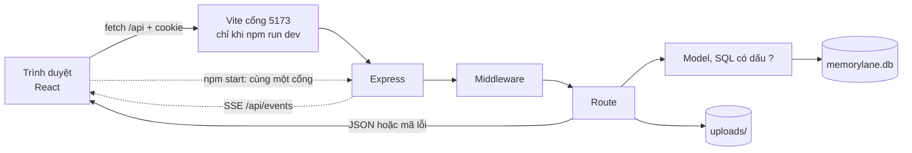

# Tự xây lại Memory Lane

Một file. Đọc từ trên xuống, làm từng mốc trong thư mục **của bạn**, rồi mở file cùng tên trong repo này để đối chiếu. Repo là bản đúng để đọc, không phải bản để kéo nguyên sang bài.

Cài máy Mac và mở repo này: mục [Làm việc trên máy Mac](#làm-việc-trên-máy-mac-vs-code-và-git). Node tối thiểu là **22.22** (`engines` trong `package.json`). CI, `Dockerfile` và `NODE_VERSION` trên Render dùng **Node 24** — cài 24. Mỗi mốc một commit. Khi hỏng, `git diff` chỉ ra mốc nào làm vỡ.

Ba file cũ (`KIEN-TRUC.md`, `LO-TRINH-TU-XAY-LAI.md`, `DEPLOY-VA-VAN-HANH.md`) chỉ còn dòng trỏ về đây. Bấm Google Cloud từng ô, Railway và Docker vẫn ở [DEPLOY.md](DEPLOY.md). Bản nói chuyện dài ở [PRESENTATION.md](PRESENTATION.md).

## Nhìn cả sản phẩm

Memory Lane là album riêng. Mỗi người có tài khoản, rồi lưu **kỷ niệm** (ảnh, video, câu chuyện), **người quen**, **phim và nhạc**, và **kỷ vật** (thẻ vẽ từ một kỷ niệm). Chia sẻ chỉ qua link mời. Không có bảng tin, không có gợi ý.

Ba lớp:

| Lớp | Công nghệ | Việc của nó |
| --- | --- | --- |
| Giao diện | React 19, React Router 8, Vite 8 | Vẽ trang, đổi URL không tải lại cả trang |
| API | Express 5 | Nhận HTTP, trả JSON (dữ liệu dạng chữ máy đọc được) |
| Dữ liệu | SQLite qua `node:sqlite` | Một file `memorylane.db`, cộng thư mục ảnh |

Máy chủ chỉ phụ thuộc ba gói: `express`, `multer`, `compression`. React và Vite chỉ cần lúc build.



**Middleware** là hàm chạy trước route (route = một URL cộng một method như `GET` hoặc `POST`). **Cookie** là mẩu dữ liệu trình duyệt tự gửi lại mỗi request. **SSE** (Server-Sent Events) là một kết nối HTTP giữ mở để máy chủ đẩy tin xuống.

### Một request tạo kỷ niệm

1. Form gọi `api.post('/api/memories', { title, story, year, ... })` trong `client/src/api.js`.
2. `fetch` gửi cookie `ml_session`. JavaScript không đọc được cookie này (`HttpOnly`).
3. `sessions.loadUser` băm token (băm = biến chuỗi thành vân tay một chiều), tìm hàng trong bảng `sessions`, gán `req.user`.
4. `requireAuth` trả 401 `UNAUTHORIZED` nếu không có user.
5. `validator` cắt độ dài theo `shared/limits.js`. Sai thì 400 `VALIDATION`.
6. `memoriesModel.create` chạy `INSERT` với dấu `?`, luôn kèm `user_id` của người đang đăng nhập.
7. React nhận JSON và vẽ lại.

Xem ảnh đi đường khác: thẻ `` cũng gửi cookie. `server/routes/files.js` kiểm tra tên file và quyền. Không được thì **404**, cùng mã với "không có file". Được thì `sendFile`, có `Range` để video tua được.

Khi học, trình duyệt chỉ nói với Vite (cổng 5173). Vite chuyển `/api` sang Express (cổng 3001), `changeOrigin: false` trong `vite.config.js` để header `Host` vẫn là `localhost:5173` (Google cần đúng địa chỉ này). Sau `npm run build && npm start` chỉ còn một cổng. Cùng nguồn gốc (same origin) nên cookie đi kèm và **không cần CORS**. Đừng thêm `Access-Control-Allow-Origin: *`.

### Thư mục nào làm việc gì

```text
client/src/main.jsx          bật React, font, provider
client/src/App.jsx           danh sách route
client/src/api.js            mọi fetch JSON
client/src/auth.jsx          user: undefined | null | {…}
client/src/state.jsx         cache danh sách, useFetch
client/src/i18n/             vi.js, en.js, hàm t()
client/src/pages/            một màn hình một file
client/src/components/       nav, form, gallery, lời nhắn
client/src/lib/              nén ảnh, upload, vẽ thẻ
client/src/styles/           CSS hai giao diện
server/index.js              mở db, listen, tắt khi SIGTERM
server/app.js                lắp middleware, route, trang tĩnh, lỗi
server/config.js             đọc .env
server/db.js                 SQLite và migration
server/migrations/           001 … 005
server/models/               mọi câu SQL
server/routes/               một nhóm URL một file
server/lib/                  mật khẩu, phiên, file, Google, SSE
shared/                      limits.js và dates.js, dùng cả hai phía
```

Quy tắc: trang React không viết SQL. Route không viết câu SQL dài. Model không biết HTTP. Hỏng ở đâu thì mở đúng tầng đó.

### Chép nguyên hay ngồi đọc

Giao diện tái dùng được khi API trả đúng hình dạng. Chép phần vẽ. Tự viết phần nối dữ liệu, vì đó là bài học.

| Chép nguyên khi API đã khớp | Ngồi đọc, rồi tự viết |
| --- | --- |
| `client/src/styles/` (sáu file CSS) | `main.jsx`, `App.jsx`, `api.js`, `auth.jsx`, `state.jsx` |
| `client/src/i18n/vi.js` và `en.js` | `components/RouteGuards.jsx` |
| `client/public/` (`theme-init.js`, icon, ảnh landing) và `client/index.html` | một trang, ví dụ `pages/Album.jsx`, rồi các trang kia theo khuôn |
| Component chỉ vẽ: `Icon`, `States`, `Modal`, `Field`, `Gallery`, `Brand` | `Comments.jsx`, `LiveUpdates.jsx`, `lib/upload.js` |
| Sau khi quen canvas: `lib/cards.js`, `components/CardStudio.jsx` | `lib/image.js`, `lib/video.js` (nén và xoá GPS phía trình duyệt) |

`server/seed.js` và `server/seed-media/` là thế giới demo, khoảng 34 MB. Đừng mang vào bài. Một tài khoản tự đăng ký là đủ.

## Làm việc trên máy Mac (VS Code và Git)

Mục này là cách mở **repo này** mỗi ngày. Mốc 0 trở đi là tự viết một bản mới trong thư mục khác. Repo không có ESLint, không có Prettier, không có `.vscode/`. Đừng cài hai extension đó rồi format cả dự án. Một dòng `eslint-disable` trong `server/app.js` không làm gì khi chưa có cấu hình.

### Cài ba thứ

1. **Node 24.** Tải bản macOS ở https://nodejs.org . Cài xong, tắt Terminal mở lại. `node -v` in `v24.…`, `npm -v` in số. Bản 22.22 trở lên vẫn chạy được. Bản 24 khớp CI.
2. **Git.** Terminal: `git --version`. Máy báo chưa có thì chạy `xcode-select --install` (công cụ dòng lệnh của Apple, có sẵn Git).
3. **VS Code** (Visual Studio Code, trình soạn thảo). Tải bản Mac ở https://code.visualstudio.com , kéo vào Applications. Mở VS Code, `Cmd+Shift+P`, gõ `shell command`, chọn **Install 'code' command in PATH**. Sau bước này Terminal hiểu lệnh `code`.

Extension đáng cài: **SQLite Viewer** trên Marketplace (ô Extensions, `Cmd+Shift+X`). Repo không khai extension nào. Viewer chỉ để bấm mở file database.

### Lấy code và mở đúng thư mục

```bash
git clone https://github.com/Bone-helloworld/Memory-Lane.git
cd Memory-Lane
code .
```

Cùng một việc trên menu: **File > Open Folder**, chọn thư mục có `package.json`. Mở thư mục cha sẽ làm Explorer và Terminal lệch chỗ.

`npm ci` cài đúng phiên bản trong `package-lock.json` (CI cũng dùng lệnh này). `npm install` chỉ khi bạn sắp sửa danh sách gói.

### Bốn ô trong VS Code

| Ô | Mở bằng | Dùng để |
| --- | --- | --- |
| Explorer | `Cmd+Shift+E` | Cây file. Nhánh bạn sẽ đụng: `client/`, `server/`, `shared/`, `test/`, `docs/`. Bỏ qua `node_modules/` |
| Search | `Cmd+Shift+F` | Tìm chữ trong cả repo, ví dụ `ml_session` |
| Go to Definition | `Cmd+click` hoặc `F12` | Nhảy tới chỗ khai báo. Trong `server/index.js`, `Cmd+click` vào `createApp` ra `server/app.js` |
| Terminal | **View > Terminal** hoặc **Ctrl+`** | Lệnh chạy ở đúng thư mục đã mở. Một `npm run dev` thôi |

`Cmd+P` rồi gõ tên file để mở nhanh (`app.js`, `Album.jsx`).

### Chạy và gắn debugger

Trong Terminal của VS Code:

```bash
cp .env.example .env
npm run seed
npm run dev
```

`.env` là tuỳ chọn: không có file này app vẫn chạy bằng mặc định trong `server/config.js`. File đã nằm trong `.gitignore`. Sửa cổng, tắt demo, hoặc dán khóa Google vào đây, không commit.

`npm run dev` chạy hai việc: `dev:api` (`node --watch server/index.js`, API cổng 3001, lưu file là khởi động lại) và `dev:web` (Vite, trang ở http://localhost:5173). Dừng bằng `Ctrl+C` trong terminal đó.

Repo không có `launch.json`. Muốn đặt breakpoint (dừng tại một dòng):

1. Bấm lề trái số dòng trong `server/routes/auth.js`, xuất hiện chấm đỏ.
2. **Run and Debug** (`Cmd+Shift+D`) > **JavaScript Debug Terminal**.
3. Trong terminal vừa mở, chạy `npm run dev:api`. Terminal thường bên cạnh chạy `npm run dev:web`.
4. Đăng nhập trên trình duyệt. VS Code dừng ở chấm đỏ. Xem `req.body` trong ô Variables. Nút tiếp tục ở thanh trên. `dev:api` dùng `node --watch`: sau khi lưu file, tiến trình chạy lại. Nếu chấm đỏ không dừng nữa, tắt debug và chạy lại lệnh đó.

`npm start` là một tiến trình, không tự restart. Dùng khi thử bản đã `npm run build`.

### Lệnh npm có thật

| Lệnh | Việc |
| --- | --- |
| `npm run dev` | API + Vite. Lệnh học hàng ngày |
| `npm run seed` | Dựng lại tài khoản demo. Không xoá tài khoản bạn tự đăng ký |
| `npm test` | 72 bài `node:test` trong `test/*.test.js` |
| `npm run build` | Gói React vào `client/dist/` |
| `npm start` | Một cổng: API và giao diện đã build |
| `npm run admin -- stats` | Xem số liệu. Mọi lệnh admin ở mốc 13 |

Cùng file còn `dev:phone`, `start:demo`, `setup:google`, `test:e2e`. Không có `lint` hay `format`.

### Xem database

Sau `seed` hoặc lần chạy đầu, file là `data/memorylane.db` (git bỏ qua). Explorer > mở file đó bằng SQLite Viewer. Hoặc trong Terminal:

```bash
sqlite3 data/memorylane.db '.tables'
```

Đừng sửa hàng bằng tay rồi tưởng app vẫn đúng. Sửa qua API hoặc qua `npm run admin`.

### Vòng Git mỗi ngày

**Nhánh** (branch) là một đường commit riêng, để `main` luôn chạy được. Tên gợi việc: `sua-loi-dang-nhap`.

Trên Terminal:

```bash
git status
git switch main
git pull
git switch -c sua-loi-dang-nhap
```

Sửa file. Rồi:

```bash
git status
git diff
git add server/routes/auth.js
git commit -m "Sửa thông báo khi sai mật khẩu"
git push -u origin sua-loi-dang-nhap
```

`git add` một file, hoặc `git add -p` để chọn từng cụm. Đừng `git add .` khi `git status` còn file lạ.

Câu commit: một dòng, nói **việc** và **vì sao**. Ổn: `Ẩn nút demo khi ALLOW_DEMO=false`. Log của repo thường một dòng tiếng Anh, kiểu `docs: thêm hướng dẫn tự xây lại`. Không ổn: `update`, `fix`, `asdf`.

Cùng việc trên ô **Source Control** (`Cmd+Shift+G`):

- Tên nhánh ở góc trái thanh dưới. Bấm vào đó để tạo hoặc đổi nhánh.
- File đổi nằm dưới **Changes**. Bấm `+` để stage (đưa vào commit), tương đương `git add`.
- Ô chữ phía trên, gõ câu commit, bấm **Commit**.
- **Sync** hoặc **Push** / **Pull** trên thanh đó. Pull lấy commit mới từ GitHub. Push đưa commit của bạn lên.

### PR và Render

**Pull request** (PR) là đề nghị gộp nhánh của bạn vào `main`.

1. Sau `git push`, mở repo trên GitHub. Nút **Compare & pull request**.
2. Base là `main`, compare là nhánh bạn. Viết vài câu: lỗi gì, sửa thế nào, đã chạy lệnh nào (`npm test`).
3. GitHub chạy workflow `.github/workflows/ci.yml`: `npm ci`, `npm test`, `npm run build`. Đỏ thì chưa gộp.
4. Gộp vào `main`.

Render không do workflow đó deploy. Khi service trên Render đã nối repo và theo dõi `main` (mặc định của Render, `render.yaml` không tắt), mỗi lần `main` có commit mới Render tự build và chạy lại. Xem tab **Logs** tới dòng `Memory Lane API`. Đĩa không bị tạo mới. Backup trước khi gộp bản đổi schema (mốc 14).

### Gỡ lỗi an toàn

| Tình huống | Lệnh | Việc xảy ra |
| --- | --- | --- |
| Sửa nhầm, chưa `add` | `git restore server/routes/auth.js` | File về đúng bản commit cuối. Mất sửa chưa commit |
| Đã `add`, muốn bỏ khỏi commit tới | `git restore --staged server/routes/auth.js` | Giữ sửa trong file, thôi stage |
| Đang dở, phải chuyển nhánh | `git stash` rồi lúc về `git stash pop` | Cất sửa chưa commit, rồi trải lại |
| Commit đã push và sai | `git revert <mã-commit>` | Commit **mới** hoàn tác commit cũ. Lịch sử không viết lại |

`<mã-commit>` lấy từ `git log --oneline` (bảy ký tự đầu là đủ). Đừng `git reset --hard`: nó vứt sửa chưa commit và commit chưa push. Đừng `git push --force`: nó viết đè lịch sử trên GitHub.

**Xung đột** (conflict): `git pull` hoặc lúc gộp PR, Git không tự chọn vì hai người sửa cùng dòng. File có dấu:

```text
<<<<<<< HEAD
dòng của bạn
=======
dòng vừa kéo về
>>>>>>> main
```

Xoá ba dòng dấu, giữ nội dung đúng (một bên hoặc ghép cả hai). Trong VS Code bấm **Accept Current**, **Accept Incoming**, hoặc **Accept Both** ngay trên dấu. Rồi:

```bash
git add file-vua-sua
git commit -m "Gộp main, giữ kiểm tra mật khẩu"
```

`git status` hết chữ `unmerged` là xong. Không commit khi còn `<<<<<<<`.

### Bảng lệnh

| Việc | Lệnh |
| --- | --- |
| Phiên bản | `node -v` · `npm -v` · `git --version` |
| Mở repo | `code .` hoặc File > Open Folder |
| Cài gói đúng khoá | `npm ci` |
| Tạo `.env` | `cp .env.example .env` |
| Học / demo | `npm run seed` rồi `npm run dev` |
| Một cổng như production | `npm run build && npm start` |
| Test | `npm test` |
| Admin | `npm run admin -- stats` |
| Bảng SQLite | `sqlite3 data/memorylane.db '.tables'` |
| Nhánh mới | `git switch -c ten-nhanh` |
| Xem sửa | `git status` · `git diff` |
| Ghi commit | `git add <file>` · `git commit -m "…"` |
| Đưa lên GitHub | `git push -u origin ten-nhanh` |
| Lấy `main` mới | `git switch main` · `git pull` |
| Huỷ sửa chưa commit | `git restore <file>` |
| Cất tạm | `git stash` · `git stash pop` |
| Hoàn tác commit đã push | `git revert <mã>` |

## Mốc 0 — Thư mục và một lệnh chạy được

**Mục tiêu.** Có repo git riêng, `package.json` kiểu module, git không thấy `node_modules`.

**Vì sao.** Mọi mốc sau đứng trên cái này. `"type": "module"` để dùng `import`.

**Khái niệm.** `package.json` là tờ khai dự án. `npm` cài gói vào `node_modules` (đừng commit).

**Làm.**

1. `mkdir album && cd album && git init && npm init -y`
2. Thêm `"type": "module"` và `"engines": { "node": ">=22.22" }`.
3. `.gitignore`: `node_modules/`, `.env`, `.env.*`, `!.env.example`, `data/`, `client/dist/`, `*.db`.

**Khung.** Script thật nằm ở `package.json` của repo: `dev`, `build`, `start`, `test`, `admin`.

**Tự kiểm tra.**

```bash
node -e "console.log('ok')" && git status
```

In `ok`. `git status` không có `node_modules`.

**Lỗi hay gặp.** Quên `"type": "module"` thì `import` chết. Commit nhầm `node_modules` hoặc `.env`.

## Mốc 1 — Express, thứ tự lớp, và /api/health

**Mục tiêu.** Một tiến trình Node trả `{ "ok": true }` khi đọc được database, `503` khi không đọc được.

**Vì sao.** Hosting gọi URL này để biết app còn sống. Express 5 tự chuyển lỗi ném trong hàm `async` xuống middleware lỗi. Express 4 không làm vậy.

**Khái niệm.** `createApp({ db, config })` nhận database từ ngoài, để bài test dùng database tạm. File `server/index.js` mới là chỗ `listen`.

**Làm.** `npm install express`. Tách `createApp` và `listen` như repo. Thứ tự trong `server/app.js` là hợp đồng, đừng đảo:

1. `app.disable('x-powered-by')`
2. Nếu production: `app.set('trust proxy', 1)` (mốc 12)
3. Header bảo mật (mốc 12)
4. `compression`, **trừ** `/api/events` (nén sẽ giữ tin SSE trong bộ đệm)
5. Router `/api`: `noStore` → `GET /health` → `express.json({ limit: '100kb' })` → chặn ghi từ site khác → `loadUser` → các route → 404 `{ error: 'NOT_FOUND' }`
6. Nếu có `client/dist/index.html`: file tĩnh, rồi mọi `GET` khác trả `index.html`
7. Middleware lỗi **cuối cùng**

Health đứng **trước** phần đọc JSON và trước phần bắt buộc đăng nhập. Nó chỉ chạy `SELECT 1`.

**Khung.** Rút từ `server/app.js` và `server/index.js`:

```js
export function createApp({ db, config }) {
  const app = express();
  app.disable('x-powered-by');
  const api = express.Router();
  api.get('/health', (req, res) => {
    try {
      db.prepare('SELECT 1').get();
      res.json({ ok: true });
    } catch (err) {
      console.error(`HEALTH database unavailable: ${err.message}`);
      res.status(503).json({ ok: false });
    }
  });
  app.use('/api', api);
  return app;
}
// server/index.js: app.listen(config.port) — không ghi host, Node nghe mọi giao diện.
// SIGINT và SIGTERM: server.close(), rồi db.close().
```

**Tự kiểm tra.**

```bash
node server/index.js
curl -sS http://127.0.0.1:3001/api/health
```

Thấy `{"ok":true}`. Chạy lần hai khi lần một còn sống: log `EADDRINUSE`. Tắt bằng Ctrl+C.

**Lỗi hay gặp.** Health đặt sau `requireAuth` thì hosting nhận 401 và tưởng app chết. Quên middleware 4 tham số `(err, req, res, next)` thì lỗi không thành JSON.

## Mốc 2 — Cấu hình, không rải số cổng

**Mục tiêu.** Mọi số và bí mật đi qua `server/config.js`. Thiếu `.env` thì app vẫn chạy bằng mặc định.

**Vì sao.** Hosting đưa bí mật bằng biến môi trường (biến process đọc lúc chạy), không bằng file trong git.

**Khái niệm.** Node 22 có `process.loadEnvFile`. Không cần gói `dotenv`. `.env` bị git bỏ qua. `.env.example` chỉ có tên biến và giá trị mẫu.

**Làm.** Chép tên biến từ `.env.example`. Mặc định trong `loadConfig`:

| Biến | Mặc định | Ý nghĩa |
| --- | --- | --- |
| `PORT` | `3001` | Cổng Express. Hosting tự gán. Đừng ghi đè trên Render. |
| `DATA_DIR` | `./data` | Chứa `memorylane.db` và `uploads/` |
| `ALLOW_DEMO` | `true` nếu không đặt | Nút vào tài khoản An. Album thật đặt `false` |
| `SESSION_DAYS` | `30` | Tuổi cookie |
| `MAX_UPLOAD_MB` / `MAX_VIDEO_MB` | `15` / `100` | Trần ảnh / video |
| `STORAGE_MB` | `2048` | Trần dung lượng một tài khoản |
| `INVITE_DAYS` | `7` | Tuổi link mời |
| `AUTH_RATE_LIMIT` | `20` | Lần đăng nhập hoặc đăng ký mỗi IP / 15 phút |
| `GOOGLE_CLIENT_ID`, `GOOGLE_CLIENT_SECRET` | trống | Cả hai có thì nút Google bật |
| `PUBLIC_URL` | trống | `https://ten-mien`, không `/` cuối. Config tự cắt `/` thừa |
| `NODE_ENV` | trống lúc dev | `production` bật cookie `Secure`, HSTS, `trust proxy` |

`npm run dev` đọc cùng `PORT` trong `vite.config.js` để biết proxy sang đâu.

**Khung.** `server/config.js`: `isProd = env.NODE_ENV === 'production'`, `allowDemo: (env.ALLOW_DEMO ?? 'true') === 'true'`.

**Tự kiểm tra.**

```bash
PORT=4000 node server/index.js
curl -sS http://127.0.0.1:4000/api/health
```

Xoá `.env` rồi chạy lại: vẫn nghe 3001.

**Lỗi hay gặp.** Commit `.env` có Client secret. Đặt `PORT=3001` trên Render: proxy của Render không nối tới app. Quên `ALLOW_DEMO=false` thì người lạ bấm được vào album demo.

## Mốc 3 — SQLite và migration

**Mục tiêu.** Một file database, khoá ngoại bật, schema đổi bằng file SQL chạy đúng một lần.

**Vì sao.** Hai request ghi cùng lúc làm hỏng file JSON tự viết. SQLite có transaction (một cụm lệnh cùng thành công hoặc cùng huỷ).

**Khái niệm.** **Migration** là file SQL đổi cấu trúc bảng. `PRAGMA user_version` nhớ đã chạy tới file số mấy. `?` là tham số: giá trị người dùng không bao giờ được nối vào câu SQL.

**Làm.** `import { DatabaseSync } from 'node:sqlite'`. Trong `openDb` (`server/db.js`):

1. `mkdir` thư mục cha nếu file không phải `:memory:`.
2. `PRAGMA journal_mode = WAL` (ghi nhật ký bên cạnh, đọc không chặn ghi), `foreign_keys = ON`, `busy_timeout = 5000`.
3. `db.function('fold', ...)` để tìm không dấu. `fold` nằm ở `server/lib/text.js`: "Đà Lạt" thành "da lat".
4. Đọc `server/migrations/*.sql` theo tên, chạy phần chưa áp, mỗi file trong một transaction, rồi tăng `user_version`.

Năm file, đúng thứ tự tên:

| File | Thêm gì |
| --- | --- |
| `001_init.sql` | `users`, `sessions`, `memories`, `people`, `person_notes`, `memory_people`, `media` |
| `002_media_sharing.sql` | `memory_files` (nhiều ảnh mỗi kỷ niệm), `connections`, `invites`, `shares`, `comments` |
| `003_google_login.sql` | `google_sub`, `google_email` |
| `004_artifacts.sql` rồi `005_card_artifacts.sql` | Kỷ vật. File 005 **xoá** bảng của 004 và tạo lại: thẻ gắn với một kỷ niệm, xoá kỷ niệm là xoá thẻ |

Mọi bảng nghiệp vụ có `user_id`. `ON DELETE CASCADE` xoá dữ liệu con khi xoá user. SQLite không xoá file trên đĩa: route phải xoá thêm.

**Khung.** `transaction()` trong `server/db.js`: `BEGIN` / `COMMIT`, lỗi thì `ROLLBACK`.

**Tự kiểm tra.** Chạy app hai lần. Lần hai không báo `table already exists`.

```bash
sqlite3 data/memorylane.db 'PRAGMA user_version; PRAGMA foreign_keys;'
```

`user_version` bằng số file migration. `foreign_keys` là `1`. `git status` không thấy `*.db`.

**Lỗi hay gặp.** Sửa file migration đã chạy trên database cũ: `user_version` không chạy lại file đó. Thêm file `006_...sql`. Tắt `foreign_keys` thì CASCADE không chạy.

## Mốc 4 — Model, kiểm tra input, mã lỗi

**Mục tiêu.** Tạo, sửa, xoá, đọc kỷ niệm. Máy chủ trả **mã**, không trả câu tiếng Việt.

**Vì sao.** Giao diện dịch mã trong `client/src/i18n/`. Một mã dùng được cho cả hai ngôn ngữ và cho bài test.

**Khái niệm.** `HttpError` (`server/lib/errors.js`) có `status`, `code`, `fields`. `validator` (`server/lib/validate.js`) gom mọi lỗi rồi `check()` ném một lần. Trần độ dài là `shared/limits.js` (`memoryTitle` 120, `passwordMin` 8, `maxFilesPerMemory` 20, …).

**Làm.**

1. `usersModel`, `memoriesModel` chỉ nhận `db` và trả object hàm. SQL dùng `db.prepare(...).get/run/all` với `?`.
2. `POST /api/memories` đọc `title`, `place`, `story`, `year`, `month`, `day`, `peopleIds` như `readMemoryForm` trong `server/routes/memories.js`. Năm từ 1850. Có ngày thì phải có tháng. Ngày không có thật hoặc ở tương lai thì lỗi.
3. Người lạ hỏi id của bạn: model trả `null`, route ném `notFound()` → **404**, không 403. 403 sẽ tiết lộ "có, nhưng cấm".
4. Middleware lỗi: `HttpError` giữ nguyên status. `MulterError` thành `VALIDATION` / `FILE_TOO_LARGE`. Lỗi 500 sinh `ref` 8 ký tự hex, log `SERVER <ref> METHOD đường-dẫn user=id`, che đoạn token dài hơn 20 ký tự trên URL, trả `{ error: 'SERVER', ref }`.

Ở mốc này gắn tạm một user cố định nếu chưa có đăng nhập. Mốc 5 thay bằng `req.user.id`. Đừng ship bản "cả máy một album".

**Khung.**

```js
const v = validator(req.body);
const title = v.text('title', { required: true, max: LIMITS.memoryTitle });
v.check(); // 400 { error: 'VALIDATION', fields: { title: { code: 'REQUIRED' } } }
```

**Tự kiểm tra.**

```bash
curl -sS -X POST http://127.0.0.1:3001/api/memories \
  -H 'Content-Type: application/json' -d '{"title":"","year":1990}'
```

400 và `VALIDATION`. Tiêu đề hợp lệ thì 201. `GET` id vừa tạo ra JSON. `DELETE` rồi `GET` lại thì 404. (Sau mốc 5 phải gửi cookie; xem mốc đó.)

**Lỗi hay gặp.** Nối `title` vào chuỗi SQL. Trả câu "Tiêu đề trống" từ máy chủ. Dùng 403 cho kỷ niệm của người khác.

## Mốc 5 — Mật khẩu, phiên, đăng ký, đăng nhập, đăng xuất

**Mục tiêu.** Đăng ký và đăng nhập bằng email. Cookie httpOnly. Database không chứa mật khẩu thô và không chứa token thô.

**Vì sao.** Token trong `localStorage` bị script đọc trộm. JWT (token tự mang nội dung) khó thu hồi ngay. Hàng trong bảng `sessions` xoá là phiên chết.

**Khái niệm.** **scrypt** là hàm băm mật khẩu có sẵn trong `node:crypto`, tốn RAM nên đoán mật khẩu chậm. **Phiên** (session) là hàng "token này là user này, hết hạn lúc này".

**Làm.** Bám `server/lib/password.js`, `server/lib/sessions.js`, `server/routes/auth.js`.

- Băm: `scrypt`, `N = 2 ** 15`, `r = 8`, `p = 1`, salt 16 byte, khoá 64 byte, mật khẩu chuẩn hoá `NFKC`. Chuỗi lưu: `scrypt$N$r$p$salt$hash` (salt và hash dạng base64). So sánh bằng `timingSafeEqual`.
- `DUMMY_HASH` băm một mật khẩu ngẫu nhiên lúc nạp module. Đăng nhập **luôn** gọi `verifyPassword` với hash thật hoặc `DUMMY_HASH`, rồi mới trả 401 `INVALID_CREDENTIALS`. Email không tồn tại và sai mật khẩu mất cùng một khoảng thời gian.
- Tài khoản tạo bằng Google có `password_hash` rỗng và không đăng nhập được bằng mật khẩu.
- Token phiên: `randomBytes(32).toString('base64url')`. Database lưu SHA-256 hex. Cookie `ml_session`: `httpOnly: true`, `sameSite: 'lax'`, `path: '/'`, `secure` chỉ khi `cookieSecure` (production), `maxAge` theo `SESSION_DAYS`.
- `loadUser` không đưa `password_hash` vào `req.user`. Chỉ có cờ `has_password`. `toUser` trong `server/models/users.js` cũng vậy.
- Route: `GET /api/auth/session` luôn 200, `{ user, demo, google, limits }`. `POST /register` (201), `POST /login`, `POST /logout` (204, xoá hàng và `clearCookie`).
- Email trùng: 400 `VALIDATION` / `EMAIL_TAKEN`, kể cả khi hai request đụng index UNIQUE cùng lúc (mã SQLite `2067`).
- Đổi mật khẩu và "đăng xuất mọi nơi" gọi `revokeAll`: `DELETE FROM sessions WHERE user_id = ?`.
- `POST /api/auth/demo` chỉ khi `ALLOW_DEMO`. Body `{ as: 'friend' }` vào `thuha@memorylane.local`, không có body thì vào `demo@memorylane.local`. Tắt demo thì 404. Trên `main`, route này **chưa** có rate limit.

Đăng ký hiện kiểm tra email **trước** khi băm, nên thời gian trả lời vẫn khác giữa email mới và email đã có. Đăng nhập thì không. PR #7 (đang mở, chưa trên `main`) muốn băm trước rồi trả mã `EMAIL_UNAVAILABLE`. Đừng viết tài liệu như thể mã đó đã có.

**Khung.** `sessions.start` trong `server/lib/sessions.js` là mẫu cookie. Gắn `requireAuth` lên mọi route trừ health, auth, và preview lời mời.

**Tự kiểm tra.**

```bash
curl -sS -c /tmp/ml.txt -X POST http://127.0.0.1:3001/api/auth/register \
  -H 'Content-Type: application/json' \
  -d '{"name":"An","email":"an@example.com","password":"matkhau1"}'
curl -sS -b /tmp/ml.txt http://127.0.0.1:3001/api/auth/session
```

JSON user **không** có `password_hash`. `POST /api/auth/logout` với cùng cookie rồi `POST /api/memories` thì 401. Hai email không thấy kỷ niệm của nhau. `sqlite3 data/memorylane.db 'SELECT token_hash FROM sessions'` là hex, không phải chuỗi cookie.

**Lỗi hay gặp.** Lưu token thô. Bỏ `DUMMY_HASH` cho "đỡ chậm". `secure: true` lúc dev trên http thì trình duyệt không giữ cookie. Quên lọc `user_id` sau khi đã có đăng nhập.

## Mốc 6 — React: route, gọi API, trạng thái

**Mục tiêu.** Trang đăng nhập và trang album trên cổng Vite, tải lại vẫn còn đăng nhập.

**Vì sao.** Một hàm `api` duy nhất thì cookie, lỗi mạng và mã lỗi không bị mỗi trang xử một kiểu.

**Khái niệm.** **SPA** (ứng dụng một trang): một `index.html`, React đổi màn hình. `user === undefined` nghĩa là đang hỏi server, `null` là khách, object là đã đăng nhập. Ba trạng thái này tránh nháy trang login trước khi cookie được đọc.

**Làm.**

1. `npm install react react-dom react-router`. Dev: `vite`, `@vitejs/plugin-react`. Vite `root: 'client'`, alias `@shared` → `shared/`, proxy `/api` như `vite.config.js`, `strictPort: true` (cổng 5173 bị chiếm thì dừng, không nhảy 5174).
2. `main.jsx` bọc theo thứ tự: `BrowserRouter`, `ThemeProvider`, `I18nProvider`, `AuthProvider`, rồi `App`. Font import từ `@fontsource`, không gọi Google Fonts.
3. `App.jsx`: `/` là landing hoặc chuyển `/today` nếu đã đăng nhập. `/login` và `/register` nằm trong `GuestOnly`. `/join/:token` ai cũng mở. Các trang còn lại nằm trong `RequireAuth` và `AppLayout`, `React.lazy` để khách không tải album. Route thật: `/today`, `/album`, `/album/:id`, `/people`, `/people/:id`, `/sharing`, `/archive`, `/artifacts`, `/timeline`, `/search`, `/settings`.
4. `api.js`: `credentials: 'same-origin'`. JSON thì tự đặt `Content-Type`. `FormData` thì **không** đặt, để trình duyệt gắn boundary. 204 trả `null`. Lỗi thành `ApiError { status, code, fields, ref }`. 401 (trừ đường `/api/auth/`) gọi handler xoá user.
5. `auth.jsx` lúc mount gọi `GET /api/auth/session`. Đăng xuất dùng `startTransition` để khỏi bị guard đá qua `/login`.
6. `state.jsx`: `refresh()` tăng một số, `useFetch(path)` gọi lại. Request cũ bị `AbortController` huỷ. `DataProvider` và `LiveUpdates` nằm trong `AppLayout.jsx`.

**Khung.** `request()` trong `client/src/api.js`. Trang danh sách chỉ cần `useFetch('/api/memories')`.

**Tự kiểm tra.** `npm run dev`, mở http://localhost:5173 . Tab Network: request đi tới `http://localhost:5173/api/...` (Vite chuyển tiếp), có cookie sau khi đăng ký. F5 vẫn đăng nhập.

**Lỗi hay gặp.** Gọi thẳng cổng 3001 từ React: khác nguồn gốc, cookie không đi. Hai `npm run dev`: cổng 5173 đã dùng. `user` chỉ có true/false nên trang riêng tư nháy ra login.

## Mốc 7 — CSS và hai ngôn ngữ, đủ để tái dùng

**Mục tiêu.** Hiểu vì sao chép `styles/` và `i18n/*.js` được, và chỗ nào phải tự nối.

**Vì sao.** Sáu file CSS cộng lại khoảng 5.600 dòng. Hai từ điển khoảng 800 dòng mỗi file. Viết lại từ số không không dạy thêm gì về album. Hiểu quy ước thì sửa được.

**Khái niệm.** **Token** là biến CSS (`--bg`, `--text`, `--s4`). `base.css` chỉ dùng biến. `notebook.css` và `darkroom.css` gán giá trị cho biến đó. Đổi giao diện là đổi thuộc tính `data-theme` trên `<html>`, không đổi HTML.

**Làm.**

1. Chép `client/src/styles/` và `client/public/theme-init.js`. File đó chạy trong `<head>` **trước** khi React vẽ, đọc `localStorage` khoá `ml.theme`. CSP cấm script viết thẳng trong HTML, nên nó phải là file riêng.
2. `theme.jsx` giữ React khớp với `data-theme` và `meta theme-color`. Notebook: `#f6f1e6`. Darkroom: `#121110`.
3. Chép `vi.js` và `en.js`. Tự viết `i18n/index.jsx` cho ngắn: `t('album.count', { count: 3 })` tìm khoá lồng nhau, thiếu thì fallback tiếng Anh, số nhiều qua `Intl.PluralRules`. Ngày lịch dùng `timeZone: 'UTC'` để không lệch một ngày. Khoá nhớ máy: `ml.locale`.
4. Quy tắc ngôn ngữ trong `auth.jsx`: khách đã chọn trên máy này thì giữ và `PATCH /api/me`. Chưa chọn thì dùng `locale` của tài khoản.
5. Ô nhập trên điện thoại để cỡ chữ ít nhất 16px, nếu không iPhone phóng to. Biến `--gutter` đã tính `safe-area-inset`.

Sửa câu tiếng Việt: chỉ sửa `vi.js`. Cách làm từng khoá nằm ở [SUA-NOI-DUNG-TIENG-VIET.md](SUA-NOI-DUNG-TIENG-VIET.md). Ý tưởng giao diện: [design/DESIGN.md](design/DESIGN.md).

**Khung.** `translate()` đầu file `client/src/i18n/index.jsx`.

**Tự kiểm tra.** Đổi theme, F5, không nháy giao diện kia. Đổi ngôn ngữ, F5, còn đúng ngôn ngữ. `npm test` (sau mốc 13) có bài so khoá `en` và `vi`.

**Lỗi hay gặp.** Gọi Google Fonts: CSP chặn, và bên thứ ba thấy lần mở album. Viết câu trong JSX rồi chép `vi.js` đè lên: hai nguồn chữ lệch nhau. Script theme để trong `index.html`: CSP không cho chạy.

## Mốc 8 — Upload, nhận diện byte, trần dung lượng, phục vụ file

**Mục tiêu.** Ảnh và video chỉ chủ (hoặc người được chia sẻ) xem được. Loại file quyết định bằng byte đầu, không bằng tên.

**Vì sao.** `express.static` công khai thì ai đoán được tên là tải được. Video 100 MB không được nằm trong RAM.

**Khái niệm.** **Magic bytes** là vài byte đầu đặc trưng của định dạng. **multer** nhận `multipart/form-data` và ghi thẳng ra đĩa.

**Làm.** Bám `server/lib/files.js`, `server/routes/memories.js`, `server/routes/files.js`, `server/lib/metadata.js`.

1. `uploader` ghi vào `uploads/tmp` tên ngẫu nhiên. Giới hạn multer là **cỡ video** (số lớn hơn), vì một request có thể là video. Ảnh bị từ chối sau khi đã biết loại, nếu vượt `MAX_UPLOAD_MB`.
2. `beforeUpload`: phải là chủ, chưa đủ 20 file (`LIMITS.maxFilesPerMemory`), `Content-Length` cộng dung lượng đã dùng không vượt `STORAGE_MB`. Từ chối trước khi nhận 100 MB.
3. `sniff` 16 byte đầu: JPEG, PNG, GIF, WebP, MP4/MOV (`ftyp`, trừ HEIC/AVIF), WebM. Sai thì `FILE_TYPE`.
4. Poster (ảnh xem trước) nếu có: phải là ảnh, tối đa 3 MB.
5. `scrubMetadata`: JPEG bỏ APP1/APP13, PNG bỏ eXIf và chunk chữ, WebP bỏ EXIF/XMP, MP4/MOV xoá toạ độ ISO-6709 tại chỗ để không làm lệch offset. GIF không bị đụng.
6. `adopt`: đổi tên thành 32 ký tự hex cộng đuôi thật, `NAME_PATTERN` trong `files.js`.
7. `GET /api/files/:name` cần đăng nhập. `canViewFile` của kỷ niệm **hoặc** của kỷ vật. Sai tên hoặc không có quyền: 404. `Cache-Control: private, no-cache`. `sendFile` trả Range.
8. Phía trình duyệt, làm sau cho đúng sản phẩm: `lib/image.js` vẽ lại trên canvas (xoá GPS, xoay, cạnh dài tối đa 2000 px, WebP chất lượng 0.85, preview 560 px). `lib/upload.js` dùng `XMLHttpRequest` vì `fetch` chưa báo tiến trình upload. Máy chủ vẫn scrub lại, không tin trình duyệt.

**Khung.** `sniff()` và `router.get('/:name')` trong `server/routes/files.js`.

**Tự kiểm tra.**

```bash
curl -sS -o /dev/null -w '%{http_code}\n' -b /tmp/ml.txt \
  http://127.0.0.1:3001/api/files/khong-ton-tai.webp
```

404. Cùng URL ở cửa sổ không cookie: 401 (route nằm sau `requireAuth`). Ảnh JPEG đổi tên thành `a.exe` vẫn được nhận nếu byte đúng, hoặc bị `FILE_TYPE` nếu bạn chưa nhận JPEG. Quyết định phải dựa trên byte.

**Lỗi hay gặp.** Phục vụ cả thư mục `uploads/` bằng `express.static`. Tin `file.mimetype` do trình duyệt gửi. Chỉ xoá GPS trên canvas rồi bỏ bước server. Để file tạm nằm mãi: repo xoá file trong `tmp/` cũ hơn một giờ lúc khởi động.

## Mốc 9 — Chia sẻ và lời mời

**Mục tiêu.** Link mời một lần, hết hạn, thu hồi được. Người nhận vào vòng thân quen rồi chỉ xem đúng kỷ niệm được chọn.

**Vì sao.** Gửi email người nhận trong URL thì link bị lộ là xem được. Token dài, chỉ lưu băm, thì lộ database cũng không nhận lời mời hộ.

**Khái niệm.** Vòng thân quen là bảng `connections`, ghi **hai chiều**. `shares` là "user này xem được memory này", và chỉ giữa người đã kết nối.

**Làm.** Bám `server/models/social.js` và `server/routes/invites.js`.

1. `randomBytes(24)` là 192 bit, chuỗi `base64url`. Database lưu SHA-256. Hàm trả token **một lần** trong JSON của `POST /api/invites`.
2. Hết hạn sau `INVITE_DAYS`. `revoke` chỉ được khi chưa accept. `findInvite` chỉ thấy lời mời còn `pending`. Hết hạn, đã dùng, đã thu hồi đều thành 404 `INVITE_INVALID`.
3. `POST /api/invites/accept/:token` cần đăng nhập. Tự nhận lời mời của mình: 400 `INVITE_OWN`. Accept tạo hai hàng `connections`, share kỷ niệm gắn kèm nếu còn là của người mời, và `live.publish` cho người mời sự kiện `circle`.
4. `GET /api/invites/preview/:token` **công khai**, có rate limit. Chỉ trả tên người mời, tiêu đề kỷ niệm nếu có, và `expiresAt`. Không trả nhãn riêng hay hồ sơ người quen.
5. `PUT /api/memories/:id/shares` body `{ userIds: [...] }` thay cả danh sách. Người không ở trong vòng bị bỏ qua (`setRecipients`). Người vừa được thêm nhận sự kiện `shared`.
6. Trần tạo lời mời: 30 lần / 24 giờ / **user** (`MAX_INVITES_PER_DAY`), vượt thì 429 `RATE_LIMITED`. Preview và accept: 60 lần / 15 phút / IP.
7. Form tạo kỷ niệm tạo link **trước** khi có memory, rồi `PUT /api/invites/:id/memory` gắn sau. Nếu đối phương đã accept, kỷ niệm được share ngay (`attachMemory`).

`GET /api/memories/:id` cho chủ hoặc người có hàng trong `shares`. Kỷ vật không đi theo: chỉ chủ thấy (`memory.access === 'owner'`).

**Khung.** `createInvite` trong `server/models/social.js`.

**Tự kiểm tra.** User B accept link, `GET` đúng một kỷ niệm được share thì 200, kỷ niệm bên cạnh thì 404. Thu hồi hoặc xoá share xong, URL ảnh cũ của B cũng 404. `sqlite3 data/memorylane.db 'SELECT token_hash FROM invites'` không chứa chuỗi trên link.

**Lỗi hay gặp.** Lưu token thô "để hiện lại nút copy". Share cho email chưa có tài khoản rồi quên bước accept. Trả 403 cho kỷ niệm không được xem.

## Mốc 10 — Lời nhắn hiện ngay (SSE)

**Mục tiêu.** Tab đang mở thấy lời nhắn mới không cần tải lại.

**Vì sao.** SSE là HTTP thường, cookie đăng nhập đi kèm, trình duyệt tự nối lại. App chỉ cần máy chủ đẩy xuống. Gửi lên vẫn qua `POST` JSON. Không cần thư viện WebSocket.

**Khái niệm.** Một dòng SSE: `event: comment` rồi `data: {...}` rồi một dòng trống. Comment `: ping` là nhịp tim, không phải sự kiện.

**Làm.** Code trên `main`: `server/lib/live.js`.

1. `GET /api/events` sau `requireAuth`. Header `text/event-stream`, `Cache-Control: no-cache, no-transform`, `X-Accel-Buffering: no`, rồi `retry: 5000`.
2. Map trong RAM: `userId` → các response đang mở. Nhịp 25 giây: `res.write(': ping\n\n')`. Đóng kết nối thì xoá khỏi Map.
3. `POST` lời nhắn (`server/routes/memories.js`) gọi `live.publish` tới **những người còn lại** trong `audience` (chủ và người được share), type `comment`. Xoá lời nhắn: `comment-removed`. Không gửi lại cho người vừa gõ: trang đó tự thêm vào danh sách.
4. Client: `LiveUpdates.jsx` mở `new EventSource('/api/events')`, phát `window` event `ml-live`. `Comments.jsx` nghe và nối vào mảng nếu đúng `memoryId` và chưa có id đó. Tab ẩn thì **đóng** EventSource (HTTP/1.1 chỉ khoảng 6 kết nối mỗi site). Khi hiện lại thì mở và `refresh()`.
5. `compression` đã loại `/api/events` ở mốc 1.

Giới hạn thật của code này: Map nhớ **user**, không nhớ **phiên**. Đăng xuất xoá cookie nhưng sợi dây đang mở vẫn nhận tin. PR #7 (chưa merge) gắn mỗi kết nối với SHA-256 của cookie, `logout` chỉ đóng phiên đó, `revokeAll` đóng mọi phiên của user. Khi tự viết, làm theo hướng đó nếu máy có thể dùng chung. Đừng tưởng `live.js` trên `main` đã làm vậy.

Nhiều instance thì RAM không chia sẻ. Một máy là đúng với SQLite của app. Xem [MO-RONG.md](MO-RONG.md) khi nào cần Redis.

**Khung.** `connect` và `publish` trong `server/lib/live.js`. Client tối thiểu:

```js
const source = new EventSource('/api/events');
source.addEventListener('comment', (event) => {
  const data = JSON.parse(event.data);
  window.dispatchEvent(new CustomEvent('ml-live', { detail: data }));
});
```

**Tự kiểm tra.** Hai trình duyệt, hai user, cùng một kỷ niệm đã share. A gửi:

```bash
curl -sS -b /tmp/a.txt -X POST http://127.0.0.1:3001/api/memories/1/comments \
  -H 'Content-Type: application/json' -d '{"body":"xin chao"}'
```

Tab B đang mở kỷ niệm đó thấy dòng mới không cần F5. `curl -N -b /tmp/b.txt http://127.0.0.1:3001/api/events` in ra `event: comment`.

**Lỗi hay gặp.** Bọc SSE bằng `compression`. Để EventSource mở ở mọi tab ẩn. Quên `requireAuth` trên `/api/events`.

## Mốc 11 — Google (PKCE, state, nonce, redirect)

**Mục tiêu.** "Tiếp tục với Google" không chạy script của Google trên trang mình. Email đã có mật khẩu không bị gộp tự động.

**Vì sao.** Gộp theo email cho phép người khác đăng ký hộ địa chỉ của bạn trước (chiếm tài khoản trước). Chủ đăng nhập bằng mật khẩu rồi tự liên kết ở Cài đặt.

**Khái niệm.** **OAuth** ở đây là luồng authorization code: trình duyệt sang Google, Google trả về một `code` dùng một lần, máy chủ đổi code lấy ID token. **PKCE** là bí mật `verifier` mà chỉ trình duyệt bắt đầu luồng mới biết. `code_challenge` là SHA-256 của verifier. **state** chống ai đó gọi callback giả. **nonce** nằm trong token để không xài lại token cũ.

**Làm.** `server/lib/google.js` và `server/routes/google.js`. Thiếu một trong hai biến Google thì nút hiện nhưng tắt (`google: false` trong `/api/auth/session`).

1. `GET /api/auth/google/start?mode=login|link&next=&locale=`. `newAttempt`: state và nonce 24 byte, verifier 32 byte, challenge SHA-256 base64url.
2. Lưu attempt trong cookie `ml_google`, httpOnly, `SameSite=Lax`, `path: '/api/auth/google'`, sống 10 phút.
3. Redirect 303 sang Google: scope `openid email profile`, `code_challenge_method: S256`, `prompt: select_account`.
4. Redirect URI: `` `${PUBLIC_URL ?? protocol://host}/api/auth/google/callback` ``. Phải khớp từng ký tự với ô Authorized redirect URI. Local: `http://localhost:5173/api/auth/google/callback` vì Vite giữ `Host`.
5. `?next=` chỉ được là đường dẫn trong app: bắt đầu bằng `/`, không phải `//`, không phải `/api/`, dài tối đa 200 (`safeNext`).
6. Callback xoá cookie attempt ngay. `state` lệch hoặc không có cookie: về `/login?google=FAILED`. Người bấm Huỷ: `CANCELLED`.
7. Đổi code ở `https://oauth2.googleapis.com/token`, gửi cả `code_verifier` và client secret. Token tới thẳng từ HTTPS của Google. Code **không** kiểm chữ ký JWT lần nữa. Nó **có** kiểm: `iss` là `https://accounts.google.com` hoặc `accounts.google.com`, `aud` đúng client id, `exp` còn hạn, `nonce` khớp, có `sub` và `email`, `email_verified` là true.
8. Nhận diện người bằng `google_sub`, không bằng email (email đổi được). Email đã có tài khoản mật khẩu: `?google=EMAIL_TAKEN`, không tạo user mới. `mode=link` chỉ gắn vào đúng user đã bắt đầu, và `sub` chưa thuộc người khác (`TAKEN`).
9. Rate limit start và callback: `AUTH_RATE_LIMIT * 2` trong 15 phút, vì một lần đăng nhập là hai request.

Các ô bấm trên Google Cloud: [DEPLOY.md](DEPLOY.md). Lệnh máy local: `npm run setup:google` ghi `.env`, không đụng production.

**Khung.** `exchangeCode` trong `server/lib/google.js` là danh sách điều kiện phải giữ.

**Tự kiểm tra.** Chưa có Client ID: `curl -sS -D- http://127.0.0.1:3001/api/auth/google/start` trả 303 về `/login?google=NOT_CONFIGURED`. Có cấu hình: mở nút, sai một ký tự redirect thì Google báo `redirect_uri_mismatch`. `?next=https://evil.example` không được đi ra ngoài.

**Lỗi hay gặp.** `changeOrigin: true` trên proxy Vite: `Host` thành cổng 3001, Google từ chối. Tự bỏ kiểm `nonce` hoặc `email_verified`. Tự gộp user theo email.

## Mốc 12 — Rate limit, header, CSP

**Mục tiêu.** Đoán mật khẩu bị trần theo IP. Trang không chạy script, font, hay ảnh từ nơi khác. Form từ site khác không gửi được.

**Vì sao.** Cookie `SameSite=Lax` chặn phần lớn CSRF (site khác lợi dụng cookie của bạn). Header `Sec-Fetch-Site` chặn nốt các lần ghi. CSP (Content-Security-Policy) chặn script lạ nếu một ngày có lỗ hổng chèn HTML.

**Khái niệm.** Bộ đếm trên `main` nằm trong RAM của **một** tiến trình, cửa sổ cố định, khoá là `req.ip`. Restart là về 0.

**Làm.** Đọc `server/lib/rateLimit.js` và `server/lib/security.js`.

Bộ đếm hiện tại: quá `max` thì 429 `RATE_LIMITED` và header `Retry-After` (giây). Dọn hàng hết hạn bằng `setInterval(...).unref()`.

| Chỗ | Trần |
| --- | --- |
| `POST /api/auth/login` và `/register` | `AUTH_RATE_LIMIT` (mặc định 20) / 15 phút |
| Google start và callback | gấp đôi, vì một lần là hai hit |
| Preview và accept lời mời | 60 / 15 phút |
| Tạo lời mời | 30 / 24 giờ / user, không theo IP |
| `POST /api/auth/demo` | không có, trên `main` |

`blockCrossSiteWrites`: `GET`/`HEAD`/`OPTIONS` đi tiếp. Method khác mà `Sec-Fetch-Site` có giá trị và không phải `same-origin` hoặc `none` thì 403 `CROSS_SITE`. `curl` không gửi header đó, nên vẫn gọi được.

Header mỗi response: CSP (`default-src 'self'`, script và font chỉ `'self'`, style thêm `'unsafe-inline'`, ảnh `data:` và `blob:`, media thêm `blob:` để xem trước video lúc chọn file), `X-Content-Type-Options: nosniff`, `X-Frame-Options: DENY`, `Referrer-Policy: same-origin`, `Cross-Origin-Opener-Policy: same-origin`, `Permissions-Policy` tắt camera, mic, GPS. Production thêm HSTS `max-age=15552000; includeSubDomains`. API còn `Cache-Control: no-store`.

**`trust proxy` và bài học PR #7.** PR #7 đang **mở**, chưa nằm trên `main`. Code `main`: `if (config.isProd) app.set('trust proxy', 1)`, rồi limiter dùng `req.ip`.

Vì sao số `1` chứ không phải `true`:

- Khách gửi được phần **trái** của `X-Forwarded-For`. Proxy chỉ nối thêm địa chỉ nó thật sự thấy vào bên **phải**.
- `trust proxy = true` tin cả chuỗi, kẻ tấn công đổi địa chỉ giả mỗi lần, bộ đếm không bao giờ đầy.
- `trust proxy = 1` chỉ tin một bước. `req.ip` là địa chỉ bước đó ghi vào.

Vì sao `1` vẫn hụt trên Render: khách → Cloudflare → máy Render. Bước ngay trước app thường là máy Cloudflare, và máy đó **đổi**. Hai mươi lần thử không rơi vào cùng một ô, nên không bao giờ 429.

Thiết kế PR #7 (đọc diff, đừng tưởng đã merge): vẫn `trust proxy = 1`, không bao giờ tin cả chuỗi. Không có proxy được tin (máy mình, bài test) thì đếm IP của kết nối TCP, bỏ qua `X-Forwarded-For` và `CF-Connecting-IP`. Trên Render tiến trình có `RENDER=true`. Cloudflare ghi đè `CF-Connecting-IP`, khách không tự chọn, nên chỉ lúc đó mới lấy header này. Proxy khác chuyển tiếp nguyên giá trị khách gửi, nên **không** đọc header đó. Giá trị không phải một IP thì đếm vào IP kết nối, kẻ không được gửi chuỗi mới mỗi lần để mở ô mới. PR cũng gắn 60 lần / 15 phút cho `POST /api/auth/demo` khi demo đang bật.

**Khung.** Hàm `rateLimit({ windowMs, max })` trên `main`. Khi tự viết bản production, thêm hàm chọn IP theo đoạn trên và một bài test: gửi `X-Forwarded-For` khác mỗi lần vẫn bị 429.

**Tự kiểm tra.** Local (`NODE_ENV` không phải production):

```bash
for i in $(seq 1 21); do
  curl -sS -o /dev/null -w '%{http_code}\n' -X POST http://127.0.0.1:3001/api/auth/login \
    -H 'Content-Type: application/json' -d '{"email":"khong@co.example","password":"sai"}'
done
```

Lần 21 là `429` và có `Retry-After`. Rồi `curl -sSI http://127.0.0.1:3001/api/health | head` thấy `Content-Security-Policy`.

**Lỗi hay gặp.** `trust proxy = true`. Đọc `CF-Connecting-IP` cả khi không đứng sau Cloudflare. Nghĩ rate limit trong RAM vẫn đúng khi chạy hai instance.

## Mốc 13 — Test và lệnh admin

**Mục tiêu.** Một lệnh chứng minh đăng ký, cô lập user, upload và quyền xem. Một lệnh vận hành không phải URL công khai.

**Vì sao.** Test trong `test/` gọi `createApp` thật, database trong thư mục tạm, cổng `0` (hệ điều hành chọn cổng trống). Không cần trình duyệt. CI (`.github/workflows/ci.yml`) chạy `npm ci`, `npm test`, `npm run build` trên Node 24.

**Khái niệm.** `node:test` là bộ test có sẵn. `npm test` là `node --test "test/*.test.js"`. Hiện **72** bài: `api` 42, `google` 12, `metadata` 7, `i18n` 6, `admin` 5. `npm run test:e2e` là Chrome thật (`test/e2e/`), không nằm trong 72 bài đó.

**Làm.** Viết năm bài trước khi nghĩ tới 72: đăng ký, hai user không thấy dữ liệu nhau, upload từ chối file không phải ảnh, share rồi rút quyền thì 404, `/api/health`. Google test dựng một máy chủ giả, không cần mạng. Bài i18n so khoá hai ngôn ngữ và bảo mọi mã lỗi server có câu dịch.

`npm run admin` (`server/admin.js`) mở đúng `DATA_DIR`. Chạy nơi **thấy** đĩa, không phải job một lần không gắn đĩa. Không in tiêu đề, chuyện, lời nhắn, ảnh.

| Lệnh | Việc |
| --- | --- |
| `stats`, `users`, `user <email\|id>`, `memory <id>`, `sessions` | Chỉ đọc |
| `sessions <email\|id> --revoke` | Xoá mọi phiên |
| `reset-password <email\|id>` | Mật khẩu tạm in một lần, rồi đăng xuất mọi nơi. Chưa có email quên mật khẩu |
| `check-files` / `check-files --fix` | File mồ côi, file mất, tmp cũ. `--fix` chỉ xoá file không ai dùng, cũ hơn 10 phút |
| `backup [thư mục]` | `VACUUM INTO` rồi chép `uploads/` trừ `tmp/`, mặc định vào `DATA_DIR/backups` |

**Khung.** `before()` trong `test/api.test.js`: `mkdtemp`, `openDb`, `listen(0)`.

**Tự kiểm tra.**

```bash
npm test
npm run admin -- stats
```

Test xanh. `stats` in số tài khoản, không in câu chuyện.

**Lỗi hay gặp.** Test đụng `data/memorylane.db` thật. Chạy `reset-password` trên URL. Backup bằng cách `cp` file db đang WAL: bản copy có thể thiếu trang chưa checkpoint. `VACUUM INTO` là cách repo dùng vì nó đọc một ảnh nhất quán.

## Mốc 14 — Render, rồi trông nom

**Mục tiêu.** Một tiến trình Node, một đĩa, HTTPS, health check. Album thật còn sau khi restart.

**Vì sao.** App không phải site tĩnh. SQLite và `uploads/` nằm trên đĩa. SSE và rate limit nằm trong RAM tiến trình đó. `render.yaml` đã chọn một instance gói `starter`, đĩa 3 GB tại `/var/data`, build `npm ci && npm run build`, start `npm run start:demo`, health `/api/health`.

**Khái niệm.** **Persistent disk** là đĩa còn sau deploy. Gói Free của Render ngủ sau khoảng 15 phút không ai vào, và không gắn đĩa này: mỗi lần ngủ hoặc deploy là mất tài khoản và ảnh. Free chỉ để xem build có xanh. Album thật: gói `starter` (trả phí) cộng đĩa. Giá đổi, xem https://render.com/pricing trước khi trả tiền. Một instance là cố ý: hai tiến trình không được cùng ghi một file SQLite, và đĩa Render chỉ gắn một instance.

**Làm.**

1. Build và start giống production trên máy: `npm run build && npm start`, mở http://localhost:3001 , F5 trên `/album` vẫn ra trang (Express trả `index.html`). `client/dist/` không commit.
2. Trên Render chọn **Web Service**, không chọn Static Site. Ô publish directory để trống.
3. Biến: `NODE_ENV=production`, `NODE_VERSION=24`, `DATA_DIR=/var/data` (trùng mount path), `ALLOW_DEMO=false` và start `npm start` nếu là album gia đình. `render.yaml` đang để demo `true` và `start:demo` cho bản lớp. `STORAGE_MB` nhỏ hơn dung lượng đĩa (file WAL và bản sao lưu cần chỗ). `PUBLIC_URL` không có `/` cuối.
4. **Gotcha build.** `vite` và `@vitejs/plugin-react` nằm trong `devDependencies`. Biến `NODE_ENV=production` trong `render.yaml` có mặt lúc build. npm khi đó bỏ qua devDependencies, `npm run build` không thấy lệnh `vite`. Render tự đặt `NODE_ENV=production` chỉ lúc **chạy**, không phải lúc build (tài liệu biến mặc định của Render). Chính biến bạn khai trong service mới làm hỏng `npm ci`. Thêm `NPM_CONFIG_PRODUCTION=false` để npm vẫn cài devDependencies. App chạy vẫn thấy `NODE_ENV=production` (cookie `Secure`, HSTS, `trust proxy`). `Dockerfile` không dính: giai đoạn build chạy `npm ci` khi chưa có `NODE_ENV=production`, giai đoạn chạy dùng `npm ci --omit=dev` sau khi đã có `client/dist`.
5. Health check path: `/api/health`. Đừng đặt `PORT` trên dashboard.
6. Sau Live: đăng ký, tải một ảnh, restart service, ảnh còn. Mất nghĩa là `DATA_DIR` không trỏ vào đĩa, hoặc đang ở gói Free.
7. Tên miền: CNAME cho tên phụ, ALIAS hoặc A cho tên gốc, chứng chỉ do Render cấp. Sửa `PUBLIC_URL`, thêm redirect URI Google. Chi tiết DNS và Google: [DEPLOY.md](DEPLOY.md). Cloudflare "orange cloud" phía trước dễ cắt body khoảng 100 MB và làm đứt SSE. App đã có HTTPS.

**Khung.** Khối `services:` trong `render.yaml`. Dòng cần thêm khi build đỏ vì thiếu Vite:

```yaml
- key: NPM_CONFIG_PRODUCTION
  value: "false"
```

**Tự kiểm tra.**

```bash
curl -sS https://TEN-MIEN/api/health
curl -sS https://TEN-MIEN/api/auth/session
```

`{"ok":true}`. Session là JSON, `user` là `null`. Album thật thì `demo` là `false`.

**Lỗi hay gặp.** Deploy `client/dist` như site tĩnh. Hai instance. Quên `NPM_CONFIG_PRODUCTION=false`. `ALLOW_DEMO` để mặc định `true`. Backup chỉ nằm trên cùng đĩa với dữ liệu gốc.

### Vận hành

- **Sống hay chết.** `/api/health` chạy `SELECT 1`. Hỏng db thì 503 và log `HEALTH database unavailable`. Muốn email khi chết: một monitor HTTPS bên ngoài gọi URL đó mỗi vài phút. Monitor đó đánh thức gói Free liên tục. Thêm một lý do để không ở Free.
- **Sự cố.** Người dùng đọc `ref` trên màn hình (câu dịch kèm trong `errorMessage`, `client/src/api.js`). Logs tìm `SERVER` cộng mã đó. Dòng kế là stack. Chưa có Sentry trong repo. Log Render xoay vòng.
- **Sao lưu.** `npm run admin -- backup` nơi thấy `DATA_DIR`. Tải bản ra khỏi máy chủ mỗi tuần. Khôi phục đúng bốn bước trong `README.txt` mà lệnh backup tự ghi: dừng server, đổi tên `DATA_DIR` cũ chứ đừng xoá, chép `memorylane.db` và `uploads/` vào, bật lại, `/api/health`, rồi `check-files`.
- **Quên mật khẩu.** `npm run admin -- reset-password <email>`, đưa mật khẩu tạm bằng một kênh khác. Ai có Shell là đặt lại được mật khẩu. Đừng chia tài khoản Render.
- **Cập nhật.** Dependabot (`.github/dependabot.yml`) mở PR mỗi tuần. Đọc changelog `express` và `multer`, để CI xanh, rồi merge. Đừng `npm audit fix --force`.
- **Deploy đụng schema.** Backup trước. Migration lỗi thì tiến trình không nghe cổng. Sửa hoặc khôi phục. Đừng chạy hai bản đè một file db.

Việc app **chưa** làm, đừng kể là đã có: xác minh email, quên mật khẩu qua email, rate limit đường upload (chỉ có trần `STORAGE_MB`), khoá từng email sau nhiều lần sai (chỉ có trần theo IP), diệt virus file, mã hoá riêng từng file ảnh, kiểm chữ ký JWT Google lần nữa.

## Thuật ngữ

| Từ | Nghĩa trong app này |
| --- | --- |
| API | Các URL bắt đầu bằng `/api`, trả JSON |
| Cookie `ml_session` | Token ngẫu nhiên, httpOnly, SameSite=Lax, Secure khi production |
| CSP | Danh sách nguồn được phép tải script, font, ảnh |
| CSRF | Site khác lợi dụng cookie của bạn để ghi dữ liệu. Chặn bằng SameSite và `Sec-Fetch-Site` |
| Hash / băm | SHA-256 cho token. scrypt cho mật khẩu |
| HttpOnly | JavaScript trên trang không đọc được cookie |
| Magic bytes | Byte đầu file, dùng để biết JPEG/PNG/MP4 |
| Migration | File SQL trong `server/migrations/`, chạy một lần |
| Model | Object trong `server/models/`, chỗ duy nhất viết SQL |
| PKCE | `code_verifier` giữ trong cookie, Google đòi đúng thì mới đưa token |
| Route | Hàm xử lý một method và một đường dẫn |
| Session / phiên | Hàng `sessions`. Xoá hàng là đăng xuất có hiệu lực ngay |
| SPA | Một `index.html`, React Router chọn trang |
| SSE | `GET /api/events`, máy chủ đẩy `comment`, `shared`, `circle` |
| Token lời mời | 192 bit ngẫu nhiên, chỉ lưu SHA-256, một lần, hết hạn, thu hồi được |
| `trust proxy` | Số bước proxy được tin khi tính IP. Trên `main` là `1` lúc production |
| WAL | Chế độ SQLite ghi file `-wal` bên cạnh database |

## Bài tập khi bản chính đã chạy

Mỗi bài một commit. Làm xong phải qua được lệnh ở cột kiểm tra.

1. **Đóng SSE khi đăng xuất.** Gắn kết nối với hash của cookie, như PR #7 mô tả ở mốc 10. Đăng xuất rồi `curl -N` trên kết nối cũ phải hết chữ. Phiên điện thoại kia vẫn nhận tin.
2. **IP đúng sau Cloudflare.** Viết `clientAddress` như mốc 12 và một bài `node:test`: đổi `X-Forwarded-For` mỗi lần vẫn 429. Ngoài Render, header `CF-Connecting-IP` giả không được mở ô đếm mới.
3. **Một giao diện thứ ba.** Thêm file CSS chỉ gán lại token, một giá trị trong `THEMES` của `theme.jsx`, và một khoá i18n. Đừng sửa HTML từng trang. Gợi ý ở `docs/design/DESIGN.md`.
4. **Người quen hoặc phim.** Cùng khuôn model và route. Nếu có `url`, chỉ cho `http:` và `https:` như `validator.url`.
5. **Năm bài test của riêng bạn** trong thư mục bạn, không chép 72 bài. Đủ năm việc ở mốc 13.
