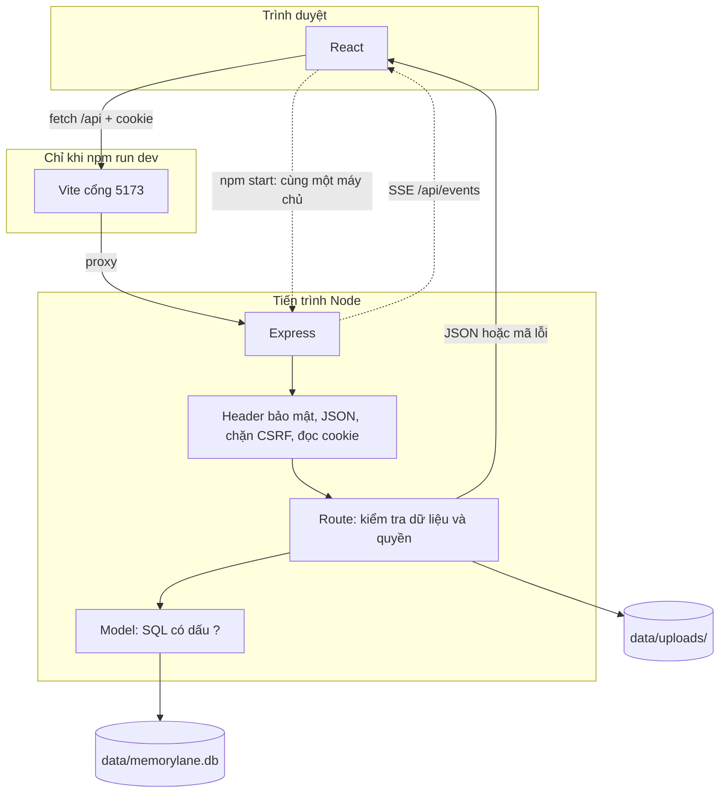

# Kiến trúc Memory Lane

Tài liệu này dành cho người mới học web, muốn nhìn cả dự án trước khi sửa hoặc tự viết lại. Tên file, lệnh và tên biến giữ nguyên tiếng Anh vì đó là những gì bạn sẽ gõ trong terminal và trên hosting.

Ba tài liệu đi cùng nhau:

- Tài liệu này: app là gì, các mảnh ghép nằm ở đâu, một yêu cầu chạy qua hệ thống thế nào.
- [LO-TRINH-TU-XAY-LAI.md](LO-TRINH-TU-XAY-LAI.md): tự xây một bản nhỏ hơn từ thư mục trống.
- [DEPLOY-VA-VAN-HANH.md](DEPLOY-VA-VAN-HANH.md): đưa đúng stack này lên mạng và trông nom nó.

Bản thuyết trình dài hơn nằm ở [PRESENTATION.md](PRESENTATION.md). [PLAN.md](../PLAN.md) là sổ tay rất dài (có cả đoạn code dán sẵn); đừng đọc từ đầu đến cuối trước khi chạy được app.

## Ứng dụng này làm gì

Memory Lane là album riêng tư. Mỗi người có tài khoản, rồi lưu:

- **Kỷ niệm** (`memories`): tiêu đề, câu chuyện, nơi chốn, ngày (có thể chỉ có năm), tối đa 20 ảnh hoặc video.
- **Người quen** (`people`): tên, quan hệ, lần cuối liên lạc, ghi chú.
- **Phim và nhạc** (`media`): bộ phim hoặc bài hát gia đình từng yêu, kèm link xem lại.
- **Chia sẻ**: link mời một lần, hết hạn sau 7 ngày. Người nhận vào "vòng thân quen" rồi được xem đúng những kỷ niệm bạn chọn, và để lại lời nhắn.
- **Kỷ vật** (`artifacts`): bưu thiếp, con tem hoặc thẻ ảnh vẽ từ một kỷ niệm, rồi lưu lại.

Không có bảng tin, không có gợi ý thuật toán. Máy chủ chỉ trả dữ liệu của người đang đăng nhập, hoặc dữ liệu được chia sẻ đích danh với họ.

Giao diện có hai lớp da (Sổ tay và Phòng tối) và hai ngôn ngữ (Tiếng Việt, English). Đó là lớp trang trí. Lõi app vẫn là: form → JSON → SQLite → file ảnh trên đĩa.

## Stack, và vì sao từng thứ có mặt

| Lớp | Công nghệ | Việc nó làm | Nếu bỏ nó thì sao |
| --- | --- | --- | --- |
| Giao diện | React 19 | Chia màn hình thành component, giữ trạng thái "ai đang đăng nhập". | Có thể viết HTML thuần, nhưng mỗi lần thêm kỷ niệm bạn sẽ tự vá DOM. |
| Điều hướng | React Router 8 | Đổi `/album`, `/today`… mà không tải lại cả trang. | Mỗi trang một file HTML cũng được, nhưng cookie phiên và thanh nav phải lặp lại. |
| Build | Vite 8 | Khi học: máy chủ dev ở cổng 5173, sửa code là trình duyệt tải lại. Khi deploy: gói React thành file tĩnh trong `client/dist/`. | Không có bước build thì trình duyệt không hiểu JSX. |
| CSS | CSS thuần + biến | Hai giao diện đổi bằng `<html data-theme="notebook">` hoặc `darkroom`. Font đóng gói bằng `@fontsource`, không gọi Google Fonts. | Một file CSS cũng đủ cho bản tự viết. |
| API | Node.js + Express 5 | Nhận HTTP, trả JSON. Express 5 tự bắt lỗi trong hàm `async`. | Đây là máy chủ thật. Hosting tĩnh (chỉ có HTML) không chạy được phần này. |
| Cơ sở dữ liệu | SQLite qua `node:sqlite` | Một file `memorylane.db`. Có khóa ngoại, index, migration. Không cần cài Postgres. | File JSON tự viết sẽ hỏng khi hai request ghi cùng lúc. |
| Ảnh và video | `multer` ghi thẳng ra đĩa | Video tới 100 MB không nằm trong RAM. Tên file là chuỗi ngẫu nhiên. | `express.static` công khai sẽ để ai cũng đoán URL và tải ảnh. |
| Nén phản hồi | `compression` | Gzip JSON, JS, CSS. Luồng SSE (`/api/events`) được loại ra để không bị giữ trong bộ đệm. | App vẫn chạy, chỉ chậm hơn trên mạng điện thoại. |
| Đăng nhập | Cookie `HttpOnly` + scrypt | Trình duyệt giữ token ngẫu nhiên. Database chỉ lưu SHA-256 của token. Mật khẩu băm bằng scrypt. | JWT nằm trong `localStorage` dễ bị script đọc trộm, và khó thu hồi ngay. |
| Google | OAuth 2.0 / OpenID Connect | Tuỳ chọn. Không có Client ID thì nút Google hiện nhưng bị tắt. | Email + mật khẩu là đủ để dùng app. |
| Thời gian thực | Server-Sent Events | Tab đang mở nhận lời nhắn mới không cần reload. | Bấm tải lại trang vẫn xem được lời nhắn. |
| Kiểm thử | `node:test` | `npm test` chạy API thật trên database tạm. | Không bắt buộc để deploy, nhưng CI trên GitHub đang chạy nó. |

Ba gói npm mà máy chủ cần lúc chạy: `express`, `multer`, `compression`. React và Vite chỉ cần lúc build.

Yêu cầu Node: `>=22.22` (xem `engines` trong `package.json`). File CI và `Dockerfile` dùng Node 24. Máy này đã cài bằng Node 22 và build được; trên hosting hãy đặt Node 24 cho khớp CI.

## Bản đồ thư mục

```text
memory-lane/
├── package.json              Lệnh npm: dev, build, start, seed, test, admin
├── package-lock.json         Khoá đúng phiên bản. Trên hosting dùng `npm ci`
├── vite.config.js            Vite lấy gốc là client/, chuyển /api sang cổng 3001
├── .env.example              Tên biến môi trường. Chép thành .env khi muốn đổi mặc định
├── render.yaml               Công thức deploy trên Render (đã viết sẵn)
├── Dockerfile                Cùng app, đóng trong image, gắn ổ đĩa ở /data
├── shared/                   Code dùng cả trình duyệt lẫn máy chủ
│   ├── limits.js             Độ dài tối đa, loại thẻ, ngôn ngữ hợp lệ
│   └── dates.js              Tính "hôm nay nhiều năm trước"
├── client/                   Giao diện React. Đây là root của Vite
│   ├── index.html            Trang HTML duy nhất
│   ├── public/               favicon, theme-init.js, ảnh trang giới thiệu
│   └── src/
│       ├── main.jsx          Bật React, font, các provider
│       ├── App.jsx           Danh sách route. Trang sau đăng nhập được tải khi cần
│       ├── api.js            Mọi fetch() nằm ở đây
│       ├── auth.jsx          user = undefined | null | {…}
│       ├── state.jsx         Dữ liệu dùng chung, hook tải trang
│       ├── theme.jsx         Sổ tay / Phòng tối
│       ├── i18n/             vi.js, en.js, và hàm t('...')
│       ├── pages/            Mỗi màn hình một file
│       ├── components/       Thanh nav, form, gallery, hộp thoại
│       ├── lib/              Nén ảnh, video, vẽ thẻ, thanh tiến trình upload
│       └── styles/           CSS. File này lớn vì có hai giao diện
├── server/
│   ├── index.js              Mở database, listen cổng, tắt gọn khi nhận SIGTERM
│   ├── app.js                Lắp middleware, route, trang tĩnh, bắt lỗi
│   ├── config.js             Đọc .env và process.env
│   ├── db.js                 Mở SQLite, chạy migration
│   ├── migrations/           001 … 005, chạy một lần theo thứ tự
│   ├── models/               Mọi câu SQL
│   ├── routes/               Một nhóm URL một file
│   ├── lib/                  Mật khẩu, phiên, file, bảo mật, Google, SSE
│   ├── seed.js               Tạo lại tài khoản demo (không đụng tài khoản thật)
│   ├── admin.js              Lệnh quản trị trên máy chủ, không phải URL công khai
│   └── seed-media/           Ảnh và video demo, khoảng 34 MB, cố ý commit
├── test/                     Kiểm thử API. Không cần để app chạy
└── docs/                     Tài liệu
```

Quy tắc đọc code: giao diện không viết SQL. Route không viết câu SQL dài. Model không biết HTTP. Nhờ vậy, khi một trang hỏng bạn biết nên mở `pages/`, `routes/` hay `models/`.

### Trang trên giao diện (`client/src/App.jsx`)

| URL | File | Ai vào được |
| --- | --- | --- |
| `/` | `pages/Landing.jsx` | Khách. Nếu đã đăng nhập thì chuyển tới `/today` |
| `/login`, `/register` | `Login.jsx`, `Register.jsx` | Chỉ khách |
| `/join/:token` | `Join.jsx` | Ai cũng mở được link mời |
| `/today` | `Today.jsx` | Đã đăng nhập |
| `/album`, `/album/:id` | `Album.jsx`, `MemoryDetail.jsx` | Đã đăng nhập |
| `/people`, `/people/:id` | `People.jsx`, `PersonDetail.jsx` | Đã đăng nhập |
| `/sharing` | `Sharing.jsx` | Đã đăng nhập |
| `/archive` | `Archive.jsx` | Phim và nhạc |
| `/artifacts` | `Artifacts.jsx` | Kỷ vật, chỉ của bạn |
| `/timeline`, `/search`, `/settings` | file cùng tên | Đã đăng nhập |

`RequireAuth` trong `components/RouteGuards.jsx` chặn các URL riêng tư khi chưa có user.

### API (`server/app.js`)

Mọi URL API bắt đầu bằng `/api`. Máy chủ trả mã lỗi (`EMAIL_TAKEN`, `UNAUTHORIZED`…), không trả câu tiếng Việt. Giao diện dịch mã đó trong `client/src/i18n/`.

Công khai (không cần cookie):

- `GET /api/health` → `{ "ok": true }` hoặc 503
- `GET /api/auth/session`
- `POST /api/auth/register`, `/login`, `/logout`, `/demo`
- `GET /api/auth/google/start`, `GET /api/auth/google/callback`
- `GET /api/invites/preview/:token`

Còn lại cần đăng nhập. Ảnh không bao giờ là file tĩnh: `GET /api/files/:name` kiểm tra bạn là chủ hoặc được chia sẻ, rồi mới `sendFile`.

## Một yêu cầu đi như thế nào

Khi học trên máy, trình duyệt chỉ nói chuyện với Vite (cổng 5173). Vite chuyển mọi đường dẫn `/api` sang Express (cổng 3001). Xem `vite.config.js`, mục `proxy`.

Khi đã `npm run build && npm start`, chỉ còn một cổng (mặc định 3001). Express vừa trả file trong `client/dist/`, vừa trả API. Trình duyệt gọi `/api/...` cùng nguồn gốc (same origin), nên cookie đi kèm và không cần CORS.



Ví dụ "tạo một kỷ niệm":

1. `MemoryForm` gọi `api.post('/api/memories', { title, story, ... })` trong `client/src/api.js`.
2. `fetch` gửi cookie `ml_session` (JavaScript không đọc được cookie này).
3. `sessions.loadUser` băm token, tìm dòng trong bảng `sessions`, gán `req.user`.
4. `requireAuth` trả 401 nếu không có user.
5. `validator` trong `server/lib/validate.js` cắt độ dài theo `shared/limits.js`.
6. `memoriesModel` chạy `INSERT` với tham số `?`, luôn kèm `user_id` của người đang đăng nhập.
7. React nhận JSON và vẽ lại danh sách.

Ví dụ "xem ảnh":

1. Thẻ `` cũng gửi cookie.
2. `fileRoutes` từ chối tên file lạ, rồi hỏi model: user này có được xem file này không.
3. Không được thì 404 (cùng một mã với "không có file", để người ngoài không dò được tên).
4. Được thì Express gửi file, có hỗ trợ `Range` để video tua được.

## Dữ liệu nằm ở đâu

`DATA_DIR` (mặc định thư mục `data/`, đã nằm trong `.gitignore`) chứa:

- `memorylane.db` — SQLite, chế độ WAL (có thêm file `-wal` và `-shm` khi đang chạy).
- `uploads/` — ảnh, video, ảnh bìa video, ảnh thẻ kỷ vật. Tên dạng 32 ký tự hex + đuôi thật.

Migration trong `server/migrations/` chạy lúc mở database. `PRAGMA user_version` nhớ đã chạy tới file nào. Thứ tự:

1. `001_init.sql` — user, session, kỷ niệm, người, phim/nhạc.
2. `002_media_sharing.sql` — nhiều file mỗi kỷ niệm, lời mời, chia sẻ, lời nhắn.
3. `003_google_login.sql` — cột `google_sub`, `google_email`.
4. `004_artifacts.sql` rồi `005_card_artifacts.sql` — kỷ vật là thẻ gắn với một kỷ niệm.

Mỗi bảng nghiệp vụ có `user_id`. Xoá user thì `ON DELETE CASCADE` xoá dữ liệu của họ. File trên đĩa do route xoá thêm, vì SQLite không xoá được file.

## Đăng nhập, phiên, và quyền

- Mật khẩu: `server/lib/password.js` băm bằng scrypt. Chuỗi lưu dạng `scrypt$N$r$p$salt$hash`. Email không tồn tại vẫn mất cùng một lượng thời gian kiểm tra, để người ngoài không dò được email nào đã đăng ký.
- Cookie `ml_session`: `HttpOnly`, `SameSite=Lax`, `path=/`. Cờ `Secure` chỉ bật khi `NODE_ENV=production`. Database lưu SHA-256 của token. Đăng xuất là xoá dòng đó, có hiệu lực ngay.
- Thời hạn phiên: `SESSION_DAYS` (mặc định 30). Đổi mật khẩu hoặc "đăng xuất mọi nơi" xoá hết session của user đó.
- Google: `server/lib/google.js` và `server/routes/google.js`. Có PKCE, `state`, `nonce`. Tài khoản email cũ không tự gộp với Google. Không đặt `GOOGLE_CLIENT_ID` thì phần này tắt.
- Nút demo: `POST /api/auth/demo` chỉ chạy khi `ALLOW_DEMO=true` (đây là mặc định nếu bạn quên không đặt biến). Mật khẩu demo là ngẫu nhiên, không ai biết; cửa vào là nút bấm. Trên mạng thật hãy tắt, xem tài liệu deploy.
- Link mời: 192 bit ngẫu nhiên, database chỉ giữ mã băm, dùng một lần, hết hạn theo `INVITE_DAYS`.
- CSRF: cookie `SameSite=Lax` cộng với kiểm tra header `Sec-Fetch-Site` trong `server/lib/security.js`. Không có middleware CORS. Đừng thêm `Access-Control-Allow-Origin: *` — cookie phiên sẽ không còn an toàn.
- Rate limit: bộ nhớ của một tiến trình Node, trong `server/lib/rateLimit.js`. Áp vào đăng nhập, đăng ký, Google, và xem trước link mời. Khởi động lại máy chủ là bộ đếm về 0. Chỉ đúng khi bạn chạy **một** instance.

## Chạy trên máy, từng bước

1. Cài Node.js **22.22 trở lên**. Bản khớp CI là **24**. Kiểm tra:

   ```bash
   node -v
   npm -v
   ```

2. Vào thư mục dự án (nơi có `package.json`).

3. Cài đúng bộ khoá trong `package-lock.json`:

   ```bash
   npm ci
   ```

   `npm install` cũng được khi bạn đang sửa dependency. Trên hosting dùng `npm ci`.

4. Biến môi trường là tuỳ chọn trên máy. Muốn đổi cổng hoặc tắt demo:

   ```bash
   cp .env.example .env
   ```

   Sửa `.env`. File này đã bị git bỏ qua. Không điền Client secret thật vào file nào sẽ được commit.

5. Dữ liệu demo (tài khoản An và năm người bạn, ảnh trong `server/seed-media/`):

   ```bash
   npm run seed
   ```

   Lệnh này chỉ tạo lại các email demo. Tài khoản bạn tự đăng ký không bị xoá.

6. Chạy giao diện và API cùng lúc:

   ```bash
   npm run dev
   ```

   Mở http://localhost:5173 . Bấm "Dùng thử bản demo". API nằm ở http://localhost:3001/api/health và phải trả `{ "ok": true }`.

   Chỉ chạy **một** `npm run dev`. Lần thứ hai sẽ báo cổng 5173 đã bị chiếm (`strictPort: true` trong `vite.config.js`).

7. Chạy giống lúc lên mạng (một cổng, file đã build):

   ```bash
   npm run build
   npm start
   ```

   Mở http://localhost:3001 . `npm run build` ghi ra `client/dist/` (thư mục này không commit).

8. Kiểm thử máy chủ (không cần trình duyệt):

   ```bash
   npm test
   ```

`npm run dev:phone` mở Vite cho điện thoại cùng Wi-Fi. Google từ chối redirect về địa chỉ `192.168...`, nên đăng nhập Google trên điện thoại chỉ làm được qua bản đã có HTTPS.

## Mọi biến môi trường

Giá trị dưới đây là mặc định hoặc ví dụ hình thức. Không có bí mật thật trong repo.

| Biến | Đọc ở đâu | Mặc định | Ý nghĩa |
| --- | --- | --- | --- |
| `PORT` | `server/config.js`, `vite.config.js` | `3001` | Cổng Express. Hosting thường tự gán. Vite dùng cùng số này để proxy. |
| `DATA_DIR` | `server/config.js` | `./data` | Thư mục chứa `memorylane.db` và `uploads/`. |
| `ALLOW_DEMO` | `server/config.js` | `true` nếu không đặt | `true` hiện nút demo. Album thật phải là `false`. |
| `SESSION_DAYS` | `server/config.js` | `30` | Số ngày cookie còn hiệu lực. |
| `MAX_UPLOAD_MB` | `server/config.js` | `15` | Ảnh lớn nhất, đơn vị MB. |
| `MAX_VIDEO_MB` | `server/config.js` | `100` | Video lớn nhất, đơn vị MB. |
| `STORAGE_MB` | `server/config.js` | `2048` | Trần dung lượng file của một tài khoản. |
| `INVITE_DAYS` | `server/config.js` | `7` | Số ngày một link mời còn dùng được. |
| `AUTH_RATE_LIMIT` | `server/config.js` | `20` | Số lần đăng nhập hoặc đăng ký mỗi IP trong 15 phút. |
| `GOOGLE_CLIENT_ID` | `server/config.js` | trống | Bật nút Google. Dạng `....apps.googleusercontent.com`. |
| `GOOGLE_CLIENT_SECRET` | `server/config.js` | trống | Bí mật OAuth. Chỉ đặt trên hosting hoặc trong `.env` máy bạn. |
| `PUBLIC_URL` | `server/config.js` | trống | `https://ten-mien-cua-ban`, không có `/` cuối. Dùng để tạo URL quay về của Google. |
| `NODE_ENV` | `server/config.js` | trống lúc dev | `production` bật cookie `Secure`, HSTS, và `trust proxy`. |
| `NODE_VERSION` | Render, không phải code app | | Bảo hosting dùng Node 24. |
| `ENV_FILE` | `server/setup-google.js` | `.env` | Chỉ cho lệnh `npm run setup:google` và bài test. |
| `E2E_PORT`, `E2E_CHROME_PORT`, `CHROME_PATH` | `test/e2e/` | | Chỉ khi chạy `npm run test:e2e`. |

Đăng nhập Google trên máy: `npm run setup:google` hỏi Client ID và Client secret rồi ghi vào `.env`. Hướng dẫn đầy đủ nằm ở [DEPLOY.md](DEPLOY.md).
