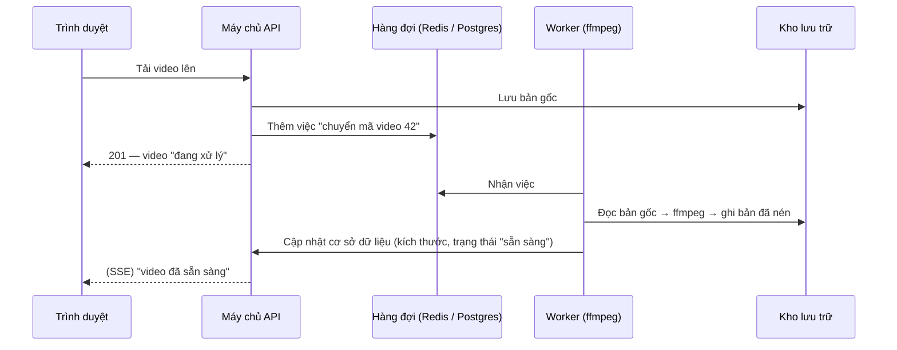
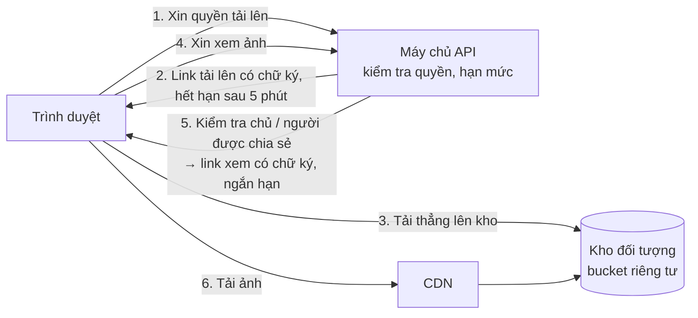
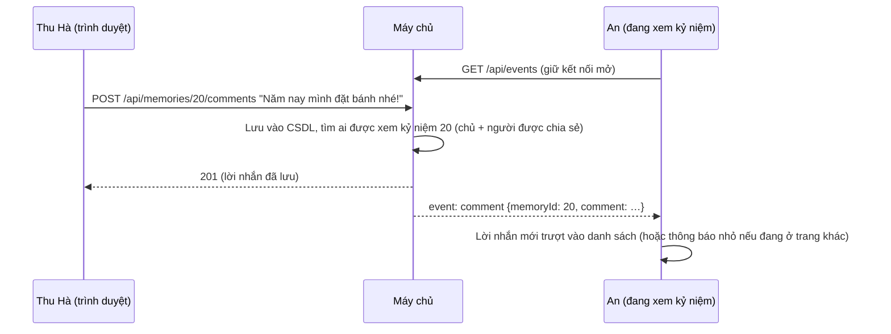

# Khi Memory Lane có nhiều người dùng

> Ảnh và video chiếm gần như **toàn bộ** dung lượng và băng thông của Memory Lane, lại là dữ liệu **riêng tư nhất** của người
> dùng. Vì vậy "làm nhỏ dữ liệu mà vẫn giữ chất lượng, lưu ở đâu, bảo vệ thế nào" là bài toán cốt lõi của dự án.
> Tài liệu này giải thích: bản MVP **đang làm gì** (kèm số liệu đo thật), và **nên làm gì tiếp** khi lượng người dùng tăng.
> Phần cuối nói về tương tác **thời gian thực** trong kỷ niệm chung.

## Mục lục

1. [Hình dung con số](#1-hình-dung-con-số)
2. [Ảnh: nhỏ đi nhiều, nhìn như cũ](#2-ảnh-nhỏ-đi-nhiều-nhìn-như-cũ)
3. [Video: phần nặng nhất](#3-video-phần-nặng-nhất)
4. [Lưu trữ: từ một thư mục đến kho lưu trữ đám mây](#4-lưu-trữ-từ-một-thư-mục-đến-kho-lưu-trữ-đám-mây)
5. [Bảo mật và an toàn dữ liệu khi hệ thống lớn lên](#5-bảo-mật-và-an-toàn-dữ-liệu-khi-hệ-thống-lớn-lên)
6. [Tương tác thời gian thực trong kỷ niệm chung](#6-tương-tác-thời-gian-thực-trong-kỷ-niệm-chung)
7. [Lộ trình theo giai đoạn](#7-lộ-trình-theo-giai-đoạn)

---

## 1. Hình dung con số

Một phép tính **ước lượng** để thấy vì sao phải nén. Giả định:

- Mỗi người dùng có 500 ảnh và 20 video, mỗi video khoảng 1 phút.
- Ảnh gốc từ điện thoại 12 MP nặng khoảng 3 MB.
- Video 1080p từ điện thoại nặng khoảng 100 MB mỗi phút (tuỳ máy, tuỳ codec).

| Cách lưu | Mỗi người dùng | 10.000 người dùng |
| --- | --- | --- |
| Giữ nguyên tệp gốc | 500 × 3 MB + 20 × 100 MB ≈ **3,5 GB** | ≈ **35 TB** |
| Cách Memory Lane làm với ảnh (2000 px, WebP) + nén video về khoảng 35 MB/phút | 500 × 0,27 MB + 20 × 35 MB ≈ **0,8 GB** | ≈ **8 TB** |

Nén đúng cách giúp **giảm khoảng 4 lần** dung lượng, tức cũng giảm khoảng 4 lần tiền lưu trữ, tiền băng thông và thời gian tải trên
mạng điện thoại. Các con số trên chỉ là ước lượng để hình dung. Giá lưu trữ của các nhà cung cấp thay đổi theo thời gian, nên
cần xem trang giá hiện tại khi lên kế hoạch thật.

---

## 2. Ảnh: nhỏ đi nhiều, nhìn như cũ

### "Giữ nguyên chất lượng" nghĩa là gì?

- **Không mất dữ liệu (lossless):** từng điểm ảnh giống hệt bản gốc. Ảnh chụp thật chỉ nhỏ đi được rất ít theo cách này.
- **Không mất về mặt thị giác (visually lossless):** máy tính đo được có thay đổi, nhưng mắt người không thấy. Đây là cách mọi dịch
  vụ ảnh lớn đang làm, và là mục tiêu của Memory Lane.

Để đo "mắt người có thấy không", ta dùng **SSIM** (Structural Similarity, chỉ số giống nhau về cấu trúc). SSIM = 1 là giống hệt.
Trên khoảng 0.98, người xem bình thường gần như không phân biệt được hai ảnh khi xem ở kích thước thật.

### Bản MVP đang làm gì (`client/src/lib/image.js`)

Mọi ảnh được **xử lý ngay trong trình duyệt**, trước khi gửi lên máy chủ:

1. **Vẽ lại lên `<canvas>`.** Bước này bỏ hết EXIF, kể cả toạ độ GPS, và xoay ảnh đúng chiều.
2. **Thu nhỏ cạnh dài về tối đa 2000 px.** Ảnh 12 MP (4032×3024) chỉ còn 2000×1500. Bấy nhiêu đủ nét cho màn hình máy tính,
   điện thoại, và cả in ảnh 6×4 inch ở 300 dpi (cần 1800×1200).
3. **Lưu dạng WebP chất lượng 0.85** nếu trình duyệt hỗ trợ (Chrome, Edge, Firefox, Android, Safari bản mới). Nếu không,
   ảnh tự lưu dạng JPEG 0.88.
4. **Tạo bản xem trước 560 px**, cũng dạng WebP. Lưới album chỉ tải bản này, không tải ảnh lớn.

Bước 2 tiết kiệm nhiều nhất: ít điểm ảnh hơn khoảng 4 lần. Bước 3 tiết kiệm thêm khoảng 30%. Với một ảnh điện thoại 3 MB,
kết quả thường còn **khoảng 300–500 KB**.

### Số liệu đo thật trên ảnh demo

Đo trên 23 ảnh demo (khoảng 1600 px). Mỗi ảnh được nén lại bằng chính canvas của trình duyệt, rồi so với ảnh gốc bằng SSIM:

| Cách nén | Dung lượng trung bình | So với JPEG 0.88 | SSIM trung bình | SSIM thấp nhất |
| --- | --- | --- | --- | --- |
| JPEG 0.88 (cách cũ) | 358 KB | — | 0.998 | 0.993 |
| WebP 0.90 | 319 KB | −11% | 0.996 | 0.987 |
| **WebP 0.85 (đang dùng)** | **249 KB** | **−30%** | **0.994** | **0.977** |
| WebP 0.80 | 205 KB | −43% | 0.992 | 0.964 |

WebP 0.85 là điểm cân bằng: nhỏ hơn 30% mà vẫn rất gần bản gốc. Ảnh có nhiều chi tiết nhỏ (lá cây, sóng nước) là ảnh có SSIM
thấp nhất, nên ta không xuống thấp hơn 0.85.

### Bước tiếp theo khi có nhiều người dùng

- **Nhiều kích thước cho mỗi ảnh** (ví dụ 560 / 1280 / 2000 px) và thuộc tính `srcset` của ``. Điện thoại tự chọn bản
  1280 px, giảm thêm băng thông cho người xem.
- **AVIF:** thường nhỏ hơn WebP thêm khoảng 20% ở cùng chất lượng. Nhưng trình duyệt chưa tự tạo được AVIF qua canvas, nên
  phải làm ở máy chủ, bằng thư viện **sharp** (dựa trên libvips) chạy trong một tiến trình nền.
- **Tuỳ chọn "Giữ bản gốc"** cho ai muốn lưu trữ lâu dài, ví dụ ảnh gia đình quý. Bản gốc được cất ở lớp lưu trữ "lạnh" rẻ
  hơn (xem phần 4), còn app vẫn hiển thị bản đã nén.

---

## 3. Video: phần nặng nhất

### Bản MVP đang làm gì

- Video được **lưu nguyên tệp**, tối đa 100 MB (`MAX_VIDEO_MB`).
- Trình duyệt đo độ dài và chụp một **khung hình đại diện** (poster) dạng WebP.
- Máy chủ **xoá toạ độ nơi quay** trong tệp MP4/MOV.
- Khi xem, video được phát theo kiểu **HTTP Range** (mã 206): trình duyệt xin từng đoạn, nên video phát ngay và tua được.

Lưu nguyên tệp có hai vấn đề:

- Video điện thoại có **bitrate rất cao** (thường 10–20 Mbps), nên 45 giây đã nặng khoảng 70 MB, đúng như video bạn tải thử
  (khoảng 12 Mbps).
- Video **HEVC** của iPhone không phát được trên một số trình duyệt Windows.

### Giải pháp: chuyển mã (transcode) ở máy chủ

Sau khi nhận video, một **tiến trình nền** (worker) dùng **ffmpeg** chuyển video sang định dạng phổ biến, với bitrate hợp lý:

```bash
ffmpeg -i input.mov -vf "scale='min(1920,iw)':-2" -c:v libx264 -preset medium -crf 23 -c:a aac -b:a 128k -movflags +faststart output.mp4
```

| Tham số | Ý nghĩa |
| --- | --- |
| `scale='min(1920,iw)':-2` | Tối đa 1920 px bề ngang (1080p); video nhỏ hơn giữ nguyên |
| `-c:v libx264` | Mã H.264: trình duyệt nào, máy nào cũng phát được |
| `-crf 23` | **Chất lượng mục tiêu**, không phải bitrate cố định: cảnh tĩnh dùng ít dữ liệu, cảnh động dùng nhiều hơn. 18 gần như không mất gì, 23 là mặc định cân bằng, 28 nhỏ hơn hẳn |
| `-c:a aac -b:a 128k` | Âm thanh AAC 128 kbps |
| `-movflags +faststart` | Đưa phần chỉ mục lên đầu tệp, để video phát ngay khi mới tải được vài trăm KB |

Với video điện thoại thông thường, cách này thường **giảm khoảng 50–80% dung lượng** mà mắt khó nhận ra khác biệt. Con số
thật phụ thuộc vào từng video, nên hãy đo trên vài video mẫu khi triển khai. Có thể đi xa hơn:

- **HEVC / AV1:** nhỏ hơn H.264 thêm khoảng 30–50%. Đổi lại phải lưu thêm một bản H.264 cho thiết bị chưa hỗ trợ.
- **HLS** (phát thích ứng): video dài được cắt thành nhiều đoạn ở nhiều mức chất lượng. Mạng yếu thì trình duyệt tự xem bản thấp.

### Luồng xử lý với hàng đợi (queue)

Chuyển mã tốn CPU và mất từ vài giây tới vài phút, nên **không làm trong lúc trả lời yêu cầu tải lên**:



Công cụ hàng đợi phổ biến: **BullMQ** (dùng Redis) hoặc **pg-boss** (dùng PostgreSQL). Nếu không muốn tự vận hành ffmpeg, có
thể dùng dịch vụ có sẵn như Cloudflare Stream, Mux hoặc AWS MediaConvert, tính tiền theo số phút video.

**Phương án phía trình duyệt:** API **WebCodecs** (Chrome, Edge, Safari bản mới) cho phép nén lại video ngay trên điện
thoại trước khi tải lên. Cách này tiết kiệm cả dung lượng 4G của người dùng, nhưng khá phức tạp: phải tách và ghép tệp MP4,
xử lý âm thanh, và hỗ trợ khác nhau giữa các trình duyệt. Nên để sau.

---

## 4. Lưu trữ: từ một thư mục đến kho lưu trữ đám mây

### Hiện tại

Ảnh và video nằm trong thư mục `data/uploads/` trên **một** máy chủ, dữ liệu nằm trong tệp SQLite `data/memorylane.db`. Cách
này đơn giản, đủ cho đồ án và vài trăm người dùng, nhưng không chạy được trên nhiều máy chủ cùng lúc.

### Khi lớn lên: kho lưu trữ đối tượng (object storage)

Chuyển ảnh/video sang **S3, Cloudflare R2 hoặc Backblaze B2**: dung lượng gần như không giới hạn, độ bền cao, giá tính theo GB.



Các ý chính:

- **Bucket riêng tư:** không ai truy cập trực tiếp được.
- **Link có chữ ký (signed URL / presigned URL):** máy chủ vẫn **kiểm tra quyền mỗi lần**, giống `/api/files` bây giờ. Sau đó
  máy chủ đưa cho trình duyệt một đường link có hạn vài phút. Thu hồi chia sẻ thì những link mới không còn được cấp nữa.
- **Tải thẳng lên kho:** tệp lớn không phải đi qua máy chủ ứng dụng, nên máy chủ nhẹ hơn hẳn.
- **CDN:** ảnh được phục vụ từ máy gần người xem nhất. Với dữ liệu riêng tư, CDN chỉ được giữ bản sao trong thời gian rất ngắn
  và phải kiểm tra chữ ký.
- **Khử trùng lặp (deduplication):** đặt tên tệp theo **mã băm SHA-256 của nội dung**. Ví dụ ảnh nhóm được 5 người cùng tải
  lên thì chỉ lưu một lần. Khi xoá, phải đếm còn bao nhiêu kỷ niệm đang dùng tệp đó.
- **Vòng đời (lifecycle):** bản gốc ít khi được mở lại, nên tự chuyển sang lớp lưu trữ "lạnh" rẻ hơn sau 30 ngày. Bản xem trước
  luôn ở lớp "nóng".
- **Hạn mức theo gói:** hiện mỗi tài khoản có `STORAGE_MB`; sau này có thể chia gói miễn phí / trả phí.
- **Dọn tệp mồ côi:** bản MVP đã xoá tệp tạm và tệp của kỷ niệm bị xoá. Khi lên kho đám mây, chạy thêm một việc định kỳ để đối
  chiếu cơ sở dữ liệu với kho.

### Cơ sở dữ liệu

SQLite → **PostgreSQL** khi có nhiều máy chủ. Phần lớn câu SQL trong `server/models/` giữ nguyên. Chỉ vài chỗ dùng tính năng
riêng của SQLite phải đổi: `json_group_array` thành `json_agg`, hàm `fold()` bỏ dấu tiếng Việt thành extension `unaccent`.
Cần thêm sao lưu tự động (và khôi phục được về một thời điểm), cùng nhóm kết nối (connection pool).

---

## 5. Bảo mật và an toàn dữ liệu khi hệ thống lớn lên

| Lớp | Bản MVP đang có | Khi có nhiều người dùng |
| --- | --- | --- |
| Đường truyền | HTTPS + HSTS khi chạy thật | Như cũ |
| Quyền truy cập | Mỗi yêu cầu xem ảnh/video đều kiểm tra chủ hoặc người được chia sẻ; người khác nhận 404 | Như cũ, cộng thêm link có chữ ký ngắn hạn |
| Siêu dữ liệu | Xoá GPS/EXIF ở trình duyệt **và** máy chủ, kể cả trong video | Như cũ, làm thêm trong worker sau khi chuyển mã |
| Lưu trữ | Tệp tên ngẫu nhiên, không có thư mục công khai | **Mã hoá khi lưu** (S3/R2 bật sẵn); khoá truy cập kho chỉ có quyền tối thiểu |
| Tệp độc hại | Nhận diện bằng magic bytes, chỉ nhận định dạng an toàn | Quét virus (ví dụ ClamAV) trong worker |
| Sao lưu | Tự làm thủ công | Nguyên tắc **3-2-1**: 3 bản, 2 loại lưu trữ, 1 bản ở nơi khác; và **diễn tập khôi phục** định kỳ |
| Tài khoản | Mật khẩu scrypt, phiên thu hồi được, đăng nhập Google an toàn | Xác minh email, quên mật khẩu, xác thực hai lớp (2FA) |
| Giám sát | Nhật ký máy chủ | Nhật ký truy cập dữ liệu, cảnh báo bất thường, giới hạn tần suất dùng chung (Redis) |
| Pháp lý | — | Tuân thủ quy định về bảo vệ dữ liệu cá nhân của Việt Nam (Nghị định 13/2023/NĐ-CP và các văn bản mới hơn): xin đồng ý, cho xuất và xoá dữ liệu (app đã có sẵn hai việc này) |

### Còn mã hoá đầu-cuối (end-to-end) thì sao?

Mã hoá đầu-cuối nghĩa là chỉ máy của bạn và người được chia sẻ mới giải mã được; máy chủ chỉ thấy dữ liệu đã mã hoá. Rất riêng
tư, nhưng cái giá khá lớn:

- Máy chủ **không tự tạo ảnh xem trước, không chuyển mã video, không tìm kiếm** được.
- Chia sẻ cho người mới đòi hỏi trao **khoá** an toàn giữa các máy.
- **Mất khoá là mất ảnh vĩnh viễn.**

Ở giai đoạn này, cách hợp lý là **mã hoá phía máy chủ + kiểm soát quyền chặt chẽ + xoá siêu dữ liệu**. Mã hoá đầu-cuối có thể là
một tuỳ chọn cho riêng các "ngăn bí mật" sau này.

---

## 6. Tương tác thời gian thực trong kỷ niệm chung

### Đã làm: lời nhắn và chia sẻ hiện ra ngay

Khi Thu Hà viết lời nhắn dưới kỷ niệm mà An đang xem, lời nhắn **tự hiện ra** trên màn hình của An, không cần tải lại. Khi ai đó
chia sẻ một kỷ niệm với bạn, góc màn hình hiện thông báo nhỏ và tab "Chia sẻ" cập nhật dấu **mới**.

Công nghệ dùng là **Server-Sent Events (SSE)**:

- Mỗi tab đang mở giữ một kết nối HTTP dài tới `GET /api/events`.
- Mỗi khi có chuyện liên quan tới người đó, máy chủ ghi một dòng sự kiện vào kết nối.

Code nằm ở `server/lib/live.js` (máy chủ) và `client/src/components/LiveUpdates.jsx` (trình duyệt).



### Vì sao SSE mà không phải WebSocket hay hỏi định kỳ?

| Cách | Hoạt động | Hợp với Memory Lane? |
| --- | --- | --- |
| Hỏi định kỳ (polling) | Cứ 15 giây trình duyệt hỏi "có gì mới không?" | Dễ nhất, nhưng chậm tới 15 giây và tốn yêu cầu vô ích |
| **SSE** | Máy chủ chủ động đẩy xuống qua một kết nối HTTP | **Vừa đủ:** app chỉ cần chiều máy chủ → trình duyệt; không cần thư viện; trình duyệt tự kết nối lại khi rớt mạng; dùng chung cookie đăng nhập |
| WebSocket | Kênh hai chiều liên tục | Cần cho chat nhanh, "đang gõ…", chơi game; ở đây là thừa, phải thêm thư viện và xử lý xác thực riêng |

### Giao diện có giống bình luận Facebook không?

Cố ý **không giống hẳn**. Memory Lane không có bảng tin công khai, không đếm lượt thích, không xếp hạng ai bình luận hay nhất.
Lời nhắn giống **những tờ giấy note dán dưới một tấm ảnh trong album gia đình**:

- **Ai thấy:** chỉ chủ kỷ niệm và những người được chia sẻ. Ô nhập luôn ghi rõ ai sẽ thấy lời nhắn.
- **Thứ tự:** từ cũ đến mới, như một cuộc trò chuyện. Lời nhắn mới trượt vào và sáng lên trong giây lát.
- **Báo hiệu:** chấm xanh nhỏ cạnh tiêu đề "Lời nhắn" cho biết danh sách đang cập nhật trực tiếp.
- **Quyền xoá:** tác giả xoá được lời nhắn của mình; chủ kỷ niệm xoá được mọi lời nhắn dưới kỷ niệm của mình.

Có thể thêm sau này, vẫn giữ tinh thần riêng tư và nhẹ nhàng:

- Thả **một biểu tượng cảm xúc** cho từng ảnh (không hiện bảng xếp hạng).
- Trả lời trực tiếp một lời nhắn.
- "Hà đang xem kỷ niệm này".
- **Thông báo đẩy (Web Push)** khi app đang đóng, hoặc email tóm tắt hằng tuần.

### Khi có nhiều người dùng

- Mỗi tab giữ một kết nối. Với HTTP/1.1, trình duyệt chỉ mở tối đa 6 kết nối tới một tên miền. Chạy sau **HTTP/2** (Render,
  Cloudflare và nginx đều hỗ trợ) thì không lo giới hạn này.
- Ngay cả khi chạy ở máy (HTTP/1.1), app chỉ giữ kết nối khi trang **đang hiện trên màn hình**. Tab bị ẩn, hay trang được trình
  duyệt cất vào bộ nhớ "quay lại" (bfcache), sẽ đóng kết nối; quay lại thì mở lại và tải lại dữ liệu. Trước khi sửa, sau vài lần
  chuyển trang, các trang cũ nằm trong bfcache giữ hết 6 kết nối và ảnh ngừng tải. Lỗi này lộ ra khi chụp ảnh màn hình tự động.
- Nhiều máy chủ API: sự kiện phát ở máy A phải tới được người đang nối với máy B. Dùng **Redis pub/sub** làm "bảng tin chung"
  giữa các máy.
- Một số nền tảng "serverless" không giữ được kết nối dài. Với chúng, dùng dịch vụ realtime riêng (Ably, Pusher) hoặc quay về
  hỏi định kỳ.

---

## 7. Lộ trình theo giai đoạn

| Giai đoạn | Quy mô | Việc nên làm |
| --- | --- | --- |
| **1. Đồ án (hiện tại)** | Một máy chủ, vài chục người | Đã có: nén ảnh WebP trong trình duyệt, xem trước 560 px, xoá GPS hai lớp, hạn mức, phát video theo Range, SSE |
| **2. Ra mắt nhỏ** | Vài trăm người | PostgreSQL; ảnh/video lên R2/S3 + link có chữ ký; worker ffmpeg + hàng đợi; sao lưu tự động; xác minh email, quên mật khẩu |
| **3. Lớn dần** | Hàng nghìn người trở lên | CDN; nhiều kích thước ảnh + AVIF; HLS cho video dài; khử trùng lặp; nhiều máy chủ + Redis (sự kiện, giới hạn tần suất); giám sát, cảnh báo; gói lưu trữ |

Nguyên tắc chung: **đo trước, tối ưu sau**. Hãy đo kích thước thật, thời gian thật và chi phí thật ở từng giai đoạn, giống bảng
đo WebP ở phần 2, thay vì đoán.
