# Memory Lane — Thuyết trình toàn bộ dự án

> Tài liệu này giải thích **toàn bộ** dự án như một buổi thuyết trình: ý tưởng, tính năng, kiến trúc, front-end, back-end, cơ sở
> dữ liệu, chia sẻ, thời gian thực, đăng nhập Google, bảo mật, đa ngôn ngữ, giao diện, kiểm thử và triển khai.
> Người đọc được giả định là **vừa học xong một khóa lập trình web**: đã biết HTML/CSS/JavaScript, đã nghe về React, Node.js, API,
> SQL, nhưng chưa từng tự ráp tất cả lại thành một sản phẩm hoàn chỉnh. Mỗi khái niệm đều được giải thích bằng lời thường trước, rồi
> mới chỉ vào code thật trong dự án.

<p>
  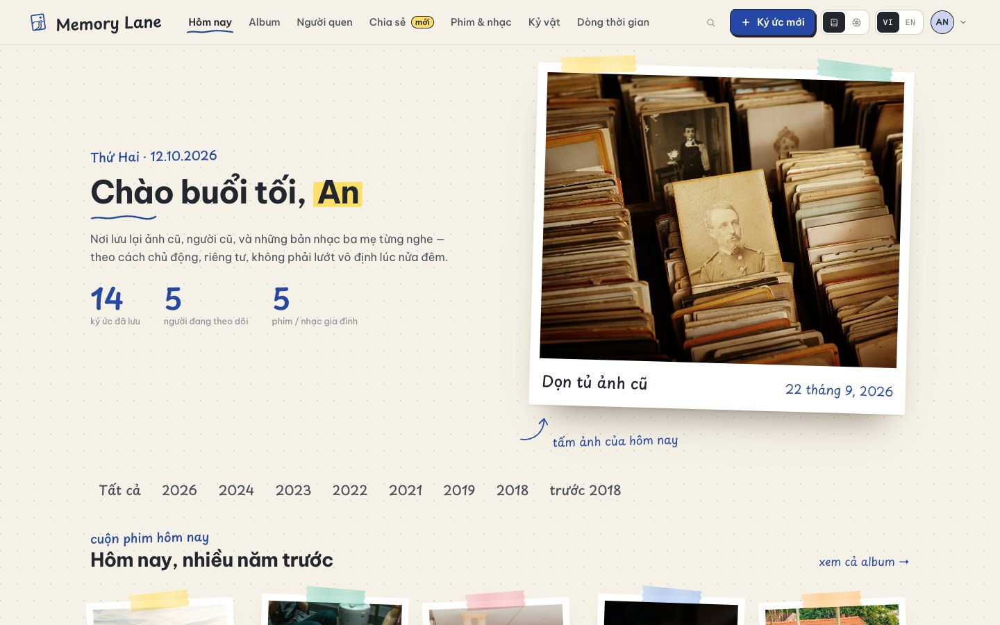
  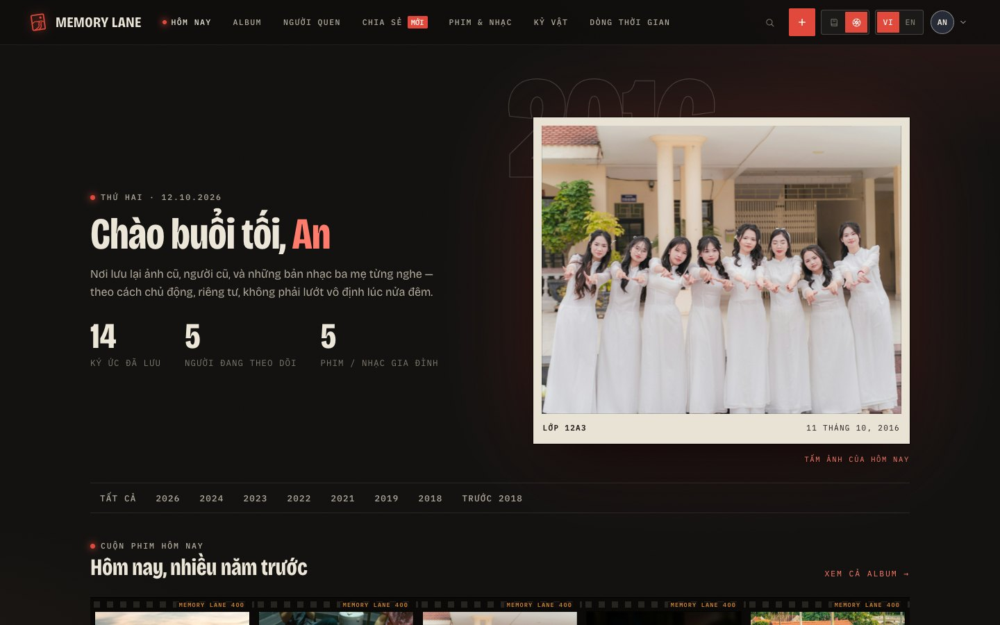
</p>

**Những gì mới so với bản trước:**

1. Tên mới **Memory Lane** và logo mới.
2. **Thẻ kỷ niệm**: bưu thiếp, con tem, thẻ ảnh làm từ một kỷ niệm.
3. Tab **Kỷ vật** (Artifacts): bộ sưu tập các thẻ kỷ niệm bạn đã lưu từ chính kỷ niệm của mình.
4. **Đăng nhập bằng Google**.
5. **Chia sẻ ngay trong form** tạo kỷ niệm.
6. Lời nhắn **thời gian thực**.
7. Ảnh nén **WebP** (nhỏ hơn 30%).
8. Soát kỹ cho **iPhone và Samsung**.
9. Sửa ba lỗi bạn phát hiện: tắt hộp chọn tệp làm đóng form; video dọc hiện quá nhỏ; chữ trên thanh điều hướng đè nhau sau khi đổi
   giao diện.

## Mục lục

1. [Memory Lane là gì?](#1-memory-lane-là-gì)
2. [Chạy thử trong 2 phút](#2-chạy-thử-trong-2-phút)
3. [Các tính năng chính](#3-các-tính-năng-chính)
4. [Bức tranh tổng thể](#4-bức-tranh-tổng-thể)
5. [Tech stack và vì sao chọn](#5-tech-stack-và-vì-sao-chọn)
6. [Cấu trúc thư mục](#6-cấu-trúc-thư-mục)
7. [Back-end (máy chủ) chi tiết](#7-back-end-máy-chủ-chi-tiết)
8. [Cơ sở dữ liệu](#8-cơ-sở-dữ-liệu)
9. [Front-end (giao diện) chi tiết](#9-front-end-giao-diện-chi-tiết)
10. [Đa ngôn ngữ VI ⇄ EN](#10-đa-ngôn-ngữ-vi--en)
11. [Bảo mật & quyền riêng tư](#11-bảo-mật--quyền-riêng-tư)
12. [Hành trình của một yêu cầu — 7 câu chuyện](#12-hành-trình-của-một-yêu-cầu--7-câu-chuyện)
13. [Kiểm thử](#13-kiểm-thử)
14. [Đưa lên mạng (deploy)](#14-đưa-lên-mạng-deploy)
15. [Giới hạn & hướng phát triển](#15-giới-hạn--hướng-phát-triển)
16. [Kịch bản thuyết trình & demo 10 phút](#16-kịch-bản-thuyết-trình--demo-10-phút)
17. [Bảng thuật ngữ](#17-bảng-thuật-ngữ)

---

## 1. Memory Lane là gì?

### Vấn đề

- Ảnh cũ và video gia đình nằm rải rác: trong điện thoại, trên mạng xã hội, trong chiếc hộp ở nhà ông bà. Ta chỉ nhìn lại khi một
  **thuật toán** quyết định cho ta xem.
- Bạn bè cũ dần chỉ còn là "đã xem story của bạn".
- Một kỷ niệm đẹp hiếm khi thành **vật cầm nắm được**: một tấm bưu thiếp gửi bố mẹ, một con tem ghi lại chuyến đi.
- Muốn cho người trong ảnh xem lại một kỷ niệm thì phải **đăng công khai**, hoặc gửi lẻ tẻ qua tin nhắn rồi trôi mất.

### Ý tưởng

**Memory Lane** ("con đường ký ức") là *"một cuốn album không thuật toán"*:

| Ngăn kéo | Lưu gì |
| --- | --- |
| **Album** | Kỷ niệm: tối đa 20 ảnh và video, tiêu đề, nơi chốn, câu chuyện, thời gian (có khi chỉ nhớ năm) |
| **Người quen cũ** | Những người bạn muốn nhớ: lần cuối liên lạc, độ thân, nhật ký riêng, lời mời dùng Memory Lane |
| **Phim & nhạc** | Bộ phim mẹ xem mỗi dịp cuối năm, bài hát ba hát khi pha trà |
| **Kỷ vật** | Bưu thiếp, con tem, thẻ ảnh làm từ chính các kỷ niệm: một bảo tàng gia đình nhỏ, mỗi món dẫn về kỷ niệm gốc |
| **Chia sẻ** | Vòng thân quen, kỷ niệm chia sẻ qua lại, **lời nhắn** dưới mỗi kỷ niệm, hiện ra trực tiếp |

Trang chính **"Hôm nay gợi lại"** mỗi ngày tự mang lại những kỷ niệm chụp quanh ngày này ở những năm trước, cùng những gì người thân
vừa chia sẻ. Từ một kỷ niệm, bạn có thể tạo **bưu thiếp, con tem hay thẻ ảnh** để gửi cho người thân.

### Ba lời hứa của sản phẩm

1. **Không thuật toán:** không xếp hạng, không gợi ý, không bảng tin.
2. **Riêng tư từ thiết kế:**
   - Mặc định chỉ mình bạn xem.
   - Ảnh/video không bao giờ là tệp công khai.
   - Toạ độ GPS bị xoá.
   - Chia sẻ là việc bạn chủ động làm với **từng người, từng kỷ niệm**.
3. **Dữ liệu là của bạn:** xuất toàn bộ thành một tệp, hoặc xóa tài khoản cùng mọi tấm ảnh.

---

## 2. Chạy thử trong 2 phút

Cần **Node.js 22.22 trở lên** (đã thử trên Node 24). Không cần cài cơ sở dữ liệu: nó chỉ là một tệp tự tạo ra.

```bash
npm install
```

```bash
npm run seed
```

```bash
npm run dev
```

Mở **http://localhost:5173**, bấm **"Dùng thử bản demo"**.

- `npm install`: tải các thư viện trong `package.json`.
- `npm run seed`: tạo **thế giới demo**:
  - **An**: 14 kỷ niệm, 5 người quen, 5 phim/nhạc, 6 kỷ vật (thẻ làm từ các kỷ niệm đó).
  - **Năm người bạn** đã kết nối với An (Thu Hà, Minh Khoa, Phương Linh, Anh Tuấn, Quốc Bảo), với 12 kỷ niệm chia sẻ qua lại và
    20 lời nhắn.
  - Ảnh và video là ảnh thật, miễn phí, từ Unsplash/Pexels.
  - Ngày tháng tính **theo hôm nay**, nên luôn có kỷ niệm "hôm nay, nhiều năm trước".
- `npm run dev`: chạy **2 chương trình** cùng lúc: máy chủ API (cổng 3001) và Vite (cổng 5173, tự tải lại khi sửa code).
- `npm run dev:phone`: như trên nhưng mở cho **điện thoại cùng Wi-Fi** truy cập.

**Nên thử:**

1. Đổi **Sổ tay ⇄ Phòng tối** và **VI ⇄ EN**. Kéo cửa sổ hẹp dần: thanh điều hướng tự thu gọn, không bao giờ đè chữ.
2. Bấm **+**: kéo vài ảnh và **một video quay dọc** vào; ở cuối form, tick người được xem hoặc **tạo link mời ngay**.
3. Mở "Đà Lạt" → **Tạo thẻ kỷ niệm** → chọn con tem → **Lưu vào Kỷ vật**: tab Kỷ vật mở ngay tấm thẻ vừa lưu, "Hiện vật số 007".
4. Tab **Kỷ vật**: lọc "Con tem", mở "Vịnh Hạ Long" (bưu thiếp gửi bố mẹ), bấm sang kỷ niệm gốc.
5. Mở kỷ niệm "Sinh nhật Hà" ở hai trình duyệt (An và Thu Hà): viết lời nhắn bên này, bên kia **thấy ngay**.

---

## 3. Các tính năng chính

| Tính năng | Người dùng thấy gì | Code chính |
| --- | --- | --- |
| Hai giao diện | Sổ tay ký ức / Phòng tối; đổi tức thì; thanh điều hướng tự thu gọn bằng đo đạc | `theme.jsx`, `styles/notebook.css`, `darkroom.css`, `TopBar.jsx` (`useNavFit`) |
| Đăng ký / đăng nhập | Email + mật khẩu, hoặc **Tiếp tục với Google**; đến từ link mời thì quay lại đúng lời mời | `pages/Login.jsx`, `Register.jsx`, `GoogleButton.jsx`, `routes/auth.js`, `routes/google.js` |
| Hôm nay gợi lại | Lời chào, kỷ niệm nổi bật, cuộn phim "Hôm nay, nhiều năm trước", được chia sẻ với bạn | `pages/Today.jsx`, `routes/dashboard.js` |
| Album & một kỷ niệm | Lưới ảnh in / tờ in thử; bộ ảnh có phím ←/→ và **vuốt**; khung xem **theo hình dạng** ảnh/video | `pages/Album.jsx`, `MemoryDetail.jsx`, `components/Gallery.jsx` |
| Tải ảnh & video | Kéo thả nhiều tệp, tiến trình từng tệp, ảnh bìa; ảnh nén **WebP** trong trình duyệt; video có khung hình đại diện | `forms/MemoryForm.jsx`, `lib/image.js`, `lib/video.js`, `lib/upload.js` |
| Chia sẻ trong form | Tick người trong vòng thân quen; **tạo link mời ngay** trước khi lưu, tự gắn kỷ niệm khi lưu | `forms/ShareFields.jsx`, `InviteLink.jsx`, `PUT /invites/:id/memory` |
| Lời nhắn trực tiếp | Giấy note / nhật ký phòng tối; lời nhắn mới trượt vào ngay; thông báo nhỏ ở trang khác | `Comments.jsx`, `LiveUpdates.jsx`, `server/lib/live.js` |
| Link mời & Chia sẻ | Tạo link (hiện một lần), gửi qua Zalo/Messenger; trang Chia sẻ: vòng thân quen, link mời, hai chiều chia sẻ | `InviteDialog.jsx`, `pages/Join.jsx`, `pages/Sharing.jsx` |
| Thẻ kỷ niệm | Bưu thiếp / con tem / thẻ ảnh, kiểu Giấy hoặc Phòng tối, tải về hoặc chia sẻ; chủ kỷ niệm **lưu vào Kỷ vật** | `components/CardStudio.jsx`, `lib/cards.js`, `POST /memories/:id/artifacts` |
| Kỷ vật | Danh mục các thẻ đã lưu: số hiện vật, lọc theo loại, xem lớn, tải về, mở kỷ niệm gốc; "Tạo từ một kỷ niệm" | `pages/Artifacts.jsx`, `routes/artifacts.js`, `models/artifacts.js` |
| Người quen cũ · Phim & nhạc | Thẻ thư viện, nhật ký, "Mời dùng Memory Lane" · băng cassette / đĩa than | `pages/People.jsx`, `PersonDetail.jsx`, `Archive.jsx` |
| Dòng thời gian · Tìm kiếm | Theo năm · tìm **không cần dấu** trong kỷ niệm, người, ghi chú, phim nhạc, kỷ vật | `pages/Timeline.jsx`, `Search.jsx`, `routes/search.js` |
| Cài đặt riêng tư | Giao diện, tên, ngôn ngữ, **liên kết Google**, mật khẩu, kín đáo, dung lượng, đăng xuất mọi nơi, xuất dữ liệu, xoá tài khoản | `pages/Settings.jsx`, `routes/me.js` |
| Điện thoại | iPhone/Samsung: ô nhập 16 px, vùng chạm lớn, tai thỏ, chạm để xem, biểu tượng màn hình chính | `styles/base.css`, `client/index.html` |

<p>
  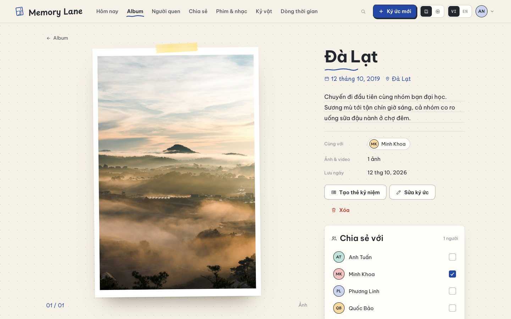
  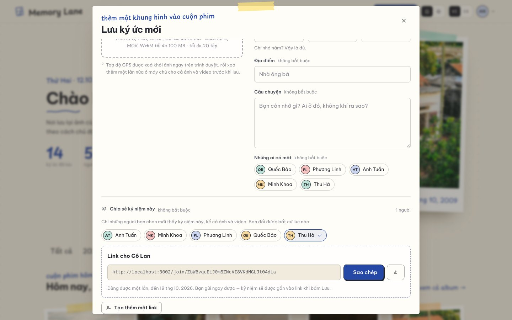
  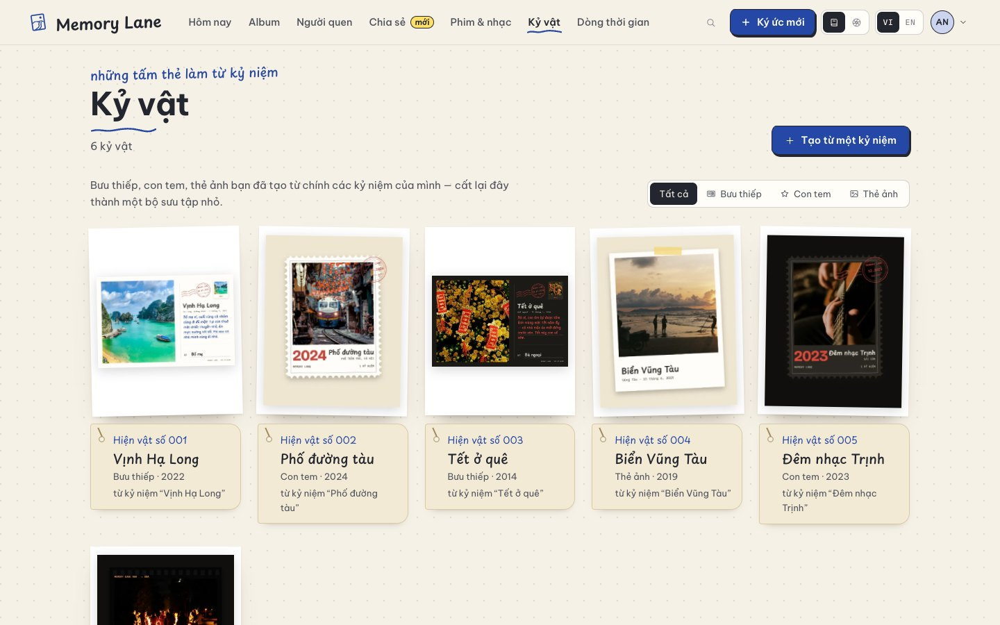
  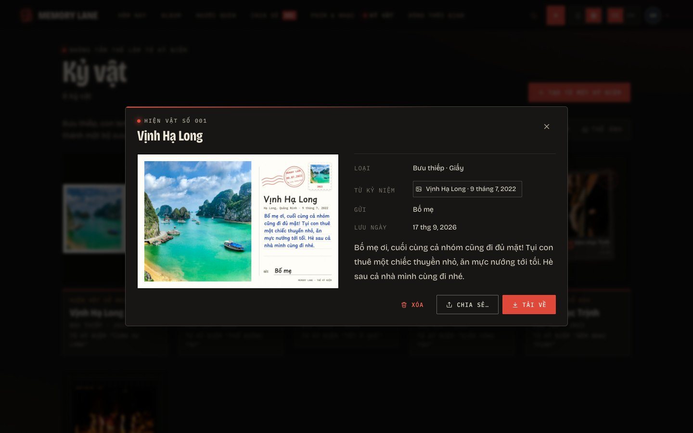
  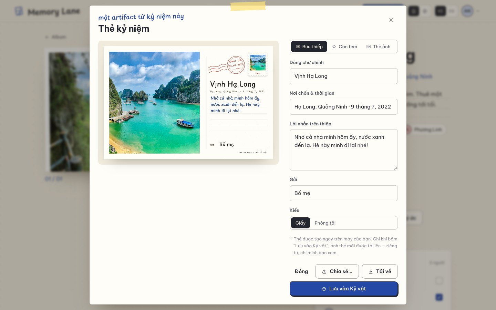
  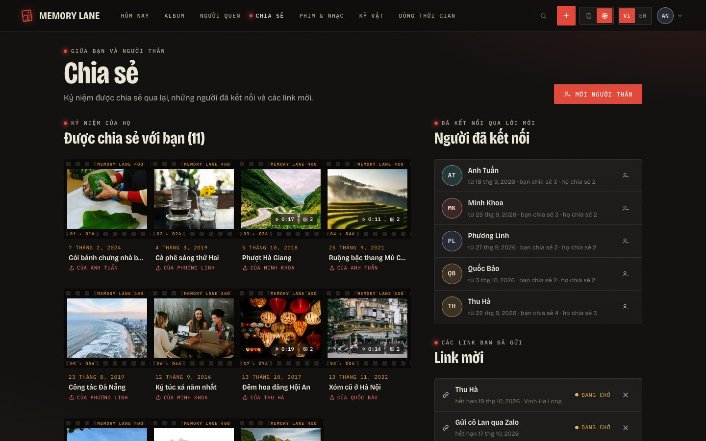
</p>

<p>
  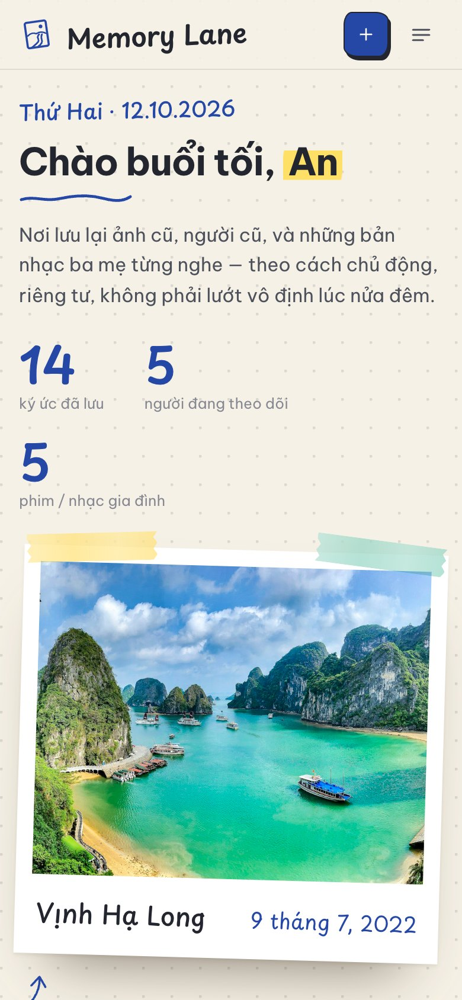
  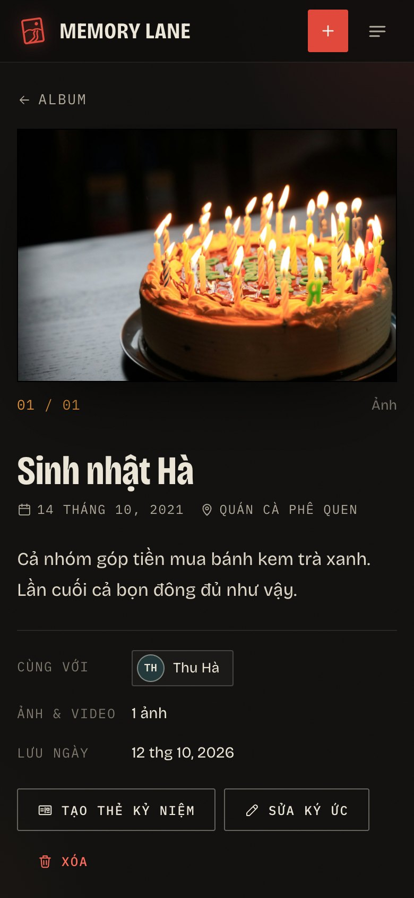
  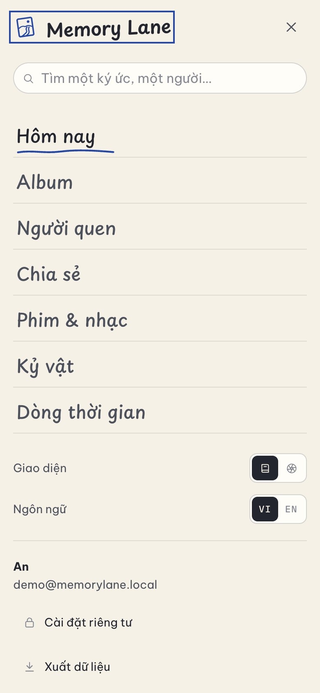
</p>

---

## 4. Bức tranh tổng thể

### So sánh với một nhà hàng

| Nhà hàng | Memory Lane | Trong code |
| --- | --- | --- |
| Thực khách | Người dùng với trình duyệt | — |
| Thực đơn, bàn ghế, người phục vụ | **Front-end**: giao diện React chạy *trong trình duyệt* | `client/` |
| Phiếu gọi món | **Yêu cầu HTTP** gửi tới `/api/...` dạng JSON | `client/src/api.js` |
| Bếp | **Back-end**: máy chủ Express | `server/` |
| Quy tắc của bếp | **Middleware**: các bước kiểm tra mọi yêu cầu đều phải qua | `server/app.js`, `server/lib/` |
| Kho nguyên liệu | **Cơ sở dữ liệu** SQLite + thư mục ảnh/video | `data/` |
| Thẻ giữ xe | **Cookie phiên đăng nhập** | `server/lib/sessions.js` |
| Thiệp mời dự tiệc | **Link mời**: mã bí mật dùng một lần | `server/models/social.js` |
| Chuông báo món đã xong | **Sự kiện trực tiếp (SSE)**: bếp chủ động báo cho bàn | `server/lib/live.js` |

Trình duyệt **không bao giờ** tự đọc cơ sở dữ liệu. Nó chỉ gửi yêu cầu. Máy chủ kiểm tra *bạn là ai*, *bạn có quyền không*, *dữ
liệu có hợp lệ không*, rồi mới đọc/ghi kho và trả kết quả.

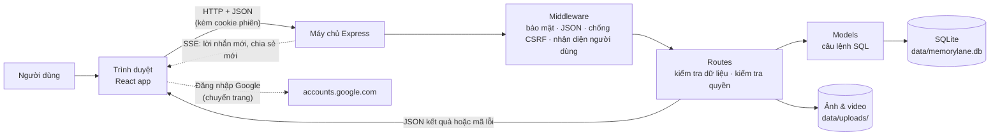

### Vài khái niệm nền tảng

- **HTTP:** "ngôn ngữ" giữa trình duyệt và máy chủ.
  - Phương thức: GET = xem, POST = tạo, PUT = sửa, DELETE = xóa, PATCH = sửa một phần.
  - Mã trạng thái: 200 OK, 201 đã tạo, 204 xong, **206 một phần** (video), **303 chuyển trang** (đăng nhập Google), 400 dữ liệu sai,
    401 chưa đăng nhập, 404 không thấy, 429 quá nhiều yêu cầu.
- **JSON:** dữ liệu dạng `{ "title": "Đà Lạt", "year": 2019 }`.
- **REST API:** đường dẫn theo "tài nguyên" (memories, artifacts, invites…), phương thức HTTP nói hành động.
- **SPA:** trình duyệt tải trang **một lần**, sau đó React tự đổi nội dung, chỉ xin *dữ liệu*.

### Khi phát triển và khi chạy thật

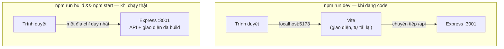

---

## 5. Tech stack và vì sao chọn

| Công nghệ | Dùng để | Vì sao chọn |
| --- | --- | --- |
| **React 19** + **React Router 8** | Giao diện bằng component, điều hướng không tải lại | Phổ biến nhất trong khóa học và đi làm |
| **Vite 8** | Máy chủ phát triển + build | Khởi động tức thì; tách code: mỗi trang riêng tư là một tệp, tệp chính chỉ khoảng 77 KB khi nén |
| **CSS thuần + biến CSS** | Toàn bộ giao diện, **hai bộ token** | Mỗi giao diện có cá tính riêng (xem [DESIGN.md](design/DESIGN.md)) |
| **@fontsource** | Be Vietnam Pro, Playpen Sans, Bricolage Grotesque, IBM Plex Mono | Font đóng gói cùng app, **không gọi Google Fonts** |
| **Canvas · `<video>` · XMLHttpRequest** (có sẵn) | Nén ảnh WebP, chụp khung hình video, thanh tiến trình, **vẽ thẻ kỷ niệm** | Không cần thư viện xử lý ảnh/video |
| **Node.js + Express 5** | Máy chủ API | Rõ ràng; Express 5 tự bắt lỗi trong hàm `async` |
| **SQLite (`node:sqlite`)** | Cơ sở dữ liệu | SQL thật nhưng chỉ là **một tệp**; driver có sẵn trong Node |
| **multer** (ghi xuống đĩa) | Nhận ảnh/video | Video 100 MB không nằm trong RAM |
| **scrypt** (có sẵn) | Băm mật khẩu | Thuật toán "tốn bộ nhớ", chống dò mật khẩu |
| **OAuth 2.0 / OpenID Connect** (tự viết, dùng `fetch` + `crypto`) | Đăng nhập Google | Không cần thư viện, không nạp script của Google vào trang |
| **Server-Sent Events** (có sẵn) | Lời nhắn, chia sẻ hiện ra trực tiếp | Đủ cho chiều máy chủ → trình duyệt, tự kết nối lại |
| **Intl** (có sẵn) | Ngày, số, số nhiều theo ngôn ngữ | "12 tháng 10, 2026" và "October 12, 2026" đều do trình duyệt làm |
| **node:test** (có sẵn) | Kiểm thử tự động | 72 bài máy chủ, không cần Jest/Mocha; cộng 35 kiểm tra toàn hệ thống trên Chrome thật |

**Triết lý:** dùng **ít thư viện nhất có thể**. Máy chủ chỉ phụ thuộc 3 gói (`express`, `multer`, `compression`). Ít thư viện nghĩa là
ít thứ phải học, ít lỗ hổng, và dễ giải thích từng dòng khi bảo vệ.

---

## 6. Cấu trúc thư mục

```text
memory-lane/
├── client/                    ← FRONT-END (chạy trong trình duyệt)
│   ├── index.html             trang HTML duy nhất (meta cho điện thoại)
│   ├── public/                theme-init.js · favicon.svg · apple-touch-icon.png · ảnh trang giới thiệu
│   └── src/
│       ├── main.jsx · App.jsx  điểm khởi đầu · danh sách trang
│       ├── api.js             nơi gọi tới máy chủ (+ lib/upload.js cho tải tệp có tiến trình)
│       ├── auth.jsx · theme.jsx · state.jsx
│       ├── i18n/              vi.js · en.js · index.jsx (hàm t(), số nhiều, ngày tháng)
│       ├── components/        TopBar, Memories, Gallery, Comments, SharePanel, InviteLink, InviteDialog,
│       │                      GoogleButton, CardStudio, LiveUpdates, forms/ (MemoryForm, ShareFields, PersonForm…)
│       ├── pages/             Today, Album, MemoryDetail, Artifacts, Sharing, Join, Settings…
│       ├── lib/               image.js (WebP) · video.js · upload.js · cards.js · artifacts.js · people.js
│       └── styles/            base · layout · components · pages · notebook · darkroom
├── server/                    ← BACK-END
│   ├── index.js · app.js      bật máy chủ · lắp ráp middleware + routes + xử lý lỗi
│   ├── config.js · db.js      cấu hình · SQLite + migration
│   ├── migrations/            001_init · 002_media_sharing · 003_google_login · 004_artifacts · 005_card_artifacts
│   ├── models/                TẤT CẢ câu SQL (users, memories, people, media, social, artifacts)
│   ├── routes/                auth, google, me, dashboard, memories, files, invites, sharing, people, media, artifacts, search
│   ├── lib/                   files, metadata (xoá GPS), google (OAuth), live (SSE), validate, sessions, password, security…
│   ├── seed.js                thế giới demo: An và 5 người bạn
│   ├── setup-google.js        npm run setup:google — ghi mã OAuth của bạn vào .env
│   ├── admin.js               npm run admin — công cụ quản trị cho người vận hành (PLAN.md, Phần C)
│   └── seed-media/            ảnh & video demo miễn phí (xem docs/CREDITS.md) · cards/ (6 thẻ demo do app vẽ)
├── shared/                    ← code DÙNG CHUNG cho cả hai phía (giới hạn, tính ngày)
├── test/                      ← api.test.js · google.test.js · metadata.test.js · i18n.test.js
├── docs/                      ← tài liệu này, MO-RONG, DESIGN, DEPLOY, CREDITS, hướng dẫn sửa tiếng Việt, ảnh chụp
├── .github/workflows/ci.yml   ← GitHub tự chạy kiểm thử + build mỗi lần đẩy code
├── Dockerfile · render.yaml   ← cấu hình triển khai
└── package.json
```

**Vì sao có `shared/`?** Ví dụ "mỗi kỷ niệm tối đa 20 tệp" nằm ở `shared/limits.js`, được dùng ở **cả hai nơi**: máy chủ dùng để từ
chối, giao diện dùng để báo trước. Một nguồn sự thật duy nhất, hai phía không bao giờ "cãi nhau".

---

## 7. Back-end (máy chủ) chi tiết

### 7.1 Máy chủ khởi động thế nào?

```js
const config = loadConfig();              // 1. đọc cấu hình (cổng, thư mục dữ liệu, Google…)
const db = openDb(config.dbFile);          // 2. mở SQLite, chạy các migration còn thiếu
const app = createApp({ db, config });     // 3. lắp ráp ứng dụng Express
app.listen(config.port, () => { /* … */ }); // 4. bắt đầu nghe yêu cầu
```

`createApp` **nhận** `db` và `config` từ bên ngoài. Nhờ vậy, khi kiểm thử ta đưa vào một cơ sở dữ liệu tạm, hoặc một "Google giả",
mà không đụng dữ liệu thật.

### 7.2 Middleware

Middleware giống các **trạm kiểm tra ở sân bay**: mỗi trạm là một hàm `(req, res, next)`, làm một việc rồi gọi `next()`, hoặc chặn
yêu cầu lại.

| # | Middleware | Làm gì |
| --- | --- | --- |
| 1 | `securityHeaders` | Gắn header bảo mật vào **mọi** phản hồi (CSP, cấm nhúng iframe, HSTS…) |
| 2 | `compression` | Nén phản hồi văn bản, **trừ** luồng sự kiện `/api/events` (nén sẽ giữ sự kiện lại) |
| 3 | `noStore` | Dặn trình duyệt **không lưu** JSON riêng tư |
| 4 | `express.json` | Đọc thân yêu cầu JSON (tối đa 100 KB) |
| 5 | `blockCrossSiteWrites` | Chặn yêu cầu ghi dữ liệu từ trang web khác (CSRF) |
| 6 | `loadUser` | Đọc cookie phiên → `req.user` |
| 7 | `requireAuth` | Chưa đăng nhập → 401 (trừ xem trước link mời và các bước đăng nhập Google) |
| 8 | **Routes** | Xử lý nghiệp vụ |
| 9 | **Error handler** | Mọi lỗi về đây, trả JSON gọn gàng `{ error: 'CODE' }` |

### 7.3 Routes & REST API

Mỗi tệp trong `server/routes/` phụ trách một nhóm tài nguyên. Bảng đầy đủ nằm trong [README › API](../README.md#api). Route **mỏng**:
đọc yêu cầu, kiểm tra dữ liệu và quyền, gọi model, trả kết quả, và (mới) **báo cho những người liên quan**:

```js
router.post('/:id/comments', (req, res) => {
  const id = idParam(req.params.id);
  if (!social.canView(req.user.id, id)) throw notFound();   // không phải chủ, không được chia sẻ → 404
  const v = validator(req.body);
  const body = v.text('body', { required: true, max: LIMITS.comment });
  v.check();                                                 // sai → ném lỗi 400, dừng ở đây
  const comment = social.addComment(id, req.user.id, body);
  // Những người khác được xem kỷ niệm này nhận lời nhắn ngay (SSE, xem 7.13).
  const others = social.audience(id).filter((userId) => userId !== req.user.id);
  live.publish(others, { type: 'comment', memoryId: id, title: memories.get(req.user.id, id).title, comment });
  res.status(201).json({ comment });
});
```

### 7.4 Models — nơi duy nhất có SQL

- **Dấu `?` (tham số hoá):** giá trị người dùng nhập **không bao giờ** được ghép vào chuỗi SQL. Đây là cách chống **SQL injection**.
- **Điều kiện quyền ở mọi truy vấn.** "Được xem" một kỷ niệm nghĩa là:

  ```sql
  WHERE m.id = ?
    AND (m.user_id = ?                                         -- bạn là chủ
         OR EXISTS (SELECT 1 FROM shares s
                     WHERE s.memory_id = m.id AND s.user_id = ?)) -- hoặc được chia sẻ đích danh
  ```

  Sửa, xoá, tải tệp, chia sẻ tiếp, **lưu thẻ vào Kỷ vật**: chỉ chủ ký ức. **Kỷ vật** thì luôn chỉ chủ mới thấy.
- Mỗi ký ức được trả về **cùng lúc** với danh sách tệp, người có mặt, tên chủ, số người được chia sẻ, số lời nhắn. SQLite tự gói
  danh sách thành JSON bằng `json_group_array`, nhờ vậy tránh được lỗi hiệu năng "N+1 queries".

### 7.5 Kiểm tra dữ liệu & mã lỗi

Không tin dữ liệu từ trình duyệt: mọi route kiểm tra lại bằng `server/lib/validate.js`, và trả về **mã lỗi**:

```json
400 Bad Request
{ "error": "VALIDATION", "fields": { "file": { "code": "FILE_TOO_LARGE", "max": 100 } } }
```

Giao diện dịch mã đó thành câu đúng ngôn ngữ, ví dụ *"Video quá lớn — tối đa 100 MB."* Một vài quy tắc:

- Ngày 30/2 bị từ chối.
- Ký ức ở tương lai bị từ chối.
- Mỗi ký ức tối đa 20 tệp.
- Mỗi tài khoản có hạn mức dung lượng; ảnh các thẻ đã lưu vào Kỷ vật cũng được tính.
- Link phim/nhạc phải là `http(s)://`.

### 7.6 Tải ảnh & video — từ trình duyệt tới ổ đĩa

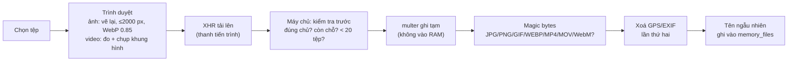

1. **Trong trình duyệt** (`lib/image.js`, `video.js`):
   - **Ảnh** được vẽ lại lên `<canvas>`: bỏ toàn bộ EXIF (cả GPS), xoay đúng chiều, thu về tối đa 2000 px.
   - Ảnh được lưu **WebP 0.85**, hoặc JPEG nếu trình duyệt không tạo được WebP, kèm bản xem trước 560 px.
   - Đo trên 23 ảnh demo: WebP 0.85 trung bình **249 KB** với SSIM 0.994, so với **358 KB** nếu dùng JPEG 0.88 (nhỏ hơn 30%, nhìn
     như nhau). Chi tiết ở [MO-RONG.md](MO-RONG.md).
   - Giải mã ảnh có 3 lớp dự phòng cho Safari bản cũ và ảnh HEIC.
   - **Video:** đo độ dài, kích thước và **chụp một khung hình** làm ảnh đại diện.
2. **Tải lên bằng XMLHttpRequest**, vì `fetch` chưa báo được tiến trình gửi đi.
3. **Kiểm tra trước khi nhận** (`beforeUpload`): đúng chủ, còn chỗ, chưa đủ 20 tệp. Sai thì từ chối **trước khi một byte nào được ghi**.
4. **multer ghi thẳng xuống đĩa**, nên video 100 MB không chiếm 100 MB RAM.
5. **Magic bytes:** đọc 16 byte đầu để biết tệp *thật sự* là gì. Ảnh HEIC "đội lốt" MP4 bị từ chối.
6. **Xoá GPS lần hai ở máy chủ** (`lib/metadata.js`):
   - JPEG: APP1/APP13.
   - PNG: `eXIf`, `tEXt/zTXt/iTXt`.
   - WebP: EXIF/XMP.
   - **MP4/MOV:** chuỗi toạ độ `+21.0285+105.8542/` được thay bằng số 0, **giữ nguyên độ dài**.
7. **Tên ngẫu nhiên** 128 bit; ghi CSDL lỗi thì tệp vừa ghi bị xoá ngay (`finally`).

**Xem tệp:** không có thư mục công khai. `GET /api/files/<tên>` kiểm tra người xem là **chủ hoặc người được chia sẻ** (với ảnh thẻ
trong Kỷ vật: chỉ chủ), sai thì 404. Video phát theo **HTTP Range** (mã 206).

### 7.7 Đăng nhập & phiên (session)

**Cookie** là mẩu dữ liệu máy chủ nhờ trình duyệt giữ hộ, như **thẻ giữ xe**. Quy trình:

1. Người dùng gửi email + mật khẩu.
2. Máy chủ so mật khẩu với **mã băm scrypt** (có salt) đã lưu.
3. Đúng: tạo **token ngẫu nhiên** 32 byte, lưu **mã băm SHA-256 của token** vào bảng `sessions`, gửi token trong cookie `ml_session`.
4. Mỗi yêu cầu sau: middleware băm token, tìm trong `sessions` → biết `req.user`.
5. Đăng xuất là **xoá dòng** đó: cookie cũ (kể cả bị đánh cắp) vô dụng ngay.

| Thuộc tính cookie | Ý nghĩa |
| --- | --- |
| `HttpOnly` | JavaScript trên trang **không đọc được** cookie |
| `SameSite=Lax` | Trang web khác không "mượn" được cookie để ghi dữ liệu |
| `Secure` (khi chạy thật) | Chỉ đi qua HTTPS |

Đăng nhập sai email hay sai mật khẩu đều nhận **cùng câu trả lời, cùng thời gian**. Tài khoản tạo bằng Google (không có mật khẩu)
cũng vậy.

### 7.8 Trang "Hôm nay gợi lại" — thuật toán "On this day"

Tìm ký ức **những năm trước** có ngày/tháng gần hôm nay (±3 ngày). Mẹo: đặt mọi ngày lên cùng một năm nhuận, đổi ra "ngày thứ mấy
trong năm", rồi tính khoảng cách **theo vòng tròn** (30/12 và 2/1 chỉ cách nhau 3 ngày):

```js
export function dayOfYearDistance(month1, day1, month2, day2) {
  const dayOfYear = (m, d) => (Date.UTC(2000, m - 1, d) - Date.UTC(2000, 0, 1)) / DAY_MS;
  const diff = Math.abs(dayOfYear(month1, day1) - dayOfYear(month2, day2));
  return Math.min(diff, 366 - diff);
}
```

Không có ký ức trùng ngày thì lùi dần: cùng tháng, rồi ngẫu nhiên. Trình duyệt gửi kèm ngày của chính nó (`?today=…`) để khỏi lệch
múi giờ.

### 7.9 Tìm kiếm không dấu

Hàm `fold()` biến `'Đà Lạt'` thành `'da lat'` và được **đăng ký vào SQLite** như một hàm SQL, nên câu truy vấn viết được
`fold(title) LIKE '%da lat%'`. Ký tự `%`, `_` được thoát. Tìm trong kỷ niệm, người (cả ghi chú), phim nhạc và kỷ vật (chữ trên thẻ, tên kỷ niệm gốc) của chính bạn.

### 7.10 Chia sẻ: vòng thân quen, link mời, lời nhắn

Mô hình **ba lớp**, mỗi lớp phải có trước lớp sau:

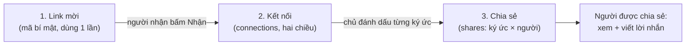

- **Link mời** (`createInvite`):
  - Mã 24 byte (192 bit); CSDL chỉ lưu **SHA-256**, nên link chỉ hiện **một lần**.
  - Dùng một lần, hết hạn 7 ngày, thu hồi được.
  - Trang xem trước công khai chỉ có tên người mời và tên kỷ niệm, **không** có ghi chú riêng.
  - **Nhận lời mời phải đăng nhập và tự bấm.** Trang hiện ngày giờ hết hạn và số ngày còn lại.
  - Mở link khi **đang đăng nhập**: link của chính mình → thông báo kèm hình xem trước người nhận sẽ thấy (và gợi ý mở trong cửa sổ
    ẩn danh để thử thật); link của người khác nhưng đang ở tài khoản khác → nút **"Không phải bạn? Đăng xuất…"** ngay trên trang.
  - Hạn 7 ngày là **thật**: máy chủ so `expires_at` với giờ hiện tại mỗi lần mở hoặc nhận lời mời (`models/social.js`), có bài
    kiểm thử "invites can be withdrawn and they expire".
- **Tạo link ngay trong form** (mới): link được tạo trước khi kỷ niệm tồn tại. Khi bấm Lưu, form gọi `PUT /api/invites/:id/memory`
  để gắn kỷ niệm vào link. Nếu người kia **đã kịp nhận lời** trong lúc bạn đang soạn, hai người đã kết nối, nên kỷ niệm được chia sẻ
  cho họ ngay.
- **Chia sẻ:** câu SQL chỉ thêm những người **đã kết nối**; id người lạ bị bỏ qua.

  ```sql
  INSERT OR IGNORE INTO shares (memory_id, user_id)
  SELECT ?, c.other_id FROM connections c
   WHERE c.user_id = ? AND c.other_id IN (SELECT value FROM json_each(?))
  ```

- **Thu hồi:**
  - Bỏ tick → yêu cầu tiếp theo của người kia (kể cả xin ảnh) trả 404 ngay.
  - Ngừng kết nối → xoá mọi chia sẻ giữa hai người, theo **cả hai chiều**.

<p>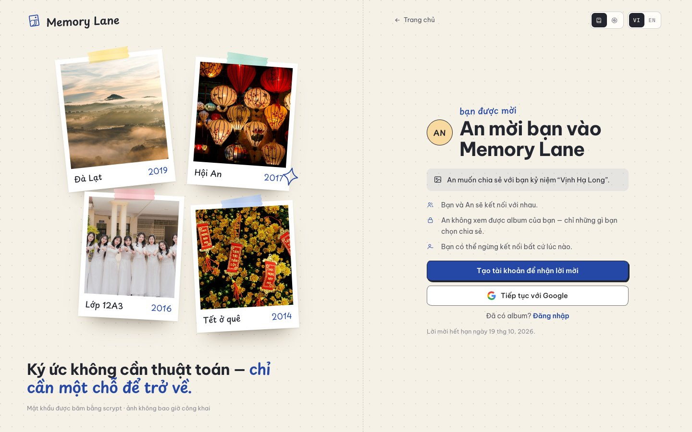</p>

### 7.11 Hạn mức dung lượng

Mỗi tài khoản có `STORAGE_MB` (mặc định 2048 MB), tính cả ảnh/video kỷ niệm **và ảnh các thẻ đã lưu vào Kỷ vật**. Máy chủ kiểm tra hai lần: trước khi
nhận (theo `Content-Length`) và sau khi nhận (theo kích thước thật).

### 7.12 Đăng nhập bằng Google — OAuth 2.0 / OpenID Connect

Đây là luồng **authorization code** chuẩn. Máy chủ của bạn nói chuyện trực tiếp với Google, và **không** có script nào của Google
chạy trên trang:

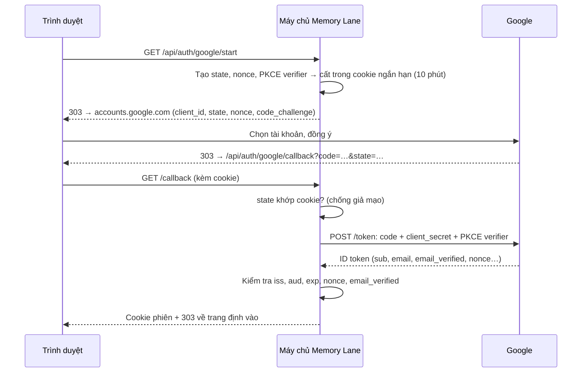

| Thành phần | Chống điều gì |
| --- | --- |
| `state` | Kẻ xấu ép bạn đăng nhập vào **tài khoản của họ** (login CSRF) |
| `nonce` | Phát lại một ID token cũ |
| **PKCE** (`code_verifier` / `code_challenge`) | Mã `code` bị đánh cắp giữa đường cũng vô dụng |
| Kiểm tra `aud` | Token được cấp cho **app khác** |
| `email_verified` | Email chưa được Google xác minh có thể là của người khác |

**Không tự gộp tài khoản cùng email.** Nếu email Google trùng với một tài khoản đăng ký bằng mật khẩu, app **từ chối**
(`EMAIL_TAKEN`). Lý do: ai đó có thể đã đăng ký trước bằng email của bạn, kiểu tấn công gọi là *account pre-hijacking*. Chủ thật
đăng nhập bằng mật khẩu rồi tự **liên kết Google trong Cài đặt**. Tài khoản tạo bằng Google không có mật khẩu (`password_hash = ''`).
Muốn huỷ liên kết Google thì phải đặt mật khẩu trước, để không tự khoá mình ngoài.

Người dùng được nhận diện bằng `sub`, mã cố định của Google cho mỗi người, chứ **không** bằng email (email có thể đổi).

<p>
  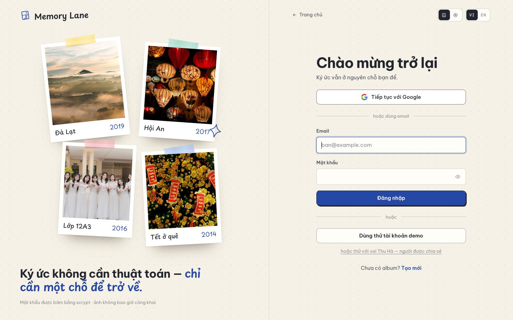
  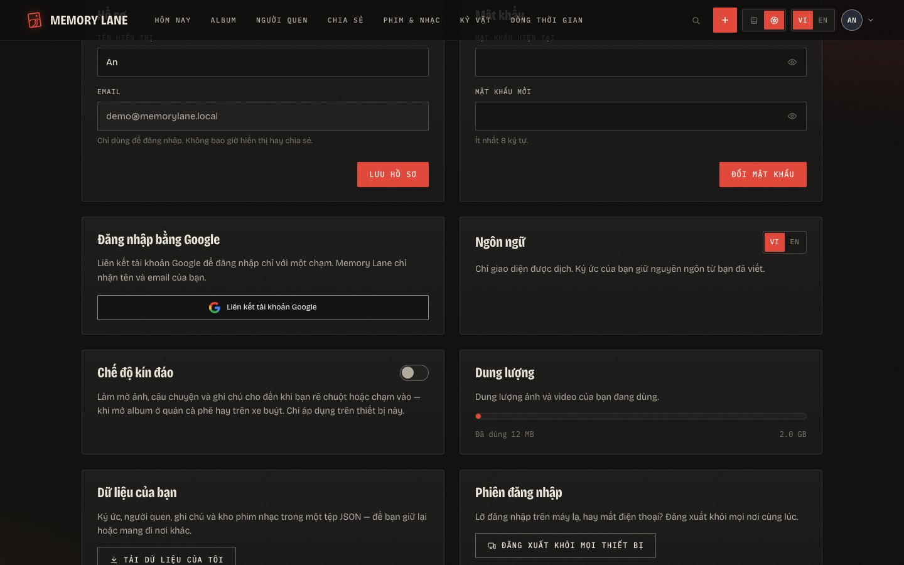
</p>

### 7.13 Thời gian thực — Server-Sent Events

```js
// server/lib/live.js (rút gọn)
connect(req, res) {
  res.writeHead(200, { 'Content-Type': 'text/event-stream', 'Cache-Control': 'no-cache, no-transform' });
  clients.get(req.user.id).add(res);                         // mỗi tab một kết nối
  const heartbeat = setInterval(() => res.write(': ping\n\n'), 25_000);
  req.on('close', () => { clearInterval(heartbeat); /* bỏ khỏi danh sách */ });
},
publish(userIds, event) {
  const message = `event: ${event.type}\ndata: ${JSON.stringify(event)}\n\n`;
  for (const id of new Set(userIds)) for (const res of clients.get(id) ?? []) res.write(message);
}
```

- **Sự kiện:** `comment`, `comment-removed` (cho chủ + người được chia sẻ, trừ tác giả) · `shared` (cho người vừa được chia sẻ) ·
  `circle` (cho người mời khi ai đó nhận lời).
- **Phía trình duyệt:** `LiveUpdates.jsx` mở **một** `EventSource('/api/events')` cho cả app. Đang xem đúng kỷ niệm thì lời nhắn
  trượt vào danh sách; ở trang khác thì hiện thông báo nhỏ.
- **Chỉ giữ kết nối khi trang đang hiện:** tab bị ẩn, hoặc trang được trình duyệt cất vào bộ nhớ "quay lại" (bfcache), sẽ đóng kết
  nối; quay lại thì mở lại và tải lại dữ liệu. Lý do: qua HTTP/1.1 (khi chạy ở máy) trình duyệt chỉ mở tối đa **6 kết nối** tới một
  trang web; nếu mỗi trang cũ giữ một kết nối sự kiện, ảnh sẽ ngừng tải. Lỗi này được phát hiện khi chụp ảnh màn hình tự động và
  đã sửa trong `LiveUpdates.jsx`.
- **Vì sao SSE mà không WebSocket:** app chỉ cần chiều máy chủ → trình duyệt; SSE là HTTP thường (dùng chung cookie), không cần thư
  viện, và tự kết nối lại. So sánh đầy đủ ở [MO-RONG.md § 6](MO-RONG.md#6-tương-tác-thời-gian-thực-trong-kỷ-niệm-chung).

<p>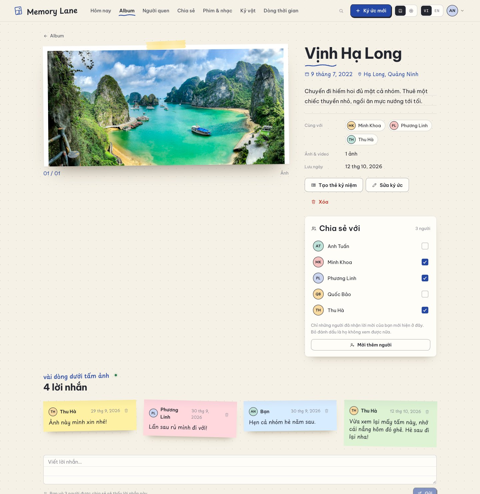</p>

### 7.14 Kỷ vật (Artifacts) — thẻ lưu từ chính kỷ niệm

Kỷ vật **không phải đồ vật tự khai**, mà là những tấm thẻ (bưu thiếp, con tem, thẻ ảnh) người dùng **tạo từ chính kỷ niệm của mình**
rồi bấm **Lưu vào Kỷ vật**. Tab Kỷ vật là bộ sưu tập các thẻ đó, trình bày như danh mục bảo tàng.

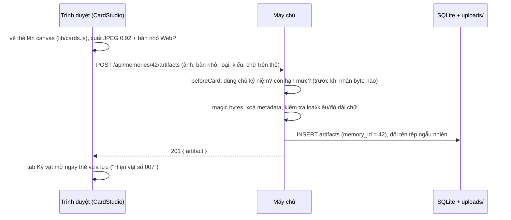

- **Bảng `artifacts`** (migration `005_card_artifacts`): `memory_id` **bắt buộc**, `kind` (`postcard` · `stamp` · `photo`),
  `style` (`paper` · `darkroom`), chữ trên thẻ (`title`, `line`, `message`, `recipient`), ảnh thẻ `file` + bản nhỏ `preview`,
  kích thước, dung lượng (tính vào hạn mức).
- **Chỉ chủ kỷ niệm lưu được** (`POST /memories/:id/artifacts`). Người được chia sẻ vẫn tạo thẻ, tải về, gửi Zalo, nhưng **không** cất
  bản sao ảnh của người khác vào tài khoản mình (máy chủ trả 404).
- **Gắn chặt với kỷ niệm gốc:** `FOREIGN KEY (memory_id) … ON DELETE CASCADE`. Xoá kỷ niệm thì các thẻ của nó cũng biến mất, và
  `memories.remove` trả về tên tệp của thẻ để xoá khỏi đĩa. Hộp xác nhận xoá báo trước "1 thẻ đã lưu trong Kỷ vật … cũng sẽ bị xoá".
- **Số hiện vật** ("Hiện vật số 001") là thứ tự lưu: trang luôn tải **toàn bộ** danh sách rồi mới lọc theo loại, nên số không đổi
  khi lọc.
- **Riêng tư tuyệt đối:** kỷ vật không bao giờ được chia sẻ; ảnh thẻ chỉ chủ xem được (`canViewFile`). Có kiểm thử cho cả hai.
- **Không lưu trùng:** bấm "Lưu vào Kỷ vật" lần hai với đúng tấm thẻ đó thì nút đã chuyển thành "Đã lưu vào Kỷ vật"; sửa chữ hoặc
  đổi loại thì lưu được bản mới.

---

## 8. Cơ sở dữ liệu

### Sơ đồ quan hệ (ERD)

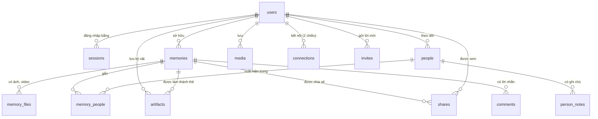

| Bảng | Một dòng là | Cột đáng chú ý |
| --- | --- | --- |
| `users` | một tài khoản | `email` (duy nhất, không phân biệt hoa thường), `password_hash` (`''` nếu chỉ dùng Google), **`google_sub`**, **`google_email`** |
| `sessions` | một lần đăng nhập | `token_hash`, `expires_at` |
| `memories` | một ký ức | `year` (bắt buộc), `month`, `day` (có thể trống), `scene` |
| `memory_files` | một ảnh hoặc video | `kind`, `file`, `poster`, `width`, `height`, `duration`, `size`, `position` (0 = ảnh bìa) |
| `people` · `person_notes` | người quen · ghi chú | `linked_user_id` (tài khoản của họ, nếu đã tham gia) |
| `memory_people` | "người X có mặt trong ký ức Y" | khóa chính kép |
| `media` | một bộ phim / bài hát | `kind`, `owner`, `era`, `url` |
| **`artifacts`** | một thẻ đã lưu vào Kỷ vật | `memory_id` (kỷ niệm gốc), `kind`, `style`, `title`, `line`, `message`, `recipient`, `file`, `preview`, `size` |
| `connections` · `invites` · `shares` · `comments` | kết nối · link mời · chia sẻ · lời nhắn | `token_hash`, `expires_at`, `accepted_by`, `revoked_at` |

### Các khái niệm thể hiện trong thiết kế

- **Một–nhiều:** một ký ức có nhiều tệp (`memory_files.memory_id`) và nhiều thẻ trong Kỷ vật (`artifacts.memory_id`).
- **Nhiều–nhiều:** ký ức ↔ người được chia sẻ (`shares`), ký ức ↔ người có mặt (`memory_people`).
- **`ON DELETE CASCADE`:** xoá người dùng là SQLite **tự** xoá phiên, ký ức, tệp, kỷ vật, kết nối, lời nhắn của họ; xoá một ký ức
  thì các thẻ làm từ nó cũng đi theo.
- **`ON DELETE SET NULL`:** xoá một người quen thì lời mời từng gửi cho họ vẫn còn, chỉ mất liên kết.
- **`CHECK`:** cơ sở dữ liệu tự từ chối giá trị vô lý (`kind` lạ, tự kết nối với chính mình…).
- **Index một phần:** `CREATE UNIQUE INDEX users_google_sub ON users (google_sub) WHERE google_sub IS NOT NULL`. Mỗi tài khoản
  Google chỉ gắn với một người, còn nhiều tài khoản không có Google vẫn hợp lệ.

### Migration — nâng cấp cơ sở dữ liệu mà không mất dữ liệu

Khi khởi động, `server/db.js` đọc `PRAGMA user_version` và chạy các tệp **còn thiếu**, theo thứ tự, mỗi tệp trong một transaction:

| Tệp | Thay đổi |
| --- | --- |
| `001_init.sql` | Album, người quen, phim nhạc, phiên đăng nhập |
| `002_media_sharing.sql` | Một ảnh → **nhiều ảnh/video** (chuyển dữ liệu cũ sang `memory_files`), kết nối, link mời, chia sẻ, lời nhắn |
| `003_google_login.sql` | `users.google_sub`, `users.google_email` + index duy nhất |
| `004_artifacts.sql` | Kỷ vật đời đầu: `artifacts` (đồ vật, thư từ, giấy tờ tự khai) + `memory_artifacts` |
| `005_card_artifacts.sql` | Kỷ vật = **thẻ lưu từ một kỷ niệm**: bỏ hai bảng cũ, tạo `artifacts` mới với `memory_id` bắt buộc, `ON DELETE CASCADE` |

**Không bao giờ sửa migration đã chạy**: muốn đổi thì viết migration mới.

### Seed — dữ liệu mẫu

`server/seed.js` tạo **An** và **5 người bạn**, kèm ảnh, video, bản xem trước, kết nối, chia sẻ hai chiều, lời nhắn và đủ
trạng thái link mời. Nó **chỉ xoá và tạo lại các tài khoản demo**, không bao giờ đụng tài khoản thật. Mật khẩu demo là chuỗi ngẫu
nhiên không ai biết: chỉ vào được bằng nút demo (tắt bằng `ALLOW_DEMO=false`).

6 kỷ vật của An là thẻ **do chính app vẽ** (`lib/cards.js` chạy trong Chrome) từ ảnh các kỷ niệm demo, lưu sẵn ở
`server/seed-media/cards/`. Chỉ chọn kỷ niệm có ngày cố định, vì ngày được in lên thẻ (các kỷ niệm "Hôm nay, nhiều năm trước"
đổi ngày theo hôm nay).

---

## 9. Front-end (giao diện) chi tiết

### 9.1 React trong 5 phút, bằng ví dụ của dự án

- **Component** = một hàm trả về giao diện. `Avatar` nhận tên và màu, trả về vòng tròn chữ tắt:

  ```jsx
  export function Avatar({ name, color = 'teal', className = '' }) {
    return (
      <span className={`avatar ${color} ${className}`.trim()} aria-hidden="true">
        {initials(name)}
      </span>
    );
  }
  ```

- **Props** = tham số truyền vào. **State** = dữ liệu thay đổi theo thời gian; state đổi thì React tự vẽ lại.
- **Effect** (`useEffect`) = việc làm *sau khi* vẽ (gọi API, mở kết nối SSE…).
- **Context** = "kênh phát sóng" dùng chung: `useI18n`, `useTheme`, `useAuth`, `useToast`.
- **Custom hook** = hàm `use…` gom logic dùng lại: `useFetch(path)`, `useNavFit(...)`.

### 9.2 Điểm khởi đầu: `main.jsx`

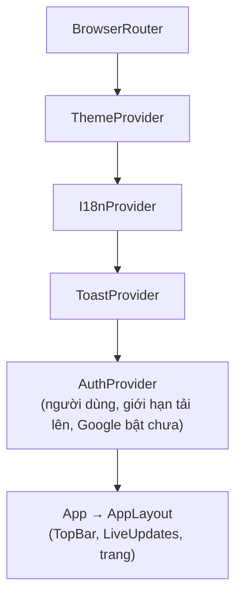

### 9.3 Điều hướng và bảo vệ trang

- `/join/:token`: ai cũng mở được; có nút tạo tài khoản, đăng nhập, **Tiếp tục với Google** (quay lại đúng link mời).
- `/login`, `/register`: bọc trong `GuestOnly`, sau khi đăng nhập thì chuyển tới **đúng nơi định đến**. Trang đăng nhập đọc
  `?google=CODE` để báo kết quả đăng nhập Google.
- Trang trong app (`/today`, `/album`, `/artifacts`, `/sharing`…): bọc trong `RequireAuth`.
- Bảo vệ ở giao diện chỉ để **trải nghiệm**. Bảo vệ **thật** nằm ở máy chủ.
- **Code splitting:** mỗi trang riêng tư được tải khi cần (`lazy(() => import(...))`). Code vẽ thẻ chỉ tải cùng trang một kỷ niệm.

### 9.4 Lấy dữ liệu từ máy chủ

- `api.js` gọi `fetch`, biến lỗi thành `ApiError { status, code, fields }`.
- `useFetch(path)` trả `{ data, error, loading, retry }` và hủy yêu cầu cũ khi chuyển trang.
- Sau mỗi lần lưu/xoá, `refresh()` làm mọi `useFetch` đang hiện tự tải lại.
- **Sự kiện trực tiếp:** `LiveUpdates` phát mỗi sự kiện thành `window` event `ml-live`. `Comments` lắng nghe để chèn lời nhắn mới,
  không cần tải lại cả trang.

### 9.5 Form ký ức — tải nhiều ảnh & video, chia sẻ ngay

`components/forms/MemoryForm.jsx` là phần phức tạp nhất phía giao diện:

1. Kéo thả hoặc chọn **nhiều tệp**. Đóng cửa sổ chọn tệp **không** đóng form. (Lỗi cũ: sự kiện `cancel` của `<input type=file>`
   "nổi bọt" lên `<dialog>`; giờ `Modal.jsx` chỉ nhận `cancel` của chính nó.)
2. Tệp được **chuẩn bị lần lượt** (ảnh 48 MP giải nén chiếm vài trăm MB RAM, làm song song dễ treo điện thoại).
3. Chọn **ảnh bìa**, đổi thứ tự, bỏ tệp.
4. **Chia sẻ kỷ niệm này** (`ShareFields.jsx`): tick người trong vòng thân quen; **"Mời người mới bằng link"** tạo link ngay, có nút
   Sao chép và Chia sẻ (bảng chia sẻ của điện thoại).
5. **Lưu**, theo các bước:
   - (a) JSON phần chữ.
   - (b) **chia sẻ + gắn kỷ niệm vào các link vừa tạo**.
   - (c) xoá tệp đã bỏ.
   - (d) tải từng tệp, mỗi tệp một thanh tiến trình, dừng được.
   - (e) thứ tự cuối.
6. Tệp lỗi: ký ức **vẫn đã lưu**; có nút **Thử lại** hoặc **Bỏ qua và hoàn tất**.

### 9.6 Các thành phần dùng lại

| Thành phần | Vai trò |
| --- | --- |
| `AppLayout` | Khung sau đăng nhập: thanh điều hướng, `LiveUpdates`, hai hộp thoại dùng chung |
| `TopBar` | 7 tab, tìm kiếm, nút +, giao diện, ngôn ngữ, tài khoản; **`useNavFit`** đo và thu gọn từng bước |
| `Gallery` | Bộ ảnh/video: khung theo **hình dạng tệp** (`--ratio`), phím ←/→, **vuốt** trên điện thoại |
| `Comments` · `SharePanel` · `ShareFields` · `InviteLink` · `InviteDialog` | Lời nhắn (trực tiếp) · ai được xem · chia sẻ trong form · link + copy/chia sẻ · tạo link mời |
| `GoogleButton` | Nút "Tiếp tục với Google" (tắt kèm lý do khi chưa cấu hình) |
| `CardStudio` | Cửa sổ tạo thẻ kỷ niệm |
| `Modal` · `ConfirmDialog` | Hộp thoại dựa trên `<dialog>` (giữ tiêu điểm, `Esc`, khoá khi đang tải tệp) |

### 9.7 Hai giao diện trên cùng một mã nguồn

Chi tiết trong [DESIGN.md](design/DESIGN.md). Tóm tắt:

- `<html data-theme="notebook|darkroom">` + hai bộ biến CSS.
- Cùng một HTML, chi tiết trang trí riêng.
- `theme-init.js` áp giao diện **trước khi vẽ**.
- **Thanh điều hướng đo đạc** thay cho mốc `@media` cố định (đó là nguyên nhân lỗi đè chữ khi đổi giao diện).

<p>
  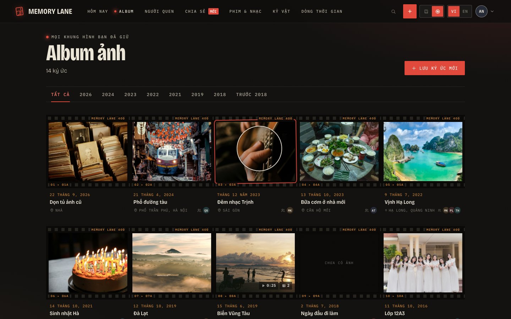
  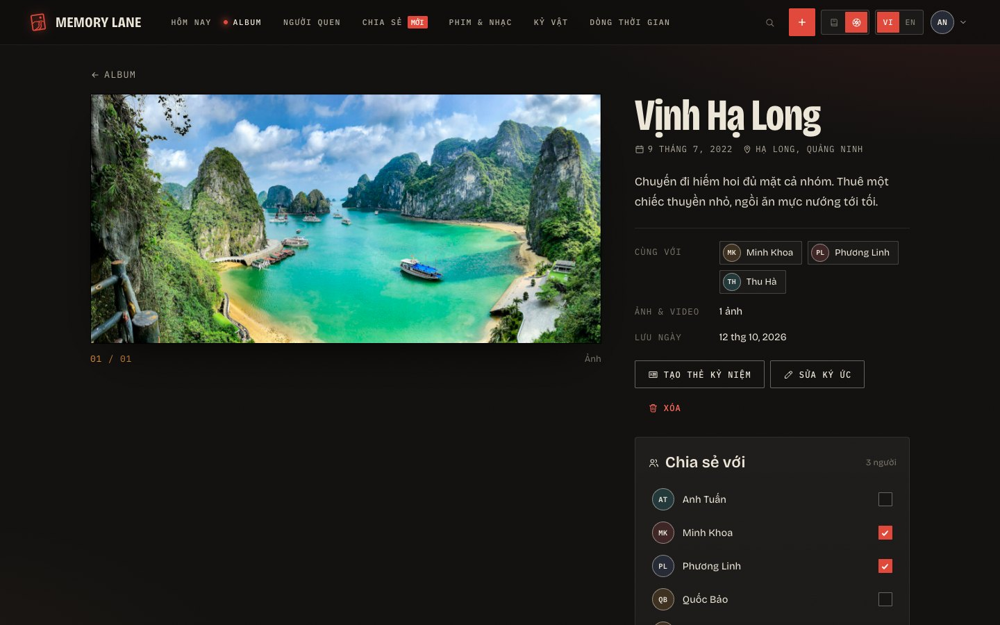
</p>

### 9.8 Trên điện thoại

Bảng đầy đủ ở [DESIGN.md § 7](design/DESIGN.md#7-trên-điện-thoại-iphone--samsung). Tóm tắt:

- Ô nhập ≥ 16 px để iPhone không tự phóng to.
- Vùng chạm ~44 px.
- `100dvh`, vùng an toàn tai thỏ, khoá cuộn khi hộp thoại mở.
- `color-scheme` và `theme-color` theo giao diện.
- Chạm để xem ở chế độ kín đáo, vuốt ảnh.
- Biểu tượng màn hình chính.
- Dự phòng clipboard khi mở qua Wi-Fi (`http://192.168…`).

### 9.9 Vẽ thẻ kỷ niệm bằng canvas

`lib/cards.js` vẽ bưu thiếp, con tem, thẻ ảnh hoàn toàn bằng mã:

- `cover()` cắt ảnh kiểu `object-fit: cover`.
- `wrap()` xuống dòng cho lời nhắn.
- `fit()` thu chữ cho vừa.
- `perforated()` **đục lỗ răng cưa** của con tem bằng `globalCompositeOperation = 'destination-out'`.
- `postmark()` vẽ dấu bưu điện.

Trước khi vẽ, `document.fonts.load(font, text)` tải đúng phần font chứa các chữ có dấu trong câu. Ảnh lấy từ `/api/files` (cùng
nguồn) nên canvas vẫn xuất ảnh được. Kết quả là JPEG 0.92, tải về bằng `<a download>` hoặc chia sẻ bằng
`navigator.share({ files })`. Thẻ chỉ rời khỏi máy khi chủ kỷ niệm bấm **Lưu vào Kỷ vật** (xem [§ 7.14](#714-kỷ-vật-artifacts--thẻ-lưu-từ-chính-kỷ-niệm)).

<p>
  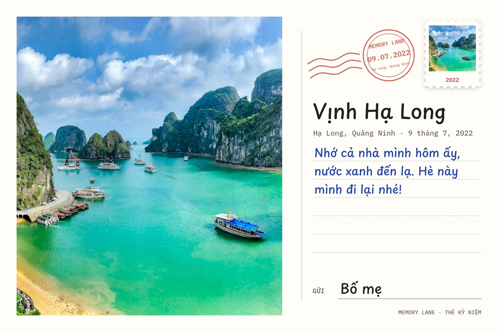
  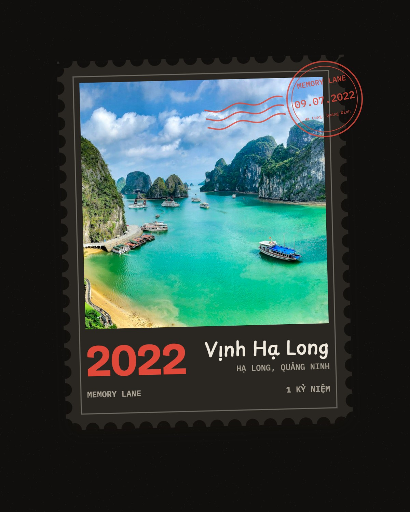
</p>

---

## 10. Đa ngôn ngữ VI ⇄ EN

1. **Từ điển:** `client/src/i18n/vi.js` và `en.js` có **cùng cấu trúc khóa**.
2. **`t()`:** `t('album.count', { count: 13 })` → "13 ký ức" / "13 memories".
3. **Số nhiều** với `Intl.PluralRules`; **ngày tháng & số** với `Intl.DateTimeFormat`.
4. **Máy chủ chỉ gửi mã** (`INVITE_INVALID`, `NEEDS_PASSWORD`…) → giao diện dịch. Kết quả đăng nhập Google về dạng `?google=CODE` →
   khoá `google.result.CODE`.
5. Đổi ngôn ngữ tức thì, nhớ trên thiết bị và trong tài khoản.

<p>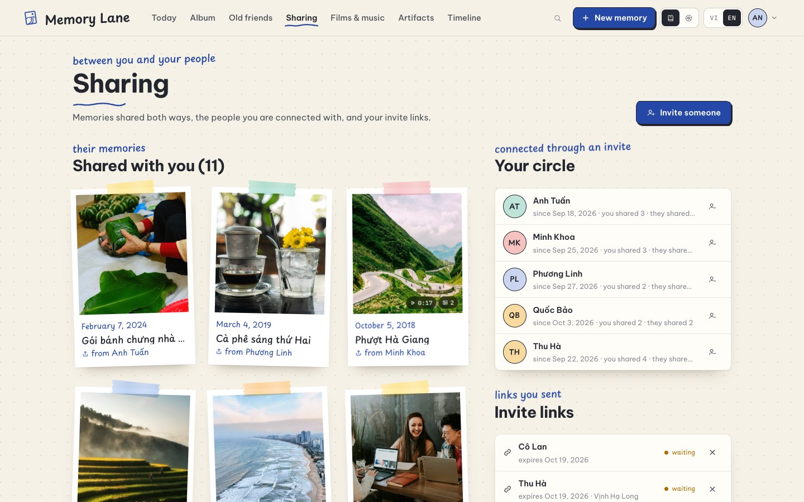</p>

**Bạn tự sửa câu chữ tiếng Việt.** Mọi câu nằm trong `vi.js`:

- Mỗi nhóm có chú thích cho biết nó ở màn hình nào.
- Câu cho tính năng mới là **bản nháp** có dòng `✎ MỚI — bản nháp, cần duyệt (vòng 3)` hoặc `(vòng 4)`.
- Hướng dẫn: [SUA-NOI-DUNG-TIENG-VIET.md](SUA-NOI-DUNG-TIENG-VIET.md).

**Kiểm thử tự động** (`test/i18n.test.js`):

- Hai từ điển cùng khoá, cùng `{biến}`, không câu nào trống.
- Mọi khoá dùng trong code đều tồn tại, kể cả khoá ghép lúc chạy (`nav.tabs.${…}`, `cards.kind.${…}`, `cards.style.${…}`,
  `google.result.${…}`).
- Mọi mã lỗi máy chủ có thể gửi đều có câu dịch.

---

## 11. Bảo mật & quyền riêng tư

| Mối nguy | Ví dụ tấn công | Memory Lane chặn bằng | Ở đâu |
| --- | --- | --- | --- |
| Lộ cơ sở dữ liệu → lộ mật khẩu, phiên, link mời | Kẻ xấu lấy được tệp `.db` | Mật khẩu **scrypt + salt**; phiên và link mời chỉ lưu **mã băm** | `lib/password.js`, `sessions.js`, `models/social.js` |
| Đoán mật khẩu / link mời | Thử hàng nghìn lần | **Giới hạn tần suất** (đăng nhập 20 lần/15 phút; Google gấp đôi; link mời 60 lần/15 phút); tối đa 30 lời mời/ngày | `lib/rateLimit.js` |
| Dò email đã đăng ký | So câu trả lời/thời gian | **Cùng câu trả lời, cùng thời gian**, kể cả tài khoản chỉ có Google | `routes/auth.js` |
| Đăng nhập Google bị giả mạo | Ép đăng nhập vào tài khoản kẻ xấu; đánh cắp `code`; phát lại token | **state + PKCE + nonce**; kiểm tra `iss`, `aud`, `exp`, `email_verified`; cookie lần thử chỉ dùng một lần | `lib/google.js`, `routes/google.js` |
| Chiếm tài khoản trước (pre-hijacking) | Đăng ký trước bằng email của nạn nhân | **Không tự gộp** theo email; chỉ chủ đã đăng nhập mới liên kết Google | `routes/google.js` |
| Chuyển hướng mở (open redirect) | `?next=https://trang-xau` | `next` chỉ nhận đường dẫn nội bộ | `routes/google.js` |
| Xem dữ liệu người khác (IDOR) | Đổi `/album/13` thành `/album/14` | Mọi truy vấn kiểm tra **chủ hoặc được chia sẻ đích danh**; còn lại **404** | `models/*.js` |
| Người được chia sẻ làm quá quyền | Sửa, xoá, tải tệp, chia sẻ tiếp | Các route đó chỉ nhận **chủ ký ức** | `routes/memories.js` |
| Lộ kỷ vật qua kỷ niệm chung | Người được chia sẻ xin ảnh thẻ, hoặc tự lưu thẻ từ kỷ niệm của người khác | Kỷ vật và ảnh thẻ **chỉ chủ** xem được; chỉ **chủ kỷ niệm** lưu được thẻ (còn lại 404) | `models/artifacts.js`, `routes/files.js`, `routes/memories.js` |
| Nghe lén luồng sự kiện | Mở `/api/events` không đăng nhập | 401; mỗi người chỉ nhận sự kiện của **kỷ niệm mình được xem** | `lib/live.js`, `routes/memories.js` |
| Link mời bị chuyển tiếp | Link rơi vào tay người khác | Một lần, 7 ngày, thu hồi được; nhận lời phải đăng nhập và tự bấm | `models/social.js` |
| Xem trộm tệp | Đoán đường dẫn | Không có thư mục công khai; tên 128 bit + kiểm tra quyền mỗi lần; `Cache-Control: private, no-cache` | `routes/files.js` |
| **Lộ vị trí nhà** qua ảnh/video | GPS trong EXIF, toạ độ trong video | Vẽ lại trong trình duyệt **và** xoá ở máy chủ (JPEG/PNG/WebP, **MP4/MOV**) | `lib/image.js`, `lib/metadata.js` |
| Tệp độc hại | `.png` chứa HTML; HEIC giả video | **Magic bytes**, danh sách định dạng cho phép, `nosniff` | `lib/files.js` |
| Làm đầy ổ đĩa | Tải lên hàng chục GB | Giới hạn mỗi tệp, 20 tệp/ký ức, **hạn mức tài khoản** (cả ảnh thẻ trong Kỷ vật), kiểm tra **trước khi nhận** | `routes/memories.js` |
| SQL injection · XSS · CSRF · Clickjacking | — | Tham số `?` · React thoát ký tự + **CSP** · `SameSite` + `Sec-Fetch-Site` · `frame-ancestors 'none'` | `models/`, `lib/security.js` |
| Bị theo dõi bởi bên thứ ba | Google Fonts, script đăng nhập | **Không** script, font, ảnh nào từ bên ngoài; đăng nhập Google chỉ là chuyển trang | `main.jsx`, `lib/security.js` |
| Mất điện thoại · nhìn trộm màn hình | — | Đăng xuất mọi nơi · **chế độ kín đáo** (mặc định tắt, mỗi tài khoản tự bật; trên điện thoại: chạm để xem) | `routes/me.js`, `state.jsx` |
| Quyền được mang đi & được quên | — | Xuất toàn bộ (cả kỷ vật, chia sẻ, lời nhắn); xoá tài khoản xoá mọi tệp, rời mọi vòng thân quen | `routes/me.js` |

Mỗi dòng quan trọng đều có **kiểm thử tự động** chứng minh (phần 13). Ví dụ:

- Callback Google có `state` sai → từ chối.
- Token của app khác hoặc email chưa xác minh → từ chối.
- Người được chia sẻ xin ảnh kỷ vật → 404.
- Lời nhắn mới đến tay người kia qua SSE.

**Chưa làm (nói thẳng khi bảo vệ):** mã hoá cơ sở dữ liệu trên đĩa, xác minh email, quên mật khẩu qua email, 2FA, quét virus. Lộ
trình ở [MO-RONG.md § 5](MO-RONG.md#5-bảo-mật-và-an-toàn-dữ-liệu-khi-hệ-thống-lớn-lên).

---

## 12. Hành trình của một yêu cầu — 7 câu chuyện

### 12.1 Đăng nhập bằng mật khẩu

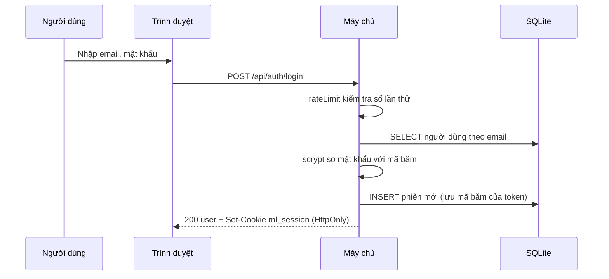

### 12.2 Đăng nhập bằng Google

Xem sơ đồ ở [7.12](#712-đăng-nhập-bằng-google--oauth-20--openid-connect).

### 12.3 Lưu một ký ức có ảnh, video và chia sẻ

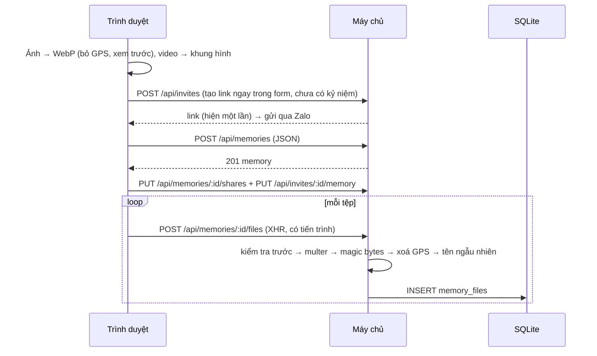

### 12.4 Mở trang "Hôm nay gợi lại"

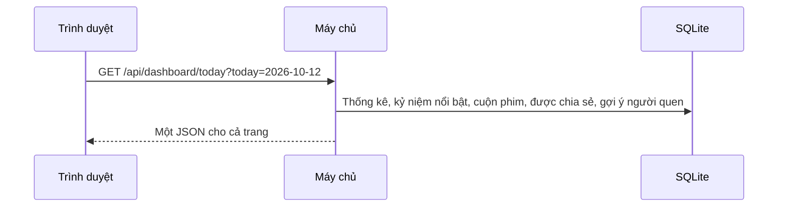

### 12.5 An mời Thu Hà và chia sẻ một kỷ niệm

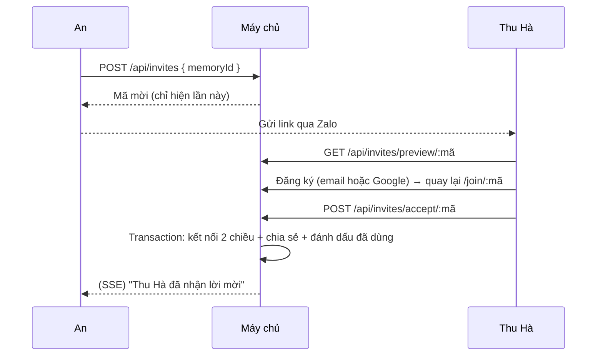

### 12.6 Lời nhắn hiện ra trực tiếp

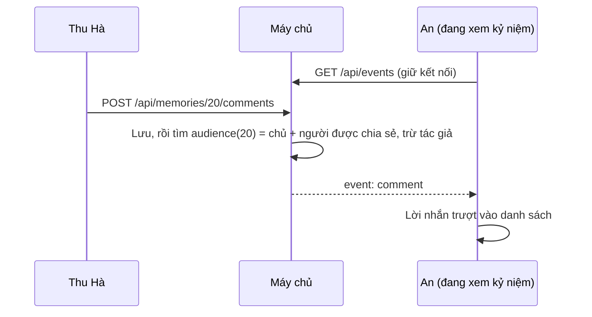

### 12.7 Tạo bưu thiếp

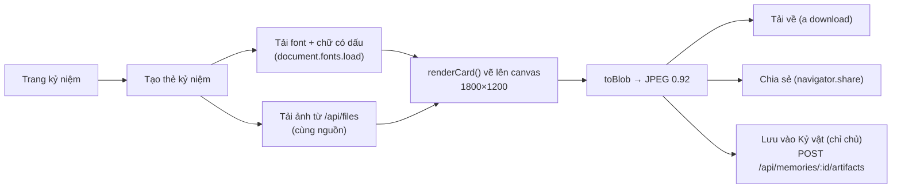

---

## 13. Kiểm thử

```bash
npm test
```

**72 bài kiểm thử máy chủ**, chạy trong vài giây bằng `node:test`:

| Nhóm | Số bài | Kiểm tra gì |
| --- | --- | --- |
| Xác thực | 10 | Phiên, lỗi từng ô, không lộ mã băm, cookie an toàn, email trùng, trả lời giống nhau, đăng xuất, đổi mật khẩu, đăng xuất mọi nơi |
| Ký ức | 5 | CRUD, ngày không hợp lệ/tương lai, xuống dòng, lọc năm, **cô lập hoàn toàn giữa hai người dùng** |
| Ảnh & video | 6 | Nhiều ảnh, thứ tự, ảnh bìa, xoá khỏi đĩa; **WebP**; video + Range 206; xoá GPS khỏi video/JPEG/PNG; magic bytes; giới hạn & hạn mức |
| Chia sẻ, lời mời, lời nhắn | 8 | Link mời (băm, một lần, xem trước không lộ ghi chú); thu hồi & hết hạn; **gắn kỷ niệm vào link tạo trước**; chỉ trong vòng thân quen; quyền lời nhắn; ngừng kết nối; **SSE** (chia sẻ, lời nhắn, xoá lời nhắn đến ngay) |
| Kỷ vật | 3 | Lưu thẻ, lọc theo loại, mở, xoá (xoá cả tệp); **chỉ chủ kỷ niệm lưu được**, người được chia sẻ không thấy thẻ hay ảnh thẻ (404); lỗi từng ô; tính hạn mức; **xoá kỷ niệm xoá luôn thẻ và tệp**; tìm kiếm; xuất dữ liệu |
| Tìm kiếm, trang chủ, người, phim nhạc | 5 | Tìm không dấu, "On this day", gợi ý người lâu ngày, link `javascript:` bị từ chối |
| Bảo mật | 5 | CSRF, header (CSP có `media-src`), xuất dữ liệu đúng người, xoá tài khoản, JSON hỏng |
| **Đăng nhập Google** | 12 | Tạo tài khoản mới; **từ link mời: đăng ký bằng Google → quay lại lời mời → nhận → mở kỷ niệm**; Google không thành công vẫn nhớ đường về lời mời; nhận lại theo `sub` dù email đổi; từ chối callback giả/phát lại/huỷ/token không tin được; `next` chỉ nội bộ; không gộp theo email + liên kết từ Cài đặt; tài khoản chỉ có Google; chưa cấu hình; lệnh **`npm run setup:google`** ghi đúng `.env` và từ chối Client ID sai; khi `npm run dev`, Google được hẹn quay về đúng `localhost:5173` |
| Metadata | 7 | Nhận diện định dạng; xoá EXIF/IPTC (JPEG), `eXIf`/`iTXt` (PNG), EXIF/XMP (WebP); xoá toạ độ ISO-6709 trong video |
| Đa ngôn ngữ | 6 | Cùng khoá, cùng `{biến}`, không trống, khoá dùng trong code tồn tại, khoá ghép lúc chạy, mọi mã lỗi có câu dịch |
| **Vận hành** | 5 | `/api/health` (ok / 503 khi mất cơ sở dữ liệu); lỗi 500 kèm **mã tham chiếu** trùng với dòng log, token trong địa chỉ bị che; `npm run admin`: tra cứu **không in nội dung riêng tư**, không tự tạo cơ sở dữ liệu trống khi chỉ sai thư mục, đăng xuất mọi nơi, mật khẩu tạm dùng được, `check-files` chỉ xoá tệp không ai dùng, bản sao lưu mở được độc lập |

**Kiểm thử Google không cần Internet:** `test/google.test.js` dựng một **"Google giả"**, tức một máy chủ HTTP nhỏ đóng vai trang lấy
token. Máy chủ giả kiểm tra PKCE và client secret như Google thật, rồi trả về ID token theo kịch bản của từng bài (đúng, sai `aud`, hết
hạn, sai `nonce`…).

**Kiểm thử SSE:** bài kiểm thử mở kết nối `/api/events` thật bằng `fetch`, đọc luồng, và đợi đúng sự kiện sau khi người kia chia sẻ
và viết lời nhắn.

**Kiểm thử toàn hệ thống trên Chrome thật** (`npm run test:e2e`, `test/e2e/`): tự build, tạo dữ liệu demo riêng, chạy máy chủ riêng ở
cổng 3299, rồi điều khiển **ba trình duyệt cùng lúc** (An, Thu Hà, một tài khoản mới) qua DevTools Protocol, bấm và gõ như người dùng:
35 tính năng từ trang giới thiệu, đăng ký, tạo kỷ niệm có ảnh và video, lời nhắn trực tiếp giữa hai người, chia sẻ, link mời từ đầu
đến cuối, thẻ kỷ niệm và Kỷ vật, người quen, phim nhạc, tìm kiếm không dấu, cài đặt (đổi mật khẩu, xuất dữ liệu, xoá tài khoản), tới
hai giao diện, điện thoại 390 px, tiếng Anh, mã lỗi khi máy chủ gặp sự cố, và không có lỗi JavaScript nào. Kết quả ngày 14/10/2026:
**35/35 đạt**. Chi tiết và cách viết thêm kiểm tra: [PLAN.md, E8](../PLAN.md#e8-kiểm-thử-toàn-hệ-thống--điều-khiển-chrome-như-người-dùng-thật).

**Kiểm thử thủ công trên trình duyệt:**

- Hai giao diện × hai ngôn ngữ × máy tính (1000–1536 px, thanh điều hướng không đè chữ) × điện thoại (360/375 px, không tràn ngang).
- Ảnh/video dọc hiển thị đúng; tắt hộp chọn tệp không đóng form.
- Chia sẻ + tạo link mời trong form; lời nhắn trực tiếp giữa hai người.
- Kỷ vật: lưu thẻ từ trang kỷ niệm và từ tab Kỷ vật, lọc, xem, xoá; bưu thiếp, con tem, thẻ ảnh ở hai kiểu.
- Trang đăng nhập với nút Google; bảng điều khiển trình duyệt không có lỗi.

---

## 14. Đưa lên mạng (deploy)

1. **Build:** `npm run build` → `client/dist/`.
2. **Biến môi trường:** `NODE_ENV=production`, `DATA_DIR`, `ALLOW_DEMO`, `MAX_VIDEO_MB`, `STORAGE_MB`, `PUBLIC_URL`,
   `GOOGLE_CLIENT_ID`, `GOOGLE_CLIENT_SECRET`…
3. **Ổ đĩa bền vững** gắn vào `DATA_DIR`, đủ lớn cho video.
4. **HTTPS:** nền tảng tự cấp; cookie `Secure`, HSTS. HTTP/2 giúp luồng sự kiện không bị giới hạn kết nối.
5. **Đăng nhập Google:** tạo OAuth client của bạn, khai báo đúng địa chỉ callback.

Hướng dẫn từng bước (Render, Railway, Fly.io/Docker, Google): [DEPLOY.md](DEPLOY.md). Repo có sẵn `render.yaml`, `Dockerfile` và
`.github/workflows/ci.yml`.

**Sau khi chạy thật — vận hành** (chi tiết: [PLAN.md, Phần C](../PLAN.md#phần-c--vận-hành-bảo-trì-và-xử-lý-sự-cố)):

- **`GET /api/health`** trả `{"ok":true}` khi máy chủ đọc được cơ sở dữ liệu; Render dùng làm health check, Docker có `HEALTHCHECK`.
- **Mã lỗi tham chiếu:** lỗi 500 trả `{"error":"SERVER","ref":"1f9e2221"}`, giao diện hiện "Mã lỗi: 1f9e2221", log máy chủ có dòng
  `SERVER 1f9e2221 POST /api/memories/27/files user=1`. Người dùng báo mã, người vận hành tìm ra đúng dòng lỗi.
- **`npm run admin`:** tra tài khoản và kỷ niệm (chỉ số liệu, không in nội dung riêng tư), đặt mật khẩu tạm (bản MVP chưa gửi
  email đặt lại mật khẩu), đăng xuất mọi nơi, đối chiếu tệp với cơ sở dữ liệu, sao lưu bằng `VACUUM INTO`.
- **Sổ tay xử lý sự cố** theo triệu chứng (quên mật khẩu, Google lỗi, ảnh không hiện, link mời hết hạn…), sao lưu và khôi phục, cập
  nhật an toàn, và 5 bài diễn tập trên dữ liệu thử.

---

## 15. Giới hạn & hướng phát triển

**Giới hạn hiện tại (nên chủ động nói khi bảo vệ):**

- SQLite + thư mục tệp chạy tốt trên **một** máy chủ.
- Video lưu **nguyên bản** (chưa nén lại), nên HEVC của iPhone có thể không phát trên vài trình duyệt Windows.
- Tải lên chưa **tiếp tục được giữa chừng**.
- Sự kiện trực tiếp chỉ đến khi app đang mở; chưa có thông báo đẩy hay email.
- Chưa có xác minh email, quên mật khẩu, 2FA; chưa mã hoá CSDL trên đĩa.
- Chưa có kiểm thử end-to-end tự động trên trình duyệt; chưa thử trên iPhone/Samsung thật (đã soát code và giả lập).

**Hướng phát triển:** xem lộ trình theo giai đoạn ở [MO-RONG.md § 7](MO-RONG.md#7-lộ-trình-theo-giai-đoạn):

- Nén video bằng ffmpeg trong worker.
- Kho lưu trữ đám mây + link có chữ ký + CDN.
- PostgreSQL, Redis.
- Thông báo đẩy, thả cảm xúc, album chung.
- Giao diện "Lịch bloc".
- Kiểm thử Playwright.

---

## 16. Kịch bản thuyết trình & demo 10 phút

| Thời gian | Nội dung | Gợi ý |
| --- | --- | --- |
| 0:00 – 0:45 | **Vấn đề** | "Lần cuối bạn xem lại ảnh cũ là khi nào — và ai chọn tấm ảnh đó cho bạn?" |
| 0:45 – 1:30 | **Ý tưởng & 3 lời hứa** | Trang giới thiệu; đổi **Sổ tay ⇄ Phòng tối** và **VI ⇄ EN** |
| 1:30 – 2:00 | **Đăng nhập** | Chỉ nút **Tiếp tục với Google**, nói 1 câu về PKCE/state; vào bằng nút demo |
| 2:00 – 4:00 | **Demo An** | Hôm nay → Album (kính lúp ở Phòng tối) → **+**: 2 ảnh + **1 video dọc**, tick Thu Hà, **tạo link mời ngay trong form** → Lưu → khung xem dọc |
| 4:00 – 5:00 | **Thời gian thực** | Cửa sổ ẩn danh "vào vai Thu Hà" mở cùng kỷ niệm → viết lời nhắn → bên An **hiện ngay** |
| 5:00 – 6:00 | **Thẻ kỷ niệm & Kỷ vật** | Kỷ niệm "Đà Lạt" → **Tạo thẻ kỷ niệm**: con tem → **Lưu vào Kỷ vật** → tab Kỷ vật mở ngay "Hiện vật số 007" → lọc, mở bưu thiếp "Vịnh Hạ Long" → bấm về kỷ niệm gốc |
| 6:00 – 6:30 | **Điện thoại** | Mở bằng điện thoại thật (hoặc giả lập 375 px): menu, vuốt ảnh, "Chia sẻ…" |
| 6:30 – 8:30 | **Kỹ thuật** | Sơ đồ phần 4; đường ống tải tệp (WebP −30%, xoá GPS cả video); mô hình chia sẻ 3 lớp; SSE; 4 dòng bảng bảo mật |
| 8:30 – 10:00 | **Đa ngôn ngữ, kiểm thử, mở rộng, kết** | Máy chủ trả mã lỗi; `npm test` 72 bài (có "Google giả") + `npm run test:e2e` 35 tính năng; khi có nhiều người dùng ([MO-RONG](MO-RONG.md)) |

**Mẹo:**

- Chạy `npm run seed` buổi sáng.
- Quay sẵn video dự phòng.
- Để sẵn một video quay dọc ngắn trong máy.
- Mở sẵn cửa sổ ẩn danh cho Thu Hà.

### Câu hỏi giảng viên hay hỏi — và gợi ý trả lời

1. **"Sao không dùng MongoDB/MySQL?"** — Dữ liệu có quan hệ rõ (ký ức ↔ người ↔ kỷ vật ↔ người được chia sẻ). SQLite cho SQL thật
   mà không cần cài máy chủ; chuyển sang PostgreSQL dễ.
2. **"Mật khẩu lưu thế nào?"** — Chỉ lưu mã băm scrypt có salt riêng.
3. **"Người A có xem được ảnh của B không?"** — Chỉ khi B **chia sẻ đích danh**, và chỉ sau khi đã kết nối. Mỗi lần xin ảnh đều kiểm tra
   lại. Có kiểm thử.
4. **"Đăng nhập Google an toàn thế nào?"** — Luồng authorization code + PKCE + state + nonce; máy chủ đổi `code` lấy token trực tiếp với
   Google; kiểm tra `aud`, `exp`, email đã xác minh; không gộp tài khoản theo email.
5. **"Lỡ link mời bị lộ?"** — Một lần, 7 ngày, thu hồi được, phải đăng nhập và tự bấm; CSDL chỉ có mã băm.
6. **"Sao lỗi trả 404 mà không phải 403?"** — 403 tiết lộ "có nhưng cấm"; 404 không tiết lộ gì.
7. **"Làm sao ảnh nhỏ đi mà không xấu?"** — Thu về 2000 px + WebP 0.85, đo bằng SSIM: nhỏ hơn JPEG 30%, SSIM 0.994. Video: lộ trình
   ffmpeg CRF ([MO-RONG](MO-RONG.md)).
8. **"Xoá GPS khỏi video bằng cách nào?"** — Toạ độ nằm trong phần đầu tệp dưới dạng chữ; máy chủ thay chữ số bằng 0, **giữ nguyên độ
   dài**, nên cấu trúc video còn nguyên.
9. **"Thời gian thực làm sao? Sao không WebSocket?"** — SSE: kết nối HTTP dài, máy chủ đẩy sự kiện. App chỉ cần chiều xuống; SSE dùng
   chung cookie, tự kết nối lại, không cần thư viện. Nhiều máy chủ thì thêm Redis pub/sub.
10. **"Có nhiều người dùng thì lưu ảnh ở đâu?"** — Kho đối tượng (S3/R2) riêng tư + link có chữ ký ngắn hạn + CDN; khử trùng lặp bằng
    mã băm; bản gốc sang lớp lưu trữ lạnh.
11. **"Hai giao diện có làm code gấp đôi không?"** — Không: cùng HTML, cùng component; khác hai bộ biến CSS và vài chi tiết trang trí.
12. **"Phần nào khó nhất?"** — Đường ống tải tệp an toàn, mô hình quyền của chia sẻ, hoặc luồng OAuth. Chọn một phần và kể kỹ.

---

## 17. Bảng thuật ngữ

| Thuật ngữ | Giải thích ngắn |
| --- | --- |
| **API / REST / Endpoint** | "Cửa giao tiếp" của máy chủ / cách đặt tên theo tài nguyên / một đường dẫn + phương thức cụ thể |
| **Mã trạng thái** | 200 OK, 201 đã tạo, 206 một phần, 303 chuyển trang, 400 dữ liệu sai, 401 chưa đăng nhập, 404 không thấy… |
| **Middleware / Route / Model** | "Trạm kiểm tra" / hàm xử lý một endpoint / nơi chứa câu SQL |
| **SQL / SQLite / Migration / Seed** | Ngôn ngữ truy vấn / CSDL trong một tệp / tệp thay đổi cấu trúc theo thứ tự / dữ liệu mẫu |
| **Khóa chính / ngoại · CASCADE · Index** | Cột định danh / cột trỏ sang bảng khác · xoá dây chuyền · "mục lục" để tìm nhanh |
| **Transaction** | Một nhóm lệnh "tất cả hoặc không gì cả" |
| **Cookie / Phiên / Token** | Mẩu dữ liệu trình duyệt giữ hộ / trạng thái đăng nhập ở máy chủ / chuỗi ngẫu nhiên làm "chìa khoá" |
| **Băm (hash) / salt** | Biến dữ liệu thành chuỗi không đảo ngược được / chuỗi ngẫu nhiên thêm vào trước khi băm |
| **OAuth 2.0 / OpenID Connect** | Chuẩn uỷ quyền / lớp "đăng nhập" trên OAuth, trả về **ID token** cho biết bạn là ai |
| **Authorization code · PKCE · state · nonce** | Mã một lần đổi lấy token · cặp mã chứng minh chính bạn bắt đầu đăng nhập · mã chống giả mạo · mã chống phát lại |
| **ID token / `sub` / `aud`** | Phiếu Google ký xác nhận danh tính / mã cố định của người dùng / app mà token dành cho |
| **Account pre-hijacking** | Đăng ký trước bằng email của nạn nhân để chờ nạn nhân "gộp" vào |
| **SQL injection / XSS / CSRF / IDOR** | Bốn kiểu tấn công kinh điển (xem phần 11) |
| **CSP / HSTS / Rate limit** | Header khai báo nguồn được phép tải / bắt dùng HTTPS / giới hạn số lần thử |
| **SPA / Code splitting** | Ứng dụng một trang / chia code, cần trang nào tải trang đó |
| **Component / Props / State / Hook / Context** | Khái niệm cơ bản của React (phần 9.1) |
| **Design token** | Một biến CSS cho màu, font, bo góc… dùng chung khắp giao diện |
| **Server-Sent Events (SSE) / EventSource** | Máy chủ đẩy sự kiện qua một kết nối HTTP dài / đối tượng trình duyệt nhận các sự kiện đó |
| **WebSocket / Polling** | Kênh hai chiều liên tục / trình duyệt hỏi định kỳ |
| **Canvas** | "Tấm vải" vẽ bằng JavaScript: dùng để nén ảnh, chụp khung hình video, vẽ thẻ kỷ niệm |
| **WebP / AVIF / SSIM** | Định dạng ảnh nhỏ hơn JPEG / định dạng còn nhỏ hơn / chỉ số đo hai ảnh giống nhau tới đâu (1 = giống hệt) |
| **Magic bytes · EXIF · ISO-6709** | Vài byte đầu cho biết loại tệp · thông tin ẩn trong ảnh · cách ghi toạ độ trong video |
| **HTTP Range (206)** | Xin một đoạn của tệp: video phát ngay và tua được |
| **Poster / bản xem trước** | Ảnh đại diện của video / ảnh nhỏ 560 px cho lưới album |
| **Transcode / CRF / HLS** | Chuyển mã video / "chất lượng mục tiêu" của bộ nén / phát video thích ứng theo mạng |
| **Object storage / signed URL / CDN** | Kho tệp đám mây (S3, R2) / link tạm thời có chữ ký / mạng máy chủ gần người xem |
| **Kỷ vật (artifact)** | Một tấm thẻ (bưu thiếp, con tem, thẻ ảnh) làm từ chính một kỷ niệm và được lưu lại; tab Kỷ vật là bộ sưu tập các thẻ đó |
| **Vòng thân quen (circle)** | Những người đã nhận lời mời của nhau; chỉ chia sẻ được trong vòng này |
| **Hạn mức (quota)** | Dung lượng tối đa mỗi tài khoản |
| **dvh / safe area** | Đơn vị chiều cao màn hình "thật" trên điện thoại / vùng không bị tai thỏ, góc bo che |
| **Biến môi trường / volume / CI** | Cấu hình ngoài code / ổ đĩa bền vững của máy chủ / tự chạy kiểm thử mỗi lần đẩy code |
