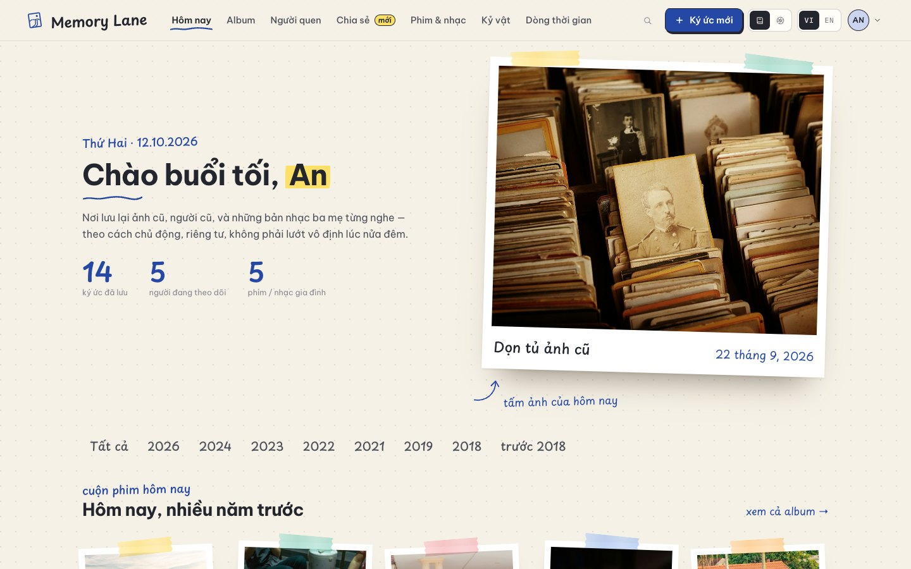
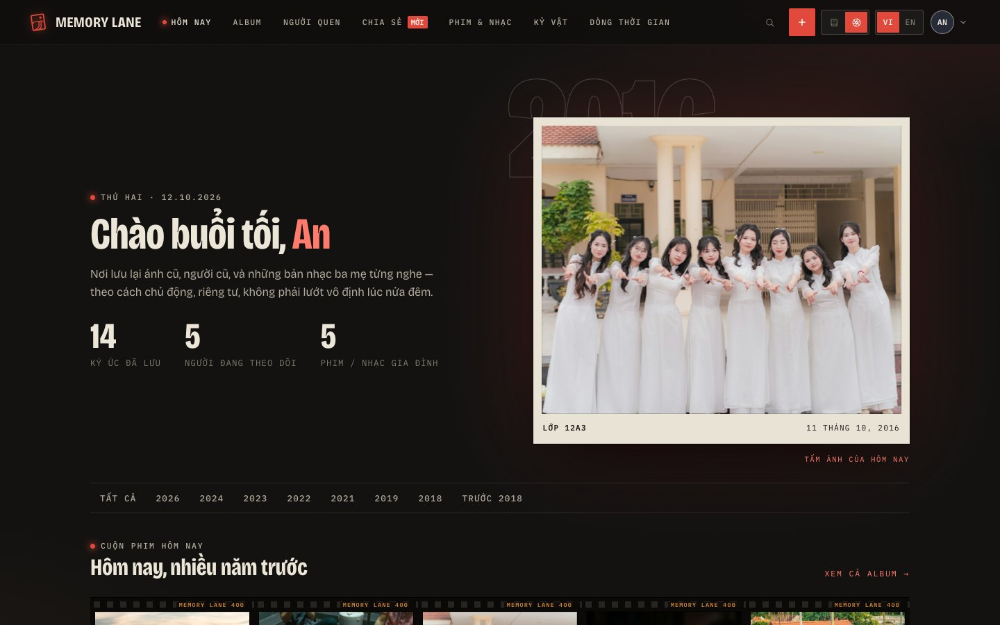
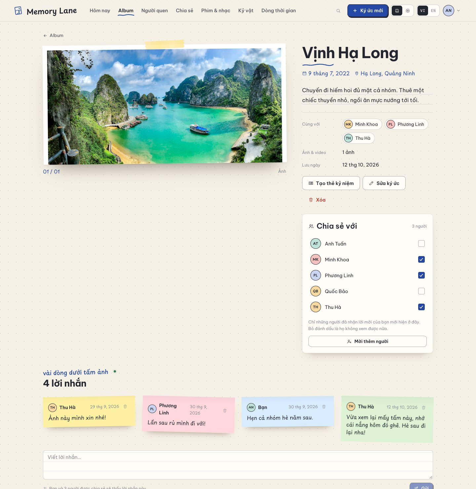
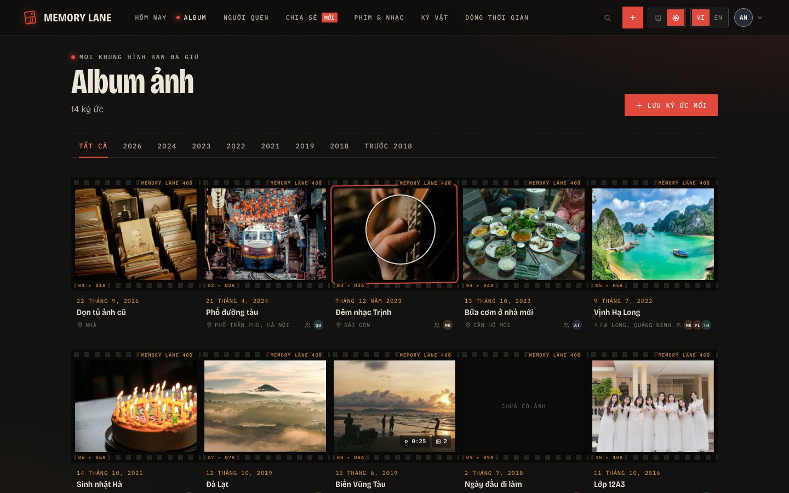
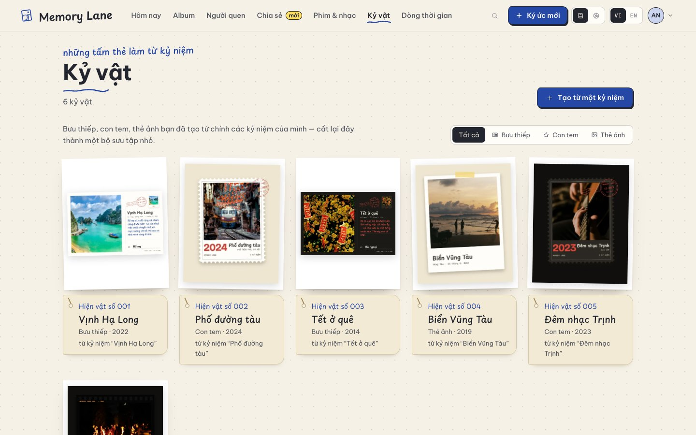
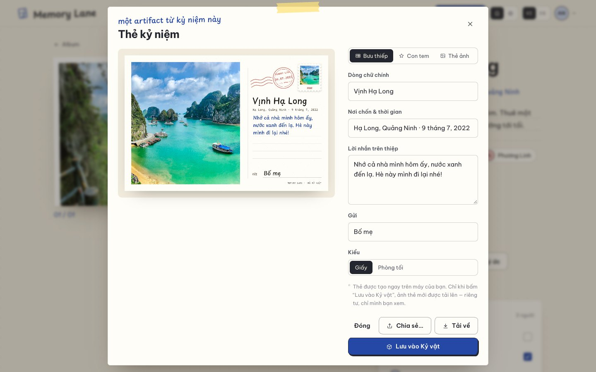
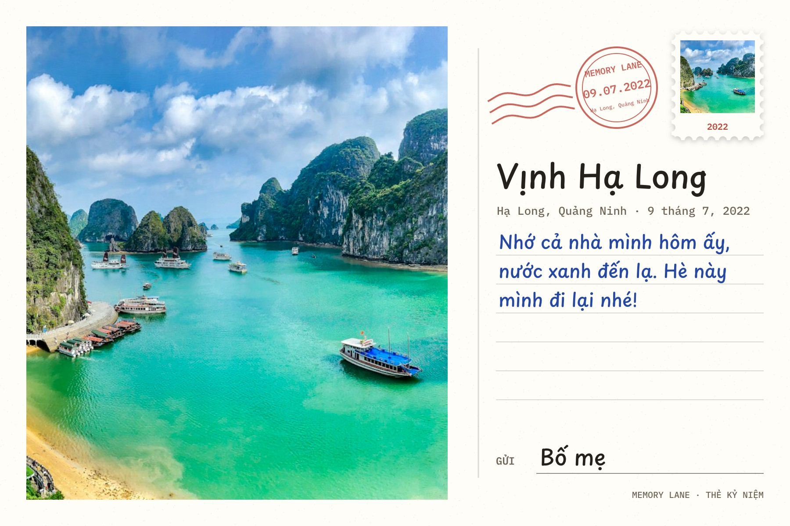
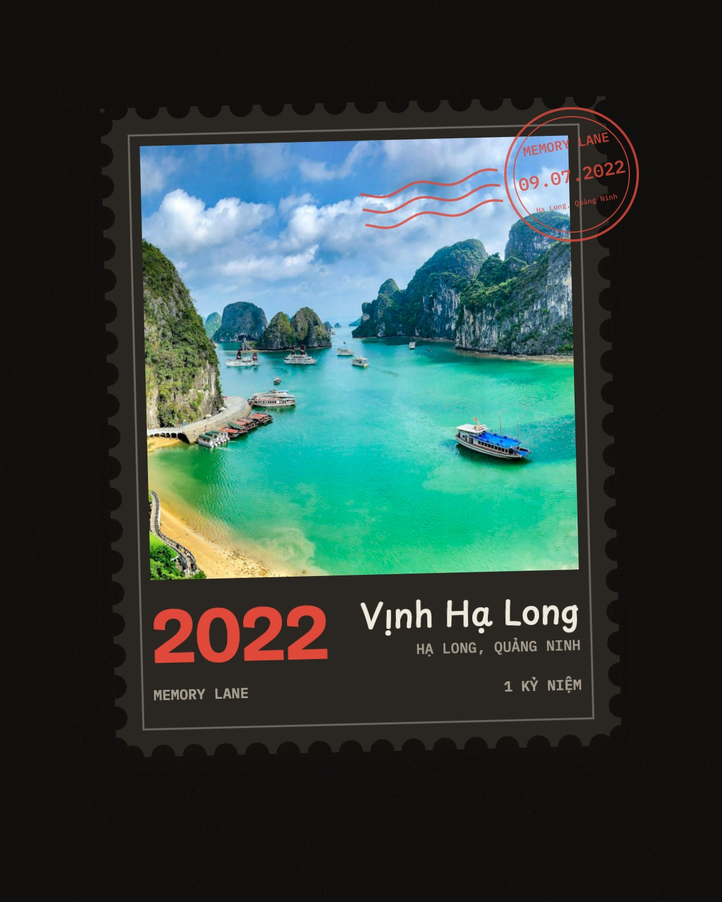

# Thiết kế giao diện Memory Lane

Tài liệu này giải thích **vì sao** giao diện trông như vậy, **lấy cảm hứng từ đâu**, **cách làm hai giao diện trên cùng một mã
nguồn**, cách thiết kế cho **điện thoại**, và **gợi ý giao diện mới** cho sau này.

<p>
  
  
</p>

## Mục lục

1. [Vấn đề ban đầu: "giống hệt sản phẩm AI làm"](#1-vấn-đề-ban-đầu-giống-hệt-sản-phẩm-ai-làm)
2. [Tên & logo: Memory Lane](#2-tên--logo-memory-lane)
3. [Giao diện A — Sổ tay ký ức](#3-giao-diện-a--sổ-tay-ký-ức)
4. [Giao diện B — Phòng tối & tờ in thử](#4-giao-diện-b--phòng-tối--tờ-in-thử)
5. [Kỷ vật và thẻ kỷ niệm](#5-kỷ-vật-và-thẻ-kỷ-niệm)
6. [Một mã nguồn, hai giao diện](#6-một-mã-nguồn-hai-giao-diện)
7. [Trên điện thoại: iPhone & Samsung](#7-trên-điện-thoại-iphone--samsung)
8. [Những nguyên tắc giữ nguyên ở cả hai](#8-những-nguyên-tắc-giữ-nguyên-ở-cả-hai)
9. [Gợi ý giao diện mới — nên làm lúc nào?](#9-gợi-ý-giao-diện-mới--nên-làm-lúc-nào)
10. [25 nhóm tài nguyên — đã dùng gì?](#10-25-nhóm-tài-nguyên--đã-dùng-gì)

---

## 1. Vấn đề ban đầu: "giống hệt sản phẩm AI làm"

Giao diện đầu tiên có đủ các dấu hiệu quen thuộc của giao diện do AI sinh ra:

| Dấu hiệu | Vì sao nó làm giao diện "vô hồn" |
|---|---|
| Thanh bên tối + nội dung là các thẻ bo góc, đổ bóng mềm | Bố cục mặc định của hàng nghìn trang quản trị |
| Một màu nhấn "ấm áp" chung chung cho mọi thứ | Không gắn với một hình ảnh cụ thể nào của ký ức |
| Font serif "sang trọng" + Inter | Cặp font xuất hiện ở mọi landing page năm 2024–2025 |
| Ảnh minh hoạ là khối gradient | Không có ảnh thật, không có chất liệu |
| Hiệu ứng nhẹ, an toàn, giống nhau ở mọi nơi | Không có chi tiết nào khiến người xem nhớ |

Cách sửa: chọn **một ẩn dụ vật lý có thật** cho ký ức, rồi để ẩn dụ đó quyết định mọi thứ, từ màu sắc, font chữ cho tới từng
hiệu ứng nhỏ. Dự án làm **cả hai hướng**, nên ứng dụng có hai giao diện chuyển qua lại được.

---

## 2. Tên & logo: Memory Lane

"Memory Lane" là **con đường ký ức**, như trong câu tiếng Anh *a walk down memory lane* (dạo lại con đường kỷ niệm). Logo là
**một tấm ảnh in hơi nghiêng**. Trong ảnh có **con đường nhỏ uốn lượn** về phía dãy đồi, và một mặt trời.

- Vẽ bằng một SVG duy nhất (`client/src/components/Brand.jsx`), nét 1,5–1,9 px như bộ icon. Màu lấy từ giao diện: **xanh bút bi**
  ở Sổ tay, **đỏ đèn an toàn** ở Phòng tối.
- Logo đã thử 4 phương án và chọn bản đọc rõ nhất ở cỡ 30 px. Bản có đường chân trời cắt ngang trông giống "hình người que".
- `client/public/favicon.svg`: logo trên nền giấy.
- `client/public/apple-touch-icon.png`: ảnh 180×180 cho "Thêm vào Màn hình chính" của iPhone. iOS không dùng được SVG cho việc
  này, và tự bo góc, nên ảnh có nền vuông kín.
- Chữ "MEMORY LANE 400" in trên mép phim ở Phòng tối, như chữ "KODAK 400" trên phim thật.

---

## 3. Giao diện A — Sổ tay ký ức

> Ẩn dụ: **cuốn sổ ai cũng từng có**. Ảnh in dán băng keo, chú thích viết tay bằng bút bi, dòng quan trọng tô bút dạ quang.

| | |
|---|---|
| **Nền** | Giấy ngà `#f6f1e6` với lưới chấm mờ (giống sổ bullet journal) |
| **Mực** | Đen than `#23262f` · **xanh bút bi** `#2547a6` (màu nhấn) · **vàng dạ quang** `#ffe066` · đỏ bút sửa bài `#c0392b` (xoá, lỗi) |
| **Chữ** | **Be Vietnam Pro** cho giao diện (font Việt, đủ dấu, rõ ở cỡ nhỏ) · **Playpen Sans** cho chữ "viết tay": chú thích ảnh, ngày tháng, lời nhắn |
| **Ảnh** | Mỗi ảnh là một tấm **ảnh in viền trắng**, nghiêng ±2°, dán **băng keo washi**; rê chuột thì tấm ảnh thẳng lại và nhấc lên |
| **Chi tiết vẽ tay** | Gạch chân nguệch ngoạc dưới tiêu đề và tab đang mở · **khoanh tròn bằng bút** quanh năm đang chọn · icon có nét hơi run nhờ một bộ lọc SVG |
| **Giấy** | Câu chuyện nằm trên **giấy kẻ dòng** · người quen là **thẻ thư viện** · lời nhắn là **giấy note** dán lệch · kỷ vật có **nhãn giấy kraft xỏ dây** |
| **Phim & nhạc** | Băng **cassette** vẽ bằng CSS |
| **Tham khảo** | [juanmnl.com](https://juanmnl.com) (qua Curated): bố cục tạp chí cá nhân, chữ viết tay · Siteinspire, mục *Photography* |



---

## 4. Giao diện B — Phòng tối & tờ in thử

> Ẩn dụ: **phòng tráng ảnh**. Dưới ánh đèn an toàn màu đỏ, người thợ soi **tờ in thử (contact sheet)** bằng kính lúp và khoanh khung
> hình đẹp bằng bút sáp đỏ.

| | |
|---|---|
| **Nền** | Than chì `#121110`, **vệt đèn đỏ** ở góc trên và một lớp **hạt phim** mờ phủ toàn trang |
| **Màu** | Ngà `#ece6d8` cho chữ · **đỏ đèn an toàn** `#e0483a` (màu nhấn duy nhất) · **cam chữ in mép phim** `#e8953a` |
| **Chữ** | **Bricolage Grotesque** (trục độ rộng, dùng bản hẹp cho tiêu đề và con số năm khổng lồ) · **IBM Plex Mono** viết hoa, giãn chữ cho mọi nhãn, như chữ in trên mép phim |
| **Album** | Một **tờ in thử**: các khung ảnh nằm liền nhau trên dải phim có **lỗ răng cưa** và **chữ in mép** ("MEMORY LANE 400", "07 ▸ 07A") |
| **Tương tác** | Rê chuột vào khung ảnh: **khoanh bút sáp đỏ** và một **kính lúp tròn** phóng to đúng chỗ con trỏ |
| **Ảnh xuất hiện** | Ảnh **"hiện hình"** như trong khay thuốc tráng: từ cháy sáng → rõ dần |
| **Kỷ vật** | **Phiếu lưu trữ** nền tối, viền trên đỏ, chữ mono |
| **Tham khảo** | Stephen Kent Johnson và Daigh Rick (Siteinspire) · YOIN (Curated) · Dark.design |



Ảnh chụp các trang tham khảo nằm trong [`docs/design/references/`](references/). Đó là ảnh chụp màn hình trang web của người
khác (bản quyền thuộc về họ), chỉ dùng làm bảng cảm hứng (moodboard). Khi đưa mã nguồn lên GitHub, **nhất là ở chế độ công khai**,
hãy bỏ thư mục này (lệnh chép trong [PLAN.md](../../PLAN.md#a2-tạo-dự-án-của-bạn-từ-bản-mvp) đã bỏ sẵn).

---

## 5. Kỷ vật và thẻ kỷ niệm

Cả hai tính năng đều xuất phát từ chữ **"Artifacts"**: những *vật mang ký ức*. Kỷ vật ở đây **không phải đồ vật tự khai**: đó là
những tấm thẻ kỷ niệm (bưu thiếp, con tem, thẻ ảnh) bạn làm từ chính kỷ niệm của mình rồi cất lại.

### Tab Kỷ vật — một bảo tàng gia đình nhỏ

- Mỗi thẻ được **đánh số theo thứ tự lưu** ("Hiện vật số 007"), như danh mục của một bảo tàng. Số không đổi khi lọc theo loại.
- Khung trưng bày giữ tỉ lệ 4:5 để các hàng thẳng nhau; thẻ được đặt **trọn vẹn** trong khung (bưu thiếp nằm ngang ở giữa). Trên
  điện thoại, mỗi hàng một thẻ và khung theo đúng hình thẻ (bưu thiếp 3:2).
- **Sổ tay:** thẻ đặt trên nền ảnh in trắng dán nghiêng, bên dưới là **nhãn giấy kraft** có lỗ xỏ dây, tên viết tay.
- **Phòng tối:** khung đen, **phiếu lưu trữ** viền trên đỏ, chữ mono viết hoa.
- Nhãn ghi loại thẻ, năm của kỷ niệm và **"từ kỷ niệm “…”"**; cửa sổ xem có nút dẫn về kỷ niệm gốc.
- Trang một kỷ niệm có dòng **"Kỷ vật"** với ảnh nhỏ các thẻ đã lưu từ nó; bấm vào là mở đúng thẻ trong tab Kỷ vật.
- Hai đường để lưu một thẻ: nút **"Lưu vào Kỷ vật"** trong cửa sổ tạo thẻ (chỉ chủ kỷ niệm thấy), hoặc nút **"Tạo từ một kỷ niệm"**
  ngay trong tab (chọn kỷ niệm → cửa sổ tạo thẻ).



### Thẻ kỷ niệm — biến kỷ niệm thành một vật để gửi đi

Vẽ bằng `<canvas>` ngay trong trình duyệt (`client/src/lib/cards.js`), lưu thành JPEG chất lượng cao:

| Thẻ | Kích thước | Chi tiết |
| --- | --- | --- |
| **Bưu thiếp** | 1800×1200 (6×4 inch ở 300 dpi, in được) | Ảnh bên trái · tem có ảnh thu nhỏ · **dấu bưu điện** tròn ghi ngày và nơi chốn, kèm đường lượn sóng · dòng kẻ cho lời nhắn viết tay · dòng "Gửi" |
| **Con tem** | 1200×1500 | **Răng cưa thật**: đục lỗ bằng `destination-out` trên canvas · năm cỡ lớn · tiêu đề viết tay · dấu bưu điện chồng lên góc · ở kiểu Phòng tối, giấy tem xám than sáng hơn nền một chút để răng cưa vẫn rõ |
| **Thẻ ảnh** | 1200×1500 | **Giấy:** ảnh lấy liền nghiêng nhẹ, băng keo vàng · **Phòng tối:** khung phim đen có lỗ, chữ "MEMORY LANE 400 ▸ 30A" |

Hai kiểu màu **Giấy** và **Phòng tối** dùng lại bảng màu của hai giao diện. Chữ trên thẻ dùng đúng bốn font của app, và đợi font
tải xong (kể cả phần chữ có dấu tiếng Việt) mới vẽ. Vì vậy chữ "Hà ơi, hè này…" luôn đúng dấu.



<p>
  
  
</p>

---

## 6. Một mã nguồn, hai giao diện

```
<html data-theme="notebook">   ← hoặc "darkroom"
```

1. **Cùng một HTML** cho cả hai. Ví dụ, mỗi ký ức luôn được vẽ bằng cùng một cấu trúc:

   ```jsx
   <a class="print">
     <div class="print-film">
       <span class="tape"/>                  ← băng keo  (chỉ hiện ở Sổ tay)
       <span class="edge edge-top">…</span>  ← chữ mép phim (chỉ hiện ở Phòng tối)
       <div class="print-photo">ảnh + kính lúp</div>
     </div>
     <div class="print-cap">ngày · tiêu đề · nơi chốn</div>
   </a>
   ```

2. **Design token:** mọi màu, font, bo góc, bóng đổ đều là biến CSS (`--accent`, `--font-display`, `--btn-radius`…).
   `notebook.css` và `darkroom.css` khai báo **hai bộ giá trị** cho cùng các biến đó.
3. **Chi tiết riêng** của từng giao diện chỉ nằm trong tệp CSS của giao diện đó.
4. **Không nháy màu khi tải trang:** `public/theme-init.js` gắn `data-theme` **trước khi** trang được vẽ. Đây là tệp riêng vì CSP
   cấm script nội tuyến. Tệp này cũng đặt màu thanh trình duyệt (`theme-color`) và `color-scheme` (xem §7).
5. **Thanh điều hướng tự thu gọn bằng cách đo.** Hai giao diện dùng font có độ rộng rất khác nhau, nên các mốc `@media` cố định
   từng làm chữ đè lên nhau sau khi đổi giao diện. Giờ `useNavFit` (trong `TopBar.jsx`) **đo xem có vừa không** và bật dần từng bước:
   ẩn số thứ tự tab → thu gọn → chuyển nút giao diện/ngôn ngữ vào menu tài khoản → chỉ còn nút menu.
6. **Khung xem ảnh theo hình dạng của ảnh.** Video và ảnh dọc (9:16) có khung dọc thay vì bị thu nhỏ trong khung ngang 4:3.
   Chiều cao tối đa là 78% màn hình.

| Tệp | Nội dung |
|---|---|
| `client/src/styles/base.css` | Reset, kiểu chữ, nút, ô nhập, hộp thoại, toast, trạng thái trống/lỗi, quy tắc cho điện thoại |
| `client/src/styles/layout.css` | Thanh điều hướng (các bước thu gọn), menu điện thoại, khung trang |
| `client/src/styles/components.css` | Ảnh in, cuộn phim, bộ ảnh, lời nhắn, chia sẻ, tải tệp, kỷ vật, cửa sổ tạo thẻ, nút Google |
| `client/src/styles/pages.css` | Trang giới thiệu, đăng nhập, link mời, 404 |
| `client/src/styles/notebook.css` | **Giao diện A** |
| `client/src/styles/darkroom.css` | **Giao diện B** |

---

## 7. Trên điện thoại: iPhone & Samsung

Mỗi trang đều đã soát ở bề rộng 360 px (Galaxy S23), 375 px (iPhone SE) và 390–430 px (iPhone 15). Kết quả: **không trang nào tràn
ngang**. Những quy tắc đã áp dụng:

| Vấn đề | Trên máy nào | Cách xử lý |
| --- | --- | --- |
| Chạm vào ô nhập là **cả trang tự phóng to** | iPhone (Safari) | Chữ trong mọi ô nhập ≥ **16 px** trên màn hình cảm ứng |
| Không có "rê chuột": ảnh mờ ở chế độ kín đáo không mở được, kính lúp bật linh tinh | Mọi điện thoại | **Chạm để xem** (chạm lần nữa để che lại); kính lúp chỉ bật khi có chuột (`hover: hover`) |
| Nút, link nhỏ khó chạm | Mọi điện thoại | Vùng chạm ~44 px bằng lớp đệm vô hình (link "xem tất cả", "← Album", công tắc, nút xoá) |
| `100vh` tính cả thanh địa chỉ nên trang bị hụt/tràn | iPhone, Android | Dùng `100dvh` (kèm `100vh` cho máy cũ) |
| Tai thỏ, góc bo khi xoay ngang | iPhone | `viewport-fit=cover` + lề `env(safe-area-inset-*)` gộp vào biến `--gutter` |
| Trang phía sau vẫn cuộn khi hộp thoại/menu đang mở | iPhone | `html:has(dialog[open]) { overflow: hidden }` |
| "Chế độ tối cho trang web" tự đảo màu giao diện Sổ tay | Chrome Android, Samsung Internet | `<meta name="color-scheme">`: `only light` cho Sổ tay, `dark` cho Phòng tối (đổi theo giao diện) |
| Thanh trình duyệt không cùng màu với app | iPhone, Android | `<meta name="theme-color">` đổi theo giao diện |
| Safari bản cũ không đọc được tuỳ chọn `imageOrientation: 'from-image'` | iOS 15–16 | Ba lớp dự phòng khi giải mã ảnh, lớp cuối dùng `` (đọc được cả HEIC trên Safari) |
| Ảnh HEIC chọn từ app Tệp | iPhone | Safari giải mã và chuyển sang WebP/JPEG; trình duyệt không đọc được thì báo lỗi rõ ràng |
| Copy link mời khi mở app qua Wi-Fi (`http://192.168…`) | Mọi máy | Clipboard API chỉ có ở trang HTTPS → dự phòng bằng chọn chữ + `execCommand('copy')` |
| Gửi link/thẻ qua Zalo, Messenger | Mọi điện thoại | **Web Share API** (bảng chia sẻ của máy) khi trình duyệt hỗ trợ |
| Lật ảnh trong bộ ảnh | Mọi điện thoại | **Vuốt trái/phải** (`touch-action: pan-y`) |
| Thêm vào Màn hình chính | iPhone | `apple-touch-icon.png` + `apple-mobile-web-app-title` |

**Tự thử trên máy thật:** chạy `npm run dev:phone` rồi mở địa chỉ `http://192.168.x.x:5173` trên điện thoại cùng Wi-Fi. Nên thử:
đăng nhập · tạo kỷ niệm bằng ảnh **và video quay dọc** từ thư viện · xem video · tạo link mời rồi "Chia sẻ…" sang Zalo ·
tạo bưu thiếp rồi chia sẻ · bật chế độ kín đáo rồi chạm vào ảnh · xoay ngang máy.

---

## 8. Những nguyên tắc giữ nguyên ở cả hai

- **Chữ tiếng Việt trước hết:** cả bốn font đều có đủ dấu tiếng Việt. Nhiều font đẹp như Instrument Serif, DM Serif Display,
  Caveat **không có** dấu tiếng Việt nên bị loại.
- **Font tự lưu trữ** (Fontsource), không gọi Google Fonts: không bên thứ ba nào biết bạn mở album.
- **Ảnh nhẹ:** lưới ảnh dùng bản xem trước 560 px dạng WebP (khoảng 20–40 KB) thay vì ảnh lớn.
- **Truy cập được:** viền focus rõ ràng, điều khiển bằng bàn phím, `prefers-reduced-motion` tắt mọi chuyển động (kể cả chấm "trực
  tiếp" và hiệu ứng lời nhắn mới), phần trang trí đều `aria-hidden`.
- **Kích thước chữ mềm** theo màn hình bằng `clamp()`.

---

## 9. Gợi ý giao diện mới — nên làm lúc nào?

**Lời khuyên: chưa vội.** Hãy làm chủ toàn bộ dự án trước (xem [PLAN.md](../../PLAN.md)). Lý do:

- **Hai giao diện đã đủ** để chứng minh kiến trúc "một mã nguồn, nhiều giao diện".
- **Mỗi giao diện mới kéo theo nhiều việc:** khoảng 400 dòng CSS, kiểm tra ở mọi trang, hai ngôn ngữ, điện thoại và độ tương phản.
- **Giám khảo đánh giá chiều sâu** (bảo mật, dữ liệu, kiểm thử) nhiều hơn số lượng giao diện.

Nếu còn thời gian sau ngày 25/10, **một** giao diện thứ ba là điểm cộng đẹp. Công thức 8 bước nằm trong
[PLAN.md § A6](../../PLAN.md#a6-biến-giao-diện-thành-của-bạn). Năm ý tưởng, xếp theo độ hợp với Memory Lane:

| Ý tưởng | Ẩn dụ & chi tiết | Màu & chữ | Công sức |
| --- | --- | --- | --- |
| **1. Lịch bloc** ⭐ | Cuốn **lịch xé hằng ngày** treo tường của mọi nhà Việt. Trang "Hôm nay gợi lại" là **tờ lịch hôm nay**: số ngày đỏ cỡ lớn, thứ, âm lịch, câu châm ngôn, ký ức của ngày này nằm ở mặt sau tờ lịch. Hợp hoàn hảo với tính năng "On this day" | Giấy trắng ngà, **đỏ son** cho Chủ nhật/ngày lễ, xanh lá cho ngày thường · chữ số lớn kiểu lịch cũ (Bricolage bản hẹp), chữ nhỏ Be Vietnam Pro | Trung bình |
| **2. Bưu điện** | Phong bì, tem, dấu bưu điện, **phiếu gửi** (dùng lại đồ hoạ của thẻ kỷ niệm). Lời nhắn là những lá thư nhỏ, chia sẻ là "gửi thư" | Kraft nâu, đỏ dấu bưu điện, xanh hàng không · chữ máy đánh chữ (IBM Plex Mono) + viết tay | Trung bình |
| **3. Album nhung** | Cuốn **album ảnh bìa nhung** thập niên 80–90: trang giấy dày, **góc dán ảnh** bốn góc, giấy pelure mờ ngăn giữa các trang | Đỏ đô / xanh rêu, giấy kem · chữ serif có dấu tiếng Việt (Lora, Noto Serif) | Thấp – trung bình |
| **4. Báo Tết** | Trang **báo Xuân / tạp chí** cũ: cột chữ, tít lớn, ảnh in lưới (halftone), số báo | Giấy báo ngả vàng, mực đen, đỏ Tết · chữ serif tạp chí + sans gọn | Cao (bố cục nhiều cột) |
| **5. Tương phản cao** | Không phải ẩn dụ mà là **trợ năng**: chữ lớn, tương phản AAA, không hiệu ứng, nút to; cho ông bà, người mắt kém | Đen trên trắng / trắng trên đen · Be Vietnam Pro cỡ lớn | Thấp, giá trị thật lớn |

Gợi ý chọn: **Lịch bloc** (đậm chất Việt, ăn khớp tính năng chính) hoặc **Tương phản cao** (ít công, dễ ghi điểm về trợ năng).

---

## 10. 25 nhóm tài nguyên — đã dùng gì?

Theo danh sách 25 nhóm × 3 nguồn trong bài đăng của Lê Huy Thái. Bảng ghi rõ nguồn nào **dùng trực tiếp**, nguồn nào chỉ **mượn ý
tưởng / kỹ thuật** (tự làm lại), nguồn nào **cố ý không dùng** và vì sao.

| # | Nhóm | Nguồn | Trong dự án |
|---|---|---|---|
| 1 | Template để tùy chỉnh | OriginKit · 21st.dev · Shadcnblocks | ✗ Không dùng: template làm giao diện giống hàng nghìn trang khác, đúng điều cần tránh |
| 2 | Template kèm prompt AI | GetLayers · MotionSites · Aura | ✗ Như trên |
| 3 | Hiệu ứng | React Bits · Aceternity UI · Magic UI | ✗ Thư viện hiệu ứng tạo ra đúng "vẻ AI". Hiệu ứng ở đây được tự viết theo ẩn dụ: kính lúp, ảnh hiện hình, khoanh bút, lời nhắn trượt vào |
| 4 | Thành phần (component) | shadcn/ui · daisyUI · Flowbite | ✗ Tự viết bằng CSS thuần để mỗi giao diện có cá tính riêng |
| 5 | Bố cục | Landbook · Lapa Ninja · **Curated** | ✓ **Curated**: juanmnl.com (Sổ tay), YOIN (Phòng tối) |
| 6 | Phong cách & luồng | **Siteinspire** · **Dark.design** · Mobbin | ✓ **Siteinspire** (Photography) · **Dark.design** cho giao diện tối |
| 7 | Icon | **Lucide** · Phosphor · Heroicons | ◐ Phong cách **Lucide** (nét 1.6 px, lưới 24 px), tự vẽ bằng SVG (kể cả hộp, phong thư, giấy tờ, bưu thiếp), không tải thư viện |
| 8 | Font | **Google Fonts** · Fontshare · Typewolf | ✓ Cả bốn font đều của **Google Fonts**, kiểm tra hỗ trợ tiếng Việt rồi **tự lưu trữ** qua Fontsource |
| 9 | Màu | Coolors · Realtime Colors · Radix Colors | ○ Màu lấy từ đồ vật thật (mực bút bi, bút dạ quang, đèn an toàn). Muốn tinh chỉnh: **Realtime Colors** |
| 10 | Hình minh hoạ | unDraw · Storyset · Humaaans | ✗ Minh hoạ "người dẹt" dễ nhận ra; trạng thái trống dùng **nét vẽ tay** riêng |
| 11 | Nền | Haikei · SVG BG · fffuel | ◐ Hạt phim và nét run vẽ tay tạo bằng bộ lọc SVG `feTurbulence`, cùng kỹ thuật của **fffuel** |
| 12 | Ảnh / video | **Unsplash** · **Pexels** · Pixabay | ✓ **30 ảnh Unsplash + 5 video Pexels** cho dữ liệu demo, ghi nguồn ở [CREDITS.md](../CREDITS.md) |
| 13 | Mockup thiết bị | Shots · MockupBro · MockUPhone | ○ Gợi ý cho slide thuyết trình |
| 14–16 | Ảnh 3D · 3D tương tác · tài nguyên 3D | Shapefest, Icons8, 3dicons · Spline, model-viewer, Vectary · Poly Haven, ambientCG, Kenney | ✗ Không hợp tinh thần ảnh cũ, lại nặng trang |
| 17 | Icon động | Lucide Animated · Lordicon · Rive | ✗ Chuyển động đến từ CSS |
| 18 | Thư viện chuyển động | GSAP · Motion · Anime.js | ✗ Không cần: mọi chuyển động là CSS, tự tắt khi bật "giảm chuyển động" |
| 19 | Hiệu ứng lạ | CodePen · Codrops · Hoverstat.es | ◐ **Kính lúp**, **ảnh hiện hình**, **con tem đục lỗ trên canvas** là kiểu thử nghiệm thường thấy trên **Codrops** / CodePen, tự viết lại |
| 20 | Công cụ theme | tweakcn · ZippyStarter · shadcn.io | ◐ Ý tưởng "một bộ token, nhiều theme" làm bằng biến CSS |
| 21 | Thang chữ | Typescale · Utopia · Modular Scale | ◐ Cỡ chữ co giãn bằng `clamp()`, đúng cách **Utopia** đề xuất |
| 22 | Chỉnh ảnh | **Squoosh** · iLoveIMG · Photopea | ◐ Cùng việc **Squoosh** làm (thu nhỏ, nén ảnh, so chất lượng): app nén **WebP** ngay trong trình duyệt và đo bằng SSIM; ảnh demo chuẩn bị bằng `sips` của macOS |
| 23 | Dữ liệu giả | Mockaroo · DummyJSON · DiceBear | ✗ Dữ liệu demo viết tay bằng tiếng Việt cho thật; ảnh đại diện là chữ cái đầu |
| 24 | Trạng thái tải / trống / lỗi | React Skeleton · PatternFly · GOV.UK | ◐ Khung xương khi tải; trạng thái trống và lỗi nói rõ chuyện gì xảy ra và làm gì tiếp, theo nguyên tắc của **GOV.UK** |
| 25 | Kiểm thử | WebAIM · WAVE · **DevTools** | ✓ **DevTools** để kiểm tra bố cục (360–1536 px), mạng (video 206, luồng sự kiện SSE) và console. ○ **WebAIM / WAVE**: chạy trước khi nộp (lịch 25/10 trong PLAN.md) |

Ký hiệu: ✓ dùng trực tiếp · ◐ mượn ý tưởng / kỹ thuật, tự làm lại · ○ gợi ý dùng tiếp · ✗ cố ý không dùng.
